# Automatizacija

```{contents} In this page
:backlinks: entry
:depth: 2
```

## Što je automatizacija?

„**Automatizacija**“ je značajka koja može automatski izvršavati zadatke u AAPS-u.

Automatizacija izvršava određene radnje na temelju jednog ili više uvjeta ili okidača. Okidači mogu biti i neredoviti događaji, kao što su niska ili visoka razina glukoze u krvi (GUK) ili zadana količina negativnog aktivnog inzulina (IOB). Automatizacija može obrađivati i događaje koji se ponavljaju, kao što su obroci ili vježbanje u određeno doba dana, ili situacije kada je korisnik na određenoj udaljenosti od GPS lokacije ili u području Wi-Fi SSID-a. Automatizacija može raditi sigurnosne kopije postavki AAPS-a prema rasporedu ili pri svakoj promjeni Pod-a.

Pravila automatizacije izrađuju se i mijenjaju na zaslonu **Automatizacija** (**Upravljanje → Automatizacija**). Svako pravilo određuju dva svojstva:

- Jedan ili više uvjeta ili „okidača“ koji pokreću radnju.

    Npr. određeni vremenski raspored, događaj ili vrijednost nekog svojstva u AAPS-u

- Jedna ili više radnji koje treba izvršiti.

    Na primjer alarm, postavljanje postotka profila ili izvoz postavki AAPS-a pri promjeni Pod-a.


Opcija automatizacije ima mnogo i korisnicima se preporučuje da ih prouče u aplikaciji AAPS, u odjeljku Automatizacija. Primjere automatizacije drugih korisnika možete potražiti i u grupama korisnika AAPS-a na [**Facebooku**](https://www.facebook.com/groups/AndroidAPSUsers) i [**Discordu**](https://discord.gg/4fQUWHZ4Mw).

## Kako automatizacija može pomoći

1. **Automatizacija zadataka koji se ponavljaju:** programirane radnje izvršavaju se automatski, bez korisnikove interakcije.

1. **Manji umor od donošenja odluka:** glavna korist **automatizacije** je to što korisnika oslobađa tereta ručnih intervencija u **AAPS-u**. [Istraživanje](https://www.ncbi.nlm.nih.gov/pmc/articles/PMC6286423/#ref4) procjenjuje da osobe s dijabetesom tipa 1 u prosjeku moraju donijeti 180 dodatnih odluka dnevno. **Automatizacija** može smanjiti mentalno opterećenje i osloboditi korisnikovu energiju za druge dijelove života.

1. **Moguće bolja kontrola glikemije:** na primjer, **automatizacija** može osigurati da se **privremeni ciljevi** uvijek postave kada su potrebni, čak i u užurbanim danima ili kada nešto zaboravite. Na primjer, ako dijete s dijabetesom ima tjelesni odgoj u školi utorkom u 10 sati i četvrtkom u 14 sati i treba visoki privremeni cilj („TT“) 30 minuta prije sporta, **privremeni cilj** može se uključiti putem **automatizacije**.

1. **AAPS se može jako prilagoditi** tako da u određenim situacijama bude više ili manje agresivan, prema želji korisnika. Na primjer, pokretanje privremeno smanjenog postotka **profila** na zadano vrijeme ako se usred noći pojavi negativni **aktivni inzulin**, što pokazuje da je postojeći **profil** možda prejak.

Primjer u nastavku pokazuje kako **automatizacija** može ukloniti neke korake.

Korisnik vježba svako jutro u 6 sati: mora se sjetiti da u 5 sati, prije vježbanja, u AAPS-u ručno postavi privremeni cilj „Aktivnost“.

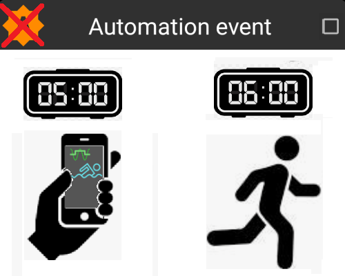

Korisnik je postavio **automatizaciju** koja u 5 sati pokreće privremeni cilj „Aktivnost“ kako bi njegov **GUK** i **aktivni inzulin** bili optimalni za vježbanje u 6 sati:

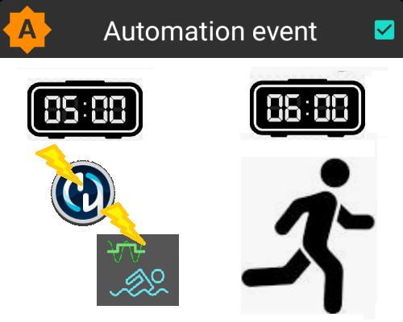

## Važne stvari prije početka korištenja automatizacije

1. Prije postavljanja nekih automatizacija trebali biste imati razumnu kontrolu **GUK-a** s **AAPS-om**. Automatizaciju ne treba koristiti za nadoknađivanje loše podešenih postavki bazala, **ISF-a** ili **CR-a** (više o tome niže). Nemojte postavljati automatsku **zamjenu profila** kako biste nadoknadili porast **GUK-a** zbog _npr._ hrane; to je bolje riješiti drugim strategijama (SMB-ovi itd.).

1. Kao i svaka tehnologija, **CGM-ovi**, **pumpe** i telefoni mogu zakazati: tehnički problemi ili pogreške senzora mogu ometati radnje **automatizacije**, pa može biti potrebna ručna intervencija.

1. **Potrebe za automatizacijom vjerojatno će se mijenjati kako se mijenja vaša dnevna rutina**. Kada prelazite između razdoblja posla, škole i praznika, postavite podsjetnik u kalendaru da provjerite koje su **automatizacije** trenutačno aktivne (lako ih je aktivirati i deaktivirati). Na primjer, ako idete na odmor i više vam ne treba automatizacija za školski sport ili svakodnevno vježbanje, ili trebate promijeniti vremena.

1. **Automatizacije** mogu biti u sukobu jedna s drugom, pa je dobro svaku novu postavku **automatizacije** pažljivo provjeriti u sigurnom okruženju i razumjeti zašto se neka **automatizacija** pokrenula ili nije pokrenula onako kako ste očekivali.

1. Ako koristite Autosens, pokušajte koristiti **privremene ciljeve** umjesto **zamjena profila**. **Privremeni ciljevi** ne vraćaju Autosens na 0. **Zamjene profila** resetiraju Autosens.

1. Većinu **automatizacija** treba postaviti samo na **ograničeno trajanje**, nakon čega **AAPS** može ponovno procijeniti stanje i ponoviti **automatizaciju** ako je potrebno i ako je uvjet još uvijek ispunjen. Na primjer, „pokreni privremeni cilj od 7,0 mmol/L na 30 min“ ili „pokreni **profil** 110% na 10 min“ _i_ „pokreni privremeni cilj od 5,0 mmol/L na 10 min“. Korištenje **automatizacije** za trajne promjene (npr. jači postotak profila) nosi rizik od hipoglikemije.

## Kada mogu početi koristiti automatizaciju?

**Automatizaciju** možete početi koristiti u **Cilju 10**.

## Gdje se u AAPS-u nalazi automatizacija?

Otvorite **Upravljanje** u donjoj navigaciji glavnog zaslona i odaberite **Automatizacija**.

## Kako mogu postaviti automatizaciju?

Da biste postavili **automatizaciju**, na zaslonu Automatizacija pritisnite gumb **+** i izradite „pravilo“:

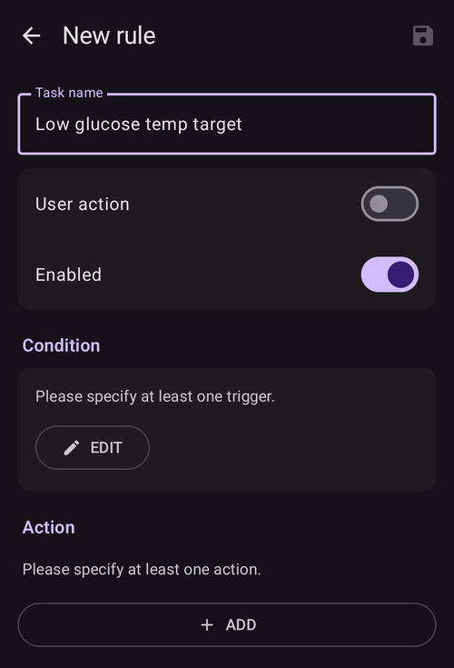

* dajte „pravilu“ naslov (Naziv zadatka);
* pritisnite „**UREDI**“ pod **Uvjet**. Na zaslonu **Uvjet** odaberite kako se okidači povezuju (**I**, **Ili**, **Isključivo ili**) i pritisnite „**Dodaj okidač**“:

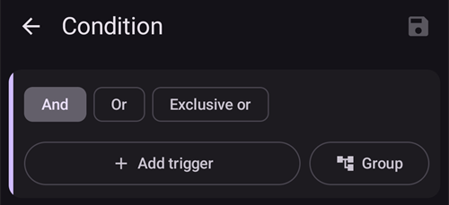

* dodajte barem jedan okidač:

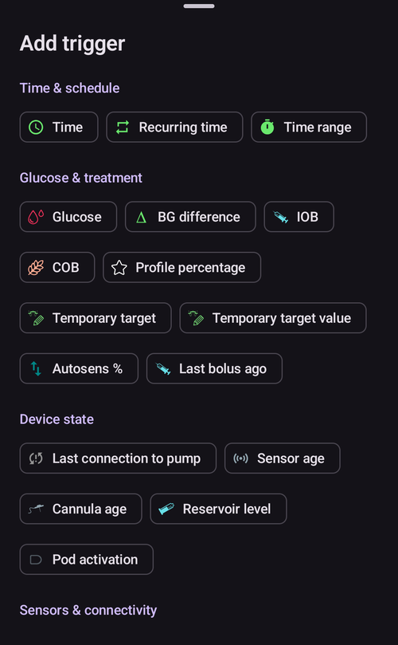

* pritisnite „**DODAJ**“ pod **Radnja** i odaberite jednu radnju:

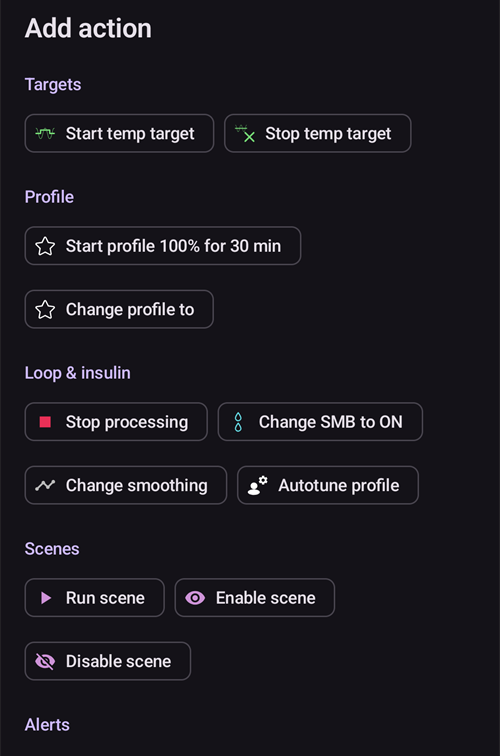

* spremite pravilo gumbom **Spremi** i provjerite je li kućica lijevo od naziva pravila „označena“, kako bi **automatizacija** bila aktivna:


Da biste deaktivirali pravilo **automatizacije**, odznačite kućicu lijevo od naziva **automatizacije**. Primjer u nastavku prikazuje **automatizaciju** koja je aktivirana („označeno“) ili deaktivirana („neoznačeno“):

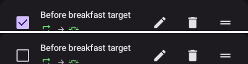


Kada postavljate **automatizaciju**, najprije je možete isprobati tako da pod „Radnje“ uključite opciju „Obavijest“. Tako će **AAPS** najprije prikazati obavijest umjesto da stvarno automatski izvrši radnju. Kada ste sigurni da se obavijest pojavila u pravo vrijeme i pod pravim uvjetima, pravilo **automatizacije** možete promijeniti tako da „Obavijest“ zamijenite „Radnjom“.

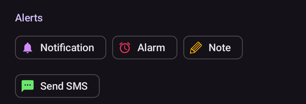

```{admonition} Important note
:class: note

**Automatizacija** je aktivna i kada je petlja onemogućena!
```


## Kada se pravila provjeravaju

**AAPS** provjerava sva pravila **automatizacije** svaki put kada obradi novo očitanje glukoze, pa se pravila procjenjuju u ritmu vašeg CGM-a, i kada je zaslon telefona isključen. Pravila se provjeravaju i kada se telefon počne puniti, kada se promijeni mreža ili lokacija te kada se poveže Bluetooth uređaj. Istodobno se izvodi samo jedna provjera, pa se pravilo čije radnje traju neko vrijeme (na primjer naredba pumpi) ne može izvršiti dvaput.

## Sigurnosne granice

Za **automatizaciju** postoje sigurnosne granice:

* **Privremeni cilj** koji postavlja **automatizacija** mora biti između 72 i 180 mg/dL (ili 4 i 10 mmol/L).
* **Postotak profila** mora biti između 50% i 130%.
* Između izvršavanja **automatizacije** (i prvog izvršavanja) postoji vremensko ograničenje od 5 minuta.

## Pravilna upotreba negativnih vrijednosti

```{admonition} Warning
:class: warning

Budite oprezni kada u **automatizaciji** odabirete negativnu vrijednost
```

Budite oprezni kada u „Uvjetu“ **automatizacije** odabirete „negativnu vrijednost“, npr. s „je manje od“. Na primjer:

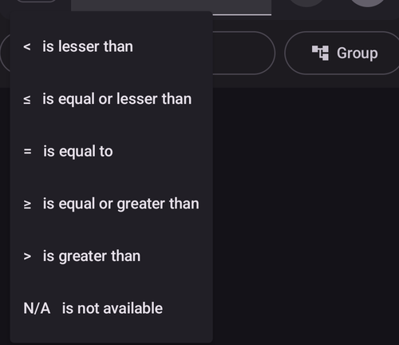

**Example 1:** Creating a Condition **"is less than"** "-0.1mmol/L" (or "-2mg/dL") will:

Pokrenite **automatizaciju** za svaki broj koji je **strogo manji od** -0,1 (-2). To uključuje brojeve kao što su -0,2, -0,3, -0,4 (-4, -6, -8) i tako dalje. Imajte na umu da sam broj -0,1 (-2) **nije** uključen u ovaj uvjet. (The condition "is equal or less than -0.1mmol/L (-2 mg/dL)" _would_ include -0.1 mmol/L or -2 mg/dL).

**Primjer 2:** uvjet „je veće od“ -0,1 mmol/L (-2 mg/dL) će:

Pokrenuti **automatizaciju** za svaki broj koji je **veći od** -0,1 mmol/L (-2 mg/dL). To uključuje brojeve kao što su 0, 0,2, 0,4 mmol/L (0, 4, 8 mg/dL) i svaki drugi pozitivan broj.

Kada odabirete te uvjete i vrijednosti, važno je pažljivo razmisliti što točno želite postići svojom **automatizacijom**.

(automations-automation-triggers)=
## Okidači automatizacije


Pomaknite se prema dolje da vidite ostatak popisa:

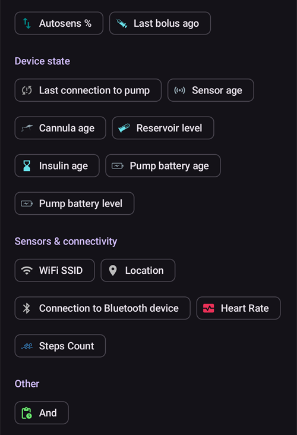

Korisnik može odabrati različite „okidače“. Okidači su uvjeti koji moraju biti ispunjeni da bi se automatizacija izvršila. Popis u nastavku nije potpun:

**Okidač:** povezivanje uvjeta

**Opcije:**

Više uvjeta može se povezati s
* „I“
* „Ili“
* „Isključivo ili“ (to znači da će se radnja ili radnje izvršiti ako je ispunjen jedan – i samo jedan – od uvjeta)

**Okidač:** vrijeme i ponavljajuće vrijeme

**Opcije:**

* vrijeme = jednokratni vremenski događaj
* ponavljajuće vrijeme = nešto što se događa redovito (npr. jednom tjedno, svaki radni dan itd.)

**Okidač:** lokacija

**Opcije:**

* u [Postavke > Automatizacija](#preferences-maintenance-settings) korisnik može odabrati potrebnu uslugu lokacije.

**Okidač:** usluga lokacije

**Opcije:**

* Koristi pasivnu lokaciju: **AAPS** uzima lokaciju samo kada je traže druge aplikacije.
* Koristi mrežnu lokaciju: lokacija vaše Wi-Fi mreže.
* Koristi GPS lokaciju (Pozor! To može jako trošiti bateriju!)

**Okidači**: podaci pumpe i senzora

* Okidač Starost kanile: dostupan za sve pumpe
* Okidač Starost inzulina: dostupan za podržane pumpe
* Okidač Starost baterije pumpe: dostupan za podržane pumpe
* Okidač Starost senzora: uvijek dostupan
* Okidač Aktivacija Pod-a: dostupan za pumpe bez katetera

Imajte na umu da se kod svih okidača vezanih uz starost usporedba „jednako“ teško može ispuniti, pa su u tom slučaju potrebna dva okidača koji čine raspon

* Okidač Razina spremnika: dostupan za sve pumpe; usporedba "NOT\_AVAILABLE" ne radi za ovaj okidač jer je vrijednost u **AAPS-u** uvijek popunjena
* Okidač Razina baterije pumpe: dostupan za podržane pumpe; usporedba "NOT\_AVAILABLE" ne radi za ovaj okidač jer je vrijednost u **AAPS-u** uvijek popunjena

(automations-automation-action)=
## Radnja


Pomaknite se prema dolje da vidite ostatak popisa:

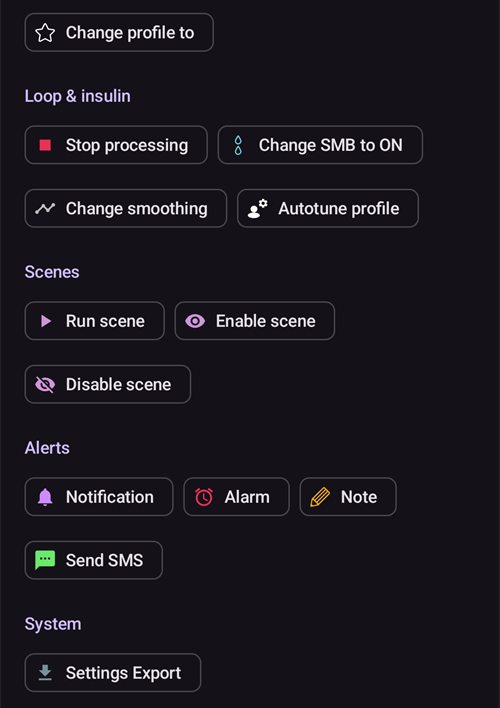

**Radnje:** pokreni **privremeni cilj**

**Opcije:**

* **GUK** mora biti između 72 mg/dL i 180 mg/dL (4 mmol/L i 10 mmol/L)
* **TT** radi samo ako ne postoji prethodni privremeni cilj — **AAPS** to automatski dodaje u pravilo kao redak „**Preduvjeti: Privremeni cilj ne postoji**“

**Radnje:** zaustavi **privremeni cilj**

**Opcije:**

nema

**Radnje:** **Postotak profila**

**Opcije:**

* **Profil** mora biti između 50% i 130%
* radi samo ako je prethodni postotak 100%

**Radnje:** **Promijeni zaglađivanje** (u skupini **Petlja i inzulin**)

**Opcije:**

* odaberite [metodu zaglađivanja](../CompatibleCgms/SmoothingBloodGlucoseData.md) na koju želite prijeći. Popis je isti kao pod **Konfiguracija** > **Zaglađivanje**, a radnja radi točno ono što radi promjena tamo: nova metoda se sprema, sinkronizira s uparenim klijentima, a podaci GUK-a odmah se ponovno zaglađuju.
* izvršava se samo ako ta metoda zaglađivanja već nije aktivna — **AAPS** to automatski dodaje u pravilo kao redak „**Preduvjeti: Zaglađivanje … nije aktivno**“. Kada je odabrano zaglađivanje aktivno, pravilo se tiho preskače.
* Primjer: novi senzor često ima puno šuma tijekom prvog dana. Dva pravila s okidačem **Starost senzora** daju jače filtriranje dok se senzor smiruje, a nakon toga zaglađivanje bez kašnjenja:
  * **Starost senzora** manje od 24 h: **Promijeni zaglađivanje** na **Unscented Kalman Filter**
  * **Starost senzora** više od 24 h: **Promijeni zaglađivanje** na **Prosječno zaglađivanje**

**Radnje:** **Bilješka** (u skupini **Upozorenja** na popisu)

**Opcije:**

* odaberite događaj koji se bilježi: **Bilješka**, **Tjelovježba**, **Pitanje**, **Objava** ili **Promjena mjesta primjene pumpe**, i neobaveznu bilješku. Naziv radnje mijenja se u događaj koji odaberete.
* **Trajanje**: koristi se za **Bilješka**, **Tjelovježba** i **Promjena mjesta primjene pumpe**. **Pitanje** i **Objava** nemaju trajanje: umjesto toga bilježe vaš trenutačni GUK.
* **Promjena mjesta primjene pumpe** resetira starost kanile, kao da ste promjenu mjesta primjene zabilježili ručno. Primjer: neke pumpe (kao Combo) same bilježe zamjenu spremnika, ali ne i promjenu mjesta primjene. Ako uvijek mijenjate oboje zajedno, pravilo sa **Starost inzulina** manje od 1 sata i **Starost kanile** više od 24 sata može umjesto vas zabilježiti promjenu mjesta primjene.

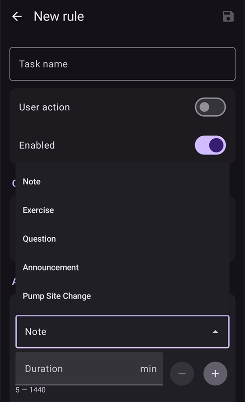 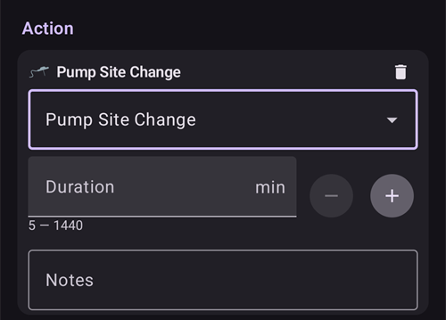

**Radnje:** **Pošalji SMS na sve brojeve** (u skupini **Upozorenja**)

**Opcije:**

* unesite tekst poruke. Šalje se na sve telefonske brojeve dopuštene u postavkama [SMS Communicatora](../RemoteFeatures/SMSCommands.md). Dodatak SMS Communicator mora biti omogućen.

**Radnje:** **Promijeni profil u** (u skupini **Profil**)

**Opcije:**

* odaberite **profil** koji treba aktivirati. Aktivira se na 100%, bez vremenskog pomaka. Ako je taj profil već aktivan, radnja ne radi ništa.

**Radnje:** **Omogući/onemogući SMB** (u skupini **Petlja i inzulin**)

**Opcije:**

* odaberite **Uključeno** ili **Isključeno**. To mijenja postavku **Omogući SMB** u OpenAPS SMB, točno kao da ste je promijenili u **Postavkama**, i ostaje tako dok je vi ili neko drugo pravilo ne vratite.

**Radnje:** **Pokreni Autotune** (u skupini **Petlja i inzulin**)

**Opcije:**

* odaberite profil koji se podešava i broj dana: pogledajte [Pokretanje Autotunea pravilom automatizacije](#autotune-run-autotune-with-an-automation-rule).

**Radnje:** **Zaustavi obradu** (u skupini **Petlja i inzulin**)

**Opcije:**

* nema. Dok su uvjeti pravila s ovom radnjom ispunjeni, **AAPS** ne provjerava pravila ispod njega na popisu. Čim uvjeti opet nisu ispunjeni, pravila ispod provjeravaju se kao i obično. Dodajte je pravilu koje mora imati prednost pred pravilima ispod njega (pogledajte [redoslijed automatizacija](#Automations-the-order-of-the-automations-in-the-list-matters)).

**Radnje:** **Pokreni scenu**, **Omogući scenu**, **Onemogući scenu** (u skupini **Scene**)

**Opcije:**

* odaberite [scenu](Scenes.md) koju želite pokrenuti, omogućiti ili onemogućiti.

Kada je „Radnja“ dodana, zadane vrijednosti morate promijeniti u željeni broj tako da ih kliknete i podesite.

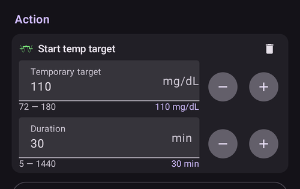

(Automations-the-order-of-the-automations-in-the-list-matters)=
## Redoslijed **automatizacija** na popisu je važan
 **AAPS** izvršava izrađena pravila redoslijedom prioriteta, počevši od vrha popisa **automatizacije**. Na primjer, ako je **automatizacija** „Nisko“ najvažnija **automatizacija**, iznad svih drugih pravila, ta **automatizacija** treba biti na vrhu korisnikova popisa **automatizacije**, kao što je prikazano niže:


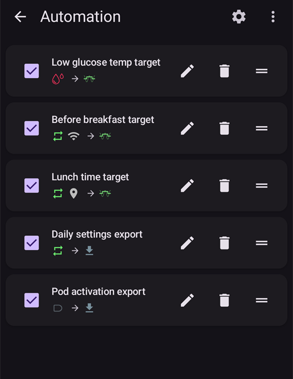

Da biste promijenili prioritet pravila **automatizacije**, dodirnite i držite ručku **=** na desnoj strani pravila. Promijenite redoslijed **automatizacija** pomicanjem pravila gore ili dolje.

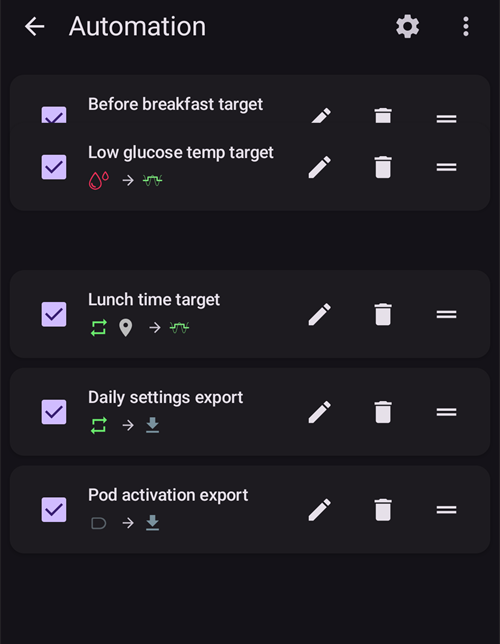

## Kako izbrisati pravila automatizacije

Da biste izbrisali pravilo **automatizacije**, kliknite ikonu kante za smeće.


## Primjeri automatizacije

U nastavku su primjeri **automatizacije**. Više rasprava o **automatizaciji** i o tome kako su korisnici prilagodili svoju **automatizaciju** možete pronaći u grupama za raspravu na Facebooku ili na Discordu. Primjere u nastavku ne biste trebali preuzimati ako dobro ne razumijete kako će **automatizacija** raditi.

(automations-low-glucose-temp-target)=
### Privremeni cilj kod niske glukoze

This **Automation** triggers an automatic **Temp Target** when **BG** falls below a certain threshold — here, when glucose is less than 70 mg/dL, a target of 110 mg/dL is started for 30 minutes:

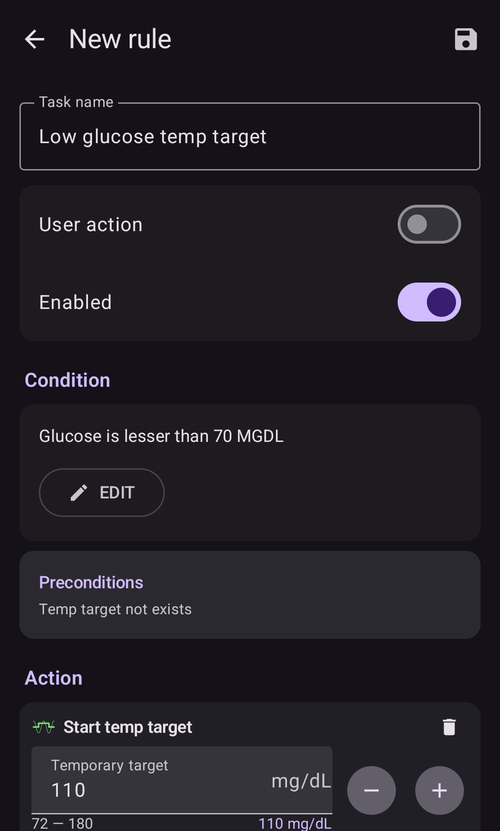

### Privremeni cilj za vrijeme ručka (s „Lokacijom“)

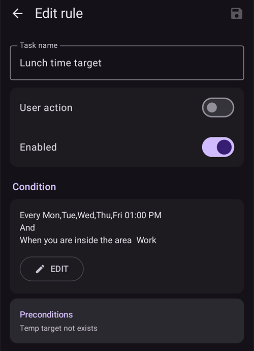

Ova **automatizacija** izrađena je za korisnika koji svaki radni dan ruča na poslu otprilike u isto vrijeme, ali pokreće se samo ako se korisnik nalazi na zadanoj „lokaciji“.  Dakle, ako korisnik jednog dana nije na poslu, ova se **automatizacija** neće aktivirati.

Ova **automatizacija** u 13:00 postavlja niski **privremeni cilj** (Prije obroka) kako bi GUK spustila na 90 mg/dL (ili 5 mmol/L) kao pripremu za ručak.

„Okidač“ lokacija ima naziv, položaj (dodirnite **Odaberi na karti** ili koristite svoju trenutačnu lokaciju) i polumjer u metrima, a pokreće se kada ste unutar (ili izvan) područja:

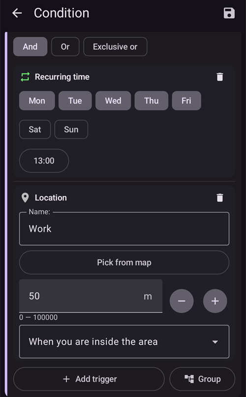

Zbog veze „I“ **automatizacija** se izvršava samo u „odabrano vrijeme“ i ako je korisnik na odabranoj lokaciji.

**Automatizacija** se neće pokrenuti ni u jedno drugo vrijeme na ovoj lokaciji, niti u ovo vrijeme izvan polumjera od 50 metara oko odabranog položaja.

### Automatizacija s lokacijom prema Wi-Fi SSID-u

Wi-Fi SSID dobra je opcija za pokretanje **automatizacije** dok ste u dometu određene Wi-Fi mreže (u usporedbi s GPS-om): prilično je precizan, troši manje baterije i radi u zatvorenim prostorima gdje GPS i druge usluge lokacije možda nisu dostupne.

Evo još jednog primjera postavljanja **privremenog cilja** samo radnim danima prije doručka (1).


**Automatizacija** će se pokrenuti u 5:30 samo od ponedjeljka do petka (2)  
i dok je telefon spojen na kućnu Wi-Fi mrežu (3).


Zatim će postaviti **privremeni cilj** od 75 mg/dL na 30 minuta (4). Jedna od prednosti uključivanja lokacije je da se pravilo neće pokrenuti ako je korisnik, na primjer, na putovanju ili godišnjem odmoru.

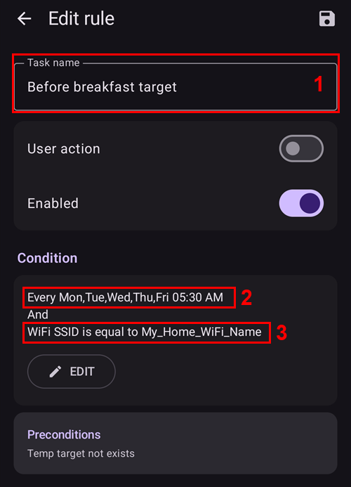

Pomaknite se prema dolje da biste vidjeli radnju: **privremeni cilj** od 75 mg/dL na 30 minuta (4).

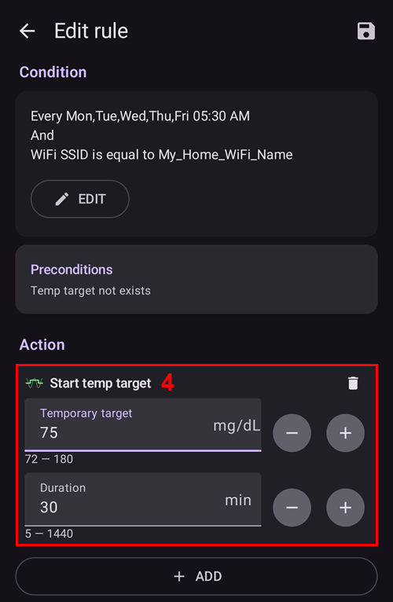

Ovo je snimka zaslona s pojedinostima o okidačima **automatizacije**:

1) Pod glavnim „I“ (oba uvjeta moraju biti ispunjena za pokretanje) 1) Ponavljajuće vrijeme = P,U,S,Č,P u 5:30  
1) Wi-Fi SSID = My_Home_WiFi_Name

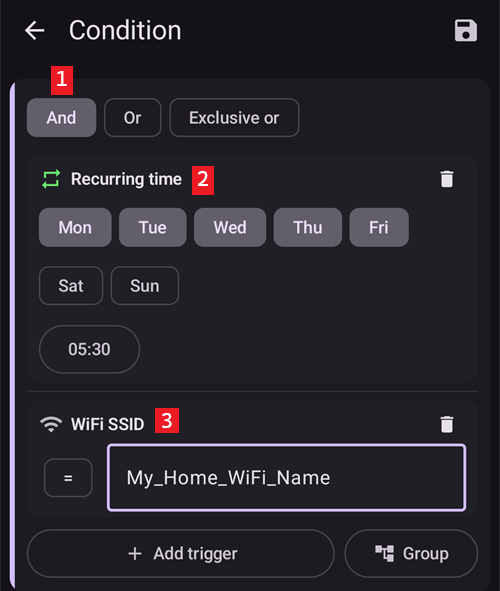

(automating-preference-settings-export)=

## Automatski izvoz postavki

### Izvoz bez nadzora: po rasporedu (dnevno)

Snimke zaslona s pojedinostima o okidačima automatizacije:

1) Uvjet: Ponavljajuće vrijeme = P,U,S,Č,P u 8:00 1) Radnja: Izvoz postavki (za „Tekst u tretmanima“ unesite „Dnevno“)

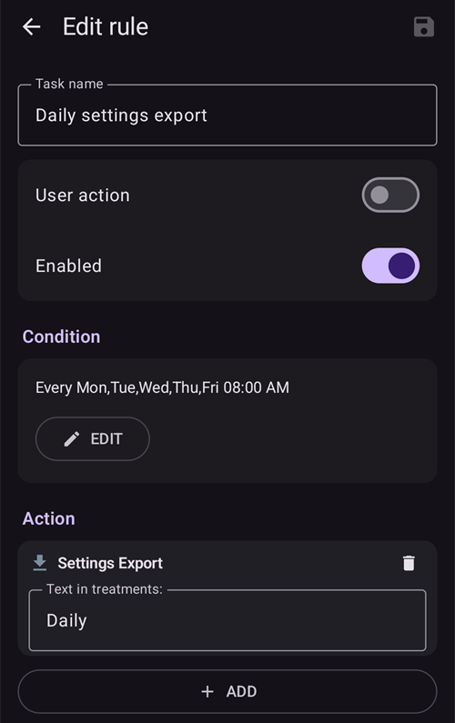

Napomena: izvršenje izvoza bit će zabilježeno u Careportalu

### Izvoz bez nadzora: Aktivacija Pod-a (samo pumpe bez katetera)

Snimke zaslona s pojedinostima o okidačima automatizacije:

1) Uvjet: Aktivacija Pod-a 1) Radnja: Izvoz postavki (za „Tekst u tretmanima“ unesite „Aktivacija Pod-a: izvoz postavki“)

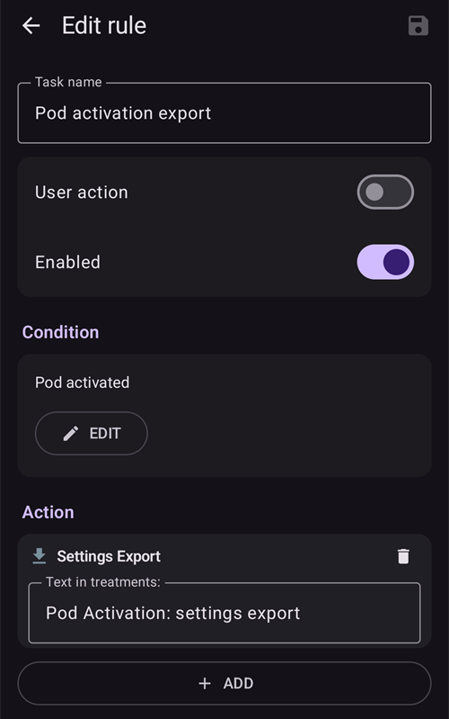

Napomena: izvršenje izvoza bit će zabilježeno u Careportalu. Napomena: automatizacija se **uopće** neće pokrenuti ako prije toga niste barem jednom ručno izvezli postavke. Za pravilno uključivanje izvoza postavki bez nadzora pogledajte [Postavke → Održavanje](#preferences-maintenance-settings).


## Dnevnik automatizacije

**AAPS** prikazuje dnevnik zadnjih događaja **automatizacije** na dnu zaslona **Automatizacija**, ispod pravila. Pomoću njega provjerite jesu li se vaša pravila pokrenula kada ste očekivali.

U primjeru u nastavku omogućeno je pravilo **Low glucose temp target** (1) (pogledajte [Privremeni cilj kod niske glukoze](#automations-low-glucose-temp-target) gore). Dnevnik (2) pokazuje da je u 15:09 glukoza pala ispod 70 mg/dL i da se pravilo pokrenulo:
* radnja je bila "Pokreni privremeni cilj: 110mg/dL@30 min": **privremeni cilj** od 110 mg/dL na 30 minuta;
* **OK** na kraju znači da je radnja uspješno izvršena.

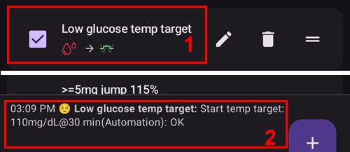

(automations-troubleshooting)=

## Rješavanje problema

* Problem: __AAPS ne pokreće moje automatizacije?__

Provjerite je li kućica lijevo od naziva **automatizacije** „označena“, kako bi pravilo bilo aktivno:


* Problem: __Moje automatizacije pokreću se pogrešnim redoslijedom.__

Provjerite redoslijed prioriteta svojih pravila, kako je opisano gore.

* Problem: __Uvjet prikazuje "Nepoznati okidač … - nikada nije ispunjen".__

Pravilo sadrži okidač koji ova verzija **AAPS-a** ne može pročitati, na primjer nakon što ste se vratili na stariju verziju ili uvezli postavke iz novije verzije. Takav okidač nikada nije ispunjen, pa se pravilo ne izvršava. Ostaje nepromijenjen, kako bi ga novija verzija i dalje mogla koristiti. Uredite pravilo i zamijenite okidač ili ažurirajte **AAPS**.

## Alternative automatizaciji

Napredni korisnici mogu automatizirati zadatke i na druge načine, pomoću IFTTT-a ili Android aplikacije drugog proizvođača pod nazivom Automate. 
