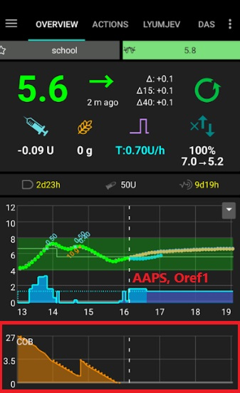

# Izračun aktivnih ugljikohidrata (COB)

## Kako AAPS izračunava vrijednost COB-a?

Kada korisnik unese ugljikohidrate kao dio unosa obroka ili kao korekciju ugljikohidratima, **AAPS** ih dodaje trenutnim aktivnim ugljikohidratima (**COB**). **AAPS** zatim izračunava apsorpciju korisnikovih ugljikohidrata na temelju uočenih odstupanja korisnikovih vrijednosti **GUK-a**. The rate of absorption depends on the carb’s sensitivity factor (**CSF**). To nije postavka u korisnikovom **Profilu**, nego je izračunava **AAPS** prema postavkama **ISF/I:C**. Određuje koliko mg/dL 1 g ugljikohidrata podiže korisnikov **GUK**.

## Faktor osjetljivosti na ugljikohidrate

Formula koju koristi **AAPS** je:

- absorbed_carbs = deviation * ic / isf.

Učinak na korisnikov **Profil**:

- _increase_ **IC** - by increasing the carbs absorbed every 5 minutes thus shorten total time of absorption;

- _povećanje_ **ISF-a** – smanjuje ugljikohidrate apsorbirane svakih 5 minuta i tako produljuje ukupno vrijeme apsorpcije; i

- _change_ **Profile Percentage** - increase/decrease both values thus has no impact on carbs absorption time.

For example, if the user’s **Profile** **ISF** is 100 and the **I:C** is 5, the user’s Carb Sensitivity Factor would be 20. Za svakih 20 mg/dL porasta korisnikovog **GUK-a** **AAPS** će izračunati 1 g ugljikohidrata kao apsorbiran. Pozitivni **aktivni inzulin (IOB)** također utječe na izračun **COB-a**. Dakle, ako **AAPS** predviđa da će korisnikov **GUK** pasti za 20 mg/dL zbog **aktivnog inzulina (IOB)**, a on umjesto toga ostane ravan, **AAPS** će također izračunati 1 g ugljikohidrata kao apsorbiran.

Ugljikohidrati se apsorbiraju i metodama opisanima niže, ovisno o tome koji je algoritam osjetljivosti odabran u korisnikovom **AAPS-u**.

## Osjetljivost na ugljikohidrate – Oref1

Neapsorbirani ugljikohidrati odbacuju se nakon zadanog vremena:




```{admonition} Older screenshot
:class: note
Snimka zaslona iznad je iz starije verzije **AAPS-a** – u **AAPS-u** 4 grafovi izgledaju malo drukčije, ali graf **COB** prikazuje iste informacije.
```


## Osjetljivost na ugljikohidrate – WeightedAverage

Apsorpcija se izračunava tako da COB bude 0 nakon zadanog vremena:


Ako se umjesto vrijednosti izračunate iz odstupanja **GUK-a** koristi minimalna apsorpcija ugljikohidrata (min_5m_carbimpact), na grafu **COB** pojavljuje se narančasta točka.

(CobCalculation-detection-of-wrong-cob-values)=
## Otkrivanje pogrešnih vrijednosti COB-a

**AAPS** will warn the user if they are about to bolus with **COB** from a previous meal if the algorithm detects current **COB** calculation as incorrect. U tom slučaju korisnik nakon korištenja bolus kalkulatora dobiva dodatnu napomenu na zaslonu potvrde.

### Kako AAPS otkriva pogrešne vrijednosti COB-a?

__AAPS__ obično otkriva apsorpciju ugljikohidrata putem odstupanja **GUK-a**. Ako je korisnik unio ugljikohidrate, ali **AAPS** ne može otkriti njihovu procijenjenu apsorpciju putem odstupanja **GUK-a**, za izračun apsorpcije koristit će metodu [min_5m_carbimpact](#Preferences-min_5m_carbimpact) (tzv. „zamjenska metoda“, engl. fallback). Budući da ova metoda izračunava samo minimalnu apsorpciju ugljikohidrata, bez uzimanja u obzir odstupanja **GUK-a**, može dovesti do netočnih vrijednosti COB-a.


Na snimci zaslona iznad 66 % vremena apsorpcija ugljikohidrata izračunata je pomoću min_5m_carbimpact umjesto vrijednosti otkrivene iz odstupanja. To znači da je korisnik možda imao manje **COB-a** nego što je izračunao algoritam.

### Što učiniti s ovim upozorenjem?

- Razmislite o otkazivanju tretmana – pritisnite „Otkaži“ umjesto „U redu“.
- Ponovno izračunajte nadolazeći obrok bolus kalkulatorom, bez kvačice kod **COB**.
- Ako trebate korekcijski bolus, unesite ga ručno.
- Be careful not to overdose or stack insulin!


### Zašto algoritam ne otkriva COB ispravno?

Razlozi mogu biti:
- Moguće je da je korisnik precijenio ugljikohidrate pri unosu.
- Aktivnost / tjelovježba nakon prethodnog obroka.
- I:C treba prilagoditi.
- Vrijednost min_5m_carbimpact nije ispravna (preporučeno je 8 sa SMB-om, 3 s AMA-om).


## Ručna ispravka unesenih ugljikohidrata

Ako su ugljikohidrati precijenjeni ili podcijenjeni, to se može ispraviti na zaslonu **Povijest tretmana**, kako je opisano [ovdje](#screens-bolus-carbs).


## Ispravka ugljikohidrata – kako izbrisati unos ugljikohidrata iz tretmana


Zaslon **Povijest tretmana** može se koristiti za ispravak pogrešnog unosa ugljikohidrata tako da ga izbrišete. To može biti zato što je korisnik precijenio ili podcijenio unos ugljikohidrata:


1. Provjerite i zapamtite trenutne **COB** i **IOB** na glavnom zaslonu **AAPS-a**.
2. Otvorite **Povijest tretmana** (bočni izbornik → *Povijest tretmana*), karticu **Ugljikohidrati i bolus**. Depending on the pump, the carbs might show together with insulin in one line or as a separate entry (e.g. with Dana RS).
3. **Dugo pritisnite** pogrešan unos ugljikohidrata – popis prelazi u **način odabira** s potvrdnim okvirom u svakom retku, a unos je označen kvačicom (oznaka **1** iznad). Označite kvačicom i sve ostale unose koje također želite ukloniti.
4. Dodirnite ikonu **🗑 Izbriši** u gornjoj traci (oznaka **2**) i potvrdite – dijalog potvrde točno navodi što će biti uklonjeno.
5. Provjerite jesu li ugljikohidrati uspješno uklonjeni tako da ponovno provjerite **COB** na glavnom zaslonu **AAPS-a**.
6. Isto napravite i za **IOB** ako postoji samo jedan redak koji sadrži i ugljikohidrate i inzulin.
7. Ako ugljikohidrati nisu uklonjeni kako treba, a dodaju se dodatni ugljikohidrati kako je objašnjeno u ovom odjeljku, vrijednost **COB** bit će previsoka i to može dovesti do toga da **AAPS** isporuči previše inzulina.
8. Unesite ispravnu količinu ugljikohidrata u dijalogu **UH** (**Tretmani** → **UH**) i postavite ispravno vrijeme događaja.
9. Ako je postojao samo jedan redak koji sadrži i ugljikohidrate i inzulin, korisnik treba ponovno dodati i količinu inzulina. Obavezno postavite ispravno vrijeme događaja i nakon potvrde novog unosa provjerite **IOB** na glavnom zaslonu.

