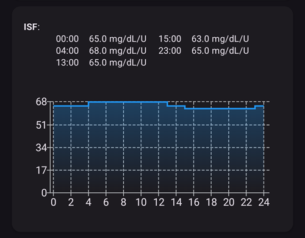
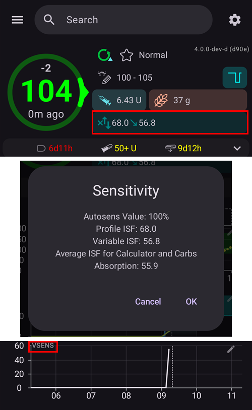
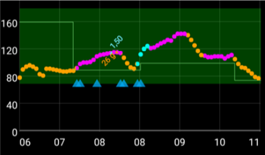
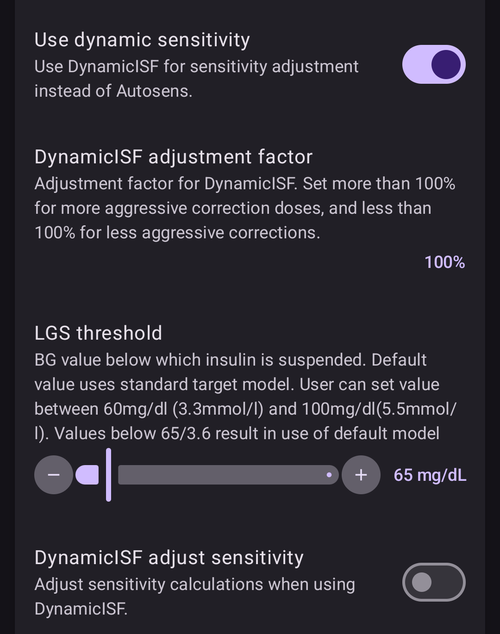

(Open-APS-features-DynamicISF)=
# Dinamički ISF (DynISF)

Do sada je s **AMA** i **SMB** algoritmom **ISF** bio određen u **profilu** i bio je statičan za svako zadano razdoblje dana. Ali u stvarnosti **ISF** osobe nije tako statičan i mijenja se ovisno o razini **GUK-a**: kod visokog GUK-a korisniku treba više inzulina da snizi **GUK** za 50 mg/dL / 3 mmol/L nego kod nižeg **GUK-a**. [Autosens](#Open-APS-features-autosens) je bio prvi algoritam koji je pokušao riješiti taj problem, tako da prilagođava **ISF** izvan vremena obroka.

**Dinamički ISF** (zove se i **DynISF**) ima istu svrhu, ali je napredniji jer se može koristiti u svako doba. Preporučuje se samo naprednim korisnicima koji dobro vladaju upravljanjem i nadzorom svog **AAPS-a**. Prije nego što ga isprobate, pročitajte ispod odjeljak [Što uzeti u obzir pri aktivaciji dinamičkog ISF-a](#dyn-isf-things-to-consider-when-activating-dynamicisf).

```{admonition} CAUTION - Automations or Profile Percentage change
:class: warning

**Automatizacije** uvijek treba koristiti oprezno. To posebno vrijedi za **dinamički ISF**.

Kad koristite **dinamički ISF**, onemogućite svako pravilo **automatizacije** koje privremeno mijenja **profil**, jer bi zbog toga **dinamički ISF** davao previše agresivne korekcijske boluse, što dovodi do hipoglikemije. Upravo je to svrha **dinamičkog ISF-a**, pa nema potrebe da **AAPS** putem automatizacije dobije naredbu da kod visokog **GUK-a** da dodatni inzulin.

```

Za korištenje **dinamičkog ISF-a** baza podataka **AAPS-a** treba najmanje 7 dana korisnikovih podataka iz **AAPS-a**.

## Što radi dinamički ISF?

**Dinamički ISF** dinamički prilagođava faktor osjetljivosti na inzulin (**ISF**) na temelju korisnikove:

- ukupne dnevne doze inzulina (**TDD**) i
- trenutačnih i predviđenih vrijednosti glukoze u krvi.

Kad koristite **dinamički ISF**, vrijednosti **ISF-a** unesene u **profil** više se uopće ne koriste, osim kao zamjena ako u bazi podataka **AAPS-a** nema dovoljno podataka o TDD-u (*npr.* nakon nove instalacije aplikacije).

**SMB/AMA** – primjer korisnikova **profila** sa statičnim **ISF-om** koji je postavio korisnik i koji koriste **SMB** i **AMA**.



**Dinamički ISF** – primjer korisnikova **ISF-a** koji se mijenja prema izračunu **dinamičkog ISF-a**.



Dio zaokružen crvenom bojom prikazuje: `profile ISF` -> `ISF as calculated by DynISF`. <br/> Dodir na ovaj dio otvara dijalog s dodatnim informacijama, kao što je **ISF** koji se koristi za kalkulator i apsorpciju ugljikohidrata (pogledajte ispod [Druge upotrebe ISF-a](#dynisf-other-usages-of-isf)).

Vrijednost **DynISF-a** može se prikazati i na grafu: dodirnite **Dodaj graf** ispod grafova na glavnom zaslonu i odaberite **VOSJ** (promjenjiva osjetljivost). Prikazuje se kao bijela linija (na dnu gornje slike).

## Kako se izračunava dinamički ISF?

**Dinamički ISF** koristi model Chrisa Wilsona za određivanje **ISF-a**, umjesto korisnikove statične vrijednosti **ISF-a** postavljene u **profilu**. Detaljno objašnjenje možete naći ovdje: [Chris Wilson o osjetljivosti na inzulin (korekcijski faktor) s Loop and Learn, 2/6/2022](https://www.youtube.com/watch?v=oL49FhOts3c).

Korištena jednadžba **dinamičkog ISF-a** je: `ISF = 1800 / ((TDD * DynISF Adjust Factor) * Ln (( current BG / insulin divisor) + 1 ))`

Varijable iz ove jednadžbe opisane su ispod.<br/> Napomena: `Ln` označava prirodni logaritam, matematičku funkciju.

Gornja jednadžba koristi se za izračun trenutačnog **ISF-a** i u oref1 [predviđanjima za **IOB**, **ZT** (nulti privremeni bazal) i **UAM**](#aaps-screens-prediction-lines). Koristi se i za **COB** i u bolus kalkulatoru (pogledajte ispod [Druge upotrebe ISF-a](#dynisf-other-usages-of-isf)).

### TDD (ukupna dnevna doza)
TDD koristi kombinaciju sljedećih vrijednosti:
1.  prosječni **TDD** za 7 dana;
2.  **TDD** prethodnog dana i
3.  ponderirani prosjek potrošnje inzulina u zadnjih osam (8) sati, preračunat na 24 sata.

**TDD** u gornjoj jednadžbi čini po jedna trećina svake od gornjih vrijednosti.

### Faktor prilagodbe dinamičkog ISF-a

Postavlja se u korisnikovim **Postavkama** i služi da **dinamički ISF** bude više ili manje agresivan. Pogledajte ispod odjeljak [Postavke](#dyn-isf-preferences).

### Djelitelj inzulina
Djelitelj inzulina ovisi o vrhu djelovanja korištenog inzulina i obrnuto je proporcionalan vremenu vrha djelovanja. Za Lyumjev ta je vrijednost 75, za Fiasp 65, a za obični brzodjelujući inzulin 55.

### ISF na temelju predviđenog GUK-a za odluke o doziranju

Dinamička osjetljivost izračunava se s vrijednošću **trenutačnog GUK-a** i prikazuje se kao vaš trenutačni ISF u **AAPS-u**. Ali kod izračuna doza algoritam oref1 umjesto toga izračunava i koristi **budući ISF**.

Tako se sprječava davanje previše inzulina kad je **GUK** nizak ili se predviđa da će pasti nisko.

**Budući ISF** koristi istu formulu kao gore, osim što umjesto **trenutačnog GUK-a** može koristiti **najniži predviđeni GUK**. **Najniži predviđeni GUK**, [kako ga izračunava oref1](#aaps-screens-how-predictions-become-a-dosing-decision), najniža je vrijednost do koje se predviđa da će GUK pasti tijekom cijelog razdoblja predviđanja.

* Ako je trenutačni **GUK** iznad cilja<br/> **i** ako je razina **GUK-a** stabilna, unutar +/- 3 mg/dL:<br/>u formuli se za GUK koristi: `average(minimum predicted BG, current BG)`.
* Ako je konačni **GUK** iznad cilja i razina glukoze raste,<br/> **ili** je konačni **GUK** iznad trenutačnog **GUK-a**:<br/>u formuli se za GUK koristi: `current BG`.
* Inače:<br/>u formuli se za GUK koristi: `minimum predicted BG`.

Za pojednostavljeno objašnjenje pogledajte snimku zaslona ispod, koja prikazuje gornju situaciju. Narančaste točke koriste **predviđeni GUK**, ljubičaste točke koriste **prosjek(predviđeni GUK, trenutačni GUK)**, a plave točke koriste **trenutačni GUK**.



(dynisf-other-usages-of-isf)=
## Druge upotrebe ISF-a

### ISF i apsorpcija aktivnih ugljikohidrata (COB)

Kao što je opisano na stranici [Izračun aktivnih ugljikohidrata (COB)](../DailyLifeWithAaps/CobCalculation.md), apsorpcija COB-a obično se izračunava ovom formulom:   
`absorbed_carbs = deviation * ic / isf`  
Kad koristite **dinamički ISF**, ovdje se kao **ISF** koristi prosjek vrijednosti dinamičkog ISF-a u zadnja 24 sata.

### ISF u bolus kalkulatoru

Kad koristite [bolus kalkulator](#aaps-screens-bolus-wizard), **ISF** se koristi za dodavanje korekcije ako je **GUK** iznad cilja.

Kad koristite **dinamički ISF**, ovdje se kao **ISF** koristi prosjek vrijednosti dinamičkog ISF-a u zadnja 24 sata.

(dyn-isf-preferences)=
## Postavke

Za aktivaciju označite **Koristi dinamičku osjetljivost** u [Postavke > OpenAPS SMB](#Preferences-openaps-smb-settings). Kad ga odaberete, postaju dostupne nove postavke.



(dyn-isf-adjustment-factor)=
### Faktor prilagodbe DynamicISF-a
**Dinamički ISF** radi prema jednom pravilu koje bi trebalo vrijediti za sve, što znači da bi osobe s istim **TDD-om** imale istu osjetljivost. Budući da svaki korisnik ima svoju osjetljivost, **faktor prilagodbe** omogućuje korisniku da odredi je li osjetljiviji ili manje osjetljiv na inzulin od „standardne“ osobe.

**Faktor prilagodbe** je vrijednost između 1 % i 300 %. On množi vrijednost **TDD-a**.

* Povećanje ove vrijednosti iznad 100 % čini **DynISF** agresivnijim: vrijednosti **ISF-a** postaju *manje* (_tj._ potrebno je više inzulina da se razina **GUK-a** malo snizi)
* Smanjenje ove vrijednosti ispod 100 % čini **DynISF** manje agresivnim: vrijednosti **ISF-a** postaju veće (_tj._ potrebno je manje inzulina da se razina **GUK-a** malo snizi).

**Faktor prilagodbe** mijenja se i kad aktivirate [**zamjenu profila** s postotkom](../DailyLifeWithAaps/ProfileSwitch-ProfilePercentage.md). Niži **postotak profila** smanjit će **faktor prilagodbe**, a viši **postotak profila** povećat će ga.

Na primjer, ako je vaš **faktor prilagodbe** 80 % i aktivirate **zamjenu profila** na 80 %, novi **faktor prilagodbe** bit će `0.8*0.8=0.64`.

To znači da kod korištenja **DynISF-a** pomoću **postotka profila** možete privremeno ručno fino podesiti svoju osjetljivost. To može biti korisno kod tjelesne aktivnosti (niži postotak), bolesti (viši postotak) itd.

### Prag LGS-a

Vrijednost **GUK-a** ispod koje se inzulin obustavlja (zaštita od niske razine glukoze). Zadana vrijednost koristi standardni model cilja. Korisnik može postaviti ovu vrijednost između 60 mg/dL (3,3 mmol/L) i 100 mg/dL (5,5 mmol/L). Vrijednosti ispod 65/3,6 znače da se koristi zadani model.

### DynamicISF prilagođava osjetljivost

Ova postavka (*„Prilagođava izračune osjetljivosti kada se koristi DynamicISF.“*) zamjenjuje Autosens i koristi omjer **TDD-a** zadnja 24 sata / **TDD-a** za 7 dana kao osnovu za povećanje i smanjenje bazalne stope, na isti način kao standardni Autosens. Ova izračunata vrijednost koristi se i za prilagodbu cilja, ako su omogućene opcije za prilagodbu cilja prema osjetljivosti. Za razliku od Autosensa, ova opcija ne prilagođava vrijednosti **ISF-a**.

(dyn-isf-things-to-consider-when-activating-dynamicisf)=
## Što uzeti u obzir pri aktivaciji dinamičkog ISF-a

* **Dinamički ISF** preporučuje se samo naprednim korisnicima koji dobro vladaju upravljanjem i nadzorom svog **AAPS-a**. Korisnici bi idealno trebali postići dobru kontrolu sa **SMB-om** prije prelaska na **dinamički ISF**.
* Kao što je gore navedeno, isključite sve [**automatizacije**](../DailyLifeWithAaps/Automations.md) koje aktiviraju **postotak profila** ovisno o **GUK-u**, jer će to biti previše agresivno i može isporučiti previše inzulina! To je već dio algoritma **dinamičkog ISF-a**.
* [Postotak profila](../DailyLifeWithAaps/ProfileSwitch-ProfilePercentage.md) uzima se u obzir u izračunu dinamičkog ISF-a (pogledajte gore [Faktor prilagodbe dinamičkog ISF-a](#dyn-isf-adjustment-factor)). Loša je praksa dugo koristiti **postotak profila** različit od 100 %. Ako utvrdite da se vaš **profil** promijenio, izradite novi **profil** s izmijenjenim vrijednostima, umjesto da koristite **profil** s određenim postotkom.
* **Dinamički ISF** možda ne odgovara svima. Posebno možete dobiti neočekivane rezultate ako se na vas odnosi neka od ovih situacija:
  * Promjenjiv način života (neujednačeni obrasci prehrane ili tjelesne aktivnosti)
  * TDD ili osjetljivost koji se jako mijenjaju iz dana u dan.
* Ne postoje točne upute za početnu vrijednost **faktora prilagodbe**. Ipak, kao polazna točka: ako su vrijednosti vašeg **profila** točne, kad ste u rasponu i razina **GUK-a** je stabilna, vrijednost **DynISF-a** trebala bi biti otprilike ista kao ona koju ste prije imali u **profilu**.<br/>Ako vidite da je **dinamički ISF** previše agresivan, smanjite **faktor prilagodbe**, i obrnuto.
* Iako **DynISF** uopće ne koristi **ISF iz profila**, ako primijetite da se vaša osjetljivost jako razlikuje od one spremljene u **profilu**, bilo bi dobro da ga ažurirate. To može biti korisno ako izgubite podatke **AAPS-a** (_npr._ novi telefon, nova verzija **AAPS-a**…), jer će se sljedećih 7 dana kao zamjena koristiti **ISF iz profila**.