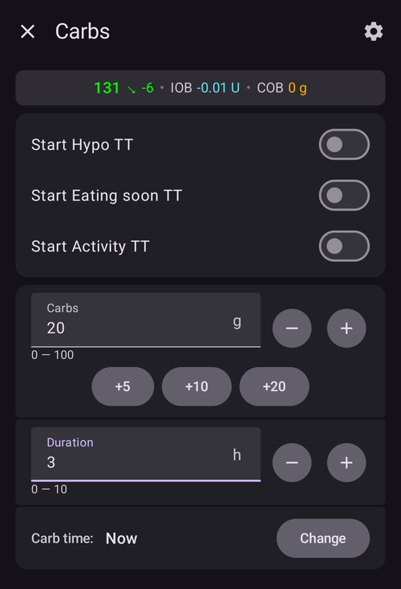
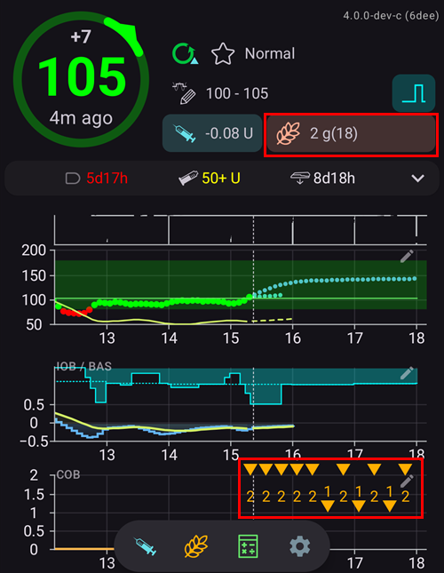
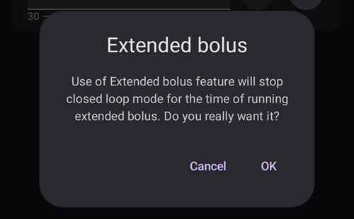
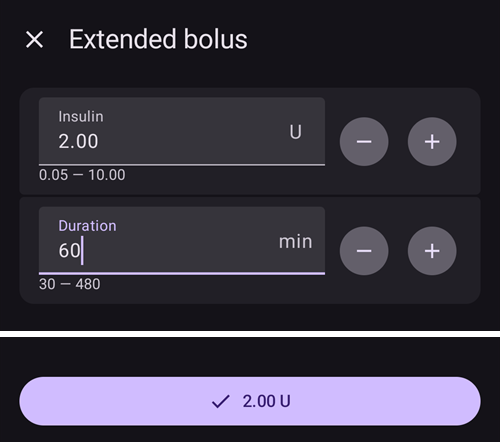
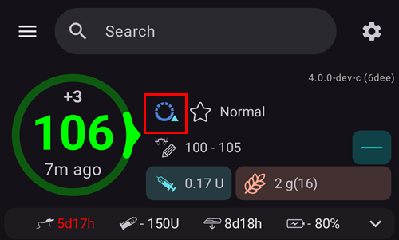
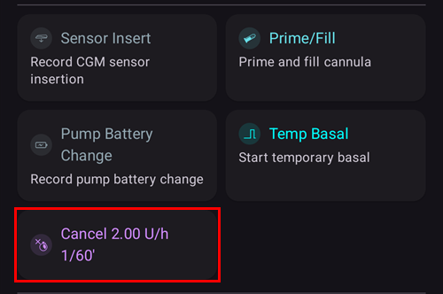

(Extended-Carbs-extended-carbs-ecarbs)=
# Produženi ugljikohidrati / „e-ugljikohidrati“

## Što su eUH i kada su korisni?

Kod obične terapije pumpom produženi bolusi dobar su način za masne ili druge obroke koji se sporo apsorbiraju i koji podižu GUK dulje nego što inzulin djeluje. U petlji, međutim, produženi bolusi nemaju toliko smisla (i stvaraju tehničke poteškoće), jer su oni u osnovi fiksni visoki privremeni bazal, a to je suprotno načinu rada petlje, koja bazalnu stopu prilagođava dinamički. Za pojedinosti pogledajte [produženi bolus](#extended-bolus-and-why-they-wont-work-in-closed-loop-environment) u nastavku.

Ipak, potreba da se riješe takvi obroci i dalje postoji. Zato AAPS podržava takozvane produžene ugljikohidrate ili eUH.

eUH su ugljikohidrati raspodijeljeni na nekoliko sati. Za uobičajene obroke s više ugljikohidrata nego masti/proteina obično je dovoljno unijeti ugljikohidrate odmah (i po potrebi smanjiti početni bolus) kako bi se spriječila prerana isporuka inzulina.  No za obroke koji se sporije apsorbiraju, kod kojih unos svih ugljikohidrata odmah daje previše aktivnog inzulina od SMB-a, eUH se mogu koristiti da se točnije simulira kako se ugljikohidrati (i svi ekvivalenti ugljikohidrata koje unesete za druge makronutrijente) apsorbiraju i utječu na GUK. S tim podacima petlja može postupnije davati SMB-ove za te ugljikohidrate, što se može smatrati dinamičkim produženim bolusom (ovo bi trebalo raditi i bez SMB-ova, ali je vjerojatno manje učinkovito).

**Napomena:** eUH nisu ograničeni na masne obroke / obroke bogate proteinima: mogu pomoći i u svakoj situaciji u kojoj nešto podiže GUK, npr. drugi lijekovi kao što su kortikosteroidi.

## Kako se koriste eUH

Za unos eUH otvorite dijalog **UH** (**Tretmani** → **UH**), unesite ukupne ugljikohidrate, postavite **Trajanje** i po želji pomaknite početak pomoću **Vrijeme UH** (*brojevi u nastavku samo su primjeri; morat ćete isprobati vlastite vrijednosti da biste dobili zadovoljavajući odgovor glukoze za svoje situacije*):

eUH na glavnom zaslonu: broj u zagradama u polju **Aktivni UGH** pokazuje ugljikohidrate koji tek dolaze, a graf **Aktivni UGH** prikazuje svaki budući unos eUH kao narančastu oznaku. Ako ne vidite graf **Aktivni UGH**, dodajte ga pomoću **Dodaj graf** ispod grafova (pogledajte [Zasloni AAPS-a](../DailyLifeWithAaps/AapsScreens.md)).

(AapsScreens-carbs-type)=
## Vrsta ugljikohidrata u bolus kalkulatoru: kruh, kolač ili pizza

U [bolus kalkulatoru](#aaps-screens-bolus-wizard) tri gumba ispod polja **UH** omogućuju vam da odaberete koliko se brzo vaš obrok apsorbira. Odaberite jedan prije nego što potvrdite. Ovisno o vrsti, **AAPS** dio unesenih ugljikohidrata uzima kao obične ugljikohidrate, a kasnije dodaje [produžene ugljikohidrate („eUH“)](#Extended-Carbs-extended-carbs-ecarbs) za spore, bogate obroke. Pritisnite ikonu **(i)** pokraj gumba da vidite tipičnu hranu za odabranu vrstu i što ona čini s vašim ugljikohidratima.

| Vrsta             | Tipična hrana (primjeri iz aplikacije)                                                                          | Ugljikohidrati sada, korišteni za bolus | Dodani eUH                                                |
| ----------------- | --------------------------------------------------------------------------------------------------------------- | --------------------------------------- | --------------------------------------------------------- |
| **Kruh** (zadano) | Kruh, slana peciva, jogurt, voće, krumpir, riža, zobena kaša, povrće                                            | 100 %                                   | Bez                                                       |
| **Kolač**         | Knedle, tjestenina, azijska jela bogata ugljikohidratima i mastima, slatka i dizana peciva, žitarice, med, džem | 90 %                                    | 20 %, počinje 60 minuta kasnije, raspodijeljeno na 2 sata |
| **Pizza**         | Lazanje, pizza, hamburgeri, pomfrit, pečeni krumpir, čips                                                       | 80 %                                    | 35 %, počinje 60 minuta kasnije, raspodijeljeno na 3 sata |

**Primjer**: unesete 100 g i odaberete **Pizza**. Bolus se izračunava za 80 g, zabilježenih sada. 35 g eUH počinje 1 sat kasnije i raspodjeljuje se na 3 sata.

Dobro je znati:
* Ovo nije obična podjela: s **Kolač** i **Pizza** zabilježeni ugljikohidrati ukupno su **više od onoga što ste unijeli** (110 % i 115 %). Višak je samo u eUH.
* Bolus pokriva samo ugljikohidrate unesene sada. **AAPS** ne daje bolus unaprijed za eUH: petlja ih uzima u obzir kada počnu, kao i sve druge [eUH](#Extended-Carbs-extended-carbs-ecarbs).
* Ako postavite **Vrijeme UH**, eUH počinju 60 minuta nakon tog vremena.
* Dijalog za potvrdu prikazuje eUH u zasebnom retku, _npr._ „eUH 35 g / 3 h (+60 min)“.
* Grami se zaokružuju naniže na cijele brojeve.
* Postoci, odgode i trajanja su fiksni; ne mogu se promijeniti u postavkama.
* Odabir se ne pamti: kalkulator se svaki put otvara s odabirom **Kruh**.

______________________________________________________________________

Jedan način kako s ovom značajkom uzeti u obzir masti i proteine opisan je ovdje: [https://adriansloop.blogspot.com/2018/04/page-margin-0.html](https://adriansloop.blogspot.com/2018/04/page-margin-0.html)

______________________________________________________________________

## Preporučene postavke, primjer i važne napomene

Preporučuje se koristiti dodatak OpenAPS SMB APS, s omogućenim SMB-ovima i s omogućenom postavkom *Omogući SMB uz COB*.

Primjer za pizzu može biti da odmah date (djelomični) bolus putem *bolus kalkulatora*, a zatim pomoću dijaloga *UH* unesete preostale ugljikohidrate s trajanjem od 4–6 sati, s početkom nakon 1 ili 2 sata.

Za brži početak *bolus kalkulator* može dodati eUH umjesto vas: odaberite [vrstu ugljikohidrata](#AapsScreens-carbs-type) **Kolač** ili **Pizza** ispod polja **UH** (pogledajte gore). Količine i vrijeme su fiksni, pa ako želite druge vrijednosti, umjesto toga koristite dijalog *UH*.

**Važne napomene:** Naravno, morat ćete isprobati koje vrijednosti odgovaraju vama. Također možete pažljivo prilagoditi postavku *Maks. minuta bazala za ograničenje SMB-a* kako bi algoritam bio više ili manje agresivan. Kod obroka s malo ugljikohidrata, a puno masti/proteina, može biti dovoljno koristiti samo eUH bez ručnih bolusa (pogledajte gore navedeni blog). Kada se stvore eUH, stvara se i bilješka u Careportalu koja bilježi sve unose, kako biste lakše isprobavali i poboljšavali unose.

(extended-bolus-and-why-they-wont-work-in-closed-loop-environment)=
## Produženi bolusi i zašto ne rade u zatvorenoj petlji

Kao što je gore spomenuto, produženi ili viševalni bolusi zapravo ne rade u zatvorenoj petlji. [Pogledajte u nastavku](#why-extended-boluses-won-t-work-in-a-closed-loop-environment) za pojedinosti

(Extended-Carbs-extended-bolus-and-switch-to-open-loop-dana-and-insight-pump-only)=
### Produženi bolus i prelazak na otvorenu petlju - samo za pumpe Dana i Insight

Neki ljudi su ipak tražili mogućnost korištenja produženog bolusa u AAPS-u jer su posebnu hranu htjeli liječiti na način na koji su navikli.

Zato **AAPS** nudi produženi bolus korisnicima pumpi Dana i Insight: otvorite **Upravljanje** i odaberite **Produženi bolus**.

**AAPS** vas najprije upozorava da će zatvorena petlja biti zaustavljena dok traje produženi bolus. Dodirnite **U redu** za nastavak:

Unesite količinu **Inzulin** i **Trajanje**, zatim dodirnite gumb za potvrdu na dnu i **U redu**:

Na pumpi Insight produženi bolus *nije dostupan* ako se koristi [emulacija TBR-a](#Accu-Chek-Insight-Pump-settings-in-aaps).

Dok traje produženi bolus, petlja radi u načinu **Otvorena petlja** (ikona petlje na glavnom zaslonu se mijenja), a zatvorena petlja se automatski ponovno uključuje kada produženi bolus završi:

Izbornik **Upravljanje** prikazuje gumb **Otkaži** sa stopom i proteklim / ukupnim vremenom (na primjer **Otkaži 2,00 J/h 1/60'**). Dodirnite ga da ranije zaustavite produženi bolus:

(why-extended-boluses-won-t-work-in-a-closed-loop-environment)=
### Zašto produženi bolusi ne rade u zatvorenoj petlji

1. Petlja odredi da se sada treba isporučiti 1,55 J/h. Za algoritam nije važno isporučuje li se to kao produženi bolus ili kao TBR. Zapravo, neke pumpe koriste produženi bolus. Što bi se tada trebalo dogoditi? Većina upravljačkih programa pumpi tada zaustavi produženi bolus -> Niste ga ni trebali pokretati.

2. Ako ste produženi bolus imali kao ulazni podatak, što bi se trebalo dogoditi u modelu?

   1. Treba li ga smatrati neutralnim zajedno s bazalnom stopom i na njemu raditi petlju? Onda bi petlja trebala moći i smanjiti bolus ako, na primjer, GUK padne prenisko i sav „neutralni“ inzulin se ukloni?
   2. Treba li produženi bolus jednostavno dodati? Dakle, petlji bi jednostavno trebalo dopustiti da nastavi? Čak i kod najgore hipoglikemije? Mislim da to nije baš dobro: hipoglikemija se predviđa, ali se ne smije spriječiti?

3. Aktivni inzulin koji produženi bolus stvori pojavljuje se nakon 5 minuta, pri sljedećem pokretanju. Prema tome, petlja bi dala manje bazala. Dakle, ne mijenja se puno... osim što se gubi mogućnost izbjegavanja hipoglikemije.
