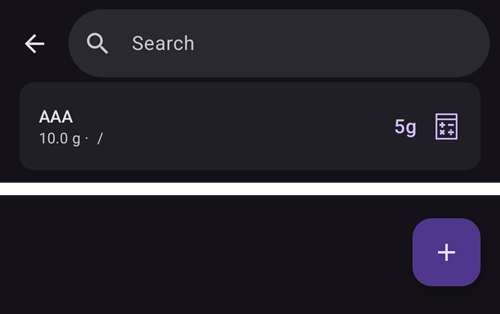
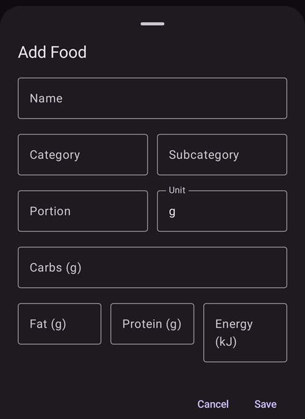

(food)=
# Hrana (vaša baza podataka o hrani)

Baza podataka **Hrana** vaš je osobni popis spremljenih namirnica. Svaki unos sprema **ugljikohidrate** namirnice (i po želji masti, proteine, energiju i kategoriju). Tako namirnice koje često jedete možete držati na jednom mjestu i pokrenuti bolus iz spremljene namirnice s već upisanim ugljikohidratima.

```{contents} Table of contents
:depth: 2
:local: true
```

---

## Otvaranje baze podataka o hrani

Otvorite zaslon **Upravljanje** (donja navigacija) i odaberite **Hrana** (*„Upravljajte unosima u bazi hrane“*). U **AAPS-u** v4 Hrana **više nije dodatak** — ništa ne treba omogućiti; to je samostalan zaslon koji otvarate s [ploče Upravljanje](#v4changes-manage).

---

## Popis hrane

Vaše namirnice prikazane su na popisu koji se može pomicati. Svaki redak prikazuje **naziv** namirnice, njezinu **porciju / jedinicu / kategoriju** i njezine **ugljikohidrate**:



- **🔍 Traži** (gore) — filtrira popis po **nazivu** (ne razlikuje velika i mala slova).
- **Filtar kategorija** — oznake (chipovi) omogućuju sužavanje popisa na jednu **kategoriju**; kada odaberete kategoriju, za nju se pojavljuju oznake **podkategorija**. (Ponovno dodirnite odabranu oznaku kako biste je poništili.)
- **➕** (dolje desno) — dodaje novu namirnicu (pogledajte ispod).
- Dodirnite redak kako biste **uredili** tu namirnicu.

Ako popis (ili trenutačni filtar) nema unosa, zaslon prikazuje **Nema podataka**.

---

## Dodavanje i uređivanje namirnice

Dodirnite **➕** za dodavanje ili dodirnite postojeći redak za uređivanje. Uređivač se otvara kao ploča na dnu zaslona (**Dodaj hranu** / **Uredi hranu**):



Polja su:

- **Naziv** — obavezno (bez njega ne možete spremiti).
- **Kategorija** i **Podkategorija** — neobavezno, služe za grupiranje/filtriranje namirnica.
- **Porcija** i **Jedinica** — uobičajena veličina obroka; **Jedinica** je prema zadanim postavkama **g**.
- **Ugljikohidrati (g)** — količina ugljikohidrata u namirnici.
- **Masti (g)**, **Proteini (g)**, **Energija (kJ)** — neobavezne prehrambene vrijednosti.

Dodirnite **Spremi** za spremanje ili **Otkaži** za odbacivanje. Kod uređivanja postojeće namirnice uređivač ima i gumb **Izbriši**.

```{admonition} Deleting is undoable
:class: note
Brisanje namirnice prikazuje poruku **„Hrana je izbrisana“** s radnjom **Poništi**, pa slučajno brisanje lako možete vratiti.
```

---

## Korištenje namirnice za bolus

Svaki redak namirnice ima gumb **kalkulatora**. Dodir na njega otvara **bolus kalkulator** s već upisanim **ugljikohidratima** te namirnice i **nazivom** namirnice kao bilješkom tretmana — tako samo potvrdite i isporučite, bez ponovnog upisivanja ugljikohidrata.

```{admonition} The carbs value is used as-is
:class: note
Spremljeni broj **ugljikohidrata** namirnice prenosi se izravno u kalkulator — **AAPS** ga ne množi s porcijom ni s količinom koju ste pojeli. Ako imate drugu količinu, prilagodite ugljikohidrate u kalkulatoru prije potvrde. (*Unutar* bolus kalkulatora ili dijaloga za ugljikohidrate nema izbora hrane; počinjete ovdje, od retka namirnice.)
```

---

## Odakle dolaze namirnice (sinkronizacija s Nightscoutom)

Baza podataka o hrani dijeli se putem **Nightscouta**, ali **samo u jednom smjeru**:

- **Preuzimanje:** **AAPS** **čita** namirnice iz **baze podataka o hrani** na vašoj Nightscout stranici i održava lokalni popis usklađenim s njom. To se radi kao dio sinkronizacije NSClienta, pa upareni **klijent/pratitelj** također dobije iste namirnice.
- **Prijenos:** **AAPS** **ne** šalje namirnice **u** Nightscout — NSClient ne podržava prijenos unosa hrane. Namirnice koje izradite ili uredite **unutar AAPS-a** zato ostaju **na tom uređaju** i ne prenose se u Nightscout ni na vaše druge uređaje.

```{admonition} Maintain your shared list in Nightscout
:class: important
Budući da se hrana **samo preuzima**, jedan zajednički popis hrane za vaš telefon, vašeg pratitelja/[klijenta](../RemoteFeatures/ClientMasterControl.md) i ostatak vašeg sustava održavate u **Nightscoutu** (u njegovom ugrađenom uređivaču hrane). **AAPS** će te unose preuzeti. Namirnica dodana samo u **AAPS-u** lokalna je za taj uređaj — i tamo ostaje: preuzimanje povezuje unose iz Nightscouta prema njihovom Nightscout ID-u, pa njih dodaje i ažurira, ali nikada ne prepisuje i ne uklanja namirnicu koju ste izradili lokalno (namirnica se uklanja samo kada se njezina kopija izbriše u Nightscoutu).

Imajte na umu da baza podataka o hrani **nije** ni dio potpisanog kanala za upravljanje glavni uređaj ↔ klijent — prenosi se isključivo kao podaci Nightscouta.
```

---

## Nije dostupno na satu

Baza podataka o hrani je značajka **telefona** — na **Wear OS satu** nema preglednika hrane, pločice ni izbornika.

---


<!-- =====================================================================
     Screenshots captured from a real master device:
       - food_list.png    (Manage → Food: list row, search, add button)
       - food_editor.png  ("Add Food" editor: name/category/subcategory/portion/unit/carbs/fat/protein/energy)
     No food was created or deleted (the editor was cancelled).
     Sync facts code-verified: download via LoadFoodsWorker.getFoods(); upload disabled
     (DataSyncSelectorV3 processChangedFoods() commented out — "NSCv3 doesn't support food update").
     Maintainers: relocate page + images and fix cross-links as needed.
     ===================================================================== -->
