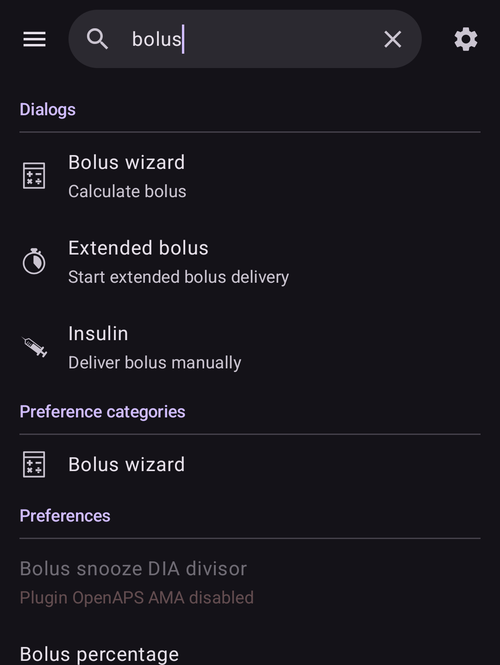
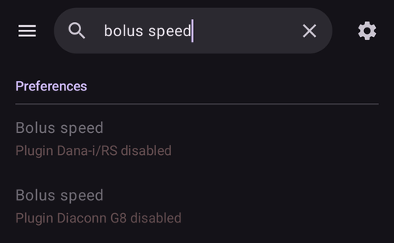
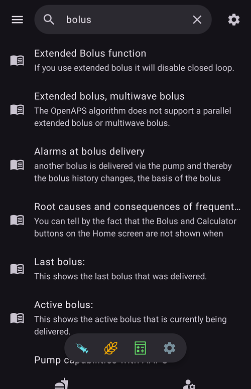

(global-search)=
# Globalno pretraživanje

**AAPS** v4 ima polje za **globalno pretraživanje** na vrhu glavnog zaslona. Upišite riječ i ono pretražuje cijelu aplikaciju odjednom — dodatke, dijaloge, zaslone postavki, pojedinačne postavke — a ako ste na mreži, i **dokumentaciju AndroidAPS-a**. To je najbrži način da dođete do postavke ili zaslona, a da ne morate pamtiti gdje se nalaze.

```{contents} Table of contents
:depth: 2
:local: true
```

---

## Otvaranje pretraživanja

Dodirnite polje **🔍 Traži** na vrhu zaslona **Pregled** (pokraj izbornika ☰). Počnite tipkati i rezultati se pojavljuju dok tipkate (nakon kratke stanke), grupirani po kategorijama:



While the box is empty, **AAPS** shows your **Recent searches**, newest first (up to ten). Tap one to run that search again, or tap the **✕** at the end of a row to remove only that search from the list. A search is added to the list when you open one of its results, so half-typed words are not kept. The list is stored on this phone only: it is not included in a settings export and is not sent to **AAPSClient**.

Polje obrišite tipkom **✕** ili zatvorite pretraživanje tipkom **Natrag** na uređaju.

---

## Pretražujte na engleskom *ili* na svom jeziku

Ovo je važno znati: pretraživanje uspoređuje **oboje**, tekst na **odabranom jeziku** **i** izvorni **engleski** tekst.

- Ako je vaša aplikacija, na primjer, na njemačkom ili češkom, možete upisati **prevedenu** riječ **ili** **englesku** riječ — obje pronalaze postavku.
- Podudaranje u **prevedenom** naslovu ima najviši rang, zatim u **engleskom** naslovu, a zatim u prevedenim i engleskim **opisima**.
- Pretraživanje zanemaruje **naglaske i dijakritičke znakove** (tako *č* odgovara *c*, a *ž* odgovara *z*) i **ne razlikuje velika i mala slova**.

To znači da vas vodič ili objava na forumu napisana na engleskom i dalje vodi do prave postavke, čak i kada vaš telefon sve prikazuje prevedeno.

---

## Što pretraživanje obuhvaća

Rezultati su grupirani u ove kategorije:

- **Dodaci** — svi dodaci vidljivi u vašoj verziji aplikacije (isti oni koji su navedeni pod [Konfiguracija](../SettingUpAaps/ConfigBuilder.md)). Svaki redak dodatka ima svoj **prekidač za uključivanje**, pa dodatak možete omogućiti ili onemogućiti izravno iz rezultata — dodir na redak onemogućenog dodatka (koji se može uključiti) omogućuje ga.
- **Dijalozi** — zasloni za tretmane i radnje te zasloni za upravljanje (Bolus kalkulator, Inzulin, Produženi bolus, Kalibracija, Privremeni cilj, Profil, …). Zasloni koji se ne odnose na vašu verziju izostavljeni su (na primjer *Upari s glavnim uređajem* na glavnom uređaju, *Ovlašteni klijenti* na klijentu).
- **Kategorije postavki** — **zasloni** postavki i njihovi podzasloni, ugrađeni (Općenito, Izgled, Zaštita, Upozorenja, Održavanje, …) i oni iz dodataka, te male grupe postavki do kojih se dolazi iz dijaloga (tipke za punjenje, koraci tipki za inzulin i ugljikohidrate, pragovi statusnih svjetala, postavke kalkulatora, …).
- **Postavke** — svaka **pojedinačna postavka** koja ima naslov. One su filtrirane prema vašoj verziji i načinu rada, pa vidite samo postavke koje se stvarno primjenjuju (APS / NSClient / upravljanje pumpom).
- **Dokumentacija** — stranice iz online **dokumentacije AndroidAPS-a** (vidi niže).

```{admonition} Settings that belong to a disabled plugin
:class: note
Postavka čiji je dodatak trenutno **onemogućen** i dalje se prikazuje — **zasivljena** i ne može se dodirnuti — s napomenom *„Dodatak … je onemogućen“*, tako da znate da postavka postoji i koji dodatak trebate omogućiti da biste do nje došli.


```

---

## Rezultati iz dokumentacije (online)

Dok traje lokalno pretraživanje, **AAPS** istovremeno pretražuje i službenu **dokumentaciju AndroidAPS-a** (smještenu na ReadTheDocs). Pronađene stranice pojavljuju se u grupi **Dokumentacija** na dnu, svaka s ikonom 📖, naslovom odjeljka i kratkim isječkom teksta:



- Ako je dokumentacija prevedena na jezik vaše aplikacije, **AAPS** istovremeno pretražuje prevedene i engleske stranice. Najprije dolaze stranice na vašem jeziku, a zatim engleske stranice koje još nisu pronađene.
- Dodir na rezultat iz dokumentacije otvara tu stranicu u vašem **pregledniku**.
- Za pretraživanje dokumentacije potreban je **internet** — kada niste na mreži, umjesto rezultata dobivate napomenu *„Za pretraživanje dokumentacije potrebna je internetska veza“*, a lokalni rezultati (u aplikaciji) i dalje rade normalno.

---

## Otvaranje rezultata

Dodirnite rezultat da biste izravno otišli na njega:

- **Dodatak** → otvara taj dodatak.
- **Dijalog** → otvara taj zaslon ili dijalog.
- **Kategorija postavki** → otvara taj zaslon postavki.
- **Postavka** → otvara postavku **na njezinom mjestu** (skoči na nju unutar njezina zaslona).
- **Dokumentacija** → otvara stranicu u vašem pregledniku.

Otvaranje postavki i zaštićenih radnji i dalje poštuje vašu **[zaštitu](#Preferences-protection)** (PIN/lozinka), točno kao da ste tamo došli ručno. Nakon što nešto napravite s rezultatom, možete pritisnuti **Natrag** da biste se vratili na rezultate pretraživanja.

---

## Prečaci za napredne korisnike

Dva posebna upita prikazuju cijelu kategoriju odjednom:

- `%PLUGINS%` — prikaži **sve** dodatke.
- `%DIALOGS%` — prikaži **sve** dijaloge i zaslone radnji.

---

```{admonition} The index stays current
:class: note
Indeks pretraživanja izrađuje se kada prvi put pretražujete i nakon toga ostaje spreman. Automatski se ponovno izrađuje kada **omogućite ili onemogućite dodatak** ili **promijenite jezik aplikacije**, tako da rezultati uvijek odgovaraju vašim trenutnim postavkama.
```

---


<!-- =====================================================================
     Screenshots captured from a real master device (query "bolus"):
       - search_results.png        (categorized local results: Dialogs / Preference categories / Preferences)
       - search_disabled_plugin.png (greyed-out preference from a disabled plugin)
       - search_documentation.png   (online ReadTheDocs results with 📖 icon + snippets)
     Maintainers: relocate page + images and fix cross-links as needed.
     ===================================================================== -->
