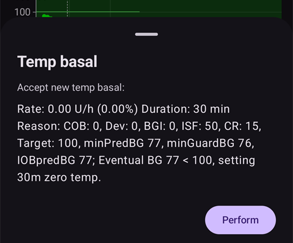
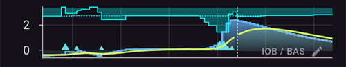

# Glavne značajke AAPS-a

## Način rada petlje

Status petlje prikazuje se na glavnom zaslonu jednom od ikona u nastavku.

**AAPS** nudi nekoliko načina rada petlje, kao što su zatvorena petlja (1), zaštita od niske razine glukoze (LGS – 2) i otvorena petlja (3).

Pogledajte [Zasloni AAPS-a > Glavni zaslon > Status petlje](#AapsScreens-loop-status) za informacije o tome kako odabrati način rada petlje i o ostalim ikonama na slici (4 do 6).

(KeyAapsFeatures-OpenLoop)=

### Otvorena petlja

**AAPS** stalno procjenjuje sve dostupne podatke (IOB, COB, GUK...) i daje prijedloge liječenja (privremene bazalne stope) kako po potrebi prilagoditi terapiju.

Prijedlozi se neće izvršiti automatski (kao u zatvorenoj petlji). Korisnik mora prijedloge ručno unijeti u pumpu (ako koristi virtualnu pumpu) ili ih izvršiti gumbom ako je **AAPS** povezan sa stvarnom pumpom.

Kada **AAPS** ima prijedlog, u donjoj navigaciji glavnog zaslona pojavljuje se stavka **Petlja** s oznakom. Pritisnite je da pročitate prijedlog („Prihvati novi privremeni bazal“) s njegovom stopom, trajanjem i razlogom, a zatim pritisnite **Izvrši** da ga provedete:

Prijedlog vrijedi samo nekoliko minuta. Ako je stariji od oko 9 minuta, ili ako je u međuvremenu petlja suspendirana ili pumpa odspojena, **AAPS** ga odbija i ništa se ne šalje na pumpu (*„Ovaj prijedlog je prestar. Ništa nije poslano na pumpu. Pričekajte sljedeći.“*). Pričekajte sljedeći prijedlog.

Ova je opcija za upoznavanje s radom **AAPS-a** ili ako koristite pumpu koja nije podržana. Bit ćete u otvorenoj petlji, bez obzira na to što ovdje odaberete, sve do kraja **[Cilja 5](#objectives-objective5)**.

(KeyAapsFeatures-LGS)=

### Zaštita od niske razine glukoze (LGS)

U ovom načinu rada [maxIOB](#Open-APS-features-maximum-total-iob-openaps-cant-go-over) postavljen je na nulu.

To znači da ako glukoza u krvi pada, **AAPS** vam može smanjiti bazal. Ali ako glukoza u krvi raste, automatska korekcija neće se napraviti. Vaše bazalne stope ostat će iste kao u vašem trenutnom **profilu**. Samo ako je IOB negativan (zbog prethodne zaštite od niske razine glukoze), dat će se dodatni inzulin za snižavanje **GUK-a**.

Ovaj je način rada dostupan od **[Cilja 6](#objectives-objective6)**.

Osim što ga sami odaberete, **AAPS** se u ovaj način rada može prebaciti i sam: dok radite na **[Cilju 6](#objectives-objective6)** i kad god otkrije dvostruka očitanja GUK-a (pogledajte [Znak upozorenja GUK-a](#aaps-screens-bg-warning-sign)).

(KeyAapsFeatures-ClosedLoop)=

### Zatvorena petlja

**AAPS** stalno procjenjuje sve dostupne podatke (IOB, COB, GUK...) i po potrebi automatski prilagođava liječenje (*tj.* bez vaše dodatne intervencije) kako bi postigao postavljeni [ciljni raspon ili vrijednost](#profile-glucose-targets) (isporuka bolusa, privremena bazalna stopa, isključivanje inzulina radi izbjegavanja hipoglikemije itd.).

Zatvorena petlja radi unutar brojnih sigurnosnih granica koje se mogu postaviti pojedinačno.

Zatvorena petlja moguća je samo ako ste na **[Cilju 7](#objectives-objective7)** ili višem i koristite podržanu pumpu.

(autosens)= (Open-APS-features-autosens)=

## Autosens

- Autosens je algoritam koji promatra odstupanja glukoze u krvi (pozitivna/negativna/neutralna).
- Pokušat će na temelju tih odstupanja odrediti koliko ste osjetljivi ili otporni.
- Implementacija oref u **OpenAPS-u** koristi kombinaciju podataka iz zadnja 24 i 8 sati. Koristi onu od te dvije vrijednosti koja je osjetljivija.
- Korisnici koji dolaze s oref1 vjerojatno će primijetiti da sustav na promjene može reagirati manje dinamično, jer se osjetljivost računa iz 24 ili iz 8 sati.
- Promjena kanile ili promjena profila vraća omjer Autosensa na 100 % (zamjena profila s postotkom i trajanjem ne resetira Autosens).
- Autosens prilagođava vaš bazal i ISF (tj. oponaša ono što radi pomak profila).
- Ako dulje vrijeme stalno jedete ugljikohidrate, Autosens će u tom razdoblju biti manje učinkovit jer se ugljikohidrati isključuju iz izračuna delte **GUK-a**.
- Odstupanja se pretvaraju u **omjer osjetljivosti** (postotak): omjer ispod 100 % znači da AAPS misli da ste osjetljiviji na inzulin nego što pretpostavlja vaš **profil** (pa snižava stvarni bazal i povećava vrijednost ISF-a), a omjer iznad 100 % znači da ste otporniji (pa povećava bazal i snižava vrijednost ISF-a).
- Prema zadanim postavkama taj se omjer drži između 0,7 (70 %, osjetljiviji) i 1,2 (120 %, otporniji), tako da niz neobičnih podataka ne može previše udaljiti vaše doziranje od vašeg **profila**. Te se granice mogu prilagoditi u naprednim postavkama detekcije osjetljivosti.
- Autosens i [Autotune](../AdvancedOptions/Autotune.md) rješavaju isti osnovni problem u različitim vremenskim razmjerima: Autosens iz minute u minutu blago prilagođava vaše *trenutno* doziranje na temelju zadnjih 8–24 h, dok Autotune polako mijenja sam vaš *profil* na temelju povijesti od nekoliko tjedana. Korištenje obaju je normalno i očekivano – oni se nadopunjuju, a ne ponavljaju.

*Za potpuni tehnički opis algoritma Autosens pogledajte [dokumentaciju OpenAPS-a o Autosensu](https://openaps.readthedocs.io/en/latest/docs/Customize-Iterate/autosens.html).*

(Open-APS-features-super-micro-bolus-smb)=

## Super Micro Bolus (SMB)

**SMB**, kratica za **Super Micro Bolus**, značajka je OpenAPS-a uvedena od 2018. godine, unutar algoritma Oref1. Za razliku od **AMA**, **SMB** ne regulira razinu glukoze privremenim bazalnim stopama, nego uglavnom **malim super mikro bolusima**. U situacijama u kojima bi **AMA** dodao 1,0 J inzulina privremenom bazalnom stopom, **SMB** isporučuje nekoliko super mikro bolusa u malim koracima u **razmacima od 5 minuta**, npr. 0,4 J, 0,3 J, 0,2 J i 0,1 J. Istodobno se (iz sigurnosnih razloga) stvarna bazalna stopa na neko vrijeme postavlja na 0 J/h kako bi se spriječilo predoziranje (**„nulti privremeni bazal“**). Tako sustav može brže prilagoditi glukozu u krvi nego povećanjem privremene bazalne stope u **AMA**.

Zahvaljujući SMB-u, za obroke koji sadrže samo „spore“ ugljikohidrate može biti dovoljno da sustavu unesete planiranu količinu ugljikohidrata, a ostalo prepustite **AAPS-u**. Međutim, to može dovesti do viših postprandijalnih vrhova (nakon obroka) jer bolus prije obroka nije moguć. Ili možete, po potrebi s bolusom prije obroka, dati **početni bolus** koji **samo djelomično** pokriva ugljikohidrate (npr. 2/3 procijenjene količine), a ostatak inzulina neka isporuči **SMB**.

SMB-ovi se prikazuju na [grafu aktivnog inzulina (IOB)](#aaps-screens-iob) plavim trokutima. [Pritisnite i držite](#aaps-screens-graph-press-and-hold) graf na trokutu da vidite koliko je inzulina isporučeno ili koristite [Povijest tretmana](#aaps-screens-treatments).

Značajke **SMB-a** sadrže neke sigurnosne mehanizme:

1. **Najveća pojedinačna doza SMB-a**  
  Najveća pojedinačna doza SMB-a može biti samo najmanja od ovih vrijednosti:
  
        * vrijednost koja odgovara trenutnoj bazalnoj stopi (kako ju je prilagodio Autosens) za trajanje postavljeno u „Maks. minuta bazala za ograničenje SMB-a“, npr. količina bazala za sljedećih 30 minuta, ili
        * polovica trenutno potrebne količine inzulina, ili
        * preostali dio vaše vrijednosti maxIOB u postavkama.
      

2. **Niske privremene bazalne stope**  
  Niske privremene bazalne stope (tzv. „low temps“) ili privremene bazalne stope od 0 J/h (tzv. „zero-temps“, nulti privremeni bazal) češće se aktiviraju sa **SMB-om**. To je namjerno, iz sigurnosnih razloga, i nema negativnih učinaka ako je **profil** ispravno postavljen. Na glavnom grafu krivulja aktivnog inzulina (IOB) (tanka žuta linija) govori više od tijeka privremenih bazalnih stopa.

3. **Nenajavljeni obroci**  
  Dodatni izračuni za predviđanje tijeka glukoze, npr. pomoću **UAM** (nenajavljeni obroci). Čak i bez ručnog unosa ugljikohidrata, **UAM** može automatski prepoznati znatan porast razine glukoze zbog obroka, adrenalina ili drugih utjecaja i pokušati ga ispraviti **SMB-om**. Radi sigurnosti ovo radi i u suprotnom smjeru i može ranije zaustaviti SMB ako dođe do neočekivano brzog pada glukoze. Zato bi UAM uvijek trebao biti aktivan uz SMB.

SMB ne odlučuje sam da je potreban inzulin – oslanja se na ista kombinirana predviđanja GUK-a (konačni GUK, nulti privremeni bazal, COB, UAM) opisana u [kako AAPS pretvara predviđanja u odluku o doziranju](#aaps-screens-how-predictions-become-a-dosing-decision). SMB i nulti privremeni bazal samo su dva alata kojima AAPS provodi tu odluku.

**Da biste koristili SMB, morate započeti [Cilj 9](#objectives-objective9).**

Pogledajte i [dokumentaciju OpenAPS-a o oref1/SMB](https://openaps.readthedocs.io/en/latest/docs/Customize-Iterate/oref1.html#understanding-super-micro-bolus-smb) za potpuni tehnički opis ili [Timove informacije o SMB-u](https://www.diabettech.com/artificial-pancreas/understanding-smb-and-oref1/) za opis iz zajednice.

Postavke za OpenAPS SMB opisane su u nastavku.

(Open-APS-features-max-u-h-a-temp-basal-can-be-set-to)=

### Maksimalna bazalna stopa

Ova sigurnosna postavka određuje najveću privremenu bazalnu stopu koju inzulinska pumpa smije isporučiti. Poznata je i kao **max-basal**.

Vrijednost se mjeri u jedinicama na sat (J/h). Preporučuje se postaviti razumnu vrijednost. Dobra preporuka za postavljanje ovog parametra je:

**MAX-BASAL = NAJVEĆA BAZALNA STOPA x 4**

Na primjer, ako je najveća bazalna stopa u vašem profilu bila 0,5 J/h, možete je pomnožiti s 4 i dobiti vrijednost 2 J/h.

**AAPS** ograničava ovu vrijednost „čvrstom granicom“ prema [Postavke > Sigurnost > Dob pacijenta](#preferences-patient-type). Čvrste granice su sljedeće:

- Dijete: 2
- Tinejdžer: 5
- Odrasla osoba: 10
- Odrasla osoba otporna na inzulin: 12
- Trudnoća: 25

*Pogledajte i [pregled čvrsto zadanih granica](#Open-APS-features-overview-of-hard-coded-limits).*

(Open-APS-features-maximum-total-iob-openaps-cant-go-over)=

### Maks. aktivni inzulin (IOB) za SMB

Ova vrijednost određuje najveći **aktivni inzulin** (bazalni i bolusni IOB) ispod kojeg će **AAPS** ostati dok radi u načinu zatvorene petlje. Poznata je i kao **maxIOB**.

Ako je trenutni IOB (npr. nakon bolusa za obrok) iznad zadane vrijednosti, petlja prestaje davati inzulin dok IOB ne padne ispod zadane granice.

Dobar početak za postavljanje ovog parametra je:

      maxIOB = prosječni bolus za obrok + 3x najveći dnevni bazal
    

Budite oprezni i strpljivi kada prilagođavate **max-IOB**. Razlikuje se od osobe do osobe i može ovisiti i o prosječnoj ukupnoj dnevnoj dozi (TDD).

**AAPS** ograničava ovu vrijednost „čvrstom granicom“ prema [Postavke > Sigurnost > Dob pacijenta](#preferences-patient-type). Čvrste granice su sljedeće:

- Dijete: 7
- Tinejdžer: 13
- Odrasla osoba: 22
- Odrasla osoba otporna na inzulin: 30
- Trudnoća: 70

*Pogledajte i [pregled čvrsto zadanih granica](#Open-APS-features-overview-of-hard-coded-limits).*

Napomena: kada koristite **SMB**, **max-IOB** se računa drugačije nego u AMA. U **AMA** je maxIOB sigurnosni parametar za bazalni **IOB**, dok u načinu SMB uključuje i bolusni IOB.

### Koristi dinamičku osjetljivost

To je značajka [Dinamički ISF (DynISF)](../DailyLifeWithAaps/DynamicISF.md). Kada je omogućena, postaju dostupne nove postavke. Postavke su objašnjene na stranici [Dinamički ISF (DynISF)](#dyn-isf-preferences).

### Koristi Autosens

To je značajka [Autosens](#Open-APS-features-autosens). Kada koristite dinamički ISF, Autosens se ne može koristiti, jer su to dva različita algoritma koja mijenjaju istu varijablu (osjetljivost).

Autosens promatra odstupanja glukoze u krvi (pozitivna/negativna/neutralna). Pokušat će na temelju tih odstupanja odrediti koliko ste osjetljivi ili otporni te prema njima prilagoditi bazalnu stopu i ISF.

Kada je omogućena, postaju dostupne nove postavke.

#### Osjetljivost podiže cilj

Ako je ova opcija omogućena, detekcija osjetljivosti (Autosens) može podići cilj kada otkrije osjetljivost (ispod 100 %). U tom slučaju vaš se cilj podiže za postotak otkrivene osjetljivosti.

Ako je cilj promijenjen zbog detekcije osjetljivosti, na glavnom zaslonu prikazuje se sa zelenom pozadinom.

Ova je postavka dostupna kada je omogućeno „Koristi dinamičku osjetljivost“ ili „Koristi Autosens“.

#### Rezistencija snižava cilj

Ako je ova opcija omogućena, detekcija osjetljivosti (Autosens) može sniziti cilj kada otkrije rezistenciju (iznad 100 %). U tom slučaju vaš se cilj snižava za postotak otkrivene rezistencije.

Ova je postavka dostupna kada je omogućeno „Koristi dinamičku osjetljivost“ ili „Koristi Autosens“.

### Omogući SMB

Omogućite ovo za korištenje funkcije SMB. Ako je onemogućeno, **SMB-ovi** se neće davati.

Kada je omogućena, postaju dostupne nove postavke.

(Open-APS-features-enable-smb-with-high-temp-targets)=

#### Omogući SMB s visokim privremenim ciljem

Ako je ova postavka omogućena, **SMB-ovi** će se isporučivati čak i ako je korisnik odabrao visoki **privremeni cilj** (definiran kao 100 mg/dL ili 5,6 mmol/L i više, bez obzira na cilj u **profilu**). Budite oprezni kada je omogućujete: **SMB-ovi** mogu postati previše agresivni ako vaše postavke nisu dobro podešene ili ako se vaš **profil** često mijenja (na primjer kod djece).

Kada je ova postavka onemogućena, visoki **privremeni cilj** isključuje **SMB-ove**. Na primjer, ako je ova opcija onemogućena, **SMB-ovi** se mogu onemogućiti postavljanjem **privremenog cilja** od 100 mg/dL ili 5,6 mmol/L i više. Ova opcija će također onemogućiti **SMB-ove** bez obzira na to koji drugi uvjet pokušava omogućiti SMB – osim niskog **privremenog cilja** kao što je **Prije obroka** (ili bilo kojeg **privremenog cilja** od 98 mg/dL ili 5,4 mmol/L i niže), uz koji se **SMB-ovi** i dalje mogu isporučivati kako bi se **GUK** doveo prema cilju.

Ova postavka sama po sebi ne uključuje **SMB**. S visokim privremenim ciljem **SMB** se daje samo ako ga dopušta i neka od ostalih postavki u nastavku (na primjer **Uvijek omogući SMB** ili **Omogući SMB uz COB**).

(Open-APS-features-enable-smb-always)=

#### Uvijek omogući SMB

Ako je ova postavka omogućena, SMB je uvijek omogućen (neovisno o COB-u, privremenim ciljevima ili bolusima). Ako je ova postavka omogućena, ostale postavke za omogućavanje u nastavku nemaju učinka. Međutim, ako je **Omogući SMB s visokim privremenim ciljem** onemogućeno, a postavljen je visoki privremeni cilj, SMB-ovi će biti onemogućeni.

Ova je postavka dostupna samo ako **AAPS** otkrije da koristite [pouzdan izvor GUK-a](#GettingStarted-TrustedBGSource) s naprednim filtriranjem. FreeStyle Libre 1 ne smatra se pouzdanim izvorom jer postoji rizik da se kod kvara senzora stari podaci GUK-a beskonačno ponavljaju.

Zbog podataka sa smetnjama **AAPS** može misliti da GUK raste vrlo brzo, pa daje nepotrebne SMB-ove. Više o smetnjama i zaglađivanju podataka pročitajte [ovdje](../CompatibleCgms/SmoothingBloodGlucoseData.md).

#### Omogući SMB uz COB

Ako je ova postavka omogućena, SMB je omogućen kada je COB veći od 0.

Ova postavka nije vidljiva ako je uključeno „Uvijek omogući SMB“.

#### Omogući SMB s niskim privremenim ciljem

Ako je ova postavka omogućena, SMB je omogućen kada je postavljen privremeni cilj (prije obroka, aktivnost, hipo, prilagođeni). Ako je ova postavka omogućena, a **Omogući SMB s visokim privremenim ciljem** onemogućeno, SMB će biti omogućen kada je postavljen niski privremeni cilj (98 mg/dL ili 5,4 mmol/L i niže), ali onemogućen kada je postavljen visoki privremeni cilj.

Ova postavka nije vidljiva ako je uključeno „Uvijek omogući SMB“.

#### Omogući SMB nakon ugljikohidrata

Ako je omogućeno, SMB je omogućen 6 h nakon najave ugljikohidrata, čak i ako je COB pao na 0.

Iz sigurnosnih razloga ova je postavka dostupna samo ako **AAPS** otkrije da koristite pouzdan izvor GUK-a. Nije vidljiva ako je uključeno „Uvijek omogući SMB“.

Ova je postavka dostupna samo ako **AAPS** otkrije da koristite [pouzdan izvor GUK-a](#GettingStarted-TrustedBGSource) s naprednim filtriranjem. FreeStyle Libre 1 ne smatra se pouzdanim izvorom jer postoji rizik da se kod kvara senzora stari podaci GUK-a beskonačno ponavljaju.

Zbog podataka sa smetnjama **AAPS** može misliti da GUK raste vrlo brzo, pa daje nepotrebne SMB-ove. Više o smetnjama i zaglađivanju podataka pročitajte [ovdje](../CompatibleCgms/SmoothingBloodGlucoseData.md).  
Ova postavka nije vidljiva ako je uključeno „Uvijek omogući SMB“.

#### Interval SMB-a

Ova značajka ograničava učestalost SMB-ova. Ova vrijednost određuje najkraće vrijeme između SMB-ova. Imajte na umu da se petlja pokreće svaki put kada stigne nova vrijednost glukoze (obično svakih 5 minuta). Oduzmite 2 minute kako bi petlja imala dodatno vrijeme za završetak. Npr. ako želite da se SMB daje pri svakom pokretanju petlje, postavite 3 minute.

Zadana vrijednost: 3 min.

(Open-APS-features-max-minutes-of-basal-to-limit-smb-to)=

#### Maks. minuta bazala za ograničenje SMB-a

Ovo je važna sigurnosna postavka. Ova vrijednost određuje koliko SMB-a se smije dati na temelju količine bazalnog inzulina u određenom vremenu, kada ga pokrivaju aktivni ugljikohidrati (COB).

Veća vrijednost čini SMB agresivnijim. Počnite sa zadanom vrijednošću od 30 minuta. Nakon nešto iskustva povećavajte vrijednost u koracima od 15 minuta i pratite učinke kroz više obroka.

Preporučuje se ne postavljati vrijednost iznad 90 minuta, jer bi algoritam tada mogao doći do točke u kojoj ne može nadoknaditi pad GUK-a bazalom od 0 J/h („nulti privremeni bazal“). Trebali biste postaviti i alarme, posebno dok još testirate nove postavke, koji će vas upozoriti dovoljno prije hipoglikemije.

Zadana vrijednost: 30 min.

#### UAM: maks. minuta bazala za ograničenje SMB-a

Ova postavka omogućuje prilagodbu jačine SMB-a tijekom UAM-a, kada više nema ugljikohidrata.

Zadana vrijednost: ista kao **Maks. minuta bazala za ograničenje SMB-a**.

Ova je postavka vidljiva samo ako su uključeni „Omogući SMB“ i „Omogući UAM“.

(enable-uam)=

### Omogući UAM

Kada je ova opcija omogućena, algoritam SMB može prepoznati nenajavljene obroke. To pomaže ako zaboravite **AAPS-u** reći za svoje ugljikohidrate ili ih pogrešno procijenite pa je unesena količina pogrešna, ili ako obrok s puno masti i proteina traje dulje nego što je očekivano. Bez ikakvog unosa ugljikohidrata UAM može prepoznati brz porast glukoze zbog ugljikohidrata, adrenalina itd. i pokušava ga ispraviti SMB-ovima. To radi i obrnuto: ako glukoza brzo pada, može ranije zaustaviti SMB-ove.

**Zato bi UAM uvijek trebao biti aktiviran kada koristite SMB.**

(key-aaps-features-minimal-carbs-required-for-suggestion)=

### Prag potrebnih ugljikohidrata

Najmanji broj grama ugljikohidrata za prikaz upozorenja s prijedlogom ugljikohidrata. Dodatni ugljikohidrati bit će predloženi kada referentni dizajn otkrije da su potrebni. U tom slučaju dobit ćete obavijest koju možete odgoditi za 5, 15 ili 30 minuta.

Obavijesti o potrebnim ugljikohidratima mogu se po želji slati u Nightscout. Tada se prikazuje i šalje objava.

U svakom slučaju potrebni ugljikohidrati prikazat će se u odjeljku COB na glavnom zaslonu.

### Napredne postavke

Za potpuni popis parametara (uključujući postavke koje ovdje nisu opisane) pogledajte [dokumentaciju OpenAPS-a o postavkama i sigurnosnim postavkama](https://openaps.readthedocs.io/en/latest/docs/While%20You%20Wait%20For%20Gear/preferences-and-safety-settings.html).

**Uvijek koristi kratku prosječnu deltu** Ako omogućite ovu značajku, **AAPS** koristi kratku prosječnu deltu glukoze u krvi iz zadnjih 15 minuta, koja je obično prosjek zadnje tri vrijednosti. To pomaže **AAPS-u** da bude stabilniji s izvorima podataka sa smetnjama kao što su xDrip i Libre.

**Maks. dnevni sigurnosni množitelj** Ovo je važna sigurnosna granica. Zadana vrijednost (koju vjerojatno nećete trebati mijenjati) je 3. To znači da **AAPS** nikada ne smije postaviti privremenu bazalnu stopu veću od 3x najveće satne bazalne stope programirane u pumpi i/ili profilu korisnika. Primjer: ako je vaša najveća bazalna stopa 1,0 J/h, a maks. dnevni sigurnosni množitelj 3, **AAPS** može postaviti najveću privremenu bazalnu stopu od 3,0 J/h (= 3 x 1,0 J/h).

Zadana vrijednost: 3 (ne mijenjajte je osim ako to stvarno trebate i znate što radite)

**Sigurnosni množitelj trenutnog bazala** Ovo je još jedna važna sigurnosna granica. Zadana vrijednost (koju također vjerojatno nećete trebati mijenjati) je 4. To znači da **AAPS** nikada ne smije postaviti privremenu bazalnu stopu veću od 4x trenutne satne bazalne stope programirane u pumpi i/ili profilu korisnika.

Zadana vrijednost: 4 (ne mijenjajte je osim ako to stvarno trebate i znate što radite)

* * *

(Open-APS-features-auto-isf)=

## Auto ISF

**Auto ISF** je **eksperimentalni** algoritam za napredne korisnike. Temelji se na OpenAPS SMB i dodaje pravila koja faktor osjetljivosti na inzulin (ISF) čine jačim ili slabijim, ovisno o tome kako se ponaša vaša glukoza.

To je razvojna značajka: može se uključiti samo u [razvojnoj verziji (dev)](../AdvancedOptions/DevBranch.md) s omogućenim **inženjerskim načinom rada**. U običnoj verziji (release) uvijek je isključena i zato se ne prikazuje u **Konfiguracija → APS**. [Ispunjavanje ciljeva](../SettingUpAaps/CompletingTheObjectives.md) ne otključava je.

Nakon odabira, njegove **Postavke** sadrže postavke OpenAPS SMB i dodatnu skupinu **Postavke AutoISF**:

- **Omogući AutoISF**: uključuje prilagodbe ISF-a. Bez toga se algoritam ponaša kao OpenAPS SMB.
- **AutoISF min** i **AutoISF max**: koliko slab i koliko jak ISF smije postati, na isti način kao granice Autosensa. Sa zadanom vrijednošću 1,0 učinak je isključen.
- **Težine**: svaka pokreće jedno pravilo, a zadana vrijednost 0,0 isključuje to pravilo. 
  - dok glukoza **ubrzava**, ISF se pojačava (više inzulina);
  - dok glukoza **usporava**, ISF se slabi (manje inzulina);
  - dok je glukoza **ispod cilja**, ISF se slabi;
  - dok je glukoza **iznad cilja**, ISF se pojačava;
  - težina za razdoblje **nakon obroka** i težina za **trajanje** djeluju nakon obroka i kada glukoza dugo ostaje visoka.
- **Omjer isporuke SMB-a** (s minimumom, maksimumom i rasponom GUK-a): koji se dio potrebnog inzulina smije isporučiti kao SMB.
- **Maks. proširenje raspona SMB-a**: koliko puta smije biti premašena uobičajena granica veličine SMB-a ([maks. minuta bazala](#Open-APS-features-max-minutes-of-basal-to-limit-smb-to), zadano 30 minuta). Zadana vrijednost 1 ništa ne mijenja; moguće je do 5. Ovu eksperimentalnu vrijednost povećavajte polako i oprezno.
- **Prag IOB-a u postocima**: postotak maksimalnog IOB-a iznad kojeg se SMB-ovi onemogućuju.

    {admonition} Samo za iskusne korisnike
    :class: danger
    Sa zadanim vrijednostima Auto ISF ništa ne mijenja. Svaka vrijednost koju povećate čini **AAPS** agresivnijim. Mijenjajte jednu po jednu vrijednost, u malim koracima, i pratite rezultat nekoliko dana. Budite izuzetno oprezni s vrijednošću **AutoISF max** iznad 2,5.

(Open-APS-features-advanced-meal-assist-ama)=

## Advanced Meal Assist (AMA)

AMA, kratica za „advanced meal assist“ (napredna pomoć pri obroku), značajka je OpenAPS-a iz 2017. godine (oref0). OpenAPS Advanced Meal Assist (AMA) omogućuje sustavu da nakon bolusa za obrok brže postavi visoki privremeni bazal, ako pouzdano unosite ugljikohidrate.

Više informacija pronaći ćete u [dokumentaciji OpenAPS-a](https://newer-docs.readthedocs.io/en/latest/docs/walkthrough/phase-4/advanced-features.html#advanced-meal-assist-or-ama).

### Maksimalna bazalna stopa (OpenAPS „max-basal“)

Ova sigurnosna postavka sprječava da **AAPS** ikada može dati opasno visoku bazalnu stopu i ograničava privremenu bazalnu stopu na x J/h. Preporučuje se postaviti razumnu vrijednost. Dobra preporuka je uzeti najveću bazalnu stopu u svom profilu i pomnožiti je s 4, a najmanje s 3. Na primjer, ako je najveća bazalna stopa u vašem profilu 1,0 J/h, možete je pomnožiti s 4 i dobiti vrijednost 4 J/h te postaviti 4 kao svoj sigurnosni parametar.

Ne možete odabrati bilo koju vrijednost: iz sigurnosnih razloga postoji „čvrsta granica“ koja ovisi o dobi pacijenta. „Čvrsta granica“ za maxIOB niža je u AMA nego u SMB. Za djecu je vrijednost najniža, a za odrasle osobe otporne na inzulin najviša.

Čvrsto zadani parametri u **AAPS-u** su:

- Dijete: 2
- Tinejdžer: 5
- Odrasla osoba: 10
- Odrasla osoba otporna na inzulin: 12
- Trudnoća: 25

*Pogledajte i [pregled čvrsto zadanih granica](#Open-APS-features-overview-of-hard-coded-limits).*

### Maks. aktivni inzulin (IOB) za AMA

Ovaj parametar ograničava najveći bazalni IOB do kojeg **AAPS** još radi. Ako je IOB veći, prestaje davati dodatni bazalni inzulin dok bazalni IOB ne padne ispod granice.

Zadana vrijednost je 2, ali ovaj parametar povećavajte polako kako biste vidjeli koliko utječe na vas i koja vrijednost vam najbolje odgovara. Razlikuje se od osobe do osobe i ovisi i o prosječnoj ukupnoj dnevnoj dozi (TDD). Iz sigurnosnih razloga postoji granica koja ovisi o dobi pacijenta. „Čvrsta granica“ za maxIOB niža je u AMA nego u SMB.

- Dijete: 3
- Tinejdžer: 5
- Odrasla osoba: 7
- Odrasla osoba otporna na inzulin: 12
- Trudnoća: 25

*Pogledajte i [pregled čvrsto zadanih granica](#Open-APS-features-overview-of-hard-coded-limits).*

### Koristi Autosens (AMA)

Ovdje možete odabrati želite li koristiti [detekciju osjetljivosti](../DailyLifeWithAaps/SensitivityDetectionAndCob.md) Autosens ili ne.

### Autosens prilagođava ciljeve

Ako je ova opcija omogućena, Autosens može prilagođavati i ciljeve (uz bazal i ISF). Time **AAPS** radi „agresivnije“ ili ne. Tako se stvarni cilj može postići brže.

### Napredne postavke

- Obično ne trebate mijenjati postavke u ovom dijalogu!
- Ako ih ipak želite promijeniti, provjerite razumijete li što radite – pogledajte potpuni popis parametara u [dokumentaciji OpenAPS-a o postavkama i sigurnosnim postavkama](https://openaps.readthedocs.io/en/latest/docs/While%20You%20Wait%20For%20Gear/preferences-and-safety-settings.html).

**Uvijek koristi kratku prosječnu deltu** Ako omogućite ovu značajku, **AAPS** koristi kratku prosječnu deltu glukoze u krvi iz zadnjih 15 minuta, koja je obično prosjek zadnje tri vrijednosti. To pomaže **AAPS-u** da radi stabilnije s izvorima podataka sa smetnjama kao što su xDrip i Libre.

**Maks. dnevni sigurnosni množitelj** Ovo je važna sigurnosna granica. Zadana vrijednost (koju vjerojatno nećete trebati mijenjati) je 3. To znači da **AAPS** nikada ne smije postaviti privremenu bazalnu stopu veću od 3x najveće satne bazalne stope programirane u pumpi korisnika. Primjer: ako je vaša najveća bazalna stopa 1,0 J/h, a maks. dnevni sigurnosni množitelj 3, **AAPS** može postaviti najveću privremenu bazalnu stopu od 3,0 J/h (= 3 x 1,0 J/h).

Zadana vrijednost: 3 (ne mijenjajte je osim ako to stvarno trebate i znate što radite)

**Sigurnosni množitelj trenutnog bazala** Ovo je još jedna važna sigurnosna granica. Zadana vrijednost (koju također vjerojatno nećete trebati mijenjati) je 4. To znači da **AAPS** nikada ne smije postaviti privremenu bazalnu stopu veću od 4x trenutne satne bazalne stope programirane u pumpi korisnika.

Zadana vrijednost: 4 (ne mijenjajte je osim ako to stvarno trebate i znate što radite)

**Djelitelj DIA za odgodu bolusa** Značajka „odgoda bolusa“ (bolus snooze) djeluje nakon bolusa za obrok. **AAPS** nakon obroka ne postavlja niske privremene bazalne stope tijekom razdoblja koje je jednako DIA podijeljenom s parametrom „odgoda bolusa“. Zadana vrijednost je 2. To znači da bi s DIA od 5 h „odgoda bolusa“ trajala 5 h : 2 = 2,5 h.

Zadana vrijednost: 2

* * *

(Open-APS-features-overview-of-hard-coded-limits)=

## Pregled čvrsto zadanih granica

|            | Dijete | Tinejdžer | Odrasla osoba | Odrasla osoba otporna na inzulin | Trudnoća |
| ---------- | ------ | --------- | ------------- | -------------------------------- | -------- |
| MAXBOLUS   | 5      | 10        | 17            | 25                               | 60       |
| MINDIA     | 5      | 5         | 5             | 5                                | 5        |
| MAXDIA     | 9      | 9         | 9             | 9                                | 10       |
| MINIC      | 2      | 2         | 2             | 2                                | 0,3      |
| MAXIC      | 100    | 100       | 100           | 100                              | 100      |
| MAXIOB_AMA | 3      | 5         | 7             | 12                               | 25       |
| MAXIOB_SMB | 7      | 13        | 22            | 30                               | 70       |
| MAXBASAL   | 2      | 5         | 10            | 12                               | 25       |