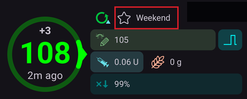
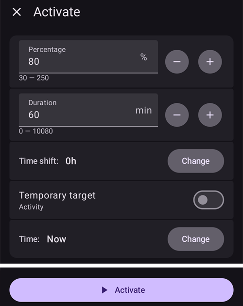
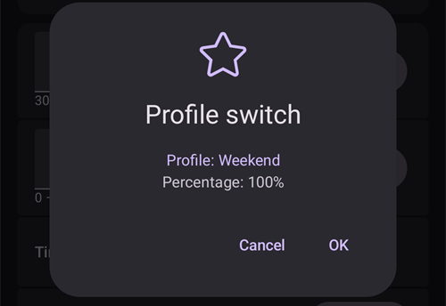
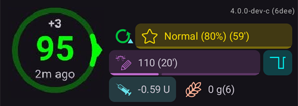
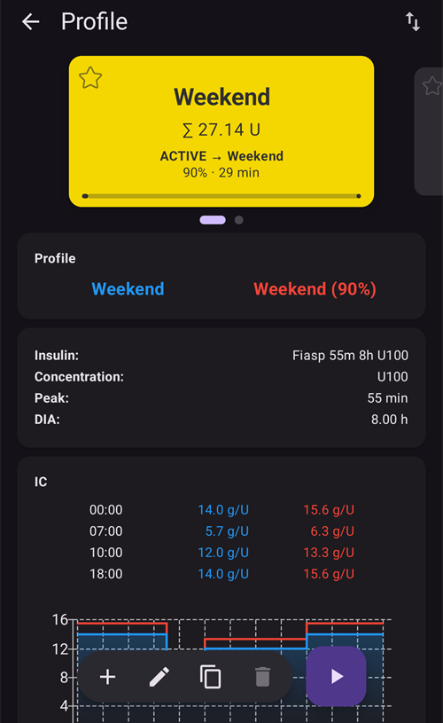
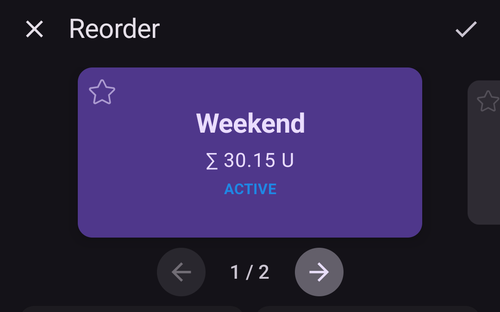
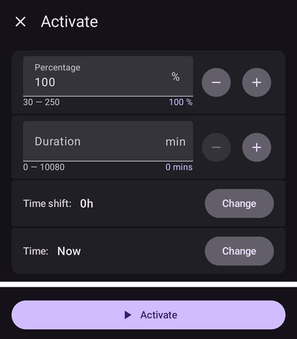
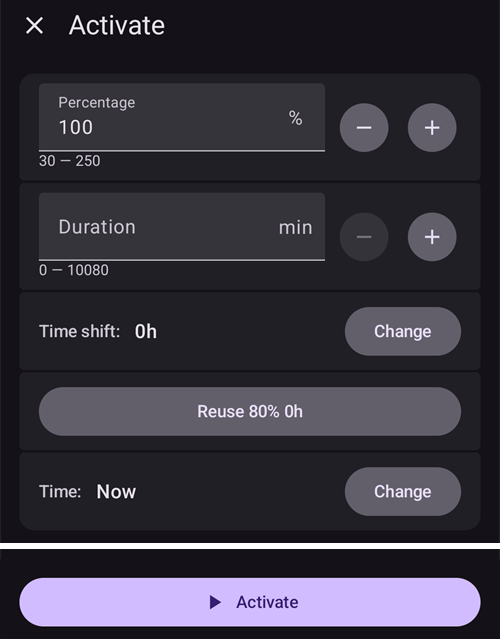
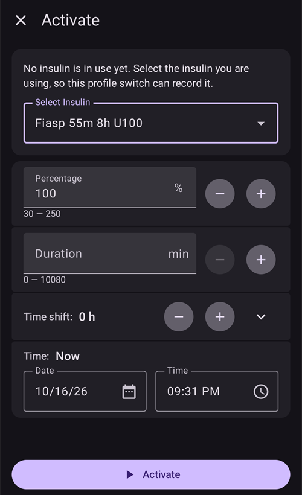
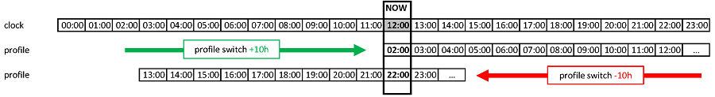

# Zamjena profila i postotak profila

Ovaj odjeljak objašnjava što su **zamjena profila** i **postotak profila**. Kako izraditi **profil**, pročitajte u [Vaš AAPS profil](#your-aaps-profile-create-and-edit-profiles).

Kada počnete koristiti **AAPS**, trebate izraditi **profil**, razumjeti kako napraviti **zamjenu profila** i naučiti kako **postotak profila** djeluje u **AAPS-u**. Značajke **zamjene profila** ili **postotka profila** mogu biti posebno korisne za:

- menstrualni ciklus – u **Automatizaciji** možete postaviti prilagodbu postotka **profila**, tako da **AAPS** uzme u obzir različite faze hormonskog ciklusa i očekivanu inzulinsku rezistenciju.

- Tjelovježba – u **Automatizaciji** možete postaviti prilagodbu postotka **profila** za tjelovježbu, kako bi se smanjio unos bazala.

- Noćni rad ili rad u smjenama – za rad u smjenama možete postaviti vremenski pomak **profila**: broj sati u **profilu** promijenite za onoliko koliko će korisnik kasnije/ranije ići spavati ili se probuditi.

Zašto koristiti **postotak profila** umjesto privremene prilagodbe bazala? Da bi bio učinkovitiji, **postotak profila** razmjerno smanjuje ili povećava bazal, ISF i I:C. Tako **AAPS** izračunava uravnoteženo doziranje inzulina za korisnika. Smanjenje bazala u korisnikovom **profilu** u **AAPS-u** malo pomaže ako algoritam i dalje koristi iste omjere za ISF i I:C.

(ProfileSwitch-change-percentage)=

## Promjena postotka profila s glavnog zaslona

Trebate barem jedan spremljeni **profil**. **Postotak profila** uvijek se primjenjuje **zamjenom profila**: ponovno aktivirate **profil**, ovaj put s postotkom.

```{admonition} Prelazite s AAPS-a 3? :class: note Dugi pritisak na naziv profila više ne otvara dijaloški okvir za zamjenu profila. **Dodirnite** naziv profila, a zatim dodirnite okrugli gumb **▶** dolje desno: otvara iste postavke (postotak, trajanje, privremeni cilj Aktivnost).

    <br />1. Na glavnom zaslonu **dodirnite naziv profila** (pored ikone zvjezdice). [Zaslon profila](#ProfileSwitch-manage-v4) otvara se na kartici **profila** koji je trenutačno aktivan, označenoj s **AKTIVAN**.
    
       
    
    2. Ako želite zadržati isti **profil**, ostavite odabranu karticu **AKTIVAN**. Ako istovremeno želite promijeniti **profil**, prijeđite prstom na drugu karticu.
    3. Dodirnite okrugli gumb **▶** (**Aktiviraj**) dolje desno. Otvara se zaslon **Aktiviraj**.
    4. Postavite **Postotak** gumbima **−** / **+** (u koracima od 5 %) ili ga upišite (od 30 do 250 %). Polje uvijek počinje od **100 %**: ne prikazuje postotak koji je trenutačno aktivan. Na primjer, unesite **80** za 20 % manje inzulina ili **120** za 20 % više.
    5. Postavite **Trajanje** u minutama:
       * **0** zadržava novi postotak dok ne napravite novu **zamjenu profila**;
       * svaka druga vrijednost završava zamjenu nakon tog vremena, a **AAPS** se vraća na **profil** koji je bio aktivan prije.
    
       
    
    6. Dodirnite **▶ Aktiviraj** na dnu zaslona. Provjerite sažetak u dijaloškom okviru **Zamjena profila** i dodirnite **U redu**.
    
       
    
    Na glavnom zaslonu naziv profila sada prikazuje postotak i preostalo vrijeme, na primjer *Normal (80%) (59')*, i postaje žut dok traje zamjena s trajanjem. Zvjezdica označava zamjenu na grafu glukoze. Pogledajte [glavni zaslon](#aaps-screens-profile--target).
    
    
    
    Ako se želite **vratiti na 100 %** prije kraja, ponovite korake i ostavite **Postotak** na 100 i **Trajanje** na 0.
    
    ```{admonition} Postoci jednim dodirom
    :class: tip
    Ako često koristite isti postotak (sport, bolest), dodajte [prečac profila](#profile-shortcuts) na traku Brzog pokretanja ili izradite [scenu](Scenes.md). Oboje jednim dodirom primjenjuje profil s unaprijed zadanim postotkom i trajanjem.
    

(ProfileSwitch-manage-v4)=

## Upravljanje profilima i njihovo aktiviranje (Upravljanje → Profil)

U **AAPS-u** v4 profilima se upravlja i aktiviraju se na zaslonu **Upravljanje** (donja navigacija) → **Profil** (*„Upravljajte profilima i aktivirajte ih“*).

Zaslon profila prikazuje vaše profile kao **niz kartica koje listate prstom**. Kartica aktivnog profila označena je s **AKTIVAN** i prikazuje njegov ukupni dnevni bazal (npr. *∑ 30,15 J*). Ispod odabrane kartice vidite detalje tog profila – vrstu **inzulina** te rasporede **IC**, **ISF**, **bazala** i **cilja** s grafovima.

Dok traje privremena zamjena, kartica **AKTIVAN** prikazuje njezin postotak i vremenski pomak s preostalim vremenom, na primjer *110% +2 h · 2 h 40 min*, iznad trake napretka. Oboje se osvježava svakih 30 sekundi. Detalji ispod tada imaju dva stupca: vrijednosti profila plavom bojom i vrijednosti koje se koriste s postotkom crvenom bojom.



Gumbi na dnu djeluju na **odabrani** profil: **➕ Dodaj**, **✏️ Uredi**, **⧉ Kloniraj** i **‘️ Izbriši**, a desno je okrugli gumb **▶ Aktiviraj**. Kako ispuniti četiri rasporeda u uređivaču (IC / ISF / BAS / TARG), pročitajte u [Izrada i uređivanje profila](#your-aaps-profile-create-and-edit-profiles).

**⧉ Kloniraj** koristi ikonu s dva kvadrata koja često znači *kopiraj*, ali nema što zalijepiti: kopiju izrađuje u jednom koraku. Potvrdite *Klonirati profil „Normal“?* i novi profil s nazivom *Normal kopija* dodaje se na kraj niza kartica i odabire, spreman za **✏️ Uredi** (gdje ga možete i preimenovati). To nije isto kao kloniranje prošle **zamjene profila** iz povijesti tretmana, koje izrađuje novi profil *s primijenjenim postotkom i vremenskim pomakom*. Pogledajte [Spremite zamjenu profila za kasnije](#ProfileSwitch-keep-for-later).

(ProfileSwitch-read-only-mode)= **Samo gumb ▶ Aktiviraj?** Vaše postavke su zaštićene, pa se zaslon otvara samo za čitanje. Dodirnite **✏️ olovku** na gornjoj traci i unesite lozinku za postavke. Pogledajte [Zaštita postavki sada zaključava i zaslone za upravljanje](#v4changes-read-only-management).

### Promjena redoslijeda profila

Ako imate više od jednog profila, možete odabrati njihov redoslijed u nizu kartica: dodirnite ikonu **Promijeni redoslijed** (⇅, dvije strelice prema gore i prema dolje) na gornjoj traci. Umjesto pokazatelja stranice pojavljuju se **gumbi za pomicanje ◀ / ▶** s prikazom *položaj / ukupno* – pomaknite središnju karticu ranije ili kasnije, a zatim potvrdite s **✓** (ili odbacite s **✕**). Novi redoslijed sprema se jednom, kada potvrdite.



### Aktiviranje profila

Odaberite profil i dodirnite **▶ Aktiviraj**. Zaslon **Aktiviraj** omogućuje vam da prilagodite kako se primjenjuje **zamjena profila**:



- **Postotak** (30–250 %, svaki put počinje od 100 %) – mijenja cijeli profil razmjerno. 100 % koristi profil bez promjene; na primjer, 70 % smanjuje bazal i izračunatu dozu inzulina (i boluse za obrok i korekcije) za 30 %. Ne mijenja vaše ciljne vrijednosti glukoze ni apsorpciju ugljikohidrata. Cijeli učinak opisan je u [Postotak profila](#ProfileSwitch-profile-percentage).
- **Trajanje** (0–10080 minuta, to jest do 7 dana) – koliko dugo traje zamjena. **0 = neograničeno** (dok ponovno ne zamijenite profil); vrijednost različita od nule vraća prethodni profil kada istekne.
- **Privremeni cilj / Aktivnost** – pojavljuje se samo kada postavite **Trajanje** i **Postotak** manji od 100 %. Uključite ga ako za isto trajanje želite pokrenuti i [privremeni cilj Aktivnost](#TempTargets-activity-temp-target), kao što biste učinili prije tjelovježbe.
- **Vremenski pomak** – prikazuje *0h*; dodirnite **Promijeni** za pomicanje rasporeda unaprijed ili unatrag za najviše 23 sata (korisno za rad u smjenama ili putovanja). Pogledajte [Vremenski pomak](#ProfileSwitch-ProfilePercentage-time-shift-of-the-circadian-percentage-profile).
- **Ponovno koristi** – pojavljuje se kada aktivna zamjena ima postotak različit od 100 % ili vremenski pomak, na primjer **Ponovno koristi 80% 0h**. Dodirnite ga da biste ispunili isti postotak i vremenski pomak, na primjer za produženje zamjene koja uskoro završava.
    
    

- **Vrijeme** – zadano je *Sada*. Možete odabrati drugo vrijeme, do 24 sata prije ili poslije sadašnjeg trenutka. Zamjena postavljena u budućnosti počinje u to vrijeme; privremeni cilj Aktivnost postavljen s njom tada također počinje u to vrijeme.
    
    

- **Bilješke** – prikazuju se samo ako je uključeno [Prikaži bilješke u dijaloškim okvirima](#Preferences-show-notes-field-in-treatments-dialogs).

Ako bazalne stope uz odabrani postotak nisu kompatibilne s vašom pumpom, na vrhu se pojavljuje upozorenje, a **▶ Aktiviraj** ostaje onemogućen: odaberite drugi postotak.

Dodirnite **▶ Aktiviraj**, a zatim **U redu** u dijaloškom okviru za potvrdu. Kartica aktivnog profila tada nosi oznaku **AKTIVAN**.

```{admonition} Vaša pumpa može zaokružiti bazalne stope :class: note Svaka pumpa može davati bazalne stope samo u vlastitim koracima (na primjer 0,05 J/h), pa zaokružuje stope vašeg **profila**. **AAPS** tada koristi bazal koji pumpa stvarno daje, pa aktivni inzulin (IOB) i TDD ostaju točni. Ako pumpa daje malo više ili manje inzulina dnevno od vašeg **profila**, obavijest *„Bazalni profil u pumpi je ažuriran“* govori vam koliko, na primjer *„daje 10,00 J dnevno umjesto 10,12 J“*.

Ako pumpa javi bazal koji je daleko od vašeg **profila**, **AAPS** zadržava bazal iz **profila** i traži da provjerite bazalne stope u pumpi.

    <br />```{admonition} S postotkom i vremenskim pomakom jedan profil vrijedi za mnogo situacija
    :class: note
    Umjesto izrade mnogo sličnih profila, zadržite jedan osnovni profil i primijenite ga s drugim **postotkom** ili **vremenskim pomakom** za situacije koje se ponavljaju (bolest, tjelovježba, putovanje). Upravo to automatiziraju [scene](Scenes.md).
    

Zamjena profila nije ograničena na ovaj zaslon. Istu zamjenu možete pokrenuti i sa **sata s Wear OS-om**, s uparenog **klijenta** (pogledajte [Upravljanje glavni uređaj ↔ klijent](../RemoteFeatures/ClientMasterControl.md)), **[scenom](Scenes.md)** ili pravilom **Automatizacije**.

(ProfileSwitch-profile-percentage)=

## Postotak profila

Važno je da korisnik razumije osnovne značajke **postotka profila**. Kada **zamjeni profila** zadate povećanje ili smanjenje u postotku, korisnikove postavke iz **profila** povećavaju se ili smanjuju za isti postotak.

Na primjer: **zamjena profila** na 130 % (znači da je korisnik 30 % otporniji na inzulin) reći će **AAPS-u** da

- **poveća** bazalnu stopu za 30 %; 
- **smanji** **ISF**: dijeljenjem s 1,3;
- **smanji** **I:C** dijeljenjem s 1,3.

Zapamtite: niži **ISF** ili **I:C** znači jači omjer i više isporučenog inzulina. Novi korisnici **AAPS-a** to lako previde.

Nakon odabira **AAPS** prilagođava zadanu bazalnu stopu, a **AAPS** (otvorena ili zatvorena petlja) nastavlja raditi na temelju odabranog postotka **profila**.

Učinak postotka **profila** prikazan je u tablici ispod:

| Zamjena profila  
Postotak |     Učinak     |     I:C  
g/J     | Primjer  
15 g |          ISF  
mmol/L/J  
mg/dL/J          | J za sniženje  
2mmol/L  
40mg/dL |
|:--------------------------:|:--------------:|:-----------------:|:--------------:|:------------------------------------------:|:---------------------------------:|
|            90%             |    Slabije     | 5/0,9  
=**5,55** |     2,7 J      | 2,2/0,9  
=**2,4**  
  
40/0,9  
=**44,4** |               0,8 J               |
|          **100%**          | **Standardno** |       **5**       |    **3 J**     |                **2,2  
40**                |             **0,9** J             |
|            130%            |      Jače      | 5/1,3  
=**3,85** |     3,9 J      | 2,2/1,3  
=**1,7**  
  
40/1,3  
=**30,8** |               1,2 J               |

(ProfileSwitch-ProfilePercentage-time-shift-of-the-circadian-percentage-profile)=

## Vremenski pomak cirkadijalnog postotnog profila

„Vremenski pomak“ u korisnikovom **profilu** pomiče postavke **profila** unutar dnevnog sata („cirkadijalno“) za uneseni broj sati. To može biti korisno za:

- **noćni rad ili rad u smjenama**: za noćne smjene broj sati u **profilu** promijenite za onoliko koliko će korisnik kasnije/ranije ići spavati ili se probuditi; 
- **korisnike koji na putovanju mijenjaju vremensku zonu**; ili
- **djecu s dijabetesom tipa 1** koja imaju stalnu večernju rutinu i inzulinsku rezistenciju uzetu u obzir u **profilu**. Ako se iz bilo kojeg razloga očekuje da će dijete kasnije ići spavati, njegovatelj može primijeniti „vremenski pomak“ na djetetov **profil**, tako da **AAPS** reagira na inzulinsku rezistenciju u razdoblju koje je odredio korisnik.

Uvijek je pitanje postavke kojeg sata u **profilu** trebaju zamijeniti postavke trenutačnog vremena. Ovo vrijeme treba pomaknuti za x sati. Zato pazite na smjerove kako je opisano u sljedećem primjeru:

- Trenutačno vrijeme: 12:00
- **Pozitivni** vremenski pomak 
    - 2:00 **+10 h** -> 12:00
    - Zbog pozitivnog vremenskog pomaka koristit će se postavke od 2:00 umjesto postavki koje se inače koriste u 12:00.
- **Negativni** vremenski pomak 
    - 22:00 **-10 h** -> 12:00
    - Zbog negativnog vremenskog pomaka koristit će se postavke od 22:00 umjesto postavki koje se inače koriste u 12:00.



Ovaj način spremanja snimki **profila** omogućuje mnogo točniji izračun prošlosti i praćenje promjena **profila**.

(ProfileSwitch-keep-for-later)=

## Spremite zamjenu profila za kasnije

Nakon što napravite zamjenu profila s postotkom i/ili vremenskim pomakom, ovaj privremeni profil možete kopirati u novi profil.

Za to otvorite izbornik (☰) → **Tretmani** i idite na karticu **Zamjena profila**, pogledajte [Kloniranje zamjene profila u novi profil](#your-aaps-profile-clone-profile-switch).