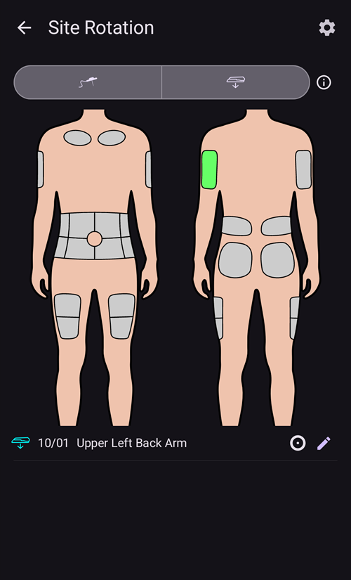

# Pumpe i kanile

## Promjena infuzijskih setova: spremnici inzulina i kanile

Postupak opisan u nastavku vrijedi samo za pumpe s cijevi. Ne vrijedi za pumpe bez katetera kao što su Omnipod, Medtrum Nano, Accu-Chek Solo itd. Ovaj postupak se ponekad naziva „promjena seta“. „Potpuna“ promjena seta uključuje spremnik inzulina i kanilu, a „djelomična“ promjena seta znači promjenu samo kanile.

Pumpe bez katetera same se pune u svom čarobnjaku za aktivaciju, a njihova kanila je već u tijelu. **AAPS** za njih ne nudi punjenje: **Punjenje** se ne prikazuje na ploči **Upravljanje** ni u brzom pokretanju. Pogledajte stranicu svoje pumpe u [Kompatibilne pumpe](../Getting-Started/CompatiblePumps.md).

Fizička zamjena uloška/spremnika ne može se obaviti putem **AAPS**-a, nego se mora obaviti izravno na pumpi. Nakon toga te promjene morate ručno zabilježiti u **AAPS**-u.

(pumps-cannulas-changing-reservoir-and-cannula)=
### Upute za zamjenu spremnika pumpe i kanile

1. U **AAPS**-u odspojite pumpu: pritisnite [ikonu petlje](#AapsScreens-loop-status) na glavnom zaslonu i odaberite **Odspoji pumpu** na 1 sat. Ikona se mijenja u sivi utikač, što znači da je pumpa odspojena.

2. Fizički zamijenite spremnik inzulina: fizički odspojite pumpu od tijela i zamijenite spremnik/uložak i kanilu prema uputama proizvođača.

3. Napunite cijev i kanilu: to možete učiniti izravno na pumpi. Svakako uklonite sve mjehuriće zraka iz cijevi.

4. Pričvrstite novu kanilu na tijelo. Kada umetnete kanilu i izvadite iglu, u spojenoj kanili ostaje mali zračni prostor koji također treba napuniti. To announce this in **AAPS** and prime the site: open **Prime/Fill** (in the expanded status panel on the main screen, in the **Manage** sheet, or as a [QuickLaunch](QuickLaunch.md) button) and tick **Record pump site change** and/or **Record insulin cartridge change** as appropriate to record the change. Sada pritisnite zadanu količinu za punjenje kanile (obično oko 0,3 J, ali provjerite je li ta vrijednost točna za vašu kanilu) i odaberite **U redu**. Pročitajte sažetak i potvrdite punjenje dodirom na **U redu**.

   


5. Ponovno spojite pumpu u **AAPS**-u: pritisnite ikonu sivog utikača i odaberite **Ponovno spoji pumpu** kako biste nastavili s petljom.

### Korisne informacije o promjeni inzulina/kanile

* Bilježenje promjene mjesta primjene pumpe vraća Autosens na 100 %. Također vraća na početak odgovarajuće statusne oznake i starost kanile/inzulina na glavnom zaslonu **AAPS**-a.

* Zadane količine za punjenje možete postaviti/prilagoditi u postavkama **Punjenje** — upišite „prime“ u traku za pretraživanje na glavnom zaslonu da ih otvorite (pogledajte [Postavke](../SettingUpAaps/Preferences.md)). U uputama u kutiji s kanilama pogledajte koliko jedinica (ovisno o duljini igle i duljini cijevi) treba upotrijebiti za punjenje vaše kanile.

* Inzulin isporučen funkcijom punjenja **AAPS** ne uzima u obzir pri izračunu aktivnog inzulina (IOB), a u [Povijesti tretmana](#aaps-screens-treatments) označen je kao „Punjenje katetera“.

* **AAPS** također ne uzima u obzir inzulin koji je dan bolusom iz pumpe dok je pumpa bila odspojena. Ako date bolus izravno iz pumpe dok je **AAPS** odspojen, nakon ponovnog spajanja pumpe možete taj inzulin zabilježiti (bez davanja bolusa) u dijalogu **Inzulin** (pogledajte [Kako zabilježiti isporučeni inzulin bez stvarnog davanja bolusa](#pumps-cannulas-announce-insulin) u nastavku).

### Problemi s kanilom, mjestom infuzije, cijevi i/ili pumpom

Ako ste sigurni da neko vrijeme niste dobili inzulin, iako **AAPS** bilježi da jeste, i točno znate kada je problem počeo (_npr._ izvadite kanilu i vidite da se savila pri umetanju), to možete ispraviti u **AAPS**-u. Imajte na umu da je inzulin možda ipak isporučen, ali iz nekog razloga djeluje sporo.

```{admonition} Caution - Risk of Hypoglycemia
:class: danger
Isporuku inzulina iz **AAPS**-a brišite samo uz KRAJNJI oprez, jer je inzulin _možda_ ipak isporučen, i pažljivo pratite GUK sljedeća 24 h.
```

Da biste uklonili boluse i SMB-ove za koje znate da nisu isporučeni, otvorite **izbornik** (☰), odaberite [Povijest tretmana](#aaps-screens-treatments) i na kartici **Ugljikohidrati i bolus** oprezno izbrišite zabilježene boluse od trenutka kada se problem dogodio. Time ćete ispraviti vrijednost aktivnog inzulina (IOB), koja je ključna za izračune **AAPS**-a; ako se sada vratite na glavni zaslon, vidjet ćete da se aktivni inzulin (IOB) smanjio. Imajte na umu da ne možete izbrisati bazalni inzulin za koji **AAPS** izračuna da je isporučen, pa će ga **AAPS** i dalje uzimati u obzir.

Kod manje očitih problema s isporukom inzulina, _npr._ curenja, začepljenja ili tuneliranja, kada niste sigurni kada je problem počeo ili mislite da je dio inzulina ipak isporučen, morate biti oprezni. Takve probleme možete otkriti po „mirisu“ inzulina, po mokrom flasteru, po visokim vrijednostima glukoze ili po alarmu. Budući da nikada nećete znati koliko je inzulina ušlo u kožu (a mogao bi početi djelovati nakon nekog vremena), bit će teško odrediti točnu količinu inzulina koju treba oduzeti od trenutne vrijednosti aktivnog inzulina (IOB). Jedna strategija je pauzirati petlju na 5 sati (ili koliko traje vaše trajanje djelovanja inzulina) nakon što riješite problem s isporukom inzulina, a zatim ponovno nastaviti s petljom. Tako će aktivni inzulin (IOB) biti točan kada ponovno pokrenete petlju.

(pumps-cannulas-disconnecting)=
## Odspajanje pumpe za tuširanje ili aktivnost

Ako skidate pumpu za tuširanje, kupanje, plivanje, kontaktne sportove ili druge aktivnosti, morate javiti **AAPS**-u da se inzulin ne isporučuje, kako bi aktivni inzulin (IOB) ostao točan. Pumpu možete odspojiti pomoću [ikone petlje](#AapsScreens-loop-status) na glavnom zaslonu: pritisnite je i odaberite **Odspoji pumpu** s trajanjem koje vam treba. Ako aktivnost traje dulje nego što ste planirali, ponovno otvorite isti dijalog i odaberite novo trajanje pod **Odspoji pumpu**: odspajanje se produljuje, a novo trajanje počinje od sada. Ne morate se prvo ponovno spojiti.

Dok je pumpa odspojena, ne dobivate inzulin, pa biste se trebali ponovno spojiti svaka dva sata i nadoknaditi propušteni bazal. To možete učiniti tako da se spojite i date bolus u iznosu propuštenog bazala (_npr._ za zadnja dva sata), a zatim se ponovno odspojite. To bi trebalo pomoći da izbjegnete ozbiljan nedostatak inzulina koji može dovesti do dijabetičke ketoacidoze (DKA). Ako je ponovno spajanje pumpe tijekom aktivnosti nepraktično (mjesto kanile je pokriveno ronilačkim odijelom _itd._), razmislite o injekciji penom. Ovu ručnu injekciju možete zabilježiti u **AAPS**-u i ne morate je zabilježiti u trenutku injekcije (samo zapišite vrijeme injekcije), jer pri ponovnom spajanju pumpe možete zabilježiti inzulin i postaviti stvarno vrijeme kada je dan.

(pumps-cannulas-announce-insulin)=
## Kako zabilježiti isporučeni inzulin bez stvarnog davanja bolusa

To announce insulin delivered from the pump either while **AAPS** was disconnected, or from pen injections: open the [Insulin dialog](#aaps-screens-buttons-insulin) (**Treatments** in the bottom navigation, or a QuickLaunch button), enter the amount in units and enable **Bolus will be recorded only (not delivered by pump)**. Redak **Vrijeme** (postavljen na **Sada**) zatim vam omogućuje da upišete stvarno vrijeme injekcije: možete ga zanemariti ako je injekcija dana nedavno. Ako je bolus dan prije nekog vremena, pomoću **-** pomaknite vrijeme unatrag (_npr._ -30 min) ili otvorite redak strelicom i odaberite točan datum i vrijeme. **AAPS** će tada uzeti u obzir trajanje djelovanja inzulina i prema tome izračunati preostali inzulin koji je još u tijelu.

Ako **AAPS** koristite kao njegovatelj, pumpu možete vrlo lako daljinski odspojiti (i ponovno spojiti) putem [SMS naredbe](../RemoteFeatures/SMSCommands.md), s naredbama kao što su „pump disconnect 120“ i „pump connect 120“. Trajanje daljinskog odspajanja može biti od 1 do 120 min (u ovom primjeru je 120 minuta). To je vrlo korisno ako vam telefon s **AAPS**-om nije lako dostupan, npr. kada je zakopan u pojasu za pumpu na djetetu koje trči prema bazenu, ili ga tinejdžer pažljivo čuva (ili koristi).

## Ponovno spajanje pumpe nakon aktivnosti

Nakon duljeg odspajanja (1–2 sata) prilično je često da **AAPS** izračuna da sada imate negativan aktivni inzulin (IOB). Kada ponovno spojite pumpu, ovisno o vašim željama, trenutnoj razini glukoze, planiranom obroku ili sljedećoj aktivnosti, možete:

a) Samo ponovno spojiti pumpu u **AAPS**-u (iz sive u zelenu, za zatvorenu petlju) i prepustiti **AAPS**-u da ponovno počne isporučivati inzulin

_ili_

b) Ako želite biti agresivniji (na primjer, idete prema hiperglikemiji), možete otvoriti [Bolus kalkulator](#aaps-screens-bolus-wizard) i dati bolus za nula ugljikohidrata, kako bi se izračunati nedostajući inzulin odmah isporučio kao bolus.

Koja vam strategija više odgovara vrlo je osobno, a najbolje ćete to otkriti isprobavanjem.


(Aapsscreens-site-rotation)=
## Rotacija mjesta primjene

**Upravljanje → Rotacija mjesta primjene** otvara dijalog Rotacija mjesta primjene u načinu prikaza:

- S dva gumba na vrhu (ikona kanile i ikona senzora) možete prikazati samo mjesta kanile, samo mjesta senzora ili oboje
- All Cannula change and Sensor change events from the past 45 days are available.
- Kliknite na područje mjesta ili na jedan unos u popisu ispod kako biste filtrirali popis samo na unose u odabranom području. Odabrano područje bit će istaknuto svijetlozelenom bojom.
- Dodirnite ikonu **olovke** pokraj unosa da otvorite prikaz za uređivanje i promijenite mjesto primjene, strelicu ili bilješku


- Ikona **zupčanika** (gore desno) otvara postavke: **Korisnički profil za rotaciju mjesta** otvara dijalog u kojem birate **Muškarac**, **Žena** ili **Dijete**, a prekidači **Upravljaj rotacijom mjesta pumpe** i **Upravljaj rotacijom mjesta CGM-a** određuju kojim mjestima upravljate.


*Note: this setting decides whether the Site Rotation dialog (Edit mode) opens automatically when a new entry is made with the "Prime/Fill" button or the "Sensor Insert" button.*

- Za promjenu mjesta primjene obavljenu izravno na pumpi morate otvoriti način prikaza i urediti novi unos kako biste odabrali lokaciju i strelicu

Način uređivanja omogućuje vam da odaberete lokaciju, strelicu i bilješku za odabrani unos:

- Unos koji uređujete prikazan je ispod slika tijela, s ikonom svoje vrste (kanila ili senzor)
- Prednji i stražnji prikaz prikazani su jedan pokraj drugog: dodirnite područje na koje ste ga postavili
- Once a site is selected (highlighted in green), the list below shows all entries made in this site in the past 45 days.


- Možete dodati i strelicu (nije obavezno) dodirom na ikonu strelice desno od unosa: dijalog **Odaberi strelicu** omogućuje vam da odredite točnije mjesto ili smjer Pod-a


- Možete dodati i **Bilješku** o odabranom mjestu
- Dodirnite ikonu **spremanja** (gore desno) da zabilježite mjesto

Filtrirati možete grafički na slici ili klikom na događaj terapije u popisu Za uklanjanje filtra samo kliknite na sliku izvan svih mjesta


