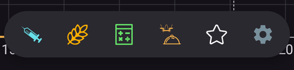
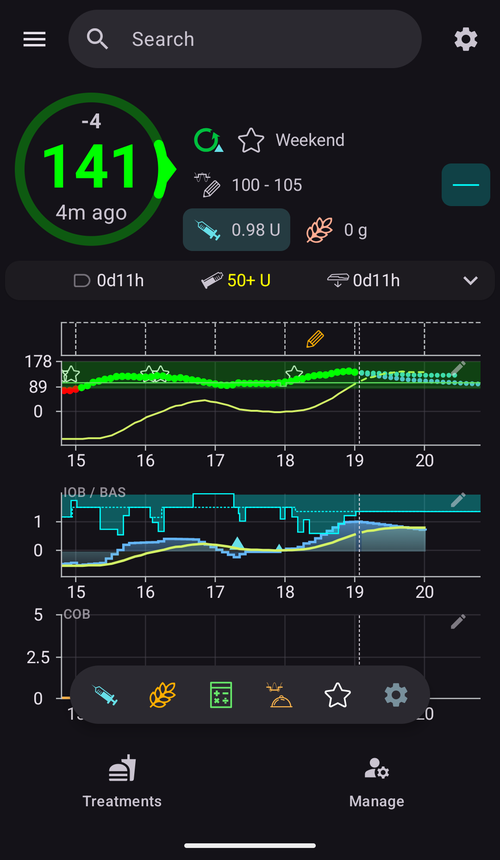
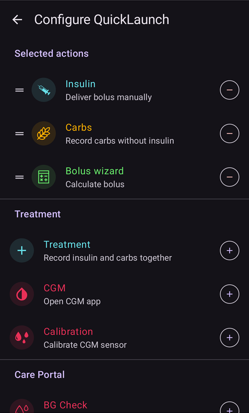
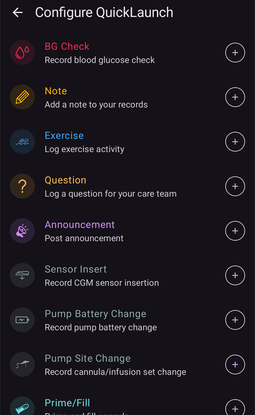
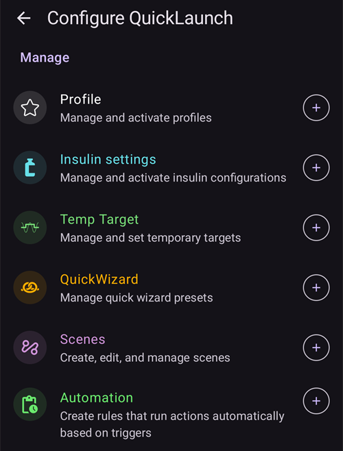
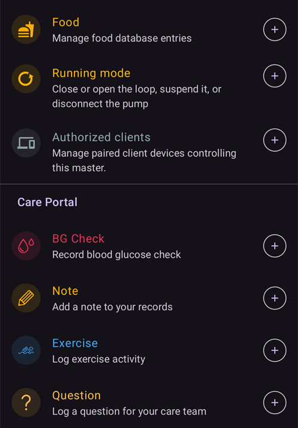
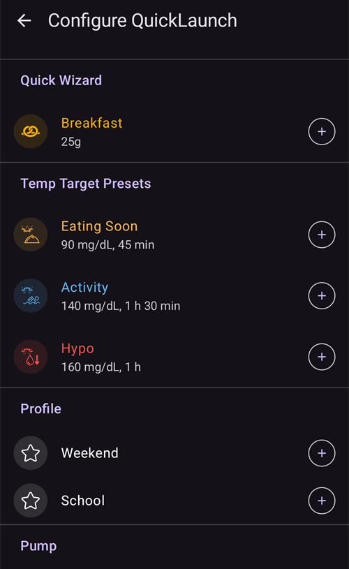
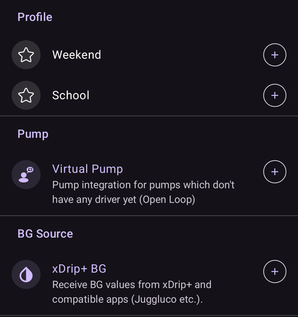
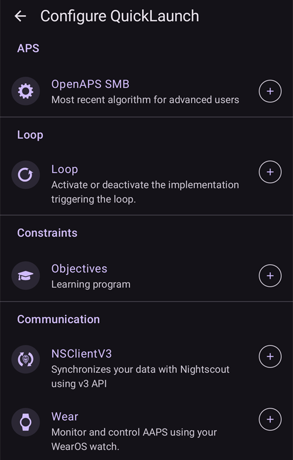

(quicklaunch)=
# Brzo pokretanje (alatna traka brzih radnji u Pregledu)

**Brzo pokretanje** je mala **alatna traka brzih radnji** na dnu zaslona Pregled u **AAPS-u**, odmah iznad donje navigacije. To je red gumba koje možete prilagoditi i koji rade jednim dodirom: vi odlučujete koje su radnje u njemu i kojim redom, pa su stvari koje najčešće radite uvijek na jedan dodir na glavnom zaslonu.

```{contents} Table of contents
:depth: 2
:local: true
```



---

## Korištenje alatne trake

Alatna traka nalazi se na zaslonu **Pregled**, između grafova i donje navigacije:



- **Dodirnite** ikonu da pokrenete njezinu radnju – točno kao da ste je otvorili s njezina uobičajenog zaslona (bolus ili tretman i dalje najprije prikazuje uobičajenu potvrdu).
- **Dugo pritisnite** ikonu da vidite **opis** s nazivom radnje i kratkim objašnjenjem.
- Ako dodate **više gumba nego što stane** na zaslon, dodatni gumbi prelaze u **izbornik s dodatnim stavkama** (gumb **⋮** na kraju alatne trake).
- Svaka ikona zadržava **boju** svoje radnje (npr. inzulin, ugljikohidrati, privremeni cilj), pa je lako prepoznate na prvi pogled.

```{admonition} The toolbar is always there
:class: note
Posljednji gumb je uvijek **Postavi brzo pokretanje** (zupčanik **⚙️**). Ne može se ukloniti, pa uvijek možete doći do zaslona postavki izravno s alatne trake. Prema zadanim postavkama alatna traka ima samo dva gumba – **Bolus kalkulator** i ovaj zupčanik.
```

---

## Postavljanje brzog pokretanja

Dodirnite zupčanik **⚙️** na alatnoj traci (ili otvorite **[Konfiguracija](../SettingUpAaps/ConfigBuilder.md) → … → Postavi brzo pokretanje**) da otvorite zaslon **Postavi brzo pokretanje** (*„Prilagodite gumbe za brze radnje na pregledu“*).



Zaslon ima dva dijela:

- **Odabrane radnje** (na vrhu) – gumbi koji su sada na vašoj alatnoj traci, redom kao na alatnoj traci.
- **Katalog** ispod toga – sve radnje koje možete dodati, grupirane po kategorijama. Svaka stavka kataloga ima gumb **➕** za dodavanje.

### Odabrane radnje – promjena redoslijeda, uređivanje, uklanjanje

Svaka odabrana radnja ima:

- **⠿ ručku za povlačenje** – pritisnite i povucite da **promijenite redoslijed** gumba (redoslijed ovdje je redoslijed na alatnoj traci),
- gumb **−** – **uklanja** radnju s alatne trake,
- i, samo za prečac **Profil**, gumb **✏️** za uređivanje postotka/trajanja (pogledajte [Prečaci profila](#profile-shortcuts)).

Promjene vrijede **odmah** – nema posebnog gumba *Spremi*. Dodana radnja ide na kraj alatne trake; odatle joj možete promijeniti mjesto.

---

## Kategorije radnji

Katalog grupira sve što možete dodati u sljedeće kategorije, ovim redom. Kategorije u kojima nema ničega (npr. nemate nijednu scenu) jednostavno se ne prikazuju.

### Tretman

Svakodnevni dijalozi za tretmane i CGM:

- **Inzulin** – ručno isporučite bolus.
- **UH** – zabilježite ugljikohidrate bez inzulina.
- **Bolus kalkulator** – otvorite bolus kalkulator.
- **Tretman** – zabilježite inzulin i ugljikohidrate zajedno.
- **CGM** – otvorite svoju CGM aplikaciju (npr. xDrip).
- **Kalibracija** – kalibrirajte CGM senzor.

### Careportal

Događaji Careportala i zapisi o održavanju uređaja:

- **Provjera GUK-a**, **Bilješka**, **Tjelovježba**, **Pitanje**, **Objava**,
- **Umetanje senzora**, **Zamjena baterije pumpe**, **Promjena mjesta primjene pumpe**, **Punjenje**, **Rotacija mjesta primjene**.

**Punjenje** i **Zamjena baterije pumpe** nude se samo ako ih vaša pumpa koristi. Pumpe bez katetera, na primjer, pune spremnik i mijenjaju bateriju u svojim koracima aktivacije, pa se te stavke za njih ne prikazuju (isto kao na ploči **Upravljanje**).



To su iste stavke do kojih inače dolazite preko ploča **[Tretmani](#v4changes-treatments)** i **[Upravljanje](#v4changes-manage)** – Brzo pokretanje samo stavlja one koje koristite na zaslon Pregled.

### Upravljanje

Zasloni s ploče **[Upravljanje](#v4changes-manage)**, istim redom, pa onaj koji najčešće koristite možete otvoriti s alatne trake:

- **Profil**, **Postavke inzulina** (upravljanje konfiguracijama inzulina i njihova aktivacija – namjerno se zove drukčije od gumba **Inzulin**, jer taj gumb isporučuje bolus), **Privremeni cilj**, **Brzi kalkulator**, **Scene**, **Automatizacija**, **Hrana**,
- **Način rada** – zatvorite ili otvorite petlju, suspendirajte je ili odspojite pumpu,
- **Ovlašteni klijenti** – samo na glavnom uređaju ili na uparenom klijentu.

Ovi gumbi otvaraju zaslon; sami ništa ne pokreću. Da biste scenu ili brzi kalkulator pokrenuli jednim dodirom, dodajte ih iz kategorije **Scene** ili **Brzi kalkulator** niže.

 

### Brzi kalkulator

Svaki vaš predložak **[Brzog kalkulatora](QuickWizards.md)** možete dodati kao gumb, pa je obrok koji se ponavlja na jedan dodir od zaslona Pregled. Gumb nosi naziv predloška i prikazuje količinu ugljikohidrata/inzulina; dodir na njega pokreće Brzi kalkulator s uobičajenom potvrdom.

Brzi kalkulatori koji su postavljeni da se prikazuju samo na satu ne nude se. Gumb Brzog kalkulatora na alatnoj traci slijedi ista pravila kao na ploči **Tretmani**: skriven je izvan svog [valjanog vremenskog raspona](#quickwizard_validity) i kratko vrijeme nakon korištenja. Ostaje u postavkama vaše alatne trake i vraća se kada se Brzi kalkulator ponovno može koristiti.

### Scene

Svaku omogućenu **[scenu](Scenes.md)** možete dodati kao gumb. Dodir na nju traži potvrdu, a zatim aktivira scenu (isti skup radnji koji biste dobili sa zaslona Scene). Ova kategorija prikazuje se samo ako imate barem jednu scenu.

Opis i katalog prikazuju isti sažetak kao **Upravljanje → Scene**, na primjer *„3 radnje, 2 h → Hlađenje“*, gdje je naziv iza strelice sljedeća scena.

### Automatizacija

Vaša pravila automatizacije s **korisničkom radnjom** (ona koja pokrećete ručno) možete dodati kao gumbe. Dodir na jedan od njih traži potvrdu, a zatim izvršava radnje tog pravila.

```{admonition} Automation buttons run on the master
:class: note
Automatizacija se izvršava na **glavnom uređaju**, pa se prečaci automatizacije nude i pokreću samo na glavnom uređaju. Nisu dostupni na uparenom **[klijentu](../RemoteFeatures/ClientMasterControl.md)**.
```

### Predlošci privremenih ciljeva

Svaki vaš predložak **[privremenog cilja](TempTargets.md)** možete dodati kao gumb (prikazuju se njegov naziv, ciljna vrijednost i trajanje, na primjer *„Prije obroka – 5,0 mmol/L, 45 min“*). Dodir na njega traži potvrdu, a zatim pokreće taj privremeni cilj.



(profile-shortcuts)=
### Profil

Svaki **[profil](ProfileSwitch-ProfilePercentage.md)** možete dodati kao **prečac** koji jednim dodirom izvodi **zamjenu profila**. Za razliku od većine prečaca, prečac profila ima vlastiti **postotak** i **trajanje**, koje postavljate nakon dodavanja gumbom **✏️**:

- **Postotak** (30–250 %, u koracima od 5 %) – mijenja jačinu profila kada se primijeni. 100 % koristi profil bez promjene.
- **Trajanje** (0–10080 min, to je do 7 dana, u koracima od 10 min) – koliko dugo traje zamjena. **0 = Trajno** (dok ponovno ne zamijenite profil).



Tako možete imati više gumba za **isti** profil s različitom jačinom – na primjer *„Profil 100 %“* i *„Profil 70 % na 2 h“* – i primijeniti bilo koji jednim dodirom. (Isti profil možete dodati više puta s različitim postavkama.)

### Dodaci



Na kraju, svaki **omogućeni dodatak** koji ima vlastiti zaslon možete dodati kao prečac koji ga izravno otvara. Oni su grupirani po vrsti dodatka – **Pumpa**, **Izvor GUK-a**, **APS**, **Petlja**, **Detekcija osjetljivosti**, **Zaglađivanje**, **Kalibracija**, **Ograničenja**, **Komunikacija** i **Općenito** – pa možete, na primjer, sa zaslona Pregled otići izravno na zaslon pumpe ili petlje.

---

## Brzo pokretanje i glavni uređaj/klijent

Za razliku od većine vaših postavki, **alatna traka Brzo pokretanje postavlja se za svaki uređaj posebno** – sprema se **lokalno i ne sinkronizira se** između glavnog uređaja i uparenih klijenata, pa svaki uređaj ima svoj skup gumba. (Ona *jest* uključena u **sigurnosnu kopiju/izvoz** postavki, pa je vraćanje kopije vraća na istom uređaju.)

Što svaki uređaj može staviti na svoju alatnu traku ipak ovisi o tome što ima: brzi kalkulatori, scene, predlošci privremenih ciljeva i profili sinkroniziraju se, pa katalog na klijentu nudi iste stavke – samo ih birate za svaki uređaj posebno. Nekoliko detalja koje trebate znati:

- Gumbi čiji cilj više ne postoji (izbrisani brzi kalkulator, scena ili predložak, onemogućeno pravilo) **automatski se preskaču**.
- Prečaci **automatizacije** nude se i pokreću samo na **glavnom uređaju** (automatizacija se izvršava na glavnom uređaju). Gumbi za scene, brze kalkulatore, privremene ciljeve i profile dostupni su na klijentu.
- Kada na klijentu dodirnete gumb koji se mora izvršiti na glavnom uređaju (bolus, privremeni cilj, zamjena profila ili scena), **glavni uređaj** ga izvršava i izdaje potvrdu. Pogledajte [Upravljanje glavni uređaj ↔ klijent (potpisano daljinsko upravljanje)](../RemoteFeatures/ClientMasterControl.md).

---


<!-- =====================================================================
     Screenshots captured from a real master device:
       - quicklaunch_toolbar.png    (cropped close-up of the overview toolbar pill)
       - quicklaunch_overview.png   (full overview showing the toolbar in place)
       - quicklaunch_config.png     (Configure QuickLaunch: Selected actions + Treatment + start of Manage)
       - quicklaunch_dynamic.png    (catalog: Quick Wizard / Scenes / Automation / Temp Target Presets)
       - quicklaunch_categories.png (catalog: Profile shortcuts + plugin categories)
     No QuickLaunch action was actually run (nothing delivered; only scrolled).
     Maintainers: relocate page + images and fix cross-links as needed.
     ===================================================================== -->
