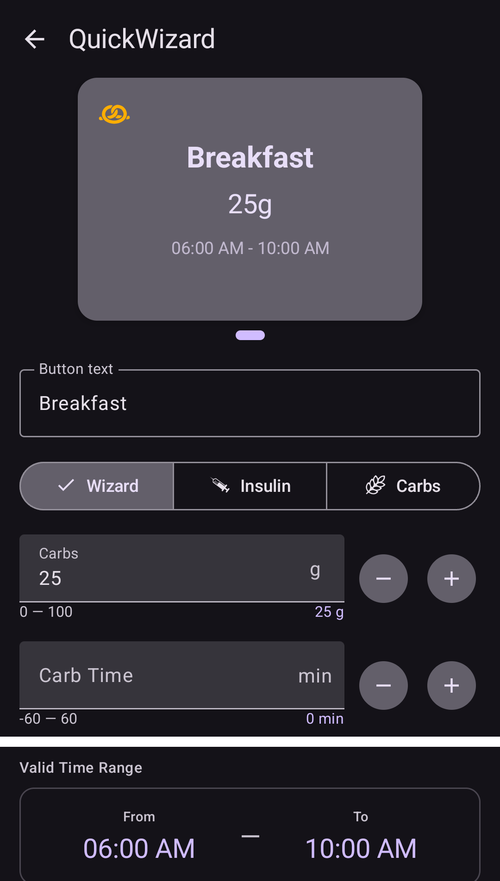
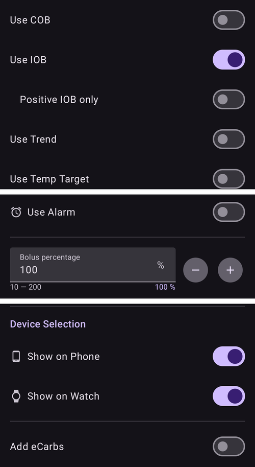
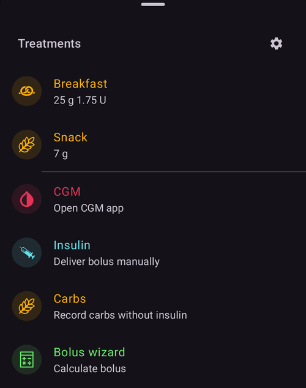
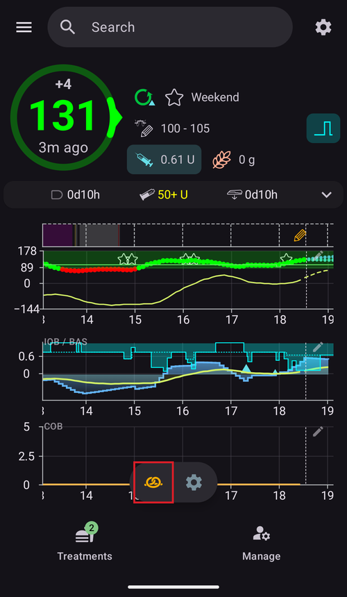
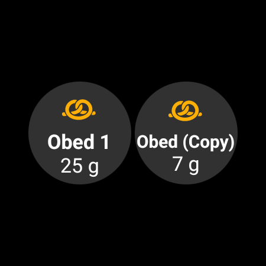

(quickwizards)=
# Brzi kalkulatori (bolusi jednim dodirom)

**Brzi kalkulator** je spremljeni gumb za jedan dodir za obrok ili situaciju koja se ponavlja. Sadrži stalnu količinu **ugljikohidrata** (i način doziranja za njih), pa možete isporučiti bolus – ili samo zapisati ugljikohidrate – jednim dodirom i potvrdom, umjesto da svaki put otvarate cijeli bolus kalkulator.

```{contents} Table of contents
:depth: 2
:local: true
```

---

## Otvaranje brzih kalkulatora

Otvorite zaslon **Upravljanje** (donja navigacija) i odaberite **Brzi kalkulator** (*„Upravljajte predlošcima brzog kalkulatora“*).

---

## Upravljanje brzim kalkulatorima

Vaši brzi kalkulatori prikazani su kao **vrtuljak kartica koje možete listati** (svaka kartica prikazuje tekst gumba, ugljikohidrate i vremenski raspon valjanosti). Uređivač ispod podešava **odabrani** brzi kalkulator; donja traka s radnjama ima **➕ dodaj**, **⧉ kloniraj**, **🗑️ izbriši** i gumb **▶** koji pokreće odabrani brzi kalkulator.



Glavna polja uređivača su:

- **Tekst gumba** – natpis koji se prikazuje na gumbu.
- **UH** i **Vrijeme ugljikohidrata** – količina ugljikohidrata i njezin vremenski pomak.
- **Vremenski raspon valjanosti** – pogledajte [Valjanost](#quickwizard_validity).
- **Opcije kalkulatora** i **Odabir uređaja** – pogledajte niže.

---

## Tri načina

Izbornik na vrhu uređivača – **Kalkulator / Inzulin / Ugljikohidrati** – određuje **što gumb radi** kada ga dodirnete:

- **Kalkulator** – pokreće cijeli **bolus kalkulator** za postavljene ugljikohidrate, uz vaše trenutne **GUK, aktivni inzulin (IOB), aktivne ugljikohidrate (COB) i trend** (prema *Opcijama kalkulatora* niže). Isporučuje *izračunati* bolus i zapisuje ugljikohidrate. Ovo je klasični brzi kalkulator.
- **Inzulin** – isporučuje **stalnu, unaprijed postavljenu količinu inzulina** koju ste sami postavili – bez izračuna.
- **Ugljikohidrati** – zapisuje **samo postavljene ugljikohidrate**,**bez bolusa**.

---

## Opcije kalkulatora (način Kalkulator)

Za gumb u načinu **Kalkulator** birate koje ulazne podatke izračun koristi:

- **Koristi GUK**, **Koristi aktivne ugljikohidrate**, **Koristi aktivni inzulin** (sa *Samo pozitivni aktivni inzulin*), **Koristi trend** (*Sve / Samo pozitivni / Samo negativni*), **Koristi privremeni cilj**, **Koristi alarm**.
- **Postotak bolusa** – mijenja veličinu izračunatog bolusa.
- **Dodaj eUH** – zakazuje i produžene ugljikohidrate.



---

## Valjanost – kada se gumb prikazuje

(quickwizard_validity)= **Vremenski raspon valjanosti** (*Od / Do*) određuje **kada** je brzi kalkulator prikazan i kada se može koristiti. Gumb postavljen, na primjer, na **06:00–10:00** prikazuje se samo ujutro – tako brzi kalkulator za *doručak* ne zatrpava vaš zaslon (i ne dodirnete ga greškom) za vrijeme večere. Izvan svog vremenskog prozora gumb je skriven na ploči **Tretmani** i na alatnoj traci [Brzo pokretanje](QuickLaunch.md). Gumb na alatnoj traci ne briše se: vraća se kada se vremenski prozor ponovno otvori.

Kada je vremenski raspon valjanosti kraći od 4 sata, gumb je također skriven 30 minuta nakon što ga upotrijebite, kako se isti obrok ne bi greškom unio dvaput.

---

## Mjesta pokretanja – gdje ga koristite

Prekidači u **Odabiru uređaja** određuju gdje se svaki brzi kalkulator prikazuje:

- **Prikaži na telefonu** – prikazuje se na **ploči [Tretmani](../Maintenance/V4Changes.md)** (s izračunatom dozom prikazanom izravno na gumbu). Brzi kalkulator prikazan na telefonu možete i **prikvačiti kao gumb za brzu radnju u Pregledu**: otvorite *Postavi brzo pokretanje* (⚙ na alatnoj traci [Brzo pokretanje](QuickLaunch.md)) i dodajte ga iz kategorije **Brzi kalkulator**.
- **Prikaži na satu** – prikazuje se na **Wear OS pločici Brzi kalkulator** (prijeđite prstom do nje u vrtuljku pločica na satu, zatim dodirnite gumb da ga pokrenete – kao kod [pločice Scene](#scenes-from-watch)).

```{admonition} Don't see Device Selection?
:class: note
Odjeljak **Odabir uređaja** prikazuje se u uređivaču samo kada je dodatak **Wear** omogućen i kada je njegova postavka **Upravljanje sa sata** uključena. Bez toga se svaki brzi kalkulator jednostavno prikazuje na telefonu.
```

Na telefonu se brzi kalkulatori prikazuju na vrhu donje ploče **Tretmani**:



…i kao gumb za brzu radnju u Pregledu:





Upareni **klijent** (**AAPSClient**) također može pokrenuti brzi kalkulator – **glavni uređaj** ga izračunava i isporučuje (pogledajte [Upravljanje glavni uređaj ↔ klijent (potpisano daljinsko upravljanje)](../RemoteFeatures/ClientMasterControl.md)).

Gdje god ga pokrenete, dodir na brzi kalkulator uvijek prikazuje **potvrdu** (potvrdu koju izrađuje glavni uređaj, kada ga pokrenete s klijenta ili sata) prije nego što se išta isporuči.

Brzi kalkulator se odbija kada je njegova doza veća od vašeg maksimalnog bolusa ili kada su njegovi ugljikohidrati ili eUH veći od vaših maksimalnih ugljikohidrata (na primjer nakon što ste smanjili granicu). Kada su ugljikohidrati iznad granice, gumb na ploči **Tretmani** je onemogućen. Uredite brzi kalkulator ili granicu.

---

## Dodavanje i uklanjanje

- **➕ Dodaj** – izradite novi brzi kalkulator.
- **⧉ Kloniraj** – napravite kopiju jednog kao početnu točku.
- **🗑️ Izbriši** – uklonite jedan.

S dva ili više brzih kalkulatora možete promijeniti i njihov redoslijed u vrtuljku: dodirnite ikonu **Promijeni redoslijed** (⇅) u gornjoj traci, pomičite središnju karticu **gumbima za pomicanje ◀ / ▶**, zatim potvrdite s **✓**. (Kontrole izgledaju isto kao kod [promjene redoslijeda profila](ProfileSwitch-ProfilePercentage.md).)

Brzi kalkulatori dio su sinkronizirane konfiguracije, pa ih dijele vaš glavni uređaj i upareni klijenti.

---


<!-- =====================================================================
     Screenshots captured from a real master device:
       - quickwizard_editor.png   (Manage → QuickWizard: carousel, mode, carbs, carb time, valid time range)
       - quickwizard_options.png  (Calculator Options, Bolus percentage, Device Selection)
       - quickwizard_overview.png (the QuickWizard quick-action button on the overview)
       - quickwizard_watch_tile.png (the Wear OS QuickWizard tile)
     No QuickWizard was actually run (no bolus delivered).
     Maintainers: relocate page + images and fix cross-links as needed.
     ===================================================================== -->
