(scenes)=
# Scene (predlošci za situacije)

**Scena** je imenovani predložak koji primjenjuje **skup radnji odjednom** — na primjer predložak *Spavanje*, *Tjelovježba* ili *Dan bolesti* koji jednim dodirom mijenja vaš profil, postavlja privremeni cilj, uključuje ili isključuje SMB i dodaje Careportal bilješku, po želji na zadano vrijeme.

```{contents} Table of contents
:depth: 2
:local: true
```

---

## Što je scena

Umjesto da svaki put kada se ponovi ista situacija ručno mijenjate više stvari, jednom ih postavite kao scenu i aktivirate je jednim dodirom. Scena može sadržavati bilo koju od ovih radnji:

- **Zamjena profila** — zamijenite profil i/ili ga promijenite postotkom (npr. 70 %).
- **Privremeni cilj** — postavite privremeni cilj (npr. *Aktivnost*, *Prije obroka* ili vlastitu vrijednost).
- **SMB uključen/isključen** — omogućite ili onemogućite super mikro boluse dok je scena aktivna.
- **Način rada petlje** — promijenite način rada (npr. u oprezniji način).
- **Careportal bilješka** — zabilježite događaj (npr. *Tjelovježba*, *Bolest*) kako bi se prikazao na grafu i u Nightscoutu.

Scena ima i **trajanje** — zadano vrijeme (minute/sati/dani) ili *Neograničeno (ručni završetak)* — i **završnu radnju** koja se izvodi kada scena završi: **obavijest** ili **povezivanje** s drugom scenom (na primjer *Dan bolesti → Tjelovježba*).

---

## Upravljanje scenama

Otvorite **Upravljanje → Scene** da biste vidjeli, izradili, uredili, omogućili/onemogućili scene i promijenili im redoslijed.

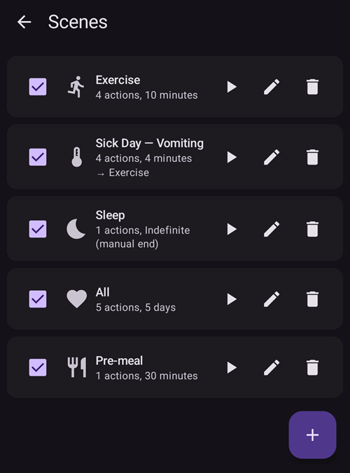

Svaka kartica scene prikazuje:

- **potvrdni okvir** za omogućavanje/onemogućavanje scene,
- **ikonu** i **naziv**,
- sažetak — *„N radnji, trajanje“* i **→ povezanu scenu** ako je scena povezana s drugom,
- i tri gumba: **▶ aktiviraj**, **✏️ uredi**, **🗑️ izbriši**.

Dodirnite gumb **+** za izradu nove scene.

---

## Izrada ili uređivanje scene

### Počnite od predloška

Za **izradu** scene dodirnite gumb **+** na zaslonu Scene. Prvi korak je **Počni od predloška**: odaberite gotovu scenu za čestu situaciju — *Tjelovježba*, *Dan bolesti*, *Dan bolesti — povraćanje*, *Spavanje*, *Noć nakon tjelovježbe*, *Prije obroka*, *Alkohol*, *Vožnja*, *Kupanje*, *Lutealna faza*, *Vruće vrijeme*, *Medicinski zahvat* — ili počnite od scene *Prazno*. Svaki predložak **unaprijed popunjava preporučene radnje**, a sve možete prilagoditi u sljedećim koracima. For example, the *Sleep* template lasts 8 hours and sets a temporary target: it selects your *Custom* temp target preset if you have one, otherwise you choose a preset in the *Temporary target* step.

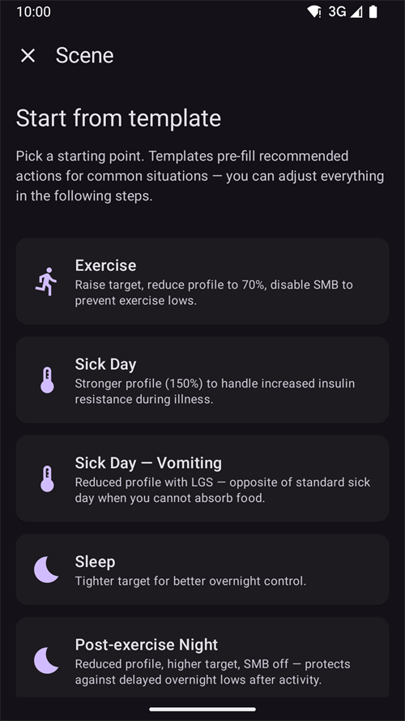

Nakon što odaberete predložak, objašnjava se njegova svrha — *kada* i *zašto* ga koristiti — prije nego što nastavite:

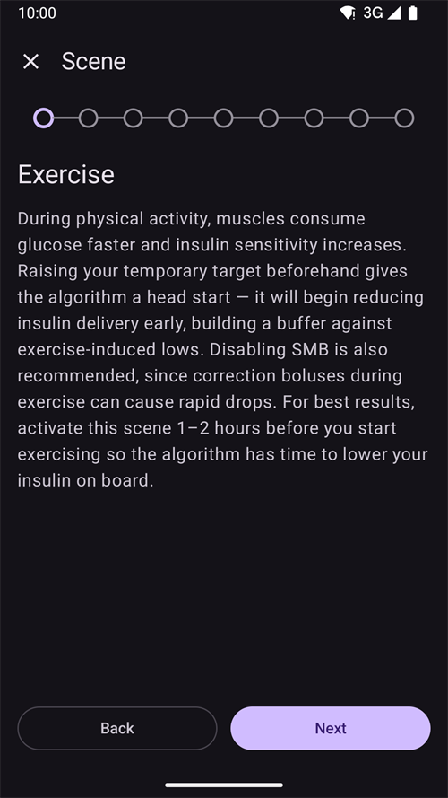

### Prođite kroz radnje korak po korak

Ostatak uređivača je kratki čarobnjak **korak po korak**. Svaki korak je jedna vrsta radnje s prekidačem *„Uključi u scenu: …“* — uključite ga samo za radnje koje ova scena treba izvesti, a ostale ostavite isključene.

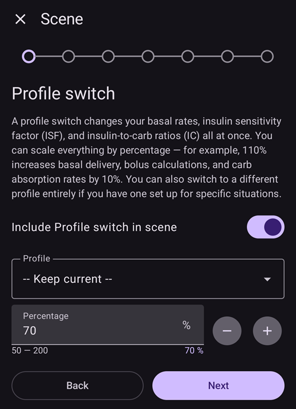

Prođite kroz korake gumbima **Sljedeći**/**Natrag**: *Zamjena profila*, *Privremeni cilj*, *SMB*, *Način rada*, *Careportal bilješka*, zatim **trajanje**, **završna radnja** (obavijest ili povezivanje s drugom scenom) i na kraju **naziv i ikona** scene. Kada završite, spremite scenu. (Za **uređivanje** postojeće scene dodirnite njezin gumb **✏️** — odmah dolazite do ovih koraka.)

Svaki korak počinje kratkim objašnjenjem što radnja radi. Koraci izgledaju ovako, ovdje s predloškom *Tjelovježba*:

**Privremeni cilj** — odaberite jedan od svojih predložaka privremenog cilja:

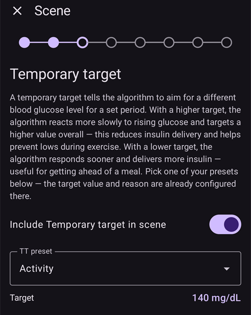

**SMB** — omogućite ili onemogućite SMB dok je scena aktivna:

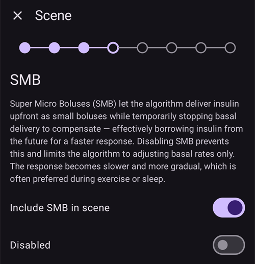

**Način rada** — po želji promijenite način rada petlje:

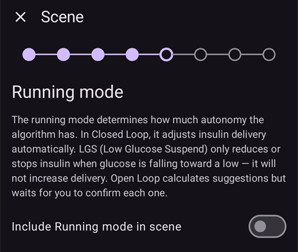

**Careportal** — vrsta događaja i bilješka koja se bilježi:

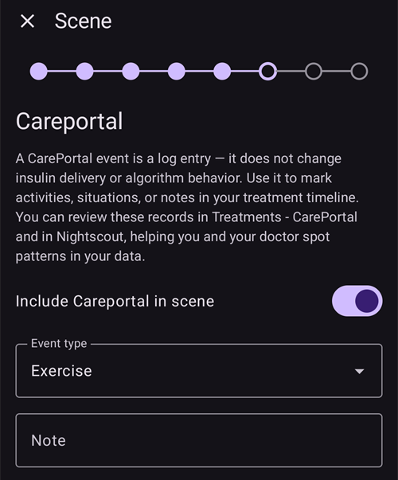

**Trajanje** — koliko dugo scena ostaje aktivna; 0 znači dok je sami ne završite:

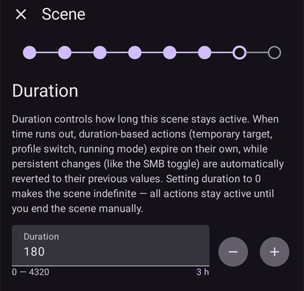

**Sljedeća scena** — po želji scena koja se pokreće kada ova završi:

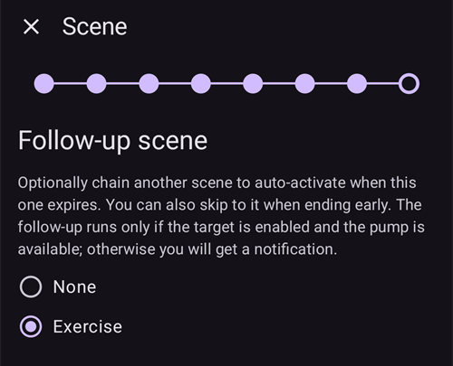

**Scena** — naziv i ikona. Pritisnite **Završi** za spremanje:

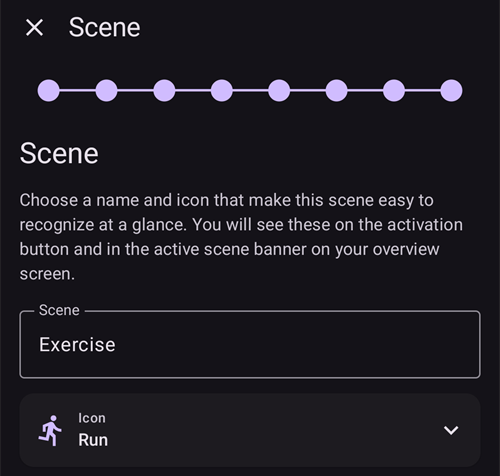

---

## Aktiviranje scene

Scenu aktivirajte s popisa **Scene** (gumb **▶**) ili preko stavke **Scene** u donjoj navigacijskoj traci. U ploči **Scene** donje navigacijske trake svaka scena prikazuje isti sažetak kao na popisu Scene, a **olovka** na vrhu ploče otvara **Upravljanje → Scene** za izradu ili uređivanje scena.

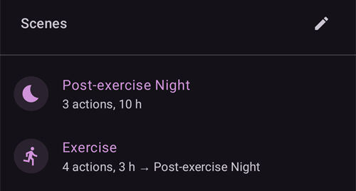

Ako je uključena [zaštita bolusa](#Preferences-protection), **AAPS** je traži prije pokretanja ili završetka scene. Za promjenu scene umjesto toga potrebna je [zaštita postavki](#Preferences-settings-protection).

Prije nego što se išta primijeni, dobivate **potvrdu** s točnim popisom onoga što će scena napraviti, tako da je možete provjeriti:

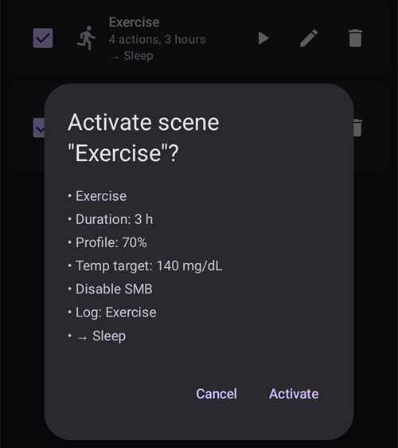

Ako je scena povezana s drugom, potvrda završava sa **→** i nazivom te sljedeće scene, isto kao na popisu Scene.

Kada scenu pokrenete preko stavke **Scene** u donjoj navigacijskoj traci, potvrda je jednostavniji dijaloški okvir s istim popisom radnji. Pritisnite **U redu** za aktivaciju:

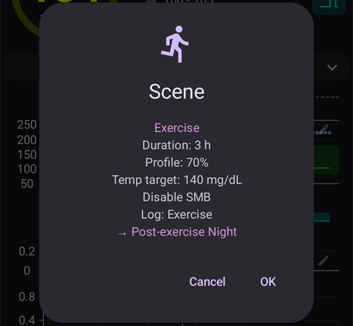

Nakon potvrde radnje se primjenjuju, a **aktivna scena** prikazuje se na vrhu Pregleda s gumbom **Završi scenu**. Ako je scena povezana s drugom, traka navodi i naziv sljedeće scene:

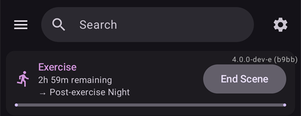

Radnje scene ostaju na snazi dok:

- ne istekne njezino **trajanje** (izvodi se **završna radnja** — obavijest ili prelazak na sljedeću scenu) ili
- ne dodirnete **Završi scenu** da biste je ručno završili. Ako je scena povezana s drugom, imate dvije mogućnosti: **Preskoči na** sljedeću scenu (aktivna scena završava, a sljedeća počinje odmah) ili **Završi scenu** (aktivna scena završava, a sljedeća se ne pokreće).

Scena bez sljedeće scene samo traži potvrdu:

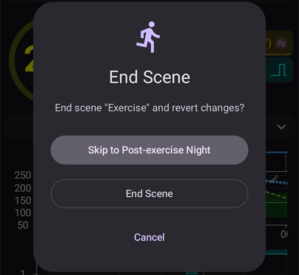

Završetak scene **poništava** promjene koje je napravila (na primjer zamjenu profila i privremeni cilj koje je pokrenula). The confirmation asks *End scene "..." and revert changes?* and lists what will be undone, one line per change: for example *Cancel temporary target*, *Revert profile change*, *Re-enable SMB* or *Cancel running mode override*. Care-portal notes stay: the list then ends with *CarePortal entries will not be reverted*. You get the same confirmation whether you end the scene from the banner on the main screen or from the Scenes screen.

Dok je scena aktivna, profil i cilj na glavnom zaslonu imaju malu ikonu scene ako ih je postavila scena. Ploča **Scene** u donjoj navigacijskoj traci ostaje dostupna za pokretanje druge scene:

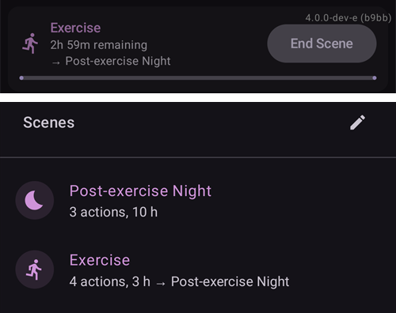

Kada trajanje istekne samo od sebe, promjene se odmah poništavaju, a traka se mijenja u **Scena završena** s gumbom **Odbaci**. Odbacivanje samo uklanja traku sa zaslona — sama scena je već završila, pa pravila automatizacije i povezana scena nastavljaju bez čekanja na to.

---

## Pokretanje scena iz automatizacije

Scenu ne morate pokretati ručno — **Automatizacija** to može učiniti umjesto vas. Kada pravilu automatizacije dodajete radnju (**Upravljanje → Automatizacija**), izbornik radnji ima kategoriju **Scene**:

- **Pokreni scenu** — aktivira scenu kada se aktiviraju okidači pravila (na primjer u zadano vrijeme, kada negdje stignete ili kada glukoza prijeđe neku granicu).
- **Omogući scenu** / **Onemogući scenu** — scena postaje dostupna (ili nedostupna), ali se ne aktivira.

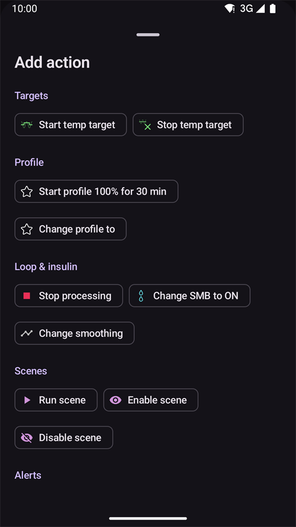

Automatizacija može i **reagirati na** scenu: popis okidača sadrži okidač **Scena**, pa se pravilo može izvoditi samo dok je određena scena aktivna. Zajedno sa **završnom radnjom** scene (poništavanje, obavijest ili povezivanje s drugom scenom) scene se tako mogu automatski pokretati, nastavljati jedna na drugu i završavati.

---

## Scene s glavnim uređajem/klijentom i satom

**Trenutno aktivna scena sinkronizira se** na svim vašim uparenim uređajima — aktivirajte je na jednom telefonu i prikazat će se i na ostalima.

Upareni **klijent** (**AAPSClient**) također može aktivirati ili završiti scenu: zahtjev se šalje **glavnom uređaju**, koji izrađuje potvrdu i primjenjuje scenu na svoje stanje. Kako to radi, pogledajte na stranici [Upravljanje glavni uređaj ↔ klijent (potpisano daljinsko upravljanje)](../RemoteFeatures/ClientMasterControl.md).

(scenes-from-watch)=
### S Wear OS sata

Scene su dostupne na **Wear OS satu** kao **pločica Scena**. Prijeđite prstom do pločice **Scena** u nizu pločica na satu (ako je još nema, najprije je dodajte s popisa pločica) i dodirnite scenu koju želite pokrenuti:

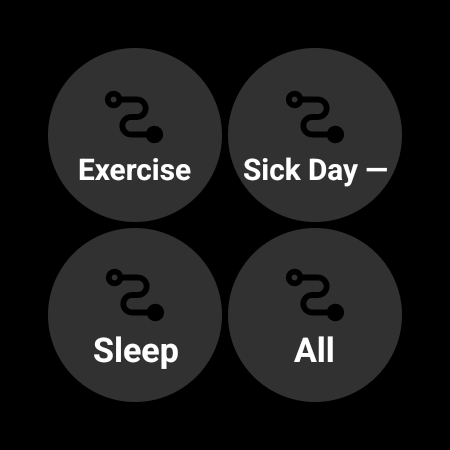

Pločica ima četiri mjesta. Prema zadanim postavkama svako se mjesto **automatski** popunjava sljedećom od vaših omogućenih scena, redoslijedom kao na telefonu. Ako želite sami birati, **dugo pritisnite pločicu** i otvorite njezine postavke: za svako od četiri mjesta možete ostaviti **Automatski**, prikvačiti **određenu scenu** ili odabrati **Nijedan** da mjesto ostane prazno. Mjesto prikvačeno za scenu koja je u međuvremenu izbrisana ili onemogućena prikazuje **Nedostupno** — odaberite drugu scenu za to mjesto.

Sat zatim prikazuje potvrdu — dodirnite **✓** za aktivaciju ili prijeđite prstom natrag za odustajanje:

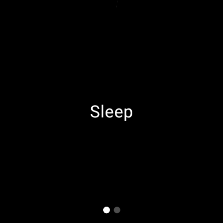

Isto kao kod klijenta, **glavni uređaj izrađuje potvrdu i pokreće scenu**; sat samo prosljeđuje zahtjev (preko telefona klijenta, ako je sat uparen s klijentom).

Dok scena radi — ili se njezina traka **Scena završena** još prikazuje na telefonu — pločica prikazuje gumb **Završi** s nazivom scene ispod njega. Dodirnite ga da biste sa zapešća završili aktivnu scenu ili uklonili preostalu traku.

Ako je aktivna scena povezana s drugom, pločica prikazuje i gumb **Preskoči** s nazivom sljedeće scene ispod njega. To su iste dvije mogućnosti kao na telefonu:

- **Završi** — aktivna scena završava. Potvrda vam govori da se sljedeća scena neće pokrenuti.
- **Preskoči** — aktivna scena završava, a sljedeća scena počinje odmah. Potvrda navodi obje scene.

[Zaslon Status petlje](#WearOsSmartwatch-loop-status) na satu također prikazuje aktivnu scenu, preostalo vrijeme i sljedeću scenu.

---


<!-- =====================================================================
     Screenshots captured from a real master device:
       - scenes_list.png        (Manage → Scenes management list)
       - templates_picker.png   (create: "Start from template" picker)
       - template_explanation.png (create: chosen template's explanation)
       - scene_editor.png       (scene editor, Profile switch step)
       - scene_confirmation.png (scene activation confirmation — also used on the Client/Master page)
       - scene_active_banner.png (overview active-scene banner with the End Scene button)
       - automation_scene_action.png (Automation action picker — Scenes category)
       - scene_watch_tile.png    (Wear OS Scene tile)
       - scene_watch_confirm.png (Wear OS scene confirmation)
     Maintainers: relocate page + images and fix cross-links as needed.
     ===================================================================== -->
