# Privremeni ciljevi

## Što su privremeni ciljevi i gdje ih mogu postaviti i konfigurirati?

**Privremeni cilj** (kratko **TT**) je značajka **AAPS-a** koja korisniku omogućuje da za planirane aktivnosti promijeni svoj [ciljni raspon **GUK-a**](#profile-glucose-targets). **AAPS** to postiže tako da mijenja količinu inzulina koju korisnik dobiva.

Ciljna vrijednost glukoze, osobito ako je samo kratkoročna (traje manje od 4 sata), ne mora biti *stvarna vrijednost* koju očekujete ili želite postići. Ona je dobar način da **AAPS-u** kažete da bude više ili manje agresivan, a da vam razina glukoze i dalje ostane u rasponu.

Privremeni ciljevi mogu se postaviti unutar ovih granica:

|          | Privremeni cilj         |
| -------- | ----------------------- |
| Minimum  | 4 mmol/L ili 72 mg/dL   |
| Maksimum | 10 mmol/L ili 180 mg/dL |

**AAPS** ima tri ugrađena predloška **privremenog cilja**: za tjelovježbu (**Aktivnost**), za obroke (**Prije obroka**) i za predviđenu hipoglikemiju (**Hipo**). Nalaze se na zaslonu **Privremeni cilj** (**Upravljanje** → **Privremeni cilj**), koji možete otvoriti i jednostavnim dodirom na **oznaku cilja** na glavnom zaslonu.

Korisnici trebaju imati realna očekivanja o rezultatima koji se mogu postići kada u **AAPS-u** odaberu **privremeni cilj**. Uspjeh u postizanju željenog cilja **GUK-a** ovisi o više čimbenika, kao što su: pouzdanost korisnikovih postavki **AAPS-a**, opća kontrola **GUK-a**, **aktivni inzulin**, osjetljivost na inzulin, otpornost na inzulin, razina napora tijekom tjelovježbe i slično.

**Privremenom cilju** može trebati približno 30 minuta ili više da postigne željeni cilj **GUK-a**. **AAPS** ne može odmah postići cilj **GUK-a** i korisnici to trebaju imati na umu kada odabiru **privremeni cilj**.

Odjeljci ispod sažimaju značajke **privremenog cilja Aktivnost**, **privremenog cilja Prije obroka** i **privremenog cilja Hipo**. Prikazane vrijednosti su tvorničke zadane vrijednosti – [svaki predložak možete prilagoditi](#TempTargets-change-preset-defaults) svojim potrebama.

### TT – Aktivnost

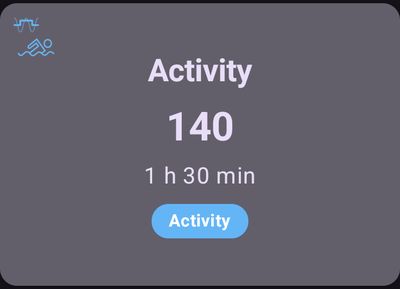

**Cilj GUK-a (zadani predložak, može se prilagoditi)**

AAPS će nastojati postići 140 mg/dL ili 7,8 mmol/L tijekom 1 h 30 min

**Ostalo što korisnici mogu uzeti u obzir pri odabiru**:

Ovisno o razini **GUK-a**, **AAPS** će „smanjiti“ isporuku inzulina kako bi postigao cilj **GUK-a**. Ako cilj **GUK-a** nije u rasponu (tj. viši je od cilja **GUK-a** odabranog u korisnikovom **profilu**), **AAPS** može ostaviti bazal uključen.

U načinu zatvorene petlje **SMB**:

- *može biti* isključen (objašnjeno niže); i/ili
- bazal se može uključiti ako **AAPS** ima negativan **aktivni inzulin** ili <0.

Korisnici mogu razmotriti i:

- *odabir* ovog **TT-a** 1–2 sata prije planirane tjelovježbe kako bi se osigurao manji aktivni inzulin (pravo vrijeme za ovaj TT razlikuje se od osobe do osobe); i
- *odabir* privremenog profila (smanjenje) za vrijeme planirane aktivnosti, kako bi se osigurao manji **aktivni inzulin**;
- *osiguravanje* da se **TT** *isključi* kratko prije tjelovježbe, jer je **aktivni inzulin** već smanjen, a kod nekih korisnika **GUK** nakon tjelovježbe brzo raste.

### TT – Prije obroka

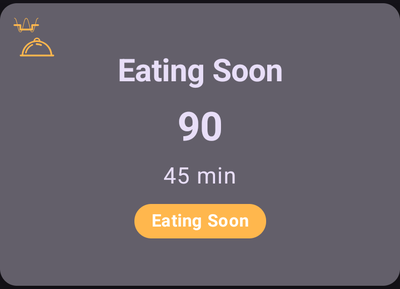

**Cilj GUK-a (zadani predložak, može se prilagoditi)**

AAPS će nastojati postići 90 mg/dL ili 5,0 mmol/L tijekom 45 minuta

**Ostalo što korisnici mogu uzeti u obzir pri odabiru**:

U načinu zatvorene petlje **SMB**:

- ostat će uključen; i/ili
- bazal se također može uključiti, ovisno o postavkama korisnikovog **profila**.

Ovisno o razini **GUK-a**, **AAPS** će „povećati“ isporuku inzulina unutar korisnikovih parametara postavki **AAPS-a** kako bi postigao željeni cilj **GUK-a**.

### TT – Hipo

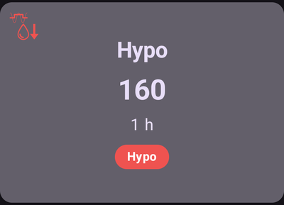

**Cilj GUK-a (zadani predložak, može se prilagoditi)**

AAPS će nastojati postići 160 mg/dL ili 8,9 mmol/L tijekom 1 sata

**Ostalo što korisnici mogu uzeti u obzir pri odabiru**:

U načinu zatvorene petlje **SMB**:

- *može biti* isključen (objašnjeno niže); i/ili
- bazal se može uključiti ako **AAPS** ima negativan **aktivni inzulin** ili <0.

(TempTargets-manage-v4)=

## Postavljanje i upravljanje privremenim ciljevima (Upravljanje → Privremeni cilj)

U **AAPS-u** v4 svojim **predlošcima** TT-a upravljate i privremeni cilj pokrećete sa zaslona **Upravljanje** (donja navigacija) → **Privremeni cilj** (*„Upravljajte privremenim ciljevima i postavite ih“*).

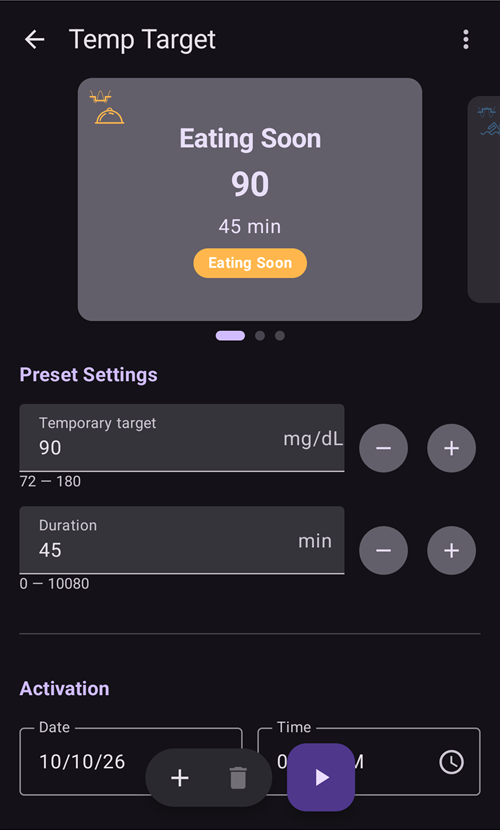

Zaslon ima tri dijela:

1. **Vrtuljak predložaka** (gore) – prelistajte svoje predloške TT-a prelaskom prsta. Svaka kartica prikazuje **naziv**, **cilj** i **trajanje** predloška; TT koji je trenutačno aktivan je istaknut.
2. **Uređivač** (sredina) – **Privremeni cilj** i **Trajanje** koji će se stvarno primijeniti, te datum/vrijeme **Aktivacija**.
3. **Traka radnji** (dolje) – gumbi **➕ dodaj**, **‘️ izbriši** i **▶ aktiviraj**.

Odabirom kartice predloška njezin se **cilj** i **trajanje** učitavaju u uređivač.

```{admonition} Ugrađeni i prilagođeni predlošci :class: note Ugrađeni predlošci – **Prije obroka**, **Aktivnost** i **Hipo** – uvijek postoje i **ne mogu se izbrisati** (no njihove vrijednosti možete promijeniti i spremiti). Svi predlošci koje sami izradite su **prilagođeni** i možete ih slobodno uređivati ili brisati.

    <br />### Aktiviranje privremenog cilja
    
    Prijeđite prstom do željenog predloška (njegove se vrijednosti učitaju u uređivač), po želji u uređivaču prilagodite **cilj**/**trajanje**, a zatim dodirnite **▶ Aktiviraj**. Prije nego što išta započne, potvrda prikazuje točan cilj, trajanje i razlog:
    
    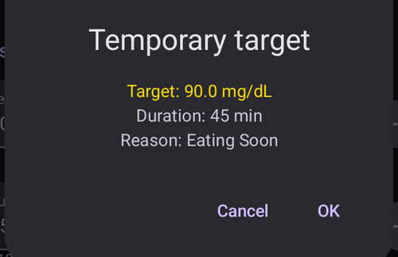
    
    Nakon što potvrdite, privremeni cilj počinje odmah (ili u odabrano vrijeme **Aktivacija**) i traje postavljeno **trajanje**.
    
    ```{admonition} Promjena brojeva vrijedi samo jednom – ne mijenja predložak
    :class: important
    **Cilj** i **trajanje** u uređivaču su vrijednosti koje će **Aktiviraj** koristiti *upravo sada*. Ako ih promijenite, ta je promjena **privremena**: vrijedi samo za ovu aktivaciju i **ne mijenja spremljeni predložak**. Tako možete „prilagoditi i aktivirati“ jednokratni TT (na primjer, danas aktivirati *Aktivnost* s malo drukčijim ciljem), a da trajno ne promijenite predložak.
    

### Spremanje promjena u predložak

Ako *ipak* želite zadržati promijenjenu vrijednost, **spremite** je: kada se uređivač razlikuje od odabranog predloška, na gornjoj alatnoj traci pojavi se ikona **Spremi**. Dodirom na nju trenutačni **cilj** i **trajanje** (te naziv, kod prilagođenih predložaka) spremaju se natrag u odabrani predložak. Kod ugrađenih predložaka na traci radnji pojavljuje se i gumb **Vrati zadane vrijednosti** (↺): on vraća zadane vrijednosti predloška.

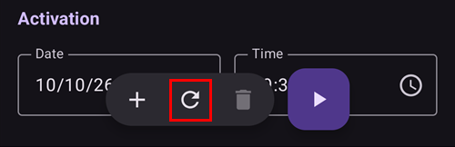

Osnovno pravilo je dakle:

- **Aktiviraj** → brojeve upotrijebite **jednom** (predložak se ne mijenja).
- **Spremi** → brojevi postaju **nove zadane vrijednosti** predloška.

Kako biste ugrađeni predložak vratili na tvorničke vrijednosti, odaberite ga i dodirnite gumb **↺ Vrati** – on se na traci radnji pojavljuje samo za **ugrađeni** predložak čije se vrijednosti trenutačno razlikuju od tvorničkih, a vraća izvorni **cilj** i **trajanje** tog predloška.

### Dodavanje i uklanjanje predložaka

- **➕ Dodaj** – izradite **novi prilagođeni predložak** iz trenutačnih vrijednosti u uređivaču. Nova kartica pojavi se u vrtuljku.
- **‘️ Izbriši** – uklonite odabrani **prilagođeni** predložak. Ugrađeni predlošci (*Prije obroka*, *Aktivnost*, *Hipo*) ne mogu se izbrisati.

Kada imate barem dva **prilagođena** predloška, možete promijeniti i njihov redoslijed u vrtuljku: dodirnite ikonu **Promijeni redoslijed** (⇅) na gornjoj traci, pomičite središnju karticu **gumbima za pomicanje ◀ / ▶**, a zatim potvrdite s **✓**. Ugrađeni predlošci ostaju na svojim mjestima – pomicati se mogu samo prilagođeni predlošci. (Kontrole izgledaju isto kao kod [promjene redoslijeda profila](ProfileSwitch-ProfilePercentage.md).)

Vaši predlošci dio su sinkronizirane konfiguracije, pa ih dijele vaš glavni uređaj i upareni klijenti.

### Drugi načini postavljanja privremenog cilja

Privremeni cilj može se postaviti i bez otvaranja ovog zaslona:

- **prekidačima TT-a u dijalogu UH** – pogledajte [niže](#TempTargets-carbs-dialog),
- **gumbom predloška na alatnoj traci [Brzo pokretanje](QuickLaunch.md)** – kategorija *Predlošci privremenih ciljeva* u *Postavi brzo pokretanje* nudi gumb za jedan dodir za svaki vaš predložak,
- sa **sata s Wear OS-om** (stavka izbornika / pločica **Privremeni cilj**),
- s uparenog **klijenta** – pogledajte [Upravljanje glavni uređaj ↔ klijent (potpisano daljinsko upravljanje)](../RemoteFeatures/ClientMasterControl.md),
- kao dio **[scene](Scenes.md)** (radnja *Privremeni cilj*) ili
- pravilom **automatizacije** (*Pokreni privremeni cilj* / *Zaustavi privremeni cilj*).

* * *

(TempTargets-where-can-i-select-a-temp-target)=

## Gdje mogu odabrati privremeni cilj?

Najbrži način je dodirnuti **oznaku cilja** na glavnom zaslonu (prikazuje vaš trenutačni ciljni raspon):

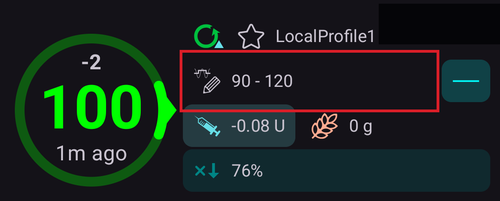

Time se otvara gore opisani zaslon **Privremeni cilj** – prijeđite prstom do predloška i dodirnite **▶ Aktiviraj**. Isti je zaslon dostupan i putem **Upravljanje** → **Privremeni cilj**.

(TempTargets-carbs-dialog)= Kada unosite ugljikohidrate, zaslon **Privremeni cilj** uopće ne trebate otvarati: **dijalog UH** (**Tretmani** → **UH**) na vrhu ima prekidače **Pokreni Hipo TT**, **Pokreni TT Prije obroka** i **Pokreni TT Aktivnost**. Uključite jedan od njih i odgovarajući predložak aktivirat će se zajedno s unosom ugljikohidrata:

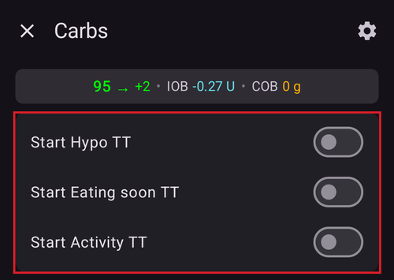

    {admonition} Automatski Hipo TT
    :class: note
    Ako otvorite **dijalog UH** dok vam je glukoza ispod 72 mg/dL (4 mmol/L), **AAPS** za vas unaprijed odabere prekidač **Pokreni Hipo TT** (osim ako je već aktivan viši privremeni cilj s duljim preostalim trajanjem).

(TempTargets-change-preset-defaults)=

## Gdje mogu promijeniti zadani privremeni cilj i zamijeniti ga vlastitim postavkama?

**Cilj** i **trajanje** svakog predloška uređuju se izravno na zaslonu **Privremeni cilj** – za to više ne postoji posebna stavka u postavkama:

1. Otvorite zaslon **Privremeni cilj** (dodirnite oznaku cilja ili **Upravljanje** → **Privremeni cilj**).
2. Prijeđite prstom do predloška koji želite promijeniti.
3. U uređivaču prilagodite **Privremeni cilj** i/ili **Trajanje**.
4. Dodirnite ikonu **Spremi** koja se pojavi na gornjoj alatnoj traci.

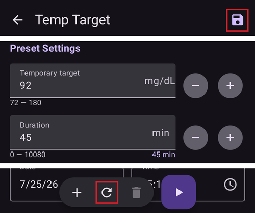

Dok se uređivač razlikuje od tvorničkih vrijednosti ugrađenog predloška, na traci radnji pojavljuje se i gumb **↺ Vrati** – dodirnite ga kako biste vratili izvorni cilj i trajanje predloška.

## Kako mogu otkazati privremeni cilj?

Dok je privremeni cilj aktivan, oznaka cilja na glavnom zaslonu prikazuje cilj i njegovo preostalo vrijeme. Dodirnite je – na zaslonu **Privremeni cilj** aktivni predložak istaknut je kao **AKTIVAN**, a na kraju alatne trake na dnu, odmah lijevo od gumba **▶ Aktiviraj**, pojavi se crveni gumb **✗ Otkaži**. Dodirnite ga i potvrdite:

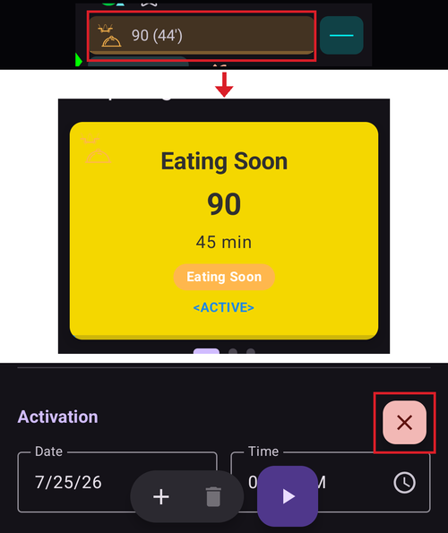

Aktivni privremeni cilj može se zaustaviti i sa **sata s Wear OS-om**, s uparenog **klijenta** ili pravilom **automatizacije** (*Zaustavi privremeni cilj*).

(TempTargets-hypo-temp-target)=

## Privremeni cilj Hipo

**Privremeni cilj Hipo** omogućuje **AAPS-u** da smanjenjem isporuke inzulina spriječi nisku razinu šećera u krvi kod korisnika. Ako korisnik predviđa da će mu **GUK** pasti nisko: **AAPS** bi to obično trebao riješiti, ali mnogo ovisi o stabilnosti korisnikovih postavki **AAPS-a**. **Privremeni cilj Hipo** omogućuje korisniku da preduhitri predviđeni pad i javi **AAPS-u** da smanji inzulin.

Ponekad, nakon što se pojedu ugljikohidrati za liječenje hipoglikemije, korisnikov **GUK** može brzo porasti, a **AAPS** će taj brzi rast **GUK-a** ispravljati uključivanjem **SMB-ova**.

Neki korisnici žele izbjeći davanje **SMB-ova** tijekom **privremenog cilja Hipo**. To se postiže isključivanjem *'Omogući SMB s visokim privremenim ciljem'* u **Postavke** → **OpenAPS SMB** (pogledajte niže):

- Napredno, Cilj 9: korisnik može uključiti *„Visoki privremeni cilj povećava osjetljivost“* za **privremene ciljeve** od 100 mg/dL (5,6 mmol/L) ili više u OpenAPS SMB, tada će **AAPS** biti osjetljiviji.

- Napredno, Cilj 9: korisnik može isključiti *„Omogući SMB s visokim privremenim ciljem“*, tako da čak i kada **AAPS** ima COB > 0, kada je uključeno „Omogući SMB s niskim privremenim ciljem“ ili „Uvijek omogući SMB“ i OpenAPS SMB aktivan, **AAPS** neće davati SMB-ove dok su aktivni visoki privremeni ciljevi.

Napomena: ako otvorite **dijalog UH** dok vam je glukoza u krvi niža od 72 mg/dL ili 4 mmol/L, **AAPS** automatski unaprijed odabere prekidač **Pokreni Hipo TT**.

(TempTargets-activity-temp-target)=

## Privremeni cilj Aktivnost

Prije i tijekom tjelovježbe korisniku može trebati viši cilj kako bi se spriječila hipoglikemija tijekom aktivnosti.

Kako bi pojednostavio **privremeni cilj Aktivnost**, korisnik može konfigurirati zadani **privremeni cilj – Aktivnost** koji podiže razinu **GUK-a** smanjenjem isporuke inzulina, kako bi se usporio pad **GUK-a** i izbjegla hipoglikemija.

Novi korisnici **AAPS-a** možda će morati eksperimentirati i prilagoditi zadane postavke **privremenog cilja Aktivnost** kako bi im ova značajka radila najbolje. Svatko je drukčiji kada je riječ o postizanju stabilne kontrole GUK-a tijekom tjelovježbe. Pogledajte i [odjeljak o sportu u čestim pitanjima](#FAQ-sports).

Neki korisnici prije i tijekom **privremenog cilja Aktivnost** radije aktiviraju i **zamjenu profila** (smanjenje profila < 100 %, kako bi **AAPS** isporučivao manje inzulina). Oboje možete pokrenuti u jednom koraku: dodirnite naziv profila na glavnom zaslonu, dodirnite okrugli gumb **▶**, postavite **Postotak** ispod 100 % i **Trajanje**, a zatim uključite **Privremeni cilj / Aktivnost**. Pogledajte [Promjena postotka profila](#ProfileSwitch-change-percentage).

Napredno, Cilj 9: korisnici mogu uključiti *'Visoki privremeni cilj povećava osjetljivost'* za **privremene ciljeve** od 100 mg/dL (5,6 mmol/L) ili više u OpenAPS **SMB**. Cilj od 99 mg/dL (5,5 mmol/L) je normalan cilj, ni visok ni nizak. Tada je **AAPS** osjetljiviji.

Osim toga, ako je *'Omogući SMB s visokim privremenim ciljem'* isključeno, **AAPS** neće isporučivati **SMB-ove**, čak ni kada je COB > 0, kada je uključeno *'Omogući SMB s niskim privremenim ciljem'* ili *'Uvijek omogući SMB'* i kada je OpenAPS **SMB** aktivan.

(TempTargets-eating-soon-temp-target)=

## Privremeni cilj Prije obroka

**Privremeni cilj Prije obroka** može pomoći da se **GUK** blago spusti i da prije jela bude dovoljno **aktivnog inzulina**.

To može biti važan alat za korisnike koji ne daju bolus unaprijed (pre-bolus). Ipak, učinkovitost **privremenog cilja Prije obroka** ovisi o nizu čimbenika, uključujući: korisnikove postavke, jede li korisnik hranu s malo ugljikohidrata i koristi li brzodjelujući inzulin (npr. Fiasp ili Lyumjev) kako ne bi morao davati bolus unaprijed. Dok korisnici ne steknu iskustvo s **AAPS-om**, obično trebaju računati na davanje bolusa unaprijed kada koriste **privremeni cilj Prije obroka**, osobito ako jedu hranu s puno ugljikohidrata.

Više o „načinu Prije obroka“ (Eating soon mode) možete pročitati u članku ['How to do “eating soon” mode'](https://diyps.org/2015/03/26/how-to-do-eating-soon-mode-diyps-lessons-learned/) ili [ovdje](https://diyps.org/tag/eating-soon-mode/).

Napredno, [Cilj 9](#objectives-objective9): ako koristite OpenAPS SMB i imate uključeno *'Niski privremeni cilj smanjuje osjetljivost'*, **AAPS** radi malo agresivnije. Za ovu opciju **privremeni cilj** mora biti 98 mg/dL (5,4 mmol/L) ili niži.

## Kako mogu isključiti SMB tijekom privremenih ciljeva?

Za to otvorite **Postavke** → **OpenAPS SMB** i isključite *'Omogući SMB s visokim privremenim ciljem'*.

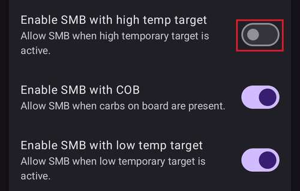

Time ćete osigurati da **AAPS** ne daje **SMB-ove**, čak ni kada je COB > 0, kada je uključeno *'Omogući SMB s niskim privremenim ciljem'* ili *'Uvijek omogući SMB'* i kada je OpenAPS SMB aktivan.