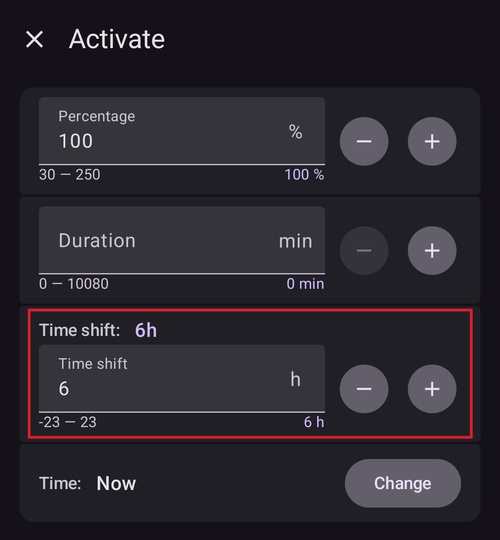

# Promjena vremenske zone i ljetno računanje vremena

Kada se vremenska zona telefona promijeni, **AAPS** otprilike 10 sekundi nakon promjene ponovno ispočetka izračunava **aktivni inzulin (IOB)**, bazal i osjetljivost za prošlo razdoblje. Dok to traje, grafovima i vrijednostima na glavnom zaslonu može trebati trenutak da se osvježe.

(timezone-traveling-with-pumps)=

## Promjena vremenske zone za Omnipod Dash

* Osvježite status pumpe u **Upravljanje → Pumpa**
* Privremeno odaberite drugi **Profil**, a zatim se vratite na svoj izvorni ili željeni **Profil**

## Promjena vremenske zone za DanaR, korejski DanaR

Promjena vremenske zone na telefonu nije problem jer pumpa ne koristi povijest

(timezone-traveling-danarv2-danars)=

## Promjena vremenske zone za DanaRv2, DanaRS, Dana-i

Ove pumpe zahtijevaju posebnu pažnju jer **AAPS** koristi povijest iz pumpe, ali zapisi u pumpi nemaju oznaku vremenske zone. **To znači da će se, ako promijenite vremensku zonu na telefonu, zapisi čitati s drugom vremenskom zonom i bit će udvostručeni.**

Da biste to izbjegli, postoje dvije mogućnosti:

### Opcija 1: Zadržite vrijeme od kuće i vremenski pomaknite profil

* Isključite „Automatski datum i vrijeme“ u postavkama telefona (ručna promjena vremenske zone).

* Telefon mora cijelo vrijeme putovanja zadržati vaše standardno vrijeme kao kod kuće.

* Vremenski pomaknite svoj **Profil** prema razlici između vremena kod kuće i vremena na odredištu.
   
   * Dodirnite naziv **Profila** na glavnom zaslonu da otvorite [zaslon Profil](#ProfileSwitch-manage-v4)
   * Odaberite svoj **Profil** i dodirnite **▶ Aktiviraj**
   * Postavite „**Vremenski pomak**“ prema svom odredištu i dodirnite **Aktiviraj**.
   
   
   
   * npr. Beč -> New York: **Zamjena profila** +6 sati
   * npr. Beč -> Sydney: **Zamjena profila** -8 sati

### Opcija 2: Izbrišite povijest pumpe

* Isključite „Automatski datum i vrijeme“ u postavkama telefona (ručna promjena vremenske zone)

Kada izađete iz zrakoplova:

* isključite pumpu
* promijenite vremensku zonu na telefonu
* isključite telefon, uključite pumpu
* izbrišite povijest u pumpi
* promijenite vrijeme u pumpi
* uključite telefon
* pustite da se telefon spoji s pumpom i precizno uskladi vrijeme

(timezone-traveling-insight)=

## Promjena vremenske zone za Insight

Upravljački program automatski usklađuje vrijeme pumpe s vremenom telefona.

Insight također bilježi u povijest u kojem je trenutku vrijeme promijenjeno te s kojeg (starog) na koje (novo) vrijeme. Tako se u **AAPS**-u može odrediti točno vrijeme unatoč promjeni vremena.

To može uzrokovati netočnosti u **TDD** vrijednostima. No to ne bi trebao biti problem.

Zato korisnik Insighta ne mora brinuti o promjenama vremenske zone i vremena. Postoji jedna iznimka od tog pravila: pumpa Insight ima malu unutarnju bateriju koja napaja sat itd. dok mijenjate „pravu“ bateriju. Ako zamjena baterije traje predugo, ta unutarnja baterija se isprazni, sat se resetira i nakon umetanja nove baterije morate unijeti vrijeme i datum. U tom slučaju AAPS u izračunu preskače sve unose prije zamjene baterije, jer se točno vrijeme ne može pouzdano odrediti.

## Promjena vremenske zone za Accu-Chek Combo

[Upravljački program za Combo](../CompatiblePumps/Accu-Chek-Combo-Pump-v2.md) automatski usklađuje vrijeme pumpe s vremenom telefona. Combo ne može spremati vremenske zone, nego samo lokalno vrijeme, a upravo to upravljački program upisuje u pumpu. Osim toga, sprema vremensku zonu u lokalne postavke AAPS-a kako bi lokalno vrijeme pumpe mogao pretvoriti u potpunu vremensku oznaku s pomakom vremenske zone. Korisnik ne mora ništa raditi; ako vrijeme na Combu previše odstupa od trenutnog vremena telefona, vrijeme pumpe automatski se usklađuje.

Imajte na umu da to ipak traje neko vrijeme, jer se može napraviti samo u načinu daljinskog terminala (remote-terminal), koji je općenito spor. To je ograničenje Comba koje se ne može zaobići.

## Promjena vremenske zone za Medtrum

Upravljački program automatski usklađuje vrijeme pumpe s vremenom telefona.

Promjene vremenske zone ne mijenjaju povijest, može biti pogođen samo TDD. Ručna promjena vremena na telefonu može uzrokovati probleme s poviješću i **aktivnim inzulinom (IOB)**. Ako vrijeme mijenjate ručno, dobro provjerite **aktivni inzulin (IOB)**.

Kada se promijeni vremenska zona ili vrijeme, aktivni **privremeni bazali (TBR)** se zaustavljaju.

(time-adjustment-daylight-savings-time-dst)=

## LJETNO RAČUNANJE VREMENA (DST)

Usklađivanje vremena za ljetno računanje vremena.

Ovisno o vašoj pumpi i postavkama CGM-a, skokovi u vremenu mogu uzrokovati probleme u ispravnom radu **AAPS**-a. Kod nekih pumpi bolje je vremensku zonu uskladiti dok ste budni, prije promjene na ljetno računanje vremena, a ne tijekom noći.

### Automatsko usklađivanje za ljetno računanje vremena kod većine pumpi

* Međutim, **Petlja** će biti deaktivirana 3 sata NAKON promjene na ljetno računanje vremena (obično od 1 sat ujutro), a **AAPS** će se vratiti na pozadinski bazal odabran u vašem **Profilu**. To se radi iz sigurnosnih razloga – **aktivni inzulin (IOB)** može biti previsok zbog udvostručenog bolusa prije promjene na ljetno računanje vremena.
* Nakon promjene na ljetno računanje vremena napravite **Zamjenu profila** na željeni **Profil** da omogućite **Petlju**: dodirnite naziv profila na glavnom zaslonu, a zatim okrugli gumb **▶** (pogledajte [Aktiviranje profila](#ProfileSwitch-manage-v4)).
* Prije promjene na ljetno računanje vremena dobit ćete i obavijest na glavnom zaslonu **AAPS**-a da je **Petlja** privremeno onemogućena. Ova će se poruka prikazati bez zvučnog signala, vibracije ili sličnog zvuka.

Ako dajete bolus kalkulatorom **AAPS**-a, molimo ne koristite podatke **Aktivni UGH** i **Aktivni inzulin** osim ako niste sigurni da su ti podaci potpuno točni. Budite oprezni i ne koristite ovu značajku nekoliko sati nakon promjene na ljetno računanje vremena.

### Ljetno računanje vremena za Accu-Chek Insight

* Prelazak na ljetno računanje vremena (DST) događa se automatski. Ništa ne trebate napraviti.

### Ljetno računanje vremena za Accu-Chek Combo

* Prelazak na ljetno računanje vremena (DST) događa se automatski. Ništa ne trebate napraviti.

### Ljetno računanje vremena za Medtrum

* Prelazak na ljetno računanje vremena (DST) događa se automatski. Ništa ne trebate napraviti.

### Ljetno računanje vremena za Omnipod Dash

* Ili dopustite da se **AAPS** nakon promjene na ljetno računanje vremena privremeno vrati na pozadinski bazal, kako je gore objašnjeno.
* U suprotnom, ako ne želite da se **AAPS** preko noći privremeno vrati na pozadinski bazal, možete promijeniti vremensku zonu dan prije promjene na ljetno računanje vremena, kako biste izbjegli smetnje tijekom noći. NAPOMENA: OVA OPCIJA MOŽE UZROKOVATI PRERANI ISTEK VAŠEG POD-A. AKO ODABERETE ZNAČAJKU OPISANU U NASTAVKU, IMAJTE PRIBOR SA SOBOM.

#### Što napraviti prije promjene sata

1. Isključite sve postavke telefona koje automatski postavljaju vremensku zonu telefona, tako da korisnik može prijeći na željenu vremensku zonu koja ne koristi ljetno računanje vremena. Kako to omogućiti, ovisi o vašem pametnom telefonu i verziji Androida.
   
   * Neki telefoni imaju dvije postavke, jednu za automatsko postavljanje vremena (koja bi idealno trebala ostati uključena) i jednu za automatsko postavljanje vremenske zone (koju morate ISKLJUČITI: **Postavi automatski** pod **Vremenska zona** na snimci zaslona ispod).
   * Nažalost, neke verzije Androida imaju samo jedan prekidač koji uključuje automatsko postavljanje i vremena i vremenske zone. To ćete za sada morati isključiti.

2. Pronađite vremensku zonu koja ima isto vrijeme kao vaša trenutna lokacija, ali ne koristi ljetno računanje vremena.
   
   * Popis tih zemalja dostupan je na [https://greenwichmeantime.com/countries](https://greenwichmeantime.com/countries/)
   * Za srednjoeuropsko vrijeme (CET) to bi mogao biti „Brazzaville“ (Kongo). Promijenite vremensku zonu telefona u Kongo.

3. U **AAPS**-u osvježite pumpu i prijeđite na željeni **Profil**.

4. Provjerite **aktivni inzulin (IOB)** i **aktivne ugljikohidrate (COB)** u **AAPS**-u i ako nisu točni, onemogućite **Petlju** barem za jedan DIA ili za maksimalno vrijeme apsorpcije ugljikohidrata (**Maks. vrijeme apsorpcije**), ovisno o tome što je dulje.

5. Što napraviti nakon promjene sata. Dobro vrijeme za povratak na lokalnu vremensku zonu je kada imate malo **aktivnog inzulina (IOB)**. Na primjer, sat vremena prije obroka kao što je doručak. Idealno bi i **aktivni ugljikohidrati (COB)** i **aktivni inzulin (IOB)** trebali biti blizu nule.