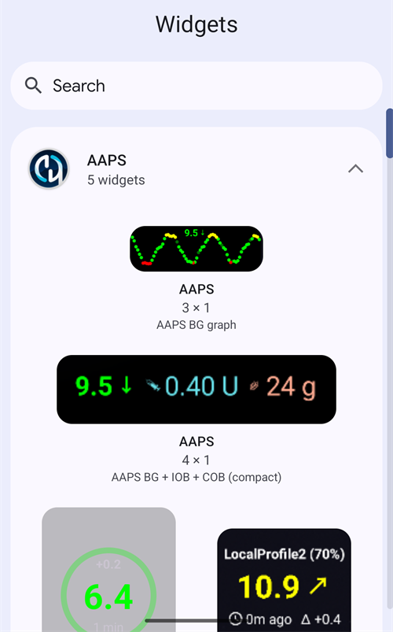
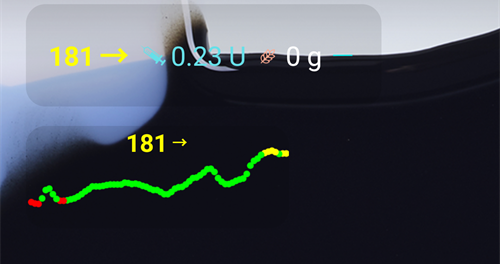
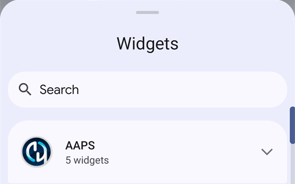
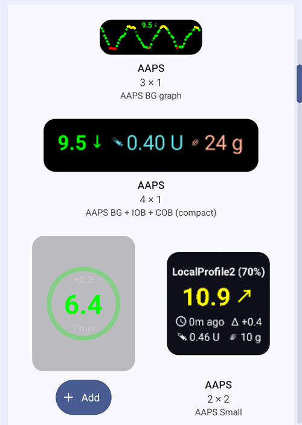
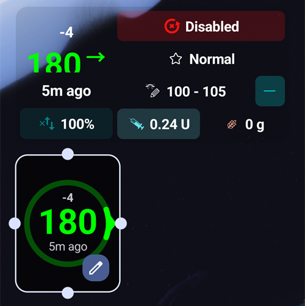
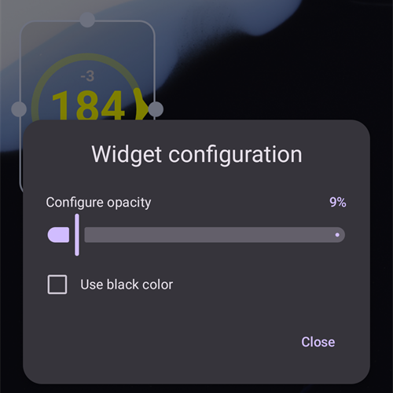

(widgets)=
# Widgeti na početnom zaslonu

**AAPS** ima widgete koje možete dodati na početni zaslon telefona. Widget prikazuje vaše trenutne podatke bez otvaranja aplikacije. Dodirnite widget da otvorite **AAPS**.

```{contents} Table of contents
:depth: 2
:local: true
```

---

## Dostupni widgeti

Dostupno je pet widgeta. Nalaze se pod **AAPS** u Androidovom izborniku widgeta:



| Widget                               | Zadana veličina | Što prikazuje                                                                                                                                                                                                                                                     |
| ------------------------------------ | --------------- | ----------------------------------------------------------------------------------------------------------------------------------------------------------------------------------------------------------------------------------------------------------------- |
| **AAPS widget**                      | 5 × 2           | Statusni blok glavnog zaslona: GUK s trendom i deltom, način rada petlje kao ikona pokraj naziva profila, cilj, osjetljivost (prikazana kao na glavnom zaslonu), IOB i COB. Tekstovi se smanjuju da stanu u veličinu koju date widgetu, umjesto da budu odrezani. |
| **AAPS krug glukoze**                | 2 × 2           | Krug GUK-a s glavnog zaslona: prsten u boji GUK-a, luk trenda, delta, vrijednost GUK-a i vrijeme od zadnjeg očitanja.                                                                                                                                             |
| **AAPS mali**                        | 2 × 2           | Naziv profila, GUK sa strelicom trenda, vrijeme od zadnjeg očitanja, delta, aktivni inzulin (IOB) i aktivni ugljikohidrati (COB).                                                                                                                                 |
| **AAPS GUK + IOB + COB (kompaktno)** | 4 × 1           | Jedan redak s GUK-om i strelicom trenda, IOB-om i COB-om.                                                                                                                                                                                                         |
| **AAPS GUK graf**                    | 3 × 1           | Vrijednost GUK-a s malim grafom nedavnih očitanja.                                                                                                                                                                                                                |

Widget **AAPS widget**, widget **krug glukoze** i widget **mali** na početnom zaslonu:


Widget **kompaktno** i widget **GUK graf**:



Vrijednosti GUK-a imaju iste boje kao u **AAPS-u**: zelena u rasponu, žuta iznad raspona, crvena ispod raspona.

---

## Dodavanje widgeta

Točni koraci ovise o vašem telefonu i njegovom pokretaču (launcheru). Na većini telefona:

1. Dugo pritisnite prazno mjesto na početnom zaslonu i odaberite **Widgeti**.

   

2. Otvorite **AAPS** na popisu i dodirnite widget koji želite.
3. Pritisnite **Dodaj** (ili povucite widget na mjesto koje želite).

   

Widget se postavlja na početni zaslon. Odmah nakon dodavanja prikazuje se s ručkama: povucite ručku da **promijenite veličinu** widgeta ili povucite widget da ga premjestite. Krugu glukoze možete dati bilo koju veličinu.



Ako je stranica početnog zaslona puna, telefon stavlja widget na novu stranicu.

---

## Konfiguracija widgeta

Dodirnite gumb s **olovkom** koji se prikazuje na widgetu odmah nakon što ste ga dodali. Kasnije dugo pritisnite widget da se ručke i olovka opet pojave.

Dijalog **Konfiguracija widgeta** ima dvije postavke:

- **Podesi prozirnost** — koliko je pozadina widgeta neprozirna. Niska vrijednost propušta pozadinsku sliku zaslona.
- **Koristi crnu boju** — koristi crnu pozadinu umjesto zadane.



Svaki widget ima svoju konfiguraciju.

---

## Dobro je znati

- Widget samo **prikazuje** podatke. Iz widgeta ne možete dati bolus niti išta promijeniti.
- Widget osvježava **AAPS**. Ako **AAPS** ne radi ili ga Android ograničava u pozadini, widget može prikazivati stare podatke. Provjerite vrijeme od zadnjeg očitanja i provjerite je li **AAPS** izuzet iz [optimizacije baterije](#SetupWizard-StoragePermission).
- U aplikacijama **AAPSClient**, **AAPSClient2** i **AAPSClient3** pozadina widgeta je žuta, plava ili zelena, tako da možete razlikovati aplikacije. Povećajte neprozirnost u konfiguraciji widgeta ako se boja teško vidi. Pogledajte [O aplikacijama AAPSClient, AAPSClient2 i AAPSClient3](#remotecontrol-aapsclient-versions).
