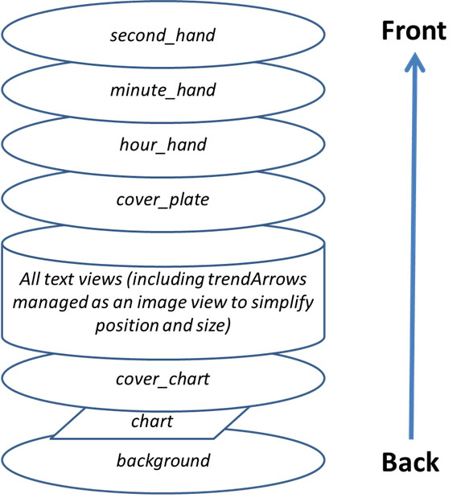
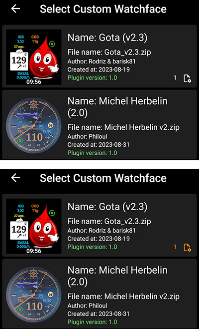
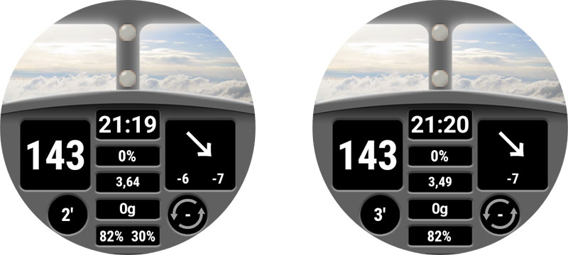
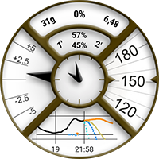
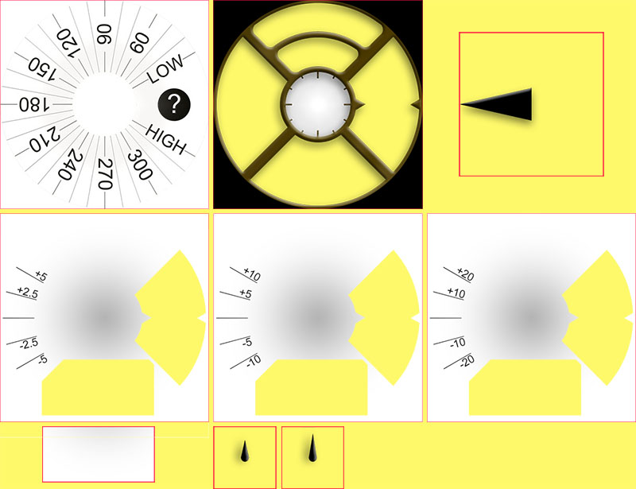
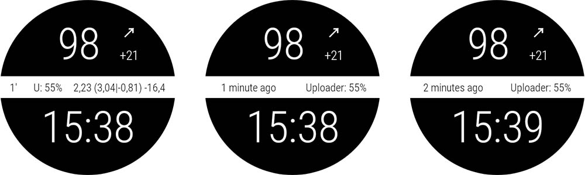
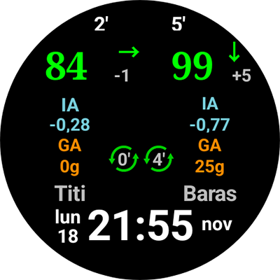

# Referentni dokument za prilagođene Watchfaceove

Ova stranica je za dizajnere novih Watchfaceova. Navodi sve ključne riječi i značajke koje su dostupne kada želite izraditi ili animirati novi Watchface.

- Nove značajke i ključevi u prilagođenom Watchfaceu V2 (Wear apk 3.3.0 ili noviji) opisani su [ovdje](#cwf-reference-new-v2-features)

## Format prilagođenog Watchfacea

Prilagođeni Watchface (Custom Watchface) je otvoreni format izrađen za AAPS i povezan s novim Watchfaceom „AAPS (Custom)“ na satu.

Datoteka Watchfacea je obična zip datoteka. Ali da bi se prepoznala kao datoteka Watchfacea, zip datoteka mora sadržavati ove datoteke:

- Jedna slikovna datoteka s imenom CustomWatchface (to može biti bitmap datoteka `CustomWatchface.jpg`, `CustomWatchface.png` ili vektorska datoteka `CustomWatchface.svg`). Ova datoteka je mala ikona za odabir Watchfacea kada kliknete gumb „Učitaj Watchface“, a i slika koja se vidi u dodatku Wear u AAPS-u.
- Jedna datoteka s imenom `CustomWatchface.json` (vidi [Struktura JSON-a](#cwf-reference-json-structure) niže). Ova druga datoteka je glavna datoteka. Ona sadrži sve podatke potrebne za izgled Watchfacea. Ova json datoteka mora biti ispravna (to je vjerojatno najteži dio kada ovu datoteku ručno uređujete u uređivaču teksta, jer je jedan zarez viška ili manjka dovoljan da se json format pokvari). Ova JSON datoteka mora sadržavati i blok `"metadata"` s ključem `"name"` koji nije prazan. To će biti ime vašeg prilagođenog Watchfacea (vidi [Postavke metapodataka](#cwf-reference-metadata-settings) niže)
- ova zip datoteka treba biti što manja (manje od otprilike 500 kB). Ako je ova datoteka prevelika, bit će blokirana i neće se poslati na sat.

Zip datoteka može sadržavati i neke dodatne datoteke resursa:

- Fiksna imena datoteka slika koje se koriste u standardnim prikazima Watchfacea (kao `Background`, `CoverChart`... vidi [Popis fiksnih datoteka resursa](#cwf-reference-list-of-hardcoded-resource-files) niže). Sve ove datoteke mogu biti u formatu `jpg`, `png` ili `svg`. ali za većinu njih morate koristiti `png` ili `svg`, jer podržavaju prozirnost (jpg datoteke su manje od png datoteka, ali nemaju prozirnost). Imajte na umu da najbolju kvalitetu uz najmanju veličinu obično daju svg datoteke (vektorski format).
- Dodatne datoteke resursa sa slobodnim imenima. Ove dodatne datoteke mogu biti slikovne datoteke ili datoteke fontova (za fontove su podržani formati `ttf` i `otf`). Imajte na umu da se za ove dodatne datoteke `filename` (bez nastavka) koristi kao vrijednost ključa (keyValue) u JSON datoteci, da se odredi gdje ili kada se ove datoteke koriste.
  - slikovne datoteke često se koriste kao pozadina tekstualnih prikaza ili za dinamičku animaciju (npr. razina baterije od 0 % do 100 %)
  - datoteke fontova omogućuju korištenje vlastitih fontova u vašem Watchfaceu

(cwf-reference-json-structure)=

## Struktura JSON-a

JSON datoteke možete uređivati u uređivaču teksta Notepad (ili Notepad++). Bolji je Notepad++, jer prepoznaje JSON i koristi boje za oblikovanje

- sadrži ključeve (string) `"string_key":` i vrijednosti ključeva, koje mogu biti tekst kao `"key value"`, cijeli broj, logička vrijednost kao `true` ili `false` ili blok podataka.
- svaka vrijednost odvojena je zarezom `,`
- Blok podataka počinje znakom `{` i završava znakom `}`
- json datoteka je jedan cijeli blok, pa počinje znakom `{` i završava znakom `}`. Unutar datoteke svaki ugrađeni blok povezan je s ključem `"key"` koji mora biti jedinstven unutar bloka
- Da bi se json datoteka lakše čitala, obično je uvučena (svaki novi ključ je u novom retku, svaki novi blok pomaknut je udesno za 4 razmaka)

(cwf-reference-metadata-settings)=

### Postavke metapodataka

Ovaj blok je prvi blok u json datoteci i obavezan je. Sadrži sve podatke o ovom Watchfaceu, kao što su ime, autor, datum izrade ili ažuriranja, verzija autora ili verzija dodatka.

Primjer bloka metapodataka:

```text
"metadata": {
    "name": "Default Watchface",
    "author": "myName",
    "created_at": "07\/10\/2023",
    "author_version": "1.0",
    "cwf_version": "1.0",
    "comment": "Default watchface, you can click on EXPORT WATCHFACE button to generate a template"
},
```

Imajte na umu da je `/` u datumu poseban znak. Da bi ga json datoteka točno prepoznala, ispred njega morate staviti znak za izbjegavanje („escape“) `\`

U nekim json datotekama vidjet ćete dodatni ključ `"filename"`. Ovaj ključ se automatski stvara ili ažurira kada se prilagođeni Watchface učita u AAPS (koristi se da korisniku pokaže ime zip datoteke u mapi exports), pa ovaj ključ možete ukloniti iz bloka metapodataka.

(cwf-reference-general-parameter-settings)=

### Opće postavke parametara

Iza prvog bloka s metapodacima postavljate neke opće parametre (vidi [Popis općih parametara](#cwf-reference-list-of-general-parameters) niže). Tako možete postaviti boje grafa (ugljikohidrati, bolus, vrijednosti GUK-a...) i zadane boje za vrijednosti u rasponu, hiperglikemiju ili hipo (zadane boje vrijednosti GUK-a i strelica)

Primjer općih parametara

```text
"highColor": "#FFFF00",
"midColor": "#00FF00",
"lowColor": "#FF0000",
"lowBatColor": "#E53935",
"carbColor": "#FB8C00",
"basalBackgroundColor": "#0000FF",
"basalCenterColor": "#64B5F6",
"gridColor": "#FFFFFF",
"pointSize": 2,
"enableSecond": true,
```
(cwf-reference-imageview-settings)=

### Postavke za ImageView

Prilagođenu sliku možete postaviti tako da koristite točno ime datoteke za svaki ImageView u rasporedu (layout) prilagođenog Watchfacea. Tada json blok služi samo za položaj, veličinu, vidljivost prikaza i, po želji, prilagodbu boje:

Ispod je primjer bloka slike za second_hand (u ovom slučaju u zip datoteci nema slike, pa se koristi zadana slika sekundne kazaljke, ali s prilagođenom bojom).

```text
"second_hand": {
    "width": 400,
    "height": 400,
    "topmargin": 0,
    "leftmargin": 0,
    "visibility": "visible",
    "color": "#BC906A"
}
```
Da bi second_hand imala zadanu boju GUK-a (lowRange, midRange ili highRange), samo promijenite zadnji redak u vrijednost ključa `bgColor`

```json
    "color": "bgColor"
```

(cwf-reference-textview-settings)=

### Postavke za TextView

TextView have more available parameters compare to ImageView: you can tune rotation (integer value in degrees), textsize (integer value in pixel), gravity (to define if text value will be centered (default value), or aligned left or right), set the font, fontStyle and fontColor, and also background color of the TextView

```text
"basalRate": {
    "width": 91,
    "height": 32,
    "topmargin": 133,
    "leftmargin": 249,
    "rotation": 0,
    "visibility": "visible",
    "textsize": 23,
    "gravity": "center",
    "font": "default",
    "fontStyle": "bold",
    "fontColor": "#BDBDBD"
},
```
Ako ne želite koristiti neki prikaz na svom Watchfaceu, postavite ključ `"visibility"` na `"gone"`, ali i veličinu i položaj postavite izvan vidljivog područja, ovako:

```text
"second": {
    "width": 0,
    "height": 0,
    "topmargin": 0,
    "leftmargin": 0,
    "rotation": 0,
    "visibility": "gone",
    "textsize": 46,
    "gravity": "center",
    "font": "default",
    "fontStyle": "bold",
    "fontColor": "#BDBDBD"
},
```
Ako su veličina i položaj unutar vidljivog područja, skrivena vrijednost može nakratko „bljesnuti“ dok se Watchface osvježava.

Ako želite prilagoditi sliku pozadine tekstualnog prikaza, koristite ključ `"background":` i kao vrijednost ključa (keyValue) upišite ime slike iz zip datoteke. Možete i samo promijeniti boju pozadine ključem `"color:"`.

```json
"background": "fileName"
```

Postoje i 4 posebna tekstualna prikaza (s imenima freetext1 do freetext4) koji imaju poseban parametar `"textvalue":`. Njime možete postaviti, na primjer, oznaku

(cwf-reference-chartview-settings)=

### Postavke za ChartView

Prikaz grafa (ChartView) je vrlo poseban prikaz koji može dijeliti neke parametre s ImageView ili s TextView...

Standardne postavke za ovaj prikaz su vrlo jednostavne:

```text
"chart": {
    "width": 400,
    "height": 170,
    "topmargin": 230,
    "leftmargin": 0,
    "visibility": "visible"
},
```
Za prikaz grafa možete dodati još 2 parametra: boju pozadine (zadano je prozirno) s ključem `"color"` ili sliku pozadine s ključem `"background"`.

(cwf-reference-how-to-build-watchface)=

## Kako izraditi i oblikovati svoj prvi Watchface

### Potrebni alati

- Uređivač teksta: savjetujem NotePad++ (ili sličan). To je jednostavan uređivač teksta, ali prednost je da tekst prikazuje oblikovan bojama, pa je lakše uočiti pogreške. poslužit će bilo koji jednostavan uređivač teksta. Jer je cilj podešavanje json podataka.
- Uređivač slika (bitmap i/ili vektorski)
  - Ako koristite bitmap
    - Uređivač slika mora podržavati prozirnost (potrebna za sve slike iznad pozadine) i png format (ako koristite bitmap slike)
    - Slika pozadine može biti u jpg formatu (manji od png)
    - Uređivač slika mora vam omogućiti mjerenje grafičkih objekata u pikselima (može biti jednostavan kvadrat) (gore, lijevo, širina, visina)
    - Image editor should be able to show you colors with RRGGBB code in hexadecimal
    - Uređivač slika mora moći promijeniti veličinu slike na 400px x 400px (vrlo je važno raditi u ovoj rezoluciji)
  - Ako koristite vektorsku grafiku
    - Vektorsku sliku treba izvesti u svg formatu

### Uzmite predložak da ne počinjete od nule

Kada oblikujete svoj prvi Watchface, najbolje je početi od zadanog Watchfacea (tako ćete sigurno imati najnoviju verziju sa svim dostupnim prikazima ispravno poredanima)

- Zip datoteku dobit ćete klikom na gumb „Izvezi predložak“ u dodatku Wear. Datoteka će biti u mapi AAPS/exports
- Imajte na umu da sat mora biti povezan s AAPS-om da biste vidjeli gumbe za prilagođeni Watchface (sat vam ionako treba da provjerite, testirate i podesite svoj prilagođeni Watchface)

Zadani Watchface je vrlo jednostavan i zip datoteka sadrži samo 2 datoteke:

- CustomWatchface.png (slika zadanog Watchfacea za odabir Watchfacea)
- CustomWatchface.json

### Organizirajte datoteke na računalu

The easiest way to work is to have phone connected to the computer, and work with two specific folders:

- jedan preglednik datoteka otvoren u posebnoj mapi u kojoj su sve datoteke (json, bitmap slike, vektorske slike, fontovi) i datoteka CustomWatchface.zip
- drugi preglednik datoteka (ili podešeno stablo mapa) otvoren tako da je dostupna mapa Phone/AAPS/exports

Tako je rad vrlo jednostavan: svaki put kada promijenite json datoteku u uređivaču teksta ili sliku u uređivaču slika (bitmap ili vektorskom), trebate samo:

1. spremiti promjene u svakoj aplikaciji
2. povući i ispustiti sve datoteke u datoteku CustomWatchface.zip
3. povući i ispustiti CustomWatchface.zip u mapu AAPS/exports na telefonu
4. poslati CustomWatchface na sat i provjeriti rezultat

### Početak prilagodbe Watchfacea

U prvom koraku morate odrediti ime Watchfacea (potrebno da ga lako odaberete za testiranje) i početi podešavati ključeve metapodataka na početku json datoteke

Zatim morate odlučiti koje podatke želite prikazati, odnosno koji prikazi trebaju biti vidljivi, a koji skriveni.

- hoćete li prikazivati sekunde ili ne?
- želite li oblikovati analogni ili digitalni sat (ili oboje...)

Sada možete početi mijenjati json datoteku: ključ `"visibility":` svakog prikaza postavite na `"visible"` ili `"gone"` (ovisno o tome želite li zadržati prikaz ili ne)

You can also start to tune approximately top, left margin and width height values to start organizing the watchface (these values will be tuned later using image editor)

Napomena: sve se oblikuje unutar **pravokutnika od 400px x 400px**. Zato se sve postavlja u apsolutnim koordinatama unutar ove veličine.

Kada oblikujete svoj prvi Watchface, morate znati da je sve složeno u slojeve od pozadine (Back) prema vrhu (Top). Zato svaki prikaz (ImageView ili TextView) može sakriti nešto što je iza njega...





U json datoteci svi su prikazi poredani od pozadine prema vrhu (to vam pomaže zapamtiti što je iza čega...)

Kada oblikujete ili prilagođavate svoj prvi prilagođeni Watchface, počnite s jednostavnim stvarima: promijenite vidljivost nekih prikaza, dodajte vlastitu sliku pozadine bez mijenjanja json datoteke...

### Upravljanje bojama

U json datoteci postoji nekoliko ključeva za boje: `"color"`, `"fontColor"` za prikaze, ali i `"highColor"`, `"midColor"`, `"lowColor"`, ... (vidi [Popis općih parametara](#cwf-reference-list-of-general-parameters))

Boje se navode tekstom koji počinje znakom `#`, a iza njega slijede vrijednosti RRGGBB (crvena, zelena, plava) u heksadecimalnom formatu:

- `"#FFFFFF"` je bijela, `"#000000"` je crna, `"#FF0000"` je crvena...

Možete dodati i 2 dodatne vrijednosti za alfa sloj i tako odrediti razinu prozirnosti (AARRGGBB):

- `"#00000000"` je potpuno prozirno, a `"#FF000000"` je potpuno neprozirno (dakle `"#FF000000"` je isto što i `"#000000"`)

Možete koristiti i posebnu vrijednost ključa `"bgColor"` kako bi se automatski koristile boje `"highColor"`, `"midColor"`, `"lowColor"` iz općih parametara, prema vrijednosti GUK-a:

- `"fontColor": "bgColor",` automatski postavlja boju fonta prikaza prema vrijednosti GUK-a
- Imajte na umu da prikazi `sgv` (za vrijednost GUK-a) i `direction` (za strelicu trenda) automatski koriste boje GUK-a iz općih parametara (ako za ova 2 prikaza želite druge boje, morate koristiti naprednu značajku [dynData](#cwf-reference-dyndata-feature) s bojom u jednom koraku...)

Više o ImageView i ključu `"color":` pročitajte u poglavlju [Podešavanje boje slike](#cwf-reference-tune-image-color) niže.

### Dodavanje fiksnih (Hardcoded) slika

najlakši način da počnete prilagođavati Watchface je dodati u zip datoteku slike s posebnim imenima (vidi [Popis fiksnih datoteka resursa](#cwf-reference-list-of-hardcoded-resource-files))

- Slika mora biti u formatu `.jpg`, `.png` ili `.svg`. ali pazite, jpg ne podržava prozirnost, pa ga koristite samo za sloj pozadine. Za sve srednje slojeve (cover_chart, cover_plate, kazaljke) koristite sliku `.png` ili `.svg`

- Ako imate uređivač vektorskih slika (na primjer Illustrator), koristite taj format: on daje male tekstualne datoteke s nastavkom `.svg` i najbolju kvalitetu.
- Pazite da koristite točno ime datoteke (uključujući velika i mala slova)

Now if you want a dedicated background image, you only have to include within the zip file a file named `Background.jpg` (without changing anything else). Send the zip file to the watch and check the result!

Ako želite prilagoditi hour_hand, minute_hand ili second_hand za analogni sat, samo dodajte `HourHand.png` (ili `HourHand.svg`), `MinuteHand.png` i `SecondHand.png`.

- ove se slike automatski okreću oko središta slike, pa slike trebaju pokazivati 00:00:00 (a za analogni sat „preko cijelog zaslona“ koristite veličinu 400 x 400 px s položajem top 0, left 0)

U [Popisu fiksnih datoteka resursa](#cwf-reference-list-of-hardcoded-resource-files) vidjet ćete i da za svaki slikovni prikaz postoje dva dodatna fiksna imena datoteka s `High` i `Low` (na primjer, u zip datoteku možete dodati i slike s imenima `BackgroundHigh.jpg` i `BackgroundLow.jpg`). tada se slika automatski mijenja prema vašoj razini GUK-a (u rasponu, hiperglikemija ili hipo). Primjer možete vidjeti u Watchfaceu AIMICO.

(cwf-reference-tune-image-color)=

### Podešavanje boje slike

Ključem `"color"` možete promijeniti zadanu boju slike:

- na prikazu pozadine postavlja boju pozadine (zadano crna)
- na cover_plate (jednostavan brojčanik) ili kazaljkama mijenja zadanu sliku (bijelu) u navedenu boju (uključujući `"bgColor"`)

Kada ključ `"color"` primijenite na bitmap sliku (`.jpg` ili `.png`), boja daje zanimljiv učinak na zasićenost boja. Tako ćete i dalje prepoznati svoju bitmap sliku.

Na kraju, na slikovnu datoteku `.svg` ključ `"color"` nema učinka: boje vektorskih datoteka su fiksno zapisane u slici. Ako želite promijeniti boje, morate dodati nekoliko datoteka `svg` i za promjenu koristiti naprednu značajku [dynData](#cwf-reference-dyndata-feature)

### Dodatni fontovi za TextView

U Wear apk već postoji nekoliko zadanih fontova (vidi ključeve fontova u poglavlju [Vrijednosti ključeva](#cwf-reference-key-values)). Ali ako želite koristiti dodatne fontove koji nisu zadano dostupni, možete ih dodati u zip datoteku:

- podržana su 2 formata fontova: datoteke `.ttf` i `.otf`
- ako u zip datoteku dodate vlastiti font, na primjer datoteku `myCustomFont.ttf`, tada za TextView u json datoteci morate koristiti ime te datoteke:

```
"font": "myCustomFont",
```

Imajte na umu da neki fontovi mogu biti u velikim datotekama (a veličina zip datoteke je ograničena). Ako koristite samo nekoliko znakova (brojeve, `.`, `,`), besplatnim alatima možete ukloniti nekorištene znakove (na primjer [ovdje](https://products.aspose.app/font/generator/ttf-to-ttf)) i tako smanjiti veličinu fonta.

(cwf-reference-advanced-features)=

## Napredne značajke

(cwf-reference-preference-feature)=

### Značajka postavki

CustomWatchface može automatski podesiti neke postavke sata kako bi se Watchface ispravno prikazao (ako je korisnik to dopustio u postavkama dodatka Wear).

Ali ovu značajku treba koristiti oprezno. Postavke su zajedničke sa svim drugim Watchfaceovima. Zato uz ovu značajku vrijedi nekoliko pravila:

- nikada ne postavljajte postavke koje se odnose na skrivene prikaze
- pokušajte imati što više vidljivih prikaza
- slobodno napravite neke prikaze širima nego što je potrebno:
  - Privremeni bazal (TBR) može se prikazati kao postotak (mala širina), ali i kao apsolutna vrijednost (puno šire)
  - delta ili prosječna delta s detaljnim podacima mogu biti široke
  - isto vrijedi za iob2: ovaj prikaz može pokazivati ukupni aktivni inzulin, ali ako je odabran detaljan aktivni inzulin, tekst može biti vrlo dug

Ako vam ipak trebaju vrlo posebne postavke za ispravan prikaz (u primjeru ispod, ako nema dovoljno mjesta za detaljan aktivni inzulin, ovaj parametar na satu možete „prisiliti“ na `false`), u blok metapodataka možete dodati ograničenja postavki ovako

```text
"metadata": {
    "name": "Default Watchface",
    "author": "myName",
    "created_at": "07\/10\/2023",
    "author_version": "1.0",
    "cwf_version": "1.0",
    "comment": "Default watchface, you can click on EXPORT WATCHFACE button to generate a template",
    "key_show_detailed_iob": false
},
```

Ako korisnik dopusti prilagođenom Watchfaceu da mijenja parametre sata (postavka u dodatku Wear), tada će „Prikaži detaljan aktivni inzulin“ biti postavljeno na „isključeno“ i zaključano (ovaj parametar ne može se mijenjati dok se dopuštenje ne isključi u postavkama dodatka Wear ili dok se ne odabere drugi Watchface)

- Imajte na umu da korisnik pri odabiru Watchfacea vidi broj „potrebnih parametara“

U primjeru ispod Watchface Gota ima jedan potreban parametar. Ako dopuštenje nije dano, broj je prikazan bijelom bojom. Ako je dopuštenje dano, ovaj parametar se postavlja i zaključava na satu (tada je broj narančaste boje)




(cwf-reference-twinview-feature)=

### Značajka TwinView

Blizanački prikazi (twin views) jednostavno prilagođavaju položaj prikaza prema tome koji su prikazi vidljivi. To nije tako moćno kao raspored izrađen u potpunosti od LinearLayouta, ali pokriva mnoge česte slučajeve.

U primjeru ispod vidite Watchface AAPS (Cockpit) sa svim prikazima vidljivima u postavkama i isti Watchface s isključenim „Prikaži bateriju Rig-a“ i „Prikaži prosječnu deltu“



Kada je jedan od blizanačkih prikaza skriven, drugi se pomakne u sredinu

u ovom primjeru u bloku `"uploader_battery"` dodan je ključ `"twinView":` koji određuje prikaz `"rig_battery"`, a u bloku `"rig_battery"` ključ `"twinView":` određuje `"uploader_battery"` kao blizanca. Zatim dodatni ključ `"leftOffsetTwinHidden":` određuje za koliko piksela se prikaz pomiče kada je blizanac skriven.

Kako izračunati taj broj: razlika između leftMargin dvaju blizanačkih prikaza je 50 piksela, pa je pomak za ostanak u sredini pola toga, u jednom ili drugom smjeru.

Ako su blizanački prikazi postavljeni okomito, morate koristiti ključ `"topOffsetTwinHidden":`

```text
"uploader_battery": {
    "width": 49,
    "height": 30,
    "topmargin": 354,
    "leftmargin": 150,
    "rotation": 0,
    "visibility": "visible",
    "textsize": 23,
    "gravity": "center",
    "font": "roboto_condensed_bold",
    "fontStyle": "bold",
    "fontColor": "#FFFFFF",
    "twinView": "rig_battery",
    "leftOffsetTwinHidden": 25
},
"rig_battery": {
    "width": 49,
    "height": 30,
    "topmargin": 354,
    "leftmargin": 200,
    "rotation": 0,
    "visibility": "visible",
    "textsize": 23,
    "gravity": "center",
    "font": "roboto_condensed_bold",
    "fontStyle": "bold",
    "fontColor": "#FFFFFF",
    "twinView": "uploader_battery",
    "leftOffsetTwinHidden": -25
},
```
(cwf-reference-dyndata-feature)=

### Značajka DynData

DynData je najmoćnija značajka ako želite dodati animaciju na svoj Watchface prema nekim unutarnjim vrijednostima (vrijednost GUK-a, razina GUK-a, delta, % baterije... popis dostupnih podataka vidi [ovdje](#cwf-reference-dyndata-key-values))

Za objašnjenje ove značajke uzet ću primjer Watchfacea AAPS (SteamPunk):



Na ovom Watchfaceu moramo upravljati [okretanjem vrijednosti GUK-a](#cwf-reference-background-management) (od 30 do 330 stupnjeva) na desnoj strani, [dinamičkim rasponom avg_delta](#cwf-reference-avg-delta-management) (skala do 5 mg/dL, 10 mg/dL ili 20 mg/dL prema vrijednosti), [okretanjem kazaljke](#cwf-reference-dynamic-rotation-management) koje mora biti usklađeno sa skalom, i različitim slojevima prikaza...

Ovo su sve slike u zip datoteci koje su potrebne za ovaj Watchface:

Napomena: da bi se vidjela prozirnost, sve su slike na žutoj pozadini i okružene crvenim kvadratom



- U prvom redu, Background.jpg i CoverPlate.png automatski se povezuju s odgovarajućim prikazom (zadana imena datoteka prikaza), a steampunk_pointer.png upravlja dynData
- U drugom redu vidite 3 skale dinamičkog raspona za avg_delta, kojima također upravlja dynData
- U trećem redu, chartBackground.jpg ručno se povezuje u prikazu grafa, a datoteke HourHand.png i MinuteHand.png automatski se povezuju s odgovarajućim prikazima

(cwf-reference-background-management)=

#### Upravljanje pozadinom

Prvo, za sliku vrijednosti GUK-a nema izbora: ona može biti samo u sloju pozadine (inače bi bila ispred prikaza grafa i graf se ne bi vidio!). Zato vrijednost GUK-a moramo povezati s pozadinom, a zatim okretati sliku pozadine prema vrijednosti GUK-a.

U blok `"background"` dodat ćemo 2 posebna ključa za ovo okretanje:

```text
"background": {
    "width": 400,
    "height": 400,
    "topmargin": 0,
    "leftmargin": 0,
    "dynData": "rotateSgv",
    "rotationOffset": true,
    "visibility": "visible"
},
```
Ključ `"dynData":` određuje koji se blok koristi za animaciju (vrijednost, raspon, pretvorba...). Ovdje se taj blok zove „rotateSgv“ (kada koristite ovu značajku, odaberite jasno ime),

`"rotationOffset": true,` određuje da animacija prema vrijednosti treba biti okretanje (rotacija). (drugi dostupni ključevi su `"leftOffset"` i `"topOffset"` ako želite napraviti klizač)

Sada idemo na kraj datoteke, iza zadnjeg prikaza:

```text
"second_hand": {
    "width": 120,
    "height": 120,
    "topmargin": 140,
    "leftmargin": 140,
    "visibility": "gone"
},
"dynData": {
    "rotateSgv": {
        "valueKey": "sgv",
        "minData": 30,
        "maxData": 330
    },
```
Vidite da smo iza zadnjeg prikaza (`"second_hand"`) dodali novi blok `"dynData": { ... }` koji sadrži sve animacije:

Blok naveden u prikazu `"background"` zove se `"rotateSgv"`. To je prvi blok koji ćete naći u `"dynData"`!

Ovaj blok je jednostavan: prvi ključ `"valueKey":` određuje koja se vrijednost koristi. u ovom slučaju `"sgv"` je „keyValue“ koji označava vrijednost GUK-a (u većini slučajeva keyValue ima isto ime kao prikaz koji pokazuje ovaj podatak).

Za vrijednost GUK-a zadani minData je 39 mg/dL, a maxData 400 mg/dL (sve dostupne vrijednosti ključeva i pripadajuće min/max vrijednosti vidi u [Vrijednosti ključeva DynData](#cwf-reference-dyndata-key-values) niže).

U bloku `"rotateSgv"` dva dodatna ključa (`"minData":` i `"maxData":`) postavljaju najmanju i najveću vrijednost na 30 i 330. S ovim min i max vrijednostima možemo izravno koristiti vrijednost podatka (bez pretvorbe) za okretanje pozadine u stupnjevima. U ovom slučaju sve vrijednosti GUK-a iznad 330 mg/dL ograničit će se na 330, gornju granicu slike.

#### Upravljanje grafom

Pozadina grafa je zadano prozirna. Da bismo sakrili skalu GUK-a koja je dio slike pozadine, trebamo posebnu sliku pozadine za graf (ova slika sadrži sve sjene Watchfacea Steampunk). The link to chartBackground.jpg file is done with `"background":` key

Naravno, veličina i položaj prikaza moraju biti točni do piksela!

```text
"chart": {
    "width": 216,
    "height": 107,
    "topmargin": 280,
    "leftmargin": 80,
    "visibility": "visible",
    "background": "chartBackground"
},
```
(cwf-reference-avg-delta-management)=

#### Upravljanje prosječnom deltom

Za dinamički raspon prosječne delte koristit ćemo četiri prikaza freetext. freetext1 služi za sliku skale, a freetext2 do freetext4 za okretanje kazaljke prema skali.

**freetext1**

Kao što je ranije objašnjeno, prikazi freetext su ispred grafa i ispred pozadine. Zato smo dodali prozirna područja da se ove slike vide (desna i donja strana slike)

Imajte na umu da je uklonjeni donji dio ovih slika korišten kao pozadina grafa, kako bi se sve savršeno uklopilo.

```text
"freetext1": {
    "width": 400,
    "height": 400,
    "topmargin": 0,
    "leftmargin": 0,
    "rotation": 0,
    "visibility": "visible",
    "dynData": "avgDeltaBackground"
},
```
Za ovaj prikaz dodajemo vezu na drugi blok `"dynData"` s imenom `avgDeltaBackground`. Ovaj blok upravlja skalom avgDelta prema vrijednosti avgDelta.

```text
"avgDeltaBackground": {
    "valueKey": "avg_delta",
    "minData": -20,
    "maxData": 20,
    "invalidImage": "steampunk_gauge_mgdl_5",
    "image1": "steampunk_gauge_mgdl_20",
    "image2": "steampunk_gauge_mgdl_20",
    "image3": "steampunk_gauge_mgdl_10",
    "image4": "steampunk_gauge_mgdl_5",
    "image5": "steampunk_gauge_mgdl_5",
    "image6": "steampunk_gauge_mgdl_10",
    "image7": "steampunk_gauge_mgdl_20",
    "image8": "steampunk_gauge_mgdl_20"
},
```
- `"valueKey":` povezuje s vrijednošću `"avg_delta"`
- minData i maxData također ograničavaju raspon na najveću vrijednost koju ovaj Watchface može prikazati (od -20 mg/dL do 20 mg/dL). Korisnici mmol/L: imajte na umu da su sve unutarnje vrijednosti u AAPS-u uvijek u mg/dL.

Sada ćemo vidjeti kako mijenjati sliku pozadine prema vrijednosti.

`"invalidImage":` je ključ za sliku koja se prikazuje kada su podaci neispravni (ili nedostaju). Ovdje povezujemo dodatnu slikovnu datoteku iz zip datoteke sa skalom od 5 mg/dL

Zatim koristimo niz slika, od `"image1":` do `"image8":`. Broj dodanih slika određuje broj koraka između `minData` i `maxData`.

- `image1` određuje sliku koja se prikazuje kada je avg_delta jednaka ili blizu `minData`, a slika s najvećim brojem (ovdje `image8`) određuje sliku koja se prikazuje kada je avg_delta jednaka ili blizu `maxData`
- između -20 mg/dL i 20 mg/dL ukupni raspon je 40 mg/dL; podijeljeno s 8 (broj slika) dobivamo 8 koraka od 5 mg/dL
- Sada možemo dodijeliti slike pozadine prema vrijednosti avg_delta, počevši od najnižih vrijednosti: između -20 i -15, te između -15 i -10 koristimo `steampunk_gauge_mgdl_20` za skalu, zatim između -10 i -5 `steampunk_gauge_mgdl_10`, i tako dalje do +15 i +20, gdje opet koristimo sliku pozadine `steampunk_gauge_mgdl_20`

(cwf-reference-dynamic-rotation-management)=

**freetext2 do freetext4**

For these views we will combine dynamic images and rotation feature explained before:

```text
"freetext2": {
    "width": 276,
    "height": 276,
    "topmargin": 64,
    "leftmargin": 64,
    "rotation": 0,
    "visibility": "visible",
    "dynData": "avgDelta5",
    "rotationOffset": true
},
"freetext3": {
    "width": 276,
    "height": 276,
    "topmargin": 64,
    "leftmargin": 64,
    "rotation": 0,
    "visibility": "visible",
    "dynData": "avgDelta10",
    "rotationOffset": true
},
"freetext4": {
    "width": 276,
    "height": 276,
    "topmargin": 64,
    "leftmargin": 64,
    "rotation": 0,
    "visibility": "visible",
    "dynData": "avgDelta20",
    "rotationOffset": true
},
```
Ovdje je svaki prikaz namijenjen jednoj skali (pa je povezan s posebnim blokom dynData). Primijetite i da je ključ `"rotationOffset":` uključen za ova 3 prikaza. Sada pogledajmo prvi blok dynData:

```text
"avgDelta5": {
    "valueKey": "avg_delta",
    "minData": -20,
    "maxData": 20,
    "rotationOffset": {
        "minValue": -120,
        "maxValue": 120
    },
    "invalidImage": "null",
    "image1": "null",
    "image2": "null",
    "image3": "null",
    "image4": "steampunk_pointer",
    "image5": "steampunk_pointer",
    "image6": "null",
    "image7": "null",
    "image8": "null"
},
```
Iako se dinamički raspon koristi samo između -5 i +5 za podatak avg_delta, važno je zadržati ukupni raspon od -20 do +20 mg/dL, kako bi kazaljka bila usklađena s pozadinom kada se skala promijeni. Zato zadržavamo isti ukupni raspon kao za `avgDeltaBackground` i isti broj koraka (8 slika).

Primijetite da `"invalidImage"` i nekoliko ključeva `"imagexx"` imaju vrijednost `"null"` (to može biti bilo koji tekst koji nije ime datoteke u zip datoteci). Kada se datoteka s tim imenom ne pronađe, slika pozadine prikaza bit će prozirna. Ova postavka osigurava da je kazaljka vidljiva samo u koraku 4 i koraku 5 (prosječna delta između -5 mg/dL i +5 mg/dL), a izvan tog raspona nije vidljiva.

Sada vidimo novi blok `"rotationOffset":` koji sadrži dva ključa: `"minValue":` i `"maxValue":`. Ove vrijednosti služe za pretvorbu između unutarnjih podataka (u mg/dL) i kuta okretanja koji želimo.

- Watchface Steampunk je oblikovan tako da se kazaljka okreće najviše od -30 do 30 stupnjeva. Prema skali (ovdje od -5 mg/dL do 5 mg/dL) želimo 30 stupnjeva za ove vrijednosti. Budući da su `minData` i `maxData` 4 puta veći, odgovarajuće vrijednosti minValue i maxValue su 4 * 30 stupnjeva, dakle -120 i +120 stupnjeva. Ali za svako okretanje iznad ili ispod +-30 stupnjeva kazaljka će biti skrivena (nema vidljive slike), pa će kazaljka biti vidljiva samo za vrijednosti između -5 i +5 mg/dL... A to je upravo ono što ovdje želimo.

The other dynData blocks are defined the same way to tune `"avgDelta10"`and `"avgDelta20"`

#### prikaz loop

u Watchfaceu Steampunk zelene i crvene strelice petlje (za status) su isključene. I to se radi posebnim blokom dynData povezanim s prikazom loop.

```text
    "loopArrows": {
        "invalidImage": "greyArrows",
        "image1": "greenArrows",
        "image2": "redArrows"
    }
```
Budući da ovaj blok poziva samo prikaz loop, a zadani podaci ovog prikaza su podaci o petlji, ključ `"valueKey":` nije obavezan.

Zadani `minData` i `maxData` za petlju su 0 min i 28 min. S dvije slike, sve vrijednosti ispod 14 min prikazuju se s pozadinom `image1`, a sve vrijednosti iznad 14 min s `image2`. 14 min je točno granica na kojoj se zelena strelica mijenja u crvenu.

U ovom primjeru datoteke `greyArrows`, `greenArrows` i `redArrows` nisu u zip datoteci, pa su ove strelice jednostavno uklonjene (nevidljive). Ali ovaj blok možete koristiti „takav kakav je“ ako želite prilagoditi strelice statusa vlastitim slikama pozadine.

#### prikazi rig_battery i uploader_battery

Na kraju pregleda značajke dynData pogledat ćemo upravljanje baterijom. Ideja je mijenjati boju teksta prema razini baterije (od 0 do 100 %)

```text
"uploader_battery": {
    "width": 60,
    "height": 28,
    "topmargin": 100,
    "leftmargin": 170,
    "rotation": 0,
    "visibility": "visible",
    "textsize": 20,
    "gravity": "center",
    "font": "default",
    "fontStyle": "bold",
    "fontColor": "#00000000",
    "dynData": "batteryIcons",
    "twinView": "rig_battery",
    "topOffsetTwinHidden": -13
},
"rig_battery": {
    "width": 60,
    "height": 28,
    "topmargin": 74,
    "leftmargin": 170,
    "rotation": 0,
    "visibility": "visible",
    "textsize": 20,
    "gravity": "center",
    "font": "default",
    "fontStyle": "bold",
    "fontColor": "#00000000",
    "dynData": "batteryIcons",
    "twinView": "uploader_battery",
    "topOffsetTwinHidden": 13
},
```
Ovdje vidite da oba prikaza dijele isti blok `dynData` s imenom `batteryIcons`. To je moguće jer su zadani podaci oni od samog prikaza (dakle, bez ključa `"valueKey":` u bloku `batteryIcons`, blok se primjenjuje na podatke `uploader_battery` ili `rig_battery`, ovisno o prikazu).

Imajte na umu da ova dva prikaza koriste i značajku TwinView, objašnjenu [ovdje](#cwf-reference-twinview-feature).

Sada pogledajmo blok dynData:

```text
"batteryIcons": {
    "invalidFontColor": "#00000000",
    "fontColor1": "#A00000",
    "fontColor2": "#000000",
    "fontColor3": "#000000",
    "fontColor4": "#000000",
    "fontColor5": "#000000"        
},
```
Ovdje koristimo potpuno istu logiku kao za dinamičku sliku pozadine, ali s posebnim ključevima (`"invalidFontColor"` i `"fontColor1"` do `"fontColor5"` za 5 koraka od po 20 %).

- `"fontColor1"` (tamnocrvena) koristi se za sve vrijednosti ispod 20 %, a bijela za sve vrijednosti iznad te granice.
- Ako želite spustiti granicu na „ispod 10 %“, samo dodajte 5 dodatnih ključeva od `"fontColor6"` do `"fontColor10"`. Možete i prilagoditi svaku boju ako želite postupni prijelaz od zelene prema žutoj, narančastoj i crvenoj...

(cwf-reference-dynpref-feature)=

### Značajka DynPref

Prije čitanja ovog poglavlja morate razumjeti kako radi [dynData](#cwf-reference-dyndata-feature), jer je DynPref napredna primjena DynData: sada svaki blok DynData možete prilagoditi prema postavkama koje je odabrao korisnik:

Za objašnjenje značajke DynPref koristit ćemo dva primjera:

- Watchface Steampunk (jednostavna primjena: isti Watchface sadrži verziju za mg/dL i za mmol/L i automatski se prebacuje prema jedinici odabranoj u AAPS-u).
- Watchface AAPS V2 kombinira različite postavke kako bi mijenjao boju teksta i pozadinu prema postavkama za tamnu temu i razdjelnik.

#### Jednostavna primjena dynPref u Watchfaceu Steampunk

Within Steampunk, we have two sets of images according to units: `background` image that will have BG scale and will turn according to BG value. i `freeText1` koji sadrži dinamičku skalu prema vrijednosti avgDelta. Da bi jedan Watchface automatski prikazivao ispravne jedinice, sliku trebamo odabrati prema odabranoj jedinici.

Zato ćemo u bloku prikaza ključ `dynData` zamijeniti ključem `dynPref`:

```text
 "background": {
    "width": 400,
    "height": 400,
    "topmargin": 0,
    "leftmargin": 0,
    "dynPref": "rotateSgv",
    "rotationOffset": true,
    "visibility": "visible"
},
```
Ključevi `dynPref` koriste se vrlo slično kao ključevi `dynData` objašnjeni u prethodnom poglavlju

Sada pogledajmo kraj json datoteke, iza bloka `dynData`:

```text
"dynData": {
    ...
},
"dynPref": {
    "rotateSgv": {
        "prefKey": "key_units",
        "true": {
            "valueKey": "sgv",
            "minData": 30,
            "maxData": 330,
            "invalidImage": "Background_mgdl",
            "image1": "Background_mgdl"
        },
        "false": {
            "valueKey": "sgv",
            "minData": 30,
            "maxData": 330,
            "invalidImage": "Background_mmol",
            "image1": "Background_mmol"
        }
    },
    ...
}
```
Vidite da ključ dynpref naveden u bloku prikaza `background` (`"dynPref": "rotateSgv"`) postoji u json bloku `dynPref` na kraju json datoteke:

Ovaj blok mora sadržavati ključ `"prefKey"` koji određuje koja se postavka koristi. U ovom primjeru ključ `"key_units"` povezan je s jedinicama odabranima u AAPS-u na telefonu. Vrijednost je `"true"` ako je odabrana jedinica mg/dL, a `"false"` ako je odabrana jedinica mmol/L.

Zatim slijede dva json bloka u formatu „dynData“, koji se koriste ovisno o odabranoj postavci

Note that the "HardCoded" file name for Background image is now replaced by a dynamic image that will be the same whatever the BG value (`Background_mgdl.png`file if key_units is "true", `Background_mmol.png` if key_units is false), and we also include an `"invalidImage"` key to always have a background image even if no data has been received from the phone.

#### Kombiniranje različitih postavki u dynPref s AAPS V2

Kada postavite neku postavku, najčešće ne želite „dinamičko ponašanje“, nego samo rezultat prema onome što odaberete. Ali u dynPref se to smatra dinamičkom značajkom...

- u `dynData` navodite jedan cijeli blok parametara (sa slikama, fontColor, Color, ...), a s `dynPref` možete kombinirati svaki parametar prema jednoj određenoj postavci.
- Ovdje ćemo vidjeti kako se postavka razdjelnika (match divider) povezuje s postavkom tamne teme: kada je uključena (true), prikazuje bijeli tekst na crnoj pozadini na tamnom Watchfaceu (parametar dark true) ili crni tekst na bijeloj pozadini na svijetlom Watchfaceu (dark false)...

Prvo pogledajmo početak json datoteke:

```text
"dynPrefColor": "prefColorDark",
"pointSize": 2,
"enableSecond": false,
"background": {
    "width": 400,
    "height": 400,
    "topmargin": 0,
    "leftmargin": 0,
    "visibility": "visible",
    "dynPref": "dark"
},
```
`"dynPrefColor": "prefColorDark"` određuje blok dynPref za sve zadane boje izvan prikaza. Ove boje se podešavaju prema parametru za tamnu temu u `"prefColorDark"`:

Na kraju, u bloku `dynPref`, nalazi se poseban blok dynPref za zadane boje:

```text
"prefColorDark": {
    "prefKey": "key_dark",
    "true": {
        "highColor": "#FFFF00",
        "midColor": "#00FF00",
        "lowColor": "#FF0000",
        "lowBatColor": "#E53935",
        "carbColor": "#FB8C00",
        "basalBackgroundColor": "#0000FF",
        "basalCenterColor": "#64B5F6",
        "gridColor": "#FFFFFF"
    },
    "false": {
        "highColor": "#A0A000",
        "midColor": "#00A000",
        "lowColor": "#A00000",
        "lowBatColor": "#E53935",
        "carbColor": "#D07C00",
        "basalBackgroundColor": "#0000A0",
        "basalCenterColor": "#64B5F6",
        "gridColor": "#303030"
    }
}
```
Razlika između ovog bloka dynPref i drugih standardnih blokova dynPref za prikaze je u tome što ovdje nema bloka dynData za svaku vrijednost parametra `"key_dark"`, nego samo popis glavnih boja (`highColor`, `midColor`, ...)

Lets now take a look on items included into the "divider banner" (in example below `"basalRate"` view linked to `"matchDivider"` dynPref view):

```text
"basalRate": {
    "width": 90,
    "height": 32,
    "topmargin": 127,
    "leftmargin": 242,
    "rotation": 0,
    ...
    "leftOffsetTwinHidden": 33,
    "dynPref": "matchDivider"
},
```
Zatim u bloku dynPref vidite da parametar Match divider (ključ `key_match_divider`) sadrži 2 bloka, „true“ i „false“. Ali ova dva bloka samo određuju hoće li prikaz koristiti dynBlock „dark“ (potpuno iste boje pozadine i teksta kao drugi prikazi izvan trake) ili dynBlock „white“ koji postavlja suprotne boje za pozadinu i tekst...

```text
"matchDivider": {
    "prefKey": "key_match_divider",
    "true": {
        "dynPref": "dark"
    },
    "false": {
        "dynPref": "white"
    }
},
"dark": {
    "prefKey": "key_dark",
    "true": {
        "color1": "#000000",
        "fontColor1": "#FFFFFF"
    },
    "false": {
        "color1": "#FFFFFF",
        "fontColor1": "#000000"
    }
},
```
Imajte na umu da ste ovdje unutar bloka „dynData“. Zato za boju ili fontColor koristite dynData (ovdje nije naveden) i jedan korak (koriste se `"color1"` i `'fontColor1'`)

- za sve parametre osim `image`, zadana „neispravna vrijednost“ (ako nije posebno postavljena ključem `"invalidColor"` ili `"invalidFontColor"`) bit će `"color1"` i `"fontColor1"`.


Zatim slijedi treći primjer s prikazima aktivnog inzulina (`iob1` i `iob2`), gdje koristimo manji tekst za detaljan aktivni inzulin i veći tekst za ukupni aktivni inzulin:

```text
"iob1": {
    "width": 125,
    "height": 33,
    "topmargin": 168,
    "leftmargin": 275,
    "rotation": 0,
    "visibility": "visible",
    "textsize": 19,
    ...
    "dynPref": "prefIob1"
},
"iob2": {
    "width": 125,
    "height": 33,
    "topmargin": 196,
    "leftmargin": 275,
    "rotation": 0,
    "visibility": "visible",
    "textsize": 24,
    ...
    "leftOffsetTwinHidden": -10,
    "dynPref": "prefIob2"
},
```
U zadanim postavkama prikaza vidjet ćete veličinu teksta (19 za `iob1` i 24 za `iob2`) i dva različita bloka `dynPref` koji podešavaju textsize (prema parametru za detaljan aktivni inzulin) i boje (prema parametru za tamnu temu)

```text
"prefIob1": {
    "prefKey": "key_show_detailed_iob",
    "true": {
        "dynPref": "dark",
        "textsize1": 24
    },
    "false": {
        "dynPref": "dark"
    }
},
"prefIob2": {
    "prefKey": "key_show_detailed_iob",
    "true": {
        "dynPref": "dark",
        "textsize1": 19
    },
    "false": {
        "dynPref": "dark"
    }
},
```
Ovdje vidite da, prema parametru za detaljan aktivni inzulin (ključ `"key_show_detailed_iob"`), kada je „true“, textsize ima fiksnu vrijednost veću od zadane (24 umjesto 19). To se radi značajkom „koraka“ za textsize, sa samo jednom vrijednošću, dakle jednim korakom... (imajte na umu: za sve parametre osim slika, ako invalidTextSize nije postavljen, za neispravne podatke koristi se textsize1)

Then "dark" dynPref block will be used to set color and fontColor

U ovom primjeru, kada su detaljan aktivni inzulin i tamna tema uključeni, za prikaz iob1 koristi se ovaj blok dynData:

```text
{
    "color1": "#000000",
    "fontColor1": "#FFFFFF",
    "textsize1": 24
},
```

So the text will be in white on black background and the size 24 will replace default size of 19 set into the view

Kada su detaljan aktivni inzulin i tamna tema isključeni, za isti prikaz iob1 koristi se ovaj blok dynData:

```text
{
    "color1": "#FFFFFF",
    "fontColor1": "#000000"
},
```

Sada je tekst crn na bijeloj pozadini, veličine 19

#### Savjeti i trikovi za dynPref

- Možete kombinirati koliko god želite postavki, ali pazite: broj blokova koje treba opisati raste vrlo brzo (eksponencijalno). Ako povežete 3 parametra i želite opisati sve situacije, morat ćete opisati 8 blokova, čak i ako svaki parametar ima samo 2 vrijednosti...
- Pazite da ne napravite „beskonačnu petlju“ (na primjer, ako blok dynpref1 dopunjuje blok dynpref2, a njega opet dopunjuje blok dynpref1...). U tom slučaju blokovi dynpref smatrat će se neispravnima...
- Do not forget to include the numeric index after the key (when you use for example `"textsize"`key within a view, you will have to use `"textsize1"`within the dynPref  value block, because it's a "dynData" format, so linked to value with a single step in this case)
- Za jedan prikaz smije se postaviti samo jedan ključ `"valueKey"`. Ako se konačni blok `dynData` sastavlja od više blokova `dynPref`, ne dodajte više ključeva `"valueKey"` (ni pripadajuće `"minData"`, `"maxData"`, ...)

(cwf-reference-new-v2-features)=

### Nove značajke u CustomWatchface V2 (AAPS V3.3.0 ili noviji)

Imajte na umu da Watchfaceovi koji koriste ove nove značajke ili prikaze trebaju najnoviji Wear apk izrađen iz verzije AAPS 3.3.0.

If you use a zip "v2" with a watch that includes CustomWatchface V1, you will have missing information or wrong content into the watchface.

CustomWatchface V2 donosi ove nove značajke:

- [Novi prikaz Status](#cwf-reference-new-status-feature)
- [Novi prikaz TempTarget (privremeni cilj)](#cwf-reference-new-temp-target-feature)
- [Novi prikaz razine spremnika](#cwf-reference-new-reservoir-level-feature)
- [Nova značajka oblikovanja](#cwf-reference-new-formating-feature)
- [Prikaz vanjskih podataka za pratitelja](#cwf-reference-show-external-datas) (do 3 skupa podataka na jednom Watchfaceu, za AAPS, AAPSCLIENT i AAPSCLIENT2)

(cwf-reference-new-status-feature)=

#### Novi prikaz Status

Ključ ovog prikaza je `"status"`, a pripadajući blok automatski je uključen u predložak izvezen iz Wear apk „Custom Watchface V2“ (izrađen iz AAPS-a verzije 3.3.0 ili novije)

Ovaj prikaz već je postojao u ranijim Watchfaceovima AAPS (NoChart), AAPS (BigChart) i AAPS (Large) i sadrži tekstualnu vrijednost (sastavljenu u Wear apk).

These previous watchfaces have been removed and replaced by 3 new custom watchfaces in AAPS 3.3.0.

- najmanji podatak je vrijednost aktivnog inzulina (uvijek vidljiva, bez obzira na parametar aktivnog inzulina na satu)
- zatim slijede detaljne vrijednosti aktivnog inzulina (BolusIOB|BasalIOB) ako su uključene u postavkama
- i vrijednost BGI (također ako je uključena u postavkama)

Ovaj prikaz `"status"` povezan je s ključem `"key_show_loop_status"` (unutar dynPref) koji upravlja vidljivošću.

U V1 se ovo moglo napraviti s postojećim prikazima `"iob1"`, `"iob2"` i `"bgi"`, ali uz složene postavke dynPref za razmake između podataka, ovisno o različitim postavkama odabranima na satu.

(cwf-reference-new-temp-target-feature)=

#### Novi prikaz TempTarget (privremeni cilj)

Ključ ovog prikaza je `"tempTarget"`, a pripadajući blok automatski je uključen u predložak izvezen iz Wear apk „Custom Watchface V2“ (izrađen iz AAPS-a verzije 3.3.0 ili novije).

Na Watchfaceu prikazuje:

- Cilj iz profila (jedna vrijednost ili min-max ciljne vrijednosti) (zadana boja bijela)
- Cilj koji je prilagodila petlja (zadana boja zelena)
- Privremeni cilj koji je postavio korisnik (zadana boja žuta)

Ovaj prikaz `"tempTarget"` povezan je s ključem `"key_show_temp_target"` (unutar dynPref) koji upravlja vidljivošću.

Ključ DynData (povezan s podatkom o boji) je `"tempTarget"` (zadani ključ DynData za prikaz TempTarget)

Vrijednost DynData je:

- 0 (cilj iz profila),
- 1 (cilj petlje) ili
- 2 (korisnikov privremeni cilj)

Imajte na umu da je ovaj prikaz dostupan i za vanjske podatke (vidi [niže](#cwf-reference-show-external-datas)) s ključevima `"tempTarget_Ext1"` i `"tempTarget_Ext2"` (View i DynData)

(cwf-reference-new-reservoir-level-feature)=

#### Novi prikaz razine spremnika

Ključ ovog prikaza je `"reservoir"`, a pripadajući blok automatski je uključen u predložak izvezen iz Wear apk „Custom Watchface V2“ (izrađen iz AAPS-a verzije 3.3.0 ili novije).

Ovaj prikaz pokazuje razinu spremnika (u `U`): zadano bijelom bojom, žutom na razini upozorenja, crvenom na hitnoj razini

Ovaj prikaz `"reservoir"` povezan je s ključem `"key_show_reservoir_level"` (unutar dynPref) koji upravlja vidljivošću.

Ključevi DynData povezani s razinom spremnika su:

-  `"reservoir"` (zadani ključ DynData za prikaz razine spremnika), povezan s količinom inzulina u `U`
  - Najmanja vrijednost je 0,0 J
  - Najveća vrijednost je 500,0 J
-  `"reservoirLevel"`
  - 0 (standardna razina, zadano bijela boja)
  - 1 (razina upozorenja, zadano žuta boja)
  - 2 (hitna razina, zadano crvena boja)

Imajte na umu da je ovaj prikaz dostupan i za vanjske podatke (vidi [niže](#cwf-reference-show-external-datas)) s ključevima `"reservoir_Ext1"`, `"reservoir_Ext2"`, `"reservoirLevel_Ext1"` i `"reservoirLevel_Ext2"` (View i DynData).

(cwf-reference-new-formating-feature)=

#### Nova značajka oblikovanja za DynData ili DynPref

Sada možete prilagoditi oblikovanje sirovih vrijednosti koje sat prima i koje su navedene u [tablici vrijednosti ključeva dyndata](#cwf-reference-dyndata-key-values) niže.

Da bismo pokazali kako ova značajka radi, uzmimo kao primjer Watchface AAPS (Large) i pogledajmo rezultate ovisno o vrijednosti „prije koliko vremena“ i o tome je li novi prikaz „status“ vidljiv ili ne:



- Na prvoj snimci zaslona lijevo prikaz status je vidljiv (s aktivnim inzulinom, detaljnim aktivnim inzulinom i BGI), pa je za timestamp dostupna samo 1/3 retka (vrlo sažet podatak `1'`, a za bateriju uploadera `U: 55%`)
- Na drugoj snimci zaslona prikaz `status` je skriven u parametrima sata, pa ima puno mjesta za punu oznaku za timestamp i bateriju uploadera (`1 minute ago` i `Uploader : 55%`)
- Na trećoj snimci zaslona desno postavke na satu su potpuno iste, ali timestamp se promijenio i veći je od „1“. sada prilagođeni Watchface može prikazati oznaku s ispravnom množinom (`2 minutes ago`)

Neću objašnjavati kako se svi prikazi slažu u zip datoteci (položaj svakog prikaza ovisno o različitim postavkama), nego samo kako upravljamo značajkom oblikovanja i pripadajućom dinamičkom vrijednošću u Watchfaceu AAPS (Large).


**Ova značajka treba „dinamički blok“** (to može biti blok `dynData` ili blok `dynPref`)

- Za Watchface AAPS (Large) htjeli smo da se format mijenja prema parametrima (kratki ili dugi format, ovisno o vidljivosti prikaza `status`), pa smo za to koristili blok `dynPref`.

Počnimo s prikazima:

```text
"uploader_battery": {
    "width": 200,
    "height": 50,
    "topmargin": 175,
    "leftmargin": 0,
    "rotation": 0,
    "visibility": "visible",
    "textsize": 25,
    "gravity": "center",
    "font": "roboto_condensed_light",
    "fontStyle": "normal",
    "dynPref": "uploader",
    "dynValue": false,
    "fontColor": "#BDBDBD"
},

"timestamp": {
    "width": 200,
    "height": 50,
    "topmargin": 175,
    "leftmargin": 0,
    "rotation": 0,
    "visibility": "visible",
    "textsize": 25,
    "gravity": "center",
    "font": "roboto_condensed_light",
    "fontStyle": "normal",
    "dynPref": "timestamp",
    "dynValue": false,
    "fontColor": "#FFFFFF"
},
```
ovdje je najvažniji ključ `"dynValue"`: s ovim ključem uključuje se dinamičko upravljanje sirovom vrijednošću. logička vrijednost iza njega (true ili false) određuje treba li vrijednost „pretvoriti ili ne“

- `false`: sirova vrijednost koristi se takva kakva jest, bez ograničenja ili pretvorbe
- `true`: sirova vrijednost se pretvara (s ključevima `minData` i `maxData` u bloku dynData i s `minValue` i `maxValue` navedenima u dynData)

Za ovaj Watchface sirove vrijednosti koriste se bez pretvorbe, pa je za oba prikaza ključ `"dynValue"` postavljen na `false`.


Sada pogledajmo blok `"uploader"` naveden u `"dynPref"`:

```text
"uploader": {
    "prefKey": "key_show_loop_status",
    "true": {
        "dynPref": "uploader_true_ago",
        "invalidTextvalue": "U: --",
        "textvalue1": "U: %.0f%%"
    },
    "false": {
        "dynPref": "uploader_false_ago",
        "invalidTextvalue": "Uploader: --",
        "textvalue1": "Uploader: %.0f%%"
    }
},
```
Zadano je prikaz `"uploader_battery"` povezan s `"uploader_battery"`, pa nije potrebno dodati izričit redak s

`"valueKey": "uploader_battery"` (najmanja vrijednost 0, najveća vrijednost 100, a sirova vrijednost je postotak baterije telefona)

Formatni tekst nalazi se u ključu `"textvalue1"` (ključevi `"textvalue1"`, `"textvalue2"` itd. povezani su s ključem `"textvalue"` koji može biti u bloku `view`)

- Ključ `"textvalue"` može se koristiti s podacima o oblikovanju u bloku prikaza (u tom slučaju format je statičan, bez obzira na vrijednost ili postavke)
- If you want to modify formatting information according to settings or values, then all dynData feature can be applied, and the dedicated keys are `"invalidTextValue"` key (without "formatting information" because value is not valid) and `"textvalue1"`, `"textvalue2"`... (and as many values that you want to manage steps between minData and maxData)
- dodatni ključevi `"dynPref"` određuju druge blokove za promjenu položaja i boje, ovisno o vidljivim prikazima i postavkama dark i matchDivider

Formatni tekst ima ovu sintaksu: `%[flags][width][.precision]f`

- `%` je početak oblikovanja, `f` je kraj i koristi se za pretvorbu vrijednosti tipa Double.
  - Imajte na umu: ako u tekstu želite koristiti znak `%`, morate napisati `%%`, kako bi bilo jasno da to nije formatni tekst nego znak postotka.
- `[flag]` nije obavezan; uglavnom može biti `+` ako uvijek želite predznak ispred broja, ili `(` ako želite negativne vrijednosti u zagradama
- `[width]` nije obavezan; određuje najmanji broj znakova koji se ispisuju
- `[.precision]` određuje broj znamenki iza decimalnog zareza.
  - Imajte na umu da su vrijednosti tipa Double, pa je pametno uvijek postaviti preciznost (da se izbjegne puno znamenki iza decimalnog zareza zbog preciznosti u Kotlinu)

Zato u gornjem primjeru `%.0f` prikazuje vrijednost Double kao cijeli broj


Sada pogledajmo blok dynPref za timestamp koji upravlja množinom:

```text
"timestamp": {
    "prefKey": "key_show_loop_status",
    "true": {
        "dynPref": "timestamp_true_uploader",
        "invalidTextvalue": "U: --",
        "textvalue1": "%.0f'"
    },
    "false": {
        "dynPref": "timestamp_false_uploader",
        "minData": 0,
        "maxData": 3,
        "invalidTextvalue": "-- minute ago",
        "textvalue1": "%.0f minute ago",
        "textvalue2": "%.0f minutes ago"
    }
},
```
- here if `status` view is visible (so  `"key_show_loop_status"` key is `true`), a single format is used (`"textvalue1"`), with `'`  as "unit"
- ako je prikaz `status` skriven, koriste se 2 različita formata: jedan za 0 ili 1 s jedninom, a drugi za vrijednosti od 2 naviše s množinom
  - `"minData"` i `"maxData"` određuju raspon, kako bi prijelaz iz jednine u množinu sigurno bio između vrijednosti 1 i 2
  - Imajte na umu da je `"maxData"` (cijeli broj) postavljen na 3, a ne 2, jer podaci tipa Double u sustavu nisu cijeli brojevi. Zato vrijednost malo iznad ili malo ispod 1 može imati format jednine ili množine, iako je nakon zaokruživanja na cijeli broj vrijednost jednaka 1.

- Za prikaz `timestamp` važno je postaviti ključ `"dynValue"` na `false`. Inače bi se zbog oblikovanja (jednina/množina) sve vrijednosti iznad 3 pretvorbom s `maxData` ograničile na `3 minutes ago`...


**Dodatna napomena o značajci oblikovanja**

- imajte na umu da su jedine dostupne dinamičke vrijednosti one navedene [ovdje](#cwf-reference-dyndata-key-values)
- Sve vrijednosti `BG` su u mg/dL. Ako značajkom oblikovanja želite prikazati vrijednosti u mmol/L, morate sami napraviti pretvorbu iz mg/dL u mmol/L. U bloku `dynData` ili `dynPref` blok koji sadrži `"minValue"` i `"maxValue"` za pretvorbu vrijednosti mora se zvati `"dynValue": { ...  }`. (vidi [Ključevi DynData](#cwf-reference-dyndata-keys))
- Ako u prikazu želite koristiti statičan formatni tekst, s ključem `"textvalue"` za format i ključem `"dynValue"` za dinamičku vrijednost, morate koristiti i blok `"dynData"` ili `"dynPref"` (čak i prazan), kako bi značajka oblikovanja radila.
- `"textvalue1"`, `"textvalue2"` do textvalue*n* mogu se koristiti i bez značajke oblikovanja, kako bi se korak vrijednosti tipa double zamijenio posebnom tekstualnom oznakom (na primjer, s vrijednošću ključa `"day_name"` i sedam koraka za vlastita imena dana u tjednu, ...)

- Potpunu dokumentaciju možete vidjeti u [Class Formatter](https://docs.oracle.com/javase/8/docs/api/java/util/Formatter.html)

(cwf-reference-show-external-datas)=

#### Prikaz vanjskih podataka za pratitelja

Prilagođeni Watchface sada može na istom Watchfaceu prikazati do 3 skupa podataka: AAPS, AAPSCLIENT i AAPSCLIENT2

Za korištenje ove značajke morate:

- imati na telefonu instalirane barem 2 od ove 3 aplikacije (AAPS, AAPSCLIENT, AAPSCLIENT2)
- uključiti slanje podataka (Broadcast data) u AAPSCLIENT i/ili AAPSCLIENT2, kako bi se podaci slali glavnoj aplikaciji koja se sinkronizira s CustomWatchface (AAPS ili AAPSCLIENT)
- Koristiti CustomWatchface koji ima prikaze s ključevima koji sadrže `_Ext1` ili `_Ext2` (vidi [Pregled ključeva i vrijednosti ključeva](#cwf-reference-key-and-keyvalue-reference) niže)

Imajte na umu: ako je glavna aplikacija na telefonu AAPSCLIENT, a druga aplikacija koja šalje podatke AAPSCLIENT2, morate uključiti parametar `Prebaci na vanjske podatke u Watchfaceu` u postavkama prilagođenog Watchfacea, ako koristite Watchface sa standardnim prikazima i dodatnim prikazima Ext1 (Ext1 je povezan s AAPSCLIENT, a Ext2 s AAPSCLIENT2)

Additionally three new views (`"patient_name"` , `"patient_name_Ext1"`  and `"patient_name_Ext2"` *) have been added to be able to automatically include patient name (set within AAPS preferences) within watchface (see example below)



(cwf-reference-key-and-keyvalue-reference)=

## Pregled ključeva i vrijednosti ključeva (Key i KeyValue)

(cwf-reference-list-of-metadata-keys)=

### Popis ključeva metapodataka

(cwf-reference-list-of-standard-metadata-keys)=

#### Popis ključeva metapodataka za standardne podatke

| Ključ              | Komentar                                                                                                            |
| ------------------ | ------------------------------------------------------------------------------------------------------------------- |
| `"name"`           | Ime prilagođenog Watchfacea                                                                                         |
| `"author"`         | Ime ili pseudonim autora                                                                                            |
| `"created_at"`     | Datum izrade (ili ažuriranja). Pazite, `/` je poseban znak, pa ako ga koristite u datumu, ispred njega stavite `\` |
| `"cwf_version"`    | Dodatak za Watchface koji je kompatibilan s izgledom vašeg Watchfacea                                               |
| `"author_version"` | Ovdje autor može navesti verziju svog Watchfacea                                                                    |
| `"comment"`        | Slobodan tekst za informacije ili ograničenja ovog Watchfacea                                                       |

(cwf-reference-preference-keys)=

#### Ključevi postavki

| Ključ                         | Zadana vrijednost i komentar                                                                                                                                                                                                                                                                                           |
| ----------------------------- | ---------------------------------------------------------------------------------------------------------------------------------------------------------------------------------------------------------------------------------------------------------------------------------------------------------------------- |
| `"key_show_detailed_iob"`     | true zaključava detaljne podatke o aktivnom inzulinu u prikazu `iob2`, a `iob1` (ako je vidljiv i nije zamijenjen ikonom) pokazuje ukupni aktivni inzulin.<br />false zaključava ukupni aktivni inzulin u prikazu `iob2`. može se koristiti ako je `iob2` preuzak za ispravan prikaz detaljnog aktivnog inzulina |
| `"key_show_detailed_delta"`   | false (samo ako izgled nije prilagođen širini detaljne delte u prikazima `delta` i `avg_delta`)                                                                                                                                                                                                                        |
| `"key_show_bgi"`              | true ako vaš izgled treba podatak `bgi`                                                                                                                                                                                                                                                                                |
| `"key_show_iob"`              | true ako vaš izgled treba prikaze `iob1` ili `iob2`                                                                                                                                                                                                                                                                    |
| `"key_show_cob"`              | true ako vaš izgled treba prikaze `cob1` ili `cob2`                                                                                                                                                                                                                                                                    |
| `"key_show_delta"`            | true ako vaš izgled treba podatak `delta`                                                                                                                                                                                                                                                                              |
| `"key_show_avg_delta"`        | true ako vaš izgled treba podatak `avg_delta`                                                                                                                                                                                                                                                                          |
| `"key_show_temp_target"`      | true ako vaš izgled treba podatak `tempTarget`                                                                                                                                                                                                                                                                         |
| `"key_show_reservoir_level"`  | true ako vaš izgled treba podatak `reservoir`                                                                                                                                                                                                                                                                          |
| `"key_show_uploader_battery"` | true ako vaš izgled treba podatak `uploader_battery` (baterija telefona)                                                                                                                                                                                                                                               |
| `"key_show_rig_battery"`      | true ako vaš izgled treba podatak `rig_battery`                                                                                                                                                                                                                                                                        |
| `"key_show_temp_basal"`       | true ako vaš izgled treba podatak `basalRate`                                                                                                                                                                                                                                                                          |
| `"key_show_direction"`        | true ako vaš izgled treba podatak `direction` (strelice promjene GUK-a)                                                                                                                                                                                                                                                |
| `"key_show_ago"`              | true ako vaš izgled treba podatak `timestamp` (prije koliko minuta je primljen zadnji GUK)                                                                                                                                                                                                                             |
| `"key_show_bg"`               | true ako vaš izgled treba podatak `sgv` (vrijednost GUK-a)                                                                                                                                                                                                                                                             |
| `"key_show_loop_status"`      | true ako vaš izgled treba podatak `loop` (status petlje i proteklo vrijeme)                                                                                                                                                                                                                                            |
| `"key_show_week_number"`      | true if your design requires `week_number` information                                                                                                                                                                                                                                                                 |
| `"key_show_date"`             | true ako vaš izgled treba podatak `Date`, `Month` ili `Day of the week`                                                                                                                                                                                                                                                |

#### Interni ključevi

| Ključ                 | Komentar                                                                                                                                                                             |
| --------------------- | ------------------------------------------------------------------------------------------------------------------------------------------------------------------------------------ |
| `"filename"`          | Ovaj ključ se automatski stvara (ili ažurira) kada se Watchface učita i sadrži ime lokalne zip datoteke u mapi exports                                                               |
| `"cwf_authorization"` | ovaj ključ se stvara (kada se Watchface učita) i ažurira svaki put kada se promijeni postavka dopuštenja u postavkama dodatka Wear. Koristi se za sinkronizaciju dopuštenja sa satom |

(cwf-reference-list-of-general-parameters)=

### Popis općih parametara

| Ključ                    | Komentar                                                                                                                                                                                                                      |
| ------------------------ | ----------------------------------------------------------------------------------------------------------------------------------------------------------------------------------------------------------------------------- |
| `"highColor"`            | `"#FFFF00"` (zadano žuta): boja vrijednosti GUK-a, strelica trenda i vrijednosti GUK-a na grafu kada je GUK iznad gornje granice (hiperglikemija)                                                                             |
| `"midColor"`             | `"#00FF00"` (zadano zelena): boja vrijednosti GUK-a, strelica trenda i vrijednosti GUK-a na grafu kada je GUK u rasponu                                                                                                       |
| `"lowColor"`             | `"#FF0000"` (zadano crvena): boja vrijednosti GUK-a, strelica trenda i vrijednosti GUK-a na grafu kada je GUK ispod donje granice (hipo)                                                                                      |
| `"lowBatColor"`          | `"#E53935"`(default Dark Red): Color of `uploader_battery` when value is low (below 30%)                                                                                                                                      |
| `"carbColor"`            | `"#FB8C00"` (zadano narančasta): boja točaka ugljikohidrata na grafu                                                                                                                                                          |
| `"basalBackgroundColor"` | `"#0000FF"` (zadano tamnoplava): boja krivulje privremenog bazala (TBR) na grafu                                                                                                                                              |
| `"basalCenterColor"`     | `"#64B5F6"` (zadano svijetloplava): boja točaka bolusa ili SMB-a na grafu                                                                                                                                                     |
| `"gridColor"`            | `"#FFFFFF"` (zadano bijela): boja linija i teksta skale na grafu                                                                                                                                                              |
| `"pointSize"`            | 2 (zadano): veličina točaka na grafu (1 za male točke, 2 za velike točke)                                                                                                                                                     |
| `"enableSecond"`         | false (zadano): određuje hoće li Watchface prikazivati sekunde u prikazima `time`, `second` ili `second_hand`. važno je da vidljivost prikaza odgovara ovoj općoj postavci, koja omogućuje osvježavanje vremena svake sekunde |
| `"dayNameFormat"`        | "E" (default): from "E" to "EEEE" specify dayname format (number, short name, full name)                                                                                                                                      |
| `"monthFormat"`          | "MMM" (zadano): od "M" do "MMMM" određuje format mjeseca (broj, kratko ime, puno ime)                                                                                                                                         |

(cwf-reference-list-of-hardcoded-resource-files)=

### Popis fiksnih (HardCoded) datoteka resursa

Za većinu slika, nastavci High i Low omogućuju prilagodbu slike prema razini GUK-a (u rasponu, hiperglikemija ili hipo)

| Imena datoteka                                                  | Komentar                                                                                                                                                              |
| --------------------------------------------------------------- | --------------------------------------------------------------------------------------------------------------------------------------------------------------------- |
| CustomWatchface                                                 | Slika koja se prikazuje pri odabiru Watchfacea i u dodatku Wear                                                                                                       |
| Background,<br />BackgroundHigh,<br />BackgroundLow | nema (zadano crna): slika pozadine. pozadina je uvijek vidljiva, a zadana boja je crna ako slika nije dodana. Boja se može promijeniti da odgovara izgledu Watchfacea |
| CoverChart,<br />CoverChartHigh,<br />CoverChartLow | nema (zadano): slika ispred grafa (mora imati prozirnost da se graf iza vidi). Može se koristiti za ograničavanje rubova grafa                                        |
| CoverPlate,<br />CoverPlateHigh,<br />CoverPlateLow | jednostavan brojčanik (zadano): slika ispred svih tekstualnih vrijednosti. prozirnost je obavezna da bi se vidjele sve vrijednosti iza nje                            |
| HourHand,<br />HourHandHigh,<br />HourHandLow       | hour_hand (zadano): slika kazaljke za sate. zadana slika je dostupna i može se obojiti da odgovara analognom izgledu. Napomena: os okretanja je središte slike        |
| MinuteHand,<br />MinuteHandHigh,<br />MinuteHandLow | minute_hand (zadano): slika kazaljke za minute. zadana slika je dostupna i može se obojiti da odgovara analognom izgledu. Napomena: os okretanja je središte slike    |
| SecondHand,<br />SecondHandHigh,<br />SecondHandLow | second_hand (zadano): slika sekundne kazaljke. zadana slika je dostupna i može se obojiti da odgovara analognom izgledu. Napomena: os okretanja je središte slike     |
| ArrowNone                                                       | ?? (zadano): slika koja se prikazuje kada nema ispravne strelice.                                                                                                     |
| ArrowDoubleUp                                                   | ↑↑ (zadano): slika dvostruke strelice prema gore                                                                                                                      |
| ArrowSingleUp                                                   | ↑ (zadano): slika jednostruke strelice prema gore                                                                                                                     |
| Arrow45Up                                                       | ↗ (zadano): slika strelice pod 45° prema gore                                                                                                                         |
| ArrowFlat                                                       | → (zadano): slika vodoravne strelice                                                                                                                                  |
| Arrow45Down                                                     | ↘ (zadano): slika strelice pod 45° prema dolje                                                                                                                        |
| ArrowSingleDown                                                 | ↓ (zadano): slika jednostruke strelice prema dolje                                                                                                                    |
| ArrowDoubleDown                                                 | ↓↓ (zadano): slika dvostruke strelice prema dolje                                                                                                                     |

Za sva gore navedena imena datoteka nastavak može biti `.jpg`, `.png` ili `.svg`. Ali pazite, `.jpg` ne podržava prozirnost (zato većina datoteka treba biti .png ili .svg, kako ne bi skrile prikaze iza sebe...)

(cwf-reference-list-of-view-keys)=

### Popis ključeva prikaza

Ovaj popis je poredan od pozadine prema prednjem planu. Ovaj redoslijed je vrlo važno znati kada slažete svoj Watchface, jer neke slike ili tekst mogu biti skriveni iza drugih slika.

Napomena: svi ključevi koji na kraju imaju `_Ext1` ili `_Ext2` su novi i namijenjeni su Watchfaceovima za više korisnika.

| Ključ                                                                                  | Vrsta prikaza                     | Povezani podaci                                                                                                                                                   | Ključ DynData                                                                                                                                    |
| -------------------------------------------------------------------------------------- | --------------------------------- | ----------------------------------------------------------------------------------------------------------------------------------------------------------------- | ------------------------------------------------------------------------------------------------------------------------------------------------ |
| `"background"`                                                                         | Image View                        |                                                                                                                                                                   |                                                                                                                                                  |
| `"chart"`                                                                              | Poseban prikaz grafa (Chart View) | Grafičke krivulje                                                                                                                                                 |                                                                                                                                                  |
| `"cover_chart"`                                                                        | Image View                        |                                                                                                                                                                   |                                                                                                                                                  |
| `"freetext1"`                                                                          | Text View                         |                                                                                                                                                                   |                                                                                                                                                  |
| `"freetext2"`                                                                          | Text View                         |                                                                                                                                                                   |                                                                                                                                                  |
| `"freetext3"`                                                                          | Text View                         |                                                                                                                                                                   |                                                                                                                                                  |
| `"freetext4"`                                                                          | Text View                         |                                                                                                                                                                   |                                                                                                                                                  |
| `"patient_name"` *<br/>`"patient_name_Ext1"` *<br/>`"patient_name_Ext2"` * | Text View                         | Ime pacijenta                                                                                                                                                     |                                                                                                                                                  |
| `"iob1"`<br/>`"iob1_Ext1"` *<br/>`"iob1_Ext2"` *                           | Text View                         | Oznaka aktivnog inzulina ili ukupni aktivni inzulin                                                                                                               |                                                                                                                                                  |
| `"iob2"`<br/>`"iob2_Ext1"` *<br/>`"iob2_Ext2"` *                           | Text View                         | Ukupni aktivni inzulin ili detaljan aktivni inzulin                                                                                                               |                                                                                                                                                  |
| `"cob1"`<br/>`"cob1_Ext1"` *<br/>`"cob1_Ext2"` *                           | Text View                         | Oznaka ugljikohidrata                                                                                                                                             |                                                                                                                                                  |
| `"cob2"`<br/>`"cob2_Ext1"` *<br/>`"cob2_Ext2"` *                           | Text View                         | Vrijednost aktivnih ugljikohidrata (COB)                                                                                                                          |                                                                                                                                                  |
| `"delta"`<br/>`"delta_Ext1"` *<br/>`"delta_Ext2"` *                        | Text View                         | Kratka delta (5 min)                                                                                                                                              | delta<br/>delta_Ext1<br/>delta_Ext2                                                                                                  |
| `"avg_delta"`<br/>`"avg_delta_Ext1"` *<br/>`"avg_delta_Ext2"` *            | Text View                         | Prosječna delta (15 min)                                                                                                                                          | avg_delta<br/>avg_delta_Ext1<br/>avg_delta_Ext2                                                                                  |
| `"tempTarget"`*<br/>`"tempTarget_Ext1"` *<br/>`"tempTarget_Ext2"` *        | Text View                         | Cilj GUK-a (jedna vrijednost ili min - max ciljne vrijednosti)                                                                                                    | tempTarget<br/>tempTarget_Ext1<br/>tempTarget_Ext2                                                                                   |
| `"reservoir"`*<br/>`"reservoir_Ext1"` *<br/>`"reservoir_Ext2"` *           | Text View                         | Razina spremnika                                                                                                                                                  | reservoir<br/>reservoirLevel<br/>reservoir_Ext1<br/>reservoirLevel_Ext1<br/>reservoir_Ext2<br/>reservoirLevel_Ext2 |
| `"uploader_battery"`                                                                   | Text View                         | razina baterije telefona (%)                                                                                                                                      | uploader_battery                                                                                                                                 |
| `"rig_battery"`<br/>`"rig_battery_Ext1"` *<br/>`"rig_battery_Ext2"` *      | Text View                         | razina baterije Rig-a (%)                                                                                                                                         | rig_battery<br/>rig_battery_Ext1<br/>rig_battery_Ext2                                                                            |
| `"basalRate"`<br/>`"basalRate_Ext1"` *<br/>`"basalRate_Ext2"` *            | Text View                         | % ili apsolutna vrijednost                                                                                                                                        |                                                                                                                                                  |
| `"bgi"`<br/>`"bgi_Ext1"` *<br/>`"bgi_Ext2"` *                              | Text View                         | mg/dL/(5 min) ili mmol/L/(5 min)                                                                                                                                  |                                                                                                                                                  |
| `"status"` *<br/>`"status_Ext1"` *<br/>`"status_Ext2"` *                   | Text View                         | Sažetak aktivnog inzulina (bez obzira na postavku aktivnog inzulina na satu), detaljnog aktivnog inzulina (prema postavci na satu) i BGI (prema postavci na satu) |                                                                                                                                                  |
| `"time"`                                                                               | Text View                         | HH:MM ili HH:MM:SS                                                                                                                                                |                                                                                                                                                  |
| `"hour"`                                                                               | Text View                         | HH                                                                                                                                                                |                                                                                                                                                  |
| `"minute"`                                                                             | Text View                         | MM                                                                                                                                                                |                                                                                                                                                  |
| `"second"`                                                                             | Text View                         | SS                                                                                                                                                                |                                                                                                                                                  |
| `"timePeriod"`                                                                         | Text View                         | AM ili PM                                                                                                                                                         |                                                                                                                                                  |
| `"day_name"`                                                                           | Text View                         | ime dana (vidi dayNameFormat)                                                                                                                                     | day_name                                                                                                                                         |
| `"day"`                                                                                | Text View                         | DD datum                                                                                                                                                          | day                                                                                                                                              |
| `"week_number"`                                                                        | Text View                         | (WW) broj tjedna                                                                                                                                                  | week_number                                                                                                                                      |
| `"month"`                                                                              | Text View                         | ime mjeseca (vidi monthFormat)                                                                                                                                    |                                                                                                                                                  |
| `"loop"`<br/>`"loop_Ext1"` *<br/>`"loop_Ext2"` *                           | Text View                         | minuta od zadnjeg pokretanja i status (strelice u boji u pozadini); strelice u boji mogu se prilagoditi s DynData                                                 | loop                                                                                                                                             |
| `"direction"`<br/>`"direction_Ext1"` *<br/>`"direction_Ext2"` *            | Image View                        | TrendArrows                                                                                                                                                       | direction                                                                                                                                        |
| `"timestamp"`<br/>`"timestamp_Ext1"` *<br/>`"timestamp_Ext2"` *            | Text View                         | cijeli broj (prije koliko minuta)                                                                                                                                 | timestamp                                                                                                                                        |
| `"sgv"`<br/>`"sgv_Ext1"` *<br/>`"sgv_Ext2"` *                              | Text View                         | vrijednost sgv (mg/dL ili mmol/L)                                                                                                                                 | sgv<br />sgvLevel<br/>sgv_Ext1<br />sgvLevel_Ext1<br/>sgv_Ext2<br />sgvLevel_Ext2                                  |
| `"cover_plate"`                                                                        | Image View                        |                                                                                                                                                                   |                                                                                                                                                  |
| `"hour_hand"`                                                                          | Image View                        |                                                                                                                                                                   |                                                                                                                                                  |
| `"minute_hand"`                                                                        | Image View                        |                                                                                                                                                                   |                                                                                                                                                  |
| `"second_hand"`                                                                        | Image View                        |                                                                                                                                                                   |                                                                                                                                                  |

**Prikaz dodan u Custom Watchface V2.0 ili novijem (dostupno u AAPS 3.3.0 Wear apk ili novijem)*

(cwf-reference-list-of-json-keys)=

### Popis Json ključeva

(cwf-reference-common-keys)=

#### Zajednički ključevi

 koji se mogu koristiti za sve vrste prikaza (Text View, Image View, prikaz grafa)

| Ključ                    | vrsta   | komentar / vrijednost                                                                                                                                                                         |
| ------------------------ | ------- | --------------------------------------------------------------------------------------------------------------------------------------------------------------------------------------------- |
| `"width"`                | int     | širina prikaza u pikselima                                                                                                                                                                    |
| `"height"`               | int     | visina prikaza u pikselima                                                                                                                                                                    |
| `"topmargin"`            | int     | gornja margina u pikselima                                                                                                                                                                    |
| `"leftmargin"`           | int     | lijeva margina u pikselima                                                                                                                                                                    |
| `"rotation"`             | int     | kut okretanja u stupnjevima                                                                                                                                                                   |
| `"visibility"`           | string  | vidi tablicu vrijednosti ključeva                                                                                                                                                             |
| `"dynData"`              | string  | ime bloka ključeva koji određuje dinamičke podatke za povezivanje i pripadajuću animaciju (boje, slika, pomak, okretanje)<br />`"dynData": "customName",` (vidi niže)                   |
| `"leftOffset"`           | boolean | dodajte ovaj ključ s vrijednošću true za vodoravni pomak (pozitivna ili negativna vrijednost) prema vrijednosti dynData                                                                       |
| `"topOffset"`            | boolean | dodajte ovaj ključ s vrijednošću true za okomiti pomak (pozitivna ili negativna vrijednost) prema vrijednosti dynData                                                                         |
| `"rotationOffset"`       | boolean | dodajte ovaj ključ s vrijednošću true za okretanje (pozitivna ili negativna vrijednost) prema vrijednosti dynData                                                                             |
| `"twinView"`             | string  | ključ drugog prikaza (obično i drugi prikaz ima parametar twinView s ključem ovog prikaza)                                                                                                    |
| `"topOffsetTwinHidden"`  | int     | broj piksela za okomiti pomak prikaza kada je blizanački prikaz skriven (pozitivna ili negativna vrijednost)<br />topOffsetTwinHidden = (topOffset twinView - topOffset thisView)/2     |
| `"leftOffsetTwinHidden"` | int     | broj piksela za vodoravni pomak prikaza kada je blizanački prikaz skriven (pozitivna ili negativna vrijednost)<br />leftOffsetTwinHidden= (leftOffset twinView - leftOffset thisView)/2 |
| `"dynPref"`              | string  | ime bloka ključeva koji određuje dinamičku postavku za povezivanje i pripadajuću animaciju (boje, slika, pomak, okretanje)<br />`"dynPref": "customName",` (vidi niže)                  |

(cwf-reference-textview-keys)=

#### Ključevi za TextView

| Ključ          | vrsta   | comment                                                                                                                                                                                                                                                                                                                                                                                                                                                                                                                                                                                                                                                                                                                                                                                                      |
| -------------- | ------- | ------------------------------------------------------------------------------------------------------------------------------------------------------------------------------------------------------------------------------------------------------------------------------------------------------------------------------------------------------------------------------------------------------------------------------------------------------------------------------------------------------------------------------------------------------------------------------------------------------------------------------------------------------------------------------------------------------------------------------------------------------------------------------------------------------------ |
| `"textsize"`   | int     | veličina fonta u pikselima (imajte na umu da font može imati gornju i donju marginu, pa je stvarna veličina teksta obično manja od postavljenog broja piksela). Imajte na umu da veličina treba biti manja od visine prikaza, kako se tekst ne bi odrezao                                                                                                                                                                                                                                                                                                                                                                                                                                                                                                                                                    |
| `"gravity"`    | string  | vidi tablicu vrijednosti ključeva                                                                                                                                                                                                                                                                                                                                                                                                                                                                                                                                                                                                                                                                                                                                                                            |
| `"font"`       | string  | dostupne fontove vidi u tablici vrijednosti ključeva.<br />Može biti i ime datoteke fonta (bez nastavka) za fontove u zip datoteci                                                                                                                                                                                                                                                                                                                                                                                                                                                                                                                                                                                                                                                                     |
| `"fontStyle"`  | string  | vidi tablicu vrijednosti ključeva                                                                                                                                                                                                                                                                                                                                                                                                                                                                                                                                                                                                                                                                                                                                                                            |
| `"fontColor"`  | string  | Manage color of the font<br />`"#RRGGBB"`: color code in RGB format, hexadecimal values #FF0000 is red<br />`"#AARRGGBB"`: AA include Alpha information (transparency), 00 is transparent, FF is opaque<br />`"bgColor"`: keyValue bgColor is an easy way to use highColor, midColor or lowColor according to BG value                                                                                                                                                                                                                                                                                                                                                                                                                                                                     |
| `"allCaps"`    | boolean | true ako želite tekst velikim slovima (uglavnom ime dana ili mjeseca)                                                                                                                                                                                                                                                                                                                                                                                                                                                                                                                                                                                                                                                                                                                                        |
| `"background"` | string  | `resource_filename` možete dodati slikovnu datoteku kao pozadinu tekstualnog prikaza (veličina datoteke prilagodit će se visini i širini tekstualnog prikaza, ali uz zadržavanje omjera slike). tekstualna vrijednost bit će ispred slike pozadine.<br />- Imajte na umu da se ovaj ključ može koristiti i za prikaz `chart`, kako bi graf dobio vlastitu pozadinu, ispred slike pozadine                                                                                                                                                                                                                                                                                                                                                                                                              |
| `"color"`      | string  | Manage the color of view Background or tune color of image (if bitmap only)<br />`"#RRGGBB"`: color code in RGB format, hexadecimal values #FF0000 is red<br />`"#AARRGGBB"`: AA include Alpha information (transparency), 00 is transparent, FF is opaque<br />`"bgColor"`: keyValue bgColor is an easy way to use highColor, midColor or lowColor according to BG value<br />- For default embedded image (hand, dial) color will be applied directly, for bitmap image (jpg or png) this will apply a saturation gradient filter on image<br />- For svg this parameter will have no effect (color of svg files cannot be modified)<br />- Note that this key can also be used for `chart` view to set a custom background to the chart, in front of background image |
| `"textvalue"`  | string  | Ključ samo za 4 prikaza slobodnog teksta u rasporedu (od freetext1 do freetext4). Njime postavljate tekst koji se prikazuje (može biti oznaka ili samo `:` ako želite razdjelnik između prikaza sati i prikaza minuta...)  
Od dodatka Custom Watchface v2 (AAPS 3.3) textvalue se može koristiti i za formatni tekst (format string) za druge textViews (koristi se s ključem `dynValue` i s `dynData` ili `dynPref`). na primjer                                                                                                                                                                                                                                                                                                                                                                           |
| `"dynValue"`*  | boolean | true ako želite dodati sirovu vrijednost (double). Useful with `textvalue` key if you want a dedicated format to show value                                                                                                                                                                                                                                                                                                                                                                                                                                                                                                                                                                                                                                                                                  |

**Ključ dodan u Custom Watchface V2.0 ili novijem (dostupno u AAPS 3.3.0 Wear apk ili novijem)*

(cwf-reference-imageview-keys)=

#### Ključevi za ImageView

| Ključ     | vrsta  | comment                                                                                                                                                                                                                                                                                                                                                                                                                                                                                                                                                                                                                                                                                                                                                                                                      |
| --------- | ------ | ------------------------------------------------------------------------------------------------------------------------------------------------------------------------------------------------------------------------------------------------------------------------------------------------------------------------------------------------------------------------------------------------------------------------------------------------------------------------------------------------------------------------------------------------------------------------------------------------------------------------------------------------------------------------------------------------------------------------------------------------------------------------------------------------------------ |
| `"color"` | string | Manage the color of view Background or tune color of image (if bitmap only)<br />`"#RRGGBB"`: color code in RGB format, hexadecimal values #FF0000 is red<br />`"#AARRGGBB"`: AA include Alpha information (transparency), 00 is transparent, FF is opaque<br />`"bgColor"`: keyValue bgColor is an easy way to use highColor, midColor or lowColor according to BG value<br />- For default embedded image (hand, dial) color will be applied directly, for bitmap image (jpg or png) this will apply a saturation gradient filter on image<br />- For svg this parameter will have no effect (color of svg files cannot be modified)<br />- Note that this key can also be used for `chart` view to set a custom background to the chart, in front of background image |

(cwf-reference-chartview-keys)=

#### Ključevi za ChartView

| Ključ          | vrsta  | comment                                                                                                                                                                                                                                                                                                                                                                                                                                                                                                                                                                                                                                                                                                                                                                                                      |
| -------------- | ------ | ------------------------------------------------------------------------------------------------------------------------------------------------------------------------------------------------------------------------------------------------------------------------------------------------------------------------------------------------------------------------------------------------------------------------------------------------------------------------------------------------------------------------------------------------------------------------------------------------------------------------------------------------------------------------------------------------------------------------------------------------------------------------------------------------------------ |
| `"color"`      | string | Manage the color of view Background or tune color of image (if bitmap only)<br />`"#RRGGBB"`: color code in RGB format, hexadecimal values #FF0000 is red<br />`"#AARRGGBB"`: AA include Alpha information (transparency), 00 is transparent, FF is opaque<br />`"bgColor"`: keyValue bgColor is an easy way to use highColor, midColor or lowColor according to BG value<br />- For default embedded image (hand, dial) color will be applied directly, for bitmap image (jpg or png) this will apply a saturation gradient filter on image<br />- For svg this parameter will have no effect (color of svg files cannot be modified)<br />- Note that this key can also be used for `chart` view to set a custom background to the chart, in front of background image |
| `"background"` | string | `resource_filename` možete dodati slikovnu datoteku kao pozadinu tekstualnog prikaza (veličina datoteke prilagodit će se visini i širini tekstualnog prikaza, ali uz zadržavanje omjera slike). tekstualna vrijednost bit će ispred slike pozadine.<br />- Imajte na umu da se ovaj ključ može koristiti i za prikaz `chart`, kako bi graf dobio vlastitu pozadinu, ispred slike pozadine                                                                                                                                                                                                                                                                                                                                                                                                              |

(cwf-reference-key-values)=

### Vrijednosti ključeva

| Vrijednost ključa            | ključ      | comment                                                                                      |
| ---------------------------- | ---------- | -------------------------------------------------------------------------------------------- |
| `"gone"`                     | visibility | prikaz skriven                                                                               |
| `"visible"`                  | visibility | prikaz vidljiv na Watchfaceu (ali vidljivost se može uključiti ili isključiti u parametrima) |
| `"center"`                   | gravity    | tekst je okomito i vodoravno centriran u prikazu                                             |
| `"left"`                     | gravity    | tekst je okomito centriran, ali poravnat lijevo u prikazu                                    |
| `"right"`                    | gravity    | tekst je okomito centriran, ali poravnat desno u prikazu                                     |
| `"sans_serif"`               | font       |                                                                                              |
| `"default"`                  | font       |                                                                                              |
| `"default_bold"`             | font       |                                                                                              |
| `"monospace"`                | font       |                                                                                              |
| `"serif"`                    | font       |                                                                                              |
| `"roboto_condensed_bold"`    | font       |                                                                                              |
| `"roboto_condensed_light"`   | font       |                                                                                              |
| `"roboto_condensed_regular"` | font       |                                                                                              |
| `"roboto_slab_light"`        | font       |                                                                                              |
| `"normal"`                   | fontStyle  |                                                                                              |
| `"bold"`                     | fontStyle  |                                                                                              |
| `"bold_italic"`              | fontStyle  |                                                                                              |
| `"italic"`                   | fontStyle  |                                                                                              |

(cwf-reference-dyndata-keys)=

### Ključevi DynData

| Ključ                     | vrsta  | comment                                                                                                                                                                                                                                                                                                                                                                                                                                                                                                       |
| ------------------------- | ------ | ------------------------------------------------------------------------------------------------------------------------------------------------------------------------------------------------------------------------------------------------------------------------------------------------------------------------------------------------------------------------------------------------------------------------------------------------------------------------------------------------------------- |
| `"dynData"`               | block  | određuje blok sa svim blokovima dinamičkih podataka koji se koriste za prikaze. obično iza zadnjeg prikaza.<br />Svi ključevi navedeni u ovom bloku koriste se kao vrijednost ključa (key Value) u bloku prikaza:<br />`"dynData": { dynData blocks }`<br />a svaki blok ima vlastito ime i nekoliko ključeva unutra:<br />`"customName": { one dynData block }`                                                                                                                      |
| `"valueKey"`              | string | ime dinamičkih podataka koji se koriste (obično isto kao ključ pripadajućeg prikaza).<br />Ako ga nema, koriste se vrijednosti prikaza koji koristi ovaj blok. <br />na primjer, možete napraviti jedan blok za prilagodbu postotka razine baterije bez navođenja valueKey, a zatim isti blok koristiti za uploader_battery i rig_battery                                                                                                                                                       |
| `"minData"`               | int    | određuje najmanju vrijednost podataka AAPS-a koja se uzima u obzir: na primjer, ako je vrijednost sgv (unutar sustava u mg/dL) i minData je 50, sve vrijednosti GUK-a ispod 50 mg/dL postavit će se na 50.<br />- Imajte na umu da se minData i maxData koriste za izračun dinamičkih vrijednosti (u pikselima ili stupnjevima).                                                                                                                                                                        |
| `"maxData"`               | int    | određuje najveću vrijednost podataka AAPS-a koja se uzima u obzir: na primjer, ako je vrijednost sgv (unutar sustava u mg/dL) i maxData je 330, sve vrijednosti GUK-a iznad 330 mg/dL postavit će se na 330.                                                                                                                                                                                                                                                                                                  |
| `"leftOffset"`            | block  | Specify the horizontal shift of the view according to min and max values in pixels.<br />- It includes `minValue` key, `maxValue` key and `invalidValue` key (optional)<br />- If data is below or equal minData, then the view will be shifted to minValue pixels, and if data is above or equal to maxData, then the view will be shifted to maxValue pixels<br />Note that to apply this shift, `leftOffset` should be set to true within the view                                       |
| `"topOffset"`             | block  | Specify the vertical shift of the view according to min and max values in pixels.<br />- It includes `minValue` key, `maxValue` key and `invalidValue` key (optional)<br />- If data is below or equal minData, then the view will be shifted to minValue pixels, and if data is above or equal to maxData, then the view will be shifted to maxValue pixels<br />Note that to apply this shift topOffset should be set to true within the view                                             |
| `"rotationOffset"`        | block  | Specify the rotation angle in degrees of the view according to min and max values.<br />- It includes `minValue` key, `maxValue` Key and `invalidValue` key (optional)<br />- If data is below or equal `minData`, then the view will rotate by `minValue` degrees, and if data is above or equal to `maxData`, then the view will rotate by `maxValue` degrees<br />Note that to apply this rotation, `rotationOffset` should be set to true within the view                               |
| `"dynValue"`*             | block  | Specify the dynValue conversion from min and max range to min and max values.<br />- It includes `minValue` key, `maxValue` Key and `invalidValue` key (optional)<br />- If data is below or equal `minData`, then the dynValue sent will be minValue (converted to double) , and if data is above or equal to `maxData`, then the dynValue calculated will be maxValue (converted to double)<br />Note that to apply this conversion, `dynValue` key should be set to true within the view |
| `"minValue"`              | int    | vrijednost rezultata koja se primjenjuje na prikaz (ključ vrijedi samo unutar bloka leftOffset, topOffset ili rotationOffset)                                                                                                                                                                                                                                                                                                                                                                                 |
| `"maxValue"`              | int    | vrijednost rezultata koja se primjenjuje na prikaz (ključ vrijedi samo unutar bloka leftOffset, topOffset ili rotationOffset)                                                                                                                                                                                                                                                                                                                                                                                 |
| `"invalidValue"`          | int    | vrijednost rezultata koja se primjenjuje na prikaz ako su podaci neispravni (ključ vrijedi samo unutar bloka leftOffset, topOffset ili rotationOffset)                                                                                                                                                                                                                                                                                                                                                        |
| `"invalidImage"`          | string | `resource_filename` koji se koristi za ImageView ili pozadinu TextView ako su podaci neispravni                                                                                                                                                                                                                                                                                                                                                                                                               |
| image*1_to_n*           | string | `resource_filename` slika za svaki korak između minData (ili blizu minData) s `"image1"` i maxData (ili blizu maxData) s image*n*<br />Ako, na primjer, dodate 5 slika (od image1 do image5), raspon između minData i maxData dijeli se na 5 koraka i, ovisno o vrijednosti podatka, prikazuje se odgovarajuća slika                                                                                                                                                                                    |
| `"invalidFontColor"`      | string | Manage fontColor steps if the data is invalid<br />`"#RRGGBB"` or `"#AARRGGBB"`: Color to use if an invalid data is received (can be transparent if AA=00)                                                                                                                                                                                                                                                                                                                                              |
| fontColor*1_to_n*       | string | Manage fontColor steps<br />`"#RRGGBB"` or `"#AARRGGBB"`: color to use for each step between minData (or close to minData) with `"fontColor1"` and maxData (or close to maxData) with fontColor*n*                                                                                                                                                                                                                                                                                                      |
| `"invalidColor"`          | string | Manage background color or image color steps if the data is invalid<br />`"#RRGGBB"` or `"#AARRGGBB"`: Color to use if an invalid data is received (can be transparent if AA=00)                                                                                                                                                                                                                                                                                                                        |
| color*1_to_n*           | string | Manage background color or image Color steps<br />`"#RRGGBB"` or `"#AARRGGBB"`: color to use for each step between minData (or close to minData) with `"color1"` and maxData (or close to maxData) with color*n*                                                                                                                                                                                                                                                                                        |
| `"invalidTextSize"`       | int    | Koraci veličine teksta ako su podaci neispravni                                                                                                                                                                                                                                                                                                                                                                                                                                                               |
| textsize*1_to_n*        | int    | Veličina teksta za svaki korak između minData (ili blizu minData) s `"textsize1"` i maxData (ili blizu maxData) s textsize*n*                                                                                                                                                                                                                                                                                                                                                                                 |
| `"invalidLeftOffset"`     | int    | Koraci leftOffset ako su podaci neispravni                                                                                                                                                                                                                                                                                                                                                                                                                                                                    |
| leftOffset*1_to_n*      | int    | leftOffset za svaki korak između minData (ili blizu minData) s `"leftOffset1"` i maxData (ili blizu maxData) s leftOffset*n*<br />Napomena: može se koristiti s dynPref za pomak prikaza kada je drugi prikaz skriven...                                                                                                                                                                                                                                                                                |
| `"invalidTopOffset"`      | int    | Koraci topOffset ako su podaci neispravni                                                                                                                                                                                                                                                                                                                                                                                                                                                                     |
| topOffset*1_to_n*       | int    | topOffset za svaki korak između minData (ili blizu minData) s topOffset1 i maxData (ili blizu maxData) s topOffset*n*<br />Napomena: može se koristiti s dynPref za pomak prikaza kada je drugi prikaz skriven...                                                                                                                                                                                                                                                                                       |
| `"invalidRotationOffset"` | int    | Koraci rotationOffset ako su podaci neispravni                                                                                                                                                                                                                                                                                                                                                                                                                                                                |
| rotationOffset*1_to_n*  | int    | rotationOffset za svaki korak između minData (ili blizu minData) s rotationOffset1 i maxData (ili blizu maxData) s rotationOffset*n*                                                                                                                                                                                                                                                                                                                                                                          |
| `"invalidTextvalue"`*     | string | textvalue ako su podaci neispravni                                                                                                                                                                                                                                                                                                                                                                                                                                                                            |
| textvalue*1_to_n* *     | string | Manage textvalue to use for each step between minData (or close to minData) with textvalue1 and maxData (or close to maxData) with textvalue*n*<br />Note, can include formatting string if `"dynValue"` is set to true within view                                                                                                                                                                                                                                                                     |

**Ključ dodan u Custom Watchface V2.0 ili novijem (dostupno u AAPS 3.3.0 Wear apk ili novijem)*

(cwf-reference-dyndata-key-values)=

### Vrijednosti ključeva DynData

| Vrijednost ključa                                                                           | ključ    | comment                                                                                                                                                                                                                                                     |
| ------------------------------------------------------------------------------------------- | -------- | ----------------------------------------------------------------------------------------------------------------------------------------------------------------------------------------------------------------------------------------------------------- |
| `"sgv"`<br/>`"sgv_Ext1"` *<br>`"sgv_Ext2"` *                                    | valueKey | zadano minData = 39 mg/dL<br />zadano maxData = 400 mg/dL<br />- Imajte na umu da stvarni maxData ovisi o vašem senzoru, a unutarnje vrijednosti su uvijek u mg/dL                                                                              |
| `"sgvLevel"`<br/>`"sgvLevel_Ext1"` *<br/>`"sgvLevel_Ext2"` *                    | valueKey | zadano minData = -1 (hipo)<br />zadano maxData = 1 (hiperglikemija)<br />ako je GUK u rasponu = 0                                                                                                                                               |
| `"direction"`<br/>`"direction_Ext1"` *<br/>`"direction_Ext2"` *                 | valueKey | default minData = 1 (double Down)<br />default maxData = 7 (double Up)<br />flat arrow data = 4<br />Error or missing data = 0                                                                                                            |
| `"delta"`<br/>`"delta_Ext1"` *<br/>`"delta_Ext2"` *                             | valueKey | zadano minData = -25 mg/dL<br />zadano maxData = 25 mg/dL<br />- Imajte na umu da stvarni minData i maxData mogu biti i veći, a unutarnje vrijednosti su uvijek u mg/dL                                                                         |
| `"avg_delta"`<br/>`"avg_delta_Ext1"` *<br/>`"avg_delta_Ext2"` *                 | valueKey | zadano minData = -25 mg/dL<br />zadano maxData = 25 mg/dL<br />- Imajte na umu da stvarni minData i maxData mogu biti i veći, a unutarnje vrijednosti su uvijek u mg/dL                                                                         |
| `"tempTarget"`*<br/>`"tempTarget_Ext1"` *<br/>`"tempTarget_Ext2"` *             | valueKey | default minData = 0 (Profile Target)<br />default maxData = 2 (Temp Target)<br />Target is adjusted by the loop = 1<br/>Default or missing information = 0                                                                                |
| `"reservoir"`*<br/>`"reservoir_Ext1"` *<br/>`"reservoir_Ext2"` *                | valueKey | zadano minData = 0 J<br />zadano maxData = 500 J                                                                                                                                                                                                      |
| `"reservoirLevel"`*<br/>`"reservoirLevel_Ext1"` *<br/>`"reservoirLevel_Ext2"` * | valueKey | zadano minData = 0 (standardna boja)<br/>zadano maxData = 2 (boja hitne razine)<br/>boja upozorenja = 1                                                                                                                                         |
| `"uploader_battery"`                                                                        | valueKey | zadano minData = 0 %<br />zadano maxData = 100 %                                                                                                                                                                                                      |
| `"rig_battery"`<br/>`"rig_battery_Ext1"` *<br/>`"rig_battery_Ext2"` *           | valueKey | zadano minData = 0 %<br />zadano maxData = 100 %                                                                                                                                                                                                      |
| `"timestamp"`<br/>`"timestamp_Ext1"` *<br/>`"timestamp_Ext2"` *                 | valueKey | zadano minData = 0 min<br />zadano maxData = 60 min                                                                                                                                                                                                   |
| `"loop"`<br/>`"loop_Ext1"` *<br/>`"loop_Ext2"` *                                | valueKey | zadano minData = 0 min<br />zadano maxData = 28 min<br />- Imajte na umu da su strelice statusa zelene ispod 14 min i crvene iznad 14 min. Ako dodate 2 slike, možete zamijeniti pozadinu statusa vlastitim slikama uz zadane minData i maxData |
| `"day"`                                                                                     | valueKey | zadano minData = 1<br />zadano maxData = 31                                                                                                                                                                                                           |
| `"day_name"`                                                                                | valueKey | zadano minData = 1<br />zadano maxData = 7                                                                                                                                                                                                            |
| `"month"`                                                                                   | valueKey | zadano minData = 1<br />zadano maxData = 12                                                                                                                                                                                                           |
| `"week_number"`                                                                             | valueKey | zadano minData = 1<br />zadano maxData = 53                                                                                                                                                                                                           |

**Ključ dodan u Custom Watchface V2.0 ili novijem (dostupno u AAPS 3.3.0 Wear apk ili novijem)*

(cwf-reference-dynpref-keys)=

### Ključevi DynPref

| Ključ            | vrsta  | comment                                                                                                                                                                                                                                                                                                                                                                                                                                                                                                                          |
| ---------------- | ------ | -------------------------------------------------------------------------------------------------------------------------------------------------------------------------------------------------------------------------------------------------------------------------------------------------------------------------------------------------------------------------------------------------------------------------------------------------------------------------------------------------------------------------------- |
| `"dynPref"`      | block  | određuje blok sa svim blokovima dinamičkih postavki koji se koriste za prikaze. Obično iza zadnjeg prikaza ili iza bloka dynData.<br />Svi ključevi navedeni u ovom bloku koriste se kao vrijednost ključa (key Value) u bloku prikaza:<br />`"dynPref": { dynPref blocks }`<br />a svaki blok ima vlastito ime i nekoliko ključeva unutra:<br />`"customName": { one dynPref block }`                                                                                                                   |
| `"dynPref"`      | string | *Unutar bloka prikaza*<br />ime dinamičkog bloka dynPref koji se koristi (obično isto kao ključ pripadajućeg prikaza ili pripadajuće postavke).                                                                                                                                                                                                                                                                                                                                                                            |
| `"dynPref"`      | string | *Unutar djelomičnog bloka dynData koji je dio bloka dynPref*<br />ime dinamičkog bloka dynPref kojim se dopunjuje blok dynData. Tako možete podesiti blok dynData prema više postavki                                                                                                                                                                                                                                                                                                                                      |
| `"dynPrefColor"` | string | ovaj ključ vrijedi samo za glavni blok sa svim glavnim bojama (highColor, midColor, lowColor, boje grafa...). koristite ga ako želite mijenjati glavne boje prema postavkama                                                                                                                                                                                                                                                                                                                                                     |
| `"prefKey"`      | string | određuje vrijednost ključa postavke kojom se čitaju korisničke postavke (vidi [Vrijednosti PrefKey](#cwf-reference-prefkey-values) niže). Ovaj ključ treba koristiti unutar bloka `dynPref`.<br />Ovisno o ključu postavke, blok `dynPref` mora sadržavati onoliko ključeva koliko prefKey ima vrijednosti.<br />Imajte na umu da je većina postavki logičkog tipa („Boolean“), pa ćete u bloku dynPref naći ova dva bloka dynData: <br />`"true": { dynData Block },`<br />`"false": { dynData Block }` |
| `"true"`         | block  | većina postavki ima logičku vrijednost `"true"` ili `"false"`. Navodite blok dynData koji se koristi ako je postavka koju je odabrao korisnik true.<br />Imajte na umu: ako blok sadrži i ključ `"dynPref":`, blok dynData spojit će se s drugim blokom. Tako možete, na primjer, podesiti boju prema jednoj postavci, a textsize prema drugoj postavci                                                                                                                                                                    |
| `"false"`        | block  | većina postavki ima logičku vrijednost `"true"` ili `"false"`. Navodite blok dynData koji se koristi ako je postavka koju je odabrao korisnik false.<br />Imajte na umu: ako blok sadrži i ključ `"dynPref":`, blok dynData spojit će se s drugim blokom. Tako možete, na primjer, podesiti boju prema jednoj postavci, a textsize prema drugoj postavci                                                                                                                                                                   |

(cwf-reference-prefkey-values)=

### Vrijednosti PrefKey

Svi ključevi iz poglavlja [Ključevi postavki](#cwf-reference-preference-keys) gore mogu se koristiti za podešavanje parametara prikaza

You can also use these additional keys below included into AAPS (Custom) specific parameters:

| Ključ                 | vrsta   | comment                                                                                                                                                                                                                                                                                                                                                                                         |
| --------------------- | ------- | ----------------------------------------------------------------------------------------------------------------------------------------------------------------------------------------------------------------------------------------------------------------------------------------------------------------------------------------------------------------------------------------------- |
| `"key_units"`         | boolean | *true*: ako je u AAPS-u odabrana jedinica mg/dL<br />*false*: ako je u AAPS-u odabrana jedinica mmol/L                                                                                                                                                                                                                                                                                    |
| `"key_dark"`          | boolean | *true*: to use a dark background<br />*false*: to use a light background<br />Note: this parameter is often used in previous AAPS watchfaces (AAPS, AAPS V2...)                                                                                                                                                                                                                     |
| `"key_match_divider"` | boolean | *true*: razdjelnik uključen u AAPS-u, na Watchfaceovima AAPS v2 neće biti vidljiv<br />*false*: razdjelnik uključen u AAPS-u, na Watchfaceovima AAPS v2 bit će vidljiv<br />Napomena: ova se postavka često kombinira s postavkom tamne teme (ključ `dynPref` u bloku `dynData`) kako bi se boja teksta (i pozadine) postavila na istu ili suprotnu boju od parametra tamne teme... |
