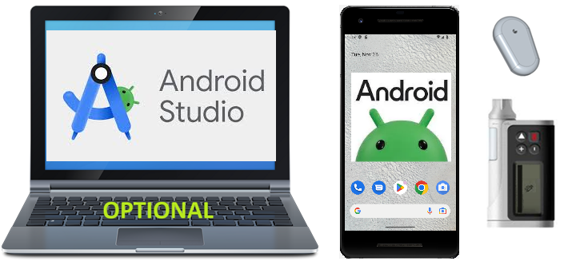

# Pregled komponenti

**AAPS** nije samo (samostalno izrađena) aplikacija; to je jedan od nekoliko modula vašeg sustava zatvorene petlje. Prije nego što odaberete komponente, dobro je pogledati dokumentaciju komponenti.



```{admonition} IMPORTANT SAFETY NOTICE
:class: important

Osnova sigurnosnih značajki **AAPS**-a opisanih u ovoj dokumentaciji temelji se na sigurnosnim značajkama hardvera koji koristite za izradu svog sustava. Za zatvaranje petlje automatskog doziranja inzulina iznimno je važno da koristite samo inzulinsku pumpu i CGM koji su testirani, potpuno ispravni i odobreni od službenih tijela vaše zemlje. Hardverske ili softverske izmjene ovih komponenti mogu uzrokovati neočekivano doziranje inzulina, što je ozbiljan rizik za korisnika. Ako nađete ili vam ponude pokvarene, izmijenjene ili samostalno izrađene inzulinske pumpe ili CGM prijemnike, **nemojte ih koristiti** za izradu sustava **AAPS**.

Osim toga, jednako je važno koristiti samo originalni pribor, kao što su uređaji za umetanje, kanile i spremnici za inzulin, koje je proizvođač odobrio za vašu pumpu ili CGM. Korištenje neprovjerenog ili izmijenjenog pribora može uzrokovati netočna očitanja CGM-a i pogreške u doziranju inzulina. Inzulin je vrlo opasan kada se pogrešno dozira – molimo vas, ne igrajte se svojim životom tako da prepravljate svoj pribor.

I na kraju, ne smijete uzimati SGLT-2 inhibitore (glifozine) jer oni nepredvidivo snižavaju razinu šećera u krvi. Kombinacija sa sustavom koji smanjuje bazalnu stopu kako bi povisio GUK posebno je opasna, jer zbog glifozina taj porast GUK-a možda neće nastupiti i može doći do opasnog stanja nedostatka inzulina. [Više informacija ovdje](#PreparingForAaps-no-sglt-2-inhibitors).
```

## Potrebni moduli

### Dobar individualni algoritam doziranja za vašu terapiju dijabetesa

Iako to nije nešto što se izrađuje ili kupuje, to je vjerojatno najpodcjenjeniji „modul“ – ali je ključan. Kada dopustite algoritmu da vam pomaže upravljati dijabetesom, on mora znati prave postavke kako ne bi napravio ozbiljne pogreške. Čak i ako vam još nedostaju drugi moduli, već možete provjeriti i prilagoditi svoj **Profil** u suradnji sa svojim dijabetološkim timom.

**Profil** uključuje:

- BR (bazalne stope): osiguravaju pozadinski inzulin;
- ISF (faktor osjetljivosti na inzulin): za koliko će 1 jedinica inzulina sniziti vašu razinu glukoze u krvi;
- CR (omjer ugljikohidrata): koliko grama ugljikohidrata pokriva jedna jedinica inzulina.

Većina korisnika petlje koristi cirkadijalne BR, ISF i CR, koji tijekom dana prate hormonalne promjene osjetljivosti na inzulin.

Uz svoj **Profil** morate podesiti i svoj **inzulin** u **Upravljanje → Postavke inzulina**, uključujući njegov DIA (trajanje djelovanja inzulina) – pogledajte [Postavke inzulina](#Config-Builder-insulin-dia).

Više informacija o vašem **Profilu** nalazi se [na posebnoj stranici](../SettingUpAaps/YourAapsProfile.md).

### Telefon

Pogledajte posebnu stranicu [Telefoni](../Getting-Started/Phones.md).

### Inzulinska pumpa

Pogledajte posebnu stranicu [Kompatibilne pumpe](../Getting-Started/CompatiblePumps.md).

**Prednosti i nedostaci nekih modela pumpi**

Combo, Insight i starije Medtronic pumpe su pouzdane pumpe i mogu se koristiti s petljom. Prednost Comba je to što možete birati između puno više vrsta infuzijskih setova, jer ima standardni Luer-Lock priključak. A baterija je obična baterija koju možete kupiti na svakoj benzinskoj postaji ili u dućanu koji radi 0–24, a ako vam je baš potrebna, možete je „posuditi“ iz daljinskog upravljača u hotelskoj sobi ;-).

Prednosti pumpi DanaR/RS i Dana-i u odnosu na Combo kao odabranu pumpu ipak su:

- Prvo uparivanje jednostavnije je s pumpom Dana-i/RS. No to obično radite samo jednom, pa je važno samo ako želite testirati novu značajku s različitim pumpama.
- Combo za sada radi čitanjem zaslona. Općenito to radi odlično, ali je sporo. Za petlju to nije jako važno jer sve radi u pozadini. Ipak, morate biti spojeni puno dulje, pa je i dulje vrijeme u kojem se BT veza može prekinuti, a to nije jednostavno ako se tijekom bolusa i kuhanja udaljite od telefona.
- Combo vibrira na kraju privremenog bazala (TBR), a DanaR vibrira (ili pišti) kod SMB-a. Noću ćete vjerojatno više koristiti privremeni bazal (TBR) nego SMB.  Dana-i/RS se može podesiti tako da ne pišti i ne vibrira.
- Čitanje povijesti s ugljikohidratima na pumpi Dana-i/RS za nekoliko sekundi omogućuje laku zamjenu telefona bez interneta i nastavak petlje čim stignu neke vrijednosti s CGM-a.
- Sve pumpe s kojima **AAPS** može komunicirati vodootporne su pri isporuci. Samo su pumpe Dana i „vodootporne prema jamstvu“, zahvaljujući zatvorenom pretincu za bateriju i sustavu za punjenje spremnika.

### Izvor GUK-a

Pogledajte posebnu stranicu [Kompatibilni CGM-ovi](../Getting-Started/CompatiblesCgms.md).

### APK datoteka **AAPS**-a

Glavna komponenta sustava. Da biste instalirali aplikaciju, najprije morate sami izraditi APK datoteku. Upute su [ovdje](../SettingUpAaps/BuildingAaps.md).

### Poslužitelj za izvješća

Poslužitelj za izvješća prikazuje vaše podatke o glukozi i tretmanima te izrađuje izvješća za detaljnu analizu. Trenutno postoje dva poslužitelja za izvješća koja možete koristiti s AAPS-om: [Nightscout](#SettingUpTheReportingServer-nightscout) i [Tidepool](#SettingUpTheReportingServer-tidepool). Oba omogućuju prikaz vaših podataka o dijabetesu kroz vrijeme te daju statistiku o **vremenu u rasponu** (TIR) i drugim mjerama.

Poslužitelj za izvješća neovisan je o ostalim modulima. Ako ne želite koristiti poslužitelj za izvješća, trebate znati da on nije obavezan za dugoročno korištenje **AAPS**-a. Ali ipak ga morate postaviti, jer je potreban za ispunjavanje [**Cilja 1**](#objectives-objective1).

Dodatne informacije o tome kako postaviti poslužitelj za izvješća nalaze se [ovdje](../SettingUpAaps/SettingUpTheReportingServer.md).

## Neobavezni moduli

### Pametni sat

Možete odabrati bilo koji pametni sat sa sustavom **Wear OS 3** ili novijim. Za pojedinosti pogledajte [Pametni satovi i AAPS](../Getting-Started/Watches.md).

Korisnici izrađuju [popis testiranih telefona i satova](#Phones-list-of-tested-phones). Postoje različiti Watchfaceovi za **AAPS**, koje možete pronaći [ovdje](../WearOS/WearOsSmartwatch.md).

### xDrip

Čak i ako vam aplikacija xDrip nije potrebna kao **Izvor GUK-a**, ipak je možete koristiti, na primjer za alarme ili za drugačiji prikaz glukoze u krvi. Možete imati koliko god alarma želite, odrediti vrijeme kada alarm treba biti aktivan, odabrati smije li zaobići tihi način rada itd. Neke informacije o xDripu možete pronaći [ovdje](../CompatibleCgms/xDrip.md). Imajte na umu da dokumentacija za ovu aplikaciju nije uvijek ažurna, jer se aplikacija brzo mijenja.

## Što raditi dok čekate module

Ponekad treba neko vrijeme da nabavite sve module za zatvaranje petlje. Ali bez brige, puno toga možete raditi dok čekate. It is **necessary** to check and (where appropriate) adapt basal rates (BR), insulin-carb ratio (IC), insulin-sensitivity-factors (ISF) etc. A otvorena petlja može biti dobar način da testirate sustav i upoznate se s **AAPS**-om. U tom načinu rada **AAPS** daje preporuke za tretmane koje možete ručno izvršiti.

Možete nastaviti čitati dokumentaciju ovdje, povezati se s drugim korisnicima petlje na internetu ili uživo, [čitati](../UsefulLinks/BackgroundReading.md) dokumentaciju ili ono što pišu drugi korisnici petlje (ali budite oprezni, nije sve točno ili dobro za vas).

**Gotovo?** Ako imate sve komponente za **AAPS** (čestitamo!) ili barem dovoljno da započnete u načinu otvorene petlje, prije svakog novog cilja najprije pročitajte [opis ciljeva](../SettingUpAaps/CompletingTheObjectives.md) i postavite svoj hardver.
