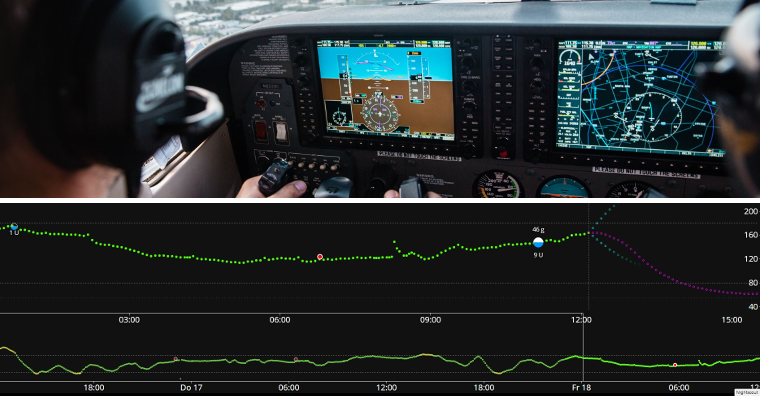
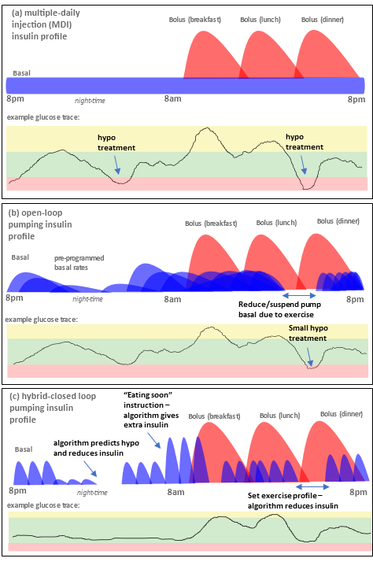
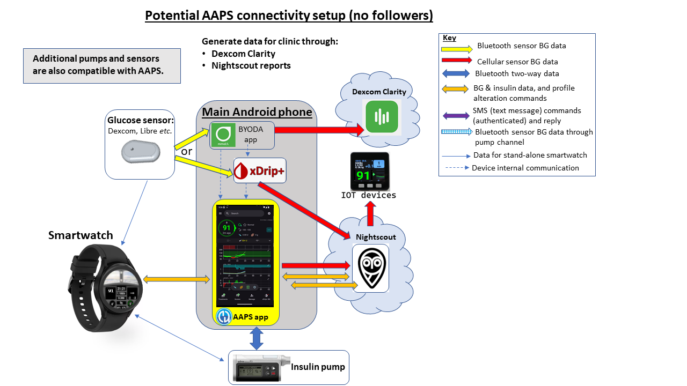
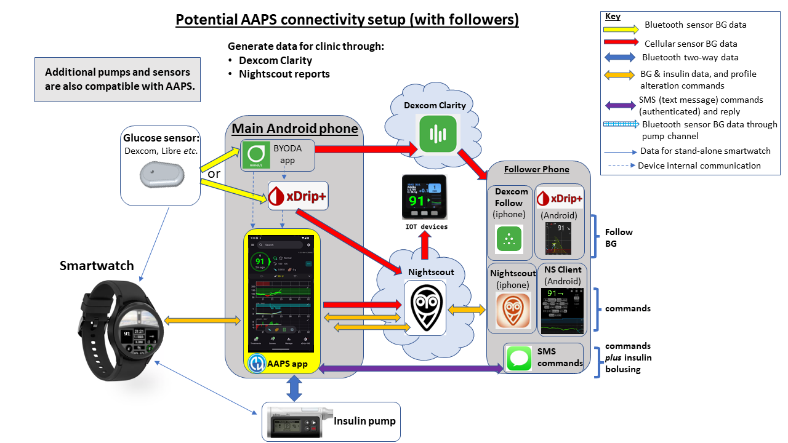

# Uvod u APS i AAPS

```{contents} In this page
:backlinks: entry
:depth: 2
```

## Što je „sustav umjetne gušterače“?

Ljudska gušterača radi mnogo stvari osim regulacije šećera u krvi. Ipak, pojam **„sustav umjetne gušterače“ (APS)** obično označava sustav koji automatski održava razinu šećera u krvi unutar zdravih granica.

Najjednostavniji način za to je mjeriti **razinu glukoze**, iz tih vrijednosti napraviti **izračune** i zatim isporučiti tijelu (predviđenu) pravu količinu **inzulina**. Izračun ponavlja svakih nekoliko minuta, danonoćno (24/7). Koristi **alarme** i **upozorenja** kako bi obavijestio korisnika kada je potrebna intervencija ili pažnja. Ovaj sustav se obično sastoji od **senzora glukoze**, **inzulinske pumpe** i **upravljača** koji radi izračune. U **AAPS-u** i drugim sustavima otvorenog koda upravljač je aplikacija na telefonu. U većini komercijalnih sustava to je softver ugrađen u samu pumpu, a aplikacija na telefonu služi uglavnom za prikaz i upravljanje.

Za osnovne informacije o tome kako su se sustavi zatvorene petlje razvili i kako rade, ovaj pregledni članak iz 2022. dobro je mjesto za početak. Imajte na umu da je stariji od većine sustava koji su danas dostupni, pa nije vodič za ono što je trenutačno na tržištu:

 [Closed-Loop Insulin Delivery Systems: Past, Present, and Future Directions](https://www.frontiersin.org/journals/endocrinology/articles/10.3389/fendo.2022.919942/full) (Templer, _Frontiers in Endocrinology_, 2022).

Takozvani „dvohormonski“ sustavi uz inzulin daju i glukagon, s ciljem sprječavanja teških hipoglikemija i još strože kontrole glukoze u krvi. Prvi sustav te vrste odobren je u Europi, ali se isporučuje samo kroz studije i projekte, a drugi su još u razvoju. Nijedan se još ne prodaje u slobodnoj prodaji.

Umjetnu gušteraču možete zamisliti kao [„autopilota za vaš dijabetes“](https://www.artificialpancreasbook.com/). Što to znači?

U zrakoplovu autopilot ne radi cijeli posao ljudskog pilota, pilot ne može prespavati cijeli let. Autopilot pomaže pilotu u radu. Oslobađa pilota tereta stalnog upravljanja zrakoplovom, pa se pilot može usredotočiti na širi nadzor. Autopilot prima signale s različitih senzora, računalo procjenjuje podatke zajedno s pilotovim zadanim vrijednostima i zatim radi potrebne prilagodbe te upozorava pilota na svaki problem. Pilot više ne mora stalno brinuti o donošenju odluka, a ova se usporedba može primijeniti i na **AAPS**.



(Introduction-what-does-hybrid-closed-loop-mean)=
## Što znači hibridna zatvorena petlja?

Najbolje rješenje za dijabetes tipa 1 bilo bi „funkcionalno izlječenje“ (vjerojatno implantat stanica gušterače koje su zaštićene od imunološkog sustava). Dok zajednica osoba s dijabetesom tipa 1 (T1D) čeka na to, umjetna gušterača s „potpuno zatvorenom petljom“ vjerojatno je sljedeće najbolje rješenje. To je tehnički sustav kojem ne treba nikakav unos korisnika (kao što je bolus inzulina za obroke ili najava tjelovježbe), a koji dobro regulira razinu glukoze u krvi. Gotovo svaki sustav u svakodnevnoj upotrebi je „hibridna“ zatvorena petlja, jer koristi kombinaciju automatizirane tehnologije i unosa korisnika. Prvi sustavi s potpuno zatvorenom petljom odobreni su u Europi 2026. godine, ali nijedan još nije široko dostupan.

## Kako je i zašto počelo korištenje petlje?

Razvoj komercijalne tehnologije za osobe s dijabetesom tipa 1 (T1D) je vrlo spor. Zajednica T1D-a je 2013. godine osnovala pokret #WeAreNotWaiting („ne čekamo“). Sami su razvili sustave od postojeće odobrene tehnologije (inzulinskih pumpi i senzora) kako bi poboljšali kontrolu glukoze u krvi, sigurnost i kvalitetu života. Oni se zovu sustavi OS-AID (Open-Source Automated Insulin Delivery, automatizirana isporuka inzulina otvorenog koda), ranije sustavi „uradi sam“ (DIY), jer ih zdravstvena tijela (FDA, NHS itd.) nisu službeno odobrila. Postoje četiri glavna sustava OS-AID: [OpenAPS](https://openaps.org/what-is-openaps/), **AAPS**, [Loop](https://loopkit.github.io/loopdocs/#what-is-loop) i [Trio](https://triodocs.org).

Odličan način da razumijete osnove petlje OS-AID je da pročitate knjigu Dane Lewis „Automated Insulin Delivery“. Možete joj pristupiti besplatno [ovdje](https://www.artificialpancreasbook.com/) (ili kupiti tiskanu knjigu). Ako želite bolje razumjeti [OpenAPS](https://openaps.org/what-is-openaps/), iz kojeg je nastao **AAPS**, [web stranica OpenAPS-a](https://openaps.org/what-is-openaps/) je odličan izvor.

Na tržište je stiglo i nekoliko komercijalnih sustava hibridne zatvorene petlje. Oni se jako razlikuju od sustava OS-AID, uglavnom zato što mnogi od njih imaju „algoritam koji uči“ i prilagođava količinu isporučenog inzulina prema vašim potrebama za inzulinom iz prethodnih dana. Mnogi u zajednici OS-AID već su isprobali komercijalne sustave i usporedili ih sa svojim sustavom OS-AID. Više o tome kako se različiti sustavi uspoređuju možete saznati ako pitate u posebnim grupama na Facebooku za te sustave, u [grupi AAPS na Facebooku](https://www.facebook.com/groups/AndroidAPSUsers/) ili na [Discordu](https://discord.com/invite/4fQUWHZ4Mw).

## Što je Android APS (AAPS)?


**Slika 1**. Osnovni prikaz sustava Android APS (sustav umjetne gušterače), AAPS.

Android APS (**AAPS**) je sustav hibridne zatvorene petlje, ili sustav umjetne gušterače (APS). Doze inzulina izračunava pomoću provjerenih algoritama [OpenAPS](https://openaps.org/) (skup pravila) koje je razvila zajednica T1D-a #WeAreNotWaiting.

Budući da OpenAPS radi samo s određenim starijim inzulinskim pumpama, **AAPS** (koji se može koristiti s više vrsta inzulinskih pumpi) prvi je put razvijen 2016. godine za člana obitelji s dijabetesom tipa 1. Od tih ranih dana tim dobrovoljnih programera i drugih entuzijasta, koji su povezani sa svijetom dijabetesa tipa 1, stalno razvija i poboljšava **AAPS**. Danas **AAPS** koriste mnoge tisuće ljudi diljem svijeta. To je vrlo prilagodljiv i svestran sustav, a budući da je otvorenog koda, lako radi i s mnogim drugim softverima i platformama za dijabetes otvorenog koda. Osnovne komponente sadašnjeg sustava **AAPS** prikazane su gore na **slici 1**.


## Koje su osnovne komponente AAPS-a?

„Mozak“ AAPS-a je **aplikacija** koju sami izradite. Za to postoje detaljne upute korak po korak. Zatim instalirate **aplikaciju AAPS** na [kompatibilni](../Getting-Started/Phones.md) **Android pametni telefon** (**1**). Neki korisnici radije koriste petlju na zasebnom telefonu, a ne na svom glavnom telefonu. Dakle, ne morate nužno koristiti Android telefon za sve ostalo u životu, nego samo za rad vaše AAPS petlje.

Na **Android pametnom telefonu** uz **AAPS** mora biti instalirana još jedna aplikacija. Ova [dodatna aplikacija](../Getting-Started/CompatiblesCgms.md) prima podatke o glukozi sa senzora (**2**) putem Bluetootha i zatim ih unutar telefona šalje **aplikaciji AAPS**.

**Aplikacija AAPS** koristi postupak donošenja odluka (**algoritam**) iz OpenAPS-a. Početnici počinju s osnovnim algoritmom **oref0**, ali kako napredujete s AAPS-om, možete prijeći na noviji algoritam **oref1**. Koji algoritam koristite (oref0 ili oref1) ovisi o tome koji najbolje odgovara vašoj situaciji.  U oba slučaja algoritam uzima u obzir više čimbenika i brzo radi izračune svaki put kada sa senzora stigne novo očitanje. Algoritam zatim putem Bluetootha šalje inzulinskoj pumpi (**3**) upute koliko inzulina treba isporučiti. Sve informacije mogu se putem mobilnih podataka ili Wi-Fi mreže poslati na internet (**4**). Ovi podaci se po želji mogu dijeliti i s pratiteljima i/ili prikupljati za analizu. Po želji možete s telefonom upariti i [pametni sat](../Getting-Started/Watches.md) (**5**) kako biste na brzinu vidjeli svoje podatke, a s nekim satovima i slati osnovne naredbe **AAPS-u**.

## Koje su prednosti sustava AAPS?

Algoritam OpenAPS koji koristi **AAPS** upravlja razinom šećera u krvi bez unosa korisnika, prema parametrima koje je korisnik zadao (važni su bazalne stope, faktori osjetljivosti na inzulin, omjeri inzulina i ugljikohidrata, trajanje djelovanja inzulina itd.), i reagira svakih 5 minuta na nove podatke senzora.

Neke od navedenih prednosti korištenja **AAPS-a** su brojne mogućnosti finog podešavanja, **Automatizacija** i veća transparentnost sustava za pacijenta/njegovatelja. To može dovesti do bolje kontrole vašeg dijabetesa (ili dijabetesa osobe o kojoj skrbite), a to može donijeti bolju kvalitetu života i više mira.

Ako uložite svoje vrijeme, **AAPS** vam može donijeti:

- manje stresa i opterećenja u upravljanju dijabetesom tipa 1;

- manje svakodnevnih rutinskih odluka koje donosi dijabetes tipa 1;

- osobno i dinamično doziranje inzulina na temelju podataka u stvarnom vremenu, što može smanjiti potrebu za liječenjem hipoglikemija i smanjiti broj hiperglikemija;

- više znanja o upravljanju inzulinom i više sigurnosti za bolje fino podešavanje vaših postavki;

- mogućnost izrade automatskih postavki (**automatizacija**) prilagođenih vašem načinu života;

- bolju kvalitetu sna i općenito manje noćnih intervencija;

- daljinski nadzor i upravljanje isporukom inzulina za njegovatelje osoba s dijabetesom tipa 1; i

- objedinjavanje sve vaše prijenosne opreme za dijabetes (prijamnika kontinuiranog mjerenja glukoze i uređaja za doziranje inzulina) pomoću Android telefona kojim upravlja **AAPS**.


Na kraju, **AAPS** može osnažiti osobe da bolje upravljaju svojim dijabetesom, što vodi do stabilnog šećera u krvi i boljeg dugoročnog zdravlja.

### Posebne prednosti su:

#### 1) Ugrađena sigurnost
Da biste pročitali o sigurnosnim značajkama algoritama, poznatih kao oref0 i oref1, [kliknite ovdje](https://openaps.org/reference-design/). Korisnik sam upravlja svojim sigurnosnim ograničenjima.

#### 2) Fleksibilnost hardvera

**AAPS** radi s mnogim inzulinskim pumpama i senzorima i nudi fleksibilnost kada se život promijeni. Na primjer, ako razvijete alergiju na ljepilo flastera senzora Dexcom, možete umjesto njega početi koristiti senzor Libre. Korisnici ne moraju ponovno izraditi ili ponovno instalirati aplikaciju **AAPS**. Za promjenu hardvera dovoljno je u **Konfiguraciji** odabrati drugu pumpu ili drugi izvor GUK-a. **AAPS** ne ovisi o određenim upravljačkim programima pumpi i ima i „virtualnu pumpu“, tako da korisnici mogu sigurno eksperimentirati prije nego što ga počnu koristiti na sebi.

#### 3) Vrlo prilagodljiv, sa širokim rasponom parametara

Korisnici mogu lako dodati ili ukloniti module ili funkcije, a **AAPS** se može koristiti u načinu rada otvorene i zatvorene petlje. Evo nekoliko primjera mogućnosti sustava **AAPS**:

 a) Mogućnost da 30 minuta prije jela postavite niži cilj **GUK-a**; cilj možete postaviti čak na 72 mg/dL (4,0 mmol/L).

 b) Ako ste otporni na inzulin pa imate visok šećer u krvi, **AAPS** vam omogućuje da postavite pravilo **automatizacije** koje se aktivira kada GUK poraste iznad 8 mmol/L (144 mg/dL) i prebaci na (na primjer) profil od 120 % (što daje 20 % više bazala i jače druge čimbenike, u usporedbi s vašom uobičajenom postavkom **profila**). Automatizacija će trajati prema planiranom vremenu koje postavite. Takva automatizacija može biti postavljena da bude aktivna samo određenim danima u tjednu, u određeno doba dana, pa čak i na određenim lokacijama.

 c) Ako je vaše dijete bez najave na trampolinu, **AAPS** omogućuje da se isporuka inzulina obustavi na zadano vrijeme, izravno s telefona.

 d) Nakon ponovnog spajanja pumpe s cijevi koja je bila odspojena zbog plivanja, **AAPS** će izračunati bazalni inzulin koji ste propustili dok je pumpa bila odspojena i pažljivo ga isporučiti, prema vašem trenutačnom GUK-u. Inzulin koji nije potreban možete poništiti tako da samo „otkažete“ propušteni bazal.

 e) **AAPS** vam omogućuje da postavite različite profile za različite situacije i da lako prelazite s jednog na drugi. Na primjer, značajke koje algoritmu omogućuju da brže snizi povišen GUK (kao što su supermikro bolusi („**SMB**“) i nenajavljeni obroci („**UAM**“)) mogu se postaviti tako da rade samo danju, ako se bojite noćnih hipoglikemija.

Ovo su samo primjeri. Sve značajke zajedno daju veliku fleksibilnost u svakodnevnom životu, uključujući sport, bolest, hormonske cikluse _itd_. Na kraju, korisnik odlučuje kako će koristiti ovu fleksibilnost i ne postoji jedna automatizacija koja odgovara svima.

#### 4) Daljinski nadzor
Postoji više mogućih kanala za nadzor (Sugarmate, Dexcom Follow, xDrip, Android Auto _itd._), koji su korisni za roditelje/njegovatelje i za odrasle u određenim situacijama (spavanje/vožnja) kojima trebaju prilagodljiva upozorenja. U nekim aplikacijama (xDrip) možete i potpuno isključiti alarme, što je odlično kada imate novi senzor koji se još „namače“ ili stabilizira i s kojim još ne želite koristiti petlju.

#### 5) Daljinsko upravljanje
Velika prednost **AAPS-a** u odnosu na komercijalne sustave je to što pratitelji putem provjerenih tekstualnih (SMS) naredbi ili uparene aplikacije **AAPSClient** mogu sustavu **AAPS** slati mnogo različitih naredbi. Ovu značajku često koriste roditelji djece s dijabetesom tipa 1 koja koriste **AAPS**.

Značajke daljinskog upravljanja mogu biti vrlo korisne: na primjer na igralištu, ako želite sa svog telefona dati bolus unaprijed za užinu, a vaše dijete je zauzeto igrom. Sustav je moguće i nadzirati s pametnog sata (_npr._ Garmin) ili s njega slati osnovne naredbe (_npr._ sat s Wear OS-om kao što je Samsung Galaxy Watch).

#### 6) Nema komercijalnih ograničenja, zahvaljujući otvorenim sučeljima aplikacije
Osim otvorenog koda, koji omogućuje da se izvorni kod **AAPS-a** pogleda u bilo kojem trenutku, opće načelo otvorenih programskih sučelja daje i drugim programerima priliku da doprinesu novim idejama. **AAPS** je usko povezan s Nightscoutom. To ubrzava razvoj i omogućuje korisnicima da dodaju značajke koje život s dijabetesom čine još lakšim. Dobri primjeri takvih integracija su [Nightscout](https://nightscout.github.io/), [Nightscout Reporter](https://nightscout-reporter.zreptil.de/), xDrip, [M5 stack](https://github.com/mlukasek/M5_NightscoutMon/wiki) itd. Postoji stalni dijalog između programera otvorenog koda i onih koji razvijaju komercijalne sustave. Mnoge inovacije iz zajednice OS-AID postupno preuzimaju komercijalni sustavi, gdje je razvoj razumljivo sporiji, djelomično zato što se sučelja između sustava različitih tvrtki (pumpi, aplikacija, senzora _itd._) moraju pažljivo dogovoriti i licencirati. To također može usporiti inovacije koje su korisne za pacijenta (ili za malu skupinu pacijenata s vrlo posebnim potrebama), ali ne donose značajnu zaradu.

#### 7) Detaljno sučelje aplikacije
S **AAPS-om** je lako pratiti stvari kao što su: razina inzulina u pumpi, starost kanile, starost senzora, starost baterije pumpe, aktivni inzulin _itd_. Mnoge radnje mogu se obaviti putem aplikacije **AAPS** (punjenje katetera pumpe, odspajanje pumpe _itd_.), umjesto na samoj pumpi, pa pumpa može ostati u vašem džepu ili na pojasu (ili kod osobe o kojoj skrbite).

#### 8) Dostupnost i pristupačna cijena
**AAPS** daje osobama koje si trenutačno ne mogu priuštiti sustav o svom trošku ili nemaju financiranje/osiguranje pristup sustavu hibridne zatvorene petlje koji je po svom konceptu godinama ispred komercijalnih sustava. Za postavljanje **AAPS-a** trenutačno vam treba poslužitelj za izvješća (Nightscout ili Tidepool), iako nije potreban za svakodnevni rad petlje **AAPS**. Mnogi i dalje koriste Nightscout za prikupljanje svojih podataka i za daljinski nadzor. Iako je sam **AAPS** besplatan, postavljanje Nightscouta na nekoj od različitih platformi može imati trošak (0 € – 12 €), ovisno o tome koju razinu podrške želite (pogledajte tablicu usporedbe) i želite li nastaviti koristiti Nightscout nakon postavljanja ili ne. **AAPS** radi s velikim brojem pristupačnih (od otprilike 150 €) [Android telefona](https://docs.google.com/spreadsheets/u/1/d/e/2PACX-1vScCNaIguEZVTVFAgpv1kXHdsHl3fs6xT6RB2Z1CeVJ561AvvqGwxMhlmSHk4J056gMCAQE02sAWJvT/pubhtml?gid=683363241&single=true). Postoje različite verzije za određene lokacije i jezike, a AAPS mogu koristiti i osobe koje su [slijepe](#accessibility-for-users-aaps-who-are-partially-or-completely-blind).

#### 9) Podrška
Nijedan sustav za automatsku isporuku inzulina nije savršen. Komercijalni sustavi i sustavi otvorenog koda imaju mnoge slične probleme, i u komunikaciji i zbog privremenih kvarova hardvera. Dostupna je podrška zajednice korisnika AAPS-a na Facebooku, Discordu i GitHubu, koji su osmislili, razvili i trenutačno koriste **AAPS** diljem svijeta. Za komercijalne APS sustave postoje i grupe podrške na Facebooku te pomoć klinika i proizvođača. Vrijedi razgovarati s korisnicima ili bivšim korisnicima tih sustava kako biste saznali o čestim problemima, kvaliteti programa edukacije i razini stalne podrške.

#### 10) Predvidljivost, transparentnost i sigurnost
**AAPS** je transparentan, logičan i predvidljiv, pa je lakše uočiti kada je neka postavka pogrešna i prema tome je prilagoditi. Možete točno vidjeti što sustav radi i zašto to radi te postaviti njegove radne granice, što kontrolu (i odgovornost) stavlja u vaše ruke. To korisniku može dati samopouzdanje i mirniji san.

#### 11) Pristup naprednim značajkama kroz razvojne (dev) načine rada, uključujući potpuno zatvorenu petlju
Ova dokumentacija za **AAPS** opisuje glavnu granu **„master“** sustava **AAPS**. Ipak, istraživanje i razvoj traju stalno. Iskusniji korisnici mogu istražiti eksperimentalne značajke u **razvojnoj** grani (development). Razvojne inovacije usmjerene su na strategije za potpuno zatvorenu petlju (bez potrebe za bolusom za obroke _itd._) i općenito na to da život s dijabetesom tipa 1 bude što lakši.

#### 12) Mogućnost da sami doprinesete daljnjim poboljšanjima
Dijabetes tipa 1 može biti vrlo frustrirajući i može izolirati osobu. Kontrola nad vlastitom tehnologijom za dijabetes, uz mogućnost da „vratite dobro“ čim napredujete, tako da pomažete drugima na njihovom putu, može biti zaista ispunjavajuća. Možete se sami educirati, otkriti prepreke i tražiti nova rješenja, pa čak i doprinijeti novom razvoju i dokumentaciji. U zajednici će biti i drugih s istim ciljem, s kojima možete razmjenjivati ideje i surađivati. To je bit pokreta #WeAreNotWaiting.

## Kako se AAPS uspoređuje s MDI-jem i otvorenom petljom?

Višestruke dnevne injekcije (MDI, (a) na **slici 2** dolje) obično znače jednu injekciju dugodjelujućeg inzulina (_npr._ Tresiba) dnevno i injekcije brzodjelujućeg inzulina (_npr._ Novorapid, Fiasp) uz obroke ili za korekcije. Otvorena terapija pumpom (b) znači da pumpa isporučuje bazal brzodjelujućeg inzulina prema unaprijed programiranim stopama, a zatim bolusima putem pumpe uz obroke ili za korekcije. Osnova sustava petlje je da aplikacija petlje koristi podatke o glukozi sa senzora kako bi pumpi naredila da zaustavi isporuku inzulina kada predviđa da idete prema niskoj vrijednosti, i da vam da dodatni inzulin ako vaša razina glukoze raste i predviđa se da će biti previsoka (c). Iako je ova slika pojednostavljena u usporedbi sa stvarnim životom, njezin cilj je pokazati ključne razlike između pristupa. S bilo kojim od ova tri pristupa moguće je postići iznimno dobru kontrolu glukoze.




**Slika 2**. Osnovni prikaz (a) MDI-ja, (b) terapije pumpom s otvorenom petljom i (c) terapije pumpom s hibridnom zatvorenom petljom.

## Kako se AAPS uspoređuje s drugim sustavima petlje?

Na dan 25. lipnja 2023. postoje četiri glavna sustava zatvorene petlje otvorenog koda: [OpenAPS](https://openaps.readthedocs.io/), **AAPS**, [Loop](https://loopkit.github.io/loopdocs/#what-is-loop) i [Trio](https://triodocs.org) (ranije FreeAPS X). Značajke različitih sustava prikazane su u tablici ispod:


| Vrsta uređaja | Naziv                                                                  | [AAPS](https://wiki.aaps.app)               | [Petlja](https://loopkit.github.io/loopdocs/) | [Open APS](https://openaps.readthedocs.io/en/latest/) | [Trio](https://triodocs.org)                |
| ------------- | ---------------------------------------------------------------------- | ------------------------------------------- | --------------------------------------------- | ----------------------------------------------------- | ------------------------------------------- |
| Telefon       | Android                                                                |         |    |            |  |
| Telefon       | iPhone                                                                 |  |           |            |         |
| Rig           | malo računalo (1)                                                      |  |    |                   |  |
| PUMP          | [Dana I](../CompatiblePumps/DanaRS-Insulin-Pump.md)                    |         |           |            |         |
| PUMP          | [Dana RS](../CompatiblePumps/DanaRS-Insulin-Pump.md)                   |         |           |            |         |
| PUMP          | [Dana R](../CompatiblePumps/DanaR-Insulin-Pump.md)                     |         |    |            |  |
| PUMP          | [Omnipod (Dash)](../CompatiblePumps/OmnipodDASH.md)                    |         |           |            |         |
| PUMP          | [Omnipod (Eros)](../CompatiblePumps/OmnipodEros.md)                    |         |           |            |         |
| PUMP          | [Diaconn G8](../CompatiblePumps/DiaconnG8.md)                          |         |    |            |  |
| PUMP          | [EOPatch 2](../CompatiblePumps/EOPatch2.md)                            |         |    |            |  |
| PUMP          | [Medtrum TouchCare Nano 200U](../CompatiblePumps/MedtrumNano.md)       |         |           |            |         |
| PUMP          | [Medtrum TouchCare 300U](../CompatiblePumps/MedtrumNano.md)            |         |           |            |         |
| PUMP          | [Roche Combo](../CompatiblePumps/Accu-Chek-Combo-Pump-v2.md)           |         |    |            |  |
| PUMP          | [Roche Insight](../CompatiblePumps/Accu-Chek-Insight-Pump.md)          |         |    |            |  |
| PUMP          | [Starije Medtronic pumpe](../CompatiblePumps/MedtronicPump.md)         |         |           |                   |         |
| PUMP          | [Equil 5.3](../CompatiblePumps/Equil5.3.md)                            |         |    |            |  |
| PUMP          | [CareLevo](../CompatiblePumps/CareLevo.md)                             |         |    |            |  |
| CGM           | [Dexcom G7/One+/Stelo](../CompatibleCgms/DexcomG7.md)                  |         |           |            |         |
| CGM           | [Dexcom One](../CompatibleCgms/DexcomG6.md)                            |         |           |            |         |
| CGM           | [Dexcom G6](../CompatibleCgms/DexcomG6.md)                             |         |           |                   |         |
| CGM           | [Libre 3/3+](../CompatibleCgms/Libre3.md)                              |         |           |            |         |
| CGM           | [Libre 2/2+](../CompatibleCgms/Libre2.md)                              |         |           |            |         |
| CGM           | [Libre 1](../CompatibleCgms/Libre1.md)                                 |         |           |            |         |
| CGM           | [Eversense](../CompatibleCgms/Eversense.md)                            |         |           |            |         |
| CGM           | [MM640g/MM630g](../CompatibleCgms/MM640g.md)                           |         |    |            |  |
| CGM           | [PocTech](../CompatibleCgms/PocTech.md)                                |         |    |            |  |
| CGM           | [Ottai](../CompatibleCgms/OttaiM8.md)                                  |         |    |            |  |
| CGM           | [Syai Tag](../CompatibleCgms/SyaiTagX1.md)                             |         |    |            |  |
| CGM           | [Nightscout kao izvor GUK-a](../CompatibleCgms/CgmNightscoutUpload.md) |         |           |                   |         |

_Napomene uz tablicu:_
1. **Rig** je malo računalo bez zaslona koje nosite sa sobom. Jedna podržana vrsta uređaja je Intel Edison + Explorer Board, a druga Raspberry Pi + Explorer HAT ili Adafruit RFM69HCW Bonnet. Prvi APS sustavi temeljili su se na takvom postavu, jer mobilni telefoni nisu mogli pokretati potrebne algoritme. Ovi sustavi se sve manje koriste jer je postavljanje na mobilnim telefonima postalo lakše, a telefoni imaju zaslon. Intel je također prestao prodavati Intel Edison. Izvrsni OpenAPS algoritmi **oref0** i **oref1** sada su ugrađeni u AAPS i Trio.


Međunarodnu, stručno recenziranu izjavu o konsenzusu s praktičnim smjernicama o petljama otvorenog koda napisali su zdravstveni djelatnici za zdravstvene djelatnike, a objavljena je u vodećem medicinskom časopisu 2022. godine: [_Lancet Diabetes Endocrinol_, 2022; 10: 58–74](https://www.ncbi.nlm.nih.gov/pmc/articles/PMC8720075/)(_1_). Vrijedi ga pročitati (i vašoj dijabetološkoj klinici), a sažima glavne tehničke razlike između različitih sustava hibridne zatvorene petlje otvorenog koda.

Teško je steći „osjećaj“ za neki sustav bez da ga koristite ili razgovarate s drugima koji ga koriste, zato se obratite drugima na Facebooku/Discordu i pitajte. Većina ljudi smatra da je **AAPS** iznimno napredan u usporedbi s drugim sustavima hibridne zatvorene petlje (posebno komercijalnim sustavima), s velikim brojem prilagodljivih postavki i značajki, opisanih gore. Nekima to na početku može biti malo previše, ali nema žurbe da sve mogućnosti istražite odjednom. Možete napredovati sporo ili brzo, kako želite, a pomoć je dostupna u svakom koraku.


## Koristi li AAPS umjetnu inteligenciju ili neki algoritam koji uči?

Trenutačna verzija **AAPS-a** (4.0) nema algoritme strojnog učenja, modele odgovora na inzulin s više parametara ni umjetnu inteligenciju. Zato je sustav otvoren i transparentan u načinu rada i mogu ga razumjeti ne samo stručnjaci, nego i liječnici i pacijenti. To također znači da, ako imate raspored koji se jako mijenja (npr. prelazite sa stresnog tjedna na poslu na opuštajući odmor) i vjerojatno vam treba znatno drukčija količina inzulina, možete **AAPS** odmah prebaciti na slabiji/jači prilagođeni profil. „Sustav koji uči“ to će prilagođavanje napraviti automatski umjesto vas, ali će vjerojatno trebati više vremena da prilagodi isporuku inzulina.

(which-system-is-right-for-me-or-my-dependent)=
## Koji je sustav pravi za mene ili za osobu o kojoj skrbim?

U praksi je vaš izbor sustava često ograničen pumpom koju već imate ili koju možete dobiti od svog zdravstvenog osiguranja, te vašim izborom telefona (Apple ili Android). Ako još nemate pumpu, imate najveći izbor sustava. Tehnologija se stalno razvija, neke pumpe se prestaju proizvoditi, a na tržište dolaze nove pumpe i senzori. Većina sustava otvorenog koda radi s glavnim senzorima (Libre i Dexcom) ili se brzo prilagodi za rad s novim senzorima otprilike godinu dana nakon njihova izlaska (s malim kašnjenjem zbog testiranja sigurnosti i stabilnosti).

Većina korisnika **AAPS-a** navodi više vremena u rasponu, niži HbA1c i bolju kvalitetu života jer imaju sustav koji može noću, za vrijeme spavanja, automatski prilagođavati bazalne stope. To vrijedi za većinu sustava hibridne zatvorene petlje. Neki ljudi više vole vrlo jednostavan sustav koji se ne može puno prilagođavati (tada vam možda više odgovara komercijalni sustav), a drugima je takav nedostatak kontrole vrlo frustrirajući (tada vam možda više odgovara sustav otvorenog koda). Ako vam je (ili osobi o kojoj skrbite) dijabetes tek dijagnosticiran, čest je put da se najprije naviknete na MDI uz senzor glukoze, zatim prijeđete na pumpu koja se može koristiti s petljom, a zatim na **AAPS**. Neki (posebno mala djeca) mogu odmah prijeći na pumpu.

Važno je znati da korisnik **AAPS-a** mora biti proaktivan i sam rješavati i popravljati probleme, uz pomoć zajednice. To je vrlo drugačiji način razmišljanja nego kod korištenja komercijalnog sustava. S **AAPS-om** korisnik ima više kontrole, ali i odgovornosti, i mora se s tim osjećati ugodno.

## Je li sigurno koristiti sustave otvorenog koda kao što je AAPS?

### Sigurnost sustava AAPS
Točnije pitanje je vjerojatno „je li siguran **u usporedbi** s mojim sadašnjim načinom isporuke inzulina?“, jer nijedan način isporuke inzulina nije bez rizika. U **AAPS-u** postoje mnoge provjere i mjere ravnoteže. Jedan nedavni [rad](https://www.liebertpub.com/doi/epub/10.1089/dia.2019.0375) proučavao je korištenje **AAPS-a** u računalnoj simulaciji, što je bio učinkovit način da se objektivno ispita koliko je sustav siguran i učinkovit. Općenito, mnoge tisuće ljudi diljem svijeta koriste automatizirane sustave za isporuku inzulina otvorenog koda, a njihova upotreba u svijetu i dalje raste.

Svaki uređaj koji koristi radijsku komunikaciju može biti hakiran, a to vrijedi i za inzulinsku pumpu bez petlje. Trenutačno ne znamo ni za koga tko je pokušao nekome naštetiti hakiranjem njegove medicinske opreme za dijabetes. Ipak, postoji više načina zaštite od takvih rizika:

1.  U postavkama pumpe ograničite i najveći dopušteni bolus i najveći privremeni bazal na količine koje smatrate najsigurnijima. To su čvrste granice za koje vjerujemo da ih nijedan zlonamjerni haker ne može zaobići.

2.  Uključite alarme CGM-a i za visoke i za niske vrijednosti.

3.  Pratite isporuku inzulina na mreži. Korisnici Nightscouta mogu postaviti dodatne alarme za mnogo različitih situacija, uključujući situacije koje su puno vjerojatnije od zlonamjernog napada. Osim visokih i niskih vrijednosti, Nightscout može prikazati dijagnostičke podatke koji pomažu provjeriti radi li pumpa kako treba, uključujući trenutačni aktivni inzulin (IOB), povijest privremenih bazala pumpe i povijest bolusa pumpe. Može se postaviti i tako da korisnike unaprijed upozori na neželjene situacije, kao što su predviđene visoke i niske vrijednosti, malo inzulina u spremniku i slaba baterija pumpe.

Kada bi se dogodio zlonamjerni napad na vašu inzulinsku pumpu, ove strategije bi znatno smanjile rizik. Svaki budući korisnik **AAPS-a** mora odvagnuti rizike korištenja **AAPS-a** u odnosu na rizike korištenja drugog sustava.

#### Sigurnosne napomene o prebrzom poboljšanju kontrole glukoze u krvi

Brzo smanjenje HbA1c i bolja kontrola glukoze u krvi zvuče privlačno. Međutim, _prebrzo_ smanjenje prosječne razine glukoze u krvi nakon početka korištenja bilo kojeg sustava zatvorene petlje može uzrokovati trajna oštećenja, uključujući oštećenja očiju, i bolnu neuropatiju koja nikada ne prolazi. Ta se oštećenja mogu izbjeći jednostavno tako da se razina smanjuje sporije. Ako trenutačno imate povišen HbA1c i prelazite na AAPS (ili bilo koji drugi sustav zatvorene petlje), molimo vas da o ovom mogućem riziku razgovarate sa svojim medicinskim timom prije početka i s njima dogovorite vremenski plan. Više općih informacija o tome kako sigurno sniziti razinu glukoze, uključujući linkove na medicinsku literaturu, pronaći ćete u odjeljku o sigurnosti [ovdje](#preparing-safety-first).

#### Medicinska sigurnost uređaja, potrošnog materijala i drugih lijekova

Za petlju umjetne gušterače koristite testiranu, potpuno ispravnu inzulinsku pumpu i CGM s odobrenjem FDA ili CE. Hardverske ili softverske izmjene ovih komponenti mogu uzrokovati neočekivano doziranje inzulina, što je ozbiljan rizik za korisnika. Ako pronađete ili vam ponude pokvarene, izmijenjene ili samostalno izrađene inzulinske pumpe ili prijamnike CGM-a, nemojte ih koristiti za izradu sustava AAPS.

Koristite originalni pribor, kao što su aplikatori, kanile i spremnici za inzulin, koje je odobrio proizvođač vaše pumpe i CGM-a. Korištenje neprovjerenog ili izmijenjenog pribora može uzrokovati netočna očitanja CGM-a i pogreške u doziranju inzulina. Inzulin je vrlo opasan kada se pogrešno dozira – molimo vas, ne igrajte se svojim životom tako da prepravljate svoj pribor.

Nemojte uzimati SGLT-2 inhibitore (glifozine) dok koristite **AAPS**, jer oni snižavaju razinu šećera u krvi na način koji se ne može izračunati. Kombinacija ovog učinka sa sustavom koji smanjuje bazalne stope kako bi povisio GUK je opasna. Više o tome pročitajte u glavnom [odjeljku o sigurnosti](#preparing-safety-first).

(introduction-how-can-i-approach-discussing-aaps-with-my-clinical-team)=
## Kako razgovarati o AAPS-u sa svojim medicinskim timom?

Korisnike potičemo da sa svojim liječnicima razgovaraju o namjeri da koriste **AAPS**. Ne bojte se iskreno razgovarati sa svojim dijabetološkim timom ako namjeravate koristiti **AAPS** (ili bilo koju drugu petlju OS-AID). Otvorenost i povjerenje između pacijenta i liječnika su najvažniji.

### Predloženi pristup:
Započnite razgovor sa svojim liječnikom kako biste saznali koliko poznaje tehnologiju za dijabetes, kao što su CGM-ovi, pumpe, hibridne petlje i komercijalne petlje, i kakav stav ima prema njoj. Vaš liječnik/endokrinolog trebao bi poznavati osnovnu tehnologiju i biti spreman s vama razgovarati o novim komercijalnim proizvodima za petlju koji su dostupni u njegovoj regiji.

#### Lokalni primjeri

Saznajte što vaši liječnici/endokrinolozi misle o petlji OS-AID _u odnosu na_ komercijalne petlje i procijenite koliko znaju o tom području. Poznaju li **AAPS** i mogu li s vama podijeliti korisno iskustvo rada s pacijentima koji koriste petlju OS-AID?

Pitajte ima li vaš tim pacijenata koji već koriste petlju OS-AID. Zbog povjerljivosti podataka o pacijentima liječnici vam ne mogu dati podatke drugih pacijenata bez njihova pristanka. Ipak, ako želite, **možete** ih zamoliti da **vaše** kontakt podatke daju pacijentu koji već koristi petlju OS-AID, ako liječnik misli da biste se mogli „dobro složiti“, i reći da ste spremni da vas taj pacijent kontaktira kako biste razgovarali o petlji OS-AID. Liječnici to nisu dužni učiniti, ali neki to rado čine jer znaju koliko je važna međusobna podrška osoba s dijabetesom tipa 1. Možda će vam biti korisno upoznati i ljubazne lokalne korisnike petlje OS-AID. To naravno ovisi o vama i nije nužno potrebno.

#### Nacionalni i međunarodni primjeri

Ako smatrate da vas vaš tim ne podržava u korištenju petlje s **AAPS-om**, mogu pomoći sljedeće točke za razgovor:

a) Sustav **AAPS** su osmislili pacijenti i njihovi njegovatelji. Osmišljen je prije svega za sigurnost, ali i na temelju dubokog iskustva pacijenata. Diljem svijeta postoji mnogo tisuća korisnika **AAPS-a**. Zato je vjerojatno da među pacijentima vaše klinike ima i drugih koji koriste petlju OS-AID (znala to klinika ili ne).

b) Nedavne stručno recenzirane smjernice objavljene u vodećem međunarodnom medicinskom časopisu [The Lancet](https://www.ncbi.nlm.nih.gov/pmc/articles/PMC8720075/pdf/nihms-1765784.pdf)(_1_) potvrdile su da su petlje OS-AID **sigurne** i **učinkovite u poboljšanju kontrole dijabetesa**, uključujući vrijeme u rasponu. U vodećim časopisima kao što je [Nature](https://doi.org/10.1038/d41586-023-02648-9)(_3_) redovito izlaze članci koji ističu napredak zajednice korisnika petlje OS-AID.

c) Početak s **AAPS-om** znači _postupan_ prijelaz s „otvorene“ petlje s pumpom, preko suspenzije pri niskoj glukozi, do hibridne „zatvorene“ petlje, kroz ispunjavanje niza ciljeva. Zato postoji strukturirani program u kojem korisnik u svakoj fazi mora pokazati određenu razinu znanja i fino podesiti svoje osnovne postavke (bazal, ISF i IC) prije nego što može zatvoriti petlju.

d) Tehnička podrška dostupna vam je od zajednice OS-AID putem GitHuba, Discorda i zatvorenih grupa na Facebooku.

e) Na pregledima u klinici moći ćete pokazati **podatke CGM-a i podatke o petlji/pumpi za inzulin** u zajedničkim izvješćima (putem Nightscouta ili Tidepoola), ispisane ili na zaslonu (ako donesete prijenosno računalo/tablet). Objedinjeni podaci CGM-a i inzulina omogućit će vašem liječniku da bolje iskoristi svoje vrijeme za pregled vaših izvješća i pomoći će mu u razgovoru o vašem napretku.

f) Ako se vaš tim i dalje snažno protivi, dajte liječniku ispise referentnih članaka povezanih u ovom tekstu i dajte im link na odjeljak **AAPS-a** za liječnike: [Za zdravstvene djelatnike – Opći uvod i vodič za **AAPS**](../UsefulLinks/ClinicianGuideToAaps.md)

#### Podrška drugih liječnika za petlju OS-AID

Rad objavljen u časopisu [Lancet Diabetes Endocrinology](https://www.ncbi.nlm.nih.gov/pmc/articles/PMC8720075/)(_1_) (koji su zajedno vodili King’s i Guy’s and St Thomas’ NHS Foundation Trust te dr. Sufyan Hussain, konzultant dijabetolog i počasni viši predavač s King’sa u Londonu) donosi:

a) **Uvjeravanje** stručnjaka da su sustavi umjetne gušterače OS-AID / otvorenog koda „sigurna i učinkovita mogućnost liječenja“ dijabetesa tipa 1, te smjernice za preporuke, razgovore, podršku i dokumentaciju;

b) **Priznanje** da automatizirani sustavi za isporuku inzulina („AID“) otvorenog koda mogu povećati vrijeme u rasponu (TIR), a pritom smanjiti varijabilnost koncentracije glukoze u krvi i broj hipoglikemija i hiperglikemija u različitim dobnim skupinama, kod oba spola i u različitim zajednicama;

c) **Preporuka** da zdravstveni djelatnici trebaju **podržati** pacijente s dijabetesom tipa 1 ili njihove njegovatelje koji odluče upravljati svojim dijabetesom pomoću AID sustava otvorenog koda;

d) Preporuka da zdravstveni djelatnici trebaju pokušati upoznati sve mogućnosti liječenja koje bi mogle koristiti pacijentima, uključujući dostupne AID sustave otvorenog koda.  Ako zdravstveni djelatnici nemaju sredstava za vlastitu edukaciju ili imaju pravne ili regulatorne nedoumice, trebali bi razmisliti o **suradnji ili udruživanju s drugim zdravstvenim djelatnicima** koji ih imaju;

e) Naglasak da svi korisnici CGM-a u svakom trenutku trebaju imati pristup **svojim zdravstvenim podacima** u stvarnom vremenu i bez ograničenja

f) Naglasak da ovi sustavi otvorenog koda nisu prošli iste regulatorne procjene kao komercijalno dostupne medicinske tehnologije i da nema komercijalne tehničke podrške. Ipak, **dostupna je opsežna podrška zajednice**; i

g) Preporuka da se **propisi i pravni okviri** ažuriraju kako bi bilo jasno da je dopušteno etično i učinkovito liječenje takvim sustavima otvorenog koda.

Drugi rad u časopisu [Medical Law International, 2021](http://pure-oai.bham.ac.uk/ws/files/120241375/0968533221997510.pdf)(_4_) također ističe da „smjernice o pristanku“ britanskog General Medical Councila (Opće liječničko vijeće) jako naglašavaju zajedničko donošenje odluka liječnika i pacijenta. Liječnik treba objasniti moguće koristi, rizike, opterećenja i nuspojave APS-a OS-AID i može preporučiti određenu mogućnost bez pritiska na pacijenta.

Na kraju, pacijent je taj koji mora odvagnuti ove čimbenike, uz sve nekliničke okolnosti koje su za njega važne, i odlučiti koju će mogućnost liječenja prihvatiti, ako ijednu.

Ako liječnik u klinici otkrije da njegov pacijent koristi petlju sa sustavom OS-AID, nije oslobođen obveze praćenja pacijenta samo zato što nije propisao tu tehnologiju koju pacijent koristi; liječnici moraju nastaviti pratiti pacijente.

Liječnicima (barem u Ujedinjenom Kraljevstvu) nije zabranjeno propisivati lijekove bez odobrenja za stavljanje u promet i mogu se služiti svojom kliničkom prosudbom. Zato trebaju koristiti svoju kliničku prosudbu kako bi odlučili je li APS OS-AID prikladan za određenog pacijenta i s pacijentom razgovarati o tome što smatraju prednostima i nedostacima.

#### Gore navedeni članci te drugi korisni linkovi i stručna stajališta navedeni su ispod:

1. Open-source automated insulin delivery: international consensus statement and practical guidance for health-care professionals [_Lancet Diabetes Endocrinol_, (2022) _10_, 58–74](https://www.ncbi.nlm.nih.gov/pmc/articles/PMC8720075/)
2. [In Silico Trials of an Open-Source Android-Based Artificial Pancreas: A New Paradigm to Test Safety and Efficacy of Do-It-Yourself Systems, 2020](https://www.liebertpub.com/doi/epub/10.1089/dia.2019.0375)
3. A DIY ‘bionic pancreas’ is changing diabetes care — what's next? [_Nature_ (2023), _620_, 940-941](https://doi.org/10.1038/d41586-023-02648-9)
4. Prescribing unapproved medical devices? The case of DIY artificial pancreas systems [_Medical law international_, (2021), _21_, 42-68](http://pure-oai.bham.ac.uk/ws/files/120241375/0968533221997510.pdf)
5. [Stručno stajalište Berlinskog instituta za zdravlje (Berlin Institute of Health), 2022.](https://www.bihealth.org/en/notices/do-it-yourself-solutions-for-people-with-diabetes-are-safe-and-recommended)
6. Do-It-Yourself Automated Insulin Delivery: A Health-care Practitioner User’s Guide (stajalište i vodič udruge Diabetes Canada) [_Canadian Journal of Diabetes_ (2023), _47_, E8, 389-397](https://www.canadianjournalofdiabetes.com/article/S1499-2671(23)00138-7/fulltext)
7.  Nizozemska (EN/NL) – za liječnike – [kako pomoći osobama koje koriste automatizirane sustave za isporuku inzulina otvorenog koda](https://www.diabetotech.com/blog/how-to-help-people-on-open-source-automated-insulin-delivery-systems)
8. First Use of Open-Source Automated Insulin Delivery AndroidAPS in Full Closed-Loop Scenario: Pancreas4ALL Randomized Pilot Study [_Diabetes Technol. Ther._, 25, _5_, 2023](https://www.liebertpub.com/doi/pdf/10.1089/dia.2022.0562?casa_token=D13eFx5vCwwAAAAA:MYvO8hChbViXVJFgov1T11RXBPx2N_wOMThLHwl3TVUxbCuANegPrIFRC5R5VXx_S71FoQYW-qg)
9. Pre-school and school-aged children benefit from the switch from a sensor-augmented pump to an AndroidAPS hybrid closed loop: A retrospective analysis [_Pediatr. Diabetes_ 2021, _22_, 594-604. 2021](https://onlinelibrary.wiley.com/doi/epdf/10.1111/pedi.13190)
10. Outcomes of the OPEN project, an EU-funded project into the Outcomes of Patient’s Evidence with Novel, Do-it-Yourself Artificial Pancreas Technology (https://www.open-diabetes.eu/publications)


## Zašto ne mogu jednostavno preuzeti AAPS i odmah ga koristiti?

Aplikacija **AAPS** nije dostupna na Google Playu – iz pravnih razloga morate je sami izraditi iz izvornog koda. **AAPS** nema licencu, što znači da ga nije odobrilo nijedno regulatorno tijelo ni u jednoj zemlji. Korištenje **AAPS-a** smatra se medicinskim eksperimentom na samom sebi i provodi se na vlastitu odgovornost korisnika.

Postavljanje sustava zahtijeva strpljenje, odlučnost i postupno stjecanje tehničkog znanja. Sve informacije i podršku možete pronaći u ovoj dokumentaciji, drugdje na internetu ili kod drugih koji su to već napravili. Mnoge tisuće ljudi diljem svijeta uspješno su izradile i trenutačno koriste **AAPS**.

Programeri **AAPS-a** izuzetno ozbiljno shvaćaju sigurnost i žele da drugi imaju dobro iskustvo s **AAPS-om**. Zato je ključno da svaki korisnik (ili njegovatelj, ako je korisnik dijete):

- sam izradi sustav AAPS i prođe kroz **ciljeve**, tako da do trenutka kada „zatvori petlju“ ima prilično dobre osobne postavke i razumije osnove rada **AAPS-a**;

- radi sigurnosnu kopiju svog sustava tako da važne datoteke (kao što su spremište ključeva i datoteka postavki .json) izveze i spremi na sigurno mjesto, kako bi po potrebi mogao brzo sve ponovno postaviti;

- ažurira na novije verzije grane master čim postanu dostupne; i

- održava i nadzire sustav kako bi bio siguran da ispravno radi.

## Kako se sustav AAPS povezuje s drugim uređajima i uslugama?

**Slika 3 (ispod)** prikazuje jedan primjer sustava **AAPS** za korisnika kojem ne trebaju pratitelji koji bi upravljali sustavom. Mogu se povezati i dodatni softver i platforme otvorenog koda koji ovdje nisu prikazani.




**Slika 4 (ispod)** prikazuje sve mogućnosti sustava **AAPS** za korisnika koji ima pratitelje i treba daljinski nadzirati i prilagođavati sustav (kao dijete s dijabetesom tipa 1). Mogu se povezati i dodatni softver i platforme otvorenog koda koji ovdje nisu prikazani.



## Kako se AAPS stalno razvija i poboljšava?

Većina korisnika **AAPS-a** koristi potpuno testiranu verziju **master**, koja je provjerena na greške i probleme prije nego što je objavljena zajednici. U pozadini programeri isprobavaju nova poboljšanja i testiraju ih u razvojnim verzijama (**dev**) **AAPS-a**, sa zajednicom korisnika koji su spremni brzo ažurirati zbog ispravaka grešaka. Ako poboljšanja dobro rade, objavljuju se kao nova verzija „master“ **AAPS-a**. Svako novo izdanje mastera najavljuje se u grupi na Facebooku, tako da većina korisnika **AAPS-a** može pročitati o novoj verziji master i ažurirati na nju.

Neki iskusni i sigurni korisnici **AAPS-a** rade eksperimente s novim tehnologijama i s razvojnim (dev) verzijama aplikacije **AAPS**. O tome mogu s interesom čitati i manje pustolovni korisnici, bez da to moraju sami raditi! Ljudi obično dijele te eksperimente i u grupi na Facebooku.

Više o nekim od tih eksperimenata i raspravama o novim tehnologijama možete pročitati ovdje:

Tim Street [https://www.diabettech.com/](https://www.diabettech.com/)

David Burren [https://bionicwookie.com/](https://bionicwookie.com/)

## Kome AAPS može koristiti?

| Vrsta korisnika                                        |
| ------------------------------------------------------ |
| ✔️ osoba s dijabetesom tipa 1                          |
| ✔️ njegovatelj ili roditelj osobe s dijabetesom tipa 1 |
| ✔️ slijepi korisnici s dijabetesom tipa 1              |
| ✔️ *liječnici i zdravstveni djelatnici                 |

Gornja tablica pretpostavlja da korisnik ima i kontinuirani mjerač glukoze i inzulinsku pumpu.

*Svi podaci iz **AAPS-a** mogu biti dostupni zdravstvenim djelatnicima putem platformi za dijeljenje podataka, uključujući Nightscout, koji omogućuje bilježenje i praćenje u stvarnom vremenu podataka CGM-a, isporuke inzulina, unosa ugljikohidrata, predviđanja i postavki. Zapisi u Nightscoutu uključuju dnevna i tjedna izvješća, koja zdravstvenim djelatnicima mogu pomoći u razgovoru s pacijentima s dijabetesom tipa 1 jer daju točnije podatke o kontroli glikemije i o ponašanju pacijenta.

(accessibility-for-users-aaps-who-are-partially-or-completely-blind)=

### Pristupačnost za korisnike AAPS-a koji su slabovidni ili potpuno slijepi

#### Svakodnevno korištenje AAPS-a:
AAPS mogu koristiti slijepe osobe. Na Android uređajima operativni sustav ima program koji se zove TalkBack. On omogućuje snalaženje na zaslonu putem glasovnog izlaza, kao dio operativnog sustava. Pomoću TalkBacka možete upravljati i pametnim telefonom i AAPS-om bez potrebe da vidite.

#### Izrada aplikacije AAPS:
Kao korisnik aplikaciju AAPS izrađujete u Android Studiju. Mnogi za to koriste Microsoft Windows, koji ima čitač zaslona sličan TalkBacku. Budući da je Android Studio Java aplikacija, komponenta „Java Access Bridge“ mora biti omogućena na upravljačkoj ploči. Inače čitač zaslona na računalu neće govoriti u Android Studiju.

Kako se to radi ovisi o vašem operativnom sustavu. Ispod su opisana dva načina:

1) U izborniku Start sustava Windows u polje za pretraživanje upišite „Upravljačka ploča“ (Control Panel) i otvorite tipkom Enter. Otvara se: „Sve stavke upravljačke ploče“.

Otvorite „Centar za olakšani pristup“.

Zatim tipkom Enter otvorite „Korištenje računala bez zaslona“.

Pod **Čuj čitanje teksta naglas** (Hear text read aloud) odaberite **Uključi Pripovjedača** (turn on narrator) i **Uključi zvučni opis** (turn on audio display), a zatim kliknite **Primijeni** (apply).

ili:

2) Pritisnite tipku Windows i u polje za pretraživanje upišite „Upravljačka ploča“ (Control Panel), otvorite tipkom Enter. Otvara se: „Sve stavke upravljačke ploče“.

Pritisnite slovo E da biste došli do „Centra za olakšani pristup“ i otvorite ga tipkom Enter.

Zatim tipkom Enter otvorite „Korištenje računala bez zaslona“.

Tamo ćete na dnu pronaći potvrdni okvir „Omogući Java Access Bridge“ (Enable Java Access Bridge), označite ga.

Gotovo, samo zatvorite prozor! Čitač zaslona sada bi trebao raditi.


Zanima vas kako započeti s postavljanjem AAPS-a? Pogledajte odjeljak [Priprema za početak s AAPS-om](../Getting-Started/PreparingForAaps.md).
