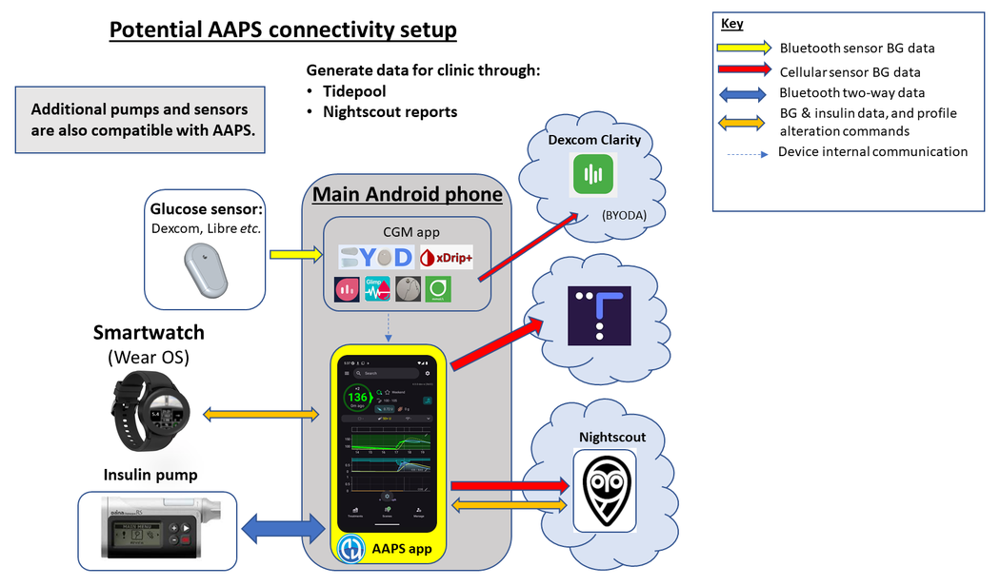
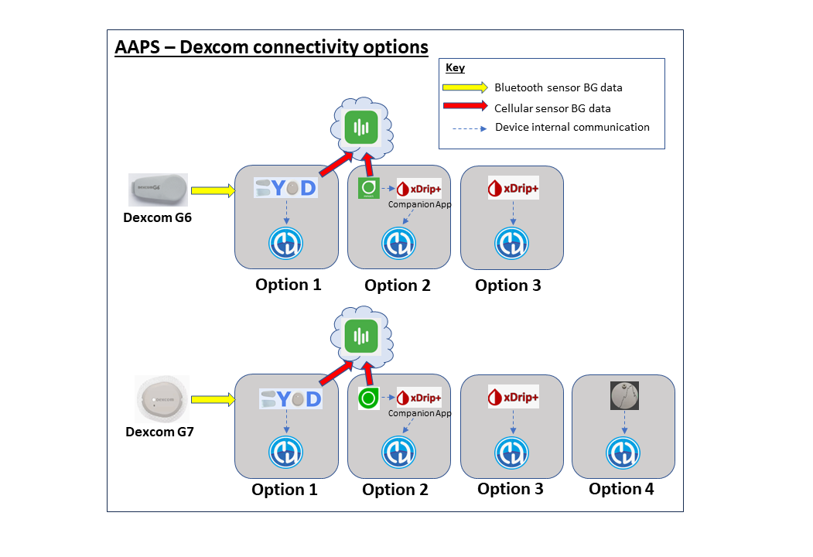
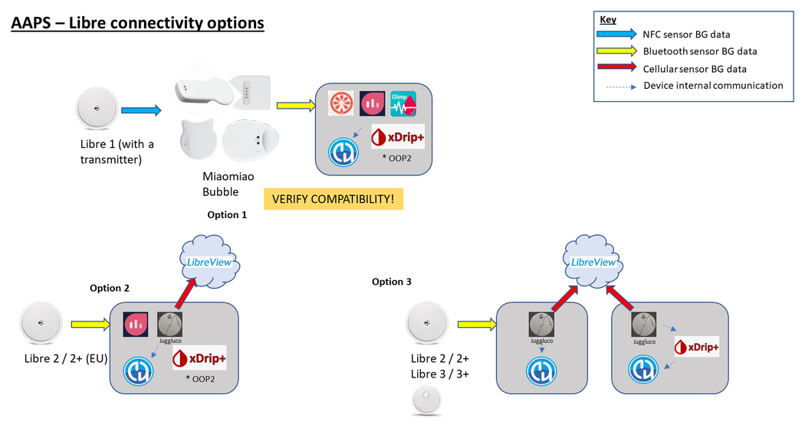
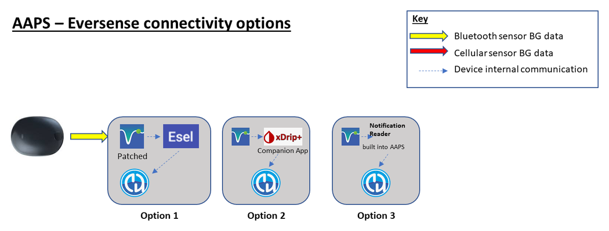

# Priprema za početak s AAPS-om

Dobro došli. Ova dokumentacija vodi korisnike koji se pripremaju postaviti i početi koristiti sustav umjetne gušterače za Android (**AAPS**).

## Kako se snaći u dokumentaciji

**Kazalo** i objašnjenje strukture dokumentacije možete naći [ovdje](../index.md), a do njega dolazite i klikom na simbol **AAPS** gore lijevo u dokumentaciji. Tamo ćete naći pregled svrhe različitih odjeljaka dokumentacije. Za kretanje kroz dokumentaciju možete koristiti i naslove s lijeve strane ove stranice. Na kraju, tu je i praktična funkcija pretraživanja, odmah ispod simbola **AAPS**.

Želimo da lako možete saznati i mogućnosti i ograničenja **AAPS-a**. Može biti razočaravajuće kad nakon vremena uloženog u čitanje dokumentacije otkrijete da možda nemate kompatibilnu inzulinsku pumpu ili CGM, ili da **AAPS** nudi drugačije funkcije nego što ste se nadali.

Mnogi detalji iz iskustva u dokumentaciji **AAPS-a** imaju više smisla kad **AAPS** stvarno koristite u stvarnom vremenu. Kao što je teško naučiti sport samo čitanjem pravila, potrebno je oboje: naučiti osnove pravila za sigurno korištenje **AAPS-a**, a zatim naučiti kako ta pravila najbolje primijeniti kad počnete koristiti **AAPS**.

(preparing-safety-first)=

## Sigurnost na prvom mjestu
„S velikom moći dolazi i velika odgovornost…“

### Tehnička sigurnost
**AAPS** ima mnogo sigurnosnih značajki. One uvode ograničenja koja se postupno uklanjaju kako u koracima ispunjavate niz [Ciljeva](../SettingUpAaps/CompletingTheObjectives.md), u kojima testirate određene parametre i odgovarate na pitanja s višestrukim izborom. Značajke **AAPS-a** otključavaju se kako uspješno ispunjavate Ciljeve. Tako korisnik može sigurno, u koracima, prijeći s otvorene petlje na zatvorenu petlju i usput upoznati različite značajke **AAPS-a**.

[Ciljevi](../SettingUpAaps/CompletingTheObjectives.md) su osmišljeni kao najbolji mogući uvod u **AAPS**. Uzimaju u obzir tipične pogreške i opće obrasce koje su razvojni programeri **AAPS-a** primijetili kod novih korisnika. Pogreške se mogu dogoditi jer početnik nema iskustva i previše želi brzo početi s **AAPS-om** ili je previdio važne stvari. [Ciljevi](../SettingUpAaps/CompletingTheObjectives.md) žele smanjiti te probleme.

### Medicinska sigurnost
```{admonition} Avoid permanent and painful damage to your eyes and nerves
:class: danger
Oprez kod brzog poboljšanja kontrole glukoze u krvi i snižavanja HbA1c 
```

Važno sigurnosno pitanje: **brzo snižavanje HbA1c i bolja kontrola glukoze u krvi kod osoba koje su dulje vrijeme imale povišenu glukozu mogu uzrokovati trajno oštećenje**. Mnoge osobe s dijabetesom to ne znaju, a ne upozoravaju svi liječnici svoje pacijente na ovaj problem.

To oštećenje može uključivati **gubitak vida i trajnu neuropatiju (bol)**. To se oštećenje može izbjeći ako se prosječna razina glukoze snižava sporije. Ako sada imate povišen HbA1c i prelazite na **AAPS** (ili bilo koji drugi sustav zatvorene petlje), _molimo_ razgovarajte o tom mogućem riziku sa svojim liječničkim timom prije početka i s njima dogovorite vremenski plan s postupno nižim sigurnim ciljevima glukoze. Na početku lako možete postaviti više ciljeve glukoze u **AAPS-u** (sada je najviši cilj koji možete odabrati 11,1 mmol/L, ali po potrebi možete i namjerno zadržati slab profil), a zatim cilj snižavati kako mjeseci prolaze.

#### Koliko brzo mogu sniziti HbA1c bez rizika od trajnog oštećenja?

Jedna retrospektivna [studija](https://pubmed.ncbi.nlm.nih.gov/1464975/) 76 pacijenata pokazala je da se rizik napredovanja retinopatije povećao 1,6 puta, 2,4 puta i 3,8 puta ako je HbA1c pao za 1 %, 2 % odnosno 3 % tijekom 6 mjeseci. Predložili su da **„sniženje vrijednosti HbA1c u bilo kojem razdoblju od 6 mjeseci treba biti manje od 2 %, kako bi se spriječilo napredovanje retinopatije.... Prebrzo sniženje na početku kontrole glikemije moglo bi uzrokovati teško ili prolazno pogoršanje napredovanja retinopatije.“**

Napomena: Ako koristite druge jedinice za HbA1c (mmol/mol umjesto %), kliknite [ovdje](https://www.diabetes.co.uk/hba1c-units-converter.html) za kalkulator HbA1c.

U drugoj retrospektivnoj [procjeni](https://academic.oup.com/brain/article/138/1/43/337923) 954 pacijenta istraživači su zabilježili:

**„Uz sniženje HbA1c od 2–3 postotna boda tijekom 3 mjeseca apsolutni rizik razvoja neuropatije uzrokovane liječenjem dijabetesa bio je 20 %, a uz sniženje HbA1c od >4 postotna boda tijekom 3 mjeseca apsolutni rizik razvoja neuropatije uzrokovane liječenjem dijabetesa bio je veći od 80 %.“**

[Komentar](https://academic.oup.com/brain/article/138/1/2/340563) na ovaj rad složio se da bi, kako bi se izbjegle komplikacije, **cilj trebao biti sniziti A1c za <2 % tijekom 3 mjeseca.** Druge preglede na ovu temu možete pročitati [ovdje](https://www.ncbi.nlm.nih.gov/pmc/articles/PMC6587545/pdf/DOM-21-454.pdf) i [ovdje](https://www.mdpi.com/1999-4923/15/7/1791).

Općenito je poznato da osobe s _novootkrivenim_ dijabetesom tipa 1 (koje pri dijagnozi, prije početka liječenja inzulinom, često imaju vrlo visok HbA1c) mogu brzo sniziti HbA1c odmah nakon dijagnoze, a da ti rizici nisu jednako veliki, jer nisu tako dugo imale povišenu glukozu u krvi. Ipak, o tome svakako razgovarajte sa svojim liječnikom.

(PreparingForAaps-no-sglt-2-inhibitors)=
### Bez SGLT-2 inhibitora

```{admonition} NO SGLT-2 inhibitors
:class: danger
SGLT-2 inhibitori, koji se zovu i glifozini, sprječavaju ponovnu apsorpciju glukoze u bubrezima. Glifozini snižavaju šećer u krvi u količini koja se ne može izračunati, pa ih NE SMIJETE uzimati dok koristite sustav zatvorene petlje kao što je AAPS! Postojao bi velik rizik od ketoacidoze i/ili hipoglikemije! Kombinacija ovog lijeka sa sustavom koji smanjuje bazalne stope kako bi podigao GUK posebno je opasna. 

Ukratko:
- **Primjer 1: rizik od hipoglikemije**
>Za ručak pomoću **AAPS-a** date bolus za 45 g ugljikohidrata. Problem je u tome što inhibitori, a AAPS to ne zna, uzrokuju da tijelo izbaci dio ugljikohidrata. Tako u tijelu ostaje previše inzulina u odnosu na apsorbirane ugljikohidrate, što dovodi do hipoglikemije.

- **Primjer 2: rizik od ketoacidoze**
>Inhibitori u pozadini izbacuju dio ugljikohidrata, pa vam GUK pada. **AAPS** će automatski dati pumpi naredbu da smanji isporuku inzulina, uključujući bazal. S vremenom vam GUK može ostati ispod ciljne vrijednosti, sve dok tijelo nema dovoljno bazalnog inzulina da iskoristi ugljikohidrate, što dovodi do ketoacidoze. Obično se ketoacidoza kod osoba s T1D-om razvija jer pumpa zakaže, što bi pokrenulo upozorenja na telefonu i bilo bi vidljivo po visokoj vrijednosti GUK-a. Kod glifozina je opasnost u tome što AAPS ne bi dao nikakva upozorenja, jer pumpa i dalje radi, a GUK možda ostaje unutar cilja.

Česti trgovački nazivi SGLT-2 inhibitora su: Invokana, Farxiga, Jardiance, Glyxambi, Synjardy, Steglatro i Xigduo XR, i drugi.
```


### Osnovna načela korištenja petlje s AAPS-om

Prije korištenja **AAPS-a** morate razumjeti osnovna načela i pojmove petlje. To postižete tako da uložite svoje vrijeme u čitanje dokumentacije **AAPS-a** i ispunite Ciljeve, koji vam žele dati čvrstu osnovu za sigurno i učinkovito korištenje **AAPS-a**. Količina dokumentacije **AAPS-a** na početku može izgledati prevelika, ali budite strpljivi i vjerujte postupku – s pravim pristupom uspjet ćete!

Brzina napredovanja ovisi o osobi, ali znajte da ispunjavanje svih ciljeva obično traje 6 – 9 tjedana. Mnogi ljudi izrade, instaliraju i postave **AAPS** dosta prije nego što ga počnu koristiti. Kao pomoć, sustav ima „virtualnu pumpu“ koju možete koristiti dok ispunjavate prve ciljeve. Tako možete upoznati **AAPS** bez stvarne isporuke inzulina. Detaljan vremenski plan nalazi se ispod. Znajte da s **AAPS-om** do cilja 7 već koristite zatvorenu petlju, a kasniji ciljevi dodaju dodatne značajke kao što su **SMB** i **automatizacije**, koje su nekim korisnicima korisne, ali nisu nužne za osnovnu funkciju **AAPS-a**.

Za uspjeh s **AAPS-om** potreban je aktivan pristup, spremnost da razmišljate o podacima GUK-a i fleksibilnost da napravite potrebne prilagodbe u **AAPS-u** kako biste poboljšali svoje rezultate. Kao što je gotovo nemoguće naučiti neki sport samo čitanjem pravila, isto vrijedi i za **AAPS**.

#### Računajte na kašnjenja i manje probleme dok sve postavite i pokrenete

U prvim fazama početka s **AAPS-om** možete imati poteškoća da sve komponente petlje dobro komuniciraju jedna s drugom (i s mogućim pratiteljima) te pri finom podešavanju postavki. Neki se problemi ne mogu riješiti dok se **AAPS** ne koristi u svakodnevnom životu, ali mnogo pomoći možete dobiti u Facebook grupi i na Discordu. Molimo planirajte unaprijed i za traženje i rješavanje problema odaberite „dobro“ vrijeme, na primjer mirno jutro vikenda (dakle ne kasno navečer, kad ste umorni, ili prije važnog sastanka ili putovanja).

#### Kompatibilnost tehnologije

**AAPS** radi samo s određenim vrstama inzulinskih pumpi, CGM-ova i telefona, a neka tehnologija možda nije dostupna u svim zemljama. Kako biste izbjegli razočaranje ili frustraciju, molimo pročitajte odjeljke [CGM](../Getting-Started/CompatiblesCgms.md), [pumpa](../Getting-Started/CompatiblePumps.md) i [telefon](../Getting-Started/Phones.md).

#### Vrijeme izrade aplikacije i put do potpune petlje

Vrijeme izrade aplikacije **AAPS** ovisi o vašem znanju i tehničkim sposobnostima. Neiskusnim korisnicima izrada **AAPS-a** obično traje do pola dana ili cijeli dan (uz pomoć zajednice). S novijim verzijama **AAPS-a** postupak će biti znatno brži, jer ćete imati više iskustva.

Nekoliko dijelova ove dokumentacije pomaže vam kroz postupak izrade:

- [Izrada AAPS-a](../SettingUpAaps/BuildingAaps.md) vodi vas korak po korak kroz izradu aplikacije i njezinu instalaciju na telefon;

- [Česta pitanja (FAQ)](../UsefulLinks/FAQ.md) odgovaraju na uobičajena pitanja i objašnjavaju najčešće pogreške; i

- središnja stranica [Rješavanje problema](../GettingHelp/GeneralTroubleshooting.md) skuplja rješenja najčešćih problema, poredana po temama.

Koliko traje put do zatvorene petlje ovisi o osobi; približan vremenski plan do potpunog korištenja petlje s **AAPS-om** nalazi se [ispod](#preparing-how-long-will-it-take).


#### Spremište ključeva i datoteka za izvoz postavki konfiguracije

„Spremište ključeva“ (.jks datoteka) je datoteka zaštićena lozinkom koja pripada samo vašoj kopiji **AAPS-a**. Vaš Android telefon pomoću nje osigurava da nitko drugi bez tog spremišta ključeva ne može ažurirati vašu kopiju. Ukratko, kao dio izrade **AAPS-a** trebate:

1.  Spremiti datoteku spremišta ključeva (.jks datoteku kojom se potpisuje aplikacija) na sigurno mjesto;

2.  Zapisati lozinku za datoteku spremišta ključeva.

Kako ćete spremiti spremište ključeva ovisi o načinu izrade:

- **Izrada s Android Studiom (računalo)**: spremište ključeva nastaje tijekom izrade – upute o tome gdje ga spremiti nalaze se u [Generate signed APK](#Building-APK-generate-signed-apk).
- **AAPS Builder**: sačuvajte sigurnosnu kopiju datoteke `aaps-keystore.jks` koju vam je stranica postavki ponudila kad ste izradili ključ, zajedno s lozinkom i aliasom. Ako ste prenijeli svoje spremište ključeva, sačuvajte tu datoteku.
- **Izrada u pregledniku s forkom**: pomoću posebnog workflowa [Export keystore](#ci-keystore-export) preuzmite kopiju na svoj Google Drive.

Tako ćete moći koristiti potpuno istu datoteku spremišta ključeva svaki put kad se izradi nova verzija **AAPS-a**. U prosjeku su potrebna 2 ažuriranja **AAPS-a** godišnje.

Osim toga, **AAPS** vam omogućuje [izvoz svih postavki konfiguracije](../Maintenance/ExportImportSettings.md). Tako možete sigurno vratiti svoj sustav kad mijenjate telefon ili ažurirate / ponovno instalirate aplikaciju, uz što manje prekida. 

#### Rješavanje problema

Slobodno se obratite zajednici AAPS-a ako u nešto niste sigurni – ne postoji glupo pitanje! Svi korisnici, s bilo kojom razinom iskustva, slobodno mogu postavljati pitanja. Odgovori na pitanja obično stižu brzo, jer **AAPS** koristi mnogo ljudi.

##### [pitajte u Facebook grupi AAPS-a](https://www.facebook.com/groups/AndroidAPSUsers/)

##### [pitajte na Discord kanalu AAPS-a](https://discord.gg/4fQUWHZ4Mw)


#### [Gdje mogu dobiti pomoć](../GettingHelp/WhereCanIGetHelp.md)?

Ovaj odjeljak daje novim korisnicima poveznice na izvore pomoći, uključujući podršku zajednice novih i iskusnih korisnika koji mogu odgovoriti na pitanja i riješiti uobičajene probleme s AAPS-om.

#### [Odjeljak za zdravstvene djelatnike](../UsefulLinks/ClinicianGuideToAaps.md)

Ovo je [odjeljak posebno za zdravstvene djelatnike](../UsefulLinks/ClinicianGuideToAaps.md) koji žele znati više o AAPS-u i tehnologiji umjetne gušterače otvorenog koda. U Uvodu postoje i savjeti o tome [kako razgovarati sa svojim liječničkim timom](#introduction-how-can-i-approach-discussing-aaps-with-my-clinical-team).

## Što ćemo izraditi i instalirati?

Ovaj dijagram daje pregled glavnih komponenti (hardvera i softvera) sustava **AAPS**:




Osim tri osnovne hardverske komponente (telefon, pumpa, senzor glukoze), potrebni su nam i: 1) aplikacija **AAPS** 2) poslužitelj za izvješća i 3) aplikacija za kontinuirano mjerenje glukoze (CGM)

### 1) Aplikacija za Android telefon: **AAPS**

**AAPS** je aplikacija koja radi na Android pametnim telefonima i uređajima. Aplikaciju **AAPS** (APK datoteku) izradit ćete sami, prema uputama korak po korak: preuzet ćete izvorni kod **AAPS-a** s GitHuba, instalirati potrebne programe (Android Studio, GitHub Desktop) na računalo i izraditi svoju kopiju aplikacije **AAPS**. Zatim ćete aplikaciju **AAPS** prenijeti na svoj pametni telefon (e-poštom, USB kabelom _itd._) i instalirati je.

### 2) Poslužitelj za izvješća: Nightscout (Tidepool*)

Kako biste u potpunosti iskoristili **AAPS**, trebate postaviti Nightscout poslužitelj. To možete [napraviti sami](https://nightscout.github.io/nightscout/new_user/#free-diy) ili platiti malu naknadu da vam netko postavi [upravljanu uslugu Nightscout](https://nightscout.github.io/#nightscout-as-a-service). Nightscout skuplja podatke iz **AAPS-a** kroz vrijeme i može izraditi detaljna izvješća koja povezuju obrasce CGM-a i inzulina. Njegovatelji također mogu koristiti Nightscout za daljinsku komunikaciju s aplikacijom **AAPS**, kako bi nadzirali liječenje dijabetesa svog djeteta. Takve značajke daljinske komunikacije uključuju praćenje razine glukoze i inzulina u stvarnom vremenu, daljinski bolus inzulina (putem SMS poruka) i najavu obroka. Analizirati liječenje dijabetesa gledajući podatke CGM-a odvojeno od podataka pumpe je kao vožnja automobila u kojem je vozač slijep, a suvozač mu opisuje što vidi. Kao zamjena za Nightscout dostupan je i Tidepool.

### 3) Aplikacija za CGM senzor

Ovisno o vašem senzoru glukoze / CGM-u, trebat će vam kompatibilna aplikacija koja prima očitanja glukoze i šalje ih u **AAPS**. Različite mogućnosti prikazane su ispod, a više informacija ima u odjeljku [Kompatibilni CGM-ovi](../Getting-Started/CompatiblesCgms.md):

  

### Održavanje sustava **AAPS**

I **Nightscout** i **AAPS** treba ažurirati otprilike jednom godišnje, kad izađu poboljšane verzije. U nekim slučajevima ažuriranje se može odgoditi, a u drugima se snažno preporučuje ili je nužno zbog sigurnosti. Obavijesti o tim ažuriranjima objavljuju se u Facebook grupama i na Discord poslužiteljima. Iz bilješki o izdanju bit će jasno o kojem se slučaju radi. U vrijeme ažuriranja vjerojatno će mnogi ljudi postavljati slična pitanja kao vi, i imat ćete podršku pri ažuriranju.

(preparing-how-long-will-it-take)=
## Koliko vremena treba da se sve postavi?

Kao što je ranije rečeno, korištenje **AAPS-a** je više „putovanje“ koje traži da uložite svoje vrijeme. To nije postavljanje koje se radi samo jednom. Prema sadašnjim procjenama, izrada **AAPS-a**, instalacija i konfiguracija **AAPS-a** i softvera za **CGM** te prijelaz s otvorene petlje na hibridnu zatvorenu petlju s **AAPS-om** ukupno traju oko 4 do 6 mjeseci. Zato preporučujemo da aplikaciju **AAPS** izradite i počnete s prvim ciljevima što prije, čak i ako još koristite drugi sustav za isporuku inzulina (virtualnu pumpu možete koristiti do cilja 5).

Za neke ciljeve mora proći određen broj dana, kako biste sigurno razumjeli novu funkciju. To vrijeme čekanja ne može se preskočiti; ta najmanja vremena čekanja postavljena su radi vaše sigurnosti.

Ovo je približan vremenski okvir:

| Zadaci                                                                  |      Približno vrijeme      |
| ----------------------------------------------------------------------- |:---------------------------:|
| Prvo čitanje dokumentacije                                              |          1–2 dana           |
| Konfiguracija GitHuba za izradu u pregledniku                           |          1–4 sata           |
| Postavljanje poslužitelja za izvješća                                   |            1 sat            |
| Instalacija aplikacije za CGM (xDrip, BYODA, …)                         |            1 sat            |
| Prva konfiguracija CGM → xDrip → AAPS                                   |            1 sat            |
| Prva konfiguracija AAPS → pumpa                                         |            1 sat            |
| Konfiguracija AAPS → Nightscout/Tidepool (samo za izvješća)             |            1 sat            |
| Neobavezno: konfiguracija Nightscout ↔ **AAPS** i NS pratitelji         |            1 sat            |
| Cilj 1: Postavljanje prikaza i praćenja                                 |            1 sat            |
| Cilj 2: Naučite kako kontrolirati AAPS                                  |           2 sata            |
| Cilj 3: Dokažite svoje znanje                                           |         Do 14 dana          |
| Cilj 4: Početak s otvorenom petljom                                     |       Najmanje 7 dana       |
| Cilj 5: Razumijevanje otvorene petlje                                   |           7 dana            |
| Cilj 6: Početak zatvorene petlje (zaštita od niske razine glukoze, LGS) |   Najmanje 5, do 14 dana    |
| Cilj 7: Podešavanje zatvorene petlje                                    |  Najmanje 1 dan, do 7 dana  |
| Cilj 8: Prilagodite bazale i omjere, omogućite Autosens                 | Najmanje 7 dana, do 14 dana |
| Cilj 9: Omogućavanje Super Micro Bolusa (SMB)                           |      Najmanje 28 dana       |
| Cilj 10: Automatizacija                                                 |      Najmanje 28 dana       |

I kad **AAPS** potpuno radi, i dalje ćete morati redovito fino podešavati postavke kako biste poboljšali liječenje dijabetesa.

## Preduvjeti

### Medicinska razmatranja

Osim medicinskih upozorenja u [odjeljku o sigurnosti](#preparing-safety-first), postoje i različiti parametri, ovisno o tome koji inzulin koristite u pumpi.

#### Izbor inzulina

Izračuni **AAPS-a** temelje se na koncentraciji inzulina od 100 J/ml (isto kao standard pumpe). Inzulin konfigurirate u **Upravljanje → Postavke inzulina**: postavite njegov **Vrh djelovanja** i **DIA** ili pomoću **Učitaj vrh djelovanja iz** unesite standardno vrijeme vrha djelovanja jednog od predložaka:

- **Novorapid** (i za Humalog i NovoLog)
- **Fiasp**
- **Lyumjev**

Napredni korisnici mogu izravno unijeti bilo koje vrijeme vrha djelovanja (od 35 do 120 minuta), na primjer za mješavinu inzulina. Pogledajte [Postavke inzulina](#Config-Builder-insulin).


### Tehnički dio

Ova dokumentacija želi potrebno tehničko znanje smanjiti na apsolutni minimum. Za izradu aplikacije **AAPS** imate nekoliko mogućnosti – pregled je na stranici [Izrada AAPS-a](../SettingUpAaps/BuildingAaps.md):

- **Izrada u pregledniku** (preporučeno): aplikaciju izradite izravno sa svog pametnog telefona pomoću GitHub Actions, bez računala i bez Android Studija. Uz [AAPS Builder](../SettingUpAaps/BrowserBuildAapsBuilder.md) trebate samo GitHub račun: aplikaciju preuzimate izravno s GitHuba. Metoda s forkom treba i Google račun, kako bi se aplikacija spremila na vaš Google Drive.
- **Izrada s Android Studiom**: aplikaciju izradite na računalu pomoću Android Studija. Ovo uglavnom koriste razvojni programeri koji žele mijenjati kod.
- **Izrada iz naredbenog retka**: za korisnike koji žele izraditi aplikaciju lokalno, bez instalacije Android Studija.

Osim izrade aplikacije, trebate postaviti i poslužitelj za izvješća, konfigurirati nekoliko aplikacija na Android telefonu i steći znanje o liječenju dijabetesa. To ćete postići ako idete korak po korak, strpljivo i uz pomoć zajednice **AAPS-a**. Ako se već znate snalaziti na internetu i sami upravljate svojom Gmail e-poštom, izrada **AAPS-a** je ostvariv zadatak. Samo si uzmite vremena.

### Pametni telefoni

#### AAPS i verzije Androida

Trenutačna verzija **AAPS-a** (4.0) zahtijeva Android pametni telefon s Googleovim **Androidom 12.0 ili novijim**. Ako razmišljate o kupnji novog telefona (stanje u siječnju 2026.), preporučuje se Android 16.<br/> Zbog sigurnosti snažno preporučujemo korisnicima da svoju verziju **AAPS-a** drže ažurnom. Ipak, za korisnike koji ne mogu koristiti uređaj s Androidom 12.0 ili novijim i dalje su dostupne starije verzije **AAPS-a** za starije verzije Androida, pogledajte: [Bilješke o izdanju](#maintenance-android-version-aaps-version).

#### Izbor modela pametnog telefona
Točan model koji kupite ovisi o funkcijama koje želite. Na [stranici Telefoni](../Getting-Started/Phones.md) naći ćete preporuke i iskustva korisnika o postavama koje rade.

Preporučujemo korisnicima da Android na telefonu drže ažurnim, uključujući sigurnosna ažuriranja. Ipak, ako ste novi u **AAPS-u** ili niste tehnički stručnjak, možda je bolje da odgodite ažuriranje telefona dok ga drugi ne naprave i na našim forumima ne potvrde da je sigurno.

```{admonition} Delaying Samsung phone updates
:class: warning
Samsung nažalost ima naviku nametati ažuriranja na svojim telefonima, što može uzrokovati probleme s Bluetooth vezom. Kako biste isključili ta nametnuta ažuriranja, telefon trebate prebaciti u „način za razvojne programere“:

1. Idite na **Postavke** > **O telefonu** > **Informacije o softveru**, a zatim dodirujte **Broj međuverzije** dok telefon ne potvrdi da ste otključali način za razvojne programere.
2. Vratite se u glavni izbornik **Postavke**, gdje biste trebali vidjeti novu stavku **Opcije za razvojne programere**.
3. Otvorite **Opcije za razvojne programere**, pronađite **Automatsko ažuriranje sustava** (Auto system update) i isključite ga.
```

```{admonition} Google Play Protect potential issue
:class: warning
Bilo je više prijava da Google Play zaštita svako jutro bez razloga zaustavlja **AAPS**. Ako se to dogodi, morate otići u opcije Google Playa i isključiti **Google Play zaštitu**. To se ne događa na svim modelima telefona ni na svim verzijama Androida.
```

```{admonition} Android developer verification
:class: note
Od rujna 2026. Google postupno uvodi [potvrdu identiteta razvojnih programera za Android](#android-developer-verification), koja mijenja način na koji se aplikacija koju ste sami izradili instalira na telefon. To ne utječe na izradu **AAPS-a**, a besplatni načini instalacije i dalje su dostupni – detalje pogledajte na povezanoj stranici.
```

