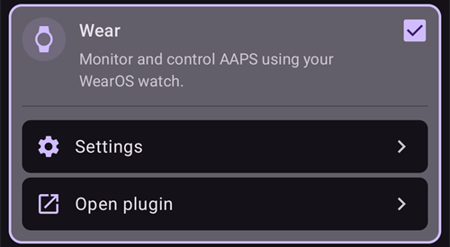
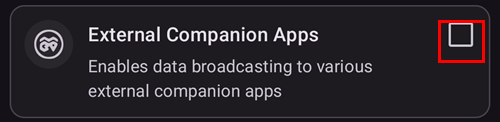
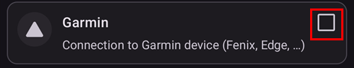
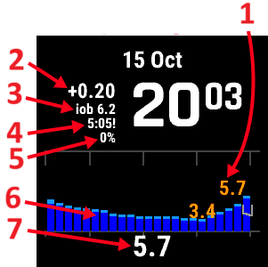
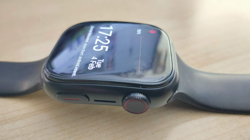

# Pametni satovi i AAPS

Razni pametni satovi mogu prikazivati neke podatke dostupne u **AAPS-u** ili izvoditi radnje na daljinu.

Izravno upravljanje **AAPS-om** (pumpom i senzorom) sa sata moguće je s potpunim Android satovima (koji se smatraju malim [pametnim telefonima](./Phones.md)).

Neki pametni satovi omogućuju unos tretmana ili više od toga, ali **AAPS-om** i dalje upravlja sam telefon.

Pametni satovi sve se više koriste s **AAPS-om**, _i_ kod odraslih s dijabetesom i kod njegovatelja/roditelja djece s dijabetesom.

## Opće prednosti korištenja pametnih satova s **AAPS-om**


Pametni satovi se, ovisno o modelu, mogu koristiti s **AAPS-om** na mnogo različitih načina. Mogu se koristiti za potpuno ili djelomično upravljanje **AAPS-om** ili samo za provjeru razine glukoze, aktivnog inzulina i drugih vrijednosti na daljinu.

Povezivanje pametnog sata s **AAPS-om** može biti korisno u mnogim situacijama, uključujući vožnju automobila ili (motora) bicikla te tijekom tjelovježbe. Neki smatraju da je pogled na sat (na sastanku, zabavi, za stolom i sl.) diskretniji od gledanja u telefon. Sa sigurnosnog stajališta, pametni sat može biti koristan i u pokretu: korisnik može držati telefon s **AAPS-om** skriven (npr. u torbi), a sat i dalje koristiti za daljinsko upravljanje.

## Posebne prednosti za roditelje/njegovatelje koji koriste **AAPS**

Za dijete – ako je njegov telefon s **AAPS-om** u blizini – njegovatelj može pametnim satom pratiti stanje ili mijenjati postavke bez korištenja telefona s **AAPS-om**. To može biti korisno, na primjer, ako je telefon s **AAPS-om** skriven u pojasu za pumpu.

Pametni sat može se koristiti _uz_ opcije za daljinsko upravljanje ili [Praćenje AAPS-a (bez interakcije sa sustavom AAPS)](../RemoteFeatures/FollowingOnly.md) putem TELEFONA, ili _umjesto_ njih.

Osim toga, za razliku od telefona pratitelja koje koriste roditelji/njegovatelji (a koji ovise o mobilnoj mreži ili Wi-Fi vezi), pametni satovi povezani Bluetoothom mogu biti korisni na udaljenim mjestima, kao što su špilja, brod ili pola puta do vrha planine. Ako su oba uređaja (telefon s **AAPS-om** i pametni sat) na istoj Wi-Fi mreži, mogu koristiti i Wi-Fi.

## Različite vrste interakcije pametnog sata i AAPS-a

Trenutno postoji pet glavnih načina na koje se pametni satovi koriste zajedno s **AAPS-om**. Prikazani su u tablici ispod: 

| Postavljanje sata             | Značajke                                                                                   | Preduvjeti                                                                                                                                                                                                                                                                                                                             |
| ----------------------------- | ------------------------------------------------------------------------------------------ | -------------------------------------------------------------------------------------------------------------------------------------------------------------------------------------------------------------------------------------------------------------------------------------------------------------------------------------- |
| Samostalno                    | AAPS bez telefona                                                                          | Potpuni Android pametni sat (provjerite min. verziju Androida)</br> Pokreće **app-fullRelease**                                                                                                                                                                                                                                        |
| Potpuno daljinsko upravljanje | Većina funkcija AAPS-a                                                                     | Android sat s **Wear OS-om** (provjerite Android/API)</br>Pokreće **wear-fullRelease**                                                                                                                                                                                                                                                 |
| Daljinsko upravljanje         | Funkcije AAPSClienta                                                                       | Android sat s **Wear OS-om** (provjerite Android/API)</br>Pokreće **[wear-aapsclientRelease](https://github.com/nightscout/AndroidAPS/releases)**                                                                                                                                                                                      |
| Daljinsko upravljanje         | Neke funkcije AAPSClienta                                                                  | Satovi Garmin</br>(samo starije postavke sa Samsung Tizenom i Fitbitom, ne preporučuje se)</br>Pogledajte ispod.                                                                                                                                                                                                                       |
| Prikaz                        | Glukoza, trend, aktivni inzulin (IOB), aktivni ugljikohidrati (COB), status petlje i pumpe | Mnogi pametni satovi, putem prateće aplikacije na telefonu s **AAPS-om** koja prima emitiranje [Vanjske prateće aplikacije](#watches-external-companion-apps): [WatchDrip+](https://bigdigital.home.blog/) (Xiaomi, Amazfit), [GlucoDataHandler](https://github.com/pachi81/GlucoDataHandler) (Wear OS), G-Watch</br>Pogledajte ispod. |

## Prije nego što kupite pametni sat…

Točan model pametnog sata koji ćete kupiti ovisi o funkcijama koje želite. Korisne podatke možete naći na [stranici Telefoni](#Phones-list-of-tested-phones), uključujući popis testiranih telefona koji sadrži i neke pametne satove.

Popularne marke satova su Samsung Galaxy, Garmin, Fossil i Mi Band. Različite opcije sažete u gornjoj tablici detaljnije su objašnjene u nastavku, kako biste lakše odlučili koji je pametni sat pravi za vašu situaciju.

Ako pametni sat povezujete s **AAPS-om** na telefonu s namjerom da s **AAPS-om** radite na daljinu, trebate provjeriti jesu li ta dva uređaja međusobno kompatibilna, posebno ako imate stariji ili neuobičajen telefon.

Općenito, ako želite samo pratiti vrijednosti glukoze, a ne raditi s **AAPS-om**, postoji širi izbor povoljnijih i jednostavnijih satova koje možete koristiti.

Najbolji način za odabir pametnog sata je pretražiti objave o satovima („watch”) u **AAPS** grupama na Discordu ili Facebooku. Pročitajte iskustva drugih i postavite konkretna pitanja ako starije objave ne odgovaraju na vaše pitanje.

## Potpuni Android

Zvuči privlačno, zar ne? Međutim, trenutno samo nekoliko entuzijasta eksperimentira s **AAPS-om** na samostalnom satu. Postoji malo pametnih satova s prihvatljivim sučeljem koji uz to dobro rade za samostalno korištenje **AAPS-a** i vaše CGM aplikacije. Popularni modeli su LEMFO LEM 15 Pro i 16. Na sat trebate instalirati „full” apk **AAPS-a** (apk koji se obično instalira na pametni telefon), a ne „wear” apk **AAPS-a**.

Iako ne postoji jasna specifikacija po kojoj biste znali hoće li sat dobro raditi za samostalno korištenje **AAPS-a**, pomoći će sljedeći parametri:

1)  Android 12 ili noviji. 2)  Mogućnost isključivanja „kvadratnog” načina Watchfacea, kako bi tekst bio veći i lakši za čitanje. 3)  Vrlo dobro trajanje baterije. 4)  Dobar domet Bluetootha.

Većina frustracija sa samostalnim **AAPS** satovima dolazi od rada na malom zaslonu i od toga što trenutno sučelje potpune aplikacije AAPS nije dizajnirano za sat. Zbog malog zaslona možda ćete radije koristiti olovku (stylus) za uređivanje postavki **AAPS-a** na satu, a neki gumbi AAPS-a možda se neće vidjeti na zaslonu sata.

Dodatni izazovi su to što je teško postići dovoljno trajanje baterije, a satovi s dovoljno jakom baterijom često su glomazni i debeli. Korisnici navode borbu s operativnim sustavom i postavkama za uštedu energije, teškoće s pokretanjem senzora na satu, slab domet Bluetootha (za održavanje veze i sa senzorom i s pumpom) i upitnu vodootpornost. Primjeri su prikazani na fotografijama ispod.


Ako vas zanima postavljanje samostalnog sata, za više informacija pročitajte objave i komentare u Facebook grupi **AAPS** (dobri pojmovi za pretraživanje su „standalone” i „Lemfo”) i na Discordu.

## Wear OS

Kôd **AAPS-a** sadrži proširenje aplikacije koje se može instalirati na [pametne satove s **Wear OS-om**](https://wearos.google.com/#oem-carousel).



Provjerite zadovoljava li vaš pametni sat [preduvjete](#maintenance-android-version-aaps-version) **AAPS-a**.

### Što _je_ Wear OS?

Prve tri opcije zahtijevaju da pametni sat ima instaliran **Wear OS**.

**Wear OS** je operativni sustav koji radi na nekim modernim Android pametnim satovima. Ako opis pametnog sata navodi samo _kompatibilnost_ s Androidom i iOS-om, to ne znači da sat pokreće Wear OS. To može biti neki drugi operativni sustav proizvođača koji nije kompatibilan s **AAPS-om**. Za instalaciju i korištenje bilo koje verzije **AAPS-a** ili **AAPSClienta** pametni sat mora imati **Wear OS 3.0, 3.2 ili 3.5** (Android 11, API razina 30) **ili noviji**. Svako izdanje Wear OS-a prati verziju Androida na kojoj se temelji: **Wear OS 3** je Android 11 (API razina 30), **Wear OS 4** je Android 13 (API razina 33), **Wear OS 5** je Android 14 (API razina 34), a **Wear OS 6** je Android 16 (API razina 36). Satovi s Wear OS-om 2 ne mogu pokretati **AAPS**.

Ako instalirate **AAPS** wear.apk na sat s **Wear OS-om**, možete odabrati jedan od niza različitih prilagođenih **AAPS** Watchfacea. Umjesto toga, možete koristiti i standardni Watchface za pametni telefon, s podacima iz **AAPS-a** prikazanima u malim pločicama koje se zovu „komplikacije”. Komplikacija je svaki element koji se uz vrijeme prikazuje na Watchfaceu.

```{note}
Novije promjene u **Wear OS-u** postupno kvare prilagođene **AAPS** Watchface (što je verzija Wear OS-a viša, to je gore), ali **komplikacije** i dalje rade. Prije kupnje ili ažuriranja sata pročitajte [Promjene Watchfacea u Wear OS-u](#wearos-watchface-changes).
```


### Kako bi moj pametni sat mogao izgledati?

Nakon [instalacije **AAPS-a** na vaš sat](../WearOS/WearOsSmartwatch.md) automatski ćete moći odabrati željeni Watchface među ovim Watchfaceima namijenjenima **AAPS-u**. Na većini satova samo dugo pritisnite početni zaslon dok se zaslon ne smanji, a zatim prijeđite prstom udesno za odabir drugog zaslona:


Ovo su osnovni zasloni ugrađeni u **AAPS**; postoji još [Watchfacea](#WearOS_changing-to-AAPS-watchface), a možete koristiti i [komplikacije](#Watchfaces-complications).

### Kako svakodnevno koristiti sat s Wear OS-om?

Više pojedinosti o Watchfaceima i svakodnevnom korištenju, uključujući kako izraditi (i podijeliti) vlastiti prilagođeni Watchface, naći ćete u odjeljku [Postavljanje AAPS-a na vaš Wear OS sat](../WearOS/WearOsSmartwatch.md).

(Watchfaces-tizen)= (watches-external-companion-apps)=

## Vanjske prateće aplikacije

**AAPS** može emitirati svoje stanje drugim aplikacijama instaliranima na istom telefonu: glukozu i trend, aktivni inzulin (IOB), aktivne ugljikohidrate (COB), bazal i privremeni bazal, naziv profila, status petlje, bateriju telefona i pumpe, razinu u spremniku i napredak bolusa. Nekoliko pratećih aplikacija za satove čita to emitiranje i prikazuje podatke na satovima koje **AAPS** ne podržava izravno. Za slanje podataka omogućite **Vanjske prateće aplikacije** u **Konfiguracija** > **Komunikacija** (pogledajte [Vanjske prateće aplikacije](#external-companion-apps) na stranici Konfiguracija (Config Builder)). Emitiranje se šalje sa svakim novim očitanjem i ne može se zatražiti: gumb za osvježavanje u pratećoj aplikaciji nema učinka na **AAPS**.



Prateće aplikacije za koje se zna da koriste ovo emitiranje:

- [WatchDrip+](https://bigdigital.home.blog/) za satove Xiaomi i Amazfit, pogledajte [Satovi Xiaomi i Amazfit](#watches-xiaomi-amazfit) ispod.
- [GlucoDataHandler](https://github.com/pachi81/GlucoDataHandler) za satove s Wear OS-om, kao komplikacija ili widget. To je korisna zamjena na verzijama Wear OS-a na kojima **AAPS** Watchface ne radi pouzdano, pogledajte [Postavljanje AAPS-a na vaš Wear OS sat](../WearOS/WearOsSmartwatch.md). Njegova prateća aplikacija GlucoDataAuto prikazuje iste podatke u automobilu s Android Autom.
- [Aplikacija G-Watch](https://play.google.com/store/apps/details?id=sk.trupici.g_watch) za satove Samsung Tizen i njezina kasnija verzija za Wear OS. U ranijim verzijama **AAPS-a** dodatak se po ovoj aplikaciji zvao **Samsung Tizen**.

```{warning}
**Aplikacija G-Watch** i njezina verzija za **Wear OS** više se ne održavaju, a Samsung je svoje pametne satove prebacio s Tizena na Wear OS. G-Watch je važan samo za postojeće, starije postavke i ne preporučuje se za novu instalaciju. Najnovije vijesti potražite u posebnoj [Facebook grupi](https://www.facebook.com/groups/gwatchapp).
```

(Watchfaces-garmin)=

## Garmin

U trgovini Garmin ConnectIQ postoje neki Watchfacei za Garmin koji se povezuju s [AAPS-om](https://apps.garmin.com/search?keywords=androidaps).



[AAPS Glucose Watch](https://apps.garmin.com/apps/3d163641-8b13-456e-84c3-470ecd781fb1) izravno se povezuje s **AAPS-om**. Uz očitanja glukoze prikazuje podatke o statusu petlje (aktivni inzulin, privremeni bazal) i šalje očitanja otkucaja srca u **AAPS**. Dostupan je u trgovini ConnectIQ; omogućite dodatak **Garmin** u **Konfiguracija → Komunikacija**. 

1. Najviša i najniža vrijednost glukoze na grafu
2. Promjena glukoze po minuti
3. Aktivni inzulin (IOB)
4. Vrijeme od posljednjeg očitanja glukoze (minute:sekunde)
5. Privremena bazalna stopa, kao postotak bazalne stope iz profila
6. Graf glukoze za posljednja 2 sata
7. Trenutna vrijednost glukoze


## Fitbit

```{warning}
Google premješta Fitbit u Google Health i uklanja aplikacije i Watchface drugih proizvođača sa satova Fitbit u EU. Zato Fitbit Watchfacei **više nisu preporučena opcija**, a kupnja Fitbita za korištenje s **AAPS-om** se ne preporučuje.
```

Za postojeće satove Fitbit, [stranice Nightscouta](https://nightscout.github.io/nightscout/wearable/#fitbit) navode neke opcije samo za praćenje, kao što je [Glance](https://glancewatchface.com/). I to su Watchfacei drugih proizvođača, pa vrijedi isto ograničenje u EU.

## Samo praćenje

Ovi pametni satovi prikazuju neke podatke iz **AAPS-a**; za neke su potrebne druge aplikacije.

Postoji širok izbor povoljnih pametnih satova koji mogu služiti samo za prikaz. Ako koristite Nightscout, dobar pregled svih opcija nalazi se [ovdje](https://nightscout.github.io/nightscout/wearable/#)

U nastavku su neki satovi samo za praćenje koji su popularni među korisnicima **AAPS-a**:

(watches-xiaomi-amazfit)=
### Satovi Xiaomi i Amazfit

**WatchDrip+** je prateća aplikacija koju razvija zajednica i koja prikazuje podatke o glukozi i petlji na raznim modelima pametnih satova, uglavnom marki Xiaomi (_npr._ Mi Band) i Amazfit:


Od verzije 0.5 **WatchDrip+** čita podatke izravno iz **AAPS-a**, bez xDrip+ kao posrednika. Na telefonu s **AAPS-om**:

1. Omogućite **Vanjske prateće aplikacije** u **Konfiguracija** > **Komunikacija**, pogledajte [gore](#watches-external-companion-apps). To daje trenutnu glukozu, deltu, strelicu trenda, aktivni inzulin (IOB) i status pumpe.
2. Omogućite dodatak **xDrip** u **Konfiguracija** > **Komunikacija** i u njegovim postavkama uključite **Šalji status u xDrip+**. To daje statusnu liniju s IOB/COB, a graf glukoze na satu popunjava se nakon nekoliko očitanja.
3. Ako je xDrip+ instaliran na telefonu, isključite njegov **Broadcast Service API** (xDrip+ > Settings > Inter-app settings), kako sat ne bi dvaput primao podatke. Ako je xDrip+ samo prosljeđivao podatke na sat, možete ga deinstalirati.

Gumb za osvježavanje u WatchDrip+ nema učinka s **AAPS-om**: podaci stižu sa svakim novim očitanjem.


Više o njima, uključujući kako ih postaviti, možete pročitati na [web-stranici WatchDrip+](https://bigdigital.home.blog/). Prednost ovih satova je to što su mali i relativno povoljni. Popularni su posebno za djecu i osobe s tanjim zapešćem.

### Sat Pebble


Satovi Pebble ([više se ne proizvode](https://en.wikipedia.org/wiki/Pebble_(watch))) prodavali su se od 2013. do 2016. i možda se još mogu nabaviti rabljeni. Fitbit je preuzeo imovinu Pebblea. Korisnici Pebblea mogu koristiti Watchface Urchin za prikaz podataka iz Nightscouta. Mogući prikazani podaci uključuju aktivni inzulin (IOB), trenutno aktivnu stopu privremenog bazala i predviđanja. Ako koristite otvorenu petlju, pomoću IFTTT-a možete izraditi applet koji, kada stigne obavijest iz **AAPS-a**, pošalje SMS ili obavijest putem Pushovera.

### [Satovi Bluejay](https://bluejay.website/)





To su jedinstveni uređaji koji mogu primati podatke o glukozi **izravno** s Dexcom odašiljača. Nije široko poznato da Dexcom G6/G7 odašiljači zapravo emitiraju trenutne podatke o glukozi na _dva_ odvojena kanala: kanal za telefon i medicinski kanal. Satovi Bluejay mogu se postaviti da primaju podatke o glukozi na bilo kojem kanalu, pa ako **AAPS** koristi kanal za telefon, satovi Bluejay mogu koristiti medicinski kanal.

Glavna prednost je to što sat ne ovisi ni o telefonu ni o sustavu petlje. Tako, na primjer, ako na plaži ili u zabavnom parku odspojite pumpu i telefon s **AAPS-om** i niste u dometu telefona s **AAPS-om**, i dalje možete dobivati očitanja s Dexcoma izravno na sat Bluejay.

Izvorni **Bluejay GTS** više se ne proizvodi i ne može čitati Dexcom G7. Kasniji modeli (U1, a zatim trenutni **U3**, koji se u vrijeme pisanja prodaje kao rani pristup) potpuni su Android satovi s xDripom, koji podatke prikupljaju izravno s Dexcoma G6 i G7. Proizvođač opisuje sat kao istraživački alat, a ne za medicinsku upotrebu. Navedeni nedostaci su to što sat ne dobije uvijek očitanje svakih 5 minuta i što se baterija mora često puniti. Trenutni model i dostupnost provjerite na [web-stranici Bluejay](https://bluejay.website/).

### Apple Watch

Pogledajte [Nightscout na vašem satu](https://nightscout.github.io/nightscout/wearable/#).

Apple Watch sada podržava izravnu vezu s G7 i može se koristiti istodobno s **AAPS-om**.

