(bluetoothtroubleshooting-bluetooth-related-issues)=

# Problemi s Bluetoothom

Neki korisnici imaju probleme s neuspjelom aktivacijom Omnipod DASH-a, s vezom Medtrum Nano pumpe i s drugim greškama Pod-a koje su povezane s Bluetoothom. Mnogi od tih problema imaju jedan od sljedećih uzroka.

Neki od tih problema vjerojatno vrijede i za druge Bluetooth inzulinske pumpe. Medtrum Nano ima poznate probleme s dopuštenjem za uređaje u blizini, kao i Omnipod DASH.

---

(bluetoothtroubleshooting-cannot-start-omnipod-with-android-16)=

## Omnipod se ne može pokrenuti na Androidu 16
- Za ispravan rad Omnipod DASH-a Android 16 treba najmanje verziju **AAPS-a** 3.3.2.1, jer ta verzija sadrži ispravke upravo za poznate probleme s Omnipodom koje je donio Android 16.

---

(bluetoothtroubleshooting-bluetooth-battery-optimisation)=

## Optimizacija baterije za Bluetooth

Novije verzije Androida uključile su optimizaciju baterije za sistemsku aplikaciju Bluetooth. Poznato je da to uzrokuje probleme s Bluetooth pumpama i CGM-ovima.

Ako ste slijedili [Čarobnjak za postavljanje AAPS-a](../SettingUpAaps/SetupWizard.md) i postavke iz odjeljka [Optimizacija baterije za Bluetooth](#setup-wizard-bluetooth-battery-optimisation), ova postavka bi trebala biti ispravna. Ali ako ste slijedili stariju verziju ovog vodiča, moguće je da je niste promijenili.

Ako se pumpa ili CGM odspajaju, provjerite je li ovo ispravno postavljeno.

---

(bluetoothtroubleshooting-apps-using-nearby-device-permission)=

## Aplikacije koje koriste Android dopuštenje „Uređaji u blizini“ mogu uzrokovati prekide veze i probleme s aktivacijom Pod-a

Android vam omogućuje da putem dopuštenja odredite što svaka aplikacija smije raditi ili čemu smije pristupiti na vašem telefonu. Za svaku instaliranu aplikaciju možete dopustiti ili zabraniti određena dopuštenja, npr. pristup datotekama na uređaju, pristup Bluetoothu, traženje uređaja u blizini itd.

**AAPS** za rad treba nekoliko određenih dopuštenja. Jedno od njih, potrebno za rad Pod-ova, je dopuštenje „Uređaji u blizini“. I mnoge druge aplikacije trebaju ovo dopuštenje. Zajednica je primijetila da neke aplikacije, kada dobiju ovo dopuštenje, na nekim uređajima uzrokuju probleme pri aktivaciji novih Pod-ova.

(bluetoothtroubleshooting-apps-using-nearby-device-permission-known-apps)=

### Aplikacije koje koriste dopuštenje „Uređaji u blizini“ i za koje je poznato da su uzrokovale probleme:

Za aplikacije s ovog popisa u zajednici se na jednom ili više mjesta raspravljalo da uzrokuju probleme s uređajima Omnipod DASH, a ponekad i s Medtrum Nano.

```{admonition} Updating the list
:class: note
Javite se korisniku @XiTatiON na Discord kanalu #omnipod-dash ako želite predložiti aplikacije za ovaj popis.
```

- **myBMW** Aplikacija MyBMW ometala je Medtrum Nano i Omnipod DASH. Aplikacija MyBMW samo jednom pita za dopuštenje „pronalaženje uređaja u blizini“. Ako ga ne dopustite, aplikacija i dalje radi potpuno ispravno

- **Amazon Alexa**  Kod nekih je oduzimanje dopuštenja „Uređaji u blizini“ aplikaciji Alexa riješilo problem, ali tada se ne mogu uparivati Matter IoT uređaji

- **Aplikacija MINI**  Čini se da se temelji na aplikaciji myBMW pa se možda ponaša isto

- **BM2** Aplikacija za nadzor solarne baterije, koristi se u nekim kamperima i solarnim sustavima za kampiranje: dok je aplikacija radila, nije bilo moguće aktivirati novi Pod. Kao zaobilazno rješenje, prisilno zaustavite aplikaciju dok aktivirate novi Pod. Nakon toga pokretanje aplikacije nije ometalo rad Dash-a (na Pixelu 8 Pro s Androidom 16).

(bluetoothtroubleshooting-revoke-nearby-device-permission)=

### Kako oduzeti dopuštenje „Uređaji u blizini“ drugim aplikacijama:
Ako imate probleme s aktivacijom novog Pod-a, a koristite ispravnu podržanu verziju **AAPS-a** za vašu verziju Androida, možda ćete morati oduzeti dopuštenje drugim aplikacijama dok aktivirate novi Pod.

Slijedite ovaj postupak da oduzmete dopuštenje „Uređaji u blizini“ svim aplikacijama osim **AAPS-a**:

```{admonition} Menus and settings
:class: note
Snimke zaslona i upute u ovom vodiču su s čistog (Vanilla) Androida 16 na Google Pixelu 8 Pro. Kod drugih proizvođača i uređaja izbornici i postavke vjerojatno neće biti potpuno isti. Prilagodite korake svom uređaju. Ako zapnete, u odjeljku [Gdje dobiti pomoć za Dash](#omnipod-dash-where-to-get-help-for-dash) pogledajte kako zatražiti pomoć zajednice.
```

1. Na telefonu otvorite Android postavke, pomaknite se prema dolje i dodirnite **Sigurnost i privatnost (1)**.

    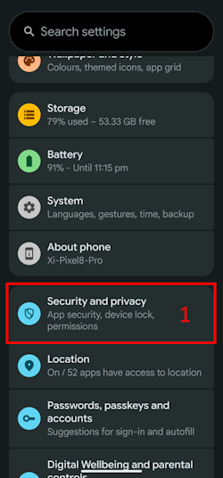

2. Pomaknite se prema dolje i dodirnite **Kontrole privatnosti (1)**.

   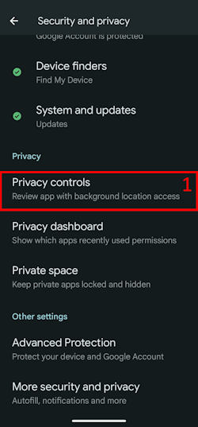

3. Dodirnite **Upravitelj dopuštenja (1)**.

   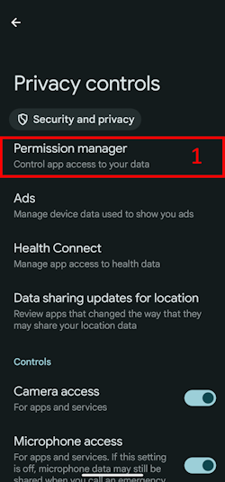

3. Pomaknite se prema dolje i dodirnite **Uređaji u blizini (1)**.

   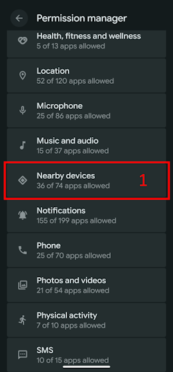

4. Na popisu aplikacija dodirnite aplikaciju kojoj želite oduzeti dopuštenje **Uređaji u blizini**.

   U ovom vodiču oduzimamo dopuštenje aplikaciji **Android Auto (1)**.

   Da ne biste uništili još Pod-ova, savjetujemo da na početku oduzmete dopuštenje svim aplikacijama osim **AAPS-a**.

```{admonition} Which app to select?
:class: tip
Ako ne znate koja aplikacija uzrokuje problem, onemogućite dopuštenje svima (provjerite i popis poznatih problematičnih aplikacija i počnite s njima). Ako si možete priuštiti nekoliko uništenih Pod-ova, prije svake nove aktivacije Pod-a dopustite dopuštenje jednoj novoj aplikaciji, dok ne pronađete koja točno aplikacija uzrokuje probleme s Pod-om. Ako pronađete nove problematične aplikacije, javite nam na Discord kanalu #omnipod-dash.
```

   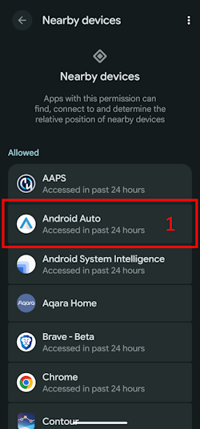

5. Da oduzmete dopuštenje, dodirnite **Nemoj dopustiti (1)**, a zatim **Svejedno nemoj dopustiti (2)** (Don't allow anyway). Ako je sve ispravno, kao odabranu opciju vidjet ćete **Nemoj dopustiti (3)**. Sada se možete vratiti u izbornik **Uređaji u blizini** dodirom na **strelicu natrag (4)** i po potrebi promijeniti ovu postavku i za druge aplikacije.

   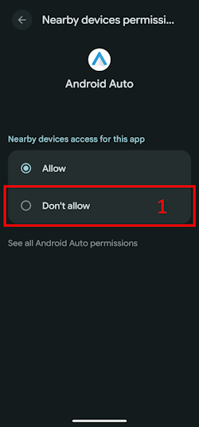 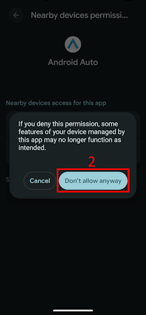  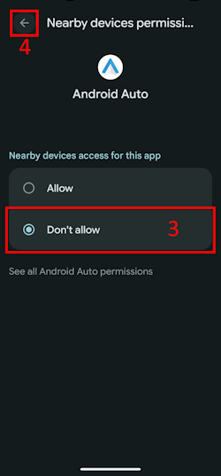

(bluetoothtroubleshooting-re-enable-nearby-device-permission)=

### Kako ponovno dopustiti dopuštenje „Uređaji u blizini“ sistemskim i drugim aplikacijama:

1. Ako je potrebno, u odjeljku **„Kako oduzeti dopuštenje ‚Uređaji u blizini‘ drugim aplikacijama“** pogledajte kako doći do postavki privatnosti aplikacija. Kada ste u postavci **Uređaji u blizini**, prijeđite na korak 2.

2. Na popisu aplikacija dodirnite aplikaciju kojoj želite dopustiti dopuštenje **Uređaji u blizini**.

   U ovom vodiču dopuštenje vraćamo aplikaciji **Android Auto (1)**.

   Primijetit ćete da nakon oduzimanja dopuštenja aplikacije **Android Auto (1)** nema na popisu aplikacija. To je zato što je **Android Auto** **sistemska aplikacija**, a sistemske aplikacije su prema zadanim postavkama skrivene.

   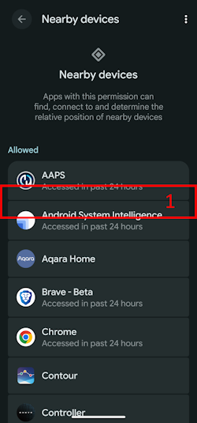

3. Da prikažete skrivene sistemske aplikacije, dodirnite **izbornik s tri točke (⋮) (1)** u gornjem desnom kutu, a zatim **„Prikaži sustav“ (2)** (Show system). Sada biste na popisu trebali vidjeti skrivenu sistemsku aplikaciju **Android Auto (3)**.

```{admonition} Find your app
:class: tip
Ako je aplikaciji dopuštenje oduzeto, pomaknite se prema dolje dok ne vidite popis aplikacija bez dopuštenja, niže na popisu.
```

   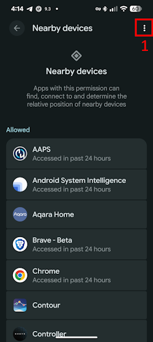 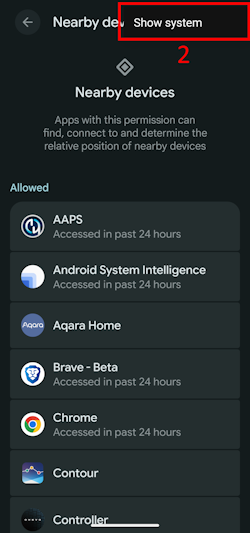 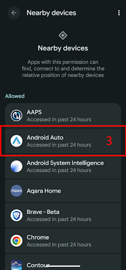

5. Slijedite upute iz **„Kako oduzeti dopuštenje ‚Uređaji u blizini‘ drugim aplikacijama“** obrnutim redom da ponovno dopustite dopuštenja za svaku aplikaciju.

---

(bluetoothtroubleshooting-android-15-bluetooth-connection-problems)=

## Android 15: česti problemi s Bluetooth vezom

Nakon nadogradnje Androida ili prelaska na noviji telefon **AAPS** često gubi Bluetooth vezu s pumpom. Problem privremeno nestane nakon ponovnog pokretanja telefona. Ako koristite **Omnipod DASH**, a vaš telefon ima Android 15, uključivanje postavke **Trajno Bluetooth uparivanje (bonding)** može poboljšati stabilnost Bluetooth veze. Da je uključite:

```{admonition} Android 16
:class: warning
Uključite **Trajno Bluetooth uparivanje (bonding)** samo na Androidu 15 i samo ako imate probleme s vezom. NE uključujte bonding na Androidu 16.
```

1. Otvorite [postavke Dash-a](#omnipod-dash-settings): otvorite zaslon pumpe DASH putem **Upravljanje** > **Pumpa** i dodirnite ikonu **Postavke** (zupčanik) u gornjem desnom kutu.

   

2. Otvorite odjeljak **Napredne postavke** i uključite **Trajno Bluetooth uparivanje (bonding)**.

   

3. Ako telefon prikaže zahtjev za uparivanje, prihvatite ga.

4. Ponovno pokrenite telefon.
