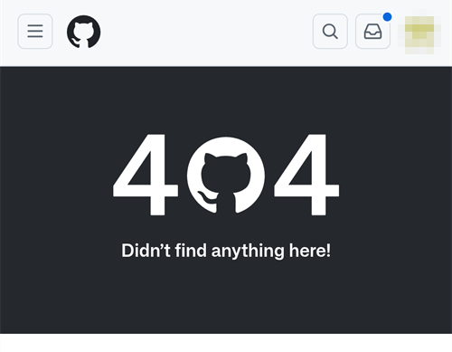

(aaps-ci-troubleshooting)=

# Izrada u pregledniku: rješavanje problema

```{note}
Ova stranica skuplja savjete za rješavanje problema za [Izrada u pregledniku](../SettingUpAaps/BrowserBuild.md).
```

(aaps-builder-troubleshooting)=

## AAPS Builder

### Korak 1: repozitorij

(aaps-builder-ts-repo-exists)=

#### „my-aaps already exists in this account“


Ovaj repozitorij već imate, na primjer iz ranijeg pokušaja. Zatvorite karticu GitHuba, zadržite taj naziv u koraku 1 stranice postavki i nastavite. Ako ste za njega već napravili korake 2 i 3, vaš ključ je još u njemu: nastavite s [korakom 4](#aaps-builder-step4). Ako je izrađen ranijom verzijom stranice postavki, jednom ažurirajte njegov workflow kako je objašnjeno u [Ažuriranje AAPS-a](#aaps-builder-updates). Želite li početi ispočetka? Upišite drugi naziv, na primjer `my-aaps-2`, i u koraku 2 koristite isto spremište ključeva.

(aaps-builder-ts-user-not-found)=

#### „No GitHub user with this name“


- **„No GitHub user with this name“** u koraku 1: upišite svoje GitHub korisničko ime kako je prikazano u vašem GitHub profilu, a ne svoju e-poštu.
- **Nema gumba „Build AAPS“ ili „Run workflow“ ili je repozitorij prazan**: repozitorij nije izrađen iz predloška. Izbrišite ga (**Settings** → dno stranice → **Delete this repository**) i ponovite [korak 1](#aaps-builder-step1) gumbom **Izradi moj privatni repozitorij**.

### Korak 3: tajna

(aaps-builder-ts-404)=

#### „Page not found“ (404)



- **„Page not found“ (404) kada stranica postavki otvori GitHub**: prijavite se na github.com u istom pregledniku (GitHub prikazuje 404 za privatne repozitorije kada niste prijavljeni). Ako ste prijavljeni, korisničko ime ili naziv repozitorija u koraku 1 stranice postavki ne odgovara vašem repozitoriju. Upišite točne nazive.

### Korak 4: izrada

(aaps-builder-ts-workflow-not-found)=

#### „This workflow does not exist“


Odmah nakon izrade repozitorija GitHub možda još nije pročitao njegovu datoteku workflowa: **Build AAPS** nedostaje na kartici **Actions** i nema gumba **Run workflow**. Svaka mala promjena datoteke natjera GitHub da je pročita:

1. U svom repozitoriju otvorite **Code**, zatim mapu `.github`, zatim `workflows`, zatim datoteku `build.yml`.
2. Dodirnite izbornik **⋯** u gornjem desnom kutu datoteke, a zatim **Edit file… In place** (na računalu kliknite olovku).

   

3. Dodirnite sam kraj teksta i dodajte prazan redak (Enter). Dodirnite **Commit changes…** na vrhu.

   

4. Ponovno dodirnite **Commit changes**.

   

5. Ponovno otvorite karticu **Actions**: **Build AAPS** je sada na popisu workflowa (na telefonu se popis otvara ikonom lijevo od **All workflows**). Dodirnite ga, a zatim **Run workflow**.

   

(aaps-builder-ts-build-failed)=

#### Izrada nije uspjela (crveni križić)

1. Na stranici postavki dodirnite **Otvori moje izrade** i dodirnite izradu s crvenim križićem.

   

2. Stranica izrade prikazuje **Failure** i koji dio nije uspio: **AAPS / Check** (repozitorij, tajna, verzija ili varijanta: ništa nije izrađeno) ili **AAPS / Build AAPS**.

   

3. Pomaknite se do **Annotations** prstom na tekstu, a ne na dijagramu. Crveni reci objašnjavaju problem: dodirnite **Show more** da pročitate cijelu poruku, a zatim je pronađite ispod.

   

- **„Secret KEYSTORE_SET is missing“**: napravite korak 3 na stranici postavki.
- **Izrada staje s porukom „This repository is PUBLIC“**: u svom repozitoriju otvorite **Settings** → **General** → **Danger Zone** → **Change visibility** → **Private**, a zatim ponovno pokrenite izradu.
- **„Version … does not exist“**: mogu se izraditi samo objavljene verzije **AAPS-a**, one na [stranici s oznakama (tags)](https://github.com/nightscout/AndroidAPS/tags) repozitorija nightscout/AndroidAPS, na primjer `3.3.2.0`. Naziv grane kao što je `dev` ne radi. Koristite `latest` ili upišite oznaku (tag) točno kako je navedena.
- **„Variant … is not supported“**: vaša datoteka workflowa je starija verzija. Zamijenite je kako je objašnjeno u [Ažuriranje AAPS-a](#aaps-builder-updates).
- **„The secret is too short“**, **„The secret is not a valid code“** ili **„The secret does not contain a keystore“**: u tajnu je zalijepljen pogrešan tekst, često sama riječ `KEYSTORE_SET` ili samo dio koda. U svom repozitoriju otvorite **Settings** → **Secrets and variables** → **Actions**, uredite `KEYSTORE_SET` i ponovno zalijepite dugi kod iz **Kopiraj tajnu** (ako ste zatvorili stranicu postavki, najprije ponovite korak 2).
- **„Keystore, password or alias is wrong“**: provjerite lozinku i alias svog spremišta ključeva, a zatim ponovite korake 2 i 3 na stranici postavki.
- **„Google Drive access has expired or was revoked“**: ponovite [korak 6](#aaps-builder-google-drive) i ažurirajte tajnu `GDRIVE_OAUTH2`.
- **„Process completed with exit code 1“ i crveni redak sa samo poveznicom na `services.gradle.org`**, nakon manje od minute: izrada nije mogla preuzeti Gradle, alat koji joj treba za izradu aplikacije. Web stranica Gradlea nije odgovarala. Vaš repozitorij i vaše postavke su u redu. Pričekajte pola sata, a zatim [ponovno pokrenite izradu](#aaps-ci-rerun).
- **Druga pogreška**: [pročitajte dnevnik izrade](#aaps-ci-read-the-logs), a zatim [ponovno pokrenite izradu](#aaps-ci-rerun). Ako opet ne uspije na isti način, zatražite pomoć i navedite naziv koraka koji nije uspio i retke s pogreškom. Nikada ne dijelite sadržaj svojih tajni.

### Korak 5: aplikacija

- **Nema poveznice Download ili se otvorila aplikacija GitHub**: aplikacija GitHub ne može preuzimati izrade. Otvorite izradu u Chromeu kako je objašnjeno u [koraku 5](#aaps-builder-step5). Da se poveznice na GitHub više ne otvaraju u aplikaciji: Android **Postavke** → **Aplikacije** → **GitHub** → **Otvori prema zadanim postavkama** (Open by default) → isključite **Otvaraj podržane veze** (Open supported links).

## Rješavanje problema s AAPS-CI

(aaps-ci-read-the-logs)=
### Najprije: saznajte što nije u redu

Kada izrada ne uspije, GitHub čuva dnevnik svakog koraka. Dnevnik vam kaže koji korak nije uspio i zašto. Pročitajte ga prije nego što pokušate bilo što drugo: poruku o pogrešci tražite na ovoj stranici, a nju će tražiti i oni koji vam pomažu.

1. U svojoj GitHub kopiji AndroidAPS-a otvorite **Actions**. Neuspjela izrada ima crveni križić. Dodirnite njezin naziv.

   

2. Sažetak pokretanja prikazuje **Failure**, a ispod posao koji nije uspio (**Build AAPS**, s crvenim križićem).

   

3. Pomaknite se do **Annotations** i dodirnite crveni redak **Build AAPS**.

   

4. Posao se otvara. Koraci sa sivom kvačicom su uspjeli. Korak s crvenim križićem je onaj koji nije uspio: GitHub ga otvara za vas. Koraci nakon njega su preskočeni (sivi krug).

   

5. Pročitajte retke odmah iznad `Error: Process completed with exit code 1.`: oni objašnjavaju problem. U ovom primjeru korak **Retrieving Google Drive access token** nije uspio s `invalid_grant` i `Token has been expired or revoked.`, pogledajte [Googleov token za osvježavanje je istekao](#aaps-ci-google-token-expired).

   

```{tip}
Tražite pomoć? Navedite naziv koraka koji nije uspio i retke s pogreškom (snimka zaslona kao gore je u redu). Nikada ne dijelite sadržaj svojih tajni.
```

(aaps-ci-update-secret)=
#### Ažurirajte tajnu

Mnogi popravci znače zamjenu vrijednosti tajne. U svojoj GitHub kopiji AndroidAPS-a idite na **Settings** → **Secrets and variables** → **Actions** i dodirnite olovku pokraj tajne.


Unesite ili zalijepite novu vrijednost i dodirnite **Update secret**. GitHub nikada ne prikazuje staru vrijednost: polje je uvijek prazno.


(aaps-ci-rerun)=
#### Ponovno pokrenite izradu nakon popravka

Kada popravite uzrok, ne morate početi ispočetka: otvorite neuspjelo pokretanje, dodirnite **...** (gore desno), zatim **Re-run failed jobs**.


Dodirnite **Re-run jobs**. Novu izradu možete pokrenuti i preko **Run workflow**, kao i obično.


(aaps-ci-preparation-web)=
### Web stranica aaps-ci-preparation
  - Stranicu za pripremu prikazuje privremeni lokalni poslužitelj (na primjer Simple Web Server na računalu), koji prima i Googleov token za osvježavanje.
  - Ako vidite zaslon ispod, lokalni poslužitelj je zaustavljen ili nije dostupan.
  - Zatvorite stranicu za pripremu, provjerite radi li lokalni poslužitelj, zatim ponovno otvorite aaps-ci-preparation.html na isti način kao u koraku 2 i dovršite preostale korake. To je potrebno posebno kada tijekom postavljanja prvi put povezujete Google.

  

(aaps-ci-google-token-expired)=
### Googleov token za osvježavanje je istekao
  - Googleovi OAuth2 tokeni za osvježavanje istječu ako se ne koriste 6 mjeseci, a mogu postati nevažeći i u drugim slučajevima (npr. ako ste promijenili lozinku Google računa ili ručno opozvali pristup). Više informacija pogledajte u [Googleovoj dokumentaciji za OAuth2](https://developers.google.com/identity/protocols/oauth2).
  - U [dnevniku izrade](#aaps-ci-read-the-logs) korak **Retrieving Google Drive access token** ne uspijeva s `invalid_grant` i `Token has been expired or revoked.`:

  

  - Ako izrada ne uspije zbog isteklog ili opozvanog Googleovog tokena za osvježavanje, morate ponoviti korake [Autorizacija Google Drivea](#aaps-ci-google-drive-auth) da dobijete novi token `GDRIVE_OAUTH2`, [ažurirati tajnu](#aaps-ci-update-secret) u svom GitHub repozitoriju, a zatim [ponovno pokrenuti izradu](#aaps-ci-rerun).
  - Ako autorizacija opet ne uspije ili Google više ne traži vaš pristanak, najprije uklonite postojeći pristup AAPS-a iz svog Google računa, pogledajte [niže](#aaps-ci-google-remove-access).

(aaps-ci-google-remove-access)=
### Uklonite pristup AAPS-a iz svog Google računa i ponovno pokrenite autorizaciju
  - Ako autorizacija za Google Drive stalno ne uspijeva ili želite početi ispočetka, najprije uklonite pristup koji ste prije dali AAPS-u, a zatim ponovite autorizaciju.
  - Na telefonu otvorite [https://myaccount.google.com](https://myaccount.google.com), dodirnite **Security**, pomaknite se do **Your connections to third-party apps & services** i otvorite popis povezanih aplikacija. Možete otići i izravno na [https://myaccount.google.com/connections](https://myaccount.google.com/connections).
  - Dodirnite **AAPS** na popisu.

  

  - Stranica prikazuje pristup koji ste dali AAPS-u (datoteke na Google Driveu koje aplikacija koristi). Dodirnite **Delete all** da uklonite vezu ili **See details** da je najprije pregledate.

  

  - Na stranici s detaljima dodirnite **Remove all access**.

  

  - Dodirnite **Confirm**.

  

  - Google potvrđuje da AAPS više nema pristup. AAPS se više ne pojavljuje na popisu povezanih aplikacija.

  

  - Sada ponovno pokrenite autorizaciju ispočetka: zatvorite **i** stranicu za pripremu i aplikaciju za upravljanje datotekama, ponovno otvorite aaps-ci-preparation.html iz aplikacije za upravljanje datotekama i ponovite korake [Autorizacija Google Drivea](#aaps-ci-google-drive-auth). Google će ponovno tražiti da odobrite pristup, a stranica će dati novi token `GDRIVE_OAUTH2`.
  - [Ažurirajte tajnu `GDRIVE_OAUTH2`](#aaps-ci-update-secret) u svom GitHub repozitoriju novim tokenom, a zatim [ponovno pokrenite izradu](#aaps-ci-rerun).

(aaps-ci-disable-software)=
### Isključite softver koji može ometati OAuth provjeru
  - Prije nego što pokušate dobiti OAuth ključ, isključite na telefonu svaki VPN ili sigurnosnu aplikaciju (vatrozid, antimalware...).

(aaps-ci-actions-permission)=
### Provjerite postavke dopuštenja za GitHub Actions
  - Provjerite jesu li pravila za GitHub Actions postavljena na „Allow all actions and reusable workflows“ (Settings → Actions → General). Ako je promijenite, pritisnite **Save** ispod opcija.

  

`actions/checkout@v4` and `actions/setup-java@v4` are not allowed to be used in `xxxxx/AndroidAPS`. Actions in this workflow must be: within a repository owned by `xxxxx`

(aaps-ci-workflow-permissions)=
### Provjerite postavke dopuštenja za GitHub workflow
  - Ako izrada odmah ne uspije s pogreškom „Invalid workflow file“ sličnom onoj ispod, zadana dopuštenja za workflowe u vašem repozitoriju su previše ograničena:

```
Invalid workflow file
The workflow is not valid. .github/workflows/aaps-ci.yml (Line: 361, Col: 3):
Error calling workflow 'xxxxx/AndroidAPS/.github/workflows/cleanup-workflow-runs.yml@...'.
The nested job 'cleanup' is requesting 'actions: write', but is only allowed 'actions: none'.
```

  - Provjerite jesu li dopuštenja za workflow postavljena na „Read and write permissions“ (Settings → Actions → General → Workflow permissions), zatim spremite i ponovno pokrenite workflow za izradu.

  

(aaps-ci-password-special-characters)=
### Izrada ne uspijeva pri provjeri lozinke spremišta ključeva
  - U [dnevniku izrade](#aaps-ci-read-the-logs) korak **Validating keystore, alias and password** ne uspijeva s `Either KEYSTORE_BASE64, KEYSTORE_PASSWORD, KEY_PASSWORD, or KEY_ALIAS is incorrect`, a zatim slijedi `Keystore was tampered with, or password was incorrect`. Izrada tu staje: spremište ključeva i lozinke provjeravaju se prije izrade AAPS-a.

  

  - Workflow za izradu čuva svaki znak vaših lozinki nepromijenjen. Unesite `KEYSTORE_PASSWORD` i `KEY_PASSWORD` točno onakve kakve jesu, bez dodavanja obrnute kose crte ili bilo kojeg drugog znaka za izbjegavanje (escape). Ako ste dodali obrnute kose crte, [ažurirajte tajne](#aaps-ci-update-secret) lozinkom točno onakvom kakva jest. Primjer ispod je pogrešan: lozinka je `Example2026`, a obrnuta kosa crta je dodana.

  

  - Ako izrada i dalje ne uspijeva pri potpisivanju APK-a iako je lozinka točna, a lozinka sadrži `$`, obrnuti apostrof (backtick), `"` ili `\`, datoteka workflowa u vašem forku starija je od rujna 2026. i još uvijek obrađuje te znakove. [Sinkronizirajte svoj fork](#Update-to-new-version-update-your-repo) s najnovijom granom dev, a zatim ponovno pokrenite workflow za izradu.
  - Okomita crta `|` je poseban slučaj. Stranica za pripremu u [Opciji 1](#aaps-ci-option1) spaja spremište ključeva, lozinke i alias u jednu tajnu `KEYSTORE_SET`, odvojene znakom `|`, a workflow ih razdvaja na tom znaku. Lozinka koju izradi stranica za pripremu sadrži samo slova i brojke, pa se to s Opcijom 1 ne može dogoditi. To se može dogoditi samo ako ste sami sastavili tajnu `KEYSTORE_SET` od lozinke koja sadrži `|`. U tom slučaju izbrišite `KEYSTORE_SET` i umjesto nje unesite zasebne tajne iz [Opcije 2](#aaps-ci-option2).
