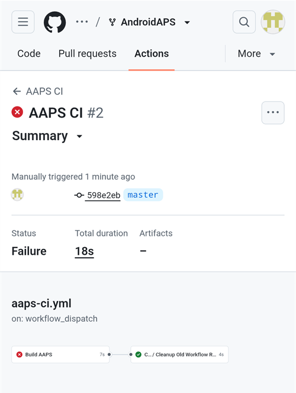
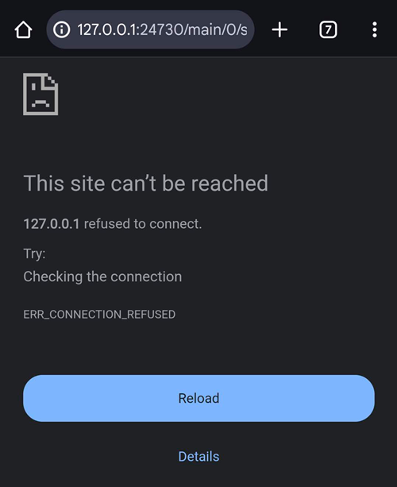
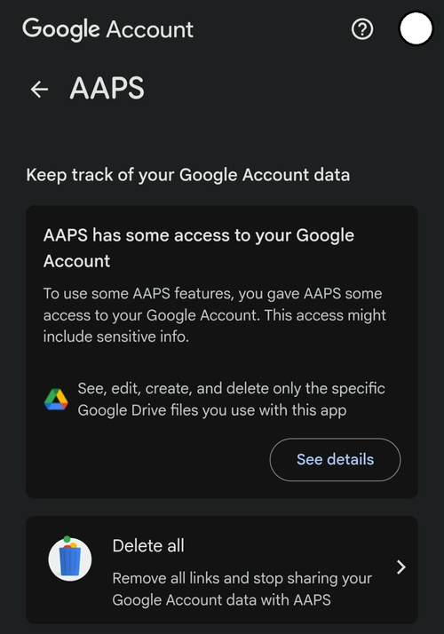

(aaps-ci-troubleshooting)=

# Izrada u pregledniku: rješavanje problema

```{note}
This page collects troubleshooting tips for the [Browser build](../SettingUpAaps/BrowserBuild.md).
```

(aaps-builder-troubleshooting)=

## AAPS Builder

### Step 1: the repository

(aaps-builder-ts-repo-exists)=

#### "my-aaps already exists in this account"


You already have this repository, for example from an earlier attempt. Close the GitHub tab, keep that name in step 1 of the setup page and go on. If you already did steps 2 and 3 for it, your key is still in it: continue with [step 4](#aaps-builder-step4). If it was made with an earlier version of the setup page, update its workflow once as explained in [Updating AAPS](#aaps-builder-updates). You prefer a fresh start? Type another name, for example `my-aaps-2`, and use the same keystore in step 2.

(aaps-builder-ts-user-not-found)=

#### "No GitHub user with this name"


- **"No GitHub user with this name"** in step 1: type your GitHub username, as shown in your GitHub profile, not your e-mail.
- **No "Build AAPS" or "Run workflow" button, or the repository is empty**: the repository was not created from the template. Delete it (**Settings** → bottom of the page → **Delete this repository**) and do [step 1](#aaps-builder-step1) again with the **Create my private repository** button.

### Step 3: the secret

(aaps-builder-ts-404)=

#### "Page not found" (404)


- **"Page not found" (404) when the setup page opens GitHub**: log in to github.com in the same browser (GitHub shows 404 for private repositories when you are not logged in). If you are logged in, the username or repository name in step 1 of the setup page does not match your repository. Type the exact names.

### Step 4: the build

(aaps-builder-ts-workflow-not-found)=

#### "This workflow does not exist"


Right after the repository is created, GitHub may not have read its workflow file yet: **Build AAPS** is missing from the **Actions** tab, and there is no **Run workflow** button. Any small change to the file makes GitHub read it:

1. In your repository, open **Code**, then the folder `.github`, then `workflows`, then the file `build.yml`.
2. Tap the **⋯** menu at the top right of the file, then **Edit file… In place** (on a computer, click the pencil).

   

3. Tap at the very end of the text and add an empty line (Enter). Tap **Commit changes…** at the top.

   

4. Tap **Commit changes** again.

   

5. Open the **Actions** tab again: **Build AAPS** is now in the list of workflows (on a phone, the list opens with the icon at the left of **All workflows**). Tap it, then **Run workflow**.

   

(aaps-builder-ts-build-failed)=

#### The build failed (red cross)

1. On the setup page, tap **Open my builds** and tap the build with the red cross.

   

2. The page of the build shows **Failure**, and which part failed: **AAPS / Check** (the repository, the secret, the version or the variant: nothing was built) or **AAPS / Build AAPS**.

   

3. Scroll down to **Annotations**, with your finger on the text, not on the diagram. The red lines explain the problem: tap **Show more** to read the whole message, then find it below.

   

- **"Secret KEYSTORE_SET is missing"**: do step 3 of the setup page.
- **The build stops with "This repository is PUBLIC"**: in your repository, open **Settings** → **General** → **Danger Zone** → **Change visibility** → **Private**, then build again.
- **"Version … does not exist"**: only released versions of **AAPS** can be built, the ones on the [tags page](https://github.com/nightscout/AndroidAPS/tags) of nightscout/AndroidAPS, such as `3.3.2.0`. A branch name such as `dev` doesn't work. Use `latest`, or type a tag exactly as listed.
- **"Variant … is not supported"**: your workflow file is an older version. Replace it as explained in [Updating AAPS](#aaps-builder-updates).
- **"The secret is too short"**, **"The secret is not a valid code"** or **"The secret does not contain a keystore"**: the wrong text was pasted into the secret, often the word `KEYSTORE_SET` itself, or only part of the code. In your repository, open **Settings** → **Secrets and variables** → **Actions**, edit `KEYSTORE_SET` and paste the long code from **Copy secret** again (redo step 2 of the setup page first if you closed it).
- **"Keystore, password or alias is wrong"**: check your keystore's password and alias, then redo steps 2 and 3 of the setup page.
- **"Google Drive access has expired or was revoked"**: redo [step 6](#aaps-builder-google-drive) and update the `GDRIVE_OAUTH2` secret.
- **"Process completed with exit code 1" and a red line with only a link to `services.gradle.org`**, after less than a minute: the build could not download Gradle, a tool it needs to build the app. The Gradle website was not responding. Your repository and your settings are fine. Wait half an hour, then [run the build again](#aaps-ci-rerun).
- **Another error**: [read the build log](#aaps-ci-read-the-logs), then [run the build again](#aaps-ci-rerun). If it fails again the same way, ask for help with the name of the failed step and the error lines. Nikada ne dijelite sadržaj svojih tajni.

### Step 5: the app

- **No Download link, or the GitHub app opened**: the GitHub app cannot download builds. Open the build in Chrome as explained in [step 5](#aaps-builder-step5). To stop GitHub links opening in the app: Android **Settings** → **Apps** → **GitHub** → **Open by default** → turn off **Open supported links**.

## Rješavanje problema s AAPS-CI

(aaps-ci-read-the-logs)=
### Najprije: saznajte što nije u redu

Kada izrada ne uspije, GitHub čuva dnevnik svakog koraka. Dnevnik vam kaže koji korak nije uspio i zašto. Pročitajte ga prije nego što pokušate bilo što drugo: poruku o pogrešci tražite na ovoj stranici, a nju će tražiti i oni koji vam pomažu.

1. U svojoj GitHub kopiji AndroidAPS-a otvorite **Actions**. Neuspjela izrada ima crveni križić. Dodirnite njezin naziv.

   

2. Sažetak pokretanja prikazuje **Failure**, a ispod posao koji nije uspio (**Build AAPS**, s crvenim križićem).

   

3. Pomaknite se do **Annotations** i dodirnite crveni redak **Build AAPS**.

   

4. Posao se otvara. Koraci sa sivom kvačicom su uspjeli. Korak s crvenim križićem je onaj koji nije uspio: GitHub ga otvara za vas. Koraci nakon njega su preskočeni (sivi krug).

   

5. Pročitajte retke odmah iznad `Error: Process completed with exit code 1.`: oni objašnjavaju problem. U ovom primjeru korak **Retrieving Google Drive access token** nije uspio s `invalid_grant` i `Token has been expired or revoked.`, pogledajte [Googleov token za osvježavanje je istekao](#aaps-ci-google-token-expired).

   

```{tip}
Tražite pomoć? Navedite naziv koraka koji nije uspio i retke s pogreškom (snimka zaslona kao gore je u redu). Nikada ne dijelite sadržaj svojih tajni.
```

(aaps-ci-update-secret)=
#### Ažurirajte tajnu

Mnogi popravci znače zamjenu vrijednosti tajne. U svojoj GitHub kopiji AndroidAPS-a idite na **Settings** → **Secrets and variables** → **Actions** i dodirnite olovku pokraj tajne.


Unesite ili zalijepite novu vrijednost i dodirnite **Update secret**. GitHub nikada ne prikazuje staru vrijednost: polje je uvijek prazno.


(aaps-ci-rerun)=
#### Ponovno pokrenite izradu nakon popravka

Kada popravite uzrok, ne morate početi ispočetka: otvorite neuspjelo pokretanje, dodirnite **...** (gore desno), zatim **Re-run failed jobs**.


Dodirnite **Re-run jobs**. Novu izradu možete pokrenuti i preko **Run workflow**, kao i obično.


(aaps-ci-preparation-web)=
### Web stranica aaps-ci-preparation
  - Stranicu za pripremu prikazuje privremeni lokalni poslužitelj (na primjer Simple Web Server na računalu), koji prima i Googleov token za osvježavanje.
  - Ako vidite zaslon ispod, lokalni poslužitelj je zaustavljen ili nije dostupan.
  - Zatvorite stranicu za pripremu, provjerite radi li lokalni poslužitelj, zatim ponovno otvorite aaps-ci-preparation.html na isti način kao u koraku 2 i dovršite preostale korake. To je potrebno posebno kada tijekom postavljanja prvi put povezujete Google.

  

(aaps-ci-google-token-expired)=
### Googleov token za osvježavanje je istekao
  - Googleovi OAuth2 tokeni za osvježavanje istječu ako se ne koriste 6 mjeseci, a mogu postati nevažeći i u drugim slučajevima (npr. ako ste promijenili lozinku Google računa ili ručno opozvali pristup). Više informacija pogledajte u [Googleovoj dokumentaciji za OAuth2](https://developers.google.com/identity/protocols/oauth2).
  - U [dnevniku izrade](#aaps-ci-read-the-logs) korak **Retrieving Google Drive access token** ne uspijeva s `invalid_grant` i `Token has been expired or revoked.`:

  

  - Ako izrada ne uspije zbog isteklog ili opozvanog Googleovog tokena za osvježavanje, morate ponoviti korake [Autorizacija Google Drivea](#aaps-ci-google-drive-auth) da dobijete novi token `GDRIVE_OAUTH2`, [ažurirati tajnu](#aaps-ci-update-secret) u svom GitHub repozitoriju, a zatim [ponovno pokrenuti izradu](#aaps-ci-rerun).
  - Ako autorizacija opet ne uspije ili Google više ne traži vaš pristanak, najprije uklonite postojeći pristup AAPS-a iz svog Google računa, pogledajte [niže](#aaps-ci-google-remove-access).

(aaps-ci-google-remove-access)=
### Uklonite pristup AAPS-a iz svog Google računa i ponovno pokrenite autorizaciju
  - Ako autorizacija za Google Drive stalno ne uspijeva ili želite početi ispočetka, najprije uklonite pristup koji ste prije dali AAPS-u, a zatim ponovite autorizaciju.
  - Na telefonu otvorite [https://myaccount.google.com](https://myaccount.google.com), dodirnite **Security**, pomaknite se do **Your connections to third-party apps & services** i otvorite popis povezanih aplikacija. Možete otići i izravno na [https://myaccount.google.com/connections](https://myaccount.google.com/connections).
  - Dodirnite **AAPS** na popisu.

  

  - Stranica prikazuje pristup koji ste dali AAPS-u (datoteke na Google Driveu koje aplikacija koristi). Dodirnite **Delete all** da uklonite vezu ili **See details** da je najprije pregledate.

  

  - Na stranici s detaljima dodirnite **Remove all access**.

  

  - Dodirnite **Confirm**.

  

  - Google potvrđuje da AAPS više nema pristup. AAPS se više ne pojavljuje na popisu povezanih aplikacija.

  

  - Sada ponovno pokrenite autorizaciju ispočetka: zatvorite **i** stranicu za pripremu i aplikaciju za upravljanje datotekama, ponovno otvorite aaps-ci-preparation.html iz aplikacije za upravljanje datotekama i ponovite korake [Autorizacija Google Drivea](#aaps-ci-google-drive-auth). Google će ponovno tražiti da odobrite pristup, a stranica će dati novi token `GDRIVE_OAUTH2`.
  - [Ažurirajte tajnu `GDRIVE_OAUTH2`](#aaps-ci-update-secret) u svom GitHub repozitoriju novim tokenom, a zatim [ponovno pokrenite izradu](#aaps-ci-rerun).

(aaps-ci-disable-software)=
### Disable Software That May Interfere With OAuth Verification
  - Disable any VPN or security app (firewall, antimalware,...) on the phone before trying to get the OAuth key.

(aaps-ci-actions-permission)=
### Provjerite postavke dopuštenja za GitHub Actions
  - Provjerite jesu li pravila za GitHub Actions postavljena na „Allow all actions and reusable workflows“ (Settings → Actions → General). Ako je promijenite, pritisnite **Save** ispod opcija.

  

`actions/checkout@v4` and `actions/setup-java@v4` are not allowed to be used in `xxxxx/AndroidAPS`. Actions in this workflow must be: within a repository owned by `xxxxx`

(aaps-ci-workflow-permissions)=
### Provjerite postavke dopuštenja za GitHub workflow
  - Ako izrada odmah ne uspije s pogreškom „Invalid workflow file“ sličnom onoj ispod, zadana dopuštenja za workflowe u vašem repozitoriju su previše ograničena:

```
Invalid workflow file
The workflow is not valid. .github/workflows/aaps-ci.yml (Line: 361, Col: 3):
Error calling workflow 'xxxxx/AndroidAPS/.github/workflows/cleanup-workflow-runs.yml@...'.
The nested job 'cleanup' is requesting 'actions: write', but is only allowed 'actions: none'.
```

  - Provjerite jesu li dopuštenja za workflow postavljena na „Read and write permissions“ (Settings → Actions → General → Workflow permissions), zatim spremite i ponovno pokrenite workflow za izradu.

  

(aaps-ci-password-special-characters)=
### Izrada ne uspijeva pri provjeri lozinke spremišta ključeva
  - U [dnevniku izrade](#aaps-ci-read-the-logs) korak **Validating keystore, alias and password** ne uspijeva s `Either KEYSTORE_BASE64, KEYSTORE_PASSWORD, KEY_PASSWORD, or KEY_ALIAS is incorrect`, a zatim slijedi `Keystore was tampered with, or password was incorrect`. Izrada tu staje: spremište ključeva i lozinke provjeravaju se prije izrade AAPS-a.

  

  - Workflow za izradu čuva svaki znak vaših lozinki nepromijenjen. Unesite `KEYSTORE_PASSWORD` i `KEY_PASSWORD` točno onakve kakve jesu, bez dodavanja obrnute kose crte ili bilo kojeg drugog znaka za izbjegavanje (escape). Ako ste dodali obrnute kose crte, [ažurirajte tajne](#aaps-ci-update-secret) lozinkom točno onakvom kakva jest. Primjer ispod je pogrešan: lozinka je `Example2026`, a obrnuta kosa crta je dodana.

  

  - Ako izrada i dalje ne uspijeva pri potpisivanju APK-a iako je lozinka točna, a lozinka sadrži `$`, obrnuti apostrof (backtick), `"` ili `\`, datoteka workflowa u vašem forku starija je od rujna 2026. i još uvijek obrađuje te znakove. [Sinkronizirajte svoj fork](#Update-to-new-version-update-your-repo) s najnovijom granom dev, a zatim ponovno pokrenite workflow za izradu.
  - Okomita crta `|` je poseban slučaj. Stranica za pripremu u [Opciji 1](#aaps-ci-option1) spaja spremište ključeva, lozinke i alias u jednu tajnu `KEYSTORE_SET`, odvojene znakom `|`, a workflow ih razdvaja na tom znaku. Lozinka koju izradi stranica za pripremu sadrži samo slova i brojke, pa se to s Opcijom 1 ne može dogoditi. To se može dogoditi samo ako ste sami sastavili tajnu `KEYSTORE_SET` od lozinke koja sadrži `|`. U tom slučaju izbrišite `KEYSTORE_SET` i umjesto nje unesite zasebne tajne iz [Opcije 2](#aaps-ci-option2).
