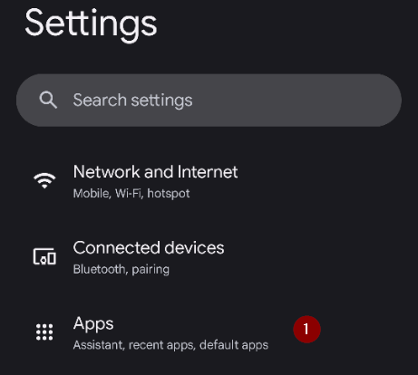
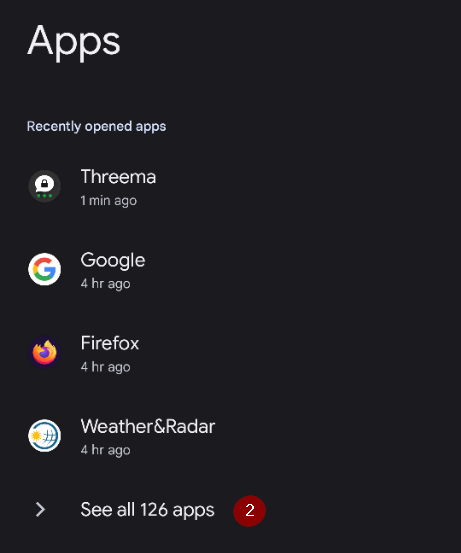
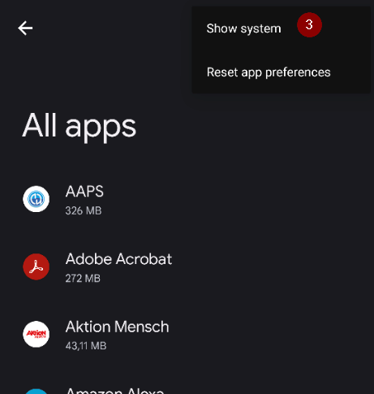
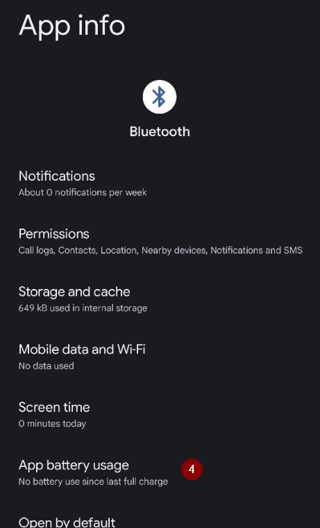
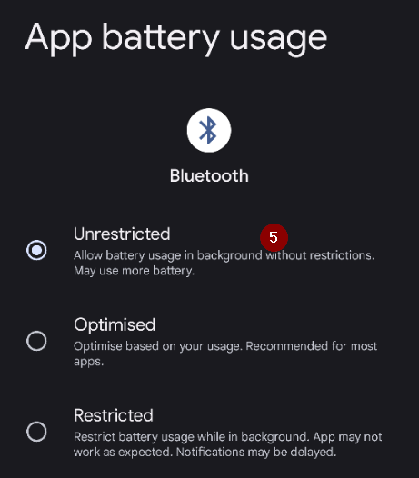
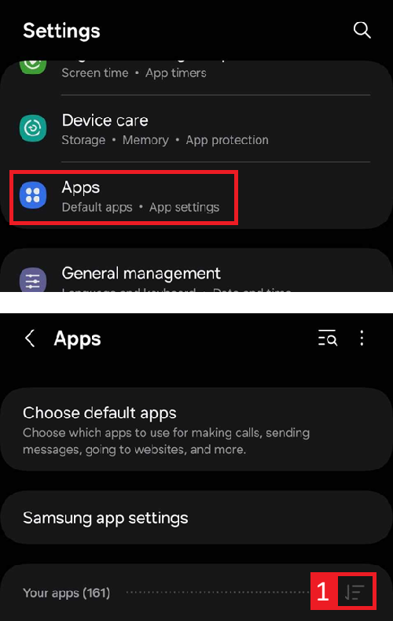
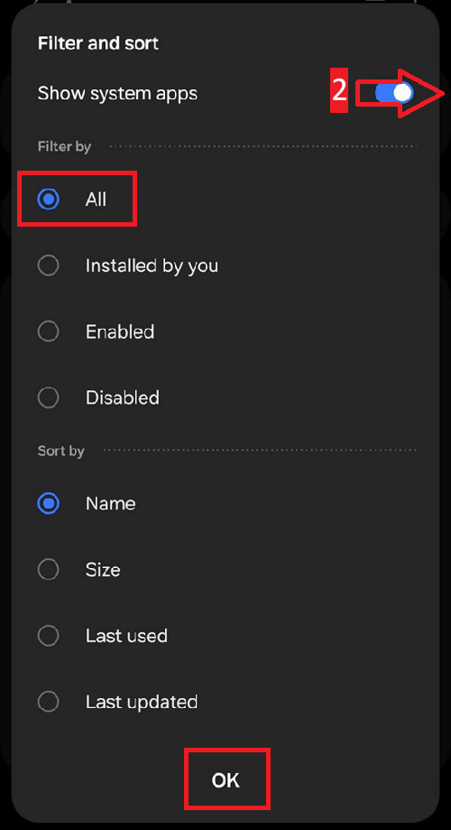
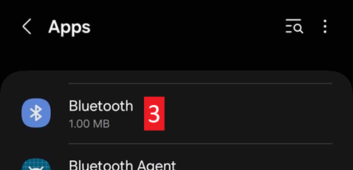
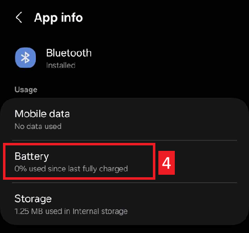
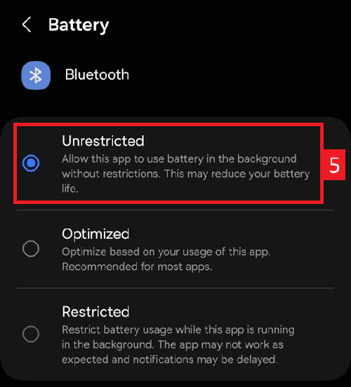

(generaltroubleshooting)=

# Rješavanje problema

**Počnite ovdje kada nešto ne radi.** Podaci o rješavanju problema nalaze se na mnogo stranica u dokumentaciji. Ova stranica ih okuplja: to je jedan zbirni popis poveznica, poredanih po temama, koji vam pomaže riješiti najčešće probleme.

Ako ispod ne nađete odgovor, pogledajte i:

* [Česta pitanja korisnika petlje](../UsefulLinks/FAQ.md) za odgovore na česta pitanja i
* [Podešavanje profila u AAPS-u](ProfileTuning.md) ako vaša petlja radi, ali kontrolu glukoze treba poboljšati.

```{admonition} Still stuck?
:class: tip
Ako nijedna poveznica ne riješi vaš problem, pogledajte [Gdje mogu dobiti pomoć?](WhereCanIGetHelp.md) kako biste pitali zajednicu (Facebook, Discord) ili pošaljite svoje [datoteke dnevnika](AccessingLogFiles.md) razvojnim programerima.
```

---

(generaltroubleshooting-aaps-app)=

## Aplikacija AAPS

### Izrada i ažuriranje

* Ako izrada ne uspije, pogledajte [Ako izrada ne uspije](#building-aaps-troubleshooting): tamo je odjeljak za rješavanje problema za svaki način izrade:
  * [AAPS Builder](#aaps-builder-troubleshooting)
  * [Izrada u pregledniku](#aaps-ci-troubleshooting)
  * [Android Studio](TroubleshootingAndroidStudio.md)
* Izgubljeno ili novo spremište ključeva: [Ponovna instalacija AAPS-a](#reinstall-aaps)
* Ažuriranje **AAPS-a**: [s AAPS Builderom](#aaps-builder-updates), [izradom u pregledniku (fork)](#update-browser-build-troubleshooting), [s Android Studiom](#update-computer-build-troubleshooting)

### Instalacija

* [Upozorenje Google Play zaštite](#transferring-installing-play-protect-warning): aplikacija je prijavljena kao nesigurna.
* Instalacija je **blokirana** s porukom o neprovjerenom razvojnom programeru: pogledajte [Provjera Android razvojnih programera](#android-developer-verification) za besplatne načine instalacije.

### Postavke

* [Profil: „Bazalna stopa nije kompatibilna s trenutnom pumpom“](#your-aaps-profile-basal-not-compatible)
* [Pumpa: „Podaci dolaze s druge pumpe“](#config-builder-wrong-pump-data)
* [Nightscout klijent](TroubleshootingNsClient.md)
* **„Postavke AAPS-a ne mogu se pročitati“** pri pokretanju: postavke su šifrirane ključem koji Android čuva za **AAPS**, a taj ih ključ više ne može otvoriti, na primjer nakon što je spremište ključeva na telefonu resetirano. Dok je ovaj zaslon prikazan, **AAPS** ne radi i ne upravlja pumpom. Dodirnite **Pokušaj ponovno**: zatvara se i ponovno pokreće **AAPS**. Ako to ne pomogne, ponovno pokrenite telefon. **Počni ispočetka** koristite samo kada ništa drugo ne pomaže: datoteka s nečitljivim postavkama stavlja se na stranu (preimenuje se i čuva) i **AAPS** se pokreće s praznim postavkama. Zatim uvezite svoj zadnji [izvoz postavki](../Maintenance/ExportImportSettings.md).

### Korištenje

* [Pogrešne vrijednosti ugljikohidrata (spora apsorpcija ugljikohidrata)](#CobCalculation-detection-of-wrong-cob-values)
* [Automatizacija](#automations-troubleshooting)
* [Potpuno zatvorena petlja](#full-closed-loop-troubleshooting)

---

(generaltroubleshooting-bluetooth-related-issues)=


## Problemi s Bluetoothom

Za poznate probleme s Bluetooth vezama, prekidima veze s pumpom/Pod-ovima ili problemima s aktivacijom i vezom pogledajte [Problemi s Bluetoothom](../GettingHelp/BluetoothTroubleshooting.md)

---

(generaltroubleshooting-android-related-issues)=

## Problemi povezani s Androidom

### Optimizacija baterije

**AAPS** vam može pomoći pronaći prave postavke za vaš telefon: otvorite **izbornik** (☰) > **O aplikaciji** i dodirnite **Don't kill my app?**. Otvorit će se upute za proizvođača vašeg telefona na stranici [Don't kill my app](https://dontkillmyapp.com/). [Čarobnjak za postavljanje](#setup-wizard-bluetooth-battery-optimisation) također traži da isključite optimizaciju baterije za **AAPS** i Bluetooth.

Android ima postavke za uštedu baterije koje su uključene prema zadanim postavkama. Te postavke automatski suspendiraju/pauziraju aplikacije koje nisu potrebne za rad sustava, kako bi se smanjila potrošnja baterije aplikacija koje ne moraju stalno raditi.

Ako je optimizacija uključena, vrlo vjerojatno će uzrokovati probleme za **AAPS** i druge pomoćne aplikacije poput **xDripa**.

Važno je isključiti optimizaciju baterije kako bi **AAPS** i druge pomoćne aplikacije stalno ostale aktivne.

Ovisno o modelu i proizvođaču vašeg telefona, ova se postavka možda mora isključiti na više mjesta.

***NAPOMENA:** Slijedite korake ispod kako biste isključili optimizaciju baterije za uslugu Bluetooth ako vaš telefon ima tu opciju. Isti koraci služe i za isključivanje za **AAPS** i druge aplikacije, ali snimke zaslona prikazuju samo kako to učiniti za uslugu Bluetooth.*

#### Pixel telefoni (izvorni Android)

* Idite na Android postavke, odaberite „Aplikacije“.

  

* Odaberite „Prikaži sve aplikacije“

  

* U izborniku desno odaberite „Prikaži sustavske“ aplikacije (Show system).

  

* Sada potražite i odaberite aplikaciju „Bluetooth“.

  

* Kliknite „Potrošnja baterije aplikacije“ i odaberite „Neograničeno“ (na nekim starijim verzijama Androida „Nije optimizirano“).

  


#### Samsung telefoni

* Idite na Android postavke, odaberite „Aplikacije“

* Na ikoni koja bi trebala mijenjati način sortiranja (1) odaberite „Prikaži sustavske aplikacije“ (2).

  

  

* Sada potražite aplikaciju Bluetooth i odaberite je da vidite njezine postavke.

  

* Odaberite „Baterija“.

  

* Postavite je na „Neograničeno“ (na nekim starijim verzijama Androida „Nije optimizirano“).

  

#### Huawei telefoni

Pogledajte ovaj vodič za [Huawei: Bluetooth i optimizacija baterije](../CompatiblePhones/Huawei.md)

---

(generaltroubleshooting-cgm)=

## Kontinuirani monitor glukoze (CGM)

Korisne poveznice na poznate probleme i korake za njihovo rješavanje za CGM-ove.

* [Općenito](#general-cgm-troubleshooting)
* [Dexcom G6](#DexcomG6-troubleshooting-g6)
* [Libre 2 s Minimal Looperom](#minimallooper-troubleshooting)
* [Libre 3](#libre3-experiences-and-troubleshooting)
* [xDrip - nema podataka s CGM-a](#xdrip-identify-receiver)
* [xDrip - rješavanje problema s Dexcomom](#xdrip-troubleshooting-dexcom-g5-g6-and-xdrip)

---

(generaltroubleshooting-pumps)=

## Pumpe

Korisne poveznice na poznate probleme i korake za njihovo rješavanje za pumpe

* [Accu-Chek Combo](#combov2-tips-for-basic-usage)
* [Accu-Chek Insight](#Accu-Chek-Insight-Pump-insight-specific-errors)
* [CareLevo](#carelevo-alarms-and-notifications)
* [DanaRS](#DanaRS-Insulin-Pump-dana-rs-specific-errors)
* [Diaconn G8](#diaconn-g8-bluetooth-troubleshooting)
* [EOPatch2](#eopatch2-alarms-and-warnings)
* [Medtronic + RileyLink](#MedtronicPump-what-to-do-if-i-loose-connection-to-rileylink-and-or-pump)
* [Medtrum Nano](#medtrum-nano-troubleshooting)
* [Omnipod DASH](#omnipod-dash-troubleshooting)
* [Omnipod Eros](#OmnipodEros-troubleshooting)

---

(generaltroubleshooting-phones)=

## Telefoni

Korisne poveznice na poznate probleme i korake za njihovo rješavanje za telefone

* [Popis testiranih telefona i postava uređaja](https://docs.google.com/spreadsheets/u/1/d/e/2PACX-1vScCNaIguEZVTVFAgpv1kXHdsHl3fs6xT6RB2Z1CeVJ561AvvqGwxMhlmSHk4J056gMCAQE02sAWJvT/pubhtml?gid=683363241&single=true)
* [Jelly](../CompatiblePhones/Jelly.md)
* [Huawei: Bluetooth i optimizacija baterije](../CompatiblePhones/Huawei.md)

---

(generaltroubleshooting-remote-control)=

## Daljinsko upravljanje

* [AAPSClient i daljinsko upravljanje (uparivanje, naredbe ne stižu)](#client-master-control-troubleshooting)
* [Problemi s „pristupnim tokenom za Nightscout“](#remotecontrol-nightscout-access-token)
* [SMS naredbe](#SMSCommands-troubleshooting)
* [Android Auto](#android-auto-troubleshooting)

---

(generaltroubleshooting-smartwatches)=

## Pametni satovi

Korisne poveznice na poznate probleme i korake za njihovo rješavanje za pametne satove

* [Rješavanje problema s aplikacijom za sat (Wear)](#Watchfaces-troubleshooting-the-wear-app)
* [Sat i telefon ne komuniciraju](#wear-os-watch-phone-communication)
* [Wear OS 5](#wear-os-5-troubleshooting)
* [Izrada aplikacije za sat (Wear)](#building-aaps-wear-os-troubleshooting)
