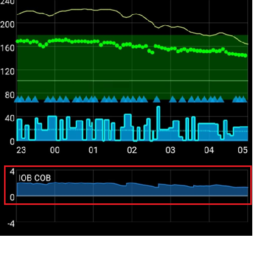
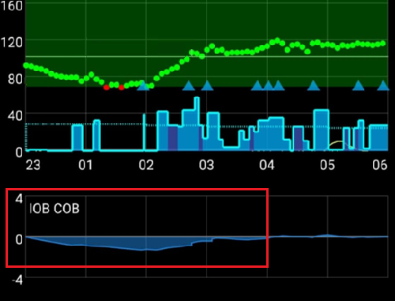
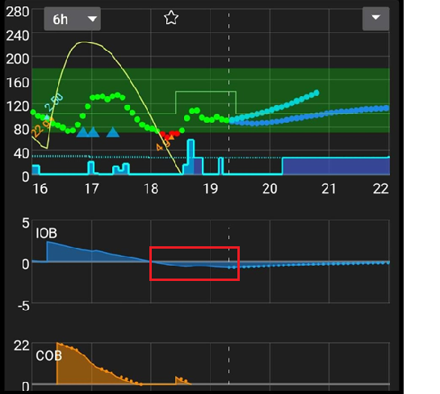
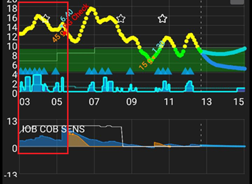
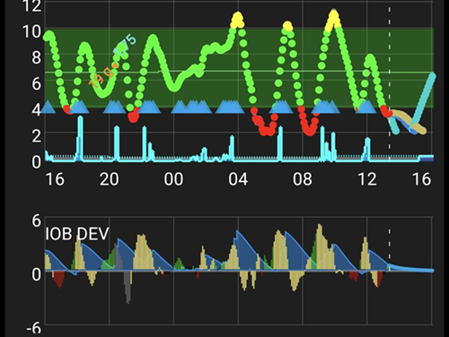
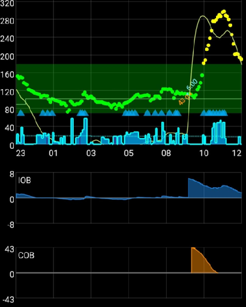

# Podešavanje profila u AAPS-u

```{admonition} This is NOT a medical advice
:class: warning
Za podršku i savjete o liječenju dijabetesa molimo surađujte sa svojim zdravstvenim timom.</br>
Ovaj vodič koristite tek kada ste [ispravno postavili svoj **Profil**](https://androidaps.readthedocs.io/en/latest/SettingUpAaps/YourAapsProfile.md) i prošli sve ciljeve **AAPS**-a.
```

Ovaj vodič objašnjava logiku rezultata algoritma OpenAPS s danim __Profilom__ i daje informacije o tome koje se vrijednosti u **AAPS**-u mogu prilagoditi kada uočite određene situacije ili obrasce. Prijedlozi o testiranju bazala u nastavku mogu se razlikovati od savjeta vašeg zdravstvenog tima.

Korištenje **zatvorene petlje** može olakšati testiranje bazala i znatno smanjiti rizik od hipoglikemije ako je bazal u vašem __Profilu__ prejak.

## Kako postupiti pri promjeni postavki profila

1. Provjerite jeste li pročitali i razumjeli preporučene postavke i savjete __AAPS__-a u nastavku. Ako ne slijedite ovaj savjet, prilagođavanje može biti problematično i manje je vjerojatno da ćete dobiti dobro podešen __Profil__
2. Pažljivo promatrajte i uspoređujte, **tijekom nekoliko dana**, što se događa s vašim __GUK__-om i __aktivnim inzulinom (IOB)__.
3. Pratite obrasce u **AAPS**-u koji se događaju (gotovo) svaki dan u isto vrijeme.
4. Važno je to raditi tijekom nekoliko dana. Odluke o prilagodbi __Profila__ donesene na temelju podataka iz samo jednog dana obično daju loše rezultate.
5. Tek kada uočite obrazac koji se ponavlja, npr. u 13 sati vidite skok __GUK__-a ili negativnu vrijednost __aktivnog inzulina (IOB)__, počnite raditi male promjene svog __Profila__.
6. Važno je mijenjati samo jednu stvar odjednom. Npr. povećajte bazal za 10 % oko 13 sati.
7. Nakon svake promjene važno je sljedećih nekoliko dana pratiti njezin utjecaj na vaš __GUK__ i __aktivni inzulin (IOB)__.
8. Ponavljajte ovaj postupak: promatrajte, odlučite, ponovno prilagodite ako je potrebno

Ne žurite, idite polako!

## Preporučene postavke i savjeti pri podešavanju bazala

- Sva testiranja radite s [omogućenom zatvorenom petljom](#AapsScreens-loop-status).
- **<u>ISKLJUČITE</u> sve [automatizacije](../DailyLifeWithAaps/Automations.md)**
- **<u>ISKLJUČITE</u> [DynISF](#Open-APS-features-DynamicISF), [AutoISF](#Open-APS-features-auto-isf), [AutoSens](#Open-APS-features-autosens)** kako ne bi pokušavali prilagoditi vaš profil.
- Tijekom testiranja ne radite ručne radnje (ručni bolus, privremeni ciljevi itd.): pustite sustav da koristi samo postavke **Profila**.
- Za [dodatne grafove](#AapsScreens-section-g-additional-graphs): na grafu 1 koristite Aktivni inzulin i Bazal. Na grafu 2 koristite Aktivni ugljikohidrati (i Promjena osjetljivosti). Na grafu 3 koristite Odstupanja i Utjecaj na glukozu u krvi. Kada tražite savjet, uvijek ih uključite na svoje snimke zaslona.
- COB=0[*](#profiletuning-cob-zero)

Ostale stvari koje bi idealno trebalo izbjegavati, jer utječu na podatke i mogu dovesti do pogrešnih zaključaka:
- Bez tjelesne aktivnosti.
- Bez stresa.
- Bez bolesti.
- Bez ekstremnog vremena, kao što su vrlo visoke ili niske temperature.
- Bez neuspjelih sesija pumpe ili CGM-a.
- Bez nenajavljenih ugljikohidrata.

Imajte na umu i:
- Ako je vaš [profil bazalne stope](#your-aaps-profile-basal-rates) ispravan, kada ste na cilju s COB=0[*](#profiletuning-cob-zero) i IOB=0, stalno ćete ostati na cilju bez obzira na vaš **ISF** (**ISF** se koristi samo kada ste iznad ciljne vrijednosti **GUK**-a).
- Morate provjeriti trenutni **aktivni inzulin (IOB)**, ali i graf **aktivnog inzulina (IOB)**, da vidite kako se **aktivni inzulin (IOB)** mijenjao tijekom proteklih nekoliko sati.

(profiletuning-cob-zero)=

***COB = 0**

To znači da je obrok probavljen i da u tijelu više nema ugljikohidrata.

**AAPS** može pokazivati [COB=0 iako još imate ugljikohidrata u tijelu](../DailyLifeWithAaps/CobCalculation.md).

## Definicije [Profila](../SettingUpAaps/YourAapsProfile.md)

Prejak **Profil** znači neku kombinaciju sljedećeg:

- Broj [ISF](#your-aaps-profile-insulin-sensitivity-factor) je premalen.
- Broj [bazala](#your-aaps-profile-basal-rates) je prevelik.
- Broj [I:C](#your-aaps-profile-insulin-to-carbs-ratio) je premalen.

## Opažanja aktivnog inzulina (IOB)

*Napomena: za pregled aktivnog inzulina (IOB) kroz nekoliko dana možete koristiti i graf IOB u izvješću Loopalyzer u Nightscoutu.*

Ako nakon nekoliko dana uočite sljedeće obrasce, razmislite o ovim promjenama:

### Pozitivan IOB

- Bazal u **Profilu** možda nije dovoljno jak (razlog mogu biti i stvari kao što su nenajavljena hrana, bolest, loša apsorpcija na mjestu primjene itd.)



### Negativan IOB

- Zadani bazal je prejak.
- Možda je to učinak ranije tjelovježbe/tjelesne aktivnosti.



- Prethodni obrok: previše bolusa (što je dovelo do vrlo dugog nultog privremenog bazala)



## Opažanja ciljne vrijednosti GUK-a

### Zaglavljen visoko

- Broj __ISF__-a je visok i nije dovoljno jak (izračunani inzulin je preslab)



- Bazal u __Profilu__ možda nije dovoljno jak (**SMB**-ovi nemaju dovoljno „bazalne zalihe“ za korištenje)
- Možda se uključila sigurnosna granica ([MaxIOB](#Open-APS-features-maximum-total-iob-openaps-cant-go-over)?) i ograničava davanje inzulina. Provjerite na zaslonu dodatka **APS** (**Konfiguracija → APS → Otvori dodatak**); pogledajte [SMB](#Open-APS-features-super-micro-bolus-smb).
- Tehnički problem: apsorpcija na mjestu primjene, infuzijski set, ...

### Zaglavljen nisko

- __ISF__ je prejak i broj treba povećati
- Bazal u __Profilu__ je prejak (ako je i IOB negativan)

### Tobogan (usponi i padovi)

- **ISF** prejak? Pogledajte svoj [AAPS profil](#your-aaps-profile-insulin-sensitivity-factor)



## Opažanja GUK-a nakon obroka

### Brz porast i GUK ide visoko

- Hrana sadrži brze ugljikohidrate (kao što je voćni sok).
- Razmislite o predbolusu ili malo ranijem predbolusu.
- Bolus (IC ili ubrizgani %) nije dovoljno jak.



### Brz porast, a zatim GUK ide nisko

- Razmislite o predbolusu; vaš **Profil** je možda preagresivan (prevelika korekcija porasta)
- Bolus je prejak.


## [Kako izračunati svoj I:C](#your-aaps-profile-insulin-to-carbs-ratio)

1. Najprije su vam potrebne ispravne zadane postavke bazala u vašem **Profilu**.
2. Počnite na cilju, po mogućnosti bez negativnog IOB-a.
3. Zabilježite ukupno dani inzulin u **Upravljanje → Pumpa** (ili u povijesti pumpe) i nazovite ga početni inzulin. Vrlo točno izmjerite poznatu količinu ugljikohidrata i zabilježite vrijeme početka i početni IOB. Zatim unesite podatke o ugljikohidratima i bolusu u **AAPS** pomoću kalkulatora (s trenutno postavljenim I:C). Ne zaboravite pojesti ugljikohidrate ;)
4. Nakon nekoliko sati, kada je COB=0[*](#profiletuning-cob-zero) i ponovno ste na cilju, zabilježite vrijeme završetka i završni IOB, provjerite ukupno dani inzulin kao i prije i nazovite ga završni inzulin. *NAPOMENA: Trajanje NIJE važno, samo neka je dulje od vašeg probavljanja*
5. Od razlike između početne i završne količine inzulina oduzmite/dodajte razliku završni IOB – početni IOB. Zatim oduzmite bazalni inzulin izračunat iz postavki vašeg **Profila**.
6. Ako je __GUK__ u ciljnom rasponu, dobit ćete ukupni inzulin potreban da se vaši ugljikohidrati „probave“. Izračunajte svoj **I:C**.

### Objašnjenja za izračun I:C

- S **Profilom** koji ima ispravnu zadanu bazalnu stopu trebali biste u bilo kojem razdoblju ostati na cilju i imati IOB blizu 0. Dobivate samo bazal iz **Profila**.
- Tome dodajete ugljikohidrate i bolus. Pričekajte da tijelo probavi sve ugljikohidrate i da se vratite na ciljnu vrijednost **GUK**-a. Vaša potrošnja inzulina bit će zbroj bazala + inzulina potrebnog za ugljikohidrate. Izračunate inzulin korišten za bazal (pomoću svog **Profila**), a višak je inzulin korišten za probavljanje ugljikohidrata.
- Ako je razdoblje prekratko, dio ugljikohidrata neće biti probavljen, pa će vaš „inzulin potreban za ugljikohidrate“ biti pogrešan.
- Ako je razdoblje predugo, ništa loše se neće dogoditi. Iskoristit ćete sve ugljikohidrate i dobit ćete više bazala. Na kraju ćete od ukupno korištenog inzulina oduzeti bazal, pa produljeno razdoblje (s više bazala) neće utjecati na rezultat.

Izvorno napisao @Robby (Discord) kao savjete i trikove za podešavanje vašeg **AAPS profila**, a zajednica ga je pregledala i uredila (hvala!).
