(reinstall-aaps)=
# Ponovna instalacija AAPS-a s novim spremištem ključeva

Svaki apk **AAPS-a** potpisan je **spremištem ključeva**. Ažuriranje se instalira preko vašeg trenutnog **AAPS-a** samo ako je potpisano **istim spremištem ključeva**: tada se sve vaše postavke i podaci zadržavaju. Zato se preporučuje spremište ključeva i njegovu lozinku čuvati na sigurnom mjestu.

Ako pokušate instalirati apk potpisan drugim spremištem ključeva nego prije, dobit ćete poruku o pogrešci da instalacija nije uspjela!

(reinstall-aaps-when)=
## Kada je potrebna ponovna instalacija?

**AAPS** morate deinstalirati i ponovno instalirati kada je vaš novi apk potpisan drugim spremištem ključeva, na primjer:

- Ne možete pronaći svoje staro spremište ključeva ili njegovu lozinku.
- Izradili ste novo spremište ključeva, na primjer s [Opcijom 1 izrade u pregledniku](../SettingUpAaps/BrowserBuildKeystore.md) ili s **Izradi novi ključ** u [AAPS Builderu](../SettingUpAaps/BrowserBuildAapsBuilder.md).
- Izrađujete aplikaciju na novom računalu i na njega niste kopirali svoje spremište ključeva.

Ako još imate svoje spremište ključeva, ova stranica vam ne treba: koristite ga ponovno i [ažurirajte **AAPS**](../Maintenance/UpdateToNewVersion.md) na isti način kao i inače.

(reinstall-aaps-before)=
## Prije nego počnete

- Deinstalacija **AAPS-a** briše sve njegove postavke, vaše [ciljeve](../SettingUpAaps/CompletingTheObjectives.md) i trenutnu vezu s pumpom. Vraćate ih uvozom svoje **datoteke postavki**, pa provjerite imate li nedavnu.
- Datoteka postavki ne sadrži vašu povijest tretmana i glukoze. Ako podatke prenosite u [Nightscout](../SettingUpAaps/SettingUpTheReportingServer.md), možete ih ponovno učitati nakon ponovne instalacije (korak 8).
- Potrebna vam je vaša [**glavna lozinka**](#Preferences-master-password): datoteka postavki šifrirana je njome. Resetiranje zaboravljene glavne lozinke ovdje ne pomaže: datoteka postavki može se uvesti samo lozinkom s kojom je izvezena (pogledajte [Kako resetirati glavnu lozinku?](#FAQ-reset-master-password)).
- **Korisnici Omnipoda i Medtruma:** najprije pročitajte [Pumpe bez katetera](#ExportImportSettings-tubeless-pumps). Vaša datoteka postavki mora biti izvezena tijekom Pod-a ili flastera (patch) koji sada nosite.
- Ako je potrebno, prije početka [postavite svoj CGM / prijemnik izvora GUK-a](../Getting-Started/CompatiblesCgms.md).

(reinstall-aaps-steps)=
## Koraci

Slike prikazuju prelazak s **AAPS-a** 3.4 (koraci 1 do 3) na **AAPS** 4 (koraci 6 do 8). Druge verzije izgledaju malo drugačije.

(reinstall-aaps-export)=
### 1. Izvezite svoje postavke

Izvezite svoje postavke s **AAPS-om** koji je trenutno instaliran na vašem telefonu. Za pojedinosti pogledajte [Izvoz postavki](#ExportImportSettings-Settings-Export).

U **AAPS-u** 3.4: otvorite **Održavanje** i dodirnite **Opcije izvoza**. Pod **Korisničke postavke** označite **Lokalna pohrana** i dodirnite **U redu**.

*Napomena: možete koristiti i [pohranu u oblaku](#preferences-maintenance-cloud) za sigurnosnu kopiju: to je dobra ideja, ali zadržite lokalnu pohranu za brzo vraćanje postavki.*

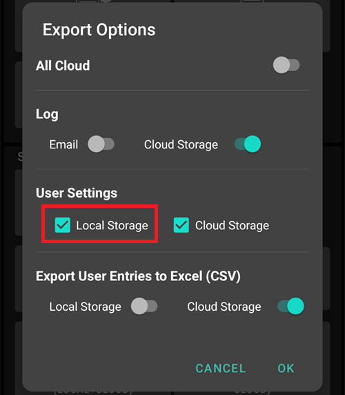

Gumb sada glasi **Izvezi postavke (lokalno)**. Dodirnite ga.

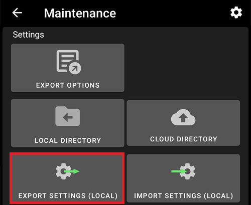

**AAPS** prikazuje naziv datoteke koju će izraditi. Dodirnite **U redu**, upišite svoju glavnu lozinku i dodirnite **U redu**.

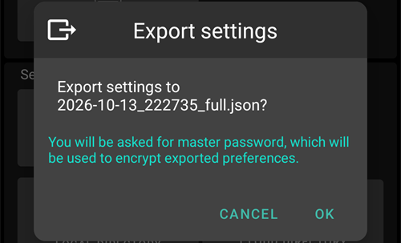

U **AAPS-u** 4: otvorite **Održavanje**, odaberite oznaku **Lokalno** pokraj **Izvezi postavke** i dodirnite **Izvezi postavke**.

(reinstall-aaps-copy)=
### 2. Kopirajte datoteku postavki s telefona

Datoteka je u mapi **preferences** vaše [**AAPS** mape](#SetupWizard-StoragePermission), s nazivom kao `2026-10-13_222735_full.json`. Kopirajte je ili prenesite na vanjsko mjesto (npr. na svoje računalo, uslugu pohrane u oblaku...). Datoteka obično ostaje na telefonu nakon deinstalacije, ali za svaki slučaj čuvajte kopiju i negdje drugdje.

(reinstall-aaps-nightscout-before)=
### 3. Sinkronizirajte s Nightscoutom

Ovaj korak nije obavezan, ali se preporučuje ako koristite [DynISF](#Open-APS-features-DynamicISF): omogućit će vam da odmah nastavite s trenutnim postavkama, umjesto da čekate 5 dana da se skupe podaci potrebni dodatku. NSClient V3 mora biti [omogućen i postavljen](../SettingUpAaps/SettingUpTheReportingServer.md).

Prije deinstalacije provjerite ima li Nightscout sve vaše podatke.

Otvorite **NSClient**, dodirnite gumb **Potpuna sinkronizacija** na dnu zaslona, zatim **U redu**.

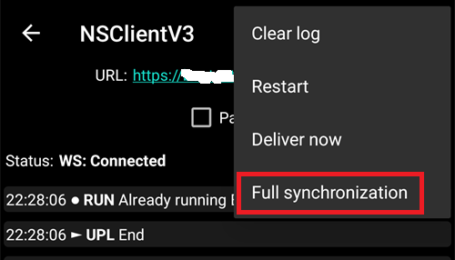

*Napomena: potrebno vrijeme ovisi o usluzi na kojoj je smješten vaš Nightscout.*

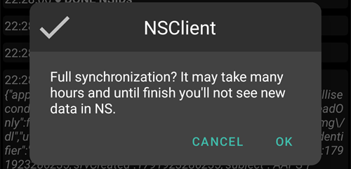

**AAPS** zatim nudi čišćenje svoje baze podataka. **U redu** uklanja s telefona podatke starije od 3 mjeseca, pa je sinkronizacija mnogo brža. **Otkaži** sinkronizira bez čišćenja. Baza podataka na telefonu ionako se briše pri deinstalaciji, pa su oba izbora u redu.

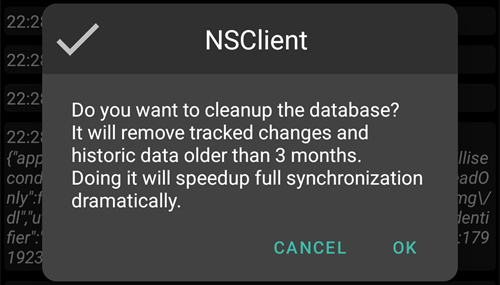

Ostavite **AAPS** da radi dok se sinkronizacija ne završi.

(reinstall-aaps-build)=
### 4. Izradite novi apk

[Izradite](../SettingUpAaps/BuildingAaps.md) novi potpisani apk sa svojim novim spremištem ključeva i prenesite ga na telefon.

(reinstall-aaps-uninstall)=
### 5. Deinstalirajte AAPS

Na telefonu u **Postavke** > **Aplikacije** > **AAPS** dodirnite **Deinstaliraj** i potvrdite s **U redu**.

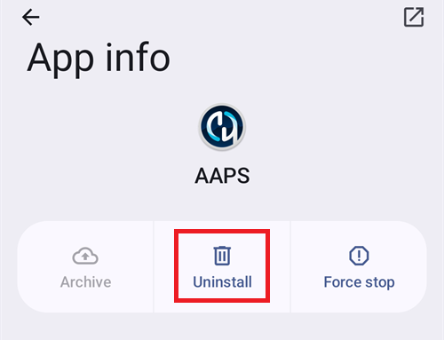

(reinstall-aaps-install)=
### 6. Instalirajte i pokrenite novi AAPS

[Instalirajte](../SettingUpAaps/TransferringAndInstallingAaps.md) novi apk i pokrenite **AAPS**. [Čarobnjak za postavljanje](../SettingUpAaps/SetupWizard.md) traži dopuštenja koja su **AAPS-u** potrebna: za svako dodirnite **Odobri**. Time se ponovno isključuje i [optimizacija baterije](#setup-wizard-bluetooth-battery-optimisation).

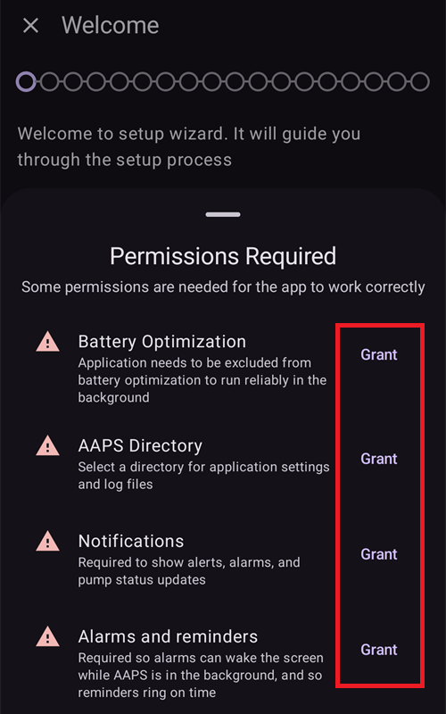

Za **AAPS mapa** odaberite istu mapu **AAPS** kao prije (onu u kojoj je mapa **preferences**), dodirnite **Koristi ovu mapu** i **Dopusti**.

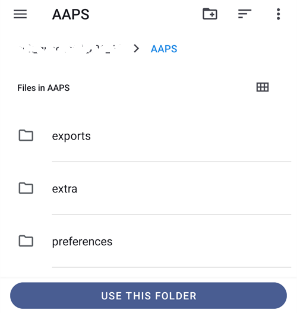

Kada **AAPS** pronađe vaše izvezene postavke, čarobnjak za postavljanje prikazuje zaslon [Pronađene su spremljene postavke](#setup-wizard-import-settings) na kojem ih možete uvesti. Možete i zatvoriti čarobnjak i uvesti postavke iz **Održavanja** kako je opisano niže.

(reinstall-aaps-import)=
### 7. Uvezite svoje postavke

Ako datoteka postavki više nije na telefonu, kopirajte je natrag u mapu **preferences** svoje **AAPS** mape.

Otvorite izbornik (☰) > **Održavanje**, odaberite oznaku **Lokalno** pokraj **Uvezi postavke** i dodirnite **Uvezi postavke**.

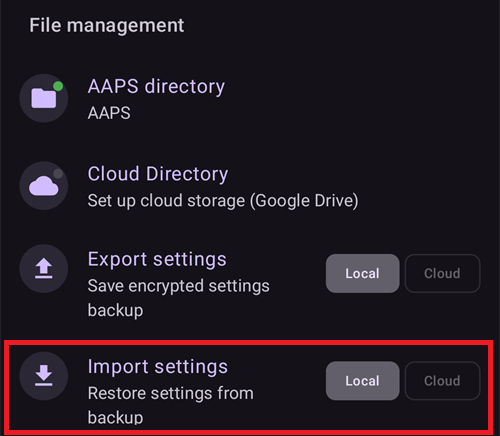

Popis prikazuje svaku datoteku s njezinom verzijom **AAPS-a** i koliko je stara. Odaberite datoteku koju ste izvezli u koraku 1.

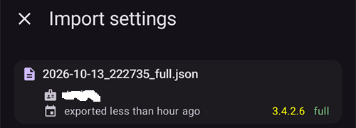

U novom **AAPS-u** ne morate prije toga postaviti glavnu lozinku. Upišite glavnu lozinku koju ste koristili za izvoz u **Lozinka za dešifriranje** i dodirnite **Dešifriraj**. **Datoteka je šifrirana drugom lozinkom** je očekivano: novi **AAPS** još ne zna vašu lozinku. Uvoz je vraća zajedno s vašim ostalim postavkama.

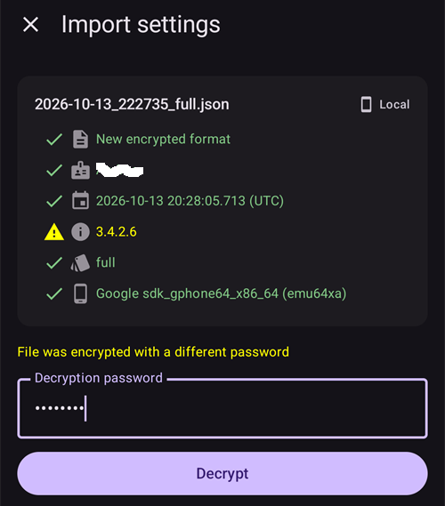

Označite **Zamijeni i postavke pumpe**: bez toga se vaša pumpa i njezine postavke ne vraćaju. Korisnici Omnipoda i Medtruma: označite to samo ako je datoteka izvezena tijekom vašeg trenutnog Pod-a ili flastera (pogledajte [Pumpe bez katetera](#ExportImportSettings-tubeless-pumps)).

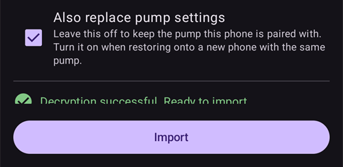

Dodirnite **Uvezi**, zatim **U redu** da primijenite postavke i ponovno **U redu** na **Postavke su primijenjene**.

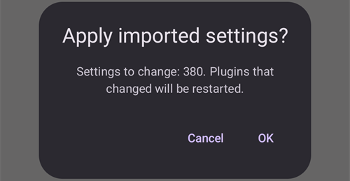

(reinstall-aaps-nightscout-after)=
### 8. Vratite svoju povijest iz Nightscouta

Otvorite izbornik (☰) > [**Konfiguracija**](../SettingUpAaps/ChangeAapsConfiguration.md) > **Komunikacija** i dodirnite **Otvori dodatak** pod **NSClientV3**. Provjerite prikazuje li status **Povezano**. Ako ne prikazuje, pogledajte [Rješavanje problema s NSClientom](TroubleshootingNsClient.md).

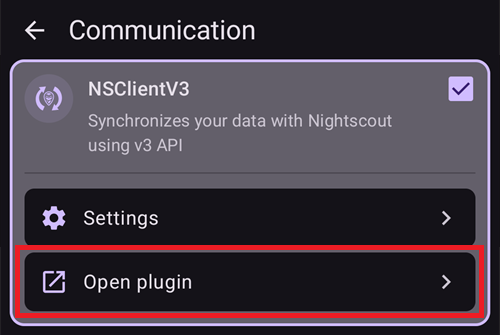

Dodirnite gumb **Potpuna sinkronizacija** na dnu zaslona i **U redu**. Baza podataka je nova, pa na pitanje o čišćenju možete odgovoriti bilo kako.

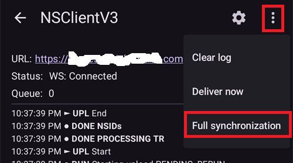

**AAPS** učitava vaše podatke iz Nightscouta. Kada završi, dnevnik prikazuje **Full sync finished**.

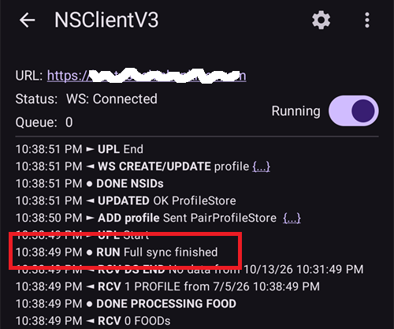

(reinstall-aaps-check)=
### 9. Provjerite i nastavite s petljom

Provjerite je li vaša pumpa povezana i stižu li vrijednosti CGM-a, a zatim nastavite koristiti petlju.

(reinstall-aaps-afterwards)=
## Nakon toga

Od sada uvijek koristite svoje novo spremište ključeva i čuvajte ga zajedno s lozinkom na sigurnom mjestu, izvan telefona. Pogledajte [Izrada i vraćanje sigurnosnih kopija](../Maintenance/ExportImportSettings.md).
