(troubleshooting_androidstudio-troubleshooting-android-studio)=

# Rješavanje problema s Android Studiom

```{contents} List of common issues
:depth: 2
:local: true
```

(troubleshooting_androidstudio-lost-keystore)=
## Izgubljeno spremište ključeva
Ako ste izgubili spremište ključeva ili njegovu lozinku, APK potpisan novim spremištem ključeva ne može ažurirati vaš trenutni **AAPS**: morate ga deinstalirati i ponovno instalirati. Pogledajte [Ponovna instalacija AAPS-a s novim spremištem ključeva](#reinstall-aaps).

## Gradle Sync nije uspio
Gradle Sync može ne uspjeti iz raznih razloga. Kada dobijete poruku „gradle sync failed“, otvorite karticu „Build“ (1) na dnu Android Studija i provjerite koja je poruka o pogrešci (2) prikazana.

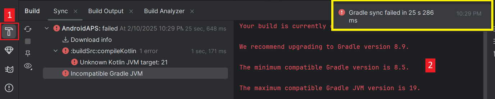

```{contents} Likely reasons for gradle sync failures are:
:depth: 1
:local: true
```

*Važno*: Nakon što slijedite upute za svoj problem, morate ponovno pokrenuti [Gradle Sync](#gradle-resync).

(troubleshooting_androidstudio-uncommitted-changes)=
### Nepotvrđene promjene (uncommitted changes)

Ako dobijete poruku o pogrešci poput ove:

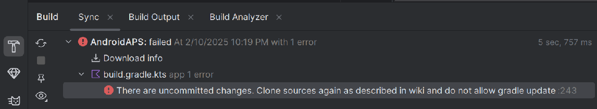

```
Build file 'C:\Data\50-Android\AndroidAPS\app\build.gradle.kts' line: 243

There are uncommitted changes.
Ponovno klonirajte izvorni kod kako je opisano u wikiju i ne dopustite ažuriranje Gradlea
```

#### Korak 1 – Provjerite instalaciju Gita
  * Otvorite karticu Terminal (1) na dnu Android Studija, kopirajte sljedeći tekst i zalijepite ga ili upišite u terminal (2).
    ```
    git --version
    ```

    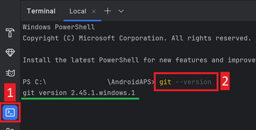

    Napomena: između „git“ i „version“ nalaze se razmak i dvije crtice!

  * Morate dobiti poruku o tome koja je verzija Gita instalirana, kao što vidite na gornjoj snimci zaslona. U tom slučaju idite na [Korak 2](#troubleshooting-android-studio-check-for-uncommitted-changes).

  * In case you get a message saying
    ```
    Git: command not found
    ```
    vaša instalacija Gita nije ispravna.

  * [Provjera instalacije Gita](#BuildingAaps-steps-for-installing-git)

  * If you are on Windows and Git was just installed, you should restart your computer to make Git globally available after the installation

  * If Git is installed, you have restarted (if on Windows), and Git still cannot be found:

  * Na računalu potražite datoteku „git.exe“.

    Zapišite si u kojoj je mapi spremljena.

  * Go to the Environment variables in Windows, select the variable "PATH" and click edit. Dodajte mapu u kojoj ste pronašli svoju instalaciju Gita.

  * Spremite i zatvorite.

  * Ponovno pokrenite Android Studio.

(troubleshooting-android-studio-check-for-uncommitted-changes)=
#### Korak 2: Provjerite postoje li nepotvrđene promjene.

  * U Android Studiju otvorite karticu „Commit“ (1) na lijevoj strani. 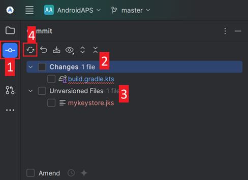
  * Vidjet ćete ili „Changes“ (u starijim verzijama Android Studija „Default changeset“) (2) ili „Unversioned Files“ (3):

    * Kod „Changes“ ste vjerojatno ažurirali „Gradle“ ili greškom promijenili sadržaj nekih datoteka.

    * Desnom tipkom miša kliknite na „Changes“ i odaberite „Rollback…“ (1)

      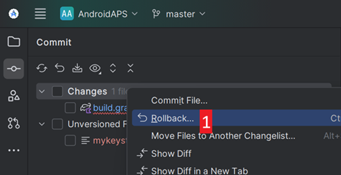

    * Datoteke se ponovno preuzimaju s Git poslužitelja. Ako na kartici Commit nema drugih promjena, idite na [Korak 3](#gradle-resync).

  * Ako vidite „Unversioned Files“, možda ste greškom spremili datoteke u mapu izvornog koda. Možda su to važne datoteke, npr. vaša datoteka spremišta ključeva, koje treba premjestiti negdje drugdje. Ako ne znate što su te datoteke i niste ih sami izradili, možete ih izbrisati.

    * Pomoću uobičajenog preglednika datoteka na računalu premjestite tu datoteku (ili je izrežite i zalijepite) na sigurno mjesto.

    * Vratite se u Android Studio i kliknite gumb Refresh (4) na kartici Commit da provjerite da datoteka više nije spremljena u mapi **AAPS-a**.

      Ako na kartici Commit nema drugih promjena, idite na [Korak 3](#gradle-resync).


#### Korak 3: Ponovno sinkronizirajte Gradle

Slijedite upute u odjeljku [Ponovna sinkronizacija Gradlea](#gradle-resync).

### Git Pull Failed – Please tell me who you are

Ako vidite ovu poruku, Git traži da se predstavite.

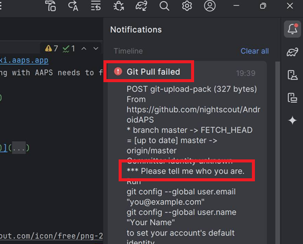

Otvorite terminal i upišite sljedeće dvije naredbe, jednu za drugom.

```
git config --global user.name "Your name here"
git config --global user.email your.email@here.com
```

Vaše ime mora biti napisano između navodnika.

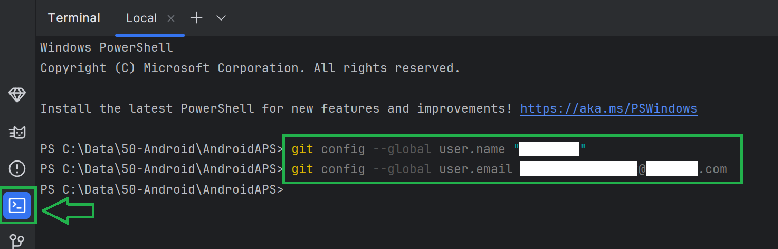

(troubleshooting_androidstudio-android-gradle-plugin-requires-java-11-to-run)=

(incompatible-gradle-jvm)=
### Nekompatibilni Gradle JVM

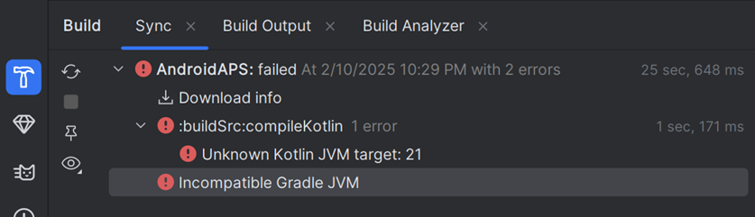

```
Your build is currently configured to use incompatible Java 21.0.3 and Gradle 8.2.
Cannot sync the project.

We recommend upgrading to Gradle version 8.9.

The minimum compatible Gradle version is 8.5.

The maximum compatible Gradle JVM version is 19.
```

Ili:

```
Cause: error: invalid source release: 21
```

If you experience the above error message, you need to download a correct JVM version before you can try to rebuild:

1.  U [tablici zahtjeva](#Building-APK-recommended-specification-of-computer-for-building-apk-file) provjerite koja vam je verzija JVM-a potrebna za verziju **AAPS-a** koju izrađujete i zapišite je.

2. Otvorite prikaz Gradle klikom na slona (1) na desnoj strani Android Studija, otvorite postavke (2) i odaberite **Gradle Settings** (3):

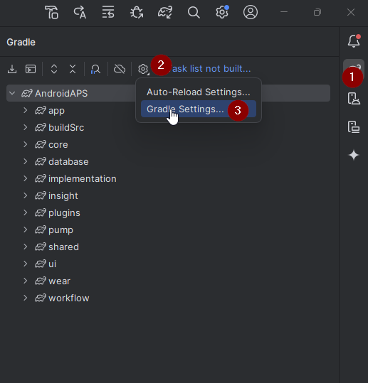

3.  U polju **Gradle JDK** provjerite je li odabrana odgovarajuća verzija (1). Ako nije, kliknite na polje i pogledajte je li već dostupna na popisu. Primjer u nastavku pokazuje da je JVM 21 označen kao „jbr-21“. Ako ga pronađete, samo ga odaberite i gotovi ste. Ako nije dostupna, odaberite **Download JDK** (2).


4. U polju Version (1) odaberite JDK potreban za vašu verziju **AAPS-a** (onu koju ste zapisali kada ste provjerili tablicu zahtjeva). U polju Vendor (2) odaberite bilo kojeg proizvođača. Location (3): ne mijenjajte. Kliknite **Download** (4).

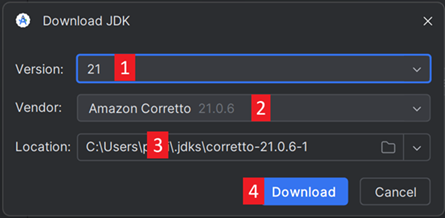

5.  Zatvorite dijalog **Settings** s **OK**.
6. Sada morate ponovno pokrenuti Gradle Sync. Slijedite upute u odjeljku [Ponovna sinkronizacija Gradlea](#gradle-resync).

(incompatible-version-of-android-gradle-plugin)=
### Nekompatibilna verzija dodatka Android Gradle

  Ako dobijete sljedeću poruku o pogrešci

`The project is using an incompatible version (AGP x.x.x) of the Android Gradle plugin. Latest supported version is AGP x.x.x`

  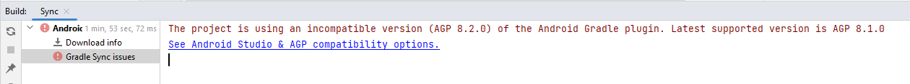

  Koristite zastarjelu verziju Android Studija. U izborniku idite na Help > Check for updates i instalirajte sva pronađena ažuriranja Android Studija i njegovih dodataka.

(troubleshooting_androidstudio-could-not-resolve-no-cached-version)=
### Could not resolve / No cached version

  Možda ćete dobiti ovu poruku o pogrešci:

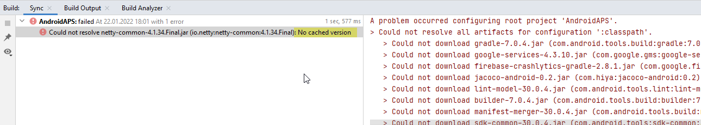

  * Na desnoj strani otvorite karticu Gradle (1).

    Provjerite da gumb prikazan pod (2) *NIJE* odabran.

    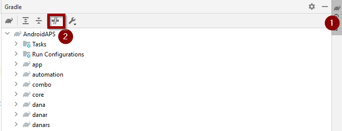

  * Sada morate pokrenuti [ponovnu sinkronizaciju Gradlea](#gradle-resync)

(troubleshooting_androidstudio-unable-to-start-daemon-process)=
### Unable to start daemon process

  Ako vidite poruku o pogrešci kao što je ova u nastavku, vjerojatno koristite 32-bitni sustav Windows 10. Android Studio 3.5.1 i noviji to ne podržavaju i, nažalost, programeri **AAPS-a** tu ne mogu ništa učiniti!

  Na internetu postoje informacije o tome kako utvrditi imate li 32-bitni ili 64-bitni operacijski sustav – npr. [ova stranica](https://support.microsoft.com/en-us/windows/32-bit-and-64-bit-windows-frequently-asked-questions-c6ca9541-8dce-4d48-0415-94a3faa2e13d).

  

(gradle-resync)=
### Ponovna sinkronizacija Gradlea

  Ako i dalje vidite poruku da gradle sync nije uspio, sada kliknite poveznicu **Try again** (1). 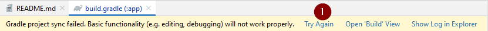


  Ako više ne vidite poruku, sinkronizaciju i dalje možete pokrenuti ručno:

  * Otvorite karticu Gradle (1) na desnom rubu Android Studija.

    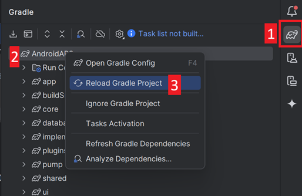

  * Desnom tipkom miša kliknite na AAPS (2)

  * Kliknite na „Reload Gradle Project“ (3)

## Generate Signed APK uspješno je izradio 0 varijanti izrade (build variants)

When you generate the signed apk, you might get the notification that generation was successful but that '0 build variants' were generated:

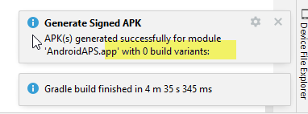

To je lažno upozorenje. Provjerite mapu koju ste odabrali kao „Destination folder“ za izradu (korak [Generate Signed APK](#Building-APK-generate-signed-apk)) i tamo ćete pronaći izrađeni APK!


## Aplikacija je izrađena s upozorenjima prevoditelja/Kotlina

Ako je izrada uspješno završena, ali dobivate upozorenja prevoditelja (compiler) ili Kotlina (označena žutim ili plavim uskličnikom), ta upozorenja možete jednostavno zanemariti.

 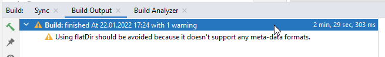

Vaš APK je uspješno izrađen i može se prenijeti na telefon!


## AAPS ne prima podatke CGM-a

* Ako koristite zakrpanu (patched) aplikaciju Dexcom G6: ta je aplikacija zastarjela. Umjesto toga koristite aplikaciju [BYODA](#DexcomG6-if-using-g6-with-build-your-own-dexcom-app).

* Ako koristite xDrip: identificirajte prijamnik kako je opisano na stranici [Postavke xDripa](#xdrip-identify-receiver).


## APK nije instaliran

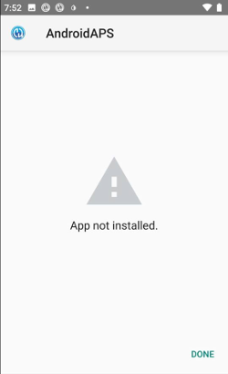

* Provjerite jeste li datoteku „app-full-release.apk“ prenijeli na telefon.
* Ova pogreška obično znači da je novi APK potpisan drugim spremištem ključeva nego vaš instalirani **AAPS**. Ako još imate svoje prethodno spremište ključeva, odaberite ga i ponovno pokrenite izradu. Inače pogledajte [Ponovna instalacija AAPS-a s novim spremištem ključeva](#reinstall-aaps).
* Ako se na telefonu prikaže „Aplikacija nije instalirana“, slijedite ove korake:

1. [Izvezite postavke](../Maintenance/ExportImportSettings.md) (u verziji AAPS-a koja je već instalirana na vašem telefonu)
2. Deinstalirajte **AAPS** s telefona.
3. Uključite način rada u zrakoplovu i isključite Bluetooth.
4. Instalirajte novu verziju („app-full-release.apk“)
5. [Uvezite postavke](../Maintenance/ExportImportSettings.md)
6. Ponovno uključite Bluetooth i isključite način rada u zrakoplovu

## APK je instaliran, ali je verzija stara

If you built the app successfully, transferred it to your phone and installed it successfully but the version number stays the same then you might have forgotten to [update your local copy](#Update-to-new-version-update-your-local-copy)

## Ništa od navedenoga nije pomoglo

Ako vam nijedan od gornjih savjeta nije pomogao, možete razmisliti o izradi APK-a ispočetka:

1. [Izvezite postavke](../Maintenance/ExportImportSettings.md) (u verziji AAPS-a koja je već instalirana na vašem telefonu)

2. Pripremite lozinku ključa i lozinku spremišta ključeva.

    Ili jednostavno koristite novo spremište ključeva.

3. Izradite APK ispočetka kako je opisano [ovdje](#Building-APK-download-AAPS-code).

4. Kada uspješno izradite APK, izbrišite postojeći APK na telefonu, prenesite novi APK na telefon i instalirajte ga.
5. Ponovno [uvezite postavke](../Maintenance/ExportImportSettings.md) da vratite svoje ciljeve i postavke.
6. Provjerite opcije optimizacije baterije i ponovno ih isključite.

## Najgori slučaj

Ako navedeno ne riješi vaš problem s izradom, možete pokušati potpuno deinstalirati Android Studio i sve ponovno izraditi ispočetka.  Nekim korisnicima to riješi problem s izradom.  Kada brišete Android Studio, nemojte brisati korisničke postavke Androida i **obavezno deinstalirajte sve datoteke povezane s Android Studiom.** Ako Android Studio ne uklonite potpuno, sa svim skrivenim datotekama, deinstalacija može izazvati nove probleme umjesto da riješi postojeće. Upute za potpuno uklanjanje možete pronaći na internetu, npr.

[https://stackoverflow.com/questions/39953495/how-to-completely-uninstall-android-studio-from-windowsv10](https://stackoverflow.com/questions/39953495/how-to-completely-uninstall-android-studio-from-windowsv10).

Instalirajte Android Studio ispočetka kako je opisano [ovdje](#Building-APK-install-android-studio).
