# Izrada i vraćanje sigurnosnih kopija

Kada instalirate AAPS na telefon, on postaje „medicinski uređaj” na koji se svakodnevno oslanjate. Toplo se preporučuje imati plan za hitne slučajeve, za slučaj da vam se telefon pokvari, bude ukraden ili izgubljen. Therefore, it is essential to prepare by asking yourself: "What if?"

Da biste mogli vratiti postavke AAPS-a na postojeći ili novi telefon, važno je sljedeće stavke čuvati na sigurnom mjestu (to jest: ne na telefonu). Najbolje je čuvati barem dvije odvojene sigurnosne kopije: na lokalnom tvrdom disku, USB stiku i (preporučeno) u pohrani u oblaku kao što su Google Drive ili Microsoft 365 OneDrive. Ako sigurnosne kopije čuvate u oblaku, sve što vam treba uvijek je dostupno s telefona, pa sustav možete vratiti bilo gdje i bilo kada.

Razmislite o nabavi drugog, rezervnog telefona i vježbajte vraćanje AAPS-a na njega, kako biste bili sigurni da rezervni telefon radi kako treba. Ovaj korak dat će vam sigurnost da vaš plan za hitne slučajeve radi i da možete bez prekida nastaviti koristiti AAPS ako vaš glavni telefon postane nedostupan.

```{admonition} Android backups and phone-transfer tools do not carry your AAPS settings
:class: warning
Since **AAPS** 4.0 the settings are kept in an encrypted store on the phone, and they are left out of the Google backup and of the phone-to-phone transfer of a new phone. A settings export, as described on this page, is the only way to carry them over.
```

Da biste mogli vratiti postavke, važno je imati pri ruci sljedeće stavke:

- Vašu **datoteku spremišta ključeva iz Android Studija** i pripadajuću **lozinku**: potrebne za (ponovnu) izradu instalacijske datoteke AAPS .APK.
- Nedavnu kopiju **instalacijske datoteke AAPS .APK**
- Nedavnu datoteku **izvoza postavki**: za vraćanje važnih postavki (uključujući vaše ciljeve!).
- Vašu **glavnu lozinku AAPS-a**
- Sigurnosne kopije dodatnih alata: kao što su BYODA i/ili xDrip.
- Osobne bilješke o vašem sustavu.

U nastavku su stavke za koje se preporučuje čuvati sigurnosne kopije.

## Izrada sigurnosnih kopija

### Datoteka spremišta ključeva s računala na kojem ste izradili APK
Kada izrađujete instalacijsku datoteku .APK u Android Studiju, on koristi **datoteku spremišta ključeva i lozinku za potpisivanje instalacijske datoteke .APK**. Da biste ažurirali trenutnu instalaciju AAPS-a, instalacijska datoteka .APK za ažuriranje mora biti potpisana istim spremištem ključeva kao i prva instalacija. Pri ažuriranju se čuvaju sve postavke i baza podataka AAPS-a. Imajte na umu da ćete bez toga morati najprije deinstalirati trenutnu aplikaciju, a zatim [ponovno instalirati](#reinstall-aaps) i ponovno konfigurirati AAPS.

Čuvanje spremišta ključeva i pripadajuće lozinke uvelike pojednostavljuje buduća ažuriranja APK-a, posebno ako aplikaciju morate izraditi na novom računalu. Pogledajte odjeljak [Ažuriranje na novu verziju ili granu](../Maintenance/UpdateToNewVersion.md) za pojedinosti o korištenju spremišta ključeva pri izradi novog APK-a.

**Kada izraditi sigurnosnu kopiju:** Sigurnosnu kopiju spremišta ključeva treba izraditi nakon što prvi put izradite instalacijsku datoteku **AAPS** .APK.

**Kako izraditi sigurnosnu kopiju:** Pronađite putanju svog spremišta ključeva. Ako je se ne sjećate, možete je pronaći u Android Studiju odabirom **Build > APK > Next**. Putanja će biti navedena u polju „Key store path”. U upravitelju datoteka idite na tu putanju i napravite kopiju datoteke spremišta ključeva (s nastavkom `.jks`). Spremite je na sigurno mjesto u oblaku, za slučaj da vaše računalo postane nedostupno. Obavezno zapišite i lozinku spremišta ključeva, alias ključa i lozinku ključa.

### Kopije najnovijeg APK-a
Ako izgubite ili oštetite glavni telefon s **AAPS-om**, kopija APK-a omogućit će vam da brzo nastavite koristiti **AAPS** na novom telefonu. Napomena: trebat će vam i sigurnosna kopija postavki, kako je opisano u nastavku.

**Kada izraditi sigurnosnu kopiju:** Trebali biste čuvati sigurnosnu kopiju najnovijeg APK-a koji ste instalirali na glavni telefon s **AAPS-om**. Možda ćete htjeti čuvati i jednu stariju verziju, za slučaj da se iz nekog razloga morate vratiti na nju.

**Kako izraditi sigurnosnu kopiju:** Čuvajte kopiju na računalu na kojem ste izradili APK s Android Studiom. Osim toga, preporučuje se koristiti platformu u oblaku za čuvanje kopije instalacijskog APK-a. Provjerite znate li pronaći obje sigurnosne kopije kada vam zatrebaju. Razmislite o tome da za ove sigurnosne kopije izradite posebne mape.

### Datoteka postavki AAPS-a (naziva se i „Postavke”)

```{admonition} Where are preferences stored on my phone?
:class: tip
Svoje postavke naći ćete u **AAPS mapi** koju ste odabrali tijekom [postavljanja AAPS-a](#SetupWizard-StoragePermission).</br>
**AAPS mapu** možete promijeniti i na zaslonu **Održavanje** (**izbornik** (☰) > **Održavanje**), pogledajte [Postavljanje lokalne AAPS mape](#preferences-maintenance-logdirectory).
```

S kopijom instalacijske datoteke APK (vidi gore) i datotekom **Postavke** možete brzo pokrenuti sustav na postojećem ili novom telefonu.

Datoteka **Postavke** služi za prilagodbu aplikacije AAPS vašem sustavu. One obuhvaćaju pojedinosti kao što su postavke **Konfiguracije**, stanje ciljeva, postavke komunikacije s drugim servisima (npr. Nightscout, Tidepool), automatizacije i profile.

Izvoz postavki AAPS-a u datoteku omogućuje vam vraćanje konfiguracije na stanje u određenom trenutku. Kao što je navedeno, osim svih postavki konfiguracije, datoteka izvoza sadrži i stanje vaših ciljeva, koje trebate vratiti pri **(ponovnoj) instalaciji** AAPS-a. Bez toga ćete morati ponovno ispuniti sve ciljeve od početka da biste omogućili zatvorenu petlju. Datoteke postavki omogućuju vam i vraćanje „posljednjih dobrih” postavki, kako biste poništili promjene konfiguracije.

**Kada izraditi sigurnosnu kopiju postavki AAPS-a:**
* Svaki put kada ispunite neki cilj, kako ne biste izgubili napredak. _Bez kopije **Postavki** morat ćete ponovno ispuniti sve ciljeve ako budete trebali ponovno instalirati AAPS ili zamijeniti telefon._

* Svaki put kada planirate veće promjene konfiguracije (promjena postavki SMB-a, promjena vrste inzulina, promjena pumpe, promjene automatizacija), trebali biste izraditi sigurnosnu kopiju **Postavki** prije i nakon promjena. Tako imate najnovije postavke, ali i kopiju postavki od prije promjena, za slučaj da ih trebate vratiti.

* Tubeless pumps (Such as Omnipod and Medtrum) users only: the **Settings** file contains connection details on your current pod and can be used to restore connection to that pod with a new phone. Ako nemate kopiju postavki izvezenu nakon što ste pokrenuli trenutni Pod, morat ćete pokrenuti novi Pod ako budete trebali zamijeniti trenutni telefon.

**Kako ručno izraditi sigurnosnu kopiju:**

1. If this is your first time importing or exporting **Settings** you will need to set a master password in [Settings > Protection](#Preferences-master-password). Postavite lozinku i zapišite je na sigurno mjesto. _Bez ove lozinke nećete moći pristupiti sigurnosnim kopijama **Postavki**._

2. Na glavnom zaslonu **AAPS-a** otvorite **izbornik** (☰) > **Održavanje**. Odaberite gdje spremiti datoteku pomoću oznaka **Lokalno** i **Oblak** pokraj **Izvezi postavke** (pogledajte **Izvoz ili uvoz postavki** u nastavku), a zatim dodirnite **Izvezi postavke**. **AAPS** pokazuje kamo će datoteka biti spremljena: naziv datoteke za **Lokalno**, **Google Drive** za **Oblak**. Dodirnite **U redu**.

   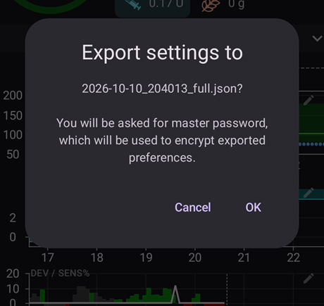

   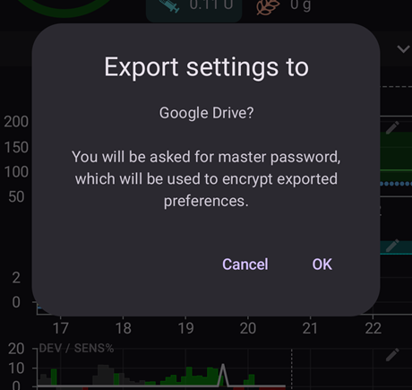

   Upišite gore postavljenu glavnu lozinku i dodirnite **U redu**.

   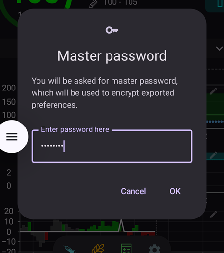

   Poruka **Postavke izvezene** (lokalno) ili **Izvoz u oblak uspješan** (oblak) potvrđuje izvoz.

   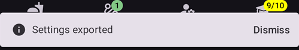

   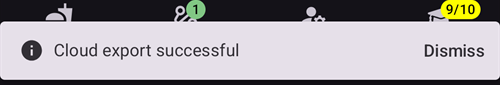

3. Upraviteljem datoteka na telefonu (obično se zove „Datoteke” ili „Moje datoteke”) idite na Interna pohrana > AAPS > preferences. Ovdje ćete vidjeti kopiju svih izvezenih datoteka postavki. Naziv datoteke trebao bi biti `YYYY-MM-DD_Time_appname.json`. Prenesite ovu datoteku na platformu u oblaku po vašem izboru. Zatim s platforme u oblaku preuzmite kopiju i na svoje lokalno računalo.

(ExportImportSettings-Settings-Export)=

## Izvoz postavki

```{admonition} Where are preferences stored on my phone?
:class: tip
Svoje postavke naći ćete u **AAPS mapi** koju ste odabrali tijekom [postavljanja AAPS-a](#SetupWizard-StoragePermission).</br>
**AAPS mapu** možete promijeniti i na zaslonu **Održavanje** (**izbornik** (☰) > **Održavanje**), pogledajte [Postavljanje lokalne AAPS mape](#preferences-maintenance-logdirectory).
```

Preporučuje se redovito izvoziti postavke, posebno prije i nakon promjena konfiguracije. Izvoz možete raditi **ručno ili (preporučeno) putem automatizacije**. Obavezno zapišite svoju glavnu lozinku AAPS-a i izradite sigurnosnu kopiju datoteka postavki tako da ih kopirate s telefona, na primjer u pohranu u oblaku.

**Napomena**: _Izvezene postavke šifriraju se vašom glavnom lozinkom AAPS-a: bez glavne lozinke korištene pri izvozu nećete moći uvesti datoteku postavki!_

If you forgot your master password, you can [reset it](#FAQ-reset-master-password), but settings files exported with the old password still need the old one.

### Izvoz ili uvoz postavki
Da biste izvezli ili uvezli postavke, otvorite **izbornik** (☰) i odaberite **Održavanje**. U odjeljku **Upravljanje datotekama** oznake **Lokalno** i **Oblak** pokraj **Izvezi postavke** i **Uvezi postavke** određuju gdje se datoteka postavki sprema ili odakle se čita: **Lokalno** je AAPS mapa na vašem telefonu, a **Oblak** je dostupan kada postavite [Mapu u oblaku](#preferences-maintenance-cloud). Dodirom na oznaku uključujete je ili isključujete; barem jedna uvijek ostaje odabrana, a oba retka dijele isti odabir. Zatim dodirnite samo **Izvezi postavke** ili **Uvezi postavke** za početak.

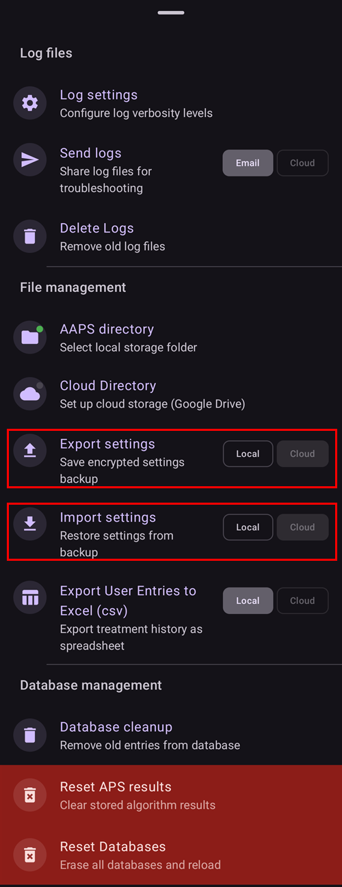

(ExportImportSettings-Automating-Settings-Export)=
### Automatizacija izvoza postavki

To automate settings exports [(**see Automation**)](../DailyLifeWithAaps/Automations.md#automating-preference-settings-export) open [**Settings** > **Maintenance**](#preferences-maintenance-settings), expand **Unattended Settings Export** and switch on **Enable automated settings export**.

Sada možete postaviti [Automatizaciju](../DailyLifeWithAaps/Automations.md#automating-preference-settings-export) da izvozi postavke, redovito (_npr._ svaki tjedan) ili nakon promjene Pod-a.

_**Note:** On importing settings, the user always needs to enter the AAPS master password!_

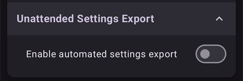

(ExportImportSettings-restoring-from-your-backups-on-a-new-phone-or-fresh-installation-of-aaps)=
## Vraćanje iz sigurnosnih kopija na novom telefonu ili na novoj instalaciji AAPS-a

```{admonition} Where are preferences stored on my phone?
:class: tip
Svoje postavke naći ćete u **AAPS mapi** koju ste odabrali tijekom [postavljanja AAPS-a](#SetupWizard-StoragePermission).</br>
**AAPS mapu** možete promijeniti i na zaslonu **Održavanje** (**izbornik** (☰) > **Održavanje**), pogledajte [Postavljanje lokalne AAPS mape](#preferences-maintenance-logdirectory).</br>
Ako **AAPS** izgubi pristup toj mapi (to se može dogoditi nakon ponovne instalacije ili nakon brisanja pohrane aplikacije), prikazuje obavijest **Pristup AAPS mapi je izgubljen** i prestaje spremati postavke na telefon dok [ponovno ne odaberete mapu](#preferences-maintenance-logdirectory).
```

Koristite ove upute ako imate sigurnosnu kopiju APK-a i **Postavki** koju želite učitati na novi telefon ili ako ste iz bilo kojeg razloga morali izbrisati i ponovno instalirati APK na postojećem telefonu.

_Ako ažurirate **AAPS** pomoću APK-a izrađenog s istim spremištem ključeva, ovaj postupak vam ne bi trebao biti potreban. Ipak, preporučuje se izraditi sigurnosnu kopiju prije nego što primijenite ažuriranje._

Ako ažurirate **AAPS** nakon što ste izgubili ili zamijenili izvorno spremište ključeva (npr. koristite novo računalo za izradu bez prijenosa spremišta ključeva), obavezno izradite sigurnosnu kopiju svih postavki kako je gore opisano, a zatim deinstalirajte postojeću verziju **AAPS-a** s telefona. Cijeli postupak opisan je na stranici [Ponovna instalacija AAPS-a s novim spremištem ključeva](#reinstall-aaps).

Ako je potrebno, [postavite prijemnik vašeg CGM-a / izvora GUK-a](../Getting-Started/CompatiblesCgms.md) prije koraka navedenih u nastavku

(ExportImportSettings-tubeless-pumps)=
```{admonition} Tubeless pumps (Omnipod and Medtrum) users
:class: warning
Datoteka **Postavke** sadrži sesiju Pod-a ili pumpe bez katetera koji je bio aktivan kada ste je izvezli.
- **Izvezite postavke odmah nakon svake aktivacije Pod-a ili pumpe bez katetera** i kopirajte datoteku s telefona.
- **Isti telefon, Pod još radi:** ostavite **Zamijeni i postavke pumpe** neoznačeno. Vaš trenutni Pod se zadržava, a uvoze se samo ostale postavke.
- **Novi telefon preuzima Pod:** označite **Zamijeni i postavke pumpe** i koristite samo datoteku izvezenu tijekom Pod-a koji sada nosite. Datoteka iz ranijeg Pod-a zamjenjuje sesiju vašeg trenutnog Pod-a i morat ćete pokrenuti novi Pod.
- **Greškom je uvezena stara sesija Pod-a:** **AAPS** se i dalje pokušava spojiti s tim Pod-om i ne možete aktivirati novi. Deaktivirajte ga; ako to ne uspije, odbacite ga (pogledajte na primjer [Odbacivanje Pod-a](#omnipod-dash-discard-pod) za Omnipod DASH).
```

```{admonition} Pump settings are kept unless you say otherwise
:class: note
Uvoz prema zadanim postavkama ne dira postavke pumpe: pumpa odabrana u **Konfiguraciji**, njezino uparivanje i sve ostale postavke pumpe ostaju kakve jesu na ovom telefonu. Označite **Zamijeni i postavke pumpe** na zaslonu za uvoz samo kada vraćate postavke na novi telefon koji treba preuzeti istu pumpu. Uvoz nikada ne briše postavke kojih nema u datoteci.
```

1. Pomoću sigurnosne kopije APK-a (vidi gore) slijedite upute za [novu instalaciju](../SettingUpAaps/TransferringAndInstallingAaps.md)

2. Pokrenite **AAPS** i dopustite sva zatražena dopuštenja

3. Izađite iz čarobnjaka za postavljanje. Uvest ćemo sve potrebne postavke iz sigurnosne kopije **Postavki**

4. From the **AAPS** main screen press **Grant** and allow all permissions listed in the **Permissions Required** panel on the top

5. Na glavnom zaslonu **AAPS-a** postavite glavnu lozinku u [Postavke > Zaštita](#Preferences-master-password) na istu lozinku koju ste koristili za sigurnosne kopije.

6. Ako to još niste učinili, [postavite **AAPS mapu**](#preferences-maintenance-logdirectory): na glavnom zaslonu **AAPS-a** otvorite **izbornik** (☰) > **Održavanje** > **AAPS mapa**.

7. Na glavnom zaslonu **AAPS-a** otvorite **izbornik** (☰) > **Održavanje** > **Izvezi postavke** > upišite gore postavljenu glavnu lozinku > **U redu**. Time će se izraditi mapa preferences ako još ne postoji na vašem telefonu.

8. Preuzmite sigurnosnu kopiju datoteke **Postavke** sa svoje platforme u oblaku.

9. Upraviteljem datoteka (obično se zove „Datoteke” ili „Moje datoteke”) premjestite datoteku iz preuzimanja u `/internal storage/AAPS/preferences` ako je vaša **AAPS mapa** postavljena na `/internal storage/AAPS`

10. Na glavnom zaslonu **AAPS-a** otvorite **izbornik** (☰) > **Održavanje** i dodirnite **Uvezi postavke**. Odaberite datoteku postavki iz koje želite vratiti postavke (najnovija je na vrhu). Pazite da odaberete ispravnu datoteku postavki: prikazat će se sve .json datoteke iz mape preferences (ili iz mape u oblaku, uz **Oblak**).

    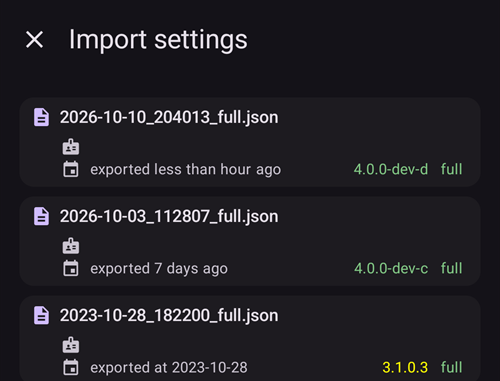

    **AAPS** prikazuje pojedinosti datoteke. Upišite gore postavljenu glavnu lozinku i dodirnite **Dešifriraj i pregledaj**.

11. Kada je datoteka dešifrirana, odlučite što učiniti s postavkama pumpe. Na novom telefonu koji preuzima istu pumpu označite **Zamijeni i postavke pumpe**, tako da uparivanje i postavke pumpe dođu iz datoteke. Ostavite okvir neoznačen ako želite zadržati pumpu s kojom je ovaj telefon već uparen. Zatim dodirnite **Uvezi**.

    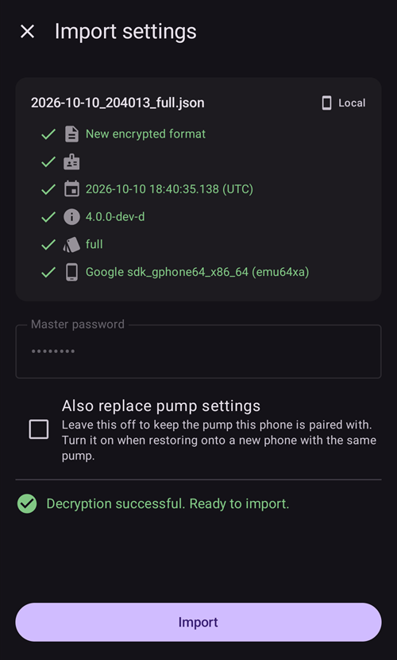

12. **AAPS** pita **Primijeniti uvezene postavke?** i navodi koliko će se postavki promijeniti te, ako ste okvir ostavili neoznačen, koliko se postavki pumpe zadržava. Još ništa nije zapisano, pa **Otkaži** ostavlja vaš telefon točno onakvim kakav je bio. Dodirnite **U redu** za primjenu.

    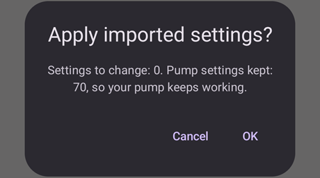

13. **AAPS** odmah primjenjuje uvezene postavke, bez ponovnog pokretanja. Ponovno se pokreću samo dodaci čije su se postavke promijenile. Dok to traje, **AAPS** prikazuje **Primjena postavki…**; ako je pumpa zauzeta, prikazuje **Čekanje na pumpu…** i primjenjuje postavke kada pumpa bude slobodna. Ako je pumpa i nakon jedne minute zauzeta, **AAPS** nudi da pokušate ponovno. Poruka **Postavke su primijenjene** potvrđuje da se uvezene postavke koriste. Svaki tretman koji je bio u redu čekanja dok je uvoz trajao odbacuje se i **AAPS** vam javlja da je otkazan, tako da se ništa ne pošalje pumpi dvaput.

    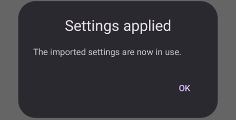

Ako je datoteka odabrala pumpu koju ova verzija **AAPS-a** nema, **AAPS** prelazi na **Virtualnu pumpu** i javlja vam to. Ponovno odaberite svoju pumpu u **Konfiguraciji** i provjerite njezine postavke.

14. Samo za korisnike pumpi bez katetera (Omnipod i Medtrum) – ako ste označili **Zamijeni i postavke pumpe**, a vaše **Postavke** nisu spremljene tijekom Pod-a koji trenutno koristite, morat ćete pokrenuti novi Pod da biste započeli isporuku inzulina.

**Rješavanje problema:** ako na glavnom zaslonu **AAPS-a** ne možete postaviti aktivni profil, otvorite **izbornik** (☰) gore lijevo > **Konfiguracija** > **Pumpa** > prebacite na **Virtualna pumpa** > zatim se vratite na svoju vrstu pumpe

### Napomena za korisnike Dana RS

- Ako ste označili **Zamijeni i postavke pumpe**, uvoze se i postavke veze s pumpom: **AAPS** na novom telefonu već će „poznavati” pumpu i zato neće pokretati Bluetooth skeniranje.
- Ručno uparite novi telefon i pumpu.