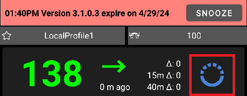
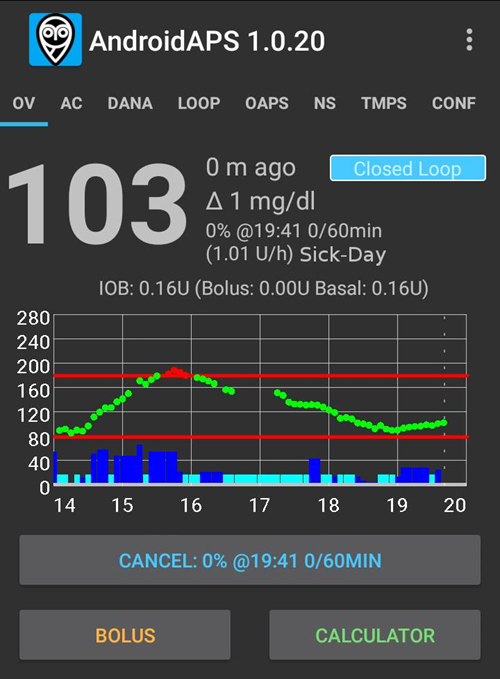

# Bilješke o izdanju

```{toctree}
:hidden:

Update2_7.md
Update3_0.md
UpdateAaps3204.md
```

Za ažuriranje na novu verziju slijedite upute u [uputama za ažuriranje](UpdateToNewVersion.md). Odjeljak za rješavanje problema na stranici s uputama za ažuriranje također obrađuje najčešće poteškoće pri ažuriranju **AAPS-a**.

```{admonition} Upgrading from AAPS v3?
:class: tip
Za važne promjene u ponašanju – značajke koje su premještene, preimenovane ili uklonjene – pogledajte [Što se promijenilo u AAPS-u v4](V4Changes.md).
```

Kada je dostupno novo ažuriranje, primit ćete ovakvu obavijest:



Ako ne ažurirate do datuma isteka, **AAPS** će se prebaciti na otvorenu petlju.

Datume kraja podrške za verzije AAPS-a pogledajte u [Kraj podrške](EndOfLife.md).

**Ne zanemarujte obavijest.** Nove verzije **AAPS-a** donose važne sigurnosne ispravke. Zato svaki korisnik **AAPS-a** mora što prije ažurirati na najnoviju verziju. Ovo je pokušaj da se poboljša sigurnost svakog korisnika **AAPS-a** i DIY zajednice. Hvala na razumijevanju.

(maintenance-android-version-aaps-version)=

## Verzija Androida i verzija AAPS-a

Ako vaš pametni telefon koristi verziju Androida stariju od Androida 12, nećete moći koristiti AAPS v3.4 i novije jer on zahtijeva najmanje Android 12.

Kako bi korisnici sa starijim Androidom mogli koristiti stariju verziju AAPS-a, objavljene su nove verzije koje mijenjaju samo provjeru verzije. Nisu uključena nikakva druga poboljšanja.

U tablici niže pronađite svoju verziju Androida i koristite odgovarajuću verziju **AAPS-a**. Kôd se preuzima s <https://github.com/nightscout/AndroidAPS> iz prikazane grane.

| Vaša verzija Androida | Verzija AAPS-a za korištenje | Grana za preuzimanje                                             |
| --------------------- | ---------------------------- | ---------------------------------------------------------------- |
| Android 12 i noviji   | Najnovija verzija            | [master](https://github.com/nightscout/AndroidAPS) (zadano)      |
| Android 11            | **3.3.2.1**                  | [3.3.2.1](https://github.com/nightscout/AndroidAPS/tree/3.3.2.1) |
| Android 9, 10         | **3.2.0.4**                  | [3.2.0.4](https://github.com/nightscout/AndroidAPS/tree/3.2.0.4) |
| Android 8             | **2.8.2.1**                  | [2.8.2.1](https://github.com/nightscout/AndroidAPS/tree/2.8.2.1) |
| Android 7             | **2.6.2**                    | [2.6.2](https://github.com/nightscout/AndroidAPS/tree/2.6.2)     |

## Verzija za Wear OS

- AAPS zahtijeva Wear OS 3.0, 3.2 ili 3.5 (Android 11, razina API-ja 30) ili noviji. Satovi s Wear OS-om 2 nisu podržani.

```{tip}
Wear OS 5, razina API-ja 34 (Android 14) ima [ograničenja](#BuildingAapsWearOs-WearOS5).
```

Verzije s naslovom su najnovije izdanje za svaku verziju Androida (pogledajte tablicu iznad). Ostala izdanja slijede između njih, s bilješkama ili poveznicom na njih na GitHubu.

(latestrelease)=

(version400)=

## Verzija 4.0.0

Datum izdanja: 31-10-2026

**Nove značajke**

- Novo korisničko sučelje: aplikacija za telefon iznova izrađena u Jetpack Composeu @MilosKozak
- [Globalno pretraživanje](../DailyLifeWithAaps/GlobalSearch.md) @MilosKozak
- Prelazak na Kotlin Multiplatform, klijent za Windows, Mac, Linux (stolna računala) i iOS @MilosKozak
- [Scene](../DailyLifeWithAaps/Scenes.md): spremite skup radnji i pokrenite ih zajedno @MilosKozak
- [Upravljanje glavni uređaj ↔ klijent](../RemoteFeatures/ClientMasterControl.md): slanje naredbi s telefona klijenta na glavni uređaj @MilosKozak
  - [Uloge klijenta](#client-master-control-roles): Samo čitanje, Obroci, Njegovatelj ili Admin za svakog klijenta @MilosKozak
  - [Zaštićeni način rada](#client-master-control-hardened-mode): kada je upravljanje s klijenta uključeno, glavni uređaj prihvaća promjene samo od uparenih klijenata @MilosKozak
  - Uparivanje putem QR koda koji na klijentu postavlja i Nightscout, ili putem PIN-a; tajni ključ za uparivanje zamjenjuje se odmah nakon uparivanja @MilosKozak
  - [Vlastiti Nightscout token](#client-master-control-own-token) za svakog klijenta, samo s pravima koja klijent treba @MilosKozak
- Podrška za [koncentraciju inzulina](../AdvancedOptions/InsulinConcentration.md) (U200, U500) u pumpama, kalkulatoru i profilima @Philoul @MilosKozak
- Upravljanje inzulinom: katalog inzulina, nadimci, odabir u profilu i kalkulatoru @Philoul
- Dodatak za kalibraciju @MilosKozak
- [Zaglađivanje](../CompatibleCgms/SmoothingBloodGlucoseData.md): Unscented Kalman Filter (UKF) @piecycle
- Nove [radnje automatizacije](#automations-automation-action): **Promijeni zaglađivanje** @olorinmaia, te **Pokreni**, **Omogući** ili **Onemogući scenu** @MilosKozak
- [Rotacija mjesta primjene](#Aapsscreens-site-rotation): praćenje i izmjenjivanje mjesta infuzije @Philoul @MilosKozak
- Prerada dodatka [Autotune](../AdvancedOptions/Autotune.md) @Philoul
- Novi [widgeti](../DailyLifeWithAaps/Widgets.md) @MilosKozak @t1dude
- Pristupačnost: aplikacija za telefon radi s čitačem zaslona – imenovane kontrole, izgovoreni status, opisi grafova i naslovi za brzo pregledavanje @MilosKozak
- [Uvoz postavki](../Maintenance/ExportImportSettings.md): može zadržati postavke pumpe @MilosKozak
- Trajna obavijest koristi Android live updates (ažuriranja uživo), s podrškom za Samsung Now bar i deltu @premnirmal
- GUK graf: [pritisnite i držite](#aaps-screens-graph-press-and-hold) za prikaz vrijednosti na nekom očitanju, na svakom grafu u Pregledu @t1dude @olorinmaia
- Poboljšanja performansi @MilosKozak
- Automatski e-ugljikohidrati u bolus kalkulatoru @MilosKozak

**Novi uređaji**

- **CareLevo**: novi [upravljački program pumpe](../CompatiblePumps/CareLevo.md) @Kisu-Choi @MilosKozak
- **Dana-i2**: podrška @MilosKozak
- **Instara**: novi izvor CGM-a @leohunt

**Poboljšanja upravljačkih programa pumpi**

- Zasloni pregleda pumpe iznova izrađeni za Insight, Medtronic, Medtrum, Omnipod, Dana, Diaconn i Equil @MilosKozak
- **Omnipod DASH**: Ref kodovi kao na PDM-u i čitljivi opisi kvarova, kompenzacija odstupanja (drift) uvijek uključena, bolje izvješćivanje o vrsti bolusa @nl-ruud
- **Omnipod**: čvrsti datum završetka za Dash i Eros @mcnelson
- **DanaR, RS**: emulator pumpe za testiranje @MilosKozak
- **Equil**: emulator pumpe za testiranje @MilosKozak
- Mnogi ispravci pumpi i petlje @MilosKozak i drugi

**Wear OS**

- [Aplikacija za sat](../WearOS/WearOsSmartwatch.md) iznova izrađena u Composeu, nove pločice i komplikacije, automatska instalacija Watchfacea (Watch Face Push) na Wear OS 6+ @olorinmaia @Philoul
- CustomWatchface dostupan za Wear OS 6.0 (GW7, GW8, GW9...) s posebnim WFF Watchfaceom @Philoul @olorinmaia
- CustomWatchface sada može sadržavati 5 mjesta za komplikacije koja možete prilagoditi (nova značajka dostupna samo za starije satove) @Philoul
- Novi [WFF Watchface temeljen na komplikacijama AAPS-a](#wearos-complications-watchface-setup) @olorinmaia
- Ispravci u rezultatu bolus kalkulatora i brzog kalkulatora @olorinmaia
- Novi GUK graf i aktivnost Način rada u glavnom izborniku @olorinmaia
- Bolus kalkulator: stranica [vrsta obroka](#WearOsSmartwatch-wizard-meal-type) koja dijeli ugljikohidrate kao kalkulator na telefonu, i [vrijeme ugljikohidrata](#WearOsSmartwatch-wizard-carb-time) s podsjetnikom *vrijeme za jelo* na satu @olorinmaia
- [Alarmi telefona na satu](#WearOsSmartwatch-phone-alarms): sat prikazuje alarm i nudi „Utišaj“ i „Utišaj 5 min“ @olorinmaia

**Izrada**

- CI workflowi za izradu iz oznake (tag) ili grane, mapiranje verzija JDK-a @Angus-repo

**Suradnici**

@MilosKozak @Philoul @olorinmaia @Kisu-Choi @leohunt @piecycle @Angus-repo @mcnelson @t1dude @premnirmal @nl-ruud

Potpuni popis promjena: <https://github.com/nightscout/AndroidAPS/compare/3.4.2.6...4.0.0>

---

(version3426)=

## Verzija 3.4.2.6

- Equil: poboljšana stabilnost @MilosKozak

---

(version3425)=

**Verzija 3.4.2.5**

- Equil: ispravak stanja utrke (race condition) @MilosKozak

---

(version3424)=

**Verzija 3.4.2.4**

- Ispravci za Equil @MilosKozak
- Ispravak sinkronizacije profila s NS-om @MilosKozak

---

(version3423)=

**Verzija 3.4.2.3**

- Dash: rješenje za odstupanje (drift) @nl-ruud
- NSClientV3: ispravak praznine nakon ponovnog povezivanja @MilosKozak
- Automatizacija: ispravak deserijalizacije @MilosKozak
- Equil: ispravak izvješća o bateriji @MilosKozak
- Čišćenje workflowa @vanelsberg
- Equil: poboljšan oporavak od pogrešaka @MilosKozak
- DanaRS: ispravak komunikacije s domaćom (korejskom) pumpom @MilosKozak
- Insight: ispravak sinkronizacije TBR-a @MilosKozak
- Dash: ispravak pogreške pri aktivaciji @nl-ruud

---

(version3422)=

**Verzija 3.4.2.2**

- Ispravci problema s Equilom i Medtronicom
- Poboljšana sigurnost Medtruma

---

(version3421)=

**Verzija 3.4.2.1**

- Equil: ispravak uparivanja i dijaloga napretka @MilosKozak

---

(version3420)=

**Verzija 3.4.2.0**

Datum izdanja: 02-04-2026

- Equil: ispravak otpora za različite modele @hhfcvmars
- Tidepool: ispravak sesije @MilosKozak
- Medtrum: ispravak postupka aktivacije sprječavanjem dvostrukog punjenja @MilosKozak
- COB: ispravak izračuna aktivnih ugljikohidrata (pokriva opasan rubni slučaj) @MilosKozak

---

(version3410)=

**Verzija 3.4.1.0**

Datum izdanja: 08-03-2026

**Jezgra**

- Ispravak rukovanja ljetnim računanjem vremena (DST) @MilosKozak
- Poboljšano i ujednačeno prepoznavanje normalnog cilja (mg/dL > 99, mmol > 5,5) @MilosKozak
- SMS: zaštita naredbe RESTART PIN-om @MilosKozak
- Održavanje: upozorenje ako je odabrana pogrešna mapa @MilosKozak

**Poboljšanja upravljačkih programa pumpi**

- **Omnipod DASH**: kôd BLE upravljačkog programa premješten u modul omnipod/common @jwoglom
- **Omnipod DASH**: pokušaj ispravka stanja veze @MilosKozak
- **Omnipod**: provjera profila prije aktivacije Pod-a kako se Podovi ne bi bacali (#4534) @brianV
- **Medtronic**: ispravak prikaza iste vrste kodiranja u dijalogu postavki @mifi100
- **Medtronic**: priprema zajedničkih klasa pumpi (priprema za Tandem) @andy-rozman
- **RileyLink**: ispravak kodiranja (#4519) @mifi100
- **Equil**: proširena kompatibilnost inzulinskih pumpi prema prefiksu serijskog broja (#4510) @hhfcvmars
- **Equil**: dodano bilježenje u dnevnik @MilosKozak
- **Diaconn G8**: ispravak pogreške sinkronizacije dnevnika i dodana podrška za firmware 3.58+ @miyeongkim
- **Diaconn**: ispravak pretvorbe jedinice trajanja TBR-a @miyeongkim
- **Diaconn**: korištenje commandQueue.loadEvents() za sinkronizaciju povijesti @miyeongkim
- Dopuštena isporuka inzulina dok je petlja suspendirana, ali je pumpa dostupna @cschuijt

**Oblak / sigurnosna kopija**

- Dodana sigurnosna kopija na Google Drive @Angus-repo
- Obavještavanje korisničkog sučelja o promjeni stanja pogreške pohrane u oblaku @Angus-repo
- Dopuštena istodobna lokalna pohrana i pohrana u oblaku @Angus-repo

**Tidepool**

- Poboljšan prijelaz Tidepoola na OAuth2 @MilosKozak
- Ispravak trajnog stanja Tidepool BLOCKED, ispravak odbijanja praznih SSID-ova @michaeln-synapse

**NSClient**

- NSCv3: poboljšano ponovno povezivanje @MilosKozak

**Wear OS**

- Prikaz novog aktivnog inzulina (IOB) u rezultatu kalkulatora ako se IOB koristi u izračunima @olorinmaia
- Ispravak Wear BolusProgress s ukupnom količinom @Philoul

**Korisničko sučelje**

- Poboljšana ikona ic_none za rotaciju mjesta primjene @Philoul
- Ispravak nekorištenja postavke pumpe za upravljanje rotacijom mjesta primjene @samfundev

**Suradnici**

@MilosKozak @Philoul @olorinmaia @jwoglom @mifi100 @andy-rozman @Angus-repo @brianV @cschuijt @hhfcvmars @miyeongkim @samfundev @michaeln-synapse

---

(version3400)=

**Verzija 3.4.0.0**

Datum izdanja: 31-12-2025

**Prije nadogradnje:**

* Ova verzija zahtijeva Google Android 12.0 ili noviji. Provjerite verziju svog telefona prije pokušaja ažuriranja.
* Ažurirajte na najnoviji Android Studio ili, još bolje, koristite izradu u pregledniku.

**Nove značajke**

* Način rada @MilosKozak
  * Prikaz [povijesti statusa petlje](#AapsScreens-running-mode) na karticama tretmana
  * Prikaz i mogućnost promjene [statusa petlje iz AAPSClienta](#RemoteControl_aapsclient).<br>NAPOMENA: potrebna je postavka [NSClient > Sinkronizacija > Primaj način rada iz NS-a](#Preferences-nsclient-synchronization)
* [Novi CGM-ovi](../Getting-Started/CompatiblesCgms.md): Glunovo, Intelligo, Sinocare
* Podrška za [rotaciju mjesta primjene](#Aapsscreens-site-rotation) @Philoul
* Nova [radnja automatizacije](#automations-automation-action): omogućavanje ili onemogućavanje SMB-ova @MilosKozak
* Syai CGM je [pouzdan izvor](#GettingStarted-TrustedBGSource) i podržava napredno filtriranje @MilosKozak

**Poboljšanja za Wear OS**

* znatno smanjena potrošnja baterije @MilosKozak
* poboljšanja i ispravci korisničkog sučelja @olorinmaia
* kôd gotovo potpuno iznova napisan kako bi odgovarao trenutnoj razini biblioteka (prije Wear OS 2) @MilosKozak
* 2 nove komplikacije za proširene podatke @Philoul
* Prelazak na moderni pružatelj komplikacija s DataStoreom @MilosKozak

**Ispravci curenja memorije**

* Ispravljena curenja memorije u kôdu @MilosKozak
* Dodano prijavljivanje curenja memorije putem LeakCanaryja u Firebase Crashlytics @MilosKozak

**Poboljšanja upravljačkih programa pumpi**

* **DanaI**: ispravljeni problemi s prekidom veze @MilosKozak
* **RileyLink**: brža komunikacija smanjenjem kašnjenja @mifi100
* **Medtrum**: dodan prikaz vremena aktivacije i starosti pumpe @vanelsberg, ispravak velikih slova u lozinci @MilosKozak
* **Combo**: ispravljena stanja utrke (race conditions) u testovima @MilosKozak @dv1
* **Equil**: optimizirana povezivost, smanjena potrošnja baterije @MilosKozak

**Sinkronizacija s Nightscoutom**

* Poboljšano uklanjanje duplikata pri pogrešci NS-a @MilosKozak

**Poboljšanja korisničkog sučelja i iskustva (UI/UX)**

* razna poboljšanja @MilosKozak @Philoul @olorinmaia

**Automatizacija**

* Nova radnja za upravljanje SMB-om – omogućavanje/onemogućavanje SMB-a putem automatizacije @MilosKozak

**Testiranje**

* Dodani opsežni jedinični testovi za pumpe Equil, Eopatch, Dana i Medtronic @MilosKozak
* Poboljšana stabilnost i pokrivenost testova u više modula @MilosKozak

**Tidepool**

* Tidepool OAUTH2 (podrška za novu Tidepool autentifikaciju) @MilosKozak

---

(version3321)=

## Verzija 3.3.2.1

Datum izdanja: 13-08-2025

- Ispravljena Bluetooth veza s Omnipodom na Androidu 16
- CI proces (izrada u pregledniku)
- Ispravak pretvorbe mmol-mg/dL
- Ispravak pogrešnog odabira vremena u dijalozima u nekim vremenskim zonama
- Ispravak čitanja ključeva u jednostavnom načinu rada
- Ispravak nedostajućih predviđanja na satu
- Poboljšana Konfiguracija (ConfigBuilder)
- Poboljšana potpuna sinkronizacija NSCv3

---

(version3300)=

**Verzija 3.3.2.0**

Datum izdanja: 27-03-2025

**Kako ažurirati**

* Za izradu ove verzije potrebna je [verzija Android Studija pod nazivom „Meerkat“](#Building-APK-recommended-specification-of-computer-for-building-apk-file) ili novija. Ako ste već izradili verziju 3.3.x, morate ponovno ažurirati Android Studio.

(version-enforcement)=

**Od ove verzije obavijesti i nametanje verzije pojednostavljeni su i ublaženi te rade na sljedeći način:**

*  Nema isteka kada je uređaj izvan mreže (ako nema veze s internetom). To znači da više nema razdoblja odgode od 60 i 90 dana.
*  Nakon isteka nameće se način LGS
*  Upozorenja/obavijesti primat ćete rjeđe:
   - Preostalo 28 ili više dana: svakih 7 dana
   - Preostalo 27–14 dana: svaka 3 dana
   - zatim jednom dnevno
   - Obavijest se stvara poslije podneva kako vas ne bi ometala noću
* Postoje samo 2 vrste obavijesti
   - Dostupna je nova verzija (nema utjecaja na AAPS)
   - Aplikacija istječe na neki datum u budućnosti (još nema utjecaja na AAPS) / je istekla (AAPS će prijeći u način LGS)

**Novosti**

* SMS naredba RESTART @MilosKozak
* Parametri zamjene profila na satu @olorinmaia
* Tamni način za Watchface AAPS V2 @olorinmaia
* Poboljšanja razmjene podataka s G7 @olorinmaia
* Konfiguracija widgeta @MilosKozak
* Poboljšanja korisničkog sučelja izbornih gumba (radio buttons) @olorinmaia
* Automatizacija: odabir položaja na karti @MilosKozak
* Verzija vidljiva na glavnim zaslonima @MilosKozak
* Obavezna je izrada s postojećim git sustavom (bez preuzimanja zip datoteka)
* Prikaz verzije na glavnom zaslonu @MilosKozak
* Poboljšanja prijenosa na Tidepool @ConstantinMatheis

**Ispravci pogrešaka**

* Ispravak raskidanja veze (unbonding) za Dash @Andreas
* Ispravci za Garmin @robertbuessow @suside
* Ispravak prikaza aktivnog inzulina (IOB) u dijalozima @olorinmaia
* Poboljšanja pravopisa i provjere u Ciljevima @MilosKozak
* Ispravljen prikaz emuliranih privremenih bazala (TBR) @MilosKozak
* Ispravljeno zaobilaženje sigurnosti @tdrkDev

---

**Verzija 3.3.1.3**

Datum izdanja: 21-01-2025

**Ispravci pogrešaka**

* Dash: povezivanje (bonding) nije obavezno (zadano isključeno) @MilosKozak
* Equil: ispravljen bolus od 10+ J, poboljšanja alarma @EquilHack
* Garmin: poboljšanja za sat @swissalpine
* Poboljšanja za sat @olorinmaia
* Upravljanje statusom petlje sa sata @tdrkDev
* Poboljšanja stabilnosti

*  **Možda će biti potrebno novo [postavljanje Authenticatora](#sms-commands-authenticator-setup).**

---

**Verzija 3.3.1.2**

Datum izdanja: 15-01-2025

**Kako ažurirati**

* Za izradu ove verzije potrebna je [verzija Android Studija pod nazivom „Ladybug Feature Drop“](#Building-APK-recommended-specification-of-computer-for-building-apk-file) ili novija. **To nije isto što i obični „Ladybug“.** Ako ste već izradili verziju 3.3.x, morate ponovno ažurirati Android Studio.

**Ispravci pogrešaka**

* Dash: korištenje povezivanja (bonding) na Androidu 15+
* Vraćen gumb Dexcom u Pregledu
* Equil: omogućeno uklanjanje pumpe koja ne radi
* Upozorenje kada je faktor prilagodbe dinamičkog ISF-a nula
* NSCv3: riješena komunikacija putem websocketa na telefonima s malo drukčijim vremenom
* SMS naredbe: ispravak jednokratne lozinke (OneTimePassword). **Možda će biti potrebno novo [postavljanje Authenticatora](#sms-commands-authenticator-setup).**
* Ispravak problema zbog kojeg se neke postavke više nisu mogle uređivati.
* Ispravak resetiranja glavne lozinke s virtualnom pumpom.
* Ispravljen uvoz velikih datoteka sigurnosne kopije postavki.

---

**Verzija 3.3.1.0**

Datum izdanja: 06-01-2025

**Promjene korisničkog sučelja**

* [Dodane boje za razlikovanje AAPSClienta i AAPSClienta2](#RemoteControl_aapsclient) @MilosKozak
* Poboljšani izgled i ikone korisničkih radnji

**Ostale funkcije**

* Novi okidač automatizacije: [broj koraka](#screen-heart-rate-steps) @Roman Rihter
* Dopušteno primanje svega pri potpunoj sinkronizaciji NSCv3 (uključujući podatke koji se prije nisu sinkronizirali, kao što je TBR) @MilosKozak
* NSClient v3: objava (Announcement) sada radi (_tj._ iz AAPSClienta u AAPS) @MilosKozak

**Tehničke promjene i ispravci pogrešaka**

* Ispravak rušenja Insighta @philoul
* Ispravak stvaranja prevelikog broja unosa deviceStatus u Nightscoutu @MilosKozak
* Ispravak apsorpcije ugljikohidrata @MilosKozak
* Ispravljena boja izbornih gumba (RadioButtons) i potvrdnih okvira (CheckBoxes) @MilosKozak
* Ispravljena pogreška u prijenosu postotka dinamičkog ISF-a @MilosKozak
* Riješena pogrešno smještena obavijest dinamičkog ISF-a @MilosKozak
* Ispravljena pogreška u Watchfaceovima @philoul

---

**Verzija 3.3.0.0**

Datum izdanja: 29-12-2024

**Glavne značajke**

* Značajka **[Dinamički ISF](../DailyLifeWithAaps/DynamicISF.md)** više nije poseban dodatak, nego je sada uključena kao opcija dodatka [OpenAPS SMB](#Config-Builder-aps), uz neke promjene u ponašanju:
  * **Zamjena profila** i **Postotak profila** sada se uzimaju u obzir za **dinamički ISF** u pogledu jačine dinamičke osjetljivosti
  * Izračunava se prosječni **ISF** za posljednja 24 sata i ta se vrijednost koristi za bolus kalkulator i izračun **aktivnih ugljikohidrata (COB)**. Vrijednost **ISF-a iz profila** uopće se ne koristi (osim kao rezerva kada podaci povijesti nisu dostupni)
  * Stranica dokumentacije za dinamički ISF iznova je napisana. Pročitajte važan odjeljak [Što treba uzeti u obzir pri aktiviranju dinamičkog ISF-a](#dyn-isf-things-to-consider-when-activating-dynamicisf).
* [Omogućite „Uvijek omogući SMB“ i „Omogući SMB nakon ugljikohidrata“](#Open-APS-features-enable-smb-always) za korisnike FreeStyle Libre 2 i Libre 3
  * Napomena: potrebna je najnovija verzija xDrip+ ili Juggluca.
* Novi okidači **Automatizacije**
* Automatski izvoz postavki (bez korisnika)

**Kako ažurirati**

* Prije nadogradnje:
  * **<span style="color:red">Ova verzija zahtijeva Google Android 11.0 ili noviji</span>**. Provjerite verziju svog telefona prije pokušaja ažuriranja.
  * Ako koristite „stari“ upravljački program za Combo s uređajem ruffy, prije ažuriranja prijeđite na [izvorni upravljački program za Combo](../CompatiblePumps/Accu-Chek-Combo-Pump-v2.md)
  * Tijekom nadogradnje izgubit ćete svoje [dodatne grafove](#AapsScreens-section-g-additional-graphs) na početnom zaslonu: ako je potrebno, ručno zapišite svoju trenutnu konfiguraciju kako biste ih mogli ponovno stvoriti nakon nadogradnje.
  * [Problemi s Bluetooth vezom koje neki korisnici imaju na Androidu 15](../Getting-Started/Phones.md) **NISU** riješeni ovim izdanjem (to je problem Androida, a ne **AAPS-a**). Ispravak je dostupan u 3.3.1.2.
  * Gumb BYODA na početnom zaslonu više nije dostupan zbog ograničenja Androida. To je ispravljeno u 3.3.1.2.
* Upute za ažuriranje: slijedite vodič [Ažuriranje na novu verziju ili granu](../Maintenance/UpdateToNewVersion.md).
  * Za izradu ove verzije potrebna je [verzija Android Studija pod nazivom „Ladybug“](#Building-APK-recommended-specification-of-computer-for-building-apk-file) ili novija. Ako već imate instaliranu stariju verziju Android Studija, možda ćete morati <span style="color:red">postaviti verziju JVM-a na 21</span>. Pogledajte [Rješavanje problema s Android Studiom > Incompatible Gradle JVM](#incompatible-gradle-jvm).
  * Savjet – ako ne želite izgubiti povijest **AAPS-a**, UVIJEK napravite AŽURIRANJE, a NE DEINSTALACIJU/INSTALACIJU. Iz opreza napravite sigurnosnu kopiju trenutnih postavki **AAPS-a** i starog APK-a kako biste se mogli vratiti na staru verziju ako nešto pođe po zlu.
* Nakon nadogradnje:
  * Na kartici Održavanje postavite novu [postavku „AAPS mapa“](#preferences-maintenance-logdirectory).

**Detaljne promjene**

**CGM-ovi i pumpe**

* [Omogućite „Uvijek omogući SMB“ i „Omogući SMB nakon ugljikohidrata“](#Open-APS-features-enable-smb-always) za korisnike FreeStyle Libre 2 i Libre 3 @MilosKozak
* Poboljšanja [upravljačkog programa za Medtrum](../CompatiblePumps/MedtrumNano.md) @jbr77rr
  * Poboljšanja komunikacije, uključujući novu postavku za zaobilaženje problema na nekim pametnim telefonima
  * Prikaz razine spremnika na početku aktivacije
  * Ispravak pogreške zbog koje se aktivacija vraća na početak i korisnik ne može dovršiti aktivaciju
  * Povratne informacije o statusu sinkronizacije i druga pojašnjenja
* Nova podržana pumpa: [Equil 5.3](../CompatiblePumps/Equil5.3.md) @EquilHack
* Novi podržani CGM-ovi: [Ottai](../CompatibleCgms/OttaiM8.md) @ottai-developer i [Syai Tag](../CompatibleCgms/SyaiTagX1.md) @syai-dev
* Upravljački program za Insight iznova napisan u Kotlinu @Philoul
* Uklonjen stari upravljački program za Combo ovisan o ruffyju

**Promjene korisničkog sučelja**

* [Jednostavni način rada](#preferences-simple-mode) zadano je uključen pri novoj instalaciji @MilosKozak
* Nove opcije [brzog kalkulatora](#Preferences-quick-wizard) @radicalb
  * Brzi kalkulator sada koristi istu logiku za izračun i prikaz bolusa kao i kalkulator. Sada možete koristiti polje „Vrijeme UH“ u brzom kalkulatoru za bolus prije obroka (pre-bolus).
* Novi [izbornik mjerila grafa](#aaps-screens-main-graph); poboljšanja korisničkog sučelja [izbornika dodatnih grafova](#AapsScreens-activate-optional-information) @Philoul
* [Poboljšan izgled Konfiguracije](../SettingUpAaps/ConfigBuilder.md) @MilosKozak
  * Odjeljci su sada zadano sažeti. Za proširenje koristite strelicu.
* Promjenjiva osjetljivost vidljiva u AAPSClientu
* Poboljšanja korisničkog sučelja bolus kalkulatora @kenzo44
* Ispravak prikaza teksta na karticama pumpe pri korištenju svijetle teme @jbr77rr

**Ostale funkcije**

* [Automatski izvoz postavki (bez korisnika)](#ExportImportSettings-Automating-Settings-Export) @vanelsberg
* Novi [okidač automatizacije](#automations-automation-triggers) @vanelsberg
  * Aktivacija Pod-a (samo za pumpe bez katetera)
* Novi [okidači automatizacije](#automations-automation-triggers) @jbr77rr
  * Starost kanile, Starost inzulina, Starost baterije pumpe, Starost senzora, Razina spremnika, Razina baterije pumpe
* Dopušten unos negativnih ugljikohidrata @MilosKozak
* Novi parametar [„AAPS mapa“](#preferences-maintenance-settings) za odabir mape za pohranu različite od zadane.
* Dopušteni [zapisi o inzulinu kada je pumpa obustavljena](#aaps-screens-buttons-insulin) @jbr77rr
* Ažuriran [Cilj 2](#objectives-objective2) @MilosKozak
  * Provjera je li glavna lozinka postavljena i poznata
* Nasumični ugljikohidrati u testnom načinu @MilosKozak
* Ispravljena pogreška u izračunu TDD-a @MilosKozak
* SMS naredbe: mogućnost da se [**ne** šalje SMS za promjenu profila](#sms-commands-too-many-messages) koja dolazi iz NS-a @MilosKozak

**Pametni satovi**

* poboljšanja za sat i Watchfaceove @Philoul @MilosKozak @olorinmaia
* Pločice na satu iz radnji automatizacije @Philoul
* Kombinirani Watchfaceovi iz AAPS-a, AAPSClienta i AAPSClienta2 za praćenje više pacijenata @Philoul @MilosKozak
* DODATNO: show\_user\_actions\_on\_watch\_only @MilosKozak

**Tehničke promjene**

* [promjena lokacije datoteka dnevnika](#Accessing-logfiles-accessing-logfiles)
* nova struktura internih modula @MilosKozak
* sloj pohrane podataka odvojen od glavnog kôda @MilosKozak
* datoteke za izradu iznova napisane u kts @MilosKozak
* algoritmi iznova napisani u Kotlinu za bolje performanse @MilosKozak
* mnoštvo novih jediničnih testova @MilosKozak i drugi
* više kôda pretvoreno u Kotlin @MilosKozak
* novo upravljanje postavkama, xml \-\> kotlin @MilosKozak
* nova CI konfiguracija, CI se pokreće na vlastitim poslužiteljima @MilosKozak
* biblioteke ažurirane na najnoviju verziju, toml @MilosKozak
* prelazak na kotlin 2.0, java 21 @MilosKozak

---

(version3204)=

## [Verzija 3.2.0.4](https://github.com/nightscout/AndroidAPS/releases/tag/3.2.0.4)

Datum izdanja: 27-02-2024

Ovo je posljednja verzija koja podržava Android 10. Ako ne možete nadograditi na Android 11, [ažurirajte AAPS na 3.2.0.4](#update-aaps-3204).

**Promjene**

- Podrška za xDrip G7
- Ispravci za Medtrum
- Ispravak ikone automatizacije
- Ispravak prolaska cilja 1

---

(version3200)=

**Verzija 3.2.0.0 posvećena @Philoul**

Datum izdanja: 23-10-2023

**Važne napomene**

- Potreban je NS 15
- Dok se u dodatku NS v3 koriste websocketi, tretmani uneseni putem sučelja NS-a (gumb plus) i drugih aplikacija koje koriste API v1 ne šalju se u AAPS. To će biti ispravljeno u budućem izdanju NS-a. Uvijek koristite istog klijenta (v1 ili v3) u AAPS-u i AAPSClientu dok NS interno potpuno ne prijeđe na v3. Isto vrijedi i za sam AAPS i AAPSClient.
- Websocketi u dodatku v3 rade slično kao u dodatku v1. Bez omogućenih websocketa AAPS redovito zakazuje preuzimanja iz NS-a, što bi trebalo smanjiti potrošnju energije jer NS nije stalno povezan. S druge strane, to znači kašnjenja u razmjeni podataka. Prije korištenja [ovdje](#Important-comments-on-using-v3-versus-v1-API-for-Nightscout-with-AAPS) pročitajte važne napomene razvojnog tima!
- Ako koristite xdrip kao izvor CGM-a, nakon ažuriranja ga morate ponovno odabrati zbog internih promjena
- Tidepool se može koristiti umjesto NS-a za prolazak prvog cilja
- Ako šaljete podatke u xDrip+, morate konfigurirati dodatak za sinkronizaciju s xDripom. Da biste u xDripu primali vrijednosti GUK-a iz AAPS-a, kao izvor mora biti odabran „xDrip+ Sync Follower“
- Ako želite prijeći na upravljački program ComboV2, Ruffy se mora deinstalirati, a pumpa ponovno upariti s AAPS-om
- Da biste koristili dodatak DynISF, morate započeti Cilj 11 (svi prethodni moraju biti završeni kako bi se mogao započeti Cilj 11)

**Promjene**

- Upravljački program za pumpu EOPatch2 / GlucomenDay @jungsomyeonggithub @MilosKozak
- Upravljački program za pumpu ComboV2 (Ruffy nije potreban) @dv1
- Upravljački program za Medtrum Nano @jbr7rr
- Podrška za korejsku DanaI @MilosKozak
- Podrška za Glunovo CGM @christinadamianou
- Podrška za G7 @MilosKozak @rICTx-T1D @khskekec
- Dodatak NSClient v3 @MilosKozak
- Podrška za Tidepool @MilosKozak
- Dodatak za zaglađivanje @MilosKozak, @justmara, eksponencijalno zaglađivanje @nichi (Tsunami), zaglađivanje prosjekom @jbr7rr
- Dodatak DynamicISF @Chris Wilson, @tim2000s
- Watchface za Garmin i podrška za otkucaje srca @buessow
- Novi logotip @thiagomsoares
- Novi Watchface @Philoul
- ispravljeno mnoštvo problema iz verzije 3.1
- mogućnost dodavanja bilješki na više mjesta @Sergey Zorchenko
- Ispravci korisničkog sučelja @MilosKozak @osodebailar @Andries-Smit @yodax @Philoul @dv1 @paravoid
- nove SMS naredbe LOOP LGS/CLOSED @pzadroga
- prijevodi za sat @Andries-Smit
- komunikacija s xDripom premještena u zaseban modul @MilosKozak
- interne promjene: ažurirane verzije biblioteka, prelazak na rx3, nova struktura modula @MilosKozak
- ispravci upravljačkog programa za Diaconn @miyeongkim
- više opcija za održavanje baze podataka @MilosKozak
- AAPSClient javlja je li glavni telefon priključen na struju @MilosKozak
- Promjena u bolus kalkulatoru. Ako CGM nije dostupan, postotak se zanemaruje (tj. koristi se 100 %)
- prelazak na sustav izrade kts @MilosKozak
- poboljšana integracija CI-ja @MilosKozak @buessow
- čišćenje testova @ryanhaining @MilosKozak
- više od 110 tisuća novih redaka kôda, 240 tisuća promijenjenih redaka, 6884 promijenjene datoteke

(Important-comments-on-using-v3-versus-v1-API-for-Nightscout-with-AAPS)= **Važne napomene o korištenju API-ja v3 u odnosu na v1 za Nightscout s AAPS-om**

v1 je stari protokol koji se koristi za razmjenu podataka između web stranice NS-a i poslužitelja NS-a. Ima mnoga ograničenja
- v1 šalje samo 2 dana podataka
- v1 pri svakom ponovnom povezivanju šalje sve podatke za 2 dana
- korištenje websocketa je obavezno = stalna veza, veća potrošnja baterije
- pri čestim prekidima veze s NS-om veza se pauzira na 15 minuta kako bi se spriječila velika potrošnja podataka

v3 je novi protokol. Sigurniji i učinkovitiji
- uz korištenje tokena možete bolje odrediti prava pristupa
- protokol je učinkovitiji na obje strane (AAPS i NS)
- Može čitati do 3 mjeseca podataka iz NS-a
- na svakom uređaju možete odabrati hoćete li koristiti websockete ili ne (korištenje znači brža ažuriranja, nekorištenje znači manju potrošnju energije, ali sporija ažuriranja, tj. minute)
- NSClient se ne pauzira pri prekidima veze

OGRANIČENJA
- S AAPS-om 3.2 mora se koristiti NS 15
- v3 ne vidi ažuriranja napravljena protokolom v1 (vjerojatno će to biti riješeno u nekoj budućoj verziji NS-a)
- u suprotnom smjeru, zbog stare neučinkovite metode praćenja promjena, v1 vidi promjene napravljene putem v3
- imajte na umu da NS interno zasad još koristi v1, pa ako koristite v3, podatke nije moguće unositi putem web sučelja NS-a. Ako želite unositi podatke na daljinu, morate koristiti AAPSClient ili SMS

PREPORUČENA POSTAVKA
- zbog svega navedenog trebali biste odabrati samo jednu metodu i koristiti je na svim uređajima (imajte na umu da u vrijeme pisanja ovog teksta svi drugi programi za prijenos podataka koriste v1). Ako odlučite prijeći na v3, odaberite v3 u AAPS-u i u svim AAPSClientima
- v3 je bolji izbor zbog učinkovitosti
- hoćete li s v3 koristiti websockete ili ne, ovisi o vašim željama
- VRLO se preporučuje da AAPS prikuplja sve podatke, a zatim ih kao jedini program za prijenos šalje u NS. Svi drugi uređaji/aplikacije trebaju samo čitati iz NS-a. Time ćete spriječiti sukobe i pogreške sinkronizacije. To vrijedi i za slanje podataka o GUK-u u NS putem konektora Dexcom Share itd.

---

(version3100)=

**Verzija 3.1.0**

Datum izdanja: 19-07-2022

[Bilješke o izdanju](https://github.com/nightscout/AndroidAPS/releases/tag/3.1.0)

---

**Verzija 3.0.0**

Datum izdanja: 31-01-2022

[Bilješke o izdanju](https://github.com/nightscout/AndroidAPS/releases/tag/3.0.0)

---

(version2821)=

## Verzija 2.8.2.1

Datum izdanja: 05-10-2021

Ovo je posljednja verzija koja podržava Android 8. [Bilješke o izdanju](https://github.com/nightscout/AndroidAPS/releases/tag/2.8.2.1)

---

**Verzija 2.8.2**

Datum izdanja: 23-01-2021

[Bilješke o izdanju](https://github.com/nightscout/AndroidAPS/releases/tag/2.8.2)

---

(version-2811)= (important-hints-2-8-1-1)=

**Verzija 2.8.1.1**

Datum izdanja: 12-01-2021

[Bilješke o izdanju](https://github.com/nightscout/AndroidAPS/releases/tag/2.8.1.1)

---

(Releasenotes-version-2-8-0)=

**Verzija 2.8.0**

Datum izdanja: 01-01-2021

[Bilješke o izdanju](https://github.com/nightscout/AndroidAPS/releases/tag/2.8.0)

---

(Releasenotes-version-2-7-0)=

**Verzija 2.7.0**

Datum izdanja: 24-09-2020

[Bilješke o izdanju](https://github.com/nightscout/AndroidAPS/releases/tag/2.7.0)

---

(Releasenotes-version-2-6-1-4)=

**Verzija 2.6.1.4**

Datum izdanja: 04-05-2020

[Bilješke o izdanju](https://github.com/openaps/AndroidAPSdocs/blob/e7e2e73cae3dd16af3391ce770fb48b3b3388c1b/docs/EN/Maintenance/ReleaseNotes.md#version-2614)

---

**Verzija 2.6.1.3**

Datum izdanja: 03-05-2020

[Bilješke o izdanju](https://github.com/openaps/AndroidAPSdocs/blob/e7e2e73cae3dd16af3391ce770fb48b3b3388c1b/docs/EN/Maintenance/ReleaseNotes.md#version-2613)

---

**Verzija 2.6.1.2**

Datum izdanja: 19-04-2020

[Bilješke o izdanju](https://github.com/openaps/AndroidAPSdocs/blob/e7e2e73cae3dd16af3391ce770fb48b3b3388c1b/docs/EN/Maintenance/ReleaseNotes.md#version-2612)

---

**Verzija 2.6.1.1**

Datum izdanja: 06-04-2020

[Bilješke o izdanju](https://github.com/openaps/AndroidAPSdocs/blob/e7e2e73cae3dd16af3391ce770fb48b3b3388c1b/docs/EN/Maintenance/ReleaseNotes.md#version-2611)

---

**Verzija 2.6.1**

Datum izdanja: 21-03-2020

[Bilješke o izdanju](https://github.com/openaps/AndroidAPSdocs/blob/e7e2e73cae3dd16af3391ce770fb48b3b3388c1b/docs/EN/Maintenance/ReleaseNotes.md#version-261)

---

(Releasenotes-version-2-6-0)=

**Verzija 2.6.0**

Datum izdanja: 29-02-2020

[Bilješke o izdanju](https://github.com/openaps/AndroidAPSdocs/blob/e7e2e73cae3dd16af3391ce770fb48b3b3388c1b/docs/EN/Maintenance/ReleaseNotes.md#version-260)

---

**Verzija 2.5.1**

Datum izdanja: 31-10-2019

[Bilješke o izdanju](https://github.com/openaps/AndroidAPSdocs/blob/e7e2e73cae3dd16af3391ce770fb48b3b3388c1b/docs/EN/Maintenance/ReleaseNotes.md#version-251)

---

(Releasenotes-version-2-5-0)=

**Verzija 2.5.0**

Datum izdanja: 26-10-2019

[Bilješke o izdanju](https://github.com/openaps/AndroidAPSdocs/blob/e7e2e73cae3dd16af3391ce770fb48b3b3388c1b/docs/EN/Maintenance/ReleaseNotes.md#version-250)

---

**Verzija 2.3**

Datum izdanja: 25-04-2019

[Bilješke o izdanju](https://github.com/openaps/AndroidAPSdocs/blob/e7e2e73cae3dd16af3391ce770fb48b3b3388c1b/docs/EN/Maintenance/ReleaseNotes.md#version-23)

---

**Verzija 2.2.2**

Datum izdanja: 07-04-2019

[Bilješke o izdanju](https://github.com/openaps/AndroidAPSdocs/blob/e7e2e73cae3dd16af3391ce770fb48b3b3388c1b/docs/EN/Maintenance/ReleaseNotes.md#version-222)

---

**Verzija 2.2**

Datum izdanja: 29-03-2019

[Bilješke o izdanju](https://github.com/openaps/AndroidAPSdocs/blob/e7e2e73cae3dd16af3391ce770fb48b3b3388c1b/docs/EN/Maintenance/ReleaseNotes.md#version-22)

---

**Verzija 2.1**

Datum izdanja: 03-03-2019

[Bilješke o izdanju](https://github.com/openaps/AndroidAPSdocs/blob/e7e2e73cae3dd16af3391ce770fb48b3b3388c1b/docs/EN/Maintenance/ReleaseNotes.md#version-21)

---

**Verzija 2.0**

Datum izdanja: 03-11-2018

[Bilješke o izdanju](https://github.com/openaps/AndroidAPSdocs/blob/e7e2e73cae3dd16af3391ce770fb48b3b3388c1b/docs/EN/Maintenance/ReleaseNotes.md#version-20)

---

**Verzija 1.0**

```{admonition} First version of **AAPS**
:class: note

Prva testna verzija pokrenuta je 2015., a prvo izdanje bilo je 2016.

Točna kronologija tih izdanja trenutno nije dostupna, ali kako je to pitanje postavljeno nekoliko puta, ovdje ga dokumentiramo.

```

