# Pregled vaših podataka

## Preglednik povijesti AAPS-a

**AAPS** čuva svu vašu povijest (**GUK**, tretmani, bazal, ciljevi, **zamjena profila**, …) u lokalnoj bazi podataka na telefonu. Ova baza podataka nije dio [izvoza postavki](../Maintenance/ExportImportSettings.md). Možete je pregledati u samom **AAPS-u** pomoću **Preglednika povijesti** i zaslona **Statistika**, koji su opisani niže. Za dugoročne preglede i izvješća prenesite svoje podatke u [Nightscout](../SettingUpAaps/Nightscout.md) ili [Tidepool](../SettingUpAaps/Tidepool.md).

Povijest **AAPS-a** možete pregledati u **Pregledniku povijesti**: otvorite **izbornik** (☰) i odaberite **Preglednik povijesti**.

- Dodirnite **karticu s datumom** da biste odabrali dan koji želite pregledati.
- Grafovi se otvaraju umanjeni, tako da prikazuju **cijeli odabrani dan**. Raširite dva prsta da biste povećali dio grafa.
- Strelicama **<** i **>** pomičete se jedan dan unatrag ili naprijed, a sa **Sada** se vraćate na današnji dan.
- Grafovi prikazuju iste podatke kao grafovi na glavnom zaslonu (GUK, tretmani, bazal, aktivni inzulin, aktivni ugljikohidrati, aktivnost, odstupanja...).

(reviewing-statistics)=
## Statistika AAPS-a

**AAPS** daje osnovnu statistiku za praćenje.

Većina vrijednosti temelji se na [preporukama](https://diabetesjournals.org/care/article/46/Supplement_1/S97/148053/6-Glycemic-Targets-Standards-of-Care-in-Diabetes) ADA 2023.

Da biste je otvorili, otvorite **izbornik** (☰) i odaberite **Statistika**.

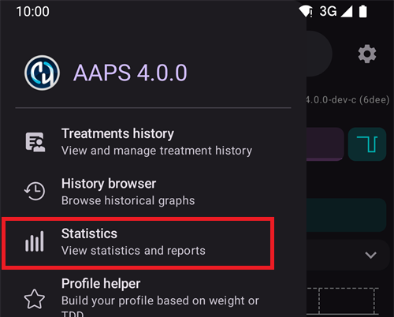

Zaslon **Statistika** ima četiri kartice: **Inzulin**, **Vrijeme u rasponu**, **Glukoza** i **Ciklus**. Dodirnite karticu ili prijeđite prstom ulijevo ili udesno za prelazak između njih.

(reviewing-tdd)=
### Kartica Inzulin: ukupna dnevna doza

Kartica **Ukupna dnevna doza** prikazuje po jedan redak za svaki prethodni dan (najviše tjedan dana) za koji **AAPS** ima podatke o inzulinu, zatim njihov **Prosjek** i na kraju **Danas** do sada. Odmah nakon instalacije **AAPS-a** prikazuje se samo **Danas**. Stupci su:

- **Bazal**: samo bazal.
- **Bolus**: zbroj bolusnih tretmana i SMB-ova.
- **TDD Total**: ukupna dnevna doza inzulina (**TDD**), zbroj bolusnog i bazalnog inzulina isporučenog tijekom dana.
- **UH**: uneseni ugljikohidrati i tretmani e-ugljikohidrata.

Odjeljak **TDD** izračunava se kada otvorite stranicu, a izračun traje nekoliko sekundi. Dodirnite **Ponovno izračunaj** da biste ga ponovno izračunali.

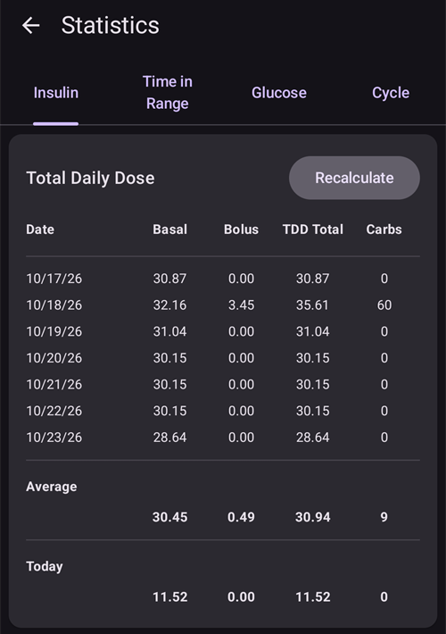

**TDD** je vaš bolusni plus bazalni inzulin po danu. Neki liječnici koriste - posebno za nove korisnike pumpe - omjer bazala i bolusa 50:50: ukupni osnovni bazal (**TBB**, zbroj vaših bazalnih stopa tijekom 24 sata) tada bi trebao biti otprilike pola TDD-a. Drugi više vole TBB od 32 % do 37 % TDD-a.

Kao i većina pravila iz iskustva, i ovo u stvarnosti vrijedi samo ograničeno. Vaš dijabetes može biti drukčiji!

### Kartica Vrijeme u rasponu

Vrijeme u rasponu (**TIR**): 70–180 mg/dL ili 3,9–10 mmol/L.

Podaci o **TIR** dostupni su za 7 i 30 dana, ovisno o količini podataka u bazi podataka **AAPS-a**.

Niže je dostupna statistika vremena u uskom rasponu (TITR) 70–140 mg/dL ili 3,9–7,8 mmol/L (zaslon prikazuje ovaj raspon kao 70–141).

**Razgovarajte o ciljevima sa svojim endokrinologom**

Vaš dijabetes može biti drukčiji. O svim predloženim ciljevima razgovarajte sa svojim endokrinologom ili medicinskim timom. Ako se pravilno koristi, statistika AAPS-a može biti učinkovit alat za praćenje trendova __GUK-a__ i napretka.

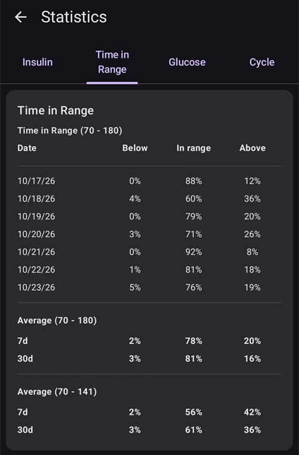

Niže kartica **Dexcom TIR** prikazuje detaljnu statistiku **TIR** za 14 dana.

**SD**: standardna devijacija, [pokazatelj](https://www.ncbi.nlm.nih.gov/pmc/articles/PMC3125941/) varijabilnosti GUK-a (najviša = najlošija).

HbA1c: procjena glikiranog hemoglobina, na temelju prosjeka mjerenja CGM-a. Ovo je okvirna vrijednost koja se možda neće podudarati s nalazima HbA1c iz krvi.

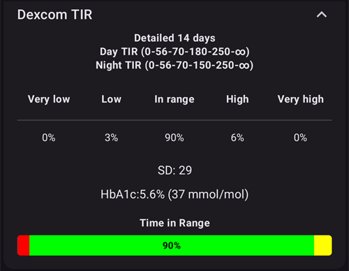

(reviewing-statistics-agp)=
### Kartica Glukoza: ambulantni profil glukoze (AGP)

**Ambulantni profil glukoze** (**AGP**) pokazuje kako se vaša glukoza obično kreće tijekom dana. Razdoblje odaberite gumbima na vrhu: **Danas**, **24h**, **7d**, **30d** ili **90d**.

- **Graf**: jedan dan od ponoći do ponoći. Linija je **Medijan** (polovica vaših očitanja u tom satu bila je niža, polovica viša). Oko nje jedan pojas obuhvaća srednju polovicu vaših očitanja (**25–75%**), a širi pojas većinu njih (**10–90%**). Uzak pojas znači da je vaša glukoza u tom satu slična iz dana u dan. Isprekidane linije označavaju vašu **Oznaku NISKO**, 140 mg/dL (7,8 mmol/L) i vašu **Oznaku VISOKO**.
- **Glikemijski pregled**: vrijeme provedeno u vašem rasponu, u uskom rasponu (70–140 mg/dL ili 3,9–7,8 mmol/L), iznad i ispod vašeg raspona, zatim **Prosjek** i **Medijan** vaše glukoze. Vaš raspon čine **Oznaka NISKO** i **Oznaka VISOKO** postavljene u [Raspon za prikaz](#Preferences-range-for-visualization).
- **eA1c** and **GMI**: two estimates of HbA1c calculated from your CGM readings, shown in % with the same value in mmol/mol below it. Kao i gornji HbA1c, možda se neće podudarati s vašim nalazima HbA1c iz krvi.
- **SD** (standardna devijacija) i **CV** (koeficijent varijacije): koliko se vaša glukoza mijenja. Niža vrijednost znači stabilniju glukozu.
- **Dani**: koliko je dana podataka CGM-a korišteno.

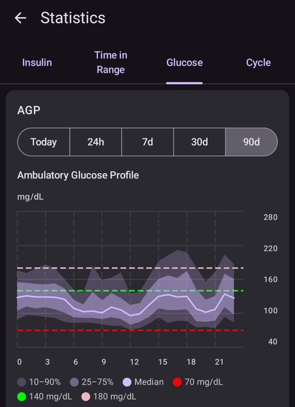 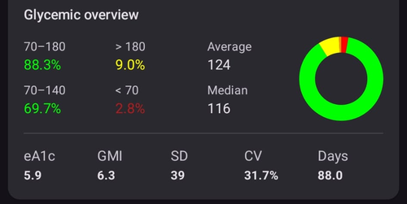

Ispod AGP-a kartica **Glukozni pentagon (CGP)** prikazuje pet mjera vaše glukoze u zadnjih 14 dana u obliku peterokuta. Manji peterokut znači bolju kontrolu glukoze.

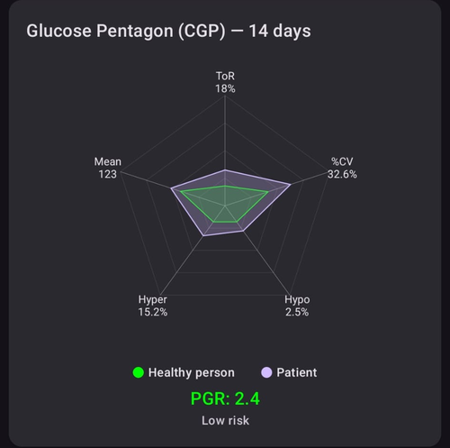

### Kartica Ciklus: TDD u ciklusima

**TDD u ciklusima** preklapa vaše dnevne ukupne doze inzulina u ciklusima od 28 dana, kako biste lakše uočili obrasce koji se ponavljaju. Svaki ciklus crta se kao linija (**Pojedinačni ciklusi**), zajedno s njihovim prosjekom.

- **Sirovi TDD** / **Očišćeni TDD**: odaberite ukupnu dnevnu dozu kako je isporučena ili TDD bez inzulina za ugljikohidrate.
- **Pomak ciklusa**: pomiče početak ciklusa (od 0 do 27 dana).

Potrebno je najmanje 56 dana podataka (2 ciklusa). Ako ima manje podataka, kartica prikazuje **Nema dovoljno podataka (potrebno je najmanje 56 dana za 2 ciklusa)**. Obrazac se izračunava samo kada otvorite karticu **Ciklus**, jer čita podatke za 168 dana.

(aaps-screens-treatments)=
## Povijest tretmana

Otvorite **izbornik** (☰) u gornjem lijevom kutu glavnog zaslona i odaberite **Povijest tretmana**. U ovom prikazu možete pregledati i mijenjati povijest sljedećih tretmana, svaki na svojoj kartici (prijeđite prstom po retku kartica da biste vidjeli sve):

* UH i bolus
* [Produženi bolus](#Extended-Carbs-extended-bolus-and-switch-to-open-loop-dana-and-insight-pump-only)
* Privremeni bazal
* [Privremeni cilj](../DailyLifeWithAaps/TempTargets.md)
* [Zamjena profila](../DailyLifeWithAaps/ProfileSwitch-ProfilePercentage.md)
* Careportal: bilješke i unosi Careportala
* Način rada: povijest statusa petlje
* Unos korisnika: ostale bilješke koje se ne šalju u Nightscout

Na kraju svakog retka male ikone pokazuju odakle podaci dolaze ili kamo su poslani:
* Ikona **Nightscout** (logotip Nightscouta): podaci dolaze iz Nightscouta ili su zapisani u Nightscout
* Ikona **Pumpa**: podaci dolaze iz povijesti pumpe (pumpa ih je obradila)
* Ikona **kanta za smeće**: unos je izbrisan (prikazuje se samo kada prikažete izbrisane unose ikonom **oka** gore desno)

(screens-bolus-carbs)=
### UH i bolus

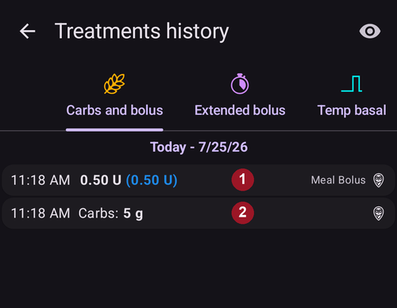

Na ovoj kartici možete pregledati dnevnik bolusa i ugljikohidrata. Svaki bolus (redak **1**) pokazuje preostali povezani aktivni inzulin pored količine inzulina. Izvor bolusa može biti:
* Obrok (ručno unesen gumbima Inzulin, Brzi kalkulator ili Bolus kalkulator)
* SMB, kada se koristi funkcija SMB

Unosi ugljikohidrata (redak **2**) prikazuju se s količinom u gramima.

Ako ste za izračun doze inzulina koristili [bolus kalkulator](#aaps-screens-bolus-wizard), možete pritisnuti tekst „Izračun“ u retku bolusa da biste vidjeli pojedinosti o tome kako je bolus izračunat.

Ovisno o pumpi, inzulin i ugljikohidrati mogu se prikazati u jednom retku ili u više redaka: jedan za pojedinosti izračuna, jedan za ugljikohidrate, jedan za sam bolus.

Povijest tretmana može se koristiti za ispravak pogrešnih unosa ugljikohidrata (_npr._ precijenili ste ili podcijenili ugljikohidrate). Imajte na umu da postojeći unos nije moguće urediti, morate slijediti ovaj postupak:

1. Provjerite i zapamtite trenutačne aktivne ugljikohidrate (COB) i aktivni inzulin (IOB) na glavnom zaslonu.
2. Ovisno o pumpi, ugljikohidrati se mogu prikazati zajedno s inzulinom u jednom retku ili kao zaseban unos (npr. kod Dana RS).
3. Uklonite unos s pogrešnom količinom ugljikohidrata: pritisnite ikonu kante za smeće, odaberite retke koje želite ukloniti, a zatim ponovno pritisnite ikonu kante za smeće za potvrdu.
4. Provjerite jesu li ugljikohidrati uspješno uklonjeni tako da ponovno provjerite aktivne ugljikohidrate na glavnom zaslonu.
5. Isto učinite i za aktivni inzulin ako postoji samo jedan redak koji uključuje i ugljikohidrate i inzulin.

   → Ako ugljikohidrati nisu uklonjeni kako treba, a vi dodate još ugljikohidrata kao što je ovdje objašnjeno (6.), aktivni ugljikohidrati bit će previsoki i to može dovesti do prevelike isporuke inzulina.

6. Ponovno unesite točnu količinu ugljikohidrata (**Tretmani → UH** u donjoj navigaciji ili gumb **UH** u [Brzom pokretanju](#quicklaunch)) i obavezno postavite točno vrijeme događaja.
7. Ako postoji samo jedan redak koji uključuje i ugljikohidrate i inzulin, morate dodati i količinu inzulina. Obavezno postavite točno vrijeme događaja i nakon potvrde novog unosa provjerite aktivni inzulin na glavnom zaslonu.

### Privremeni bazal

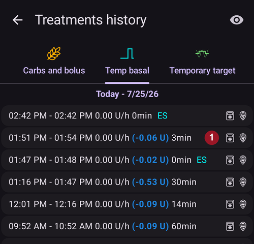

Ovdje se prikazuju **privremeni bazali** koje je postavila petlja. Ako unos još utječe na aktivni inzulin, ta se informacija prikazuje pored stope (redak **1**). To može biti:
* Pozitivan aktivni inzulin ako je privremeni bazal bio viši od bazala postavljenog u profilu
* Negativan aktivni inzulin kod nultog privremenog bazala (kao u retku **1**) ili ako je privremeni bazal bio niži od bazala postavljenog u profilu

Brisanje unosa utječe samo na vaša izvješća u Nightscoutu i vjerojatno će iskriviti vaš stvarni aktivni inzulin - ne preporučuje se.

Crveno S lijevo u retku znači „Suspend“ (obustava): pojavljuje se kada se bazal trenutačno ne isporučuje. To je normalna situacija, na primjer tijekom zamjene Pod-a.

### Privremeni cilj

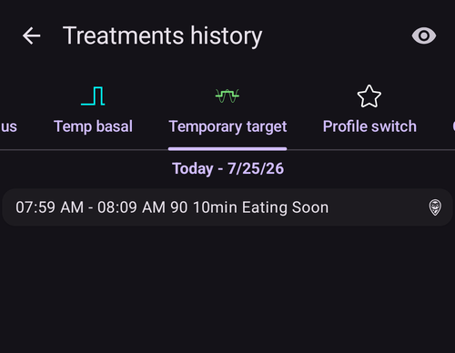

Ovdje se može vidjeti povijest privremenih ciljeva.

### Zamjena profila

Ovdje se može vidjeti povijest zamjena profila. Pri svakoj zamjeni profila možete vidjeti više unosa: redak **1**, spremljen i u NS-u i u povijesti pumpe, odgovara stvarnoj zamjeni. Redak **2**, spremljen u Nightscoutu, ali ne i u povijesti pumpe, odgovara zahtjevu za zamjenu profila koji je napravio korisnik.

Brisanje unosa utječe samo na vaša izvješća u Nightscoutu i nikada neće stvarno promijeniti trenutačni profil.

Gumbom **Kloniraj** u retku **2** možete napraviti kopiju **zamjene profila**. Za više informacija pogledajte [Vaš AAPS profil > Upravljanje profilima](#your-aaps-profile-clone-profile-switch).

### Careportal

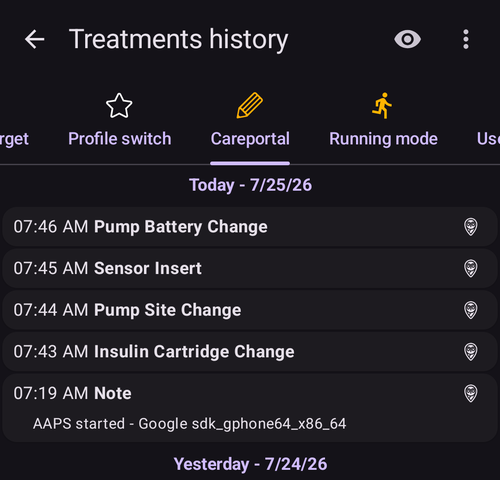

Ova kartica prikazuje sve bilješke i unose Careportala zapisane u Nightscoutu.

(AapsScreens-running-mode)= (aaps-screens-running-mode)=
### Način rada

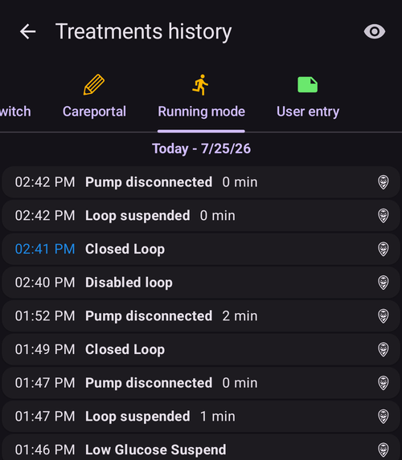

Ova kartica prikazuje povijest promjena [statusa petlje](#AapsScreens-loop-status): otvorena, zatvorena, LGS, suspendirano, odspojeno.

### Unos korisnika

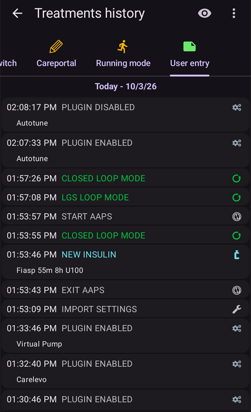

Ova kartica navodi radnje koje je u **AAPS-u** napravio korisnik ili **Automatizacija** (promjene načina rada petlje, zamjene profila, tretmani, izvozi postavki...). Ovi se unosi ne šalju u Nightscout.

------

## Koja je razlika između Nightscouta i Tidepoola?

Nightscout korisniku može olakšati pohranu podataka **AAPS-a** i nudi širok izbor [alata za izvješća](https://nightscout.github.io/nightscout/reports/).

Tidepool pak korisniku omogućuje [pregled podataka](https://www.tidepool.org/viewing-your-data) i [jednostavno dijeljenje s vašim endokrinološkim timom](https://www.tidepool.org/providers/how-it-works#tidepool-data-platform).