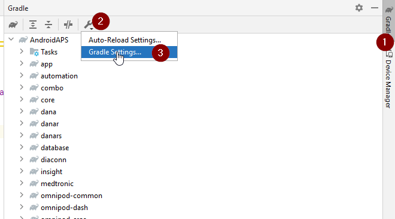
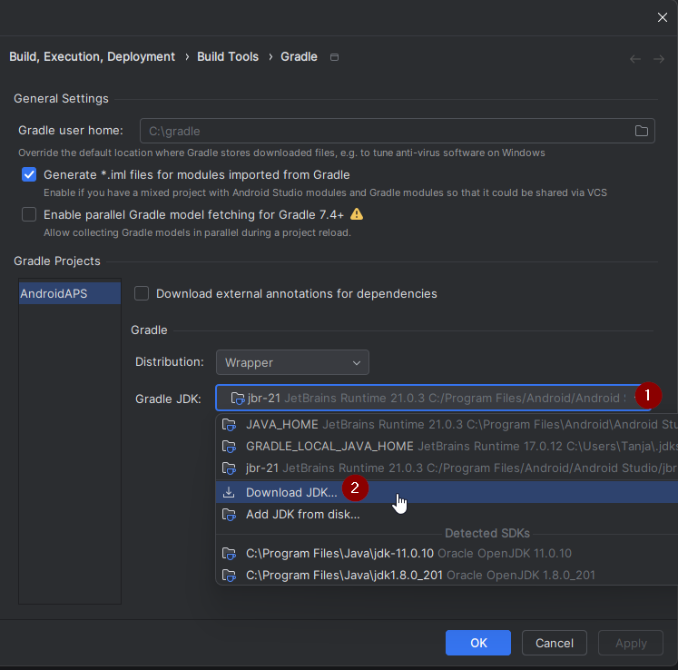
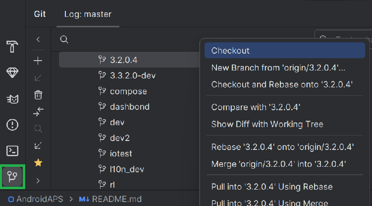
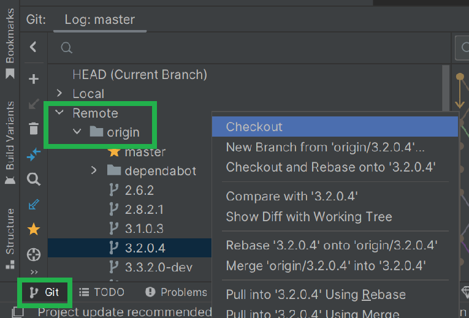
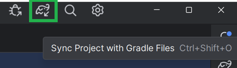
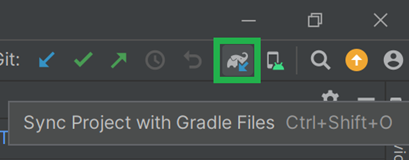

# Ažuriranje na AAPS 3.2.0.4

(update-aaps-3204)=

## Izradite sami umjesto preuzimanja

**Aplikacija AAPS (APK datoteka) nije dostupna za preuzimanje zbog propisa o medicinskim uređajima. Zakonito je izraditi aplikaciju za vlastitu upotrebu, ali kopiju ne smijete dati drugima!**

Pojedinosti pogledajte na stranici [Česta pitanja korisnika petlje](../UsefulLinks/FAQ.md).

## Specifikacije računala i softvera za izradu AAPS-a 3.2.0.4

* Za izradu apk-a možda će biti potrebna određena verzija **[Android Studija](https://developer.android.com/studio/)**.

| Verzija AAPS-a          | Preporučena<br/>verzija<br/>Android Studija | Alternativna<br/>verzija<br/>Android Studija | Gradle | JVM |
| ----------------------- | ------------------------------------------------------- | -------------------------------------------------------- | ------ |:--- |
| [3.2.0.4](#version3204) | Hedgehog (2023.1.1)                                     | do verzije Meerkat                                       | 8.2    | 17  |

„Preporučena verzija“ dolazi s odgovarajućom verzijom JVM-a. Preporučena verzija je ujedno i najniža verzija koju možete koristiti za izradu **AAPS-a**. Na verziji starijoj od „preporučene“ **NEĆETE** moći izraditi aplikaciju. Ako koristite drugu verziju, mogu se pojaviti problemi povezani s verzijom JVM-a. See the [Troubleshooting Android Studio](#incompatible-gradle-jvm) page to help solve these issues. Ako vaša trenutna verzija Android Studija nije navedena u tablici, najprije je morate ažurirati.

Verzija Gradlea vezana je uz izvorni kôd, pa ćete pri preuzimanju / ažuriranju izvornog kôda uvijek dobiti ispravnu verziju Gradlea. Ovdje je navedena samo radi informacije, ne morate ništa poduzimati.

* Android Studio ne podržava [32-bitne sustave Windows](#troubleshooting_androidstudio-unable-to-start-daemon-process). Imajte na umu da su i **64-bitni procesor i 64-bitni operacijski sustav obavezan uvjet.** Ako vaš sustav NE ispunjava taj uvjet, morate promijeniti dotični hardver ili softver ili cijeli sustav.

<table class="tg">
<tbody>
  <tr>
    <th class="tg-baqh">Operacijski sustav (samo 64-bitni)</th>
    <td class="tg-baqh">Windows 8 ili noviji</td>
    <td class="tg-baqh">Mac OS 10.14 ili noviji</td>
    <td class="tg-baqh">Bilo koji Linux koji podržava Gnome, KDE ili Unity DE;&nbsp;&nbsp;GNU C Library 2.31 ili novija</td>
  </tr>
  <tr>
    <th class="tg-baqh"><p align="center">Procesor (samo 64-bitni)</th>
    <td class="tg-baqh">Arhitektura procesora x86_64; Intel Core 2. generacije ili noviji, ili AMD procesor s podrškom za <br><a href="https://developer.android.com/studio/run/emulator-acceleration#vm-windows" target="_blank" rel="noopener noreferrer"><span style="text-decoration:var(--devsite-link-text-decoration,none)">Windows Hypervisor</span></a></td>
    <td class="tg-baqh">Čipovi temeljeni na ARM-u ili Intel Core 2. generacije ili noviji s podrškom za <br><a href="https://developer.android.com/studio/run/emulator-acceleration#vm-mac" target="_blank" rel="noopener noreferrer"><span style="text-decoration:var(--devsite-link-text-decoration,none)">Hypervisor.Framework</span></a></td>
    <td class="tg-baqh">Arhitektura procesora x86_64; Intel Core 2. generacije ili noviji, ili AMD procesor s podrškom za AMD Virtualization (AMD-V) i SSSE3</td>
  </tr>
  <tr>
    <th class="tg-baqh"><p align="center">RAM</th>
    <td class="tg-baqh" colspan="3"><p align="center">8 GB ili više</td>
  </tr>
  <tr>
    <th class="tg-baqh"><p align="center">Disk</th>
    <td class="tg-baqh" colspan="3"><p align="center">Najmanje 30 GB slobodnog prostora. Preporučuje se SSD.</td>
  </tr>
  <tr>
    <th class="tg-baqh"><p align="center">Razlučivost</th>
    <td class="tg-baqh" colspan="3"><p align="center">Najmanje 1280 x 800<br></td>
  </tr>
  <tr>
    <th class="tg-baqh"><p align="center">Internet</th>
    <td class="tg-baqh" colspan="3"><p align="center">Širokopojasni</td>
  </tr>
</tbody>
</table>

**Snažno se preporučuje (nije obavezno) koristiti SSD (Solid State Disk) umjesto HDD-a (Hard Disk Drive), jer će izrada apk datoteke AAPS-a trajati kraće.**  HDD i dalje možete koristiti za izradu apk datoteke **AAPS-a**. Ako to učinite, izrada može dugo trajati, ali kada jednom započne, možete je ostaviti da radi bez nadzora.

## Pomoć i podrška tijekom izrade verzije 3.2.0.4

Ako naiđete na poteškoće tijekom izrade aplikacije **AAPS**, postoji poseban odjeljak [**Rješavanje problema s Android Studiom**](https://androidaps.readthedocs.io/en/3.2/GettingHelp/TroubleshootingAndroidStudio.html); najprije pogledajte njega.

Ako mislite da je nešto u uputama za izradu pogrešno, nedostaje ili je nejasno, ili i dalje imate poteškoća, obratite se grupi drugih korisnika **AAPS-a** na [Facebooku](https://www.facebook.com/groups/AndroidAPSUsers) ili [Discordu](https://discord.gg/4fQUWHZ4Mw). Ako želite sami nešto promijeniti (ažurirati snimke zaslona _itd._), pošaljite [pull request (PR)](../SupportingAaps/HowToEditTheDocs.md).

```{note}
Ova stranica sadrži primjere slika i za **novo** (New) i za staro (**Classic**) korisničko sučelje Android Studija.
```

## Pregled ažuriranja s 3.2.0.x na 3.2.0.4

```{contents} Steps for updating to 3.2.0.4
:depth: 1
:local: true
```

### Izvezite svoje trenutne postavke

Izvezite postavke iz postojeće verzije **AAPS-a** na svom telefonu. Možda vam neće trebati, ali bolje je biti siguran.

Ako se ne sjećate kako se to radi, pogledajte stranicu [Izrada i vraćanje sigurnosnih kopija](ExportImportSettings.md).

### Ažurirajte svoju lokalnu kopiju AAPS-a

* Otvorite svoj postojeći projekt AAPS u Android Studiju. Možda ćete morati odabrati svoj projekt. (Dvaput) kliknite projekt AAPS.


<br>


* U traci izbornika Android Studija odaberite Git -> Fetch


<br>


* U donjem desnom kutu vidjet ćete poruku da je Fetch bio uspješan.


<br>


* Sada u traci izbornika odaberite Git -> Pull


<br>


* Ostavite sve opcije kakve jesu (origin/master) i odaberite Pull


<br>


* Pričekajte dok traje preuzimanje; to ćete vidjeti kao informaciju u donjoj traci. Kada završi, vidjet ćete poruku o uspjehu.

  ```{note}
  Ažurirane datoteke mogu se razlikovati! This is not an indication of a problem.
  ```


<br>


* Pokrenut će se Gradle Sync da preuzme neke ovisnosti. Pričekajte da završi.


<br>


### Odaberite verziju JVM-a 17

- Otvorite prikaz Gradle klikom na slona (1) na desnoj strani Android Studija, otvorite postavke (2) i odaberite **Gradle Settings** (3):


<br>



- In **Gradle JDK** field (1), check if the appropriate version: **jbr-17** is selected. If not, click on the field, and see if it is already available in the list. If it is not in the list (the screenshot below shows a computer where only **jbr-21** is available), select **Download JDK...** (2).




- U Version (1) odaberite **17**. U Vendor (2) odaberite JetBrains Runtime ili bilo kojeg proizvođača. Location (3): ne mijenjajte.


- Zatvorite dijalog **Settings** s **OK**.

### Odaberite granu AAPS 3.2.0.4

- Dolje lijevo odaberite simbol Git, desnom tipkom kliknite 3.2.0.4 i odaberite Checkout.



<br>



### Sinkronizirajte projekt s Gradleom

```{admonition} WARNING!
:class: warning
**Nikada ne ažurirajte Gradle.** Uvijek ga sinkronizirajte s projektom.
```

Za novo sučelje koristite ikonu slona i Sync Project with Gradle Files (ili slijedite [ovo](#gradle-resync)).



Ili ([ovo](https://androidaps.readthedocs.io/en/3.2/GettingHelp/TroubleshootingAndroidStudio.html#gradle-resync)) za klasično sučelje.



### Izradite potpisani APK 3.2.0.4

Vaš izvorni kôd sada je trenutna objavljena verzija i svi preduvjeti su provjereni. Vrijeme je da izradite potpisani apk kako je opisano u [odjeljku o izradi potpisanog apk-a](#Building-APK-generate-signed-apk).

### Prenesite i instalirajte APK 3.2.0.4

Apk morate prenijeti na telefon da biste ga mogli instalirati.

```{note}
Ako ste izradu dovršili s istim postojećim spremištem ključeva u Android Studiju, ne morate uklanjati postojeću aplikaciju s telefona. Kada instalirate apk, slijedite upute za instalaciju ažuriranja.
U drugim slučajevima, na primjer kada za potpisani apk izradite novo spremište ključeva u Android Studiju, morat ćete izbrisati staru aplikaciju prije instalacije apk-a. **Obavezno izvezite svoje postavke!**
```

Pogledajte upute [Prijenos i instalacija AAPS-a na vaš pametni telefon](../SettingUpAaps/TransferringAndInstallingAaps.md)

### Provjerite verziju AAPS-a 3.2.0.4 na telefonu

Nakon što instalirate novi apk, verziju AAPS-a na telefonu možete provjeriti tako da kliknete izbornik s tri točke gore desno, a zatim O aplikaciji. Trebali biste vidjeti trenutnu verziju.

