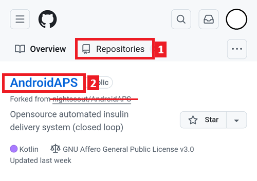
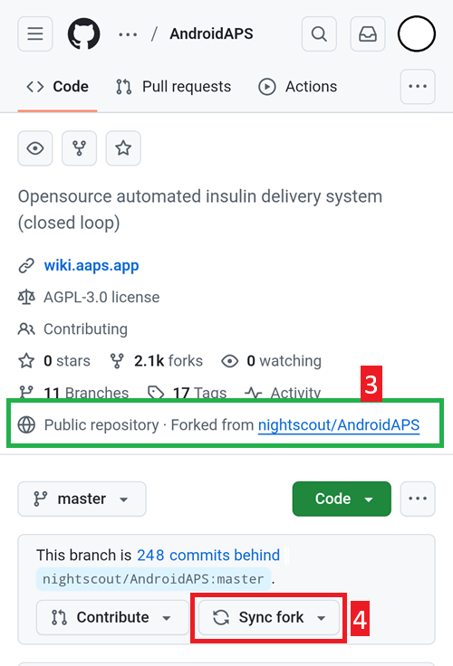
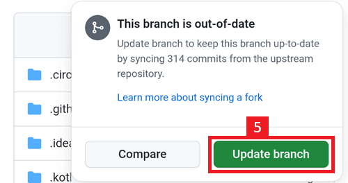
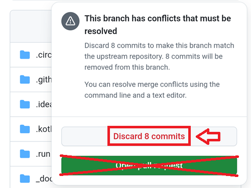
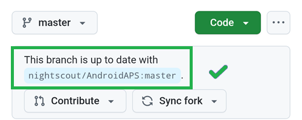

# Ažuriranje putem preglednika (fork)

```{tip}
Izradili ste AAPS s **AAPS Builderom**? Ova stranica vam ne treba: pogledajte [Ažuriranje AAPS-a s AAPS Builderom](#aaps-builder-updates).
```

## Izradite sami umjesto preuzimanja

**AAPS** nije dostupan za preuzimanje zbog propisa o medicinskim uređajima. Zakonito je izraditi aplikaciju za vlastitu upotrebu, ali kopiju ne smijete dati drugima! Pojedinosti pogledajte na stranici [Česta pitanja korisnika petlje](../UsefulLinks/FAQ.md).

```{note}
Ako želite prvi put ažurirati **AAPS** putem preglednika: kopirajte sigurnosnu kopiju datoteke spremišta ključeva na svoj Google Drive. Zatim umjesto ovog vodiča slijedite [postupak izrade **AAPS-a** u pregledniku](../SettingUpAaps/BrowserBuild.md). Umjesto izrade novog spremišta ključeva morate odabrati ono koje ste kopirali sa svog računala.
Taj korak je obavezan samo prvi put, a za sljedeća ažuriranja možete slijediti ovaj vodič.
```

```{tip}
**Prelazite na AAPS Builder?** [AAPS Builder](../SettingUpAaps/BrowserBuildAapsBuilder.md) je jednostavnija izrada u pregledniku: nema forka koji treba sinkronizirati, a aplikaciju preuzimate izravno s GitHuba. Ne morate prijeći: ovaj vodič i dalje radi. Ako prijeđete, najprije uzmite kopiju svog spremišta ključeva iz svog forka, kako je objašnjeno u [Prelazak s prethodne izrade u pregledniku (fork)](#aaps-builder-from-fork). Inače nova izrada ne može ažurirati AAPS na vašem telefonu.
```

## Pregled ažuriranja na novu verziju AAPS-a putem preglednika

```{contents} Steps for updating to a new version of AAPS
:depth: 1
:local: true
```

Ako imate problema, pogledajte posebnu stranicu [Izrada u pregledniku: rješavanje problema](../GettingHelp/BrowserBuildTroubleshooting.md).

### Izvezite svoje postavke

Izvezite postavke iz postojeće verzije **AAPS-a** na svom telefonu. Možda vam neće trebati, ali bolje je biti siguran.

Ako se ne sjećate kako se to radi, pogledajte stranicu [Izrada i vraćanje sigurnosnih kopija](ExportImportSettings.md).

(Update-to-new-version-update-your-repo)=
### Ažurirajte svoj GitHub repozitorij

[Prijavite se na GitHub](https://github.com/login).

1. Odaberite Repositories.
2. Pomaknite se prema dolje i odaberite svoj repozitorij AndroidAPS.



3. Provjerite koristite li vlastitu kopiju AndroidAPS-a (Forked from nightscout/AndroidAPS).
4. Dodirnite Sync Fork da je ažurirate (broj commita koji nedostaju može se razlikovati od slike).




5. Dodirnite Update Branch.



Napomena: ako ste greškom promijenili svoju kopiju AndroidAPS-a, vidjet ćete ovaj zaslon. Odbacite sve promjene (commite) da se vratite na objavljenu verziju.



Sada ste sinkronizirali (ažurirali) svoju kopiju s najnovijim izdanjem **AAPS-a**. Odlično.



### Pokrenite workflow za izradu potpisanog APK-a

1. U svojoj GitHub kopiji AndroidAPS-a odaberite Actions.
2. Proširite All Workflows.
3. Odaberite AAPS-CI.


4. Pomaknite se prema dolje i dodirnite Run Workflow.


5. Ostavite granu postavljenu na master. U **Select AAPS Version** provjerite je li odabrana verzija **4.0.0**, najnovija verzija na vrhu popisa. Ako vaš fork nije ažuran, unaprijed odabrana verzija je starija: ako pokrenete workflow s obrascem kakav se otvori, ponovno ćete izraditi tu stariju verziju i vaša aplikacija neće biti ažurirana. Odaberite [varijantu](#browserbuild-variant) (fullRelease), a zatim dodirnite Run workflow.

   ```{note}
   Popis verzija dio je workflowa u vašem forku. Ako **4.0.0** nedostaje, vaš fork još nije sinkroniziran: vratite se na [Ažurirajte svoj GitHub repozitorij](#Update-to-new-version-update-your-repo).
   ```


6. Vidjet ćete poruku „Workflow run was successfully requested“. Osvježite stranicu u pregledniku i moći ćete pratiti napredak izrade. Kada radnja završi, radnja AAPS CI prikazat će zelenu kvačicu. Uspješno ste izradili ažuriranu verziju **AAPS-a**. To znači da se APK za glavni uređaj i APK za Wear sada spremaju izravno na vaš Google Drive (kao niže). APK AAPSClienta možete preuzeti s Github > nightscout > AndroidAPS [ovdje](https://github.com/nightscout/AndroidAPS/releases)


### Instalirajte APK AAPS-a

1. Otvorite svoj Google Drive.
2. Otvorite mapu AAPS, odaberite mapu nove verzije i u njoj ćete naći verziju za telefon i verziju za Android Wear.


```{note}
Od rujna 2026. Googleova [provjera Android razvojnih programera](#android-developer-verification) može, ovisno o vašoj zemlji, blokirati instalaciju APK datoteke dodirom na datoteku. Besplatna zaobilazna rješenja objašnjena su na toj stranici.
```

Nastavite [ovdje](#Update-to-new-version-check-aaps-version-on-phone)

(update-browser-build-troubleshooting)=

## Rješavanje problema

Ako nešto pođe po zlu, ne paničarite.

Duboko udahnite!

Zatim provjerite je li vaš problem već opisan: pogledajte [Rješavanje problema s AAPS Builderom](#aaps-builder-troubleshooting) ako izrađujete s **AAPS Builderom**, inače [Izrada u pregledniku: rješavanje problema](#aaps-ci-troubleshooting).

Ako trebate dodatnu pomoć, obratite se drugim korisnicima **AAPS-a** na [Facebooku](https://www.facebook.com/groups/AndroidAPSUsers) ili [Discordu](https://discord.gg/4fQUWHZ4Mw).
