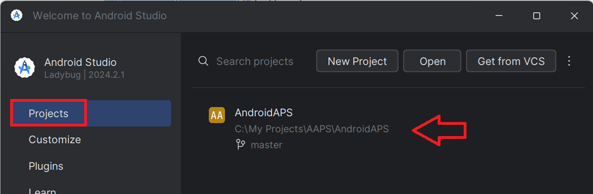
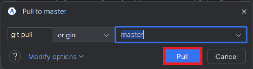

# Ažuriranje s Android Studiom

## Izradite sami umjesto preuzimanja

**AAPS** nije dostupan za preuzimanje zbog propisa o medicinskim uređajima. Zakonito je izraditi aplikaciju za vlastitu upotrebu, ali kopiju ne smijete dati drugima! Pojedinosti pogledajte na stranici [Česta pitanja korisnika petlje](../UsefulLinks/FAQ.md).

```{note}
In case you want to build **AAPS** on a new computer: copy your back-up keystore file to the new computer. Zatim umjesto ovog vodiča slijedite postupak sa stranice [Izrada **AAPS-a**](../SettingUpAaps/BuildingAaps.md). Jedina je razlika što umjesto izrade novog spremišta ključeva možete odabrati ono koje ste kopirali na novo računalo.
```

## Pregled ažuriranja na novu verziju AAPS-a s Android Studiom

```{contents} Steps for updating to a new version of AAPS
:depth: 1
:local: true
```

In case you experience problems, see separate page for [troubleshooting Android Studio](../GettingHelp/TroubleshootingAndroidStudio.md).

### Izvezite svoje postavke

Izvezite postavke iz postojeće verzije **AAPS-a** na svom telefonu. Možda vam neće trebati, ali bolje je biti siguran.

Ako se ne sjećate kako se to radi, pogledajte stranicu [Izrada i vraćanje sigurnosnih kopija](ExportImportSettings.md).

### Provjerite verziju Android Studija

Najmanja potrebna verzija opisana je u [uputama za izradu](#Building-APK-recommended-specification-of-computer-for-building-apk-file). Ako je vaša verzija starija, molimo [najprije ažurirajte Android Studio](#Building-APK-install-android-studio)!

(Update-to-new-version-update-your-local-copy)=
### Ažurirajte svoju lokalnu kopiju

* Otvorite svoj postojeći projekt AAPS u Android Studiju. Možda ćete morati odabrati svoj projekt. (Dvaput) kliknite projekt AAPS.

  

* U traci izbornika Android Studija odaberite Git -> Fetch

   

* U donjem desnom kutu vidjet ćete poruku da je Fetch bio uspješan.

   

* Sada u traci izbornika odaberite Git -> Pull

   

* Ostavite sve opcije kakve jesu (origin/master) i odaberite Pull

   

* Pričekajte dok traje preuzimanje; to ćete vidjeti kao informaciju u donjoj traci. Kada završi, vidjet ćete poruku o uspjehu.

  ```{note}
  Ažurirane datoteke mogu se razlikovati! This is not an indication of a problem.
  ```

   

* Pokrenut će se Gradle Sync da preuzme neke ovisnosti. Pričekajte da završi.

  

### Provjerite verziju JVM-a

Ova je provjera posebno preporučena ako ste na istom računalu već izradili prethodnu verziju **AAPS-a**.

U [uputama za izradu](#Building-APK-recommended-specification-of-computer-for-building-apk-file) provjerite potrebnu verziju JVM-a za verziju **AAPS-a** koju sada izrađujete. Zatim slijedite korake opisane u odjeljku [Nekompatibilan Gradle JVM](#incompatible-gradle-jvm) kako biste bili sigurni da trenutno koristite ispravnu verziju.

(Update-to-new-version-build-the-signed-apk)=
### Izradite potpisani APK

Vaš izvorni kôd sada je trenutna objavljena verzija i svi preduvjeti su provjereni. Vrijeme je da izradite potpisani apk kako je opisano u [odjeljku o izradi potpisanog apk-a](#Building-APK-generate-signed-apk).

(Update-to-new-version-transfer-and-install)=

### Prenesite i instalirajte APK
Apk morate prenijeti na telefon da biste ga mogli instalirati.

```{note}
Ako ste izradu dovršili s istim postojećim spremištem ključeva u Android Studiju, ne morate uklanjati postojeću aplikaciju s telefona. Kada instalirate apk, slijedite upute za instalaciju ažuriranja.
U drugim slučajevima, na primjer kada za potpisani apk izradite novo spremište ključeva u Android Studiju, morat ćete izbrisati staru aplikaciju prije instalacije apk-a. **Obavezno izvezite svoje postavke!**
```

See the instructions for [transferring and installing AAPS](../SettingUpAaps/TransferringAndInstallingAaps.md). Where Google's [Android developer verification](#android-developer-verification) is enforced (from September 2026, depending on your country), install with [ADB](#android-developer-verification-adb) instead of tapping the APK file.

Nastavite [ovdje](#Update-to-new-version-check-aaps-version-on-phone).

(update-computer-build-troubleshooting)=

## Rješavanje problema

Ako nešto pođe po zlu, ne paničarite.

Duboko udahnite!

Then check if your problem is already documented on the separate page [troubleshooting Android Studio](../GettingHelp/TroubleshootingAndroidStudio.md).

Ako trebate dodatnu pomoć, obratite se drugim korisnicima **AAPS-a** na [Facebooku](https://www.facebook.com/groups/AndroidAPSUsers) ili [Discordu](https://discord.gg/4fQUWHZ4Mw).