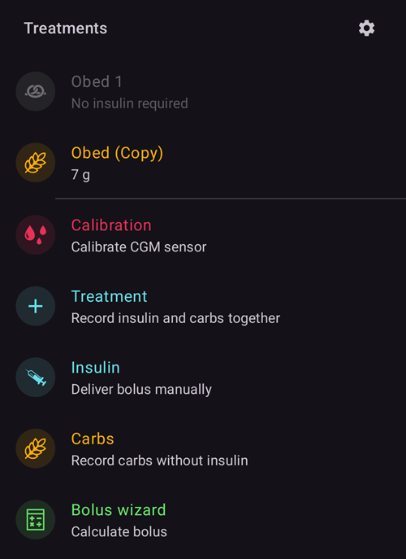
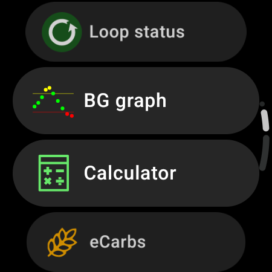
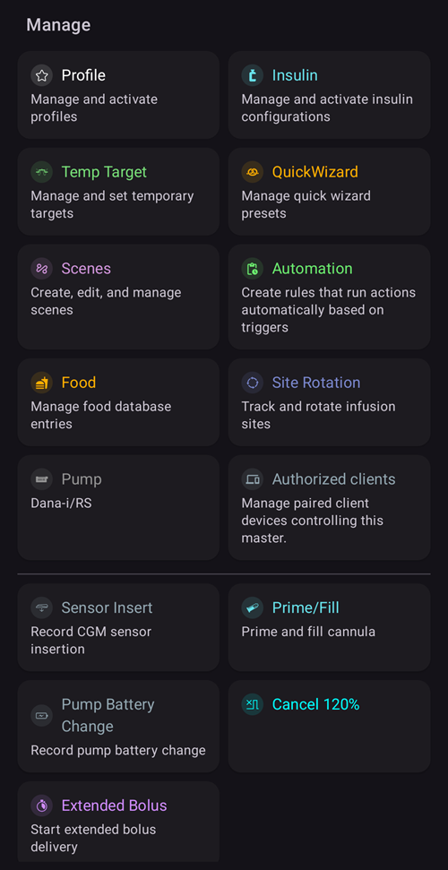
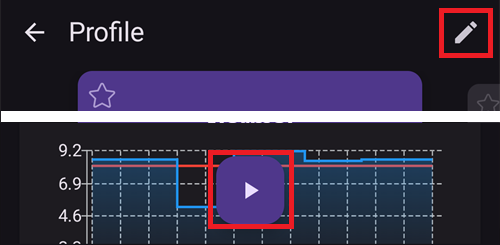

(v4-changes)=
# Što se promijenilo u AAPS-u v4

Ova stranica skuplja važne **promjene u ponašanju** između **AAPS-a** v3 i v4 – stvari koje rade drukčije, koje su premještene ili uklonjene – kako bi postojeći korisnici znali što ih čeka nakon ažuriranja. Pogledajte i [Bilješke o izdanju](ReleaseNotes.md) i [upute za ažuriranje](UpdateToNewVersion.md).

```{contents} Table of contents
:depth: 2
:local: true
```

---

## NSClient v1 je uklonjen

**AAPS** v3 imao je **dva** dodatka za sinkronizaciju s Nightscoutom:

- **NSClient** – stari klijent (stari Nightscout REST / socket.io API, zvan i *„v1“*) i
- **NSClientV3** – klijent za noviji Nightscout **API v3**.

U **AAPS-u** v4 stari dodatak **NSClient (v1)** je **uklonjen**. Za sinkronizaciju s Nightscoutom ostaje samo **NSClientV3**.

```{admonition} What you need to do
:class: important
Ako ste vi (ili vaš pratitelj s **AAPSClientom**) još sinkronizirali sa starim dodatkom **NSClient (v1)**, prijeđite na **NSClientV3** prije ili nakon ažuriranja:

- Otvorite **[Konfiguracija](../SettingUpAaps/ConfigBuilder.md) → Komunikacija → NSClientV3**.
- Unesite svoj **Nightscout URL** i **pristupni token** (NSClientV3 koristi pristupni token, *ne* staru API tajnu – pogledajte [izrada tokena](https://nightscout.github.io/nightscout/security/#create-a-token)).
- Vaša Nightscout stranica mora podržavati **API v3** (Nightscout 15 ili noviji).
- Ako koristite **websockets**, uključite ih ili isključite na **oba** uređaja, na glavnom uređaju i kod pratitelja – nikada samo na jednom.
- Websockets su **obavezni** za daljinsko upravljanje s **AAPSClienta**, na oba telefona.
```

To mijenja samo način na koji aplikacija komunicira s Nightscoutom; vaši podaci na Nightscoutu ostaju isti.

---

## Donja navigacija: Tretmani, Scene i Upravljanje

U **AAPS-u** v3 kretali ste se kroz aplikaciju pomoću niza **kartica** (Pregled, Radnje, Tretmani, …), a nekoliko značajki bili su **dodaci** koje ste omogućili u Config Builderu (**Radnje**, **Automatizacija**, **Hrana**, …).

U **AAPS-u** v4 kartica više nema, a nema ni potvrdnog okvira s okom u Config Builderu koji je prikazivao dodatak kao karticu. Glavni zaslon je **Pregled**, a **donja navigacija** daje vam tri ploče. **Radnje, Automatizacija i Hrana više nisu dodaci** – u [Konfiguraciji](../SettingUpAaps/ConfigBuilder.md) (preimenovani Config Builder) nema ništa za omogućiti; njihove funkcije sada su na ovim pločama.

(v4changes-treatments)=
### Tretmani – unos i isporuka

Ploča **Tretmani** služi za bilježenje ili isporuku tretmana: **Bolus kalkulator**, **Inzulin** (ručni bolus), **UH**, **Tretman** (inzulin i ugljikohidrati zajedno), **Kalibracija**, **CGM** (otvara vašu CGM aplikaciju, ako je postavljena) i vaši **[Brzi kalkulatori](../DailyLifeWithAaps/QuickWizards.md)**.



Na **Wear OS satu** iste tretmane unosite iz **izbornika AAPS** na satu (Bolus kalkulator / Kalkulator, eUH, Tretman, …):



### Scene

Vaši predlošci za situacije – pogledajte [Scene](../DailyLifeWithAaps/Scenes.md).

(v4changes-manage)=
### Upravljanje – uređivanje i aktiviranje

Ploča **Upravljanje** služi za uređivanje i aktiviranje svega ostalog: **[Profil](../DailyLifeWithAaps/ProfileSwitch-ProfilePercentage.md)**, **Postavke inzulina** (vaše konfiguracije inzulina), **[Privremeni cilj](../DailyLifeWithAaps/TempTargets.md)**, predlošci **[Brzi kalkulator](../DailyLifeWithAaps/QuickWizards.md)**, **[Scene](../DailyLifeWithAaps/Scenes.md)**, **Automatizacija**, **Hrana**, **Rotacija mjesta primjene**, **Pumpa**, **[Ovlašteni klijenti](../RemoteFeatures/ClientMasterControl.md)** – te radnje pumpe koje su prije bile na kartici *Radnje* (**Produženi bolus**, **Otkaži privremeni bazal**, **Punjenje**, **Umetanje senzora**, **Zamjena baterije pumpe**).



Sva vaša postojeća pravila automatizacije i unosi hrane ostaju sačuvani; promijenio se samo način na koji dolazite do ovih značajki.

(screens-action-tab)=
#### Gdje je nestala kartica Radnje?

**AAPS** 3.x imao je karticu „Radnje“. U **AAPS-u** 4 njezine funkcije nalaze se na drugim mjestima:

* **Zamjena profila** i **postotak profila**: dodirnite [naziv profila](#aaps-screens-profile--target) na glavnom zaslonu ili **Upravljanje → Profil**. Pogledajte [Promjena postotka profila](#ProfileSwitch-change-percentage).
* **Privremeni cilj**: dodirnite [cilj](#aaps-screens-profile--target) na glavnom zaslonu ili **Upravljanje → Privremeni cilj**.
* **Punjenje**, **Umetanje senzora**, **Provjera GUK-a** i ostali unosi Careportala: na proširenoj [ploči statusa](#aaps-screens-careportal), u **Upravljanju** ili kao gumbi [Brzog pokretanja](../DailyLifeWithAaps/QuickLaunch.md).
* **Preglednik povijesti**, **Statistika** (TDD): u **izborniku** (☰).

```{admonition} Profile switch and profile percentage
:class: note
U **AAPS-u** v3 dugi pritisak na naziv profila otvarao je dijalog za zamjenu profila (postotak, trajanje, privremeni cilj Aktivnost). U **AAPS-u** v4 **dodirnite** naziv profila (ili **Upravljanje → Profil**), zatim dodirnite okrugli gumb **▶** dolje desno kako biste otvorili iste postavke. Pogledajte [Promjena postotka profila](#ProfileSwitch-change-percentage).
```

---

(v4changes-read-only-management)=
## Zaštita postavki sada zaključava i zaslone za upravljanje

U **AAPS-u** v3 [Zaštita postavki](#Preferences-settings-protection) tražila je lozinku samo kada ste otvorili postavke. Profile ste i dalje mogli dodavati ili uređivati na kartici **Lokalni profil** bez lozinke.

U **AAPS-u** v4 Zaštita postavki pokriva i uređivanje na zaslonima za upravljanje: **Profil**, **Postavke inzulina**, **Privremeni cilj** i **Brzi kalkulator**. Ako su vaše postavke zaključane, ovi zasloni otvaraju se **samo za čitanje**:

- Možete pregledavati unose i aktivirati ih (**▶ Aktiviraj**) ili koristiti.
- Gumbi **Dodaj / Uredi / Kloniraj / Izbriši** su **skriveni**. Samo **✏️ olovka** na gornjoj traci pokazuje da možete otključati uređivanje.



```{admonition} What you need to do
:class: important
Za dodavanje, uređivanje, kloniranje ili brisanje unosa dodirnite **✏️ olovku** na gornjoj traci i unesite lozinku za postavke (ili koristite biometriju). Gumbi se pojavljuju.

Ako ne trebate zaštitu postavki, možete isključiti Zaštitu postavki u **Postavke → Zaštita**.
```

---

(v4changes-active-insulin)=
## Inzulin koji se koristi ne može se uređivati

U **AAPS-u** v3 mogli ste u bilo kojem trenutku promijeniti DIA inzulina koji ste koristili.

U **AAPS-u** v4 inzulin označen kao **AKTIVAN** u **Upravljanje → Postavke inzulina** je zasivljen: ne možete ga uređivati ni brisati.

Kada nadogradite, **AAPS** zadržava inzulin i DIA koje su vaše zamjene profila iz v3 već spremile. Ako pronađe starije zapise kojima je inzulin poznat, ali DIA nije, za njih koristi zadani DIA i jednom prikaže poruku, na primjer *Stariji zapisi nisu imali trajanje djelovanja inzulina, pa je za Lyumjev korišteno 9,0 sati. Provjerite postavke inzulina – već preneseni zapisi kasnije se ne ažuriraju.* Kada vidite tu poruku, provjerite postavke inzulina.

When you [import settings](../Maintenance/ExportImportSettings.md) exported from **AAPS** 3.x, **AAPS** adds the insulin of that backup to your insulin list and tells you which one, for example *Added to your insulin list from the backup: Free-Peak Oref 38m 6h U100.* This insulin is not in use yet: select the right insulin when you activate your profile, and do this before Nightscout downloads your older treatments.

```{admonition} What you need to do
:class: important
Za promjenu DIA ili vrha djelovanja dodajte novi inzulin pomoću **+**, prilagodite ga, spremite ga i aktivirajte ga (**▶ Aktiviraj**). Pogledajte [Promjena inzulina koji se koristi](#Config-Builder-insulin-change-active).
```

---

(v4changes-remote-control)=
## Daljinsko upravljanje s AAPSClientom zahtijeva uparivanje

U **AAPS-u** v3 **AAPSClient** je upravljao **AAPS-om** tako da je zapisivao tretmane Careportala u Nightscout i nije mogao isporučiti bolus.

U **AAPS-u** v4 klijent i glavni telefon **uparuju se** jednom, a svaka naredba je potpisana. Glavni telefon provjerava i potvrđuje svaku naredbu, a klijent sada može isporučiti i bolus.

- Svaki klijent ima **[ulogu](#client-master-control-roles)** koja ograničava što smije raditi.
- Dok je upravljanje s klijenta uključeno, glavni telefon je u **[zaštićenom načinu rada](#client-master-control-hardened-mode)**: tretmani i promjene upisani izravno u Nightscout (web stranica, druge aplikacije) više se ne primjenjuju.
- Svaki klijent dobiva **[vlastiti Nightscout token](#client-master-control-own-token)** sa samo onim pravima koja mu trebaju.

```{admonition} What you need to do
:class: important
Uparite svaki **AAPSClient** s glavnim telefonom: pogledajte [Upravljanje glavni uređaj ↔ klijent](#client-master-control). S administratorskim tokenom na glavnom telefonu glavni telefon prikazuje QR kod koji jednim skeniranjem postavlja i uparuje klijenta. Ako ste tretmane prije unosili na web stranici Nightscouta, sada ih unosite na uparenom klijentu.
```

---

## Dvostruki podaci GUK-a sada prebacuju petlju u Zaštitu od niske razine glukoze

Kada **AAPS** dvaput primi isto očitanje GUK-a (crvena oznaka upozorenja na prečacu izvora GUK-a u donjoj traci), ne može pouzdano izračunati vaš trend, pa prestaje davati korekcijski inzulin.

U **AAPS-u** v3 to se događalo tiho u pozadini: vaša petlja i dalje je bila prikazana kao **Zatvorena petlja**, iako više nije mogla korigirati.

U **AAPS-u** v4 ta je promjena vidljiva. Zatvorena petlja prebacuje se u način **Zaštita od niske razine glukoze**, a dijalog petlje kaže vam zašto: *„Način LGS zbog dvostrukih vrijednosti u izvoru GUK-a“*. **AAPS** i dalje može smanjiti ili zaustaviti vaš bazal kako bi vas zaštitio od niskog GUK-a.

```{admonition} What you need to do
:class: important
Pronađite i uklonite dvostruka očitanja – pogledajte [Znak upozorenja GUK-a](#aaps-screens-bg-warning-sign).

Kada ih više nema, **AAPS** ostaje u načinu **Zaštita od niske razine glukoze**. Ne vraća se sam u način **Zatvorena petlja**: pritisnite i držite ikonu petlje i ponovno odaberite **Zatvorena petlja**.
```

---

(v4changes-tidepool)=
## Tidepool: podaci se sada prikazuju pod nazivom uređaja AAPS

U **AAPS-u** v3 podaci preneseni u [Tidepool](../SettingUpAaps/Tidepool.md) prikazivali su se u Tidepoolu pod drugim nazivom uređaja.

U **AAPS-u** v4 podaci se prikazuju pod nazivom uređaja **AAPS**. Nakon ažuriranja **AAPS** započinje novi skup podataka u Tidepoolu. Vaši stariji podaci ostaju u Tidepoolu pod starim nazivom uređaja.

```{admonition} What you need to do
:class: important
Obično ništa: novi podaci jednostavno se pojavljuju pod **AAPS**.

**Nemojte** pokretati „**Potpuna sinkronizacija**“ dok su stari podaci još u Tidepoolu: isti podaci tada bi bili tamo dvaput. Ako želite sve svoje podatke pod novim nazivom, najprije upotrijebite gumb „**Izbriši sve podatke**“ na [zaslonu Tidepool](#tidepool-menu) (on briše i stare podatke koje je prenio **AAPS**), a zatim pokrenite „**Potpuna sinkronizacija**“. Samo podaci koji su još spremljeni u **AAPS-u** na vašem telefonu mogu se ponovno prenijeti.
```

---


<!-- =====================================================================
     This page is a growing list of v4 behavioral changes.
     Add new changes as their own "## " section, newest grouping as agreed.
     Maintainers: relocate page + images and fix cross-links as needed.
     ===================================================================== -->
