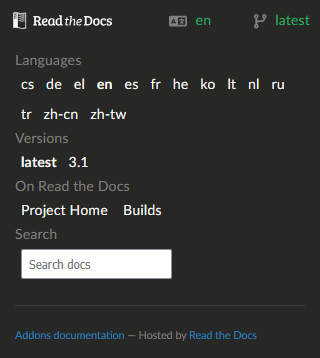

# Promjena jezika i verzije

Dokumentacija koju upravo čitate dostupna je na nekoliko jezika i odnosi se na određenu verziju **AAPS-a**. I jezik i verziju možete promijeniti u izborniku u donjem desnom kutu zaslona.

```{note}
Kliknite na traku u donjem desnom kutu zaslona da otvorite izbornik za odabir jezika i verzije.
```



## Promjena jezika

U izborniku odaberite jezik na kojem želite čitati dokumentaciju.

Slobodno se pridružite prevoditeljima i lektorima na [Crowdinu](https://crowdin.com/project/androidapsdocs) i pomozite prevesti dokumentaciju na svoj jezik.

## Promjena verzije

Trenutna verzija prikazana je u donjem desnom kutu zaslona. Za prelazak na drugu verziju kliknite na trenutnu verziju i odaberite verziju koja vam treba.

```{warning}
Kada promijenite jezik i/ili verziju, može se pojaviti greška 404 – Stranica nije pronađena, ako stranica na tom jeziku ili u toj verziji ne postoji. To se često događa kod promjene verzije, ali ne bi se trebalo događati kod promjene jezika: ako stranica još nije prevedena, prikazat će se na engleskom.
```
