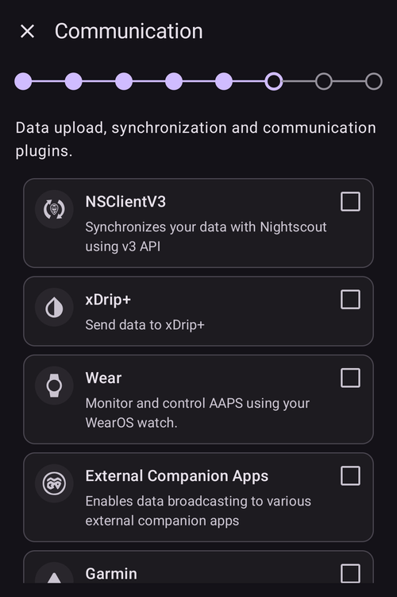
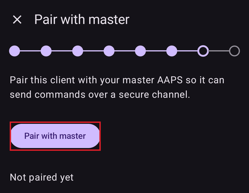
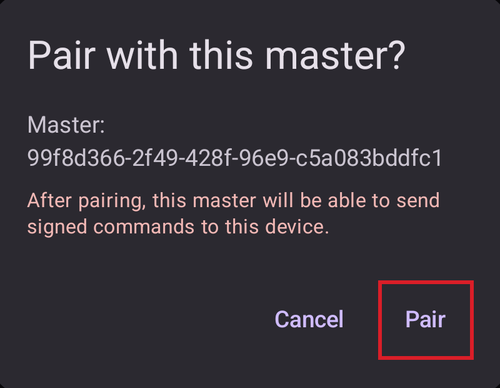
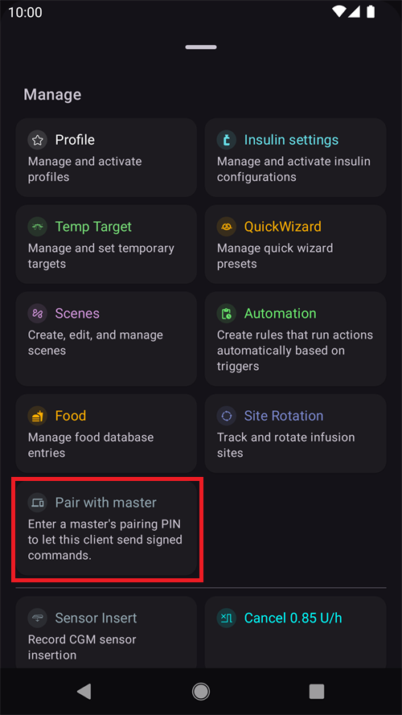
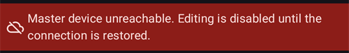

(aapsclient-app)=
# Aplikacija AAPSClient

**AAPSClient** je pomoćna aplikacija **AAPS-a**: prateća aplikacija za drugi telefon – obično telefon njegovatelja – koja **prati** osobu koja koristi **AAPS**. Od verzije 4 **AAPS-a** njegovatelj može i **daljinski upravljati** petljom putem potpisanih naredbi. Oba telefona komuniciraju preko vaše stranice **Nightscout**; izravna veza između telefona nije potrebna.

```{admonition} Wording used on this page
:class: note
- **Klijent** = telefon na kojem radi **AAPSClient**.
- **Glavni uređaj** = glavni telefon s **AAPS-om** koji upravlja pumpom i pokreće petlju.
```

```{admonition} Which devices can run AAPSClient?
:class: note
From **AAPS** version 4, **AAPSClient** runs on Android phones and tablets, on Wear OS watches and on computers (Windows, Mac and Linux). On an iPhone there is no ready-made download: you build the app yourself. See the [table of downloads by device](#aapsclient-platforms).
```

```{contents} Table of contents
:depth: 2
:local: true
```

## Što AAPSClient jest (a što nije)

**AAPSClient** izgleda i radi slično kao **AAPS**, ali **nema vlastitu petlju**:

- Ne sadrži **APS algoritam**, nema **Ciljeve** i **nema upravljačke programe pumpi** – nikada sam ne dozira inzulin.
- Ni dodaci koje koristi samo glavna aplikacija (**SMS Communicator**, **Tidepool**, **Open Humans**) nisu uključeni.
- Što *jest* uključeno: sinkronizacija **NSClientV3**, dodaci za izvor GUK-a, slanje podataka u **xDrip+** te konektori za **Wear OS** / **Garmin** – sve što je potrebno za praćenje i prosljeđivanje naredbi. Sat **Garmin** spojen na klijent može prikazivati podatke, ali ugljikohidrati koje pošalje ne unose se i ne može spojiti ni odspojiti pumpu: klijent prikazuje poruku, a vi ih umjesto toga unesete u **AAPS**.

Sve što pokrenete iz **AAPSClienta** provjerava, ograničava, potvrđuje i **izvršava glavni uređaj** (telefon s pumpom). Zasebna stranica [Upravljanje glavni uređaj ↔ klijent](ClientMasterControl.md) objašnjava kako to radi: kako upariti dva telefona, kako glavni uređaj piše tekst potvrde koji vidite, kako se isporučuje bolus pokrenut na klijentu i što se događa kada glavni uređaj nije na mreži.

## Verzije: AAPSClient, AAPSClient2 i AAPSClient3

Na isti telefon pratitelja mogu se jedna uz drugu instalirati do tri klijentske aplikacije, a svaka prati **drugu** osobu: **AAPSClient** (ikona žute sove), **AAPSClient2** (plava sova) i – novo u verziji 4 **AAPS-a** – **AAPSClient3** (zelena sova). Funkcionalno su jednake. Razlikuju se samo naziv i boja (ikona aplikacije, pozadina widgeta i odjeljak statusa na početnom zaslonu), tako da ih možete razlikovati. Svaka je aplikacija uparena sa svojim glavnim uređajem. Pojedinosti potražite u odjeljku [O AAPSClientu, AAPSClientu2 i AAPSClientu3](#remotecontrol-aapsclient-versions).

(aapsclient-platforms)=
## Preuzimanje aplikacije

All the ready-made files are in the *Assets* list of the latest release on [GitHub](https://github.com/nightscout/AndroidAPS/releases/) (click *Assets* at the bottom of the release to expand it). In the table, *x.y.z* stands for the version number. Choose the file that matches your device:

| Device                  | File to download                    | Napomene                                                                                                                                                                                     |
| ----------------------- | ----------------------------------- | -------------------------------------------------------------------------------------------------------------------------------------------------------------------------------------------- |
| Android phone or tablet | `app-aapsclient-release_x.y.z.apk`  | Install it like the main app: see [Download and installation of AAPSClient](#RemoteControl_aapsclient) and [Transferring and installing](../SettingUpAaps/TransferringAndInstallingAaps.md). |
| Wear OS watch           | `wear-aapsclient-release_x.y.z.apk` | Goes with the AAPSClient app on the phone. See [Wear OS smartwatch](../WearOS/WearOsSmartwatch.md).                                                                                          |
| Windows computer        | `AAPSClient-x.y.z.msi`              | Open the file to install.                                                                                                                                                                    |
| Mac                     | `AAPSClient-x.y.z.dmg`              | See the note on macOS below the table.                                                                                                                                                       |
| Linux (Debian, Ubuntu)  | `aapsclient_x.y.z_amd64.deb`        | Install it with your package manager.                                                                                                                                                        |
| iPhone                  | nema                                | There is no App Store version and no download. You build the app yourself, see [AAPSClient on an iPhone](#aapsclient-iphone).                                                                |

**Following two people?** Each file above also exists as *aapsclient2* / *AAPSClient2*. It is a second client app that installs next to the first one, so one device can follow two people (see [About AAPSClient, AAPSClient2 and AAPSClient3](#remotecontrol-aapsclient-versions)). **AAPSClient3** is not in the release assets: build it yourself ([build variants](#browserbuild-variant)).

**Files to ignore:** the *pumpcontrol* files (`app-pumpcontrol-release_…`, `wear-pumpcontrol-release_…`) are not a client. Leave them out.

**Mac: the first start.** The app is not notarized by Apple, so macOS blocks it the first time you open it. Click *Done*, then open *System Settings → Privacy & Security*, scroll down and click *Open Anyway*.

**Computer: how to connect.** A computer has no camera, so the QR code cannot be scanned. Set up **Nightscout** in the client, then on the master add the client with a **PIN** and type the 8-digit PIN in the client (**Pair with master**). See [Pairing with the master](#aapsclient-pairing-with-the-master).

**Same version everywhere.** The master and all its clients must run the same **AAPS** version. When you update the master, update the clients too.

(aapsclient-iphone)=
### AAPSClient on an iPhone

There is no **AAPSClient** in the App Store and no ready-made file to download, so you build the app yourself:

- You need a Mac with **Xcode** and an Apple developer account.
- The project is the `ios` folder of the [AndroidAPS repository on GitHub](https://github.com/nightscout/AndroidAPS/tree/master/ios).
- A build for a real iPhone is signed with your own Apple developer team. A build for the iPhone simulator does not need one.
- There is no step-by-step guide yet. This page will be updated when there is one.

The iPhone version pairs with the master like the others. Unlike the computer versions, the iPhone can scan the master's QR code with its camera.

## Prvo pokretanje: kraći čarobnjak za postavljanje

Pri prvom pokretanju **AAPSClient** pokreće isti **Čarobnjak za postavljanje** koji poznajete iz **AAPS-a**, ali s mnogo manje koraka – na uređaju pratitelja nema postavljanja profila, inzulina, pumpe, APS-a ni ciljeva:

1. **Dobrodošli**, **licencni ugovor**, **dopuštenja** i **glavna lozinka** – isto kao u glavnoj aplikaciji, pogledajte [Čarobnjak za postavljanje AAPS-a](../SettingUpAaps/SetupWizard.md).
2. Klijent **ne** traži **jedinice** ni **donju/gornju granicu**: preuzima ih s glavnog telefona čim se spoji na Nightscout. Kasnije ih možete vidjeti u **Postavkama**, gdje mala **ikona telefona** pokazuje da su [sinkronizirane s glavnim telefonom](#client-master-config-prefs). Mogu se uređivati samo dok je glavni uređaj dostupan.
3. **Postavljanje s glavnog uređaja** – na glavnom uređaju otvorite **Upravljanje → Ovlašteni klijenti**, dodajte ovaj telefon s **QR kodom** i ovdje dodirnite **Skeniraj QR kod**. Jedno skeniranje postavlja Nightscout s vlastitim tokenom ovog telefona i, ako kod služi za uparivanje, ujedno uparuje telefon. Telefon kao naziv svoje instance preuzima i ime s kojim je dodan na glavnom uređaju (slova s dijakritičkim znakovima postaju obična slova, „Miloš“ postaje „Milos“). **Nakon skeniranja postavljanje je završeno**: čarobnjak se zatvara, jer bi sljedeći koraci samo prikazali ono što je kod već napravio. Bez QR koda preskočite ovaj korak. (Not on a computer: it has no camera, see [Getting the app](#aapsclient-platforms).)

   

4. **Komunikacija** – popis dodataka nudi samo ono što treba pratitelju (NSClientV3, xDrip+, Wear, Vanjske prateće aplikacije, Garmin). Ako niste skenirali QR kod, omogućite **NSClientV3** i unesite **isti Nightscout URL** kao na glavnom telefonu te pristupni token, s omogućenim **websocketima** – točno kako je opisano u odjeljku [Sinkronizacija](#RemoteControl_aapsclient). Websockets are **mandatory** for remote control from **AAPSClient**, on both phones.

   

5. **Upari s glavnim uređajem** – ovaj korak postoji **samo** na klijentu. On povezuje ovaj uređaj s glavnim uređajem preko sigurnog kanala za naredbe, s PIN-om, i preuzima ime s kojim je telefon dodan na glavnom uređaju, kao i QR kod. **Nakon uparivanja postavljanje je završeno.** Možete ga i preskočiti i upariti bilo kada kasnije putem **Upravljanje → Upari s glavnim uređajem**.

   

6. **Tko koristi ovaj telefon?** – samo ako niste uparili u čarobnjaku: ime osobe koja koristi ovaj telefon. Po njemu se ova instanca razlikuje u izvješćima i sinkronizaciji.

(aapsclient-pairing-with-the-master)=

## Uparivanje s glavnim uređajem

Na **glavnom uređaju** otvorite **Upravljanje → Ovlašteni klijenti** i dodajte klijenta. Postoje dva načina uparivanja:

- **S QR kodom** (najbrže, ako telefon ima kameru): skenirajte kod u koraku čarobnjaka „**Postavljanje s glavnog uređaja**“ ili putem **Upravljanje → Upari s glavnim uređajem → Skeniraj QR kod** i potvrdite s „**Koristi**“. Time se postavlja i Nightscout.
- **S PIN-om**: na **klijentu** otvorite gore opisani korak čarobnjaka (ili **Upravljanje → Upari s glavnim uređajem**), upišite jednokratni PIN prikazan na glavnom uređaju i pritisnite „**Upari**“. Klijent zatim pokazuje kojem će uređaju vjerovati – potvrdite s „**Upari**“:



Ako uparivanje uspije iz čarobnjaka, postavljanje se završava i otvara se početni zaslon. Na glavnom uređaju klijent se prikazuje kao **Aktivan** na popisu [Ovlašteni klijenti](#client_master_master_setup). Nakon toga **Upravljanje → Upari s glavnim uređajem** prikazuje „*Već upareno*“, ulogu telefona i je li uključen zaštićeni način rada:

 Cijeli postupak uparivanja, sigurnosni detalji i rješavanje problema nalaze se na stranici [Upravljanje glavni uređaj ↔ klijent](#client_master_client_setup).

Nakon uparivanja klijent od glavnog uređaja dobiva vlastiti Nightscout token (ako glavni uređaj ima administratorski token), samo s pravima koja klijentu trebaju, i prestaje koristiti token koji ste možda unijeli. **AAPSClient** nikada sam ne zapisuje tretmane ni GUK u Nightscout: sve što radi šalje se glavnom uređaju, koji to zapisuje. Pogledajte [Vlastiti Nightscout token klijenta](#client-master-control-own-token).

Glavni uređaj određuje što ovaj telefon smije raditi putem njegove **[uloge](#client-master-control-roles)** (Samo čitanje, Obroci, Njegovatelj ili Admin). **Upravljanje → Upari s glavnim uređajem** prikazuje ulogu telefona.

## Početni zaslon

Početni zaslon klijenta prikazuje istu petlju koju prati:


- **GUK, grafovi, aktivni inzulin / aktivni ugljikohidrati i profil** dolaze iz Nightscouta, točno onako kako ih je glavni uređaj prenio.
- Prikazani **status petlje** je status **glavnog uređaja** (klijent nema vlastitu petlju). Dok klijent ne primi način rada glavnog uređaja iz Nightscouta, oznaka načina rada prikazuje **upitnik** (nepoznato).
- **Kartica statusa** prikazuje spremnik i bateriju **praćene pumpe** i bateriju uređaja koji prenosi podatke, preuzete iz statusa uređaja u Nightscoutu – klijent nema pumpu, pa nigdje u aplikaciji nema lokalnog statusa pumpe ni upravljanja pumpom.
- Donja traka nudi **Tretmani**, **Scene** i **Upravljanje** kada je klijent uparen (prije uparivanja samo **Upravljanje**) – nema kartica za pumpu ni ciljeve.

## Tretmani i radnje

Sve pod **Upravljanje** radi kao u glavnoj aplikaciji, uz jednu važnu razliku: na klijentu su radnje koje bi promijenile terapiju (bolus, ugljikohidrati, privremeni ciljevi, scene…) **skrivene dok uređaj nije uparen**, a nakon uparivanja **prosljeđuju se glavnom uređaju** na potvrdu i izvršenje – pogledajte [Korištenje daljinskog upravljanja](#client-master-control).

Iznimka je stavka **Profil**: prikazuje se i na **neuparenom** klijentu, ali se otvara **samo za pregled** – klijent prikazuje profile koje prima putem Nightscouta (trebaju mu za vlastite izračune), bez gumba za uređivanje ili aktiviranje. Kada je klijent **uparen**, popis profila sinkronizira se s glavnim uređajem i profile možete uređivati i aktivirati s klijenta kao i svaku drugu daljinsku radnju.

Na **neuparenom** klijentu **Upravljanje** nudi samo **Profil** i **Upari s glavnim uređajem**:


Crveni natpis „*Glavni uređaj nije dostupan. Uređivanje je onemogućeno dok se veza ponovno ne uspostavi.*“ pojavljuje se i na neuparenom klijentu. To je očekivano: još nema glavnog uređaja do kojeg se može doći. Natpis nestaje kada je klijent uparen i glavni uređaj na mreži.

Kada je klijent uparen, pojavljuju se radnje terapije:



**Nema stavke Pumpa** – klijent nema pumpu.

Ako glavni uređaj nije dostupan, isti se natpis pojavljuje i na uparenom klijentu: radnje terapije su zasivljene, a sve što pokušate blokira se prije slanja. Klijent primijeti da glavni uređaj nije na mreži kada pokušate neku radnju i ponovno omogućuje radnje kada se glavni uređaj vrati na mrežu.



## Postavke sinkronizirane s glavnim uređajem

Aktivna **konfiguracija** dodataka i mnoge **postavke** usklađuju se između glavnog uređaja i njegovih uparenih klijenata; sinkronizirane stavke označene su malom **ikonom telefona** i onemogućene su (uz natpis „*Glavni uređaj nije dostupan*“) dok glavni uređaj nije dostupan. To je opisano u odjeljku [Promjena konfiguracije i postavki](#client-master-config-prefs).

## AAPSClient na pametnom satu

Sat s Wear OS-om može se upariti s telefonom **klijenta**; njegove se radnje preko klijenta prosljeđuju glavnom uređaju. Pogledajte [Postavljanje AAPS-a na vaš Wear OS sat](../WearOS/WearOsSmartwatch.md) i [opcije pametnog sata u odjeljku Daljinsko upravljanje](#RemoteControl_smartwatches).
