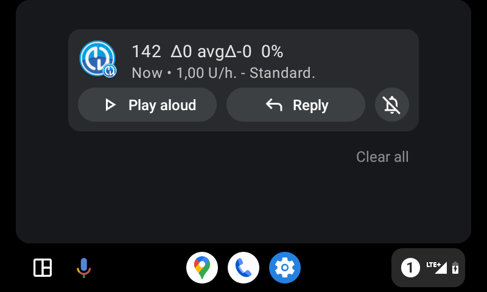
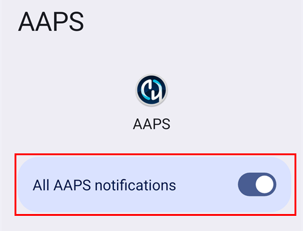
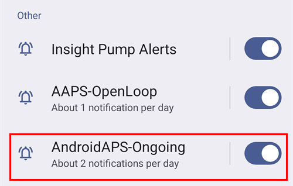
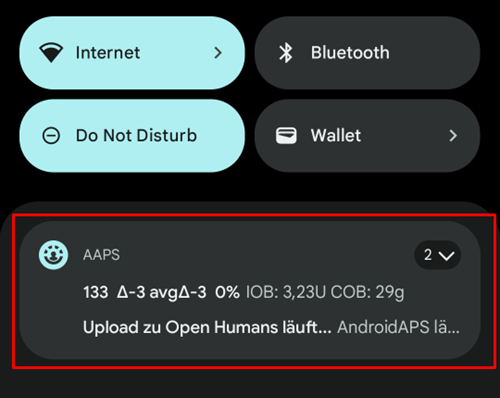
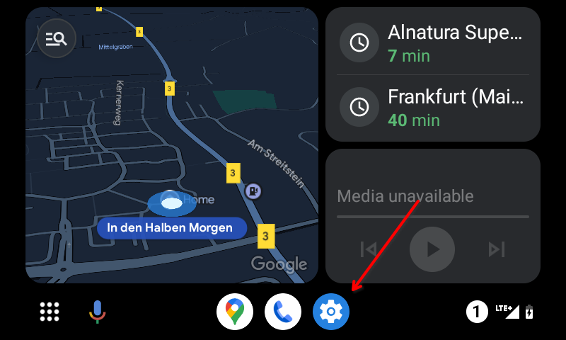
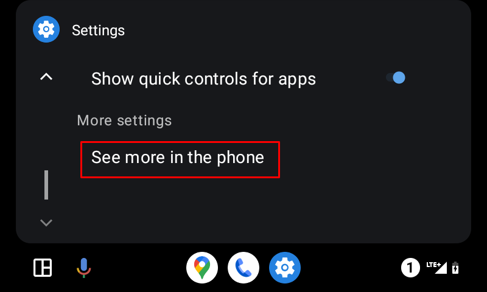
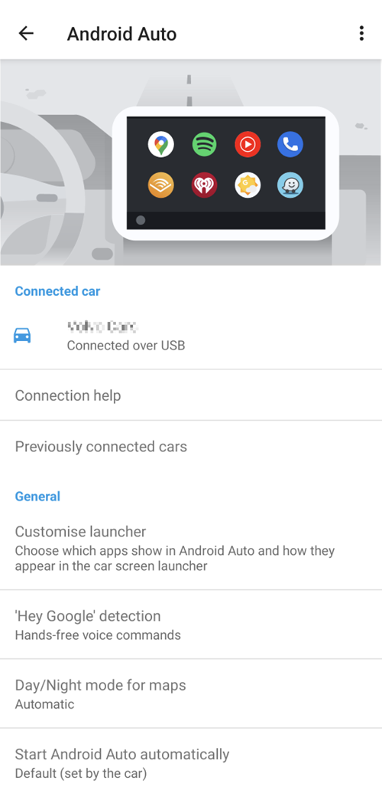
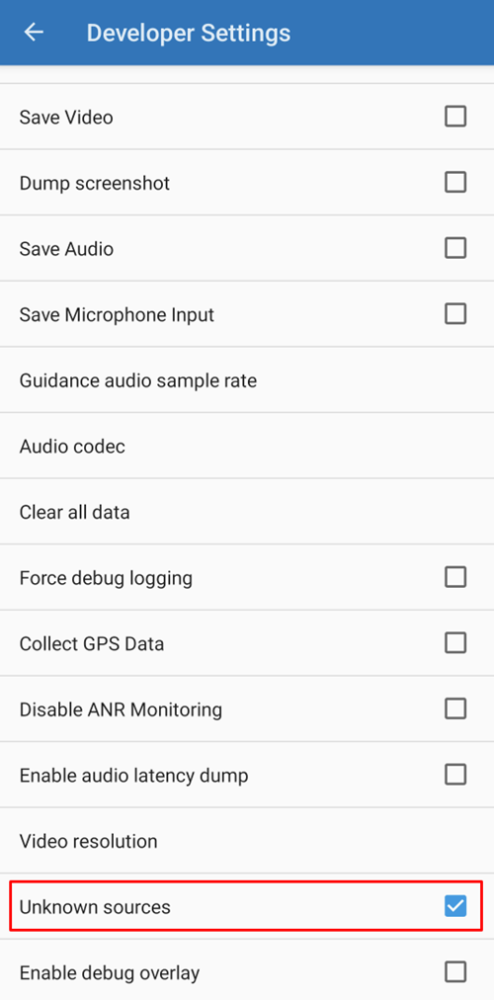
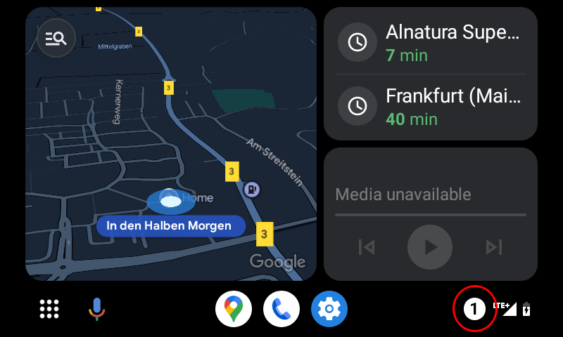

# Android Auto

**AAPS** vam može slati podatke o vašem trenutnom stanju kao poruku, izravno u Android Auto u vašem automobilu.

## Preduvjeti

**AAPS** uses a feature of Android Auto which allows messages from apps on the mobile to be routed to the display of the car audio system.

To znači da:

* Android must allow **AAPS** to show notifications and
* Budući da **AAPS** nije službena aplikacija, dopustite korištenje „nepoznatih izvora“ u Android Autu.

(androidauto-check-that-aaps-can-show-notifications)=

## Check that AAPS can show notifications

**AAPS** always shows a status notification with your current glucose, IOB and COB. This is the notification that Android Auto displays in the car. There is nothing to switch on in **AAPS**, but Android must allow **AAPS** to show notifications.

On your phone, open **Settings** > **Apps** > **AAPS** > **Notifications** and make sure **All AAPS notifications** is on.

Scroll down and make sure **Ongoing status** is on: this is the channel of the status notification.

Please check now that you see the **AAPS** status notification on the phone before you walk to your car!

(androidauto-allow-the-use-of-unknown-sources-with-android-auto)=

## Dopustite korištenje „nepoznatih izvora“ u Android Autu.

Budući da **AAPS** nije službena aplikacija za Android Auto, obavijesti se u Android Autu moraju uključiti za „nepoznate izvore“. To se radi pomoću načina za razvojne programere, koji ćemo vam ovdje pokazati.

Go to your car and connect your mobile with the car's audio system.

Sada biste trebali vidjeti zaslon sličan ovome.

Pritisnite ikonu **postavki** da biste pokrenuli konfiguraciju.

Pomaknite se do kraja stranice i odaberite **više na telefonu** (see more in the phone).

Sada ćemo na mobitelu uključiti način za razvojne programere.

Prvi zaslon izgleda ovako. Pomaknite se do kraja stranice.

Tamo je navedena verzija Android Auta. Dodirnite 10 puta (slovima: deset) verziju Android Auta. Ovom skrivenom kombinacijom sada ste omogućili način za razvojne programere.

U dijaloškom okviru „Dopustiti postavke za razvojne programere?“ (Allow development settings?) potvrdite da želite omogućiti način za razvojne programere.

U **postavkama za razvojne programere** omogućite „Nepoznati izvori“ (Unknown sources).

Sada možete izaći iz načina za razvojne programere ako želite. Za to dodirnite izbornik s tri točke gore desno.

## Prikaz obavijesti u automobilu

Dodirnite **ikonu s brojem** dolje desno u Android Autu u svom automobilu.

Vaši podaci CGM-a prikazat će se ovako:

(android-auto-troubleshooting)=

## Rješavanje problema:

* If you don't see the notification, check if you [allowed AAPS to show notifications](#androidauto-check-that-aaps-can-show-notifications) in Android and if [Android Auto has access rights to notifications](#androidauto-allow-the-use-of-unknown-sources-with-android-auto).