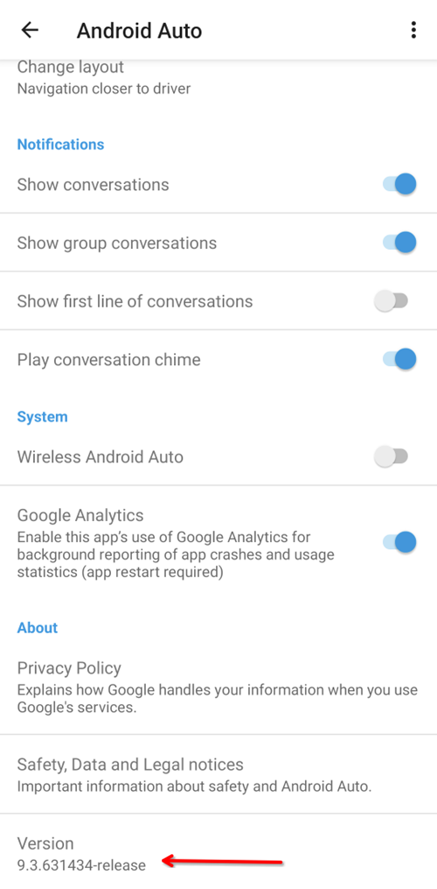
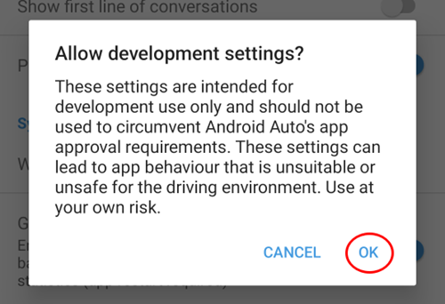

# Android Auto

**AAPS** vam može slati podatke o vašem trenutnom stanju kao poruku, izravno u Android Auto u vašem automobilu.

## Preduvjeti

**AAPS** koristi značajku Android Auta koja omogućuje da se poruke aplikacija s mobitela prikazuju na zaslonu audiosustava automobila.

To znači da:

* Android mora dopustiti **AAPS-u** da prikazuje obavijesti i
* Budući da **AAPS** nije službena aplikacija, dopustite korištenje „nepoznatih izvora“ u Android Autu.

(androidauto-check-that-aaps-can-show-notifications)=

## Provjerite može li AAPS prikazivati obavijesti

**AAPS** uvijek prikazuje obavijest o statusu s vašom trenutnom glukozom, aktivnim inzulinom (IOB) i aktivnim ugljikohidratima (COB). To je obavijest koju Android Auto prikazuje u automobilu. U **AAPS-u** ne trebate ništa uključiti, ali Android mora dopustiti **AAPS-u** da prikazuje obavijesti.

Na telefonu otvorite **Postavke** > **Aplikacije** > **AAPS** > **Obavijesti** i provjerite je li uključeno **Sve obavijesti aplikacije AAPS**.

Pomaknite se prema dolje i provjerite je li uključen **Trenutačni status**: to je kanal obavijesti o statusu.

Prije nego što krenete do automobila, provjerite sada vidite li na telefonu obavijest o statusu **AAPS-a**!

(androidauto-allow-the-use-of-unknown-sources-with-android-auto)=

## Dopustite korištenje „nepoznatih izvora“ u Android Autu.

Budući da **AAPS** nije službena aplikacija za Android Auto, obavijesti se u Android Autu moraju uključiti za „nepoznate izvore“. To se radi pomoću načina za razvojne programere, koji ćemo vam ovdje pokazati.

Idite do automobila i povežite mobitel s audiosustavom automobila.

Sada biste trebali vidjeti zaslon sličan ovome.

Pritisnite ikonu **postavki** da biste pokrenuli konfiguraciju.

Pomaknite se do kraja stranice i odaberite **više na telefonu** (see more in the phone).

Sada ćemo na mobitelu uključiti način za razvojne programere.

Prvi zaslon izgleda ovako. Pomaknite se do kraja stranice.

Tamo je navedena verzija Android Auta. Dodirnite 10 puta (slovima: deset) verziju Android Auta. Ovom skrivenom kombinacijom sada ste omogućili način za razvojne programere.

U dijaloškom okviru „Dopustiti postavke za razvojne programere?“ (Allow development settings?) potvrdite da želite omogućiti način za razvojne programere.

U **postavkama za razvojne programere** omogućite „Nepoznati izvori“ (Unknown sources).

Sada možete izaći iz načina za razvojne programere ako želite. Za to dodirnite izbornik s tri točke gore desno.

## Prikaz obavijesti u automobilu

Dodirnite **ikonu s brojem** dolje desno u Android Autu u svom automobilu.

Vaši podaci CGM-a prikazat će se ovako:

(android-auto-troubleshooting)=

## Rješavanje problema:

* Ako ne vidite obavijest, provjerite jeste li u Androidu [dopustili AAPS-u da prikazuje obavijesti](#androidauto-check-that-aaps-can-show-notifications) i ima li [Android Auto pravo pristupa obavijestima](#androidauto-allow-the-use-of-unknown-sources-with-android-auto).