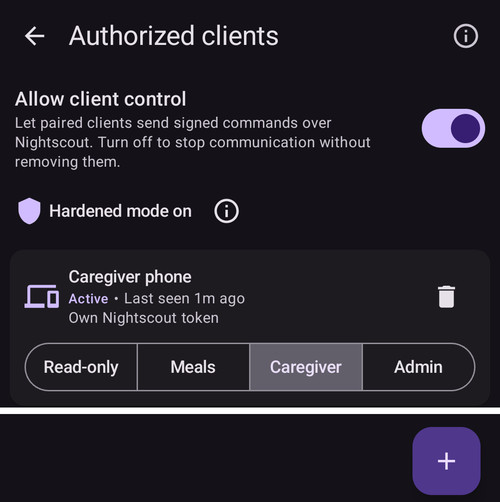
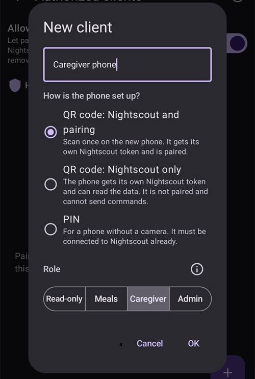
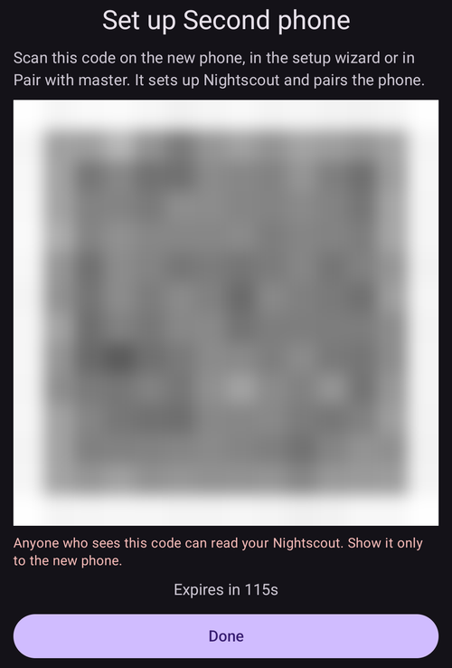
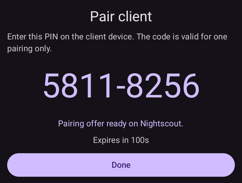
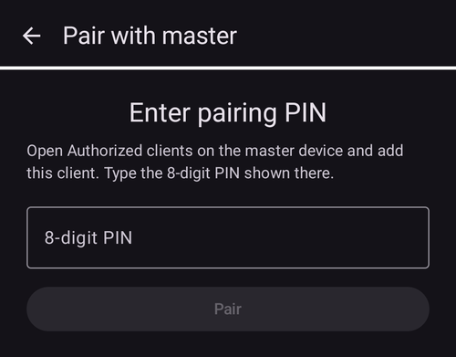
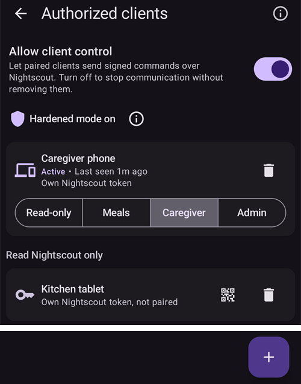
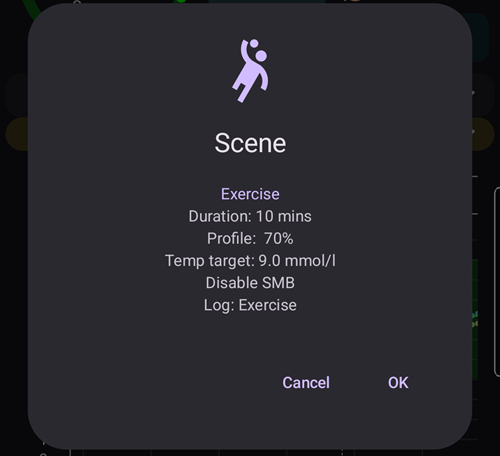
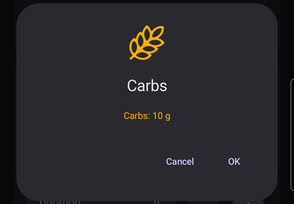
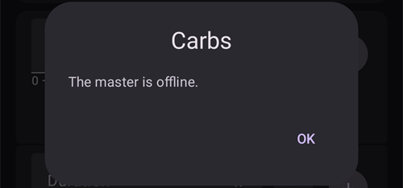
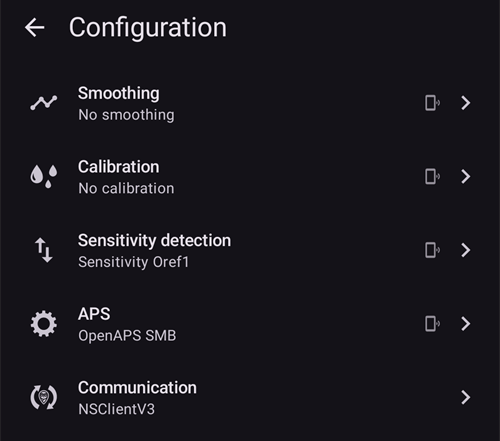

(client-master-control)=
# Upravljanje glavni uređaj ↔ klijent (potpisano daljinsko upravljanje)

Od verzije 4 **AAPS-a** telefon pratitelja s aplikacijom **AAPSClient** može mnogo više od toga da samo *najavi* tretmane putem Nightscouta: kada je **uparen** s glavnim telefonom, može slati **potpisane naredbe** koje glavni telefon (**glavni uređaj**) provjerava, potvrđuje i izvršava – uključujući isporuku **bolusa inzulina** na pumpi glavnog uređaja.

Ova stranica objašnjava kako to radi te kako to postaviti i koristiti.

```{contents} Table of contents
:depth: 2
:local: true
```

```{admonition} Wording used on this page
:class: note
- **Glavni uređaj** = glavni telefon s **AAPS-om** koji upravlja pumpom i pokreće petlju (aplikacija `full`).
- **Klijent** = telefon s aplikacijom **AAPSClient**, bez pumpe, koji prati glavni uređaj i sada njime može i *upravljati*.
- Oba telefona moraju biti spojena na **isti Nightscout**. Sva komunikacija i dalje ide preko Nightscouta – izravna veza između telefona nije potrebna.
```

---

## Kako to radi

```{admonition} Coming from AAPS v3?
:class: note
U **AAPS-u** v3 **AAPSClient** je mogao u Nightscout zapisivati samo nepotpisane tretmane iz Careportala i nije mogao isporučiti bolus. Daljinsko upravljanje sada traži jednokratno [uparivanje](#client_master_master_setup). Pogledajte i [Što se promijenilo u AAPS-u v4](#v4changes-remote-control).
```

**AAPS** v4 koristi poseban kanal **Client-Control**. On i dalje ide preko vaše Nightscout stranice (u kolekciji `settings`), ali svaka poruka je **kriptografski potpisana** tajnim ključem koji znaju samo ta dva telefona. Tajni ključ predaje se jednom, tijekom **uparivanja**, i odmah nakon toga zamjenjuje se novim, tako da nikada ne putuje kao čisti tekst.

Glavno načelo je **glavni uređaj odlučuje**:

1. Klijent šalje *namjeru* („bolus 2 J“, „pokreni scenu Vježbanje“, „postavi ovaj privremeni cilj“…).
2. **Glavni uređaj** ponovno izračunava i **ograničava** radnju prema **vlastitim** trenutnim podacima (profil, aktivni inzulin, aktivni ugljikohidrati, trenutni privremeni cilj, pumpa) i **sam piše točnu potvrdu** koju će korisnik vidjeti.
3. Klijent (ili sat) prikazuje tekst potvrde **glavnog uređaja** – nikada ne sastavlja vlastiti.
4. Nakon potvrde glavni uređaj **izvršava radnju jednom** i javlja rezultat klijentu.

Što to znači za vas:

- **Potpisane naredbe**: naredbe mogu slati samo klijenti koje ste uparili (svaki klijent ima vlastiti tajni ključ za uparivanje i potpis). Stare ili ponovno poslane naredbe se odbijaju.
- **Uloga za svakog klijenta**: vi odlučujete što svaki klijent smije raditi, od *Samo čitanje* do *Admin* – pogledajte [Uloge klijenata](#client-master-control-roles).
- **Bolus inzulina s klijenta**: glavni uređaj ga isporučuje na svojoj pumpi, a klijent prikazuje napredak isporuke.
- **Glavni uređaj odlučuje**: svaku radnju ograničava prema vlastitim ograničenjima i piše potvrdu koja se prikazuje na klijentu.
- **Samo upareni klijenti mijenjaju terapiju**: dok je upravljanje s klijenta uključeno, glavni uređaj više ne prihvaća tretmane ni promjene upisane izravno u Nightscout – pogledajte [Zaštićeni način rada](#client-master-control-hardened-mode).
- **Svaki klijent dobiva vlastiti Nightscout token** samo s pravima koja klijentu trebaju – pogledajte [Vlastiti Nightscout token klijenta](#client-master-control-own-token).
- **Glavni uređaj nije dostupan**: radnje su blokirane uz jasnu poruku.
- **Opoziv klijenta** traži jedan dodir (za svakog klijenta), a prekidačem na glavnom uređaju možete zaustaviti sve klijente.

Radnje koje se mogu pokrenuti s klijenta: **bolus**, **ugljikohidrati / eUH**, **privremeni cilj** (postavljanje i otkazivanje), **zamjena profila**, promjena **petlje / načina rada**, **privremeni bazal** (postavljanje i otkazivanje), **produženi bolus** (postavljanje i otkazivanje), **odabir inzulina** i **[scene](../DailyLifeWithAaps/Scenes.md)**. Dio **postavki** koje vrijede u oba smjera također se usklađuje između glavnog uređaja i klijenata.

---

## Uloge i preduvjeti

```{admonition} Before you start
:class: important
- **Glavni uređaj** koristi uobičajenu verziju `full` aplikacije **AAPS** i spojen je na vašu pumpu.
- **Glavni uređaj** koristi **NSClientV3** s vašim Nightscoutom i prikazuje *povezano*. Dajte mu **administratorski token** vašeg Nightscouta: s njim glavni uređaj može za svakog klijenta izraditi vlastiti token i prikazati ga klijentu kao QR kod.
- **Klijent** koristi **[AAPSClient](AapsClient.md)** (ili **AAPSClient2** / **AAPSClient3** za dodatne pacijente – pogledajte [O aplikacijama AAPSClient, AAPSClient2 i AAPSClient3](#remotecontrol-aapsclient-versions)). Mora koristiti **isti** Nightscout. Ako ga postavite QR kodom glavnog uređaja, klijent dobiva adresu Nightscouta i token od glavnog uređaja; inače najprije sami postavite **NSClientV3** na njemu.
- Websockets su **obavezni** za daljinsko upravljanje s **AAPSClienta**, na oba telefona. Naredba vrijedi samo nekoliko sekundi: bez WebSocketsa ne uspije, umjesto da stigne prekasno. Dok je upravljanje s klijenta uključeno, **AAPS** drži WebSockets uključenima, na glavnom uređaju i na uparenim klijentima. Vaš Nightscout poslužitelj mora podržavati WebSockets.
```

Uparivanje i sinkronizacija dvije su različite stvari:

- **Sinkronizacija** (podaci: GUK, tretmani, profil) postavlja se kao i prije – pogledajte [Sinkronizacija](#RemoteControl_aapsclient). QR kod glavnog uređaja može to učiniti umjesto vas na klijentu.
- **Uparivanje** (upravljanje: ovdje opisani kanal potpisanih naredbi) je novi korak u nastavku.

---

## Postavljanje

(client_master_master_setup)=
### 1. Na glavnom uređaju – omogućite upravljanje i dodajte klijenta

Na glavnom uređaju otvorite zaslon **Upravljanje** i odaberite **Ovlašteni klijenti**.

Uključite **Dopusti upravljanje s klijenta** (prema zadanim postavkama je **isključeno**). To je glavni prekidač za isključivanje: kada je isključen, nijedan klijent ne može slati naredbe, ali upareni klijenti ostaju spremljeni, pa ga kasnije možete ponovno uključiti. Njegovim uključivanjem uključuje se i [zaštićeni način rada](#client-master-control-hardened-mode), prikazan kao „*Zaštićeni način rada uključen*“ sa znakom **(i)** koji ga objašnjava. U [jednostavnom načinu rada](#preferences-simple-mode) upravljanje s klijenta je uvijek uključeno, pa se prekidač ne prikazuje.



Dodirnite gumb **+** (dolje desno) da biste dodali klijenta. U dijalogu **Novi klijent**:

1. Unesite **naziv uređaja** kako biste ga prepoznali na popisu.
2. Odaberite **kako se telefon postavlja** (pogledajte tablicu u nastavku).
3. Odaberite njegovu **[ulogu](#client-master-control-roles)**. Ništa nije unaprijed odabrano: prava uloga ovisi o tome tko koristi telefon.



| Način                               | Što novi telefon dobiva                                                        | Koristite ga kada                                                                                     |
| ----------------------------------- | ------------------------------------------------------------------------------ | ----------------------------------------------------------------------------------------------------- |
| **QR kod: Nightscout i uparivanje** | adresu Nightscouta, vlastiti Nightscout token i uparivanje, jednim skeniranjem | novi telefon ima kameru: najbrži način, ništa ne treba upisivati                                      |
| **QR kod: samo Nightscout**         | adresu Nightscouta i vlastiti Nightscout token, bez uparivanja                 | telefon treba samo **prikazivati** podatke i nikada ne slati naredbe                                  |
| **PIN**                             | samo uparivanje; zadržava postavke Nightscouta koje već ima                    | telefon nema kameru (ili glavni uređaj ne može izrađivati tokene); mora već biti spojen na Nightscout |

Dva načina s QR kodom trebaju **administratorski token** u postavkama **NSClientV3** na glavnom uređaju, jer glavni uređaj izrađuje token klijenta u Nightscoutu. Bez njega se opcije s QR kodom prikazuju, ali se ne mogu odabrati, a dijalog objašnjava zašto; **PIN** uvijek radi.

#### S QR kodom

Dodirnite **U redu**: glavni uređaj izrađuje Nightscout token klijenta i prikazuje **QR kod**. Kod koji ujedno uparuje vrijedi oko **dvije minute**; zaslon odbrojava i sam se zatvara kada se klijent upari. Skenirajte ga na novom telefonu kako je opisano u odjeljku [Na klijentu](#client_master_client_setup).

```{admonition} The QR code is a secret
:class: warning
Svatko tko vidi QR kod može čitati vaš Nightscout, a kod koji uparuje sadrži i uparivanje. Pokažite ga samo novom telefonu. **AAPS** blokira snimke zaslona dok je kod na zaslonu.
```



#### S PIN-om

Dodirnite **U redu**: glavni uređaj prikazuje 8-znamenkasti **PIN za uparivanje**, u dvije skupine po četiri znamenke (na primjer `1234 5678`). Ovaj PIN je **jednokratan** i **istječe nakon otprilike dvije minute**. Kao i kod QR koda, glavni uređaj odbija naziv klijenta koji je već na njegovom popisu: svaki klijent dobiva vlastiti Nightscout token pod svojim nazivom.



```{admonition} The pairing PIN is a secret
:class: warning
PIN štiti tajni ključ za uparivanje koji se razmjenjuje putem Nightscouta. Podijelite ga samo s uređajem koji uparujete, nemojte ga javno objavljivati i pustite da istekne ako ga ne koristite. Novi PIN uvijek možete napraviti ponovnim dodirom na **+**.
```

(client_master_client_setup)=
### 2. Na klijentu – uparivanje s glavnim uređajem

#### Skeniranje QR koda

QR kod glavnog uređaja možete skenirati na dva mjesta:

- u **čarobnjaku za postavljanje** klijenta, u koraku „**Postavljanje s glavnog uređaja**“, koji dolazi prije koraka za Nightscout. Jedno skeniranje tada postavlja Nightscout, a s kodom koji uparuje i uparivanje, pa je postavljanje gotovo: čarobnjak se zatvara i otvara se početni zaslon;
- bilo kada kasnije putem **Upravljanje → Upari s glavnim uređajem → Skeniraj QR kod**.

Prvi put **AAPSClient** traži dopuštenje za **kameru**. Ako ga odbijete, zaslon kaže da je kamera potrebna, a možete je dopustiti gumbom **Pokušaj ponovno** ili se umjesto toga upariti PIN-om.

Usmjerite kameru prema kodu. Klijent prikazuje što kod radi – adresu Nightscouta i, za kod koji uparuje, glavni uređaj s kojim se uparuje – i pita „**Koristiti ovaj kod?**“. Dodirnite **Koristi**: klijent uključuje **NSClientV3**, zamjenjuje svoju adresu Nightscouta i token onima iz koda i uključuje WebSockets. Kod koji uparuje ujedno i uparuje telefon; telefon se javlja glavnom uređaju čim se spoji na Nightscout.


```{admonition} Scanning is available on Android
:class: note
Računalo bez kamere: ondje koristite PIN.
```

#### Unos PIN-a

Na klijentu otvorite **Upravljanje → Upari s glavnim uređajem** (ili korak čarobnjaka **Upari s glavnim uređajem**, nakon koraka za Nightscout), **unesite 8-znamenkasti PIN** prikazan na glavnom uređaju i dodirnite **Upari**. Klijent pomoću PIN-a sigurno preuzima ponudu za uparivanje putem Nightscouta, zatim pita „**Upariti s ovim glavnim uređajem?**“ i prikazuje identifikator glavnog uređaja. Dodirnite **Upari** za potvrdu (snimku zaslona pogledajte u odjeljku [Uparivanje s glavnim uređajem](#aapsclient-pairing-with-the-master)).



#### Nakon uparivanja

Kada je klijent uparen, šalje glavnom uređaju poruku **Hello** i pojavljuje se na popisu **Ovlašteni klijenti** na glavnom uređaju kao **Aktivan**, s vremenom *„zadnji put viđen“*. Klijent zna svoju [ulogu](#client-master-control-roles) iz uparivanja, pa odmah prikazuje prave gumbe. Uparivanje napravljeno u čarobnjaku za postavljanje završava čarobnjak. U istom koraku dva telefona zamjenjuju tajni ključ za uparivanje novim koji nikada nije putovao (pogledajte [Sigurnosne napomene](#client-master-control-security)), a klijent postavljen PIN-om dobiva vlastiti Nightscout token (pogledajte [Vlastiti Nightscout token klijenta](#client-master-control-own-token)). Klijent može biti uparen samo s **jednim** glavnim uređajem u isto vrijeme; za uparivanje s drugim glavnim uređajem najprije odaberite **Raspari**.


### 3. Upravljanje klijentima

Na zaslonu **Ovlašteni klijenti** na glavnom uređaju možete u bilo kojem trenutku:

- **Promijeniti ulogu** klijenta pomoću reda od četiri gumba ispod njegova naziva. Nova uloga vrijedi odmah, bez ponovnog uparivanja.
- **Vidjeti kojim Nightscout tokenom** klijent zapisuje: „*Vlastiti Nightscout token*“ je ono što želite. Crveni redak „*Koristi Nightscout token …, koji ima više prava nego što klijentu treba*“ znači da klijent još koristi token s više prava, obično vaš administratorski token – pogledajte [Vlastiti Nightscout token klijenta](#client-master-control-own-token).
- **Opozvati** pojedinog klijenta – dodirnite ikonu **koša za smeće** pokraj njega. Klijent više ne može slati naredbe dok se ponovno ne upari. Briše se i njegov vlastiti Nightscout token, pa više ne može ni čitati vaš Nightscout.
- **Zaustaviti svako upravljanje** bez gubitka uparivanja – isključite **Dopusti upravljanje s klijenta**.

Telefoni postavljeni s **QR kod: samo Nightscout** navedeni su ispod klijenata, pod „**Samo čitanje Nightscouta**“. Za svaki od njih možete ponovno prikazati QR kod (da biste ponovno postavili isti telefon) ili izbrisati njegov token, čime prestaje njegov pristup vašem Nightscoutu.



---

(client-master-control-roles)=
## Uloge klijenata

Svaki upareni klijent ima **ulogu**. Glavni uređaj je provjerava za svaku naredbu, a klijent prikazuje samo ono što njegova uloga dopušta. Nova uloga vrijedi odmah, bez ponovnog uparivanja. Uloge se nadograđuju jedna na drugu: svaka može sve što može i ona prije nje.

| Uloga            | Klijent smije                                                                                                                                                                                                                                           |
| ---------------- | ------------------------------------------------------------------------------------------------------------------------------------------------------------------------------------------------------------------------------------------------------- |
| **Samo čitanje** | samo prikazivati podatke. Ostaje uparen, pa je spreman kada mu date višu ulogu.                                                                                                                                                                         |
| **Obroci**       | dati bolus, koristiti bolus kalkulator i Brzi kalkulator, unositi ugljikohidrate i zaustaviti bolus koji je u tijeku. Ugljikohidrati uneseni ovdje mogu navesti petlju da da više inzulina.                                                             |
| **Njegovatelj**  | raditi sve što korisnik radi u **AAPS-u**: privremene ciljeve, zamjene profila i inzulina, način rada petlje, privremeni bazal, produženi bolus, scene, događaje u Careportalu, kalibracije i brisanje zapisa. Ne može mijenjati postavke ni predloške. |
| **Admin**        | raditi sve, uključujući postavke i predloške (Brzi kalkulator, predlošci privremenih ciljeva, scene, profili, automatizacija, inzulin).                                                                                                                 |

Znak **(i)** na vrhu zaslona **Ovlašteni klijenti** prikazuje isto objašnjenje. Na klijentu **Upravljanje → Upari s glavnim uređajem** prikazuje vlastitu ulogu telefona.

---

(client-master-control-hardened-mode)=
## Zaštićeni način rada

Kada je **Dopusti upravljanje s klijenta** uključeno, glavni uređaj je u **zaštićenom načinu rada**: prihvaća promjene samo od uparenih klijenata. **Ne** prihvaća tretmane, privremene ciljeve, promjene profila, promjene načina rada ni brisanja napravljena izravno u Nightscoutu, na primjer na Nightscout web stranici ili u drugim aplikacijama.

- Postavke za prihvaćanje podataka iz Nightscouta (**NSClientV3 → Sinkronizacija**) skrivene su dok je zaštićeni način rada uključen; **AAPS** ih koristi kao da su isključene.
- Glavni uređaj i dalje **prenosi** sve svoje podatke u Nightscout, uključujući GUK, i drži **WebSockets** uključenima.
- Ako glavni uređaj dobiva **GUK iz Nightscouta**, i dalje ga uzima odande.
- Za učitavanje povijesti na **novi** glavni uređaj koristite **Potpuna sinkronizacija** u **NSClientV3**: ona preuzima sve što je u Nightscoutu, uključujući profile.
- [SMS naredbe](SMSCommands.md) nisu pogođene.

Upareni klijent slijedi zaštićeni način rada glavnog uređaja: drži WebSockets uključenima, a iste postavke Nightscouta i na njemu su skrivene. Neupareni klijent zadržava vlastite postavke.

[Jednostavni način rada](#preferences-simple-mode) uvijek uključuje zaštićeni način rada. Da biste ga isključili, izađite iz jednostavnog načina rada i isključite **Dopusti upravljanje s klijenta** na glavnom uređaju.

```{admonition} Why hardened mode
:class: note
Sve što upareni klijent pošalje potpisano je, a glavni uređaj to provjerava i potvrđuje. Tretman upisan na Nightscout web stranici nije: dodati ga može bilo tko s pravom pisanja u vaš Nightscout. U zaštićenom načinu rada samo potpisane naredbe mogu promijeniti ono što glavni uređaj radi.
```

---

(client-master-control-own-token)=
## Vlastiti Nightscout token klijenta

Klijentu ne treba administratorski token. On samo čita vaš Nightscout i preko njega šalje naredbe glavnom uređaju; sam ništa ne prenosi. Zato glavni uređaj svakom klijentu daje vlastiti Nightscout token, samo s ovim pravima:

- čitanje svega,
- pisanje u kolekciju `settings`, kanal prema glavnom uređaju,
- odgoda alarma u Nightscoutu.

Token pripada Nightscout ulozi pod nazivom **`aaps-client`**, koju glavni uređaj izrađuje prvi put kada mu zatreba. Ulogu i tokene (s nazivom `aaps-` i nazivom klijenta) možete vidjeti u **Admin tools** vaše Nightscout stranice. Ako se uloga ondje promijeni, glavni uređaj je vraća sljedeći put kada izrađuje token ili kada otvorite **Ovlašteni klijenti**.

Kako klijent dobiva svoj token:

- **Postavljen QR kodom**: token je u kodu.
- **Uparen PIN-om** (ili uparen prije nego što je ovo postojalo): nakon uparivanja glavni uređaj šalje klijentu njegov vlastiti token kroz upareni kanal, šifrirano. Klijent najprije provjeri radi li prijava s tim tokenom, a zatim ga koristi umjesto tokena koji je imao. Za to je potreban administratorski token na glavnom uređaju; bez njega klijent zadržava svoj token, a njegova kartica na glavnom uređaju prikazuje crveni redak.

**Klijent zadržava vlastiti token.** Kada glavni uređaj jednom vidi da klijent zapisuje vlastitim tokenom, od tada prihvaća naredbe tog klijenta samo s tim tokenom. Naredba zapisana drugim tokenom (na primjer administratorskim tokenom kasnije upisanim u klijent ili tokenom drugog klijenta) se odbija, iako je klijent uparen, a klijent kaže „*Glavni uređaj je to odbio: ovaj telefon piše u Nightscout s drugim tokenom, a ne sa svojim*“. Njegova kartica na glavnom uređaju to prikazuje crvenom bojom. Klijent se i dalje prikazuje kao dostupan, pa možete vidjeti što nije u redu. Da biste to riješili, uklonite klijenta na glavnom uređaju i ponovno ga dodajte.

Glavni uređaj nikada ne briše ni ne mijenja Nightscout token koji nije sam izradio (token s drugim ulogama osim `aaps-client`): ti tokeni su vaši. Vlastiti token klijenta briše kada uklonite klijenta.

---

## Korištenje daljinskog upravljanja

### Pokretanje radnje s klijenta

Koristite klijent točno kao i sam telefon: otvorite **UH**, **Inzulin**, **Privremeni cilj**, **Profil**, **Scene**, izbornik **Upravljanje** itd. i unesite vrijednosti.

Kada potvrdite, klijent nakratko prikazuje **„Kontaktiranje glavnog uređaja…“**, **glavni uređaj** izračunava i ograničava radnju, a klijent zatim prikazuje **potvrdu samog glavnog uređaja** – točno one retke, vrijednosti i boje koje bi glavni uređaj prikazao na svom zaslonu. Pregledajte ih i dodirnite **U redu** za nastavak.



Isto vrijedi i za jednostavan unos ugljikohidrata – količina prikazana za potvrdu je ona koju je izračunao glavni uređaj:



Nakon što potvrdite, glavni uređaj jednom izvršava radnju, a rezultat se prikazuje na klijentu.

### Bolus inzulina s klijenta

To je glavna nova mogućnost u v4. Bolus pokrenut na klijentu **isporučuje glavni uređaj na svojoj pumpi**; glavni uređaj ga ograničava prema vlastitim ograničenjima, a klijent prikazuje **napredak isporuke uživo** dok traje (i alarm ako pumpa javi grešku).

```{admonition} Boluses are always confirmed and capped on the master
:class: note
Klijent nikada sam ne odlučuje o isporučenoj količini. Glavni uređaj je ponovno izračunava i ograničava, vi potvrđujete količinu koju je napisao glavni uređaj i tek se tada isporučuje.
```

(clientmastercontrol-when-the-master-is-offline)=
### Kada je glavni uređaj izvan mreže

Ako glavni uređaj nije dostupan (telefon mu je isključen ili u stanju mirovanja, nije spojen na Nightscout ili WebSockets ne rade), radnje upravljanja na klijentu **blokirane su prije nego što se išta pošalje** i dobivate jasnu poruku. Ništa se ne primijeni napola.



Klijent automatski ponovno provjerava dostupnost i ponovno omogućuje upravljanje čim je glavni uređaj ponovno na mreži.

(clientmastercontrol-wear-os-on-a-client)=

### Wear OS (sat) na klijentu

Sat uparen s telefonom **klijenta** prosljeđuje svoje radnje preko klijenta glavnom uređaju (sat → klijent → glavni uređaj). Sat prikazuje retke potvrde **glavnog uređaja** i stvarni rezultat, kao i telefon. Postavljanje sata se nije promijenilo – pogledajte [Postavljanje AAPS-a na vaš Wear OS sat](../WearOS/WearOsSmartwatch.md).


<!-- 📷 SCREENSHOT NEEDED (optional): watch confirmation screen relayed from the master,
     and/or the "Contacting master" state on the watch. Requires a paired Wear OS device. -->

---

(client-master-config-prefs)=
## Promjena konfiguracije i postavki

Uparivanje ne služi samo za prosljeđivanje pojedinačnih radnji – ono također usklađuje **konfiguraciju** i mnoge **postavke** između glavnog uređaja i njegovih klijenata.

### Konfiguracija (koji su dodaci aktivni)

Aktivni **dodaci** (APS algoritam, osjetljivost, zaglađivanje, …) odabiru se na **glavnom uređaju** i **preslikavaju** na svakog uparenog klijenta. Na klijentu su ti odabiri označeni malom **ikonom mobitela** na zaslonu [Konfiguracija](#configuration_sync_icon) – promijenite ih na glavnom uređaju i klijenti automatski slijede, i obrnuto.

Na klijentu se ikona mobitela pojavljuje kod *Zaglađivanje*, *Kalibracija*, *Detekcija osjetljivosti* i *APS* (sinkronizirano s glavnog uređaja), ali ne kod *Komunikacija*:



Podaci o vezi koji su jedinstveni za svaki uređaj – prije svega **URL Nightscouta / pristupni token u NSClientu** – *ne* sinkroniziraju se. Svaki telefon ima svoje; na klijentu dolaze iz QR koda glavnog uređaja ili ih postavljate sami.

### Profili

Vaš **popis profila** također se usklađuje između glavnog uređaja i njegovih uparenih klijenata. Na uparenom klijentu **Upravljanje → Profil** prikazuje iste profile kao glavni uređaj; profil možete **urediti** ili **aktivirati**, a – kao i svaka druga naredba – promjena se šalje **glavnom uređaju**, ondje se primjenjuje i sinkronizira natrag.

Kada prvi put aktivirate profil na novo instaliranom klijentu, klijent može prikazati „*Još nijedan inzulin nije u upotrebi*“ i zatražiti da **odaberete inzulin**. Odaberite inzulin koji je aktivan na glavnom uređaju (prikazuje ga **Upravljanje → Postavke inzulina** na glavnom uređaju).

Na klijentu koji **nije uparen** zaslon Profil je i dalje dostupan, ali **samo za pregled**: klijent prikazuje profile koje prima putem Nightscouta (trebaju mu za vlastite izračune), ali nema gumba za uređivanje ni aktiviranje – nema glavnog uređaja kojem bi se promjena poslala.

### Postavke

Dio **postavki** je **dvosmjeran**: možete ih promijeniti na **glavnom uređaju ili na uparenom klijentu**, a promjena se sinkronizira na drugu stranu. Kada takvu postavku promijenite na klijentu, ona se šalje glavnom uređaju potpisanim kanalom, ondje se primjenjuje, a važeća vrijednost se vraća – tako da je ono što vidite na klijentu uvijek ono što je glavni uređaj spremio. Ako se ista postavka promijeni na dva uređaja gotovo u isto vrijeme, **vrijedi najnovija promjena**. Kod postavke s klizačem nova vrijednost se šalje kada podignete prst.

Unutar postavki ista mala **ikona mobitela** označava pojedine postavke koje se sinkroniziraju. U primjeru ispod *Granično vrijeme apsorpcije* se sinkronizira (ikona mobitela), dok su postavke bez ikone lokalne za uređaj:


```{admonition} The master must be online to change synced settings from a client
:class: note
Budući da je glavni uređaj nadležan za spremljenu vrijednost, za uređivanje stavke konfiguracije kojom upravlja glavni uređaj ili dvosmjerne postavke s klijenta glavni uređaj mora biti **dostupan**. Kada je glavni uređaj izvan mreže, te su kontrole na klijentu onemogućene (pogledajte [Kada je glavni uređaj izvan mreže](#clientmastercontrol-when-the-master-is-offline)).
```

---

(client-master-control-security)=
## Sigurnosne napomene

```{admonition} How the channel is protected
:class: tip
- **Tajni ključ za uparivanje**: glavni uređaj ga jednom predaje klijentu – zaštićen PIN-om u Nightscout dokumentu ili unutar QR koda – i oba ga spremaju šifrirano.
- **Novi tajni ključ odmah nakon uparivanja**: prva poruka klijenta nakon uparivanja pokreće razmjenu ključeva, a od tada oba telefona koriste tajni ključ koji nikada nije putovao. Tajni ključ koji je netko možda vidio (fotografirani QR kod, ponuda s PIN-om pročitana iz Nightscouta) nakon toga je beskoristan. Telefoni upareni prije nego što je ovo postojalo to jednom učine nakon ažuriranja.
- **Svaka naredba je potpisana** (HMAC). Glavni uređaj odbija sve čiji potpis ne odgovara uparenom klijentu.
- **Ponovno slanje je spriječeno** brojačem koji samo raste, zasebnim za svakog klijenta, a svaka naredba **istječe** nakon kratkog vremena.
- **Najmanja prava u Nightscoutu**: svaki klijent ima [vlastiti Nightscout token](#client-master-control-own-token), koji može samo čitati i pisati u kanal za upravljanje s klijenta. Kada ga klijent jednom upotrijebi, glavni uređaj prihvaća njegove naredbe samo s tim tokenom. Uklanjanje klijenta briše taj token.
- **Samo potpisane promjene**: u [zaštićenom načinu rada](#client-master-control-hardened-mode) glavni uređaj zanemaruje promjene terapije upisane izravno u Nightscout.
- **Glavni uređaj potpisuje ono što dijeli**: postavke, popis klijenata i znak „glavni uređaj radi“ koje glavni uređaj stavlja u Nightscout za svoje klijente nose potpis glavnog uređaja. Klijent ih prihvaća samo ako je potpis od glavnog uređaja, pa ih token drugog klijenta ne može promijeniti. Klijent saznaje ključ glavnog uređaja kada se upari, a telefon koji samo čita Nightscout saznaje ga iz QR koda. Odbijeni dokument prikazuje se u dnevniku NSClienta kao „*✕ SETTINGS … refused*“.
- **Vi zadržavate kontrolu**: dajte svakom klijentu [ulogu](#client-master-control-roles) koja mu treba, opozovite klijenta jednim dodirom ili sve onemogućite prekidačem **Dopusti upravljanje s klijenta**.
```

```{admonition} After restoring a backup
:class: warning
Ako se klijent vrati iz sigurnosne kopije koja njegov brojač naredbi vraća unatrag, glavni uređaj će njegove sljedeće naredbe odbiti kao ponovno poslane. Da biste to riješili, jednostavno **rasparite i ponovno uparite** klijenta.
```

---

(client-master-control-troubleshooting)=

## Rješavanje problema

Za probleme s Nightscoutom / sinkronizacijom najprije pogledajte [Rješavanje problema s NSClientom](../GettingHelp/TroubleshootingNsClient.md).

### Pairing

**Opcije s QR kodom ne mogu se odabrati u dijalogu Novi klijent**

Dijalog objašnjava zašto:

- *Nije administratorski token*: dajte glavnom uređaju administratorski token vašeg Nightscouta ili dodajte klijenta pomoću **PIN-a**.
- *Nije povezano*: pričekajte dok glavni uređaj ne prikaže *povezano* u **NSClientV3**.

**„Nightscout ima token s ovim nazivom i drugim pravima“**

Jedan od vaših vlastitih Nightscout tokena zove se `aaps-` i ovaj naziv. Odaberite drugi naziv za klijenta.

**„Klijent s ovim nazivom već je na popisu“**

Odaberite drugi naziv ili najprije uklonite tog klijenta.

**Klijent kaže „Ovaj kod je iz druge verzije AAPS-a“**

Glavni uređaj i klijent moraju imati **istu** verziju **AAPS-a**. Ažurirajte stariji.

**Klijent kaže „Ovaj kod je istekao“**

Kod koji uparuje vrijedi oko dvije minute. Ponovno dodajte klijenta na glavnom uređaju da biste dobili novi kod.

**Klijent kaže „Ovaj telefon je već uparen“**

Najprije ga rasparite (**Upravljanje → Upari s glavnim uređajem → Raspari**), zatim ponovno skenirajte. Kod **samo Nightscout** radi i na uparenom telefonu.

**Uparivanje je otkazano porukom „Tajni ključ za uparivanje nije bilo moguće spremiti“**

Ništa nije promijenjeno. Ponovno pokrenite uparivanje. Ako i dalje ne uspijeva, ponovno pokrenite **AAPSClient** i pokušajte još jednom.

**Klijent kaže da nije uparen**

Ponovno se uparite putem **Upravljanje → Upari s glavnim uređajem**. Provjerite je li klijent **Aktivan** na popisu **Ovlašteni klijenti** na glavnom uređaju.

**Nakon uparivanja ništa se ne događa**

Provjerite je li **Dopusti upravljanje s klijenta** UKLJUČENO na glavnom uređaju i je li glavni uređaj spojen na Nightscout.

### Naredbe

**Klijent kaže da je glavni uređaj izvan mreže ili naredbe ne uspijevaju**

Provjerite:

- je li telefon glavnog uređaja budan i radi li **AAPS**,
- jesu li oba telefona povezana u **NSClientV3**, na istu Nightscout stranicu,
- jesu li **WebSockets** omogućeni na oba telefona.

WebSockets su **obavezni** za daljinsko upravljanje iz **AAPSClienta**. Ako se WebSocket veza stalno prekida, daljinsko upravljanje ne radi. Pogledajte [Rješavanje problema s NSClientom](../GettingHelp/TroubleshootingNsClient.md).

**Glavni uređaj odbija naredbu**

Glavni uređaj ponovno provjerava svaku naredbu prema svom trenutnom stanju: na primjer, odabrani profil više ne postoji ili vrsta pumpe ne odgovara. Provjerite na glavnom uređaju.

**Tretmani uneseni na Nightscout web stranici ne primjenjuju se**

To je očekivano u [zaštićenom načinu rada](#client-master-control-hardened-mode). Umjesto toga unesite ih na uparenom klijentu.

### Nightscout tokeni i postavke

**Klijent kaže „Glavni uređaj je to odbio: ovaj telefon piše u Nightscout s drugim tokenom, a ne sa svojim“**

Klijent je prije koristio vlastiti Nightscout token, a sada zapisuje drugim, na primjer nakon što je token upisan u njegove postavke Nightscouta. Uklonite klijenta na glavnom uređaju i ponovno ga dodajte (pogledajte [Vlastiti Nightscout token klijenta](#client-master-control-own-token)).

**Kartica klijenta crvenom bojom prikazuje „Koristi Nightscout token …“**

Klijent i dalje zapisuje tokenom koji ima više prava nego što mu treba. Glavni uređaj nakon uparivanja šalje klijentu njegov vlastiti token, ali samo ako glavni uređaj ima administratorski token. Provjerite token glavnog uređaja ili ponovno postavite klijenta QR kodom.

**Dnevnik NSClienta na klijentu prikazuje „✕ SETTINGS … refused“, a njegove postavke više ne slijede glavni uređaj**

Netko drugi je zapisao dokument s postavkama glavnog uređaja ili glavni uređaj ima novi ključ (na primjer nakon što su mu podaci obrisani). Upareni klijent sam preuzima novi ključ sljedeći put kada se spoji na Nightscout. Telefonu koji samo čita Nightscout ponovno treba QR kod glavnog uređaja (**Samo čitanje Nightscouta → prikaži kod**).

**Klijent više ne može čitati Nightscout**

Njegov token je izbrisan, na primjer zato što je klijent uklonjen na glavnom uređaju. Ponovno ga dodajte.

---


<!-- =====================================================================
     SCREENSHOTS STILL TO ADD:
       1. (optional) Wear OS confirmation relayed from the master
     Already included:
       - authorized_clients_master.png       (master: Allow client control, hardened mode, client card, + button)
       - authorized_clients_roles.png        (master: client card with roles, Read Nightscout only section)
       - new_client_master.png               (master: New client dialog, three ways and role row)
       - qr_code_master.png                  (master: pairing QR code with countdown, code blurred; console screenshot)
       - aapsclient_wizard_from_master.png   (client: Set up from the master wizard step)
       - pair_with_master_unpaired.png       (client: pairing screen, unpaired PIN entry)
       - pairing_pin_master.png              (master: one-time pairing PIN — expired demo PIN)
       - pair_with_master_client.png         (client: pairing screen, paired state)
       - confirmation_master_authored.png    (client: master-authored scene confirmation)
       - carbs_confirmation_client.png       (client: master-authored carbs confirmation)
       - master_offline_error.png            (client: master-offline message)
     Maintainers: relocate page + images and fix cross-links as needed.
     ===================================================================== -->
