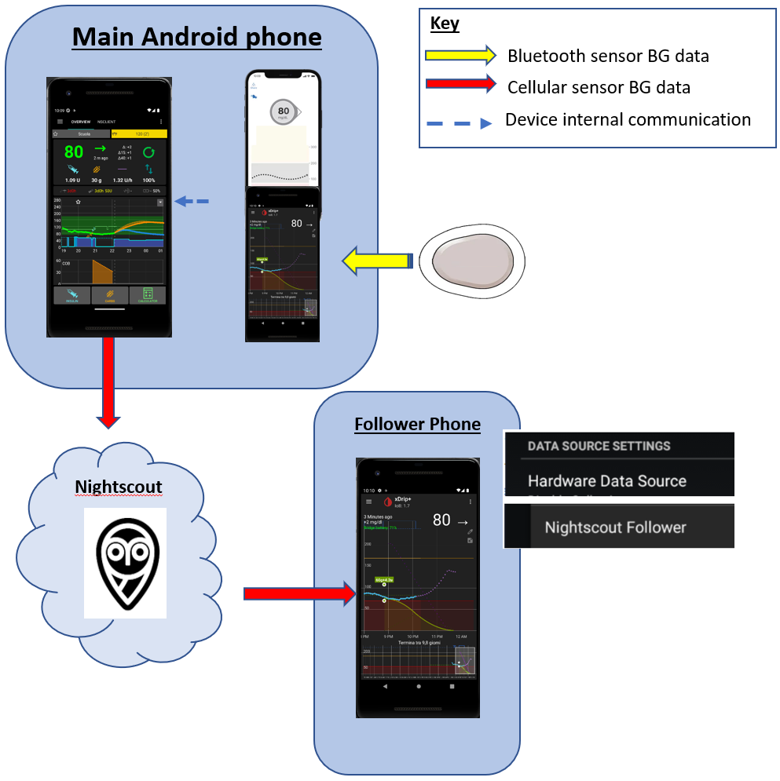
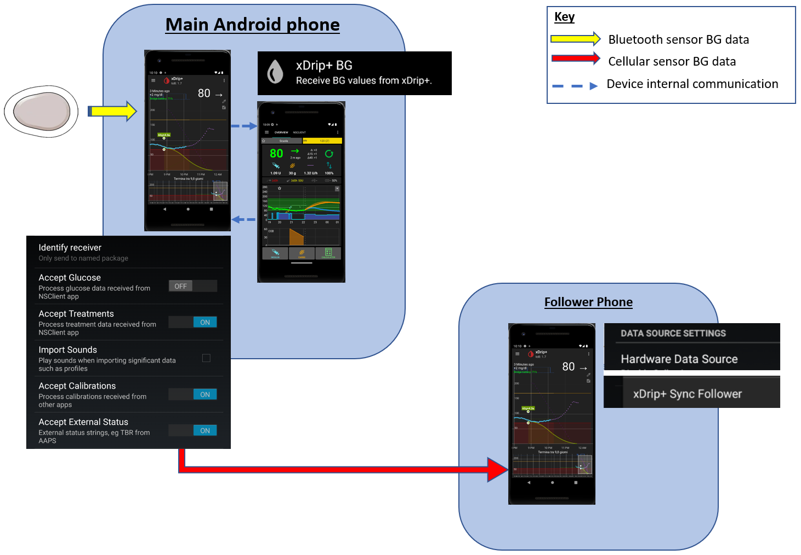
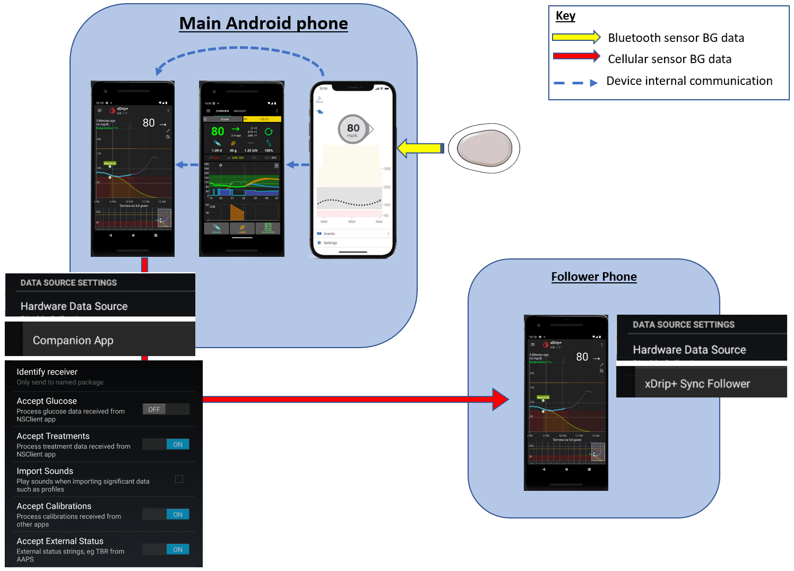
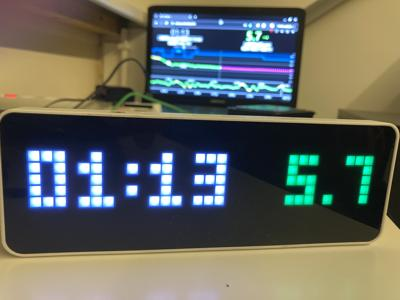

# Praćenje AAPS-a (bez interakcije sa sustavom AAPS)

Osim brojnih mogućnosti za daljinsko upravljanje _i_ praćenje **AAPS-a** koje su opisane na stranici [Daljinsko upravljanje AAPS-om](../RemoteFeatures/RemoteControl.md), zajednica je razvila još nekoliko aplikacija i uređaja za jednostavno praćenje brojeva (razina glukoze i drugih podataka), bez interakcije s **AAPS-om**.

Dobar pregled brojnih mogućnosti za praćenje **AAPS-a** nalazi se na web-stranici [Nightscout follower](https://nightscout.github.io/nightscout/downloaders/#).

```{contents} Table of contents
:depth: 1
:local: true
```

Najčešći načini koji se koriste zajedno s **AAPS-om** detaljnije su objašnjeni u nastavku.

## Aplikacije za pametni telefon

```{contents} These are some of the main “follower” apps used by **AAPS** users. All of these apps are “free”: 
:depth: 1
:local: true
```

### Dexcom Follow ([Android](https://play.google.com/store/apps/details?id=com.dexcom.follow.region2.mgdl) i [iOS](https://apps.apple.com/fr/app/dexcom-follow-mg-dl-dxcm2/id1032203080))


* Dexcom Follow radi na mnogo različitih telefona (Android i iPhone). Dexcom Follow možete koristiti čak i ako ne koristite službenu aplikaciju Dexcom za primanje podataka senzora.

* Mnogi njegovatelji poznaju Dexcom Follow i više vole njegovo jasno sučelje nego nešto složenije.

* Dexcom Follow je vrlo dobar za učitelje, bake i djedove te osobe koje malo znaju o dijabetesu i razinama šećera. Ima upozorenja koja možete prilagoditi (razina GUK-a, koji zvuk se reproducira itd.). Alarmi se po potrebi mogu potpuno isključiti. To je vrlo korisno ako imate senzor koji se još stabilizira i stvara mnogo lažnih niskih vrijednosti.

#### Postavljanje aplikacije Dexcom Follow: upute

Ako za primanje podataka senzora koristite neslužbenu Dexcom aplikaciju BYODA, možda ćete moći slati pozivnice pratiteljima iz aplikacije BYODA.

Iz aplikacija trećih strana više ne možete slati e-poruke s pozivnicama Dexcom pratiteljima. U xDripu će zahtjev za pozivnicu samo prikazati poruku „invite not sent“ (pozivnica nije poslana).

Morate instalirati službenu aplikaciju Dexcom, poslati pozivnicu i zatim deinstalirati službenu aplikaciju.

Koraci su sljedeći:

1)  Instalirajte službenu aplikaciju „Dexcom“ na _bilo koji_ pametni telefon (Android/iPhone). To može biti i telefon pratitelja, ako vam je tako jednostavnije. 2)  Prijavite se svojim Dexcom korisničkim imenom i lozinkom. To su isti podaci za prijavu koje koristite za Dexcom Clarity, ako ste već korisnik Dexcoma/Clarityja. Ako nemate Dexcom račun, u ovom koraku možete izraditi novi.   
3)  Prođite kroz uvodne izbornike. 4)  Za kod senzora odaberite „no code“ (bez koda). 5)  Pod Transmitter SN odaberite „enter manually“ (ručni unos) i unesite bilo koji valjani kod odašiljača. Koristite jedan od kodova svojih isteklih odašiljača, ako ga znate, kako ne bi ometao rad vašeg trenutnog odašiljača. Kodovi imaju točno određen oblik od brojeva i slova: „NLNNNL“ i koriste samo određene kombinacije, pa je najlakše koristiti kod za koji već znate da je valjan. 6)  Dok aplikacija pokušava pronaći odašiljač i senzor, možete pozvati pratitelje: odaberite tri male točke u gornjem lijevom kutu aplikacije i dodajte novog pratitelja. Ovo možete koristiti i ako je netko od vaših pratitelja promijenio telefon i treba novu pozivnicu: ovdje ga možete izbrisati s popisa pratitelja i ponovno mu poslati e-poruku s pozivnicom za novi telefon. 7)  Na telefon pratitelja instalirajte Dexcom Follow iz trgovine App Store (iPhone) ili Google Play (Android). Postavite aplikaciju Dexcom Follow. Aplikacija će vas zamoliti da otvorite e-poštu i pronađete pozivnicu da postanete pratitelj.    
8)  Sada možete izbrisati službenu aplikaciju Dexcom G6.

Za Dexcom Follow podaci senzora se zatim izvoze s **AAPS** telefona, izravno iz BYODA-e ili iz xDripa, ovisno o tome koju aplikaciju koristite.


### [Nightguard](https://apps.apple.com/fr/app/nightguard/id1116430352) (iOS)


Prednosti (prema iskustvu korisnika):

* Dostupan u trgovini [App Store](https://apps.apple.com/us/app/nightguard/id1116430352), jednostavno sučelje, lako za korištenje.

* Povucite gumb ili protresite telefon za odgodu alarma na različita razdoblja, od 5 min do 24 sata

* Prilagodba alarma (upozorenja za visoko i nisko, propuštena očitanja kada nema podataka 15–45 minuta).

* Brzi rast/pad tijekom 2–5 uzastopnih očitanja (sami birate). Možete odabrati i deltu između dvaju pojedinačnih očitanja

* Pametna odgoda: ne upozorava ako se razine kreću u pravom smjeru

* Postoji kartica Care koja, čini se, omogućuje postavljanje novog privremenog cilja na određeno vrijeme, brisanje privremenog cilja ili unos ugljikohidrata.

Nedostaci (prema iskustvu korisnika)

* Dostupno samo za iOS

* TT se prikazuje kao 5 mmol bez obzira na to koja je razina TT-a postavljena

* Nikad ne prikazuje stopu privremenog bazala, iako prikazuje TB

### [Nightwatch](https://play.google.com/store/apps/details?id=se.cornixit.nightwatch) (Android)


* Nightwatch se predstavlja kao Nightscout klijent i prati razine glukoze korisnika u Nightscoutu na Android telefonu ili tabletu.

* Aplikaciju možete preuzeti s [Google Playa](https://play.google.com/store/apps/details?id=se.cornixit.nightwatch). Prikazuje podatke GUK-a u stvarnom vremenu.

* Korisnik može postaviti glasne alarme za nisku i visoku vrijednost po svojoj želji.

* Podaci GUK-a mogu se prikazati u mmol/L ili mg/dL.

* Potreban je Android 5.0 ili noviji.

* It has a dark UI, large readings and buttons, designed for usage at night.

### xDrip (Android)

xDrip možete koristiti kao pratitelja.

#### S Nightscoutom

Postavite xDrip kao Nightscout pratitelja (Nightscout Follower). Primat ćete GUK i tretmane, ali ne i bazal.



#### Bez Nightscouta – xDrip kao izvor podataka GUK-a

Ako je vaš izvor podataka za **AAPS** xDrip (ili ako xDrip može primati GUK i iz druge aplikacije, npr. BYODA, Juggluco, ...), možete ga koristiti na glavnom telefonu za dijeljenje podataka s pratiteljima u xDripu. Prikazuju se GUK, tretmani i bazalne stope.



#### Bez Nightscouta – xDrip s izvorom Companion App

Ako vaš izvor podataka za **AAPS** nije xDrip, ali xDrip može prikazati podatke GUK-a iz izvora podataka Companion App, možete ga koristiti na glavnom telefonu za dijeljenje podataka s pratiteljima u xDripu. Prikazuju se GUK, tretmani i bazalne stope.



### xDrip4iOS (iOS)


xDripSwift was created from porting the original xDrip app to iOS and evolved into "xDrip for iOS", written as **xDrip4iOS**.

```{admonition} Further detail about how to attempt to obtain the original **xDrip4iOS** app
:class: dropdown
[Facebook grupa xDrip4iOS](https://www.facebook.com/groups/853994615056838/announcements) glavna je zajednica za podršku za xDrip4iOS i Shuggah. **xDrip4iOS** se može povezati s mnogo različitih CGM sustava i odašiljača te prikazivati vrijednosti glukoze u krvi, grafove i statistiku, a može i davati alarme. Može i slati podatke u Nightscout ili raditi kao [aplikacija za praćenje Nightscouta](https://xdrip4ios.readthedocs.io/en/latest/connect/follower/). 

„Kako mogu dobiti **xDrip4iOS** na svoj iPhone?“
Postoje dvije mogućnosti:

1. Ako imate Mac i Apple Developer račun (99 EUR/USD godišnje), možete sami izraditi xDrip4iOS [prema uputama](https://xdrip4ios.readthedocs.io/en/latest/install/build/).

Ako želite, zatim možete postati „releaser“ (izdavač) i [podijeliti osobni Testflight xDrip4iOS](https://xdrip4ios.readthedocs.io/en/latest/install/personal_testflight/) s do 100 drugih osoba kako biste im pomogli.

2. Pridružite se [Facebook grupi xDrip4iOS](https://www.facebook.com/groups/853994615056838/announcements) i pročitajte prikvačene objave o trenutnim načinima kako dobiti aplikaciju. **Ne tražite pozivnicu za aplikaciju** (pročitajte pravila grupe).
```


„Što je **Shuggah**?“ Grupa ukrajinskih programera kopirala je kod projekta xDrip4iOS (koji je javno dostupan na GitHubu) i objavila ga u trgovini App Store pod poslovnim računom. Izdanjem Shuggah ni na koji način ne upravljaju programeri xDrip4iOS-a.

[Facebook grupa xDrip4iOS](https://www.facebook.com/groups/853994615056838/announcements) pruža podršku za xDrip4iOS i pripadajuće aplikacije za Apple Watch.

### [Sugarmate](https://apps.apple.com/fr/app/sugarmate/id1111093108) (iOS)


[Sugarmate](https://sugarmate.io/) možete preuzeti na iPhone iz trgovine App Store. Sugarmate radi na:
* Apple iPhone (potreban je sustav verzije 13.0 ili noviji)
* Apple iPad (potreban je sustav verzije 13.0 ili noviji)
* Google Android (spremite web-aplikaciju na početni zaslon)

Korisnici Sugarmatea javljaju da se u SAD-u može koristiti s Apple CarPlayem za prikaz vrijednosti glukoze tijekom vožnje. Još nije poznato je li to moguće i u zemljama izvan SAD-a. If you know more about this, please add details in here to the documentation by completing a [pull request](../SupportingAaps/HowToEditTheDocs.md), which is quick and easy to do.


### [Spike](https://spike-app.com/) (iOS)


Spike se može koristiti kao glavni prijemnik ili kao aplikacija za praćenje. Prikazuje GUK, alarme, aktivni inzulin (IOB) i još mnogo toga.

Web-stranica i aplikacija više se ne razvijaju. Podršku možete pronaći na [Facebooku](https://www.facebook.com/groups/1973791946274873) i [Gitteru](https://gitter.im/SpikeiOS/Lobby).

## Pametni satovi za **nadzor AAPS-a** (svi podaci profila ili samo glukoza) kada **AAPS** radi na telefonu.

Pogledajte [ovdje](../Getting-Started/Watches.md).


## Uređaji za praćenje AAPS-a

```{contents} Devices include:
:depth: 1
:local: true
```

### M5Stack


M5Stack je mala kutija koja se može programirati za mnoge namjene. Martinov projekt [M5Stack NightscoutMon](https://github.com/mlukasek/M5_NightscoutMon/wiki) prikazuje vrijednosti glukoze sa senzora i trendove, aktivni inzulin (IOB) i aktivne ugljikohidrate (COB). Nalazi se u plastičnoj kutiji i ima zaslon u boji, utor za micro SD karticu, 3 gumba, zvučnik i ugrađenu bateriju. To je odličan uređaj za praćenje šećera u krvi i relativno ga je lako postaviti ako imate Nightscout račun. Korisnici ga obično koriste na kućnoj Wi-Fi mreži, ali neki ga koriste kao zaslon i tijekom vožnje motocikla, preko Wi-Fi pristupne točke na telefonu.

### SugarPixel

SugarPixel je uređaj za dodatni prikaz glukoze i sustav upozorenja za kontinuirano praćenje glukoze. Povezuje se s aplikacijom Dexcom ili Nightscout na pametnom telefonu korisnika. Uređaj prikazuje vrijednosti glukoze u krvi u stvarnom vremenu. Ovaj hardverski CGM monitor ima zvučna upozorenja s nasumično generiranim tonovima (koja su iznimno glasna), upozorenja vibracijom za osobe oštećena sluha, prilagodljive opcije prikaza i ugrađeno praćenje za više korisnika.


* SugarPixel ima više opcija prikaza u mg/dL i mmol/L, prema potrebama korisnika, s vrijednostima glukoze označenima bojama.
* Standardni prikaz pokazuje GUK, strelicu trenda i deltu. Delta je promjena (+ ili -) u odnosu na zadnje očitanje.
* SugarPixel se može prilagoditi za korištenje uz slabu svjetlinu s prikazom BG and Time, tako da korisnik na noćnom ormariću vidi svoju vrijednost GUK-a i trenutno vrijeme.
* Prikaz u boji kod SugarPixela koristi cijeli zaslon za prikaz jedne boje koja predstavlja vrijednost GUK-a. Tako korisnik može vidjeti vrijednosti GUK-a s udaljenosti kroz prozor dok se igra vani u dvorištu, na terasi ili u bazenu.
* Prikaz Big BG koristan je za korištenje na noćnom ormariću za osobe koje nose naočale ili kontaktne leće.

### Nightscout Clock na uređaju Ulanzi TC001

**Nightscout Clock** je softver otvorenog koda koji radi na uređaju **Ulanzi TC001**. Povezuje se s Dexcom poslužiteljima ili Nightscoutom i prikazuje vrijednosti glukoze u krvi u stvarnom vremenu.



* Sat podržava jedinice mmol/L i mg/dL te ima zvučne alarme.
* Several displays are available, see [Github nightscout-clock](https://github.com/ktomy/nightscout-clock?tab=readme-ov-file#more-information-for-people-who-needs-it) for an overview.
* Postavljanje i konfiguracija uređaja traže samo nekoliko jednostavnih koraka. Nakon postavljanja za rad su mu potrebni samo napajanje i Wi-Fi.
* Uređaj Ulanzi TC001 znatno je jeftiniji od SugarPixela.
* Softver i upute za instalaciju nalaze se na [Github nightscout-clock](https://github.com/ktomy/nightscout-clock?tab=readme-ov-file).
* Razvija ga i održava Artiom Kenibasov, koji pruža podršku u [Facebook grupi AAPS Users](https://www.facebook.com/groups/cgminthecloud/posts/8776932509094594/).

### Računalo (TeamViewer)
Nekim korisnicima za napredno rješavanje problema na daljinu pomaže alat za potpuni udaljeni pristup kao što je [TeamViewer](https://www.teamviewer.com/).
