# Daljinsko upravljanje AAPS-om

```{contents} In this page
:backlinks: entry
:depth: 2
```

Postoje četiri vrlo učinkovita alata za daljinsko upravljanje **AAPS**-om:

1) [SMS commands](#RemoteControl_SMS-Commands) (follower phone can be either Android or iOS), 2) [AAPSClient](#RemoteControl_aapsclient) (follower device is an Android phone or tablet, or a Windows, Mac or Linux computer; on an iPhone you [build the app yourself](#aapsclient-iphone)) 3) [Nightscout](#RemoteControl_nightscout) (Android, iOS or other computer/device), mainly for following: see the note on [client control](#client-master-control) in that section.  
4) [Smartwatches](#RemoteControl_smartwatches) (Android)

Prva tri alata uglavnom su prikladna za njegovatelje/roditelje, a pametni satovi vrlo su korisni za njegovatelje/roditelje **i** za odrasle osobe s dijabetesom.

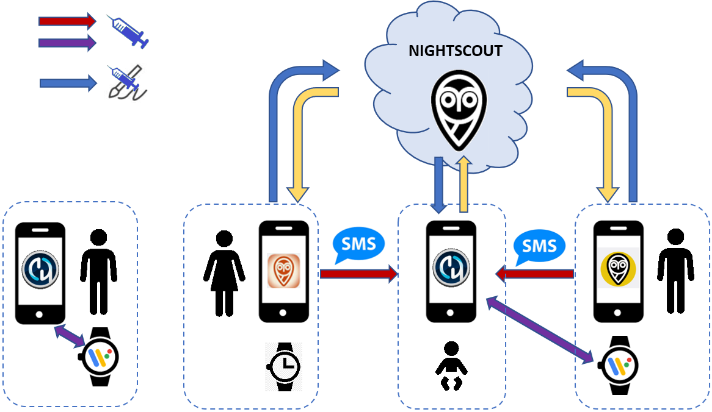

(RemoteControl_SMS-Commands)=

## 1) SMS naredbe

Pogledajte posebnu stranicu [SMS naredbe](../RemoteFeatures/SMSCommands.md).

(RemoteControl_aapsclient)=
## 2) AAPSClient

**AAPSClient** izgleda vrlo slično samom **AAPS**-u i nudi njegovatelju iste zaslone i gumbe za daljinsko slanje naredbi **AAPS**-u:


(remotecontrol-aapsclient-versions)=
### O aplikacijama AAPSClient, AAPSClient2 i AAPSClient3

Postoje 3 verzije klijentske aplikacije: **AAPSClient**, **AAPSClient2** i **AAPSClient3**. Rade na isti način. Jedina razlika je u tome što se mogu instalirati jedna pokraj druge na isti telefon pratitelja.

Njegovatelju koji prati jednu osobu treba samo **AAPSClient**. Da biste pratili drugu osobu i daljinski upravljali njezinim sustavom (s njezinom vlastitom **Nightscout** stranicom i njezinim telefonom s **AAPS**-om), instalirajte i **AAPSClient2**, a za treću osobu **AAPSClient3**. Svaka se aplikacija zasebno postavlja i [uparuje](#aapsclient-pairing-with-the-master) s **Nightscout** stranicom i telefonom s **AAPS**-om osobe koju prati.

Kako biste lakše razlikovali aplikacije, neki elementi imaju različitu boju: žutu za **AAPSClient**, plavu za **AAPSClient2** i zelenu za **AAPSClient3**. Ti elementi su ikona aplikacije, pozadina widgeta i odjeljak statusa **AAPS**-a na početnom zaslonu aplikacije. <br/> Napomena: prozirnost pozadine widgeta može se postaviti u konfiguraciji widgeta. Pri maloj neprozirnosti boja se teško vidi.

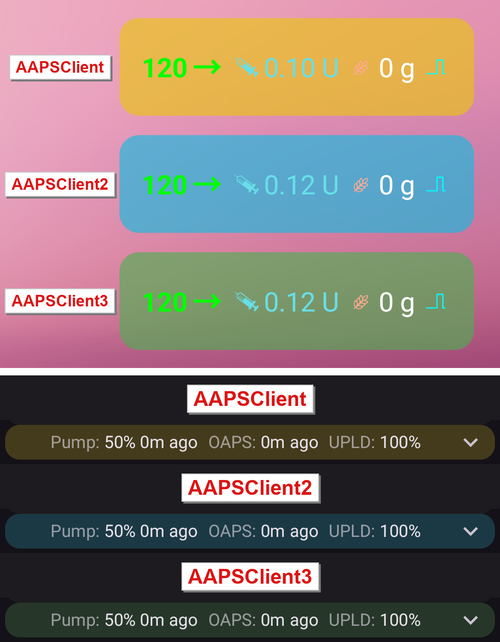

### Preuzimanje i instalacija

**AAPSClient** se može instalirati na jedan telefon ili na više telefona pratitelja (npr. telefon pratitelja roditelja 1 i telefon pratitelja roditelja 2), tako da oba njegovatelja dobiju pristup i mogu daljinski upravljati pacijentovim telefonom s **AAPS**-om.

To download **AAPSClient**, navigate to the [GitHub repository](https://github.com/nightscout/AndroidAPS/releases/) and click on the asset **“app-AAPSClient-release_x.x.x.x”** (it may be a newer version to that shown in the screenshot below):

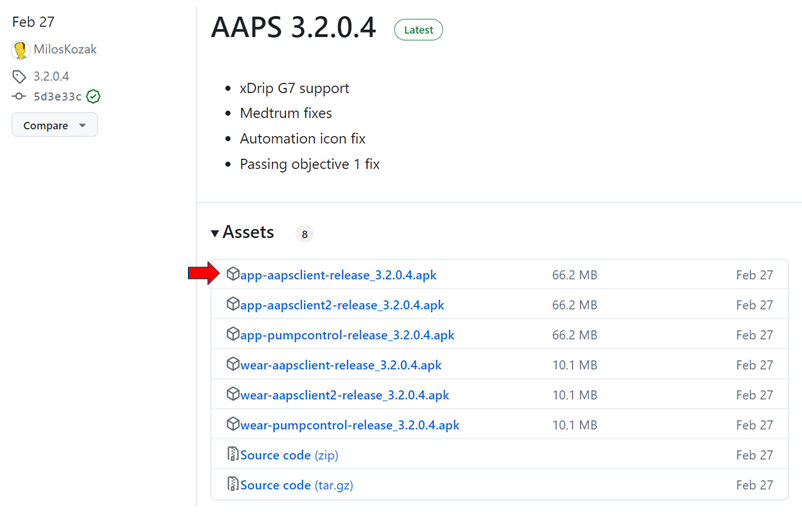

Zatim na računalu idite u _preuzimanja_. On Windows, _downloads_ will show in the right hand ribbon:

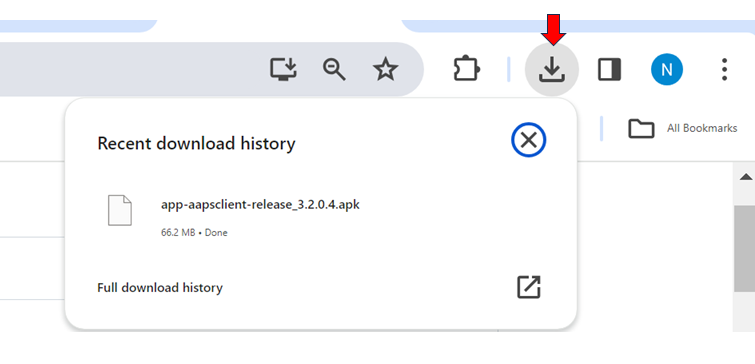

Kada se datoteka preuzme, kliknite _prikaži u mapi_ da je pronađete.

**AAPSClient** apk sada možete:

prenijeti na telefon pratitelja USB kabelom; ili povući u mapu na Google Driveu i zatim dodati na telefon pratitelja klikom na datoteku „app-AAPSClient-release“.

Should you be needing **AAPS** for yourself, and **AAPSClient** for monitoring someone else, you will need to build **AAPSClient** yourself instead of downloading it from the GitHub repository as described above. Razlog je to što na isti telefon ne možete instalirati i **AAPS** i **AAPSClient** ako su potpisani različitim ključem. <br/> Da biste sami izradili **AAPSClient**, slijedite isti postupak kao za [uobičajenu izradu AAPS-a](../SettingUpAaps/BuildingAaps.md). Na stranici **Generate signed App Bundle or APK** odaberite **aapsclientRelease** umjesto **fullRelease**.

Isto pravilo vrijedi kada na jedan telefon pratitelja instalirate nekoliko klijentskih aplikacija (**AAPSClient**, **AAPSClient2**, **AAPSClient3**): sve moraju biti potpisane **istim ključem**. Inače Android odbija instalirati drugu aplikaciju (greška `INSTALL_FAILED_DUPLICATE_PERMISSION`).

### Sinkronizacija: postavljanje AAPSClienta i AAPS-a

Once the __AAPSClient__ apk is installed on the follower phone, make sure **NSClientV3** is set up the same way on both phones for Nightscout 15 (see the [update notes](../Maintenance/UpdateToNewVersion.md)). Primjer u nastavku prikazuje postavljanje sinkronizacije s NSClientV3 i Nightscoutom 15; u __AAPS__-u su dostupni i drugi izvori podataka (npr. xDrip).

U **Konfiguracija** > **Komunikacija** korisnik sinkronizira svoje podatke s Nightscoutom putem __NSClientV3__ (koristeći v3 API), postavljenog na isti način i za __AAPS__ i za telefon pratitelja.


Korisnik mora osigurati da su telefoni s AAPS-om i s AAPS Clientom __oba__ sinkronizirani tako da na svakom postavi NSClientV3. Na telefonu pratitelja to se umjesto toga može napraviti skeniranjem QR koda koji prikazuje **AAPS**, pogledajte [Uparivanje AAPSClienta s AAPS-om](#remotecontrol-pairing) u nastavku:

- Upišite svoj **Nightscout URL** u **Postavke** NSClientV3

- U istim postavkama upišite svoj **Nightscout pristupni token**. Slijedite upute [ovdje](https://nightscout.github.io/nightscout/security/#create-a-token). Na telefonu s **AAPS**-om koristite **administratorski token**: pomoću njega **AAPS** izrađuje zaseban token za svaki telefon pratitelja.

- Enable **Use websockets** on **both** phones. Websockets are **mandatory** for remote control from **AAPSClient**, on both phones. Without them, **AAPSClient** can follow **AAPS** but cannot control it. Na oba telefona WebSockets također ubrzavaju sinkronizaciju, uz malo veću potrošnju baterije.

  Your Nightscout host must support websockets. If the websocket connection keeps dropping, remote control does not work. See [Troubleshooting NSClient](../GettingHelp/TroubleshootingNsClient.md).


Korisnik treba provjeriti da i __AAPSClient__ i __AAPS__ prikazuju „Povezano“ na zaslonu **NSClientV3** na svakom telefonu. U ovom trenutku **AAPSClient** prati **AAPS** (GUK, tretmane, profil), ali njime još ne može upravljati: uparite dva telefona kako je opisano u nastavku.

(remotecontrol-pairing)=
### Uparivanje AAPSClienta s AAPS-om (daljinsko upravljanje)

Od **AAPS** verzije 4 **AAPSClient** upravlja **AAPS**-om putem sigurne, **uparene** veze. Sama sinkronizacija nije dovoljna: dok telefoni nisu upareni, **AAPSClient** prikazuje samo **Upravljanje** s **Profilom** samo za pregled i **Upari s glavnim uređajem**.

1. Na telefonu s **AAPS**-om otvorite **Upravljanje → Ovlašteni klijenti** i uključite **Dopusti upravljanje s klijenta** (zadano je isključeno, a u jednostavnom načinu rada uvijek je uključeno).
2. Dodirnite **+**, upišite naziv telefona pratitelja, odaberite kako se postavlja i odaberite njegovu **ulogu**:
   - **QR kod: Nightscout i uparivanje** — **AAPS** prikazuje QR kod koji jednim skeniranjem postavlja Nightscout na telefonu pratitelja i uparuje ga. Za to je potreban administratorski token u postavkama NSClientV3 na telefonu s **AAPS**-om.
   - **PIN** — za telefon pratitelja bez kamere koji je već spojen na Nightscout: zapišite jednokratni **PIN** (vrijedi oko dvije minute).
3. Na telefonu s **AAPSClientom** skenirajte kod (u čarobnjaku za postavljanje ili u **Upravljanje → Upari s glavnim uređajem → Skeniraj QR kod**) ili otvorite **Upravljanje → Upari s glavnim uređajem** i upišite PIN. Potvrdite.

Telefon pratitelja tada se prikazuje kao **Aktivan** na popisu **Ovlašteni klijenti**, a **AAPSClient** prikazuje **Tretmani**, **Scene** i **Upravljanje**. Telefon pratitelja dobiva vlastiti Nightscout token, samo s pravima koja su mu potrebna. Cijeli postupak, sa snimkama zaslona i rješavanjem problema, nalazi se na stranici [Upravljanje glavni uređaj ↔ klijent](#client_master_master_setup).

Provjerite radi li postavka: upišite ugljikohidrate u **AAPSClientu**, potvrdite prikazanu količinu i provjerite pojavljuje li se unos u **Tretmani** na oba telefona.

(remotecontrol-nightscout-access-token)=

### Rješavanje problema s konfiguracijom „Nightscout pristupnog tokena“

Točna konfiguracija „Nightscout pristupnog tokena“ može se razlikovati, ovisno o tome je li vaš Nightscout plaćena usluga (hosting) ili nije.

Ako imate problema s time da **AAPS** prihvati „Nightscout pristupni token“, a koristite plaćenu uslugu za Nightscout, najprije se obratite svom pružatelju usluge Nightscout i pitajte kako riješiti probleme s „Nightscout pristupnim tokenom“. Inače se obratite grupi **AAPS**, ali prije toga još jednom provjerite jeste li točno slijedili upute [ovdje](https://nightscout.github.io/nightscout/security/#create-a-token).

### Što nudi AAPSClient

Nakon uparivanja **AAPSClient** nudi njegovatelju gotovo iste zaslone kao i sam **AAPS**:

- **Tretmani**: bolus inzulina, ugljikohidrati i bolus kalkulator.
- **Scene**: pokretanje i zaustavljanje [scena](../DailyLifeWithAaps/Scenes.md).
- **Upravljanje**: profili, postavke inzulina, privremeni ciljevi, Brzi kalkulator, automatizacija, hrana, rotacija mjesta primjene, uparivanje i trenutni privremeni bazal.
- **Glavni izbornik**: povijest tretmana, preglednik povijesti, statistika, održavanje, konfiguracija.

U **AAPSClientu** nema pumpe ni ciljeva. Detaljan opis pogledajte na stranici [Aplikacija AAPSClient](AapsClient.md).

**AAPSClient** omogućuje njegovatelju da daljinski, putem mobilne ili internetske mreže, napravi većinu promjena koje su dopuštene izravno u **AAPS**-u, **uključujući boluse inzulina**. Svaka naredba je potpisana i šalje se putem Nightscouta na telefon s **AAPS**-om, koji je provjerava prema vlastitim podacima, ograničava, prikazuje vam vlastitu potvrdu i tek je tada izvršava. **AAPSClient** _može_ biti mnogo brži od [SMS naredbi](../RemoteFeatures/SMSCommands.md), posebno za naredbe koje bi trebale provjeru autentičnosti.

Tretmani uneseni u Nightscout na drugi način (na primjer putem web stranice Nightscouta) ne primjenjuju se dok je upravljanje s klijenta uključeno: **AAPS** je tada u [zaštićenom načinu rada](#client-master-control-hardened-mode) i prihvaća promjene samo od uparenih klijenata. Kada je upravljanje s klijenta isključeno, primjenjuju se samo ako su uključene odgovarajuće opcije **Primaj** u [odjeljku Sinkronizacija u postavkama NSClienta](#Preferences-nsclient-synchronization).

Daljinsko upravljanje putem **AAPSClienta** preporučuje se samo ako vaša sinkronizacija dobro radi (_tj._ ne vidite neželjene promjene podataka, npr. same od sebe promijenjene TT, TBR itd.).

### AAPSClient s opcijama za pametni sat

Pametni sat može biti vrlo koristan alat za upravljanje **AAPS**-om kod djece. Moguće je nekoliko različitih konfiguracija. Ako je **AAPSClient** instaliran na telefonu njegovatelja, aplikaciju [**AAPSClient WearOS**](https://github.com/nightscout/AndroidAPS/releases/) možete preuzeti i instalirati na kompatibilni pametni sat koji je povezan s telefonom roditelja. Prikazat će trenutni GUK i status petlje. Kada je **AAPSClient** uparen s **AAPS**-om, radnje sa sata (uključujući boluse, ugljikohidrate, privremene ciljeve i promjene profila) prosljeđuju se putem **AAPSClienta** **AAPS**-u, koji ih potvrđuje i izvršava: pogledajte [Wear OS na klijentu](#clientmastercontrol-wear-os-on-a-client). Više o pametnim satovima možete pročitati [ovdje](#remotecontrol-smartwatches).

(RemoteControl_nightscout)=
## 3) Nightscout

Osim što je Nightscout poslužitelj „u oblaku“, postoji i posebna aplikacija **Nightscout** koju možete preuzeti izravno iz App Storea na svom iPhoneu. If you have an Android follower phone, there is not a dedicated Nightscout app and it is better to use [**AAPSClient**](#RemoteControl_aapsclient), or, if you only want to follow, and not send treatments you can download and install the [Nightwatch](https://play.google.com/store/apps/details?id=se.cornixit.nightwatch) app from the Playstore.

Kada instalirate aplikaciju **Nightscout** na iPhone, otvorite je i slijedite upute za postavljanje te upišite adresu svog Nightscouta (pogledajte dolje lijevo). Oblik adrese može se razlikovati, ovisno o tome gdje je vaš Nightscout smješten. (_npr._ http://youraddresshere.herokuapp.com). Zatim upišite svoju Nightscout API tajnu (pogledajte dolje desno). Ako aplikacija ne zatraži API lozinku, morate je upisati klikom na lokot na vrhu aplikacije:

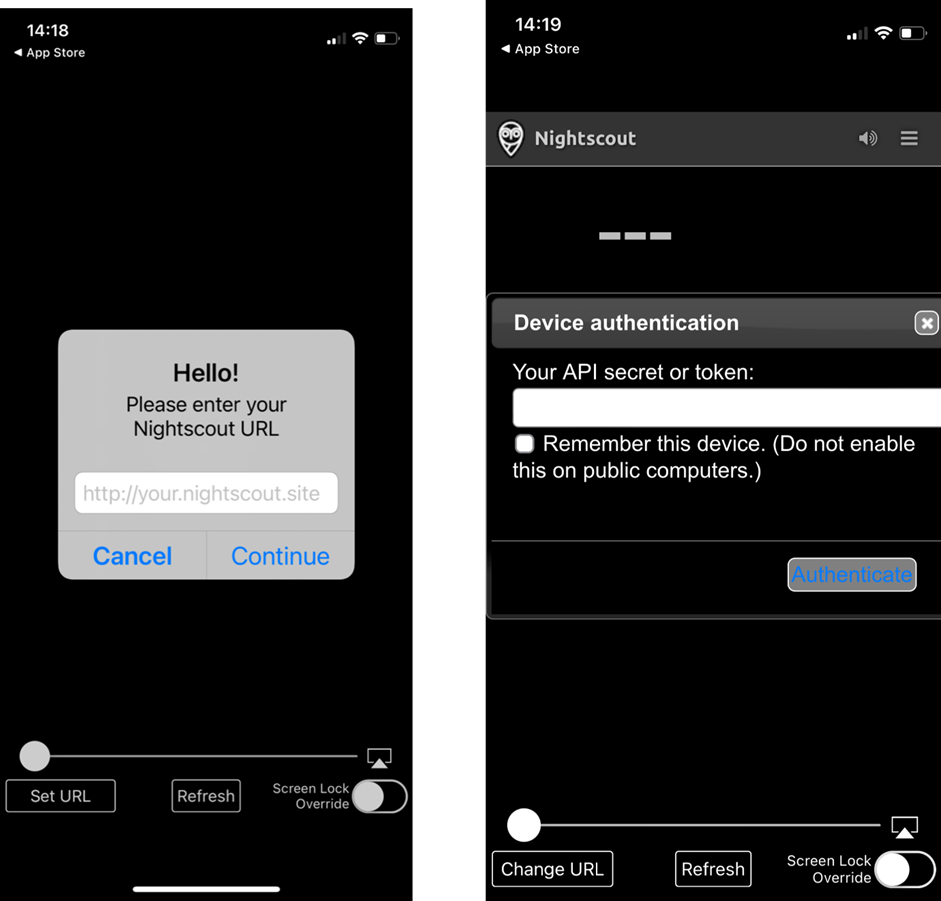

Više informacija o postavljanju možete pronaći izravno na stranici [Nightscout](https://nightscout.github.io/nightscout/discover/)

Kada se prvi put prijavite, prikaz će biti vrlo jednostavan. Prilagodite opcije prikaza tako da odaberete „hamburger“ izbornik gore desno i pomaknete se prema dolje:

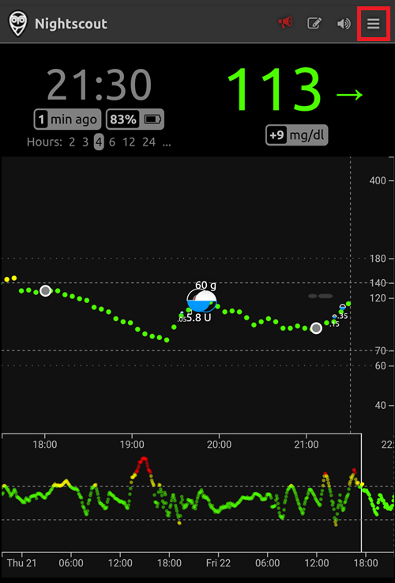

Pomaknite se prema dolje do „Settings“. Možda ćete htjeti promijeniti „scale“ u „linear“, jer je zadani prikaz GUK-a logaritamski, a pod „render basal“ odaberite „default“ kako bi se prikazao bazal pumpe.

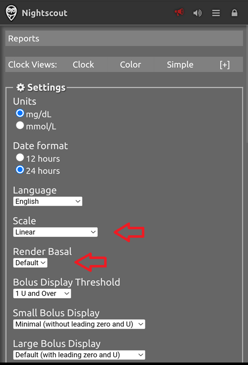

Odaberite opcije koje želite. Isključite alarme ako za alarme koristite neku drugu aplikaciju.

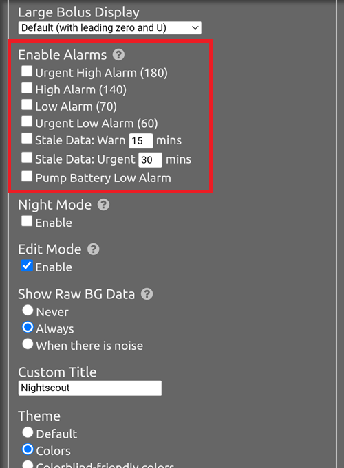

Nastavite se pomicati prema dolje dok ne dođete do „show plugins“.

Provjerite je li „careportal“ označen. Možete odabrati i razne druge podatke (najkorisniji su: IOB, care portal, pump, cannula age, insulin age, basal profile i OpenAPS).

Važno: sada morate kliknuti „save“ na dnu kako bi se te promjene primijenile.

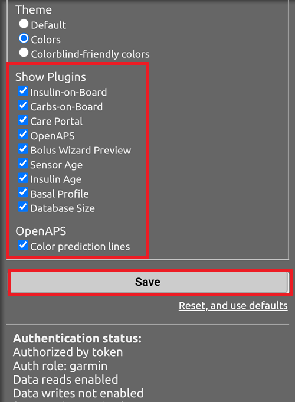

Nakon što pritisnete „save“, aplikacija će se vratiti na glavni zaslon Nightscouta, koji će izgledati otprilike ovako:

1. Trenutna vrijednost glukoze
2. Informacije o statusu sustava AAPS – dodirnite pojedine kartice na zaslonu za više detalja. Ove opcije prikaza dodajte ili uklonite putem hamburger izbornika.
3. Nedavni tijek glukoze s prikazanim tretmanima (ugljikohidrati, bolusi)
4. Dugoročni tijek glukoze
5. „Hamburger“ izbornik za postavljanje opcija prikaza, izradu izvješća, uređivanje profila i administratorske alate Nightscouta
6. Izbornik „**+**“ za unos tretmana (pogledajte [u nastavku](#RemoteControl_nightscout-treatments) kada ih **AAPS** primjenjuje).
7. Odaberite drugo razdoblje za prikaz
8. Bazalni profil inzulina
9. Zelena linija = prošle vrijednosti glukoze Plave linije = predviđena glukoza

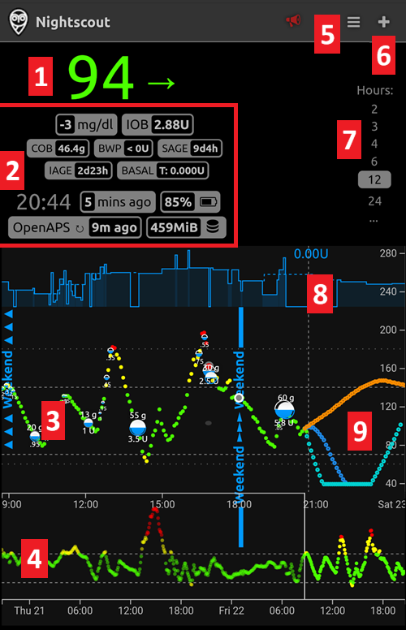

Detaljnije o izborniku gore lijevo u aplikaciji Nightscout:

1. Careportal – naknadno uređivanje
2. Uključivanje/isključivanje alarma
3. Hamburger – za postavke
4. Careportal – zabilježi tretman (pogledajte [u nastavku](#RemoteControl_nightscout-treatments) kada ih **AAPS** primjenjuje)

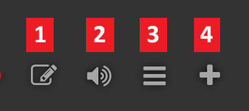

U sivim karticama na ovom zaslonu nalazi se mnogo informacija o statusu sustava **AAPS** (a još više informacija vidjet ćete ako dodirnete karticu):

1. Trend glukoze za 5 min
2. Pregled bolus kalkulatora (BWP)
3. Pritisnite Basal da vidite trenutni profil i informacije o bazalu
4. Vrijeme od zadnjeg CGM očitanja u AAPS-u
5. **Pumpa**: inzulin, postotak baterije i kada se AAPS zadnji put spojio na nju
6. Kada je AAPS zadnji put osvježen – ako je to više od 5 min, možda postoji problem s vezom između telefona s AAPS-om i pumpe/CGM-a
7. Pritisnite IOB da vidite podjelu na bazalni i bolusni inzulin
8. Starost inzulina u spremniku
9. Starost kanile
10. Status baterije telefona s AAPS-om
11. Veličina vaše baze podataka. Ako postane prepuna (samo za vlastiti Nightscout – kod plaćenih usluga to zanemarite), mogu se pojaviti problemi s vezom. Podatke možete izbrisati kako biste smanjili taj broj u izborniku Admin tools (putem hamburger izbornika).

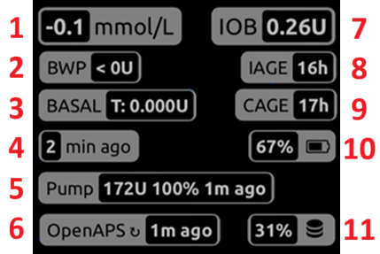

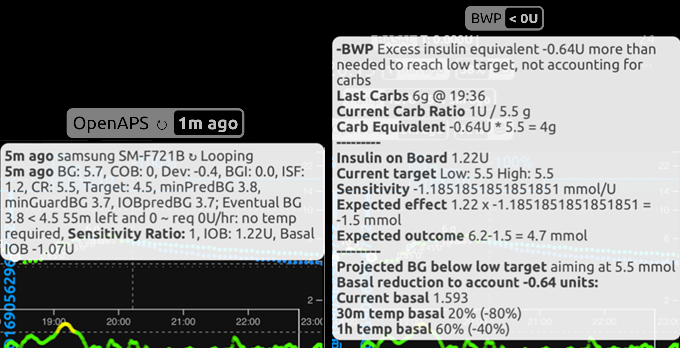

Pritisnite „refresh“ na dnu stranice da zatvorite skočni prozor.

(RemoteControl_nightscout-treatments)=
### Slanje tretmana u AAPS putem aplikacije Nightscout

In **AAPS** 4 the supported way to control **AAPS** remotely is a **paired AAPSClient**, see [Master ↔ Client control](#client-master-control): each client has a [role](#client-master-control-roles) that limits what it may do, and every command is signed by the client, then checked and confirmed by the **AAPS** phone. Dok je upravljanje s klijenta uključeno, telefon s **AAPS**-om je u [zaštićenom načinu rada](#client-master-control-hardened-mode): tretmani, privremeni ciljevi i zamjene profila uneseni na web stranici Nightscouta ili u aplikaciji Nightscout **ne** primjenjuju se. Aplikacija Nightscout tada služi samo za praćenje.

```{admonition} Only when client control is off
:class: warning
Ako je **Dopusti upravljanje s klijenta** isključeno u **Upravljanje → Ovlašteni klijenti** (i jednostavni način rada je isključen), **AAPS** primjenjuje careportal unose iz Nightscouta samo za vrste podataka koje ste uključili pod **Primaj** u [odjeljku Sinkronizacija u postavkama NSClientV3](#Preferences-nsclient-synchronization): ugljikohidrati, privremeni ciljevi, zamjene profila i ostali careportal unosi. Inzulin se nikada ne isporučuje na ovaj način: „Correction bolus“ (korekcijski bolus) unesen u Nightscout samo se *bilježi*, a **AAPS** ga ubraja u aktivni inzulin, ali ga ne isporučuje. Ova postavka ne preporučuje se za daljinsko upravljanje; umjesto toga koristite upareni **AAPSClient**.
```

Više o opcijama **Nightscouta** pročitajte [ovdje](https://nightscout.github.io/)

### Savjeti kako najbolje iskoristiti aplikaciju Nightscout

1). Ako „zapnete“ na nekoj stranici i želite ponovno vidjeti glavni zaslon, samo kliknite „refresh“ (dolje u sredini) i vratit ćete se na početnu stranicu **Nightscouta** s GUK grafom.

Da biste vidjeli trenutni profil koji radi na telefonu, pritisnite različite ikone na zaslonu iznad grafa. Više informacija (trenutni omjer ugljikohidrata, osjetljivost, vremenska zona itd.) vidjet ćete ako pritisnete „basal“, a „OpenAPS“ daje informacije o profilu, trenutnom cilju itd. Možete pratiti i postotak baterije telefona i postotak baterije pumpe. BWP pokazuje što algoritam misli da će se dogoditi u budućnosti, s obzirom na aktivni inzulin (IOB) i aktivne ugljikohidrate (COB).

#### Ostale ikone u izborniku: što znači olovka (uređivanje)?

Olovkom za uređivanje (tehnički) možete pomaknuti ili izbrisati tretmane bolusa ili korekcije iz zadnjih 48 h.

Više o tome [ovdje](https://nightscout.github.io/nightscout/discover/#edit-mode-edit)

To bi moglo biti korisno za brisanje zabilježenih ugljikohidrata (za koje nije dan bolus), ali u praksi to trenutno ne radi dobro s **AAPS**-om. Preporučujemo da takve promjene radite izravno u aplikaciji **AAPS**.

(RemoteControl_smartwatches)= (remotecontrol-smartwatches)=

## 4) Pametni satovi

### Opcija 1) Upravljanje AAPS-om sa sata s Wear OS-om

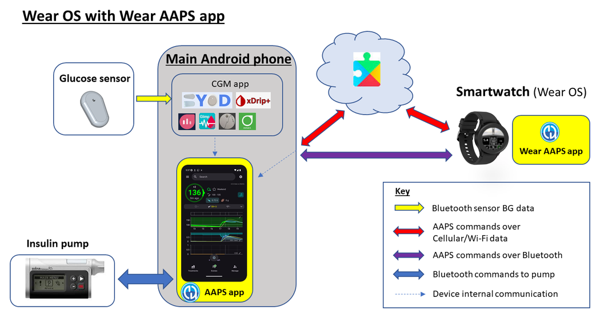

Kada [postavite **AAPS** na svoj sat](../WearOS/BuildingAapsWearOS.md), detaljne informacije o Watchfaceovima pametnog sata i njihovim funkcijama pronaći ćete u [Postavljanje AAPS-a na vaš Wear OS sat](../WearOS/WearOsSmartwatch.md).

Ukratko, s pametnog sata možete pokrenuti sljedeće funkcije:

* postaviti privremeni cilj

* koristiti bolus kalkulator (varijable izračuna mogu se odrediti u postavkama na telefonu)

* dati eUH (e-ugljikohidrate)

* dati bolus (inzulin + ugljikohidrati)

* postavke sata

* status

* provjeriti status pumpe

* provjeriti status petlje

* provjeriti i promijeniti profil, CPP (Circadian Percentage Profile = vremenski pomak + postotak)

* prikazati TDD (ukupna dnevna doza = bolus + bazal po danu)

* Daljinski bolus kada su njegovatelj i dijete s DT1 na različitim mjestima (to je moguće za sat s **AAPS**-om i telefon s **AAPS**-om, ako su oba uređaja spojena na mrežu)

#### Komunikacija njegovatelja sa satom putem drugih aplikacija (npr. WhatsApp)

Na sat možete dodati i druge aplikacije, npr. WhatsApp, za razmjenu poruka (na primjer) između njegovatelja i djece. Važno je da je s telefonom povezan samo JEDAN Google račun, inače sat neće prenijeti te podatke. Za Samsung račun morate imati 13 ili više godina, a račun mora biti postavljen na istu adresu e-pošte koja se koristi na Android telefonu.

Video koji objašnjava kako postaviti WhatsApp za poruke na satu Galaxy 4 (ne možete dobiti sve funkcije WhatsAppa) možete pogledati [ovdje](https://gorilla-fitnesswatches.com/how-to-get-whatsapp-on-galaxy-watch-4/)

Ako prilagodite postavke u aplikaciji **Galaxy wearable** na telefonu s **AAPS**-om i na satu, WhatsApp poruke mogu se najaviti laganom vibracijom i prikazati preko postojećeg Watchfacea.

### Opcija 2) **AAPS** na satu, za daljinsko upravljanje **AAPS**-om na telefonu

Slično kao kod telefona pratitelja s **AAPSClientom** ili SMS naredbama (pogledajte odjeljke iznad), pametni sat može se koristiti za daljinsko upravljanje **AAPS**-om i prikaz svih podataka profila. Glavna razlika u odnosu na telefon pratitelja je to što je veza između pametnog sata i telefona s **AAPS**-om ostvarena putem Bluetootha, pa ne trebaju ni Nightscout ni kod za provjeru autentičnosti. Usput, ako su i pametni sat i telefon s **AAPS**-om, povezani Bluetoothom, također na Wi-Fi/mobilnoj podatkovnoj mreži, sat će komunicirati s telefonom s **AAPS**-om i na većoj udaljenosti. To uključuje daljinsku isporuku bolusa kada su njegovatelj sa satom s **AAPS**-om i dijete s DT1 (s telefonom s **AAPS**-om) na različitim mjestima, što može biti korisno kada je dijete s DT1 u školi.

Pametni sat za daljinsko upravljanje stoga je često koristan u svim situacijama u kojima:

a)  naredbe putem **AAPSClienta** ili **SMS**-a ne mogu raditi; ili

b)  korisnik ne želi upisivati kod za provjeru autentičnosti (kao što je potrebno za SMS naredbe).

Pametni sat treba **Wear OS 3 ili noviji** da bi mogao upravljati **AAPS**-om. Provjerite tehničke specifikacije sata i pogledajte stranicu [Pametni satovi i AAPS](../Getting-Started/Watches.md). Search, or ask in the **AAPS** Facebook/Discord groups if unsure.

Specific How-to guides for setting up **AAPS** on the popular Samsung Galaxy Watch 4 (40mm) are given below. Sat [Garmin](https://apps.garmin.com/en-US/apps/a2eebcac-d18a-4227-a143-cd333cf89b55?fbclid=IwAR0k3w3oes-OHgFdPO-cGCuTSIpqFJejHG-klBTm_rmyEJo6gdArw8Nl4Zc#0) također je popularan izbor. Ako imate iskustva s postavljanjem nekog drugog pametnog sata i mislite da bi to bilo korisno drugima, dodajte to na ove stranice ([uredite dokumentaciju](../SupportingAaps/HowToEditTheDocs.md)) kako biste svoja saznanja podijelili s cijelom zajednicom **AAPS**.

### Opcija 3) AAPSClient na satu, za daljinsko upravljanje **AAPS**-om na telefonu

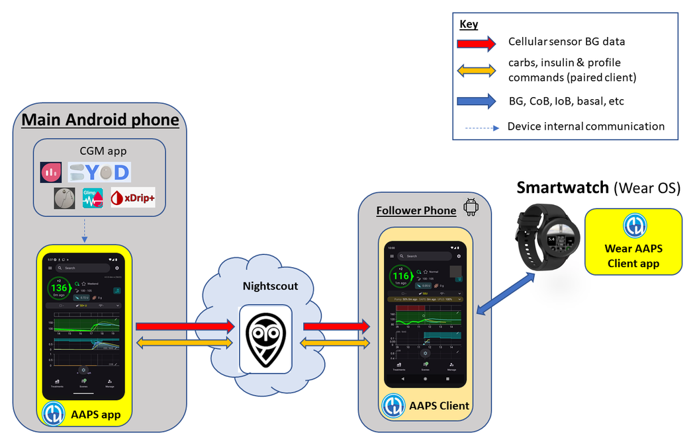

The software for the watch, **AAPSClient** Wear apk, can be downloaded directly from [GitHub](https://github.com/nightscout/AndroidAPS/releases/).

Da biste preuzeli softver, kliknite na aplikaciju za sat koja odgovara klijentskoj aplikaciji na telefonu: **wear-aapsclient-release_**_verzija_ ide s **AAPSClient**, **wear-aapsclient2-release_**_verzija_ ide s **AAPSClient2** (pogledajte [O aplikacijama AAPSClient, AAPSClient2 i AAPSClient3](#remotecontrol-aapsclient-versions)):


Zatim odaberite „save as“ (spremi kao) i spremite datoteku na prikladno mjesto na računalu:


**AAPSClient** wear apk možete prenijeti na telefon i instalirati na sat na isti način kao aplikaciju **AAPS** Wear, kako je opisano u [Prijenos aplikacije Wear na vaš telefon s AAPS-om](#remote-control-transferring-the-aaps-wear-app-onto-your-aaps-phone)  


