# Upravljanje AAPS-om putem pametnog sata s Wear OS-om

(Watchfaces-aaps-watchfaces)=

## AAPS Watchfaceovi

```{warning}
Klasični Watchfaceovi **AAPS-a** rade samo na Wear OS-u 5 i starijim verzijama, a Wear OS 5 ih već ograničava. Na **Wear OS-u 6 i novijim verzijama** aplikacija za sat umjesto toga instalira jedan Watchface u Googleovom formatu Watch Face Format: vaš prilagođeni Watchface kao sliku ili **Watchface s komplikacijama**. Pogledajte [Promjene Watchfacea u Wear OS-u](#wearos-watchface-changes) da biste saznali što prestaje raditi u kojoj verziji Wear OS-a, te [Watchface koji AAPS instalira](#wearos-aaps-v4-watchface) za Wear OS 6.
```

Na Wear OS-u 5 i starijim verzijama u aplikaciju **AAPS** za sat ugrađeno je nekoliko klasičnih Watchfaceova. Prikazuju vrijednost glukoze s deltom, aktivni inzulin (IOB), trenutnu bazalnu stopu i graf očitanja. Na njima rade dva dodira:

* Dvaput dodirnite vrijednost glukoze da biste otvorili glavni izbornik **AAPS-a**
* Dvaput dodirnite graf da biste promijenili njegov vremenski raspon

Na svakoj verziji Wear OS-a [komplikacije](#Watchfaces-complications) i [pločice](#WearOsSmartwatch-wear-os-tiles) opisane na ovoj stranici rade sa svakim Watchfaceom koji ima mjesta za njih.

## Konfiguracija

Omogućite **Wear** u [**Konfiguracija** > **Komunikacija**](#Config-Builder-wear).

Da biste davali bolus ili izvršavali druge radnje sa sata, uključite **Upravljanje sa sata**. Opcije bolus kalkulatora za sat postavljaju se na istom mjestu: pogledajte [Postavke > Wear](#preferences-wear). Dok je **Upravljanje sa sata** isključeno, telefon odbija svaki tretman ili promjenu načina rada poslanu sa sata, a sat prikazuje *„Upravljanje sa sata je isključeno u postavkama Wear na telefonu.“*

Pomoću **Otvori dodatak** na kartici **Wear** otvarate zaslon Wear:

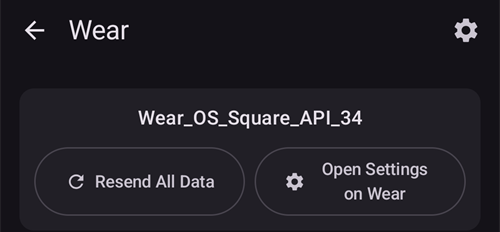

Gornji redak prikazuje naziv povezanog sata ili **(Sat nije povezan)**. Na ovom zaslonu možete

* Ponovno pošalji sve podatke. Može pomoći ako sat neko vrijeme nije bio povezan, a vi želite poslati podatke na sat.
* Otvorite postavke sata izravno s telefona.
* Odabrati koji Watchface **AAPS** instalira na sat (**Watchface instaliran na satu**: vaš prilagođeni Watchface ili Watchface s komplikacijama). Ova se kartica prikazuje samo dok je povezan sat s **Wear OS-om 6** ili novijim. Pogledajte [Watchface koji AAPS instalira](#wearos-aaps-v4-watchface).
* Upravljati **Prilagođenim Watchfaceom** (kartica se prikazuje dok je sat povezan): **Učitaj Watchface** šalje prilagođeni Watchface na sat, **Info Watchface** prikazuje pojedinosti učitanog Watchfacea i polja koja sadrži, **Više Watchfaceova** otvara [stranicu za razmjenu](../ExchangeSiteCustomWatchfaces/index.md) u pregledniku, a **Izvezi predložak** sprema predložak koji možete uređivati. Pregled učitanog Watchfacea prikazuje se ispod gumba. Pogledajte [Prelazak na AAPS Watchface](#WearOS_changing-to-AAPS-watchface).

Provjerite da obavijesti AAPS-a nisu blokirane na satu. Potvrda radnje (npr. bolusa, privremenog cilja) stiže kao obavijest koju trebate povući i označiti kvačicom.

## Otvaranje glavnog izbornika AAPS-a

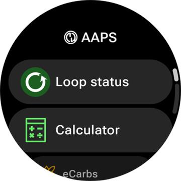

Glavni izbornik **AAPS-a** otvorite na jedan od ovih načina:

* otvorite **AAPS** s popisa aplikacija na satu
* dodirnite komplikaciju **AAPS-a** koja otvara izbornik, pogledajte [Postavke komplikacija](#WearOsSmartwatch-complication-settings)
* dodirnite pločicu **GUK graf** kojoj je **Radnja na dodir** postavljena na **Glavni izbornik**, pogledajte [Postavke pločica](#WearOsSmartwatch-wear-os-tiles)
* na klasičnom Watchfaceu **AAPS-a** dvaput dodirnite vrijednost glukoze

(WearOsSmartwatch-loop-status)=

## Zaslon Status petlje

Zaslon **Status petlje** daje sažetak onoga što petlja radi, a da ne morate uzeti telefon. Otvorite ga iz glavnog izbornika AAPS-a (**Status petlje** ili **Status → Petlja**) ili dodirom na komplikaciju **Glukoza u krvi**. Izbornik **Status** ima i stranicu **Pumpa** i stranicu **TDD** s ukupnim dnevnim dozama.

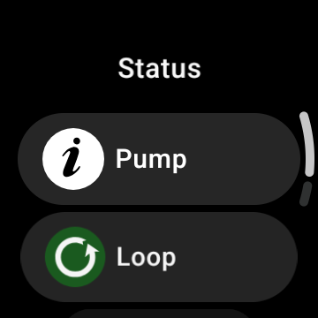

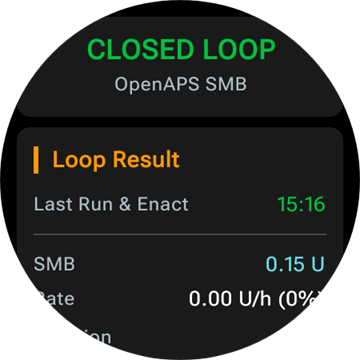

Zaslon je popis kartica. Pomaknite se prema dolje da biste vidjeli sve:

* **Način rada** — trenutni način rada (zatvorena petlja, otvorena petlja, LGS, suspendirano, odspojeno…) i, za privremeni način rada, koliko još traje.
* **Rezultat petlje** — kada je petlja zadnji put radila te privremeni bazal ili SMB koji je zatražila.
* **Scena** — samo dok je [scena](#scenes-from-watch) aktivna: njezin naziv, preostalo vrijeme (ili **Do završetka** za scenu bez vremena završetka) i sljedeću scenu (**Slijedi**) koja počinje kada ova završi.
* **Ciljevi** — vaš cilj i privremeni cilj, ako je aktivan.
* **Profil** — naziv aktivnog profila, s **Postotkom** i **Vremenskim pomakom** kada nisu zadane vrijednosti. Privremena zamjena profila je istaknuta i prikazuje koliko još traje te profil na koji se vraća kada završi (**Vraća na**).
* **Osjetljivost** — isti redci kao na oznaci osjetljivosti na glavnom zaslonu telefona: vrijednost Autosensa te ISF iz profila, promjenjivi ISF i stvarni ISF.

Mala ikona scene pored načina rada, privremenog cilja ili zamjene profila znači da ih je **Postavila aktivna scena**. Ista se ikona prikazuje i u izborniku **Način rada**.

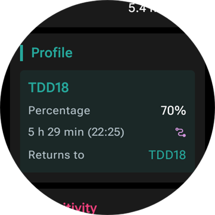

(WearOsSmartwatch-bolus-calculator)=

## Bolus kalkulator na satu

Otvorite **Kalkulator** iz glavnog izbornika **AAPS-a**, s [pločice Radnje](#WearOsSmartwatch-wear-os-tiles) ili s komplikacije postavljene da otvara kalkulator. Kalkulator ima nekoliko stranica, povucite zdesna nalijevo za sljedeću:

| Ugljikohidrati                                                   | Zahtjev                                                                 | Rezultat                                                                | Izračun                                                                            | Potvrdi                                                                 |
| ---------------------------------------------------------------- | ----------------------------------------------------------------------- | ----------------------------------------------------------------------- | ---------------------------------------------------------------------------------- | ----------------------------------------------------------------------- |
| 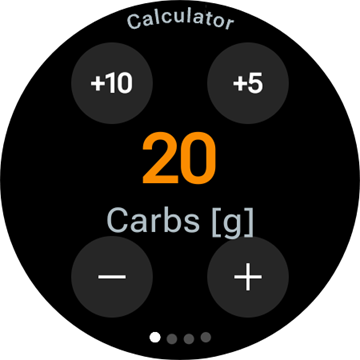 | 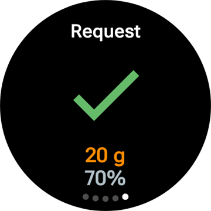 | 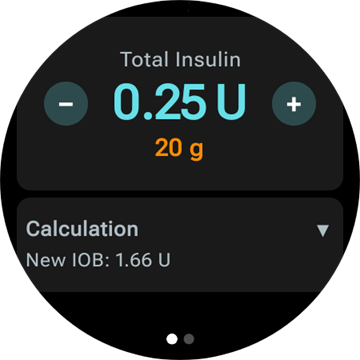 | 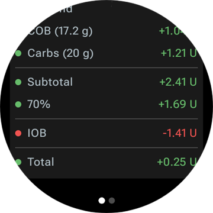 | 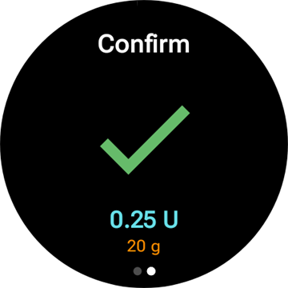 |

1. **UH**: unesite ugljikohidrate gumbima **+10**, **+5**, **−** i **+**.
2. **Zahtjev**: zadnja stranica prije nego što preuzme telefon. Prikazuje što ste unijeli: ugljikohidrate te vrstu obroka, vrijeme ugljikohidrata i postotak ako ih koristite, pogledajte [Dodatne stranice](#WearOsSmartwatch-calculator-optional-pages). Dodirnite kvačicu da biste zahtjev poslali na telefon, koji izvodi izračun.
3. **Rezultat**: bolus koji **AAPS** predlaže, a ispod njega ugljikohidrati: ugljikohidrati sada i eUH kasnije, vrijeme ugljikohidrata i zvono podsjetnika za jelo. Dozu prilagodite gumbima **−** i **+**, pogledajte niže. Pomaknite se prema dolje do kartice **Izračun**: dodirnite je da biste vidjeli svaki redak izračuna, isto kao na telefonu.
4. **Potvrdi**: povucite na drugu stranicu i dodirnite kvačicu. Telefon isporučuje bolus i bilježi ugljikohidrate.

(WearOsSmartwatch-calculator-optional-pages)=

### Dodatne stranice

Tri postavke na satu dodaju po jednu stranicu nakon stranice **UH**. Zadano su isključene. Otvorite glavni izbornik **AAPS-a**, zatim **Postavke** > **Sučelje**, i uključite one koje želite; kada je uključeno više njih, stranice dolaze ovim redom: **Vrsta obroka**, **Vrijeme UH**, **Postotak**. Točke na dnu kalkulatora pokazuju koliko stranica ima.

| Postavke                                                                             | Vrsta obroka                                                                   | Vrijeme UH                                                                   | Postotak                                                                    |
| ------------------------------------------------------------------------------------ | ------------------------------------------------------------------------------ | ---------------------------------------------------------------------------- | --------------------------------------------------------------------------- |
| 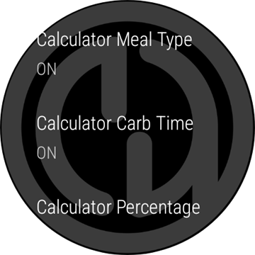 | 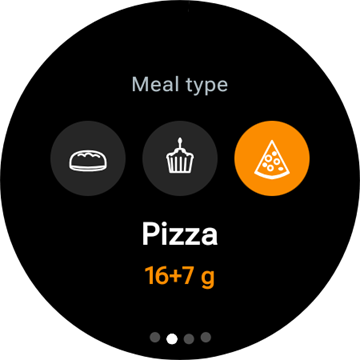 | 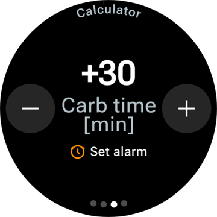 | 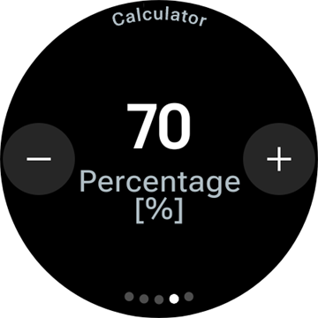 |

* **Vrsta obroka u kalkulatoru**: **Kruh**, **Kolač** ili **Pizza**, što ugljikohidrate sporog obroka dijeli na ugljikohidrate sada i eUH kasnije, pogledajte [Odabir vrste obroka](#WearOsSmartwatch-wizard-meal-type).
* **Vrijeme UH u kalkulatoru**: minute do jela, sa zvonom **Postavi alarm** za podsjetnik za jelo, pogledajte [Vrijeme ugljikohidrata i podsjetnik za jelo](#WearOsSmartwatch-wizard-carb-time).
* **Postotak kalkulatora**: postotak izračunatog bolusa, na primjer 70 % kada želite manju dozu. Počinje od vrijednosti **Postotak bolusa** iz [postavki bolus kalkulatora](#Preferences-deliver-this-part-of-bolus-wizard-result) na telefonu, 100 % ako je niste promijenili. Pogledajte i napomenu u odjeljku [Prilagodba bolusa na stranici Rezultat](#WearOsSmartwatch-wizard-result).

(WearOsSmartwatch-wizard-result)=

### Prilagodba bolusa na stranici Rezultat

Stranica Rezultat prikazuje bolus koji **AAPS** predlaže, zajedno s gumbima **−** i **+**. Pomoću njih prilagodite dozu prije nego što je potvrdite, bez povratka na telefon.

| Predloženo                                                                      | Više                                                                             | Manje                                                                              |
| ------------------------------------------------------------------------------- | -------------------------------------------------------------------------------- | ---------------------------------------------------------------------------------- |
| 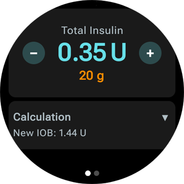 | 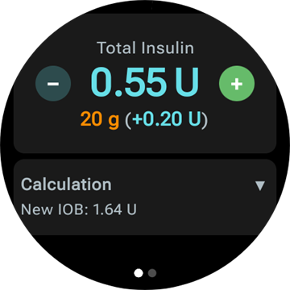 | 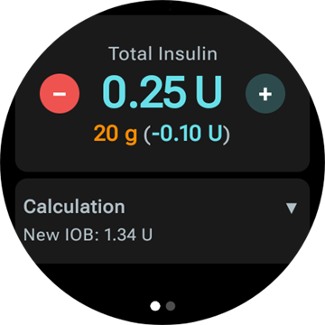 |

* Svaki pritisak mijenja bolus za **jedan korak vaše pumpe**, pa ponuđene količine uvijek odgovaraju onome što vaša pumpa stvarno može isporučiti.
* **Pritisnite i držite** gumb da bi se vrijednost nastavila mijenjati. Što dulje držite, to se brže mijenja.
* Ne možete ići ispod **0 J** ni iznad postavke **maksimalnog bolusa**.

Trenutni ukupni iznos prikazan je na stranici Rezultat, tako da uvijek vidite količinu koju ćete potvrditi. Promjena se prikazuje nakon ugljikohidrata, na primjer *(+0,20 J)*, a gumb koji ste koristili postaje zelen za više ili crven za manje.

Ako je **AAPS** morao ograničiti dozu, na primjer zato što je izračunati bolus veći od postavke **maksimalnog bolusa**, to piše u narančastom retku upozorenja ispod ukupnog iznosa (na primjer *„Primijenjeno ograničenje bolusa“*). Isto vrijedi i za ograničenu količinu ugljikohidrata.

```{admonition} Ovo nije isto što i Postotak kalkulatora :class: note Postavka **Postotak kalkulatora** omogućuje da unesete *postotak* izračunatog bolusa **prije** nego što se pojavi stranica Rezultat. Gumbi **−** i **+** prilagođavaju *konačnu količinu* **na** stranici Rezultat. Možete koristiti oboje.

    <br />(WearOsSmartwatch-wizard-meal-type)=
    
    ### Odabir vrste obroka
    
    Kalkulator na satu može ugljikohidrate sporog obroka podijeliti na ugljikohidrate sada i eUH kasnije, kao [vrsta ugljikohidrata](#AapsScreens-carbs-type) u kalkulatoru na telefonu. Uključite **Vrsta obroka u kalkulatoru** u izborniku sata **Postavke** > **Sučelje**. Postavka je zadano isključena i tada se stranica **Vrsta obroka** preskače.
    
    * Nakon što unesete ugljikohidrate, stranica **Vrsta obroka** prikazuje tri ikone: **Kruh**, **Kolač** i **Pizza**. Dodirnite ikonu: njezin naziv i ugljikohidrati koje daje prikazuju se ispod ikona, na primjer *65 g* za kruh ili *52+22 g* za pizzu (52 g sada i 22 g eUH kasnije). **Kruh** je zadana vrsta i ostavlja sve ugljikohidrate za sada.
    * Stranice Zahtjev i Potvrdi prikazuju ugljikohidrate na isti način (*52+22 g*). Stranica Rezultat prikazuje i kada eUH počinju i koliko traju.
    * Bolus se izračunava samo za ugljikohidrate koje jedete sada. Podjela koristi iste brojeve kao kalkulator na telefonu.
    
    (WearOsSmartwatch-wizard-carb-time)=
    
    ### Vrijeme ugljikohidrata i podsjetnik za jelo
    
    Kada je **Vrijeme UH u kalkulatoru** uključeno u izborniku sata **Postavke** > **Sučelje**, nakon ugljikohidrata slijedi stranica **Vrijeme UH**: minute do jela, kao [vrijeme ugljikohidrata](#aaps-screens-bolus-wizard) u kalkulatoru na telefonu. **Sada** je zadana vrijednost. **−** i **+** pomiču vrijeme u koracima od 5 minuta, do jednog sata prije ili poslije sadašnjeg trenutka. Vrijeme u prošlosti je za ugljikohidrate koje ste već pojeli.
    
    S vremenom u budućnosti ispod vrijednosti se pojavljuje zvono **Postavi alarm**. Zadano je uključeno, dodirnite ga da biste ga isključili. Stranice Zahtjev i Rezultat prikazuju vrijeme ugljikohidrata, na primjer *+30 min*, i zvono. Telefon bilježi ugljikohidrate u to vrijeme, s njima pomiče i eUH vrste obroka te pokreće svoj podsjetnik **Vrijeme za jelo**.
    
    | Rezultat | GUK graf | U tijeku | Vrijeme za jelo |
    | --- | --- | --- | --- |
    | 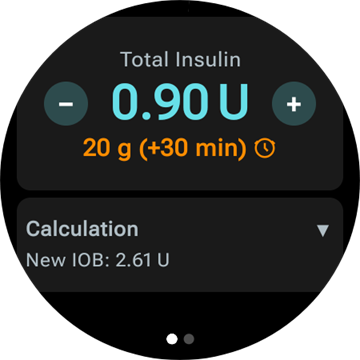 | 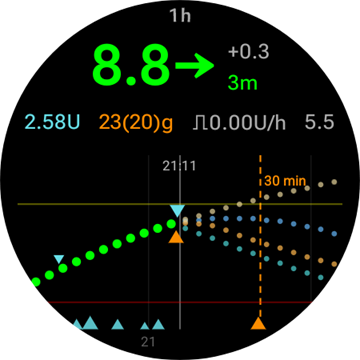 | 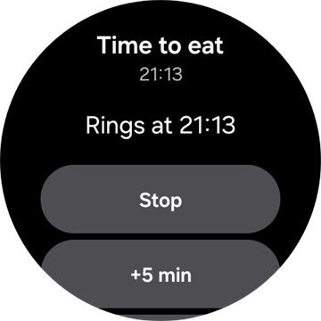 | 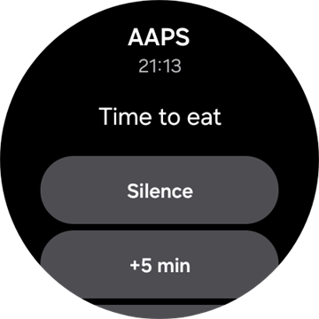 |
    
    Podsjetnik postoji i na satu, pa zvoni i kada telefon nije u blizini:
    
    * Zaslon **GUK graf**, pločica **GUK graf** i graf na **Watchfaceu s komplikacijama** crtaju narančastu isprekidanu liniju na mjestu gdje podsjetnik zvoni, a pored nje preostale minute.
    * Dok traje, u popisu obavijesti nalazi se tiha obavijest **Vrijeme za jelo** s gumbima **Zaustavi** i **+5 min**. Vraća se kada je povučete u stranu, sve dok podsjetnik ne završi.
    * Kada dođe vrijeme, sat vibrira, i ponovno svakih pola minute tijekom pet minuta, dok ne odgovorite. Obavijest nudi **Utišaj** i **+5 min**, a povlačenje obavijesti u stranu također je utišava.
    
    **Zaustavi**, **Utišaj** i **+5 min** rade isto na satu, na telefonu i u aplikaciji **AAPSClient**, i svi prikazuju isti podsjetnik.
    
    (Watchfaces-complications)=
    
    ## Komplikacije
    
    _Komplikacija_ je pojam iz tradicionalne izrade satova, gdje opisuje dodatak glavnom Watchfaceu – kao još jedan mali prozor ili mali brojčanik (s datumom, danom u tjednu, mjesečevom mijenom itd.). Wear OS 2.0 prenosi tu ideju i omogućuje da se prilagođeni izvori podataka, kao što su vrijeme, obavijesti, brojači kondicije i drugo, dodaju na svaki Watchface koji podržava komplikacije.
    
    Aplikacija AAPS za Wear OS podržava komplikacije od verzije `2.6` i omogućuje da se svaki Watchface treće strane koji podržava komplikacije postavi tako da prikazuje podatke AAPS-a (GUK s trendom, aktivni inzulin (IOB), aktivne ugljikohidrate (COB) itd.).
    
    Komplikacije služe i kao **prečac** do funkcija AAPS-a. Dodirom na njih možete otvoriti izbornike i dijaloge AAPS-a (ovisno o vrsti komplikacije i konfiguraciji).
    
    
    
    ### Vrste komplikacija
    
    Aplikacija AAPS za Wear OS daje samo neobrađene podatke, prema unaprijed određenim formatima. Watchface treće strane sam odlučuje gdje i kako će prikazati komplikacije, uključujući raspored, rub, boju i font. Od mnogih dostupnih vrsta komplikacija u Wear OS-u AAPS koristi:
    
    * `SHORT TEXT` – sadrži dva retka teksta, svaki od 7 znakova, koji se ponekad nazivaju vrijednost i oznaka. Obično se prikazuje u krugu ili malom ovalu – jedna ispod druge ili jedna pored druge. To je komplikacija s vrlo malo prostora. AAPS pokušava ukloniti nepotrebne znakove kako bi sve stalo: zaokružuje vrijednosti, uklanja nule na početku i kraju vrijednosti itd.
    * `LONG TEXT` – sadrži dva retka teksta, svaki od približno 20 znakova. Obično se prikazuje u pravokutniku ili dugom ovalu – jedna ispod druge. Koristi se za više detalja i tekstualni status.
    * `RANGED VALUE` – koristi se za vrijednosti iz unaprijed određenog raspona, na primjer za postotak. Sadrži ikonu i oznaku, a obično se prikazuje kao kružni pokazivač napretka.
    * `LARGE IMAGE` – prilagođena slika koja se može koristiti kao pozadina (ako je Watchface podržava).
    * `SMALL IMAGE` / `MONOCHROMATIC IMAGE` – mala ikona. Na mjestu `SMALL IMAGE` AAPS je crta u svojoj boji; na mjestu `MONOCHROMATIC IMAGE` boju joj daje Watchface.
    
    ### Postavljanje komplikacija
    
    Da biste dodali komplikaciju na Watchface, konfigurirajte ga dugim pritiskom i dodirom na ikonu zupčanika ispod. Ovisno o tome kako ih pojedini Watchface konfigurira – dodirnite mjesta za komplikacije ili otvorite izbornik postavki Watchfacea za komplikacije. Komplikacije AAPS-a grupirane su pod stavkom izbornika AAPS.
    
    Kada konfigurirate komplikacije na Watchfaceu, Wear OS prikazuje i filtrira popis komplikacija koje mogu stati na odabrano mjesto na Watchfaceu. Ako određenu komplikaciju ne možete pronaći na popisu, vjerojatno je razlog njezina vrsta, koja se ne može koristiti na tom mjestu.
    
    ### Komplikacije koje nudi AAPS
    
    AAPS nudi sljedeće komplikacije. „Otvara“ znači što dodir radi kada je **Radnja pri dodiru komplikacije** ostavljena na **Zadano**, pogledajte [Postavke komplikacija](#WearOsSmartwatch-complication-settings).
    
    **Glukoza**
    
    * **Glukoza u krvi** (`SHORT TEXT`, otvara _Status petlje_): vrijednost glukoze sa strelicom trenda u prvom retku, starost očitanja i delta u drugom.
    * **Glukoza u krvi (veliki prikaz)** (`SHORT TEXT`, otvara _GUK graf_): samo vrijednost glukoze u prvom retku, tako da je Watchface može prikazati velikom. Starost očitanja i strelica trenda nalaze se u drugom retku.
    * **GUK graf** (`SMALL IMAGE` / `LARGE IMAGE`, otvara _GUK graf_): GUK graf kao slika, za Watchfaceove s mjestom za sliku. To je graf na **Watchfaceu s komplikacijama**.
    * **Potpuni status** (`LONG TEXT`, otvara _Izbornik_): većina podataka u jednom retku: vrijednost glukoze sa strelicom trenda, delta i starost očitanja, zatim aktivni ugljikohidrati, aktivni inzulin i bazalna stopa.
    * **Potpuni status (okrenut)** (`LONG TEXT`, otvara _Izbornik_): isto, ali s zamijenjenim recima, za Watchfaceove koji prikazuju samo jedan od dva retka mjesta `LONG TEXT`.
    
    **Inzulin i ugljikohidrati**
    
    * **Ikona IOB** (`SHORT TEXT`, otvara _Bolus_): aktivni inzulin s ikonom štrcaljke.
    * **IOB detaljno** (`SHORT TEXT`, otvara _Bolus_): ukupni aktivni inzulin u prvom retku, bolusni i bazalni dio u drugom.
    * **Ikona COB** (`SHORT TEXT`, otvara _Kalkulator_): aktivni ugljikohidrati s ikonom ugljikohidrata.
    * **COB detaljno** (`SHORT TEXT`, otvara _Kalkulator_): aktivni ugljikohidrati sada u prvom retku, ugljikohidrati koji tek dolaze (eUH) u drugom.
    * **COB & IOB** (`SHORT TEXT`, otvara _Kalkulator_): aktivni inzulin u prvom retku, aktivni ugljikohidrati u drugom.
    
    **Bazal i cilj**
    
    * **Bazalna stopa** (`SHORT TEXT`, otvara _Izbornik_): trenutna bazalna stopa.
    * **BR & IOB** (`SHORT TEXT`, otvara _Izbornik_): aktivni inzulin u prvom retku, bazalna stopa u drugom.
    * **BR & cilj** (`SHORT TEXT`, otvara _Privremeni cilj_): cilj u prvom retku, s preostalim vremenom kada je aktivan privremeni cilj, i bazalna stopa u drugom.
    * **Cilj** (`SHORT TEXT`, otvara _Privremeni cilj_): cilj u prvom retku i, dok je aktivan privremeni cilj, njegovo preostalo vrijeme u drugom.
    * **BR, COB & IOB** (`SHORT TEXT`, otvara _Izbornik_): bazalna stopa u prvom retku, aktivni ugljikohidrati i aktivni inzulin u drugom.
    
    **Petlja i telefon**
    
    * **Način rada** (`SMALL IMAGE` / `ICON`, otvara _izbornik Način rada_): trenutni način rada petlje kao ikona: zatvorena petlja, otvorena petlja, zaštita od niske razine glukoze, suspendirano, odspojeno ili onemogućeno. Dodir otvara izbornik s promjenama načina rada koje su trenutno dopuštene, na primjer **Suspendiraj petlju**, **Odspoji pumpu**, **Nastavi petlju** ili **Ponovno spoji pumpu**. Isti izbornik nalazi se u glavnom izborniku **AAPS-a** pod **Način rada**.
    * **Baterija uploadera/telefona** (`RANGED VALUE` / `SHORT TEXT` / `ICON`, otvara _Status_): baterija telefona s **AAPS-om**, kao pokazivač s ikonom baterije, kao broj ili samo kao ikona. Osvježava se zajedno s ostalim podacima **AAPS-a**, obično svakih 5 minuta s novim očitanjem.
    
    Izbornik **Način rada**, otvoren iz komplikacije, glavnog izbornika ili pločice Način rada:
    
    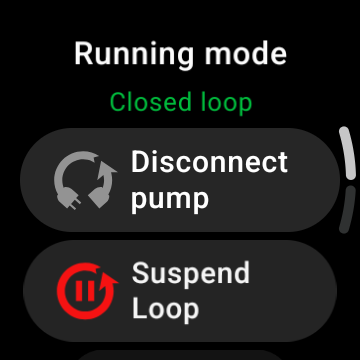
    
    (WearOsSmartwatch-complication-settings)=
    
    ### Postavke komplikacija
    
    U glavnom izborniku **AAPS-a** na satu otvorite **Postavke** > **Komplikacije**:
    
    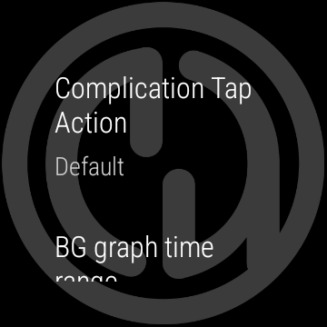
    
    * **Radnja pri dodiru komplikacije** (zadano `Default`): što otvara dodir na komplikaciju **AAPS-a**, za sve komplikacije odjednom:
      * _Zadano_: ono što otvara sama komplikacija, pogledajte gornji popis
      * _Izbornik_: glavni izbornik **AAPS-a**
      * _Kalkulator_: bolus kalkulator
      * _Tretman_: dijalog tretmana, inzulin i ugljikohidrati
      * _eUH_: dijalog eUH
      * _Status_: izbornik statusa
      * _Način rada_: izbornik načina rada. Potrebno je uključeno **Upravljanje sa sata** u postavkama Wear na telefonu, inače se umjesto toga otvara glavni izbornik.
      * _Nijedan_: dodir ne radi ništa
    * **Vremenski raspon GUK grafa** (zadano `3 hours`): koliko sati prikazuje komplikacija **GUK graf**, 1, 3 ili 6. Pločica GUK graf ima vlastitu postavku.
    * **Unicode u komplikacijama** (zadano `On`): komplikacije koriste Unicode simbole kao što su `Δ` za deltu, `⁞` kao razdjelnik i `⎍` za bazalnu stopu. Kako izgledaju ovisi o fontu Watchfacea. Isključite ovo (`Off`) kada ih Watchface prikazuje kao kvadratiće ili prazna mjesta.
    
    (WearOsSmartwatch-wear-os-tiles)=
    
    ## Pločice za Wear OS
    
    Pločice su stranice do kojih dolazite povlačenjem s Watchfacea. **AAPS** donosi sedam pločica, svaka sa skupom od najviše četiri gumba. Dodir na gumb otvara odgovarajući dijalog na satu ili traži potvrdu, a zatim posao obavlja telefon. Pločica je prečac, a ne prikaz statusa: ne sadrži stanje aplikacije na telefonu.
    
    Prije korištenja pločica uključite **Upravljanje sa sata** u [Postavke > Wear](#preferences-wear).
    
    ### Dodavanje pločice
    
    Postoje dva načina, ovisno o vašem satu i telefonu:
    
    1. Na satu: povucite s Watchfacea dalje od zadnje pločice do **Dodaj pločicu** i odaberite pločicu **AAPS-a**. Na većini satova dugi pritisak na pločicu također otvara prikaz za dodavanje i uklanjanje.
    2. Na telefonu, u pratećoj aplikaciji vašeg sata (**Galaxy Wearable** za Samsung, **Wear OS** za druge proizvođače): otvorite **Pločice**, dodirnite **Dodaj** i odaberite pločice **AAPS-a** koje želite. Redoslijed pločica možete promijeniti povlačenjem.
    
    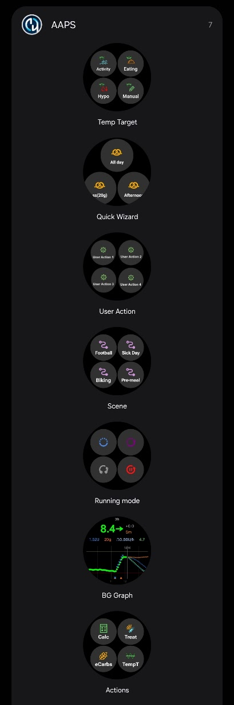
    
    ### Postavke pločica
    
    Pločice **Radnje**, **Privremeni cilj**, **GUK graf** i **Scena** imaju postavke na satu. Otvorite glavni izbornik **AAPS-a**, zatim **Postavke** > **Pločice**, i odaberite pločicu. Dugi pritisak na pločicu također otvara njezine postavke, osim na satovima Pixel. Ostale tri pločice puni telefon i na satu nemaju ništa za postaviti.
    
    | Glavni izbornik | Postavke | Pločice |
    | --- | --- | --- |
    | 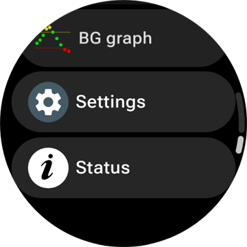 | 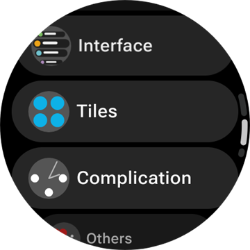 | 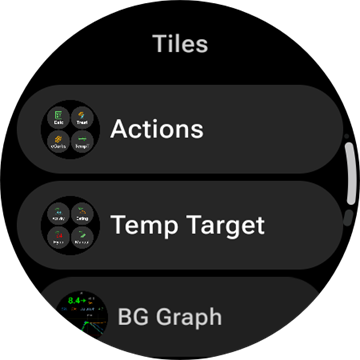 |
    
    Postavke pločice su popis njezinih četiriju mjesta. Dodirnite mjesto da biste odabrali što prikazuje ili **Nijedan** da biste ga ostavili praznim.
    
    | Dugi pritisak na pločicu | Postavke pločice Privremeni cilj |
    | --- | --- |
    | 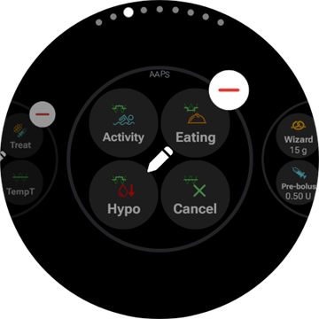 | 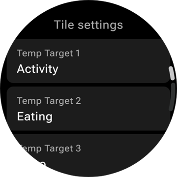 |
    
    Svaka pločica ima četiri mjesta. Pločica s više stavki prikazuje prve četiri.
    
    ### Pločica Radnje
    
    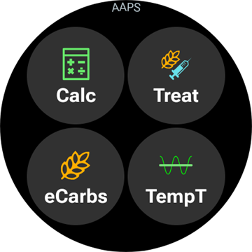
    
    Prečaci do dijaloga aplikacije **AAPS** za sat. U postavkama pločice odaberite najviše četiri od sljedećih:
    
    * **Izračun**: bolus kalkulator, s unosom ugljikohidrata, neobaveznim postotkom [1] i neobaveznom vrstom obroka [2]
    * **Tretman**: inzulin i ugljikohidrati odjednom
    * **Inzulin**: bolus, unesen u jedinicama
    * **UH**: ugljikohidrati, također produženi ugljikohidrati. Prihvaća se i **negativna** količina, sve do vaših trenutnih aktivnih ugljikohidrata (COB), kako biste ispravili ugljikohidrate koje ste ranije unijeli. Uklonjeni ugljikohidrati prikazuju se na GUK grafu sata.
    * **eUH**: produženi ugljikohidrati
    * **TT**: privremeni cilj s prilagođenim ciljem i trajanjem
    * **Zamjena profila**: zamjena profila s postotkom, vremenskim pomakom i trajanjem
    
    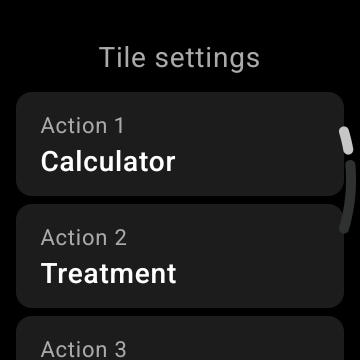
    
    Dijalozi koje gumbi otvaraju. Povucite zdesna nalijevo da biste došli do sljedeće stranice dijaloga, a na zadnjoj stranici dodirnite kvačicu da biste zahtjev poslali na telefon:
    
    | Tretman | Inzulin | UH | eUH | TT | Zamjena profila |
    | --- | --- | --- | --- | --- | --- |
    | 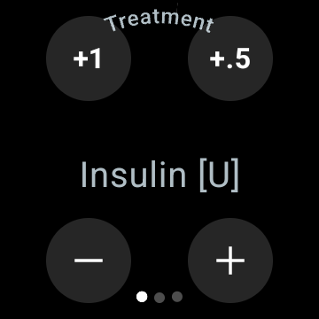 | 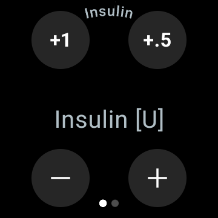 |  | 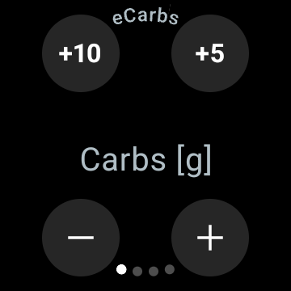 | 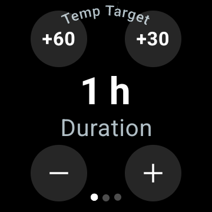 | 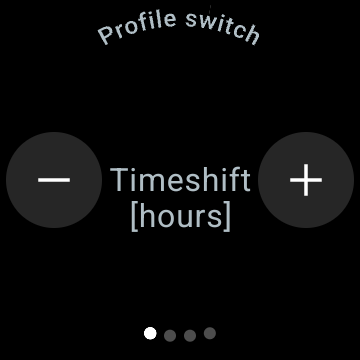 |
    
    [1] U izborniku sata **Postavke** > **Sučelje** uključite **Postotak kalkulatora** da bi se u bolus kalkulatoru prikazao unos postotka. Zadani postotak dolazi iz postavke telefona [„Postotak bolusa“](#Preferences-deliver-this-part-of-bolus-wizard-result). Ostale postavke kalkulatora su one na telefonu u **Postavke** > **Postavke bolus kalkulatora**.
    
    [2] U izborniku sata **Postavke** > **Sučelje** uključite **Vrsta obroka u kalkulatoru** da bi se prikazala stranica **Vrsta obroka**, na kojoj birate **Kruh**, **Kolač** ili **Pizza** kako biste ugljikohidrate sporog obroka podijelili na ugljikohidrate sada i eUH kasnije. Pogledajte [Odabir vrste obroka](#WearOsSmartwatch-wizard-meal-type).
    
    ### Pločica Privremeni cilj
    
    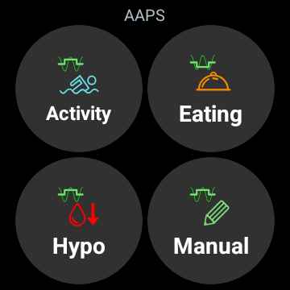
    
    Privremeni ciljevi iz predložaka na telefonu. Trajanje i cilj svakog predloška postavite na telefonu u **Postavke** > [Zadani privremeni ciljevi](#Preferences-default-temp-targets). U postavkama pločice odaberite najviše četiri od sljedećih:
    
    * **Aktivnost**: za sport
    * **Prije obroka**: niži cilj neposredno prije jela, kako bi u vrijeme obroka bilo više aktivnog inzulina
    * **Hipo**: viši cilj tijekom liječenja hipoglikemije
    * **Ručno**: prilagođeni cilj i trajanje
    * **Otkaži**: zaustavlja aktivni privremeni cilj. Gumb se prikazuje samo dok je privremeni cilj aktivan.
    
    ### Pločica Brzi kalkulator
    
    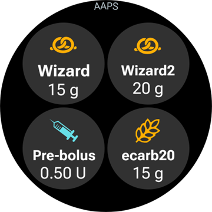
    
    Stavke [Brzog kalkulatora](#quickwizards) s telefona koje imaju uključeno **Prikaži na satu**, unutar svojih sati valjanosti. Stavka s ugljikohidratima prikazuje svoje ugljikohidrate u g, stavka s inzulinom svoju fiksnu dozu u J. Dodir pokreće stavku nakon potvrde na satu. Na satu nema ništa za postaviti: stavke uredite na telefonu i uključite **Prikaži na satu** pod **Odabir uređaja** za svaku stavku koju želite na pločici. Izvan sati valjanosti svih vaših stavki pločica prikazuje **Konfiguracija nije dostupna**.
    
    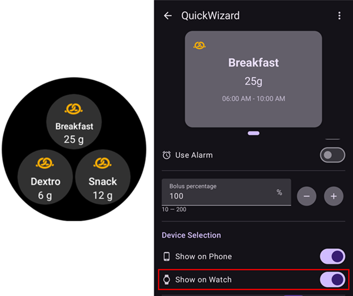
    
    ### Pločica Scena
    
    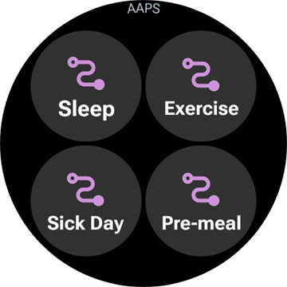
    
    [Scene](#scenes-from-watch) s telefona. U postavkama pločice svako od četiriju mjesta postavlja se na **Automatski**, **Nijedan** ili na jednu scenu. Mjesto postavljeno na **Automatski** uzima sljedeću scenu s popisa na telefonu koju nije zauzelo nijedno drugo mjesto. Mjesto postavljeno na scenu koja više ne postoji na telefonu prikazuje **Nedostupno**.
    
    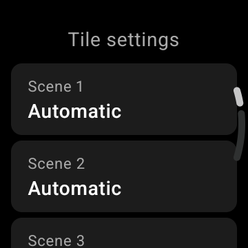
    
    ### Pločica Način rada
    
    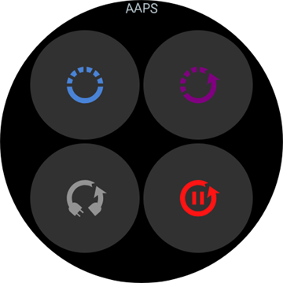
    
    [Načini rada](#aaps-screens-running-mode) na koje se možete prebaciti iz trenutnog, s istim ikonama kao na telefonu: zatvorena petlja, zaštita od niske razine glukoze, otvorena petlja, onemogućavanje petlje, suspendiranje petlje i odspajanje pumpe, ili nastavak i ponovno spajanje dok je jedan od tih načina aktivan. **Suspendiraj petlju** i **Odspoji pumpu** najprije traže trajanje. Telefon odlučuje koji se načini rada nude, sat prikazuje prva četiri i izostavlja **Onemogući petlju** kada je **Suspendiraj petlju** na popisu.
    
    ### Pločica Radnja korisnika
    
    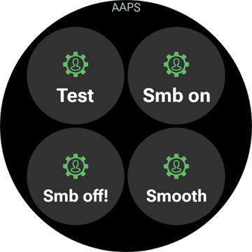
    
    Jedan gumb za svaku [automatizaciju](#automations-automation-triggers) na telefonu čiji je okidač **Radnja korisnika**. Dodir traži potvrdu, a zatim telefon izvršava radnje automatizacije. Gumbi nose nazive automatizacija, zato im dajte kratke nazive. Na satu nema ništa za postaviti.
    
    ### Pločica GUK graf
    
    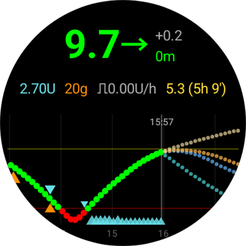
    
    Vrijednost glukoze sa strelicom, deltom i starošću očitanja, ispod toga aktivni inzulin (IOB), aktivni ugljikohidrati (COB), bazalna stopa i cilj, te GUK graf s predviđanjima, bolusima, ugljikohidratima i SMB-ovima. Dvije postavke na satu: **Vremenski raspon** (1, 3 ili 6 sati) i **Radnja na dodir**, koja otvara cijeli **GUK graf**, **Glavni izbornik** ili zaslon **Status petlje**.
    
    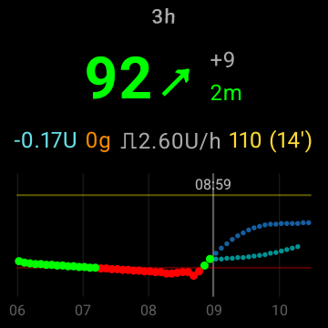
    
    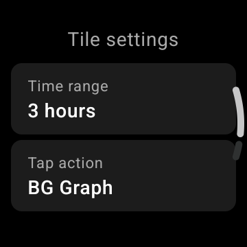
    
    ## Stalno uključen zaslon
    
    Ovaj i sljedeći odjeljak odnose se na klasične Watchfaceove **AAPS-a** na Wear OS-u 5 i starijim verzijama. Na Wear OS-u 6 **Watchface s komplikacijama** ima vlastiti stalno uključen prikaz, pogledajte [Watchface koji AAPS instalira](#wearos-aaps-v4-watchface).
    
    Dugo trajanje baterije izazov je za pametne satove s Android Wear OS-om. Neki pametni satovi izdrže i do 30 sati prije ponovnog punjenja. Za najbolju uštedu energije zaslon treba biti isključen kada ga ne koristite. Većina satova podržava zaslon „Uvijek uključen“.
    
    Od verzije 3 AAPS-a možemo koristiti „Pojednostavi korisničko sučelje“ u načinu rada sa stalno uključenim zaslonom. Ovo sučelje sadrži samo glukozu u krvi, smjer i vrijeme. Ovo sučelje štedi energiju: rjeđe se osvježava, prikazuje manje informacija i uključuje manje piksela kako bi se uštedjela energija na OLED zaslonima.
    
    Pojednostavljeno sučelje dostupno je za Watchfaceove Digital Style i prilagođene Watchfaceove. Pojednostavljeno sučelje nije obavezno i postavlja se u postavkama Watchfacea (dugo pritisnite Watchface i dodirnite „uredi“ ili ikonu zupčanika). Odaberite postavku „Pojednostavi korisničko sučelje“ i postavite je na „Stalno uključen zaslon“ ili „Stalno uključen zaslon i punjenje“.
    
    ### Noćni način rada
    
    Tijekom punjenja bilo bi korisno da zaslon ostane „stalno uključen“ i noću prikazuje vašu glukozu u krvi. No standardni Watchfaceovi presvijetli su i prikazuju previše informacija, a pojedinosti se teško čitaju pospanim očima. Zato smo dodali opciju da Watchface pojednostavi sučelje samo tijekom punjenja, ako je tako postavljeno u konfiguraciji.
    
    Pojednostavljeno sučelje dostupno je za Watchfaceove Digital Style i prilagođene Watchfaceove. Pojednostavljeno sučelje nije obavezno i postavlja se u postavkama Watchfacea (dugo pritisnite Watchface i dodirnite „uredi“ ili ikonu zupčanika). Odaberite postavku „Pojednostavi korisničko sučelje“ i postavite je na „Tijekom punjenja“ ili „Stalno uključen zaslon i punjenje“.
    
    Opcije za razvojne programere u Androidu omogućuju da sat ostane budan tijekom punjenja. Kako biste omogućili opcije za razvojne programere, pogledajte [službenu dokumentaciju](https://developer.android.com/training/wearables/get-started/debugging). U opcijama za razvojne programere uključite „Ne isključuj zaslon“ (Stay awake when charging).
    
    Napomena: ne podnose svi zasloni dobro stalno uključen prikaz. To može uzrokovati trajno urezivanje slike (burn-in), osobito na starijim OLED zaslonima. Satovi obično zatamnjuju zaslon kako bi spriječili urezivanje slike; savjet potražite u korisničkom priručniku, kod proizvođača ili na internetu.
    
    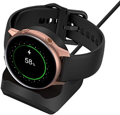
    
    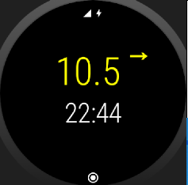
    
    (WearOsSmartwatch-phone-alarms)=
    
    ## Alarmi telefona na satu
    
    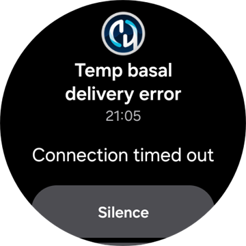
    
    Sat prikazuje alarme telefona, tako da vidite zašto telefon zvoni i možete odgovoriti sa zapešća. Sat vibrira, i ponovno svakih pola minute tijekom pet minuta, dok ne odgovorite. Obavijest prikazuje naslov i tekst alarma, s istim odgovorima kao podsjetnik [Vrijeme za jelo](#WearOsSmartwatch-wizard-carb-time):
    
    * **Utišaj** ili povlačenje u stranu: alarm prestaje, a zaslon alarma na telefonu se zatvara.
    * **Utišaj 5 min**: alarm prestaje i ponovno zvoni nakon pet minuta, na telefonu i na satu.
    
    Na sat stižu dvije vrste alarma:
    
    * Zaslon alarma s telefona (pogreške pumpe, alarmi automatizacije, alarmi GUK-a): **Utišaj** i **Utišaj 5 min**.
    * Hitne obavijesti sa zvukom, kao što su *Pumpa nedostupna* ili alarm Nightscouta: samo **Utišaj**. Telefon za njih ima samo **Odbaci**, a one se same vraćaju dok god postoji njihov uzrok.
    
    Podsjetnik *Vrijeme za jelo* ne šalje se na ovaj način: njega sat oglašava sam.
    
    ## Prečac za odgodu upozorenja
    
    Sat sam [prikazuje alarm](#WearOsSmartwatch-phone-alarms); prečac je drugi način da ga utišate, jednim pritiskom. Moguće je izraditi prečac za odgodu upozorenja/alarma AAPS-a. Isključivanje zvuka putem sata praktično je i brže jer ne morate posegnuti za telefonom. Napomena: i dalje morate provjeriti poruku alarma na telefonu i postupiti u skladu s njom, ali to možete učiniti kasnije. Ako vaš sat ima dva gumba, jednu tipku možete dodijeliti programu `AAPS Snooze Alert`.
    
    Da biste povezali gumb na satu Samsung Watch 4, idite na `Settings > Advanced Features > Customize Buttons > Double press > AAPS Snooze Alert`
    
    Na Watchfaceu s komplikacijama komplikacija **Prečac aplikacije** (App shortcut) postavljena na **AAPS odgoda upozorenja** radi isto jednim dodirom. [Alternativno postavljanje Watchfacea s komplikacijama](#wearos-complications-watchface-setup) za to koristi gornje desno mjesto.
    
    ### Odgoda xDripa
    
    Ako koristite xDrip i imate xDrip instaliran na satu, prečac 'AAPS Snooze Alert' odgodit će i svaki alarm xDripa. 
    
    
    ## Savjeti za performanse i trajanje baterije
    
    Satovi s Wear OS-om uređaji su s vrlo ograničenom energijom. Veličina kućišta sata ograničava kapacitet ugrađene baterije. Unatoč nedavnom napretku hardvera i softvera, satove s Wear OS-om i dalje treba puniti svaki dan.
    
    Ako baterija traje kraće od jednog dana (od jutra do večeri), evo nekoliko savjeta za rješavanje problema.
    
    Glavni potrošači baterije su:
    
    * Aktivan zaslon s uključenim pozadinskim osvjetljenjem (za LED) ili u načinu pune jačine (za OLED)
    * Iscrtavanje na zaslonu
    * Radijska komunikacija putem Bluetootha
    
    Budući da ne možemo popustiti na komunikaciji (trebamo najnovije podatke) i želimo prikazati najnovije podatke, većina optimizacija može se napraviti u području _vremena prikaza_:
    
    * Ugrađeni Watchfaceovi obično su bolje optimizirani od prilagođenih, preuzetih iz trgovine.
    * Bolje je koristiti Watchfaceove koji u neaktivnom / zatamnjenom načinu prikazuju manje podataka.
    * Budite oprezni kada kombinirate druge komplikacije, kao što su vremenski widgeti trećih strana ili druge – koje koriste podatke iz vanjskih izvora.
    * Počnite s jednostavnijim Watchfaceovima. Dodajte jednu po jednu komplikaciju i pratite kako utječu na trajanje baterije.
    * Koristite tamnu temu na Watchfaceu. Na OLED zaslonima manje upaljenih piksela znači manju potrošnju i manje urezivanja slike.
    * Provjerite što bolje radi na vašem satu: ugrađeni Watchfaceovi AAPS-a ili drugi Watchfaceovi s komplikacijama AAPS-a.
    * Pratite nekoliko dana, uz različite razine aktivnosti. Većina satova uključuje zaslon kada pogledate sat, pri pokretu i pri drugim okidačima vezanima uz korištenje.
    * Provjerite globalne postavke sustava koje utječu na performanse: obavijesti, vrijeme do isključivanja pozadinskog osvjetljenja/aktivnog zaslona, kada se uključuje GPS.
    * Provjerite [popis testiranih telefona i satova](#Phones-list-of-tested-phones) i [pitajte zajednicu](../GettingHelp/WhereCanIGetHelp.md) o iskustvima drugih korisnika i prijavljenom trajanju baterije.
    * **Ne možemo jamčiti da su podaci prikazani na Watchfaceu ili komplikaciji ažurni**. Na kraju Wear OS odlučuje kada će osvježiti Watchface ili komplikaciju. Čak i kada aplikacija AAPS zatraži osvježavanje, sustav može odlučiti odgoditi ili zanemariti osvježavanja kako bi uštedio bateriju. Ako niste sigurni i baterija sata je pri kraju – uvijek provjerite podatke u glavnoj aplikaciji AAPS na telefonu.
    
    (Watchfaces-troubleshooting-the-wear-app)=
    
    ## Rješavanje problema s aplikacijom za sat
    
    Ako sat ne prikazuje podatke ili prikazuje stare podatke, najprije provjerite vezu između sata i telefona, pogledajte [Rješavanje problema s komunikacijom između AAPS-a na satu i AAPS-a na telefonu](#wear-os-watch-phone-communication). Za sat s Wear OS-om 5 pogledajte i [opće preporuke za rješavanje problema za Wear OS 5](#wear-os-5-troubleshooting). Komplikacija koja se ne osvježava ima iste uzroke kao pločica ili Watchface koji se ne osvježava, zato najprije provjerite njih.
    
    ## Dostupni su i dodatni prilagođeni Watchfaceovi za AAPS
    
    [Ovdje](../ExchangeSiteCustomWatchfaces/index.md) možete preuzeti Zip-datoteke s prilagođenim Watchfaceovima koje su izradili drugi korisnici.
    
    ## Izradite vlastiti Watchface
    
    Ako želite izraditi vlastiti Watchface, slijedite [ove upute](../ExchangeSiteCustomWatchfaces/CustomWatchfaceReference.md).
    
    Kada izradite prilagođeni Watchface, svoj prilagođeni Watchface za **AAPS** možete podijeliti s drugima: Zip-datoteku možete prenijeti u mapu „ExchangeSiteCustomWatchfaces“ putem zahtjeva za povlačenje (Pull Request) na GitHubu. Pri spajanju zahtjeva za povlačenje (pull request) tim za dokumentaciju izdvojit će datoteku CustomWatchface.png i dodati joj naziv Zip-datoteke kao prefiks.
    
    (WearOsSmartwatch-complications-watchface-download)=
    
    ## Izradite vlastitu verziju Watchfacea s komplikacijama
    
    **Watchface s komplikacijama** koji **AAPS** instalira na Wear OS 6 (pogledajte [Watchface koji AAPS instalira](#wearos-aaps-v4-watchface)) izrađen je Samsungovim alatom **Watch Face Studio**. Njegova projektna datoteka besplatno se preuzima, tako da je možete prilagoditi svom ukusu ili je koristiti na satu s Wear OS-om 5 ili starijim, na koji je **AAPS** ne instalira:
    
    [Watchface s komplikacijama (AAPS V4), zip](https://github.com/openaps/AndroidAPSdocs/raw/refs/heads/master/docs/_static/wearos/Complications_watchface_AAPS_V4.zip)
    
    Zip sadrži četiri datoteke:
    
    * `AAPS V4_0_2.wfs`: projekt. Otvorite ga u alatu [Watch Face Studio](https://developer.samsung.com/watch-face-studio/download.html), promijenite što želite i odande ga instalirajte na sat.
    * `com.watchfacestudio.aapsv4.apk`: Watchface kakav jest, spreman za instalaciju pomoću [adb](https://developer.android.com/tools/releases/platform-tools): `adb install com.watchfacestudio.aapsv4.apk` dok je sat povezan putem ADB otklanjanja pogrešaka.
    * `README.txt`: dva preporučena postavljanja komplikacija, ista kao na [stranici Wear OS](#wearos-complications-watchface-setup).
    * `AAPS V4.png`: pregled.
    
    ```{admonition} Ovo nije prilagođeni Watchface
    :class: note
    Zip nije prilagođeni Watchface za **Učitaj Watchface** u dodatku **Wear** i telefon ga ne može instalirati. Mora se raspakirati i instalirati na sat pomoću alata Watch Face Studio ili adb, kao gore.