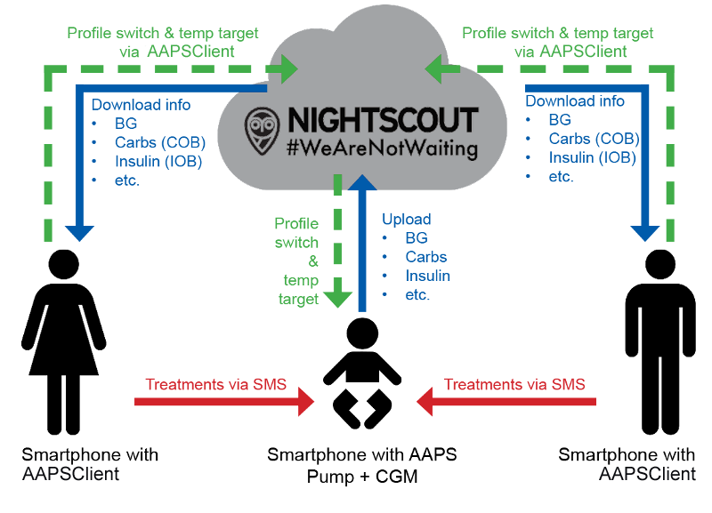

# Daljinski nadzor

__AAPS__ nudi nekoliko značajki za daljinski nadzor djece s dijabetesom tipa 1, a omogućuje i daljinske naredbe koje na daljinu šalju upute __AAPS-u__. Isto tako se __AAPSClient__ može koristiti za daljinski nadzor, da pratite __AAPS__ svojeg partnera ili prijatelja.

## Funkcije

- Pumpom djeteta upravlja djetetov telefon s __AAPS-om__.
- Njegovatelji mogu na daljinu pratiti sve važne podatke, kao što su razine glukoze, aktivni ugljikohidrati, aktivni inzulin itd., pomoću **AAPSClient apk** na svojem Android telefonu (verzija **AAPSClienta** za iPhone je u razvoju, vidi [Aplikacija AAPSClient](AapsClient.md)). Postavke promijenjene u __AAPS-u__ sinkronizirat će se s __AAPSClientom__ i obrnuto.
- Njegovatelji mogu primati alarme pomoću **aplikacije xDrip u načinu pratitelja** na svojem Android telefonu ako je postavljen xDrip companion način rada.
- Daljinsko upravljanje __AAPS-om__ putem [SMS naredbi](../RemoteFeatures/SMSCommands.md) zaštićeno je dvofaktorskom autentifikacijom.
- Daljinsko upravljanje putem __AAPSClienta__ koristi potpisani kanal za naredbe uveden u **AAPS-u** 4: klijent se najprije mora **upariti** s glavnim uređajem (QR kodom ili PIN-om), a svaku naredbu potvrđuje i izvršava glavni uređaj. Svaki telefon njegovatelja može dobiti svoju [ulogu](#client-master-control-roles), od samo čitanja do potpunog upravljanja – vidi [Upravljanje glavni uređaj ↔ klijent](#client-master-control).

## Alati i aplikacije za daljinski nadzor

- [Nightscout](https://nightscout.github.io/) u web pregledniku (uglavnom prikaz podataka).
- [__AAPSClient__](AapsClient.md) je smanjena verzija __AAPS-a__ koja može pratiti glavni __AAPS__ i, kada je **uparena**, slati daljinske naredbe: ugljikohidrate, __privremene ciljeve__, __zamjene profila__, pa čak i boluse (vidi [Upravljanje glavni uređaj ↔ klijent](#client-master-control)). Postoje 3 aplikacije: [AAPSClient, AAPSClient2 i AAPSClient3 za preuzimanje](https://github.com/nightscout/AndroidAPS/releases/), tako da njegovatelj s istog telefona može pratiti do tri različite osobe (npr. dvoje djece s tipom 1, svako sa svojim Nightscout računom i glavnim __AAPS-om__).
- Dexcom Follow ako koristite originalnu aplikaciju Dexcom (samo vrijednosti GUK-a).
- [xDrip](../CompatibleCgms/xDrip.md) u načinu pratitelja (uglavnom vrijednosti GUK-a i **alarmi**).
- [Sugarmate](https://sugarmate.io/) ili [Spike](https://spike-app.com/) na iOS-u (uglavnom vrijednosti GUK-a i **alarmi**).
- Nekim korisnicima za napredno rješavanje problema na daljinu pomaže alat za potpuni udaljeni pristup kao što je [TeamViewer](https://www.teamviewer.com/).

## Mogućnosti s pametnim satom

Pametni sat može biti vrlo koristan alat za upravljanje __AAPS-om__ kod djece s dijabetesom tipa 1. Moguće je nekoliko različitih opcija:

- Opcija 1 – Ako je __AAPSClient__ instaliran na telefonu njegovatelja, [aplikacija AAPSClient za WearOS](https://github.com/nightscout/AndroidAPS/releases/) može se instalirati na kompatibilni pametni sat spojen s telefonom njegovatelja. Sat će prikazati trenutni __GUK__, status petlje i povijest bolusa te omogućiti unos ugljikohidrata, __privremene ciljeve__ i promjene __profila__. Ako je klijent **uparen** s glavnim uređajem, sat može pokrenuti i **bolus**: naredba ide preko klijenta do glavnog uređaja, koji je potvrđuje i isporučuje (vidi [Upravljanje glavni uređaj ↔ klijent](#client-master-control)).
- Opcija 2 – [Aplikacija AAPS za WearOS](../WearOS/WearOsSmartwatch.md) također se može izraditi i instalirati na kompatibilni pametni sat koji je spojen s djetetovim telefonom, ali ga nosi njegovatelj. To uključuje sve gore navedene funkcije, a uz to i mogućnost izravnog davanja bolusa inzulina, bez potrebe da se djetetu uzme telefon.
- Opcija 3 – Samo prikaz: sat koji **AAPS** ne podržava izravno (Xiaomi, Amazfit ili Wear OS sat koji prikazuje komplikaciju) može prikazivati glukozu, aktivni inzulin (IOB), aktivne ugljikohidrate (COB) i status petlje putem prateće aplikacije kao što su WatchDrip+ ili GlucoDataHandler, koja dobiva podatke od dodatka **Vanjske prateće aplikacije** na telefonu s **AAPS-om** ili **AAPSClientom** s kojim je sat povezan. Vidi [Vanjske prateće aplikacije](#watches-external-companion-apps).

## Na što treba misliti

- Imajte na umu vremenski razmak između glavnog uređaja i pratitelja zbog vremena za slanje i preuzimanje podataka, kao i to da glavni telefon s __AAPS-om__ šalje podatke tek nakon izvođenja petlje.
- Koji je vaš plan za hitne slučajeve kada daljinsko upravljanje ne radi (_npr._ problemi s mrežom ili izgubljena Bluetooth veza)? Uvijek razmislite što će se dogoditi s **AAPS-om** ako odjednom ne možete poslati novu naredbu. **AAPS** prepisuje bazal, ISF i ICR u pumpi vrijednostima iz trenutnog profila. Ako prelazite na jači inzulinski profil, koristite samo privremene zamjene profila (_tj._ s postavljenim trajanjem), za slučaj da se daljinska veza prekine. Tada će se pumpa vratiti na izvorni profil kada vrijeme istekne.
