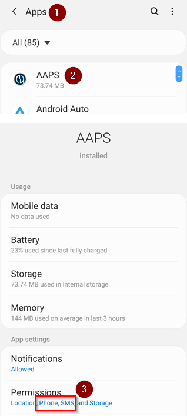
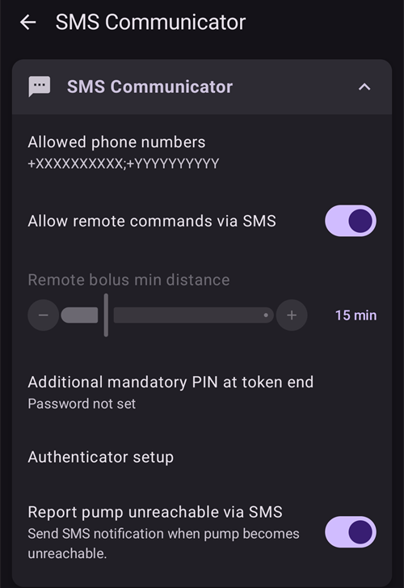
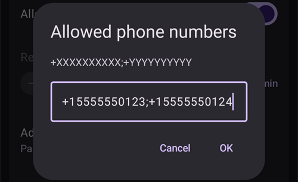
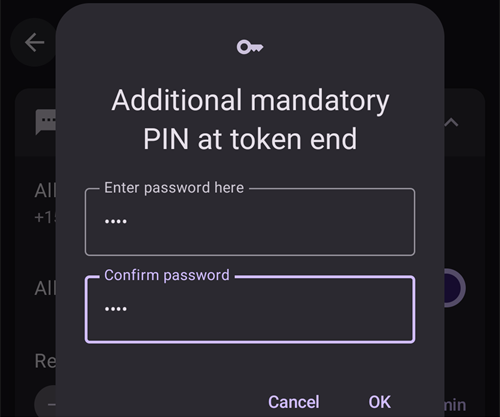
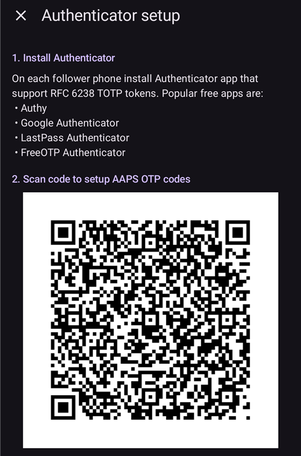
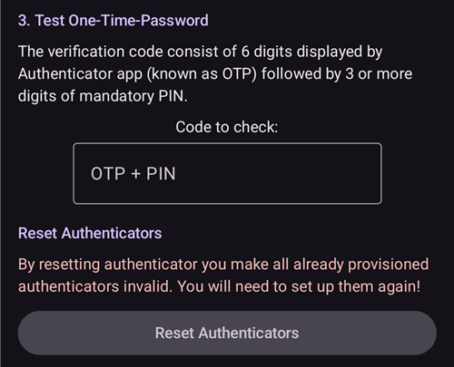
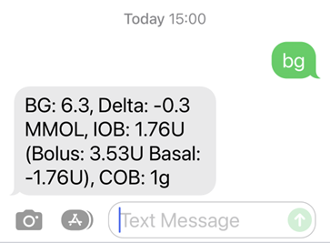
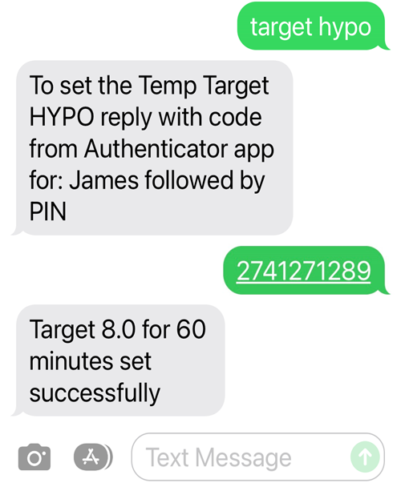

# SMS naredbe

```{contents} Table of contents
:depth: 2
```

Većina daljinskih prilagodbi (privremeni ciljevi, ugljikohidrati, zamjene profila i, nakon što je klijent uparen, bolusi) može se napraviti [aplikacijom **AAPSClient**](../RemoteFeatures/RemoteMonitoring.md) na Android telefonu s internetskom vezom, pogledajte [Upravljanje glavni uređaj ↔ klijent](#client-master-control) (verzija **AAPSClienta** za iPhone je u razvoju, pogledajte [Aplikacija AAPSClient](AapsClient.md)). SMS naredbe ostaju alternativa koja radi bez interneta i jedina su mogućnost daljinskog upravljanja ako kao pratitelj koristite iPhone i još nemate **AAPSClient**.

**SMS naredbe su vrlo korisne:**
1. Za uobičajeno daljinsko upravljanje

2. Ako želite daljinski dati bolus inzulina bez uparenog **AAPSClienta**

3. U području sa slabim internetskim signalom, gdje SMS poruke prolaze, ali je podatkovna/internetska veza telefona ograničena. To je vrlo korisno kada idete u udaljena područja (npr. kampiranje, skijanje).

4. Ako vaš drugi način daljinskog upravljanja (**AAPSClient**) privremeno ne radi

## Sigurnost na prvom mjestu

Ako omogućite **SMS Communicator** u **AAPS-u**, imajte na umu da netko može ukrasti telefon s kojeg se šalju daljinske naredbe i/ili ga može koristiti netko drugi. Uvijek zaključajte svoj telefon barem PIN-om. Snažna lozinka i/ili biometrijsko zaključavanje jako se preporučuju; neka se ona razlikuje od vaše Glavne lozinke APK-a (lozinke koja je potrebna za izvoz postavki **AAPS-a**).

Osim toga, preporučuje se dopustiti [drugi telefonski broj](#SMSCommands-authorized-phone-numbers) za SMS naredbe. Tako drugim brojem možete [isključiti](#SMSCommands-other) SMS Communicator ako vaš glavni telefon za daljinsko upravljanje bude ugrožen.

Zadano najmanje vrijeme između naredbi za bolus je 15 minuta, računajući od trenutka kada pumpa prihvati bolus. Iz sigurnosnih razloga morate dodati najmanje dva ovlaštena telefonska broja da biste ovo mogli promijeniti na kraće vrijeme čekanja. Ako pokušate ponovno daljinski dati bolus unutar 15 minuta od prethodnog bolusa, dobit ćete odgovor „Daljinski bolus nije dostupan. Pokušajte ponovno kasnije.“

AAPS će vas također SMS porukom obavijestiti jesu li vaše daljinske naredbe, kao što su bolus ili promjena profila, izvršene. Preporučuje se postaviti potvrdne poruke tako da se šalju na najmanje dva različita telefonska broja, za slučaj da netko ukrade jedan od telefona koji ih prima.

**Ako bolus dajete SMS naredbama, ugljikohidrate morate unijeti zasebno (drugi SMS, AAPSClient...)!** Ako to ne učinite, aktivni inzulin bit će točan, ali s premalo aktivnih ugljikohidrata (COB), što može dovesti do toga da se korekcijski bolus ne izvrši, jer **AAPS** misli da imate previše aktivnog inzulina.

Za osjetljive naredbe mora se koristiti aplikacija Authenticator s vremenski ograničenom jednokratnom lozinkom, radi veće sigurnosti.

Ako želite telefonu njegovatelja oduzeti mogućnost slanja SMS naredbi, upotrijebite gumb za hitne slučajeve „[Resetiraj Authenticatore](#sms-commands-authenticator-setup)“ u **AAPS-u** ili pošaljite SMS naredbu „[SMS stop](#SMSCommands-other)“. Resetiranjem Authenticatora SVI telefoni njegovatelja postaju nevažeći. Morat ćete ih ponovno postaviti.

## Postavljanje SMS naredbi

```{contents} The overall process is as follows
:depth: 1
:local: true
```

(sms-commands-authenticator-setup)=
### Postavljanje Authenticatora

Dvofaktorska autentifikacija koristi se za veću sigurnost.

Na telefon njegovatelja preuzmite (iz App Storea ili Google Playa) i instalirajte aplikaciju Authenticator. Popularne besplatne aplikacije su:
  - [Authy](https://authy.com/download/)
  - Google Authenticator - [Android](https://play.google.com/store/apps/details?id=com.google.android.apps.authenticator2) / [iOS](https://apps.apple.com/de/app/google-authenticator/id388497605)
  - [LastPass Authenticator](https://lastpass.com/auth/)
  - [FreeOTP Authenticator](https://freeotp.github.io/)

Te aplikacije Authenticator stvaraju vremenski ograničenu jednokratnu lozinku od 6 znamenki, slično kao kod mobilnog bankarstva ili kupovine. Možete koristiti i drugu aplikaciju Authenticator, ako podržava RFC 6238 TOTP tokene. Microsoft Authenticator ne radi.

### Provjera postavki telefona

Na telefonu idite na **Aplikacije > AAPS > Dopuštenja**. Provjerite jesu li **SMS** i **Telefon** dopušteni.



```{admonition} "App was denied access to SMS"
:class: tip
Android može blokirati dopuštenje za **SMS** za aplikacije koje nisu instalirane iz trgovine aplikacija, kao što je **AAPS**. Ako vidite ovu poruku kada dajete dopuštenje za **SMS**, otvorite na telefonu **Postavke > Aplikacije > AAPS**, dodirnite izbornik **⋮** (gore desno) i odaberite **Dopusti ograničene postavke**. Zatim ponovno dajte dopuštenje za **SMS**.
```


### Usklađivanje datuma i vremena

Vrijeme na oba telefona mora biti usklađeno. Najbolje je da se vrijeme postavlja automatski iz mreže. Razlike u vremenu mogu uzrokovati probleme s autentifikacijom.

Na telefonu s **AAPS-om** i na telefonu njegovatelja provjerite jesu li datum i vrijeme usklađeni. Kako se to točno radi ovisi o vašem uređaju; možda ćete morati isprobati različite postavke.

Primjer (za Samsung S23): **Postavke > Općenito upravljanje > Datum i vrijeme**: provjerite je li uključeno **Automatski datum i vrijeme**.

Neke opcije mogu biti zasivljene jer ih, ako je telefon postavljen kao dječji račun, mora odobriti administrator putem obiteljskog računa. Na iPhoneu njegovatelja/roditelja ova postavka datuma i vremena zove se „Postavi automatski“. Ako niste sigurni jesu li telefoni usklađeni, ne brinite: možete postaviti SMS naredbe i kasnije riješiti problem ako se čini da on uzrokuje poteškoće (po potrebi zatražite pomoć).

### Postavke AAPS-a

Nakon što ste provjerili postavke telefona, u samoj aplikaciji **AAPS** idite na [**Konfiguracija** → **Komunikacija**](../SettingUpAaps/ConfigBuilder.md) i omogućite dodatak **SMS Communicator**.

Otvorite postavke dodatka **SMS Communicator**.

Omogućite **Dopusti daljinske naredbe putem SMS-a**. Opcije **Dodatni obavezni PIN na kraju tokena** i **Postavljanje Authenticatora** pojavljuju se tek kada je ovo omogućeno:



(SMSCommands-authorized-phone-numbers)=
#### Dopušteni telefonski brojevi

Unesite telefonski broj (ili brojeve) njegovatelja. Uključite pozivni broj države i izostavite prvu „0“ telefonskog broja, kao u ovim primjerima:
* Broj telefona u UK-u: +447976304596
* Broj telefona u SAD-u: +11234567890
* Broj telefona u Francuskoj:  +33612344567
* _itd._

Imajte na umu da, ovisno o vašoj lokaciji, „+“ ispred broja može, ali ne mora biti potreban. Da biste to utvrdili, pošaljite probnu poruku; primljeni format prikazat će se na zaslonu dodatka **SMS Communicator** (**Konfiguracija** → **Komunikacija** → **SMS Communicator** → **Otvori dodatak**).

Ako dodajete više telefonskih brojeva, odvojite ih točkom sa zarezom, **BEZ razmaka između brojeva** (ovo je vrlo važno!). Odaberite **U redu**:



#### Min. razmak između daljinskih bolusa

- Možete odrediti najmanji razmak (u minutama) između dva bolusa poslana putem SMS-a.
- Iz sigurnosnih razloga morate dodati najmanje dva ovlaštena telefonska broja da biste mogli promijeniti ovu vrijednost.

#### Dodatni obavezni PIN na kraju tokena

Iz sigurnosnih razloga nakon koda za odgovor mora slijediti PIN. Odaberite PIN koji ćete vi (i drugi njegovatelji) dodavati na kraj koda iz Authenticatora kada šaljete SMS naredbu.

Zahtjevi za PIN su:

* najmanje 6 znamenki
* samo znamenke

Za sigurniji PIN nemojte koristiti istu znamenku mnogo puta (_npr._ 111111) ili niz (_npr._ 123456).



#### Postavljanje Authenticatora

* Dodirnite **Postavljanje Authenticatora** i slijedite upute na zaslonu korak po korak.
* Otvorite instaliranu aplikaciju Authenticator na _telefonu njegovatelja_, postavite novu vezu i
* Telefonom njegovatelja skenirajte QR kod prikazan pod **Skenirajte kod za postavljanje AAPS OTP kodova**.



* Pod **Testirajte jednokratnu lozinku** u polje **Kod za provjeru** unesite jednokratnu lozinku iz aplikacije Authenticator na telefonu njegovatelja, a iza nje svoj PIN:

Primjer:
* Token iz aplikacije Authenticator je 457051
* Vaš obavezni PIN je 2401
* Kod za provjeru: 4570512401

Ako je unos ispravan, crveni tekst „POGREŠAN PIN“ automatski će se promijeniti u zeleni „OK“. **Ne postoji gumb koji trebate pritisnuti!** Postupak je sada dovršen; nakon unosa koda ne morate pritisnuti nikakav gumb „OK“:



Sada biste trebali imati postavljene SMS naredbe.

Upotrijebite gumb **Resetiraj Authenticatore** na dnu zaslona **Postavljanje Authenticatora** ako želite ukloniti postavljene Authenticatore. (Resetiranjem Authenticatora SVI već postavljeni Authenticatori postaju nevažeći. Morat ćete ih ponovno postaviti.)

## Korištenje SMS naredbi

### Prvi koraci sa SMS naredbama

1)  Da biste provjerili jeste li sve ispravno postavili, testirajte vezu tako da s telefona njegovatelja na telefon s **AAPS-om** pošaljete SMS poruku „bg“. Trebali biste dobiti odgovor sličan ovome:



Ako ne dobijete nikakav odgovor, pogledajte odjeljak [Rješavanje problema](#SMSCommands-troubleshooting) u nastavku.

2)  Sada isprobajte SMS naredbu koja zahtijeva Authenticator, _npr._ „target hypo“. Telefon njegovatelja dobit će odgovor koji traži da unesete **šesteroznamenkastu lozinku** iz aplikacije Authenticator, a iza nje dodatni tajni **PIN** koji znaju samo njegovatelji/pratitelji (ukupno niz od dvanaest znamenki, ako vaš PIN ima 6 znamenki).

Kada prvi put šaljete SMS naredbu, učinite to dok je telefon s **AAPS-om** pokraj vas, da vidite kako to radi:


Telefon njegovatelja dobit će SMS odgovor od **AAPS-a** koji potvrđuje je li daljinska SMS naredba uspješno izvršena.

Ako je naredba uspješna, dobit ćete odgovor koji to potvrđuje. Ako postoji problem, dobit ćete poruku o pogrešci. Za česte pogreške pogledajte [Rješavanje problema](#SMSCommands-troubleshooting) u nastavku.

**Savjet**: Ako će se slati puno SMS-ova, korisno je imati neograničen broj SMS-ova u tarifi (za svaki korišteni telefon).

### Davanje bolusa za obrok putem SMS naredbi

Daljinski bolus inzulina može se dati putem **SMS naredbi** ili putem uparenog **AAPSClienta** (pogledajte [Upravljanje glavni uređaj ↔ klijent](#client-master-control)); ne može se dati putem web stranice Nightscouta. Ugljikohidrati se također mogu najaviti putem SMS-a ili **AAPSClienta**. Putem SMS-a nije moguće poslati naredbe za ugljikohidrate i za inzulin u jednoj SMS poruci. Te naredbe morate poslati zasebno, ovako:

1)  Slanje bolusa inzulina (_npr._ „bolus 2“ daje bolus od 2 jedinice) putem SMS naredbi isto je što i **Tretmani** → **Inzulin** u **AAPS-u**. 2)  Pošaljite ugljikohidrate (_npr._ „carbs 20“ najavljuje 20 g ugljikohidrata). To je isto što i **Tretmani** → **UH** u **AAPS-u**.

Da biste izbjegli hipoglikemiju, dobro je početi oprezno i dati **manje inzulina** nego što bi bilo potrebno prema vašem omjeru za ugljikohidrate, jer ne uzimate u obzir trenutnu razinu glukoze ni trend glukoze.

**Redoslijed kojim šaljete ove naredbe je važan**. Ako na bilo koji način najavite veliku količinu ugljikohidrata, a SMB je omogućen, **AAPS** može odmah reagirati davanjem djelomičnog bolusa inzulina. Ako zatim pokušate poslati bolus inzulina _nakon_ najave ugljikohidrata, može doći do neugodnog čekanja i poruke „bolus u tijeku“, a zatim morate provjeriti što je dano kao SMB. Ili, ako ne primijetite da se isporučuje SMB, a uspije i vaš vlastiti bolus nakon toga, za cijeli obrok može se isporučiti previše inzulina. Zato, kada daljinski dajete bolus za obrok, uvijek pošaljite bolus inzulina _prije_ najave ugljikohidrata. Ako želite, možete kombinirati **AAPSClient** sa SMS naredbama: ugljikohidrati uneseni na uparenom **AAPSClientu** ne trebaju kod za autentifikaciju i zato su brži od SMS naredbi. Ugljikohidrati ili drugi tretmani uneseni na web stranici Nightscouta **ne** primjenjuju se dok je upravljanje s klijenta uključeno; **AAPS** je tada u [zaštićenom načinu rada](#client-master-control-hardened-mode).

(SMSCommands-commands)=
## Naredbe

```{contents} List of command groups
:depth: 1
:local: true
```

Naredbe se moraju slati na engleskom; odgovor će biti na vašem jeziku ako je tekst odgovora već [preveden](#translations-translate-strings-for-AAPS-app). Za naredbe nije važno pišete li malim ili velikim slovima.


**Tablice SMS naredbi** u nastavku prikazuju sve moguće SMS naredbe. _Primjeri vrijednosti_ navedeni su radi lakšeg razumijevanja. Naredbe imaju isti raspon mogućih vrijednosti (ciljevi, postotak profila itd.) koji je dopušten u samoj aplikaciji **AAPS**.

(authentication-or-not)=
### Autentifikacija ili ne?

Neke SMS naredbe daju odgovor odmah, a neke zahtijevaju snažnu **autentifikaciju** putem aplikacije Authenticator. Jednostavan upit kao što je „**BG**“ (koji traži podatke o trenutnoj glukozi) brzo se upisuje, ne treba autentifikaciju i vraća podatke o statusu **AAPS-a** prikazane u nastavku:


Naredbe kojima je potrebna veća sigurnost zahtijevaju unos koda, na primjer:



Stupac *Autent.* u tablicama u nastavku pokazuje je li za pojedinu naredbu potrebna takva snažna autentifikacija.

### Podaci CGM-a

| Naredba    | Autent. | Funkcija i *odgovor*                                                                                                                                                                                                                   |
| ---------- | ------- | -------------------------------------------------------------------------------------------------------------------------------------------------------------------------------------------------------------------------------------- |
| BG         | Ne      | Vraća: zadnji GUK, deltu, aktivni inzulin (bolus i bazal), aktivne UH<br/>*Zadnji GUK: 5,6 prije 4 min, Delta: -0,2 mmol, Aktivni inzulin: 0,20 J (Bolus: 0,10 J Bazal: 0,10 J)*                                                 |
| CAL 5.6/90 | Da      | Kalibrira CGM vrijednošću 5.6/90<br/>(koristite vrijednost u svojim jedinicama glukoze)<br/>Radi samo ako je ispravno postavljeno u **AAPS-u**.<br/>*Kalibracija je poslana. Primanje mora biti omogućeno u xDrip+.* |

### Pumpa

| Naredba              | Autent. | Funkcija i *odgovor*                                                                                 |
| -------------------- | ------- | ---------------------------------------------------------------------------------------------------- |
| PUMP                 | Ne      | LastConn: 1 min ago<br/>Temp: 0.00U/h @11:38 5/30min<br/>IOB: 0.5U Reserv: 34U Batt: 100 |
| PUMP DISCONNECT *30* | Da      | Za odspajanje pumpe na *30* minuta                                                                   |
| PUMP CONNECT         | Da      | Pumpa je ponovno spojena                                                                             |

### Bazal

| Naredba           | Autent. | Funkcija i *odgovor*                   |
| ----------------- | ------- | -------------------------------------- |
| BASAL 0.3         | Da      | Za pokretanje bazala 0,3 J/h na 30 min |
| BASAL 0.3 20      | Da      | Za pokretanje bazala 0,3 J/h na 20 min |
| BASAL 30%         | Da      | Za pokretanje bazala 30 % na 30 min    |
| BASAL 30% 50      | Da      | Za pokretanje bazala 30 % na 50 min    |
| BASAL STOP/CANCEL | Da      | Za zaustavljanje privremenog bazala    |

Neke pumpe primaju privremeni bazal samo u postocima, a druge samo u J/h. Ako upotrijebite drugi oblik, **AAPS** odgovara *„Ova pumpa prima privremeni bazal samo u postocima, ne u J/h.“* (ili obrnuto) i ništa ne postavlja. Trajanje mora biti višekratnik koraka trajanja privremenog bazala vaše pumpe.


### Petlja

| Naredba           | Autent. | Funkcija i *odgovor*                                                                                                                                                                                                                                                                                        |
| ----------------- | ------- | ----------------------------------------------------------------------------------------------------------------------------------------------------------------------------------------------------------------------------------------------------------------------------------------------------------- |
| STATUS PETLJE     | Ne      | Odgovor ovisi o stvarnom stanju:<br/> - *Petlja je onemogućena* ako je petlja onemogućena<br/> - *Petlja je omogućena* ako je petlja zatvorena, otvorena ili u LGS načinu<br/> - *Pumpa odspojena* ako je pumpa odspojena<br/> - *Suspendirano (10 min)* ako je petlja suspendirana |
| LOOP STOP/DISABLE | Da      | Pumpa će se vratiti na unaprijed programiranu bazalnu stopu.<br/>*Petlja je onemogućena*                                                                                                                                                                                                              |
| LOOP SUSPEND 20   | Da      | *Loop suspended*                                                                                                                                                                                                                                                                                            |
| LOOP RESUME       | Da      | *Petlja je nastavljena*                                                                                                                                                                                                                                                                                     |
| LOOP CLOSED       | Da      | *Trenutni način rada: Zatvorena petlja*                                                                                                                                                                                                                                                                     |
| LOOP LGS          | Da      | *Trenutni način rada: Zaštita od niske razine glukoze*                                                                                                                                                                                                                                                      |

### Bolus

Daljinski bolus nije dopušten unutar 15 min (ova se vrijednost može promijeniti samo ako su dodana 2 telefonska broja) nakon zadnje naredbe za bolus ili daljinskih naredbi! U tom slučaju odgovor bi bio *Daljinski bolus nije dostupan. Pokušajte ponovno kasnije.* Ovaj se odgovor šalje i kada pumpa upravo isporučuje bolus.

| Naredba              | Autent. | Funkcija i *odgovor*                                                                                                                                                          |
| -------------------- | ------- | ----------------------------------------------------------------------------------------------------------------------------------------------------------------------------- |
| BOLUS 1.2            | Da      |                                                                                                                                                                               |
| BOLUS 0.60 MEAL      | Da      | Isporučuje navedeni bolus od 0,60 J<br/>**i** postavlja [privremeni cilj Prije obroka](#TempTargets-eating-soon-temp-target)                                            |
| CARBS 5              | Da      | Za unos 5 g, bez bolusa                                                                                                                                                       |
| CARBS 5 17:35/5:35PM | Da      | Za unos 5 g u 17:35.<br/>Prihvaćeni format vremena ovisi<br/> o postavci vremena (12 h/24 h) na telefonu.                                                         |
| EXTENDED 2 120       | Da      | Za pokretanje produženog bolusa od 2 J na 120 min.<br/>Samo za [kompatibilne pumpe](#Extended-Carbs-extended-bolus-and-switch-to-open-loop-dana-and-insight-pump-only). |
| EXTENDED STOP/CANCEL | Da      | Za zaustavljanje produženog bolusa                                                                                                                                            |

### Profil

| Naredba        | Autent. | Funkcija i *odgovor*                                                                                                                                       |
| -------------- | ------- | ---------------------------------------------------------------------------------------------------------------------------------------------------------- |
| PROFILE STATUS | Ne      | Trenutni profil i postotak                                                                                                                                 |
| PROFILE LIST   | Ne      | Trenutni popis profila u **AAPS-u**, npr.:<br/>1. Profil1<br/> 2. Profil2                                                                      |
| PROFILE 1      | Da      | Za zamjenu profila na profil 1 s popisa.<br/>Koristite brojeve koje vraća **PROFILE LIST**,<br/>a ne nazive profila pod kojima ste ih spremili |
| PROFILE 2 30   | Da      | Za zamjenu profila na Profil2 30 %                                                                                                                         |

Postotak mora biti između 30 i 250 %, kao u aplikaciji. Vrijednost izvan tog raspona odbija se prije nego što se od vas zatraži kod za autentifikaciju.

### Privremeni ciljevi

| Naredba                   | Autent. | Funkcija i *odgovor*                                 |
| ------------------------- | ------- | ---------------------------------------------------- |
| TARGET MEAL/ACTIVITY/HYPO | Da      | Za postavljanje privremenog cilja MEAL/ACTIVITY/HYPO |
| TARGET STOP/CANCEL        | Da      | Za otkazivanje privremenog cilja                     |


(SMSCommands-other)=
### Ostalo

| Naredba          | Autent. | Funkcija i *odgovor*                                                                                                                                                                                                                        |
| ---------------- | ------- | ------------------------------------------------------------------------------------------------------------------------------------------------------------------------------------------------------------------------------------------- |
| RESTART          | Da      | Ponovno pokreće AAPS. Korisno ako imate problema koji se obično riješe ponovnim pokretanjem.                                                                                                                                                |
| SMS DISABLE/STOP | Da      | Za isključivanje usluge SMS Remote Service odgovorite kodom.<br/>Imajte na umu da je ponovno možete aktivirati<br/>samo izravno na glavnom pametnom telefonu s **AAPS-om**.                                                     |
| HELP             | Ne      | Vraća sve dostupne funkcije:<br/>BG, LOOP, PUMP, BASAL, BOLUS, EXTENDED, CAL, PROFILE, TARGET, SMS, CARBS, HELP, RESTART<br/>Pošaljite naredbu ***HELP ***FUNCTION****** za popis<br/>svih opcija dostupnih u tom dijelu. |
| HELP BOLUS       |         | *BOLUS 1.2<br/>BOLUS 1.2 MEAL*                                                                                                                                                                                                        |

(SMSCommands-troubleshooting)=
## Rješavanje problema i česta pitanja

```{contents} List of questions and issues
:depth: 1
:local: true
```

### Što _ne možemo_ raditi SMS naredbama?

1)  **Ne možete postaviti _privremenu_ zamjenu profila** (na primjer postaviti „profil vježbanje“ na 60 minuta), ali možete trajno prijeći na „profil vježbanje“. Privremene zamjene profila umjesto toga možete postaviti putem **AAPSClienta**.

2)  **Ne možete otkazati automatizacije** ni **postaviti vlastite ciljeve**, ali postoje približna rješenja: Kao primjer, zamislite da je uobičajeni cilj u profilu 5,5. U AAPS-u ste postavili automatizaciju koja uvijek postavlja visoki cilj od 7,0 između 14:30 i 15:30 zbog sata tjelesnog odgoja u školi, a jedan od uvjeta automatizacije je „ne postoji privremeni cilj“. Ovaj tjedan ste u zadnji čas saznali da je sat tjelesnog odgoja otkazan i da se umjesto njega jede pizza, a vaše dijete je već u školi s telefonom s **AAPS-om**. Ako automatizacija pokrene visoki privremeni cilj od 7,0, a vi ga otkažete (na telefonu s **AAPS-om** ili daljinski), uvjeti automatizacije i dalje su ispunjeni i **AAPS** će minutu kasnije jednostavno ponovno postaviti visoki cilj.

**Da imate pristup telefonu s AAPS-om**, mogli biste isključiti/promijeniti automatizaciju ili, ako to ne želite, jednostavno postaviti novi privremeni cilj od 5,6 na 60 min pritiskom na cilj na glavnom zaslonu ili putem **Upravljanje** → **Privremeni cilj**. Time biste spriječili da automatizacija postavi visoki cilj od 7,0.

**Ako nemate pristup telefonu s AAPS-om**, SMS naredbe možete upotrijebiti za približno rješenje: na primjer naredbom „target meal“ postaviti cilj od 5,0 na 45 min (ostali zadani ciljevi su 8,0 za aktivnost ili hipo, pogledajte tablicu). Međutim, SMS naredbama ne možete zadati _određenu_ ciljnu vrijednost (na primjer 5,6 na 60 minuta); za to biste trebali koristiti **AAPSClient**.

### Što ako se predomislim nakon što sam upravo poslao naredbu?

**AAPS** će izvršiti samo najnoviju naredbu. Dakle, ako upišete „bolus 1.5“, a zatim, bez autentifikacije, pošaljete novu naredbu „bolus 1“, raniju naredbu 1.5 zanemarit će. **AAPS** će telefonu njegovatelja uvijek poslati odgovor koji potvrđuje o kojoj se SMS naredbi radi prije nego što se od vas zatraži kod za autentifikaciju, kao i odgovor nakon izvršene radnje.

### Zašto nisam dobio odgovor na SMS naredbu?

Razlog može biti jedan od ovih:

1)  Poruka nije stigla do telefona (problemi s mrežom). 2)  **AAPS** još obrađuje zahtjev (_npr._ bolus, čija isporuka može potrajati, ovisno o brzini isporuke bolusa). 3)  Telefon s **AAPS-om** nema dobru Bluetooth vezu s pumpom kada primi naredbu, pa naredba nije uspjela (to obično izazove alarm na telefonu s **AAPS-om**).

### Nema nikakvog odgovora na SMS naredbe

Na telefonu njegovatelja i/ili telefonu s **AAPS-om** pokušajte isključiti sljedeće opcije:
* **Šalji kao chat poruku** (Send as chat message) 
* Ako koristite aplikaciju Android Messages ili Google Messages, isključite RCS poruke:
  - otvorite određeni SMS razgovor u aplikaciji Poruke
  - Odaberite izbornik s tri točke u gornjem desnom kutu
  - odaberite „Pojedinosti“
  - Aktivirajte „Šalji samo SMS i MMS poruke“ (Only send SMS and MMS messages) 

### Pogreške pri izvršavanju naredbi

Postoji nekoliko mogućih razloga zašto naredba možda nije uspjela:

* Postavljanje SMS naredbi nije dovršeno/ispravno
* Poslali ste naredbu u pogrešnom formatu (npr. „disconnect pump 45“ umjesto „pump disconnect 45“)
* Upotrijebili ste pogrešan ili istekao kod iz Authenticatora (obično je dobro pričekati nekoliko sekundi na novi kod ako trenutni uskoro istječe)
* Kod+PIN bili su ispravni, ali je slanje ili primanje SMS-a kasnilo, pa je **AAPS** izračunao da je kod iz Authenticatora istekao
* Telefon s **AAPS-om** je izvan dometa/nema vezu s pumpom
* Sustav već isporučuje bolus

Česte pogreške prikazane su u primjerima u nastavku:


### Kako mogu zaustaviti naredbu nakon što je autentificirana?

Ne možete. Međutim, bolus poslan SMS-om možete otkazati na samom telefonu s **AAPS-om**, jednostavno tako da ga otkažete u skočnom prozoru bolusa, ako ste dovoljno brzi. Mnoge SMS naredbe (osim bolusa i najave ugljikohidrata) mogu se lako poništiti, ili se mogu poduzeti radnje koje ublažavaju neželjene učinke ako pogriješite.

I kod pogrešaka s bolusom i najavom ugljikohidrata još uvijek možete nešto poduzeti. Na primjer, ako ste najavili 20 g ugljikohidrata, a vaše dijete pojede samo 10 g, i vi (ili njegovatelj koji je u blizini) ne možete izravno izbrisati tretman na telefonu s **AAPS-om**, mogli biste postaviti visoki privremeni cilj ili smanjeni profil kako bi **AAPS** bio manje agresivan.

### Više SMS-ova

Ako stalno dobivate istu poruku (_npr._ zamjena profila), možda ste slučajno stvorili petlju s drugim aplikacijama. To može biti, na primjer, xDrip. Ako je tako, provjerite da xDrip (ili bilo koja druga aplikacija) ne prenosi tretmane u Nightscout.

Ako je druga aplikacija instalirana na više telefona, isključite prijenos na svima njima.

(sms-commands-too-many-messages)=
### Dobivam previše SMS poruka od SMS naredbi. Mogu li ih dobivati rjeđe ili ih potpuno zaustaviti?

Korištenje SMS naredbi može stvoriti puno automatskih poruka s telefona s **AAPS-om** na telefon njegovatelja. Dobivat ćete i poruke, na primjer „Ažuriran bazalni profil u pumpi“, ako ste u **AAPS-u** postavili automatizacije. Ako će se slati puno SMS-ova, korisno je imati neograničen broj SMS-ova u tarifi telefona s **AAPS-om** (i za svaki korišteni telefon njegovatelja) te isključiti SMS obavijesti, alarme ili vibracije na svim telefonima. Nije moguće koristiti SMS naredbe, a ne primati ta ažuriranja. Zbog toga ćete možda za izravnu komunikaciju s djetetom (ako je dovoljno staro) htjeti koristiti neki drugi način umjesto SMS-a. Česte druge aplikacije za komunikaciju koje koriste njegovatelji korisnika **AAPS-a** su WhatsApp, LINE, Telegram i Facebook Messenger.

Moguće je isključiti SMS „Ažuriran bazalni profil u pumpi“ kada je promjena profila došla iz Nightscouta. Da biste to učinili, stvorite datoteku s nazivom **točno** `do_not_send_sms_on_profile_change` u mapi `extra` vaše mape AAPS.
