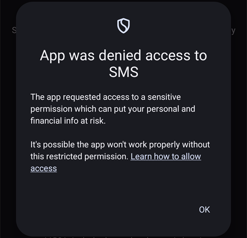
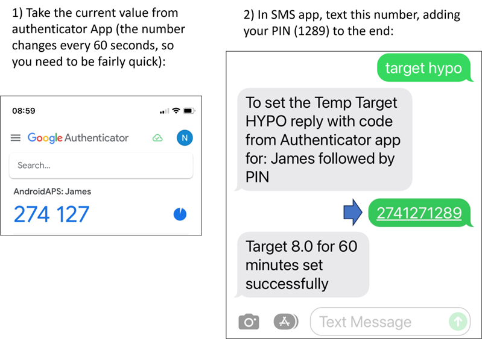
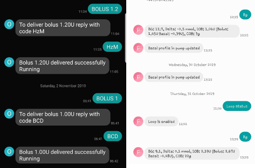
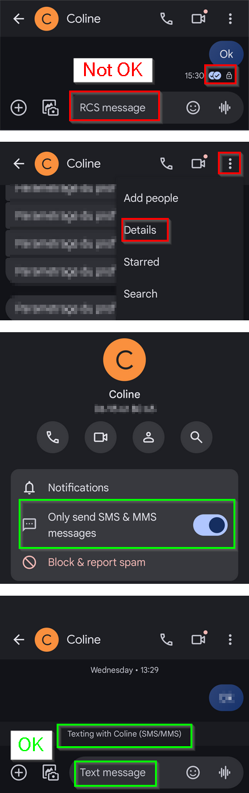
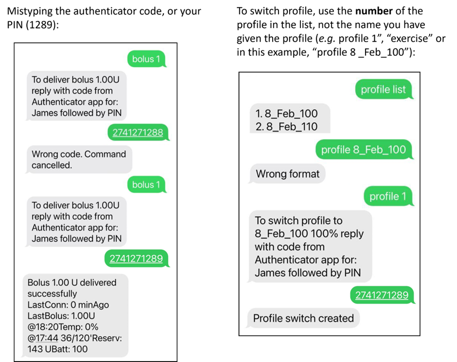

# SMS naredbe

```{contents} Table of contents
:depth: 2
```

Većina daljinskih prilagodbi (privremeni ciljevi, ugljikohidrati, zamjene profila i, nakon što je klijent uparen, bolusi) može se napraviti [aplikacijom **AAPSClient**](../RemoteFeatures/RemoteMonitoring.md) na Android telefonu s internetskom vezom, pogledajte [Upravljanje glavni uređaj ↔ klijent](#client-master-control) (verzija **AAPSClienta** za iPhone je u razvoju, pogledajte [Aplikacija AAPSClient](AapsClient.md)). SMS naredbe ostaju alternativa koja radi bez interneta i jedina su mogućnost daljinskog upravljanja ako kao pratitelj koristite iPhone i još nemate **AAPSClient**.

**SMS naredbe su vrlo korisne:**
1. Za uobičajeno daljinsko upravljanje

2. Ako želite daljinski dati bolus inzulina bez uparenog **AAPSClienta**

3. U području sa slabim internetskim signalom, gdje SMS poruke prolaze, ali je podatkovna/internetska veza telefona ograničena. To je vrlo korisno kada idete u udaljena područja (npr. kampiranje, skijanje).

4. Ako vaš drugi način daljinskog upravljanja (**AAPSClient**) privremeno ne radi

## Sigurnost na prvom mjestu

Ako omogućite **SMS Communicator** u **AAPS-u**, imajte na umu da netko može ukrasti telefon s kojeg se šalju daljinske naredbe i/ili ga može koristiti netko drugi. Uvijek zaključajte svoj telefon barem PIN-om. Snažna lozinka i/ili biometrijsko zaključavanje jako se preporučuju; neka se ona razlikuje od vaše Glavne lozinke APK-a (lozinke koja je potrebna za izvoz postavki **AAPS-a**).

Osim toga, preporučuje se dopustiti [drugi telefonski broj](#SMSCommands-authorized-phone-numbers) za SMS naredbe. Tako drugim brojem možete [isključiti](#SMSCommands-other) SMS Communicator ako vaš glavni telefon za daljinsko upravljanje bude ugrožen.

The default minimum time delay between bolus commands is 15 minutes, counted from the moment the pump accepts a bolus. Iz sigurnosnih razloga morate dodati najmanje dva ovlaštena telefonska broja da biste ovo mogli promijeniti na kraće vrijeme čekanja. Ako pokušate ponovno daljinski dati bolus unutar 15 minuta od prethodnog bolusa, dobit ćete odgovor „Daljinski bolus nije dostupan. Pokušajte ponovno kasnije.“

AAPS će vas također SMS porukom obavijestiti jesu li vaše daljinske naredbe, kao što su bolus ili promjena profila, izvršene. Preporučuje se postaviti potvrdne poruke tako da se šalju na najmanje dva različita telefonska broja, za slučaj da netko ukrade jedan od telefona koji ih prima.

**If you bolus through SMS Commands, you must enter carbs separately (second SMS, AAPSClient...)!** If you fail to do so, the IOB would be correct with too low COB, potentially leading to not performed correction bolus as **AAPS** assumes that you have too much active insulin.

Za osjetljive naredbe mora se koristiti aplikacija Authenticator s vremenski ograničenom jednokratnom lozinkom, radi veće sigurnosti.

Ako želite telefonu njegovatelja oduzeti mogućnost slanja SMS naredbi, upotrijebite gumb za hitne slučajeve „[Resetiraj Authenticatore](#sms-commands-authenticator-setup)“ u **AAPS-u** ili pošaljite SMS naredbu „[SMS stop](#SMSCommands-other)“. Resetiranjem Authenticatora SVI telefoni njegovatelja postaju nevažeći. Morat ćete ih ponovno postaviti.

## Postavljanje SMS naredbi

```{contents} The overall process is as follows
:depth: 1
:local: true
```

(sms-commands-authenticator-setup)=
### Postavljanje Authenticatora

Dvofaktorska autentifikacija koristi se za veću sigurnost.

Na telefon njegovatelja preuzmite (iz App Storea ili Google Playa) i instalirajte aplikaciju Authenticator. Popularne besplatne aplikacije su:
  - [Authy](https://authy.com/download/)
  - Google Authenticator - [Android](https://play.google.com/store/apps/details?id=com.google.android.apps.authenticator2) / [iOS](https://apps.apple.com/de/app/google-authenticator/id388497605)
  - [LastPass Authenticator](https://lastpass.com/auth/)
  - [FreeOTP Authenticator](https://freeotp.github.io/)

Te aplikacije Authenticator stvaraju vremenski ograničenu jednokratnu lozinku od 6 znamenki, slično kao kod mobilnog bankarstva ili kupovine. Možete koristiti i drugu aplikaciju Authenticator, ako podržava RFC 6238 TOTP tokene. Microsoft Authenticator ne radi.

### Provjera postavki telefona

Na telefonu idite na **Aplikacije > AAPS > Dopuštenja**. Provjerite jesu li **SMS** i **Telefon** dopušteni.


```{admonition} "App was denied access to SMS"
:class: tip
Android može blokirati dopuštenje za **SMS** za aplikacije koje nisu instalirane iz trgovine aplikacija, kao što je **AAPS**. Ako vidite ovu poruku kada dajete dopuštenje za **SMS**, otvorite na telefonu **Postavke > Aplikacije > AAPS**, dodirnite izbornik **⋮** (gore desno) i odaberite **Dopusti ograničene postavke**. Zatim ponovno dajte dopuštenje za **SMS**.
```



### Usklađivanje datuma i vremena

Vrijeme na oba telefona mora biti usklađeno. Najbolje je da se vrijeme postavlja automatski iz mreže. Razlike u vremenu mogu uzrokovati probleme s autentifikacijom.

Na telefonu s **AAPS-om** i na telefonu njegovatelja provjerite jesu li datum i vrijeme usklađeni. Kako se to točno radi ovisi o vašem uređaju; možda ćete morati isprobati različite postavke.

Primjer (za Samsung S23): **Postavke > Općenito upravljanje > Datum i vrijeme**: provjerite je li uključeno **Automatski datum i vrijeme**.

Neke opcije mogu biti zasivljene jer ih, ako je telefon postavljen kao dječji račun, mora odobriti administrator putem obiteljskog računa. Na iPhoneu njegovatelja/roditelja ova postavka datuma i vremena zove se „Postavi automatski“. Ako niste sigurni jesu li telefoni usklađeni, ne brinite: možete postaviti SMS naredbe i kasnije riješiti problem ako se čini da on uzrokuje poteškoće (po potrebi zatražite pomoć).

### Postavke AAPS-a

Nakon što ste provjerili postavke telefona, u samoj aplikaciji **AAPS** idite na [**Konfiguracija** → **Komunikacija**](../SettingUpAaps/ConfigBuilder.md) i omogućite dodatak **SMS Communicator**.

Otvorite postavke dodatka **SMS Communicator**.

Omogućite **Dopusti daljinske naredbe putem SMS-a**. Opcije **Dodatni obavezni PIN na kraju tokena** i **Postavljanje Authenticatora** pojavljuju se tek kada je ovo omogućeno:


(SMSCommands-authorized-phone-numbers)=
#### Dopušteni telefonski brojevi

Unesite telefonski broj (ili brojeve) njegovatelja. Uključite pozivni broj države i izostavite prvu „0“ telefonskog broja, kao u ovim primjerima:
* Broj telefona u UK-u: +447976304596
* Broj telefona u SAD-u: +11234567890
* Broj telefona u Francuskoj:  +33612344567
* _itd._

Imajte na umu da, ovisno o vašoj lokaciji, „+“ ispred broja može, ali ne mora biti potreban. Da biste to utvrdili, pošaljite probnu poruku; primljeni format prikazat će se na zaslonu dodatka **SMS Communicator** (**Konfiguracija** → **Komunikacija** → **SMS Communicator** → **Otvori dodatak**).

Ako dodajete više telefonskih brojeva, odvojite ih točkom sa zarezom, **BEZ razmaka između brojeva** (ovo je vrlo važno!). Odaberite **U redu**:


#### Min. razmak između daljinskih bolusa

- Možete odrediti najmanji razmak (u minutama) između dva bolusa poslana putem SMS-a.
- Iz sigurnosnih razloga morate dodati najmanje dva ovlaštena telefonska broja da biste mogli promijeniti ovu vrijednost.

#### Dodatni obavezni PIN na kraju tokena

Iz sigurnosnih razloga nakon koda za odgovor mora slijediti PIN. Odaberite PIN koji ćete vi (i drugi njegovatelji) dodavati na kraj koda iz Authenticatora kada šaljete SMS naredbu.

Zahtjevi za PIN su:

* at least 6 digits
* digits only

For a safer PIN, do not use the same digit many times (_e.g._ 111111) or a sequence (_e.g._ 123456).


#### Postavljanje Authenticatora

* Dodirnite **Postavljanje Authenticatora** i slijedite upute na zaslonu korak po korak.
* Otvorite instaliranu aplikaciju Authenticator na _telefonu njegovatelja_, postavite novu vezu i
* Telefonom njegovatelja skenirajte QR kod prikazan pod **Skenirajte kod za postavljanje AAPS OTP kodova**.


* Pod **Testirajte jednokratnu lozinku** u polje **Kod za provjeru** unesite jednokratnu lozinku iz aplikacije Authenticator na telefonu njegovatelja, a iza nje svoj PIN:

Example:
* Token iz aplikacije Authenticator je 457051
* Vaš obavezni PIN je 2401
* Kod za provjeru: 4570512401

If the entry is correct, the red text “WRONG PIN” will change automatically to a green “OK”. **There is no button you can press!** The process is now complete, there is no “OK” button you need to press after entering the code:


You should now be set up with SMS commands.

Use the **Reset Authenticators** button at the bottom of the **Authenticator setup** screen if you want to remove provisioned authenticators. (By resetting authenticator you make ALL already provisioned authenticators invalid. You will need to set them up again.)

## Korištenje SMS naredbi

### Prvi koraci sa SMS naredbama

1)  To check you have set everything up correctly, test the connection by typing “bg” as an SMS message from the caregiver phone to the **AAPS** phone. You should get a response similar to that shown here:


If you don't receive any response, check the [Troubleshooting](#SMSCommands-troubleshooting) section below.

2)  Now try an SMS command that requires the authenticator, _e.g._ “target hypo”. The caregiver’s phone will receive a text back, prompting you to enter the **six-digit authenticator password** from the authenticator app, followed by the additional secret **PIN** known only by caregivers/followers (a string of twelve digits in total, assuming your PIN has 6 digits).

When you try sending an SMS command for the first time, try it in the presence of the **AAPS** phone, to see how it works:



The caregiver’s phone will receive an SMS in reply from **AAPS** to confirm if the remote SMS command has been carried out successfully.

If your command is successful, you will receive a reply to confirm this. If there is a problem you will receive an error message. See [Troubleshooting](#SMSCommands-troubleshooting) below for common errors.

**Hint**: It can be useful to have unlimited SMS on your phone plan (for each phone used) if a lot of SMS will be sent.

### Davanje bolusa za obrok putem SMS naredbi

Remote bolusing of insulin can be done via **SMS Commands** or through a paired **AAPSClient** (see [Master ↔ Client control](#client-master-control)); it cannot be done through the Nightscout website. Carbs can be announced through SMS or **AAPSClient** as well. With SMS, it is not possible to send both carbs and insulin commands in one single SMS message. These commands must be sent separately as follows:

1)  Send the insulin bolus (_e.g._“bolus 2” will command a bolus of 2 units) through SMS commands is equivalent to **Treatments** → **Insulin** in **AAPS**. 2)  Send the carbs (_e.g._ “carbs 20” will announce 20g of carbs). This is equivalent to **Treatments** → **Carbs** in **AAPS**.

To avoid hypos, it is a good idea to start conservatively, by bolusing **less insulin** than would be needed according to your carb ratio, because you are not taking into account the current glucose level or glucose trend.

**The order in which you send these commands is important**. If you announce a large amount of carbs by any route, and have SMBs enabled, **AAPS** may immediately respond by giving a partial bolus of insulin. So, if you then try to send an insulin bolus _after_ announcing the carbs, you may have a frustrating delay and a “bolus in progress” message, and you then need to check what has been given as an SMB. Or, if you do not realise an SMB is being delivered, and your own subsequent bolus is also successful, too much insulin may be delivered for the meal overall. Therefore, if bolusing for meals remotely, always send the insulin bolus _before_ the carb announcement. If you prefer, you can combine **AAPSClient** with SMS commands: carbs entered on a paired **AAPSClient** need no authentication code and are therefore quicker than SMS commands. Carbs or other treatments entered on the Nightscout website are **not** applied while client control is on; **AAPS** is then in [hardened mode](#client-master-control-hardened-mode).

(SMSCommands-commands)=
## Naredbe

```{contents} List of command groups
:depth: 1
:local: true
```

Commands must be sent in English, the response will be in your local language if the response string is already [translated](#translations-translate-strings-for-AAPS-app). The commands are not case-sensitive, you can use lower or upper case.



The **SMS Commands Tables** below show all the possible SMS commands. _Example values_ are given, to aid understanding. The commands have the same range of possible values (targets, percent profile etc.) which are allowable in the **AAPS** app itself.

(authentication-or-not)=
### Autentifikacija ili ne?

Some SMS commands give an immediate response, and some SMS commands require strong **authentication** through the Authenticator app. A simple enquiry like “**BG**” (which requests an update on current glucose) is quick to type, doesn't need authenticating, and returns the **AAPS** status information shown below:


Commands which need more security require a code to be entered, for example:


The *Auth* column in the tables below, indicates whether such a strong authentication is required for each command.

### Podaci CGM-a

| Naredba    | Autent. | Funkcija i *odgovor*                                                                                                                                                                                                              |
| ---------- | ------- | --------------------------------------------------------------------------------------------------------------------------------------------------------------------------------------------------------------------------------- |
| BG         | Ne      | Vraća: zadnji GUK, deltu, aktivni inzulin (bolus i bazal), aktivne UH<br/>*Zadnji GUK: 5,6 prije 4 min, Delta: -0,2 mmol, Aktivni inzulin: 0,20 J (Bolus: 0,10 J Bazal: 0,10 J)*                                            |
| CAL 5.6/90 | Da      | Will calibrate the CGM with a value of 5.6/90<br/>(use the value appropriate to your glucose units)<br/>Works only if properly set-up in **AAPS**.<br/>*Calibration sent. Receiving must be enabled in xDrip+.* |

### Pumpa

| Naredba              | Autent. | Funkcija i *odgovor*                                                                                 |
| -------------------- | ------- | ---------------------------------------------------------------------------------------------------- |
| PUMP                 | Ne      | LastConn: 1 min ago<br/>Temp: 0.00U/h @11:38 5/30min<br/>IOB: 0.5U Reserv: 34U Batt: 100 |
| PUMP DISCONNECT *30* | Da      | Za odspajanje pumpe na *30* minuta                                                                   |
| PUMP CONNECT         | Da      | Pumpa je ponovno spojena                                                                             |

### Bazal

| Naredba           | Autent. | Funkcija i *odgovor*                   |
| ----------------- | ------- | -------------------------------------- |
| BASAL 0.3         | Da      | Za pokretanje bazala 0,3 J/h na 30 min |
| BASAL 0.3 20      | Da      | Za pokretanje bazala 0,3 J/h na 20 min |
| BASAL 30%         | Da      | Za pokretanje bazala 30 % na 30 min    |
| BASAL 30% 50      | Da      | Za pokretanje bazala 30 % na 50 min    |
| BASAL STOP/CANCEL | Da      | Za zaustavljanje privremenog bazala    |

Some pumps take a temp basal only in percent, others only in U/h. If you use the other form, **AAPS** answers *"This pump takes a temp basal only in percent, not in U/h."* (or the reverse) and sets nothing. The duration must be a multiple of your pump's temp basal duration step.


### Petlja

| Naredba           | Autent. | Funkcija i *odgovor*                                                                                                                                                                                                                                                               |
| ----------------- | ------- | ---------------------------------------------------------------------------------------------------------------------------------------------------------------------------------------------------------------------------------------------------------------------------------- |
| STATUS PETLJE     | Ne      | Response depends on actual status:<br/> - *Loop is disabled* if the loop is disabled<br/> - *Loop is enabled* if the loop is closed, open or LGS<br/> - *Pump disconnected* if the pump is disconnected<br/> - *Suspended (10 m)* if the loop is suspended |
| LOOP STOP/DISABLE | Da      | Pumpa će se vratiti na unaprijed programiranu bazalnu stopu.<br/>*Petlja je onemogućena*                                                                                                                                                                                     |
| LOOP SUSPEND 20   | Da      | *Loop suspended*                                                                                                                                                                                                                                                                   |
| LOOP RESUME       | Da      | *Petlja je nastavljena*                                                                                                                                                                                                                                                            |
| LOOP CLOSED       | Da      | *Current running mode: Closed Loop*                                                                                                                                                                                                                                                |
| LOOP LGS          | Da      | *Current running mode: Low Glucose Suspend*                                                                                                                                                                                                                                        |

### Bolus

Remote bolus is not allowed within 15 min (this value is editable only if 2 phone numbers added) after last bolus command or remote commands! In this case, the response would be *Remote bolus not available. Try again later.* This response is also sent when the pump is currently delivering a bolus.

| Naredba              | Autent. | Funkcija i *odgovor*                                                                                                                                                          |
| -------------------- | ------- | ----------------------------------------------------------------------------------------------------------------------------------------------------------------------------- |
| BOLUS 1.2            | Da      |                                                                                                                                                                               |
| BOLUS 0.60 MEAL      | Da      | Isporučuje navedeni bolus od 0,60 J<br/>**i** postavlja [privremeni cilj Prije obroka](#TempTargets-eating-soon-temp-target)                                            |
| CARBS 5              | Da      | Za unos 5 g, bez bolusa                                                                                                                                                       |
| CARBS 5 17:35/5:35PM | Da      | Za unos 5 g u 17:35.<br/>Prihvaćeni format vremena ovisi<br/> o postavci vremena (12 h/24 h) na telefonu.                                                         |
| EXTENDED 2 120       | Da      | Za pokretanje produženog bolusa od 2 J na 120 min.<br/>Samo za [kompatibilne pumpe](#Extended-Carbs-extended-bolus-and-switch-to-open-loop-dana-and-insight-pump-only). |
| EXTENDED STOP/CANCEL | Da      | Za zaustavljanje produženog bolusa                                                                                                                                            |

### Profil

| Naredba        | Autent. | Funkcija i *odgovor*                                                                                                                                       |
| -------------- | ------- | ---------------------------------------------------------------------------------------------------------------------------------------------------------- |
| PROFILE STATUS | Ne      | Trenutni profil i postotak                                                                                                                                 |
| PROFILE LIST   | Ne      | Trenutni popis profila u **AAPS-u**, npr.:<br/>1. Profil1<br/> 2. Profil2                                                                      |
| PROFILE 1      | Da      | Za zamjenu profila na profil 1 s popisa.<br/>Koristite brojeve koje vraća **PROFILE LIST**,<br/>a ne nazive profila pod kojima ste ih spremili |
| PROFILE 2 30   | Da      | Za zamjenu profila na Profil2 30 %                                                                                                                         |

The percentage must be between 30 and 250 %, as in the app. A value outside this range is refused before you are asked for the authentication code.

### Privremeni ciljevi

| Naredba                   | Autent. | Funkcija i *odgovor*                                 |
| ------------------------- | ------- | ---------------------------------------------------- |
| TARGET MEAL/ACTIVITY/HYPO | Da      | Za postavljanje privremenog cilja MEAL/ACTIVITY/HYPO |
| TARGET STOP/CANCEL        | Da      | Za otkazivanje privremenog cilja                     |


(SMSCommands-other)=
### Ostalo

| Naredba          | Autent. | Funkcija i *odgovor*                                                                                                                                                                                                                        |
| ---------------- | ------- | ------------------------------------------------------------------------------------------------------------------------------------------------------------------------------------------------------------------------------------------- |
| RESTART          | Da      | Ponovno pokreće AAPS. Korisno ako imate problema koji se obično riješe ponovnim pokretanjem.                                                                                                                                                |
| SMS DISABLE/STOP | Da      | To disable the SMS Remote Service, reply with the code.<br/>Keep in mind that you'll be able to reactivate it directly<br/>from the **AAPS** master smartphone only.                                                            |
| HELP             | Ne      | Vraća sve dostupne funkcije:<br/>BG, LOOP, PUMP, BASAL, BOLUS, EXTENDED, CAL, PROFILE, TARGET, SMS, CARBS, HELP, RESTART<br/>Pošaljite naredbu ***HELP ***FUNCTION****** za popis<br/>svih opcija dostupnih u tom dijelu. |
| HELP BOLUS       |         | *BOLUS 1.2<br/>BOLUS 1.2 MEAL*                                                                                                                                                                                                        |

(SMSCommands-troubleshooting)=
## Rješavanje problema i česta pitanja

```{contents} List of questions and issues
:depth: 1
:local: true
```

### Što _ne možemo_ raditi SMS naredbama?

1)  **You cannot set a _temporary_ profile switch** (so for example, setting "profile exercise" for 60 minutes), although you can permanently switch to “profile exercise”. Temporary profile switches can instead be set through **AAPSClient**.

2)  **You cannot cancel automations** or **set user-defined targets** but there are approximate solutions: As an example, imagine the normal profile target is 5.5. You have set an automation in AAPS, to always set a high target of 7.0 between 2.30pm and 3.30pm because of a sports class in school, and a condition of the automation is that “no temp target exists”. This week, you have been told at short notice that the sports class is cancelled, and is being replaced by a pizza-eating session, but your kid is already at school with the **AAPS** phone. If the high temporary target of 7.0 is started by the automation, and you cancel it (on the **AAPS** phone, or remotely) the conditions for the automation are still met and **AAPS** will simply set the high target again, a minute later.

**If you did have access to the AAPS phone**, you could uncheck/modify the automation, or, if you don’t want to do that, you could simply set a new temp target of 5.6 for 60 min by pressing on the target on the main screen, or via **Manage** → **Temp Target**. This would prevent the automation from setting the high target of 7.0.

**If you don’t have access to the AAPS phone** SMS commands can be used for an approximate fix: for example, by using the command “target meal” to set a target of 5.0 for 45 mins (other default targets are 8.0 for activity or hypo, see Table). However, with SMS commands you cannot specify a _specific_ value target value (of 5.6 for 60 minutes, for example), you would need to use **AAPSClient** to do this.

### Što ako se predomislim nakon što sam upravo poslao naredbu?

**AAPS** will only deliver on the most recent command. So, if you type “bolus 1.5”, and then, without authenticating, you send a new command “bolus 1”, it will ignore the earlier 1.5 command. **AAPS** will always send the caregiver's phone a response to confirm what the SMS command is before you are prompted to enter the authentication code, as well as a response following the action.

### Zašto nisam dobio odgovor na SMS naredbu?

It could be for one of these reasons:

1)  The message has not got through to the phone (network issues). 2)  **AAPS** is still in the process of processing the request (_e.g._ a bolus, which can take some time to deliver depending on your bolus rate). 3)  The **AAPS** phone does not have a good Bluetooth connection to the pump when the command is received, and the command has failed (this usually creates an alarm on the **AAPS** phone).

### Nema nikakvog odgovora na SMS naredbe

On the caregiver phone and/or **AAPS** phone, try disabling the following options :
* **Šalji kao chat poruku** (Send as chat message) 
* Ako koristite aplikaciju Android Messages ili Google Messages, isključite RCS poruke:
  - otvorite određeni SMS razgovor u aplikaciji Poruke
  - Odaberite izbornik s tri točke u gornjem desnom kutu
  - odaberite „Pojedinosti“
  - Aktivirajte „Šalji samo SMS i MMS poruke“ (Only send SMS and MMS messages) 

### Pogreške pri izvršavanju naredbi

There are several possible reasons the command may not be successful:

* Postavljanje SMS naredbi nije dovršeno/ispravno
* Poslali ste naredbu u pogrešnom formatu (npr. „disconnect pump 45“ umjesto „pump disconnect 45“)
* Upotrijebili ste pogrešan ili istekao kod iz Authenticatora (obično je dobro pričekati nekoliko sekundi na novi kod ako trenutni uskoro istječe)
* Kod+PIN bili su ispravni, ali je slanje ili primanje SMS-a kasnilo, pa je **AAPS** izračunao da je kod iz Authenticatora istekao
* Telefon s **AAPS-om** je izvan dometa/nema vezu s pumpom
* Sustav već isporučuje bolus

Common errors are shown in the examples below:



### Kako mogu zaustaviti naredbu nakon što je autentificirana?

You can't. However, you can cancel a bolus sent by SMS on the **AAPS** phone itself, by simply cancelling it on the bolusing popup, if you are quick. Many SMS commands (apart from bolusing and carb announcements) can be easily reversed, or actions taken to mitigate unintended effects if a mistake is made.

For errors in bolusing and carb announcements, you can still take action. For example, if you have announced 20g carbs but your child only eats 10g and you (or an onhand caregiver) is unable to delete the treatment in the **AAPS** phone directly, you could set a high temporary target, or set a reduced profile, to encourage **AAPS** to be less aggressive.

### Više SMS-ova

If you receive the same message repeatedly (_e.g._ a profile switch) you may have accidentally set up a looping condition with other apps. This could be xDrip, for example. If so, please ensure that xDrip (or any other app) does not upload treatments to NightScout.

If the other app is installed on multiple phones make sure to deactivate upload on all of them.

(sms-commands-too-many-messages)=
### Dobivam previše SMS poruka od SMS naredbi. Mogu li ih dobivati rjeđe ili ih potpuno zaustaviti?

Using SMS commands may generate a lot of automated messages from the **AAPS** phone to the caregiver’s phone. You will also receive messages, for example “basal profile in pump updated” if you have automations set up in **AAPS**. It can be useful to have unlimited SMS allowance on your **AAPS** phone plan (and for each caregiver phone used) if a lot of SMS will be sent, and to deactivate SMS notifications, alarms or vibrations on all phones. It is not possible to use SMS commands and not receive these updates. Because of this, you may want an alternative way to communicate directly with your child (if they are old enough), instead of SMS. Common alternative communication apps used by **AAPS** caregivers include WhatsApp, LINE, Telegram, and Facebook Messenger.

It is possible to disable the "Basal profile in pump updated" SMS, when the Profile change originated from Nightscout. To do this, create a file named **exactly** `do_not_send_sms_on_profile_change` in the `extra` dir of your AAPS directory.
