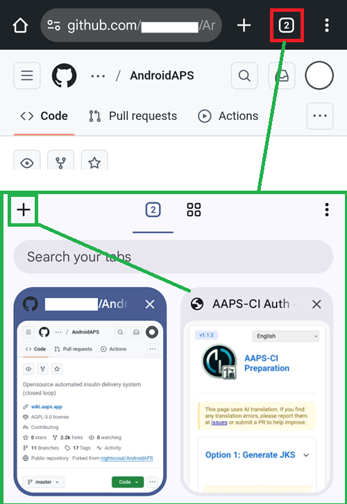

(browser-build)=

# Izrada u pregledniku

Izrada AAPS-a pomoću GitHub Actions.

**Najniža podržana verzija AAPS-a je 3.3.2.1.**

## Izradite sami umjesto preuzimanja

**Aplikacija AAPS (APK datoteka) nije dostupna za preuzimanje zbog propisa o medicinskim uređajima. Zakonito je izraditi aplikaciju za vlastitu upotrebu, ali kopiju ne smijete dati drugima!**

Pojedinosti pogledajte na stranici [Česta pitanja korisnika petlje](../UsefulLinks/FAQ.md).

(Building-APK-without-a-computer)=

## Odaberite način izrade

Odaberite način koji odgovara uređaju s kojeg izrađujete:

### Na Android telefonu: AAPS Builder (preporučeno)

Stranica postavki vodi vas kroz izradu vlastitog privatnog repozitorija za izradu na GitHubu. Ništa ne treba instalirati, nema datoteke za pripremu, a svaku izradu pokrećete sami. Aplikaciju preuzimate izravno s GitHuba. Google Drive nije obavezan.

To radi i iz preglednika na računalu.

**→ [Izrada u pregledniku s AAPS Builderom](BrowserBuildAapsBuilder.md)**

### Na računalu ili iPhoneu / iPadu: fork i datoteka za pripremu

Napravite kopiju (fork) izvornog koda AAPS-a na GitHubu, izradite spremište ključeva pomoću datoteke za pripremu, a izrađena aplikacija sprema se na vaš Google Drive. Slijedite četiri koraka ispod.

```{note}
**Već izrađujete s forkom?** Nastavite ga ažurirati kako je opisano u [Ažuriranje putem preglednika (fork)](../Maintenance/UpdateBrowserBuild.md) ili prijeđite na AAPS Builder. Da prijeđete, najprije uzmite kopiju svog spremišta ključeva iz svog forka: pogledajte [Prelazak s prethodne izrade u pregledniku (fork)](#aaps-builder-from-fork).
```

U pregledniku ćete morati koristiti više kartica i prelaziti s jedne na drugu. Primjer za Chrome:



```{note}
Morat ćete prelaziti s kartice na karticu: počnite sa svim karticama zatvorenima da se ne izgubite kad prelazite s jedne na drugu.
```

#### Što vam treba

- **Google račun**, da se izrađena aplikacija može spremiti na vaš Google Drive.
- **GitHub račun** (besplatan) – izradit ćete ga u Koraku 1.
- **Web preglednik** koji može držati otvoreno više kartica odjednom (ispod se pretpostavlja Chrome).
- Mali **pomoćni program za pokretanje datoteke za pripremu**. Koji vam treba ovisi o uređaju s kojeg izrađujete – sada ne trebate ništa instalirati, Korak 2 vodi vas kroz to za vaš uređaj:
  - **Računalo (Windows / Mac / Linux):** Simple Web Server.
  - **iPhone / iPad:** nije potrebna dodatna aplikacija – koristite ugrađenu aplikaciju Datoteke i preglednik.

#### Koraci

Izrada u pregledniku je niz odluka. Slijedite ove korake redom:

1. **[Izradite svoj GitHub fork](BrowserBuildFork.md)** – napravite svoju osobnu kopiju izvornog koda AAPS-a.
2. **[Izradite spremište ključeva za potpisivanje](BrowserBuildKeystore.md)** – ključna odluka: izradite novo spremište ključeva (Opcija 1) ili prenesite postojeće (Opcija 2), a zatim slijedite stranicu za svoj uređaj.
3. **[Autorizirajte Google Drive](BrowserBuildGoogleDrive.md)** – dopustite GitHubu da izrađenu aplikaciju spremi na vaš Google Drive.
4. **[Izradite APK](BrowserBuildAPK.md)** – pokrenite GitHub Actions workflow i odaberite verziju i varijantu.

Ako imate problema, pogledajte **[Izrada u pregledniku: rješavanje problema](../GettingHelp/BrowserBuildTroubleshooting.md)**. Za neobavezne radnje s forkom pogledajte [izvoz spremišta ključeva](#ci-keystore-export) ili [cherry-pick commita](#github-cherry-pick).

----

**Počnite s [Korakom 1 – Izradite svoj GitHub fork](BrowserBuildFork.md) →**

```{toctree}
:hidden:

AAPS Builder <BrowserBuildAapsBuilder.md>
Korak 1: Izradite svoj GitHub fork <BrowserBuildFork.md>
Korak 2: Izradite spremište ključeva za potpisivanje <BrowserBuildKeystore.md>
Korak 3: Autorizirajte Google Drive <BrowserBuildGoogleDrive.md>
Korak 4: Izradite APK <BrowserBuildAPK.md>
```
