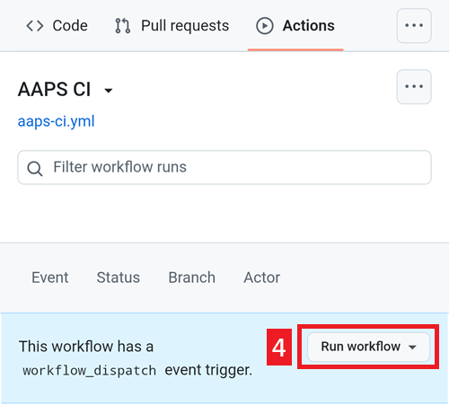
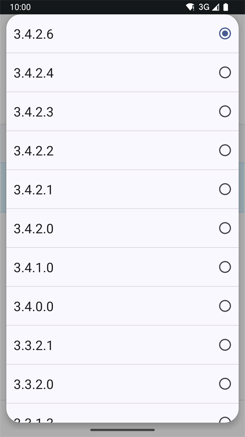
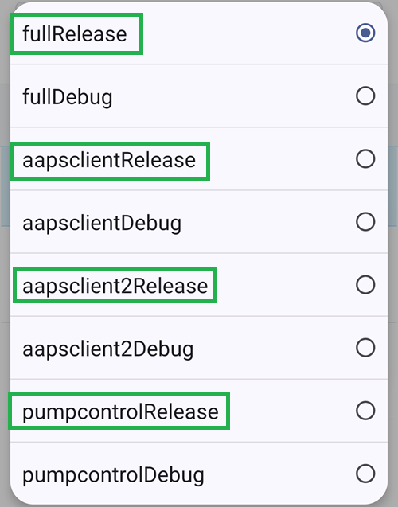

(github-build-apk)=

# Izrada u pregledniku – Korak 4: Izradite APK

```{note}
Ovo je **Korak 4** postupka [Izrada u pregledniku](BrowserBuild.md). Najprije dovršite [Korak 3 – Autorizirajte Google Drive](BrowserBuildGoogleDrive.md).
```

## AAPS-CI GitHub Actions za izradu APK datoteke AAPS-a
 - Prikladno za sve korisnike.

```{tab-set}

:::{tab-item} Wiki
### Pokrenite workflow za izradu potpisane APK datoteke

1. U svojoj GitHub kopiji AndroidAPS-a odaberite Actions.
2. Proširite All Workflows.
3. Odaberite AAPS-CI


4. Pomaknite se prema dolje i dodirnite Run Workflow.



5. Ostavite **Use workflow from** na grani master. U polju **Select AAPS Version** odaberite verziju **AAPS-a** koju želite izraditi (obično najnoviju). Odaberite [varijantu](#browserbuild-variant) (fullRelease) i dodirnite Run workflow.


6. Vidjet ćete poruku „Workflow run was successfully requested“. Osvježite stranicu u pregledniku i moći ćete pratiti napredak izrade. Kada radnja završi, radnja AAPS CI prikazat će zelenu kvačicu. Uspješno ste izradili ažuriranu verziju AAPS-a.


### Instalirajte APK datoteku AAPS-a

1. Otvorite svoj Google Drive
2. Otvorite mapu AAPS, odaberite mapu nove verzije i u njoj ćete naći verziju za telefon i verziju za Android Wear.


:::

:::{tab-item} Video
<div align="center" style="max-width: 360px; margin: auto; margin-bottom: 2em;">
  <div style="position: relative; width: 100%; aspect-ratio: 9/16;">
    <iframe
      src="https://geo.dailymotion.com/player/x9rdwms.html?video=x9rdwms&loop=true&mute=true"
      loading="lazy"
      style="position: absolute; top: 0; left: 0; width: 100%; height: 100%;"
      frameborder="0"
      allowfullscreen>
    </iframe>
  </div>
</div>
:::  

```

## Odabir verzije za izradu

**Metodom izrade u pregledniku mogu se izraditi samo verzije AAPS-a od 3.3.2.1 naviše.**

Dodirnite **Select AAPS Version** i odaberite verziju za izradu. Najnovija verzija nalazi se na vrhu popisa.



(browserbuild-variant)=

## Odabir varijante izrade

*Napomena: automatski će se izraditi i aplikacija za Android i aplikacija za Android Wear.*

  - Odaberite varijantu koja vam je potrebna:
    - fullRelease: za uobičajeno korištenje s pumpom, sa svim funkcijama.
    - [aapsclientRelease, aapsclient2Release, aapsclient3Release](#RemoteControl_aapsclient): za njegovatelje (potreban je [Nightscout](../SettingUpAaps/Nightscout.md)). `aapsclient3Release` izrađuje **AAPSClient3**, dostupan od verzije 4.0 **AAPS-a** (pogledajte [O AAPSClientu, AAPSClientu2 i AAPSClientu3](#remotecontrol-aapsclient-versions)).
    - pumpcontrolRelease: kao zamjena za aplikaciju/upravljač vaše pumpe



Variants ending with “Debug” indicate that the APK will be built in debug mode, which is useful for developers for troubleshooting.

<!-- If you want to test the items in a pull request has been moved to dev page /AdvancedOptions/DevBranch.md -->

----

Kada izrada uspije, APK datoteka sprema se na vaš Google Drive. Nastavite s [Prijenos i instalacija AAPS-a na vaš pametni telefon](TransferringAndInstallingAaps.md).

```{note}
Od rujna 2026. Googleova [provjera Android razvojnih programera](#android-developer-verification) može, ovisno o vašoj zemlji, blokirati instalaciju APK datoteke dodirom na datoteku. Besplatna zaobilazna rješenja objašnjena su na toj stranici.
```

Ako izrada ne uspije, najprije [u dnevniku izrade pronađite što je pošlo krivo](#aaps-ci-read-the-logs), a zatim pogledajte [Izrada u pregledniku: rješavanje problema](../GettingHelp/BrowserBuildTroubleshooting.md). Ako želite u izradu uključiti određeni commit, pogledajte [cherry-pick commita](#github-cherry-pick).
