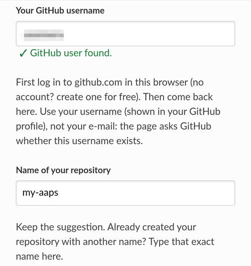
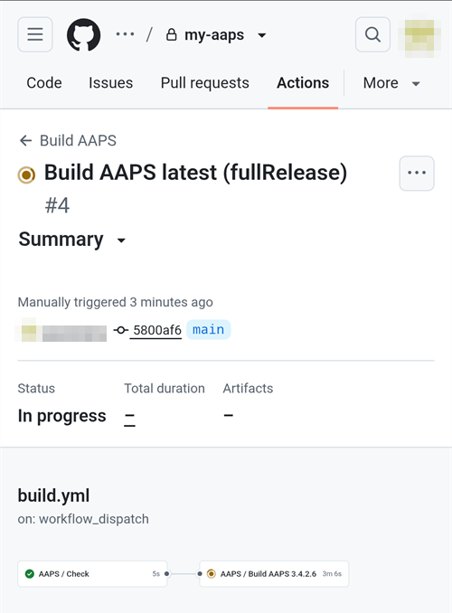
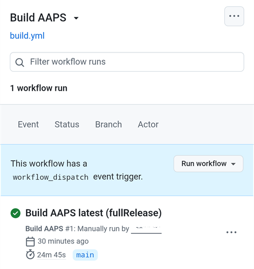
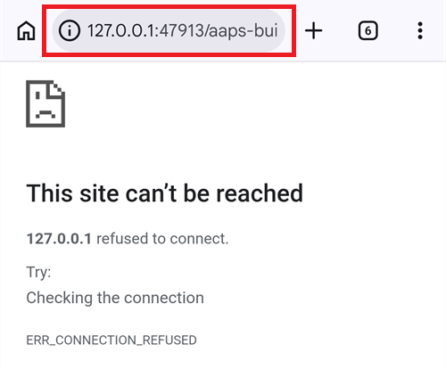

(aaps-builder)=

# Izrada u pregledniku s AAPS Builderom

```{note}
Ovo je preporučeni način izrade AAPS-a s **Android telefona**. Radi i iz bilo kojeg preglednika na računalu. Druge načine izrade s računala ili iPhonea pogledajte u pregledu [Izrada u pregledniku](BrowserBuild.md).
```

```{contents} In this page
:backlinks: entry
:depth: 2
```

**AAPS Builder** izrađuje aplikaciju AAPS umjesto vas na GitHubu, besplatnoj web stranici za smještaj koda. Na telefon ne trebate ništa instalirati niti otvarati pripremnu datoteku.

A setup page walks you through it. Prvi put to traje oko 10 minuta:

1. Create your own **private copy** of AAPS Builder in your GitHub account: the setup page opens GitHub with everything filled in, you only confirm. The build workflow, the file that tells GitHub how to build AAPS, is already in it.
2. Create or upload your **signing key** (the keystore).
3. Give the key to your repository as a GitHub **secret**.
4. **Build** the app. One build takes 15 to 30 minutes.
5. **Download and install** the app on your phone.

**Ne** trebate izraditi fork AndroidAPS-a: izvorni kod AAPS-a preuzima se iz službenog repozitorija AndroidAPS pri svakoj izradi. **Ne** trebate ni Google Drive: aplikaciju preuzimate izravno s GitHuba.

```{admonition} Where the code comes from
:class: note

The build workflow is maintained by the AAPS developers in the [nightscout/aaps-builder](https://github.com/nightscout/aaps-builder) repository, and your repository is a copy of it. The [workflow](https://github.com/nightscout/aaps-builder/blob/main/.github/workflows/build.yml) in your copy is short: it runs the [build steps](https://github.com/nightscout/aaps-builder/blob/main/.github/workflows/aaps-builder.yml) kept in that repository, so improvements reach you without any change to your repository. You can read both files. Pri izradi workflow preuzima samo službeni izvorni kod AAPS-a i GitHubove vlastite alate za izradu. Vaše spremište ključeva nikada ne napušta vaš preglednik i vaš privatni repozitorij.
```

(aaps-builder-before-you-start)=

## Prije nego počnete

Trebat će vam:

- **GitHub račun** (besplatan). Ako ga nemate, najprije ga izradite na [github.com](https://github.com/signup).
- **Web preglednik**: Chrome na telefonu ili bilo koji preglednik na računalu. Prije početka se u tom pregledniku prijavite na github.com.
- **Imate aplikaciju GitHub na telefonu?** Možete je zadržati. Neki gumbi stranice postavki tada otvaraju aplikaciju umjesto Chromea. Building works in the app, but the app **cannot download** the finished AAPS: [step 5](#aaps-builder-step5) shows how to switch to Chrome for the download.
- Vaše **postojeće spremište ključeva** (datoteka `.jks`), njegova lozinka i alias, ako ste AAPS već izradili i želite ga ažurirati bez ponovne instalacije.

```{warning}
**Vaš repozitorij za izradu mora ostati privatan.** Sve što izrada proizvede vidljivo je svakome tko može vidjeti repozitorij. Stranica postavki izradit će privatni repozitorij za vas. Never change it to public, and don't **fork** AAPS Builder instead: a fork is always public.

Privatni repozitorij dobiva 2000 besplatnih minuta GitHub Actions mjesečno, što je dovoljno za nekoliko izrada.
```

```{warning}
**Novi ključ ili postojeći ključ: o tome ovisi možete li ažurirati AAPS.**

- **Već imate AAPS na telefonu, izrađen sa spremištem ključeva koje još imate**: na stranici postavki odaberite **Već imam spremište ključeva** i prenesite ga. Vaša sljedeća izrada ažurirat će postojeći AAPS. Jeste li AAPS izradili prethodnom izradom u pregledniku (vlastiti fork)? Vaše spremište ključeva nalazi se u vašem forku: [najprije napravite njegovu kopiju](#aaps-builder-from-fork).
- **AAPS izrađujete prvi put ili ste izgubili spremište ključeva ili njegovu lozinku**: odaberite **Izradi novi ključ**. Aplikacija potpisana novim ključem **ne može ažurirati** AAPS potpisan drugim ključem. You must export your settings, copy the file off your phone, uninstall the old AAPS, install the new one, then import your settings: see [Reinstalling AAPS with a new keystore](#reinstall-aaps).

Nakon toga uvijek koristite isti ključ. Kada izradite novi ključ, preuzmite sigurnosnu kopiju koju stranica nudi i spremite je s lozinkom i aliasom (`key0`) na sigurno mjesto izvan telefona.
```

(aaps-builder-from-fork)=

## Prelazak s prethodne izrade u pregledniku (fork)

Preskočite ovaj odjeljak ako AAPS nikada niste izradili prethodnom metodom izrade u pregledniku (vlastita kopija ili fork AndroidAPS-a na GitHubu, s pripremnom datotekom i Google Driveom).

Vaše spremište ključeva spremljeno je kao tajne u vašem forku. GitHub nikada više ne prikazuje tajnu pa je ne možete kopirati u novi repozitorij. Get a copy of your keystore first, then use it in [step 2](#aaps-builder-step2) with **I already have a keystore**.

```{warning}
Ne odabirite **Izradi novi ključ**. AAPS izrađen novim ključem ne može ažurirati AAPS na vašem telefonu.
```

Koji je vaš slučaj?

- **Koristili ste Opciju 2** (prenijeli ste vlastito spremište ključeva iz Android Studija) i još imate datoteku `.jks`, njezine lozinke i alias: ovdje ne trebate ništa raditi. Use that file in step 2.
- **Koristili ste Opciju 1** (pripremna datoteka izradila je vaš ključ) ili više nemate datoteku spremišta ključeva: izvezite je iz svog forka kako je opisano u nastavku.

Izvoz spremišta ključeva iz vašeg forka:

1. U svom forku otvorite **Settings** → **Secrets and variables** → **Actions** i dodajte tajnu s nazivom `ZIP_PASSWORD`. Odaberite lozinku samo s engleskim slovima i brojkama. Ona štiti datoteku koju ćete izraditi.
2. Otvorite karticu **Actions** svog forka, dodirnite **CI Keystore Export**, a zatim **Run workflow**. Više detalja: [Izvoz spremišta ključeva](#ci-keystore-export).
3. Kada pokretanje ima zelenu kvačicu, otvorite svoj Google Drive: datoteka `keystore.zip` nalazi se u mapi **AAPS** → **KeyStore**. Ako pokretanje ne uspije u koraku Google Drive, pristup vašeg forka Google Driveu je istekao: pogledajte [Istekao je Google refresh token](#aaps-ci-google-token-expired).
4. Preuzmite `keystore.zip` i otvorite ga sa svojom lozinkom `ZIP_PASSWORD`: na računalu ili na telefonu s aplikacijom za upravljanje datotekama koja može otvoriti ZIP datoteke zaštićene lozinkom. Sadrži:
   - `keystore.jks`: vaše spremište ključeva,
   - `keyStoreInfo.txt`: vaše vrijednosti `KEYSTORE_PASSWORD`, `KEY_PASSWORD` i `ALIAS` (obično `key0`).
5. Kopirajte `keystore.jks` na telefon (ili na Google Drive da ga ondje možete odabrati).

In [step 2](#aaps-builder-step2) of the setup page:

1. Dodirnite **Već imam spremište ključeva**.
2. U polju **Datoteka spremišta ključeva** odaberite `keystore.jks`.
3. U polje **Lozinka spremišta ključeva** upišite `KEYSTORE_PASSWORD` iz `keyStoreInfo.txt`.
4. U polju **Alias ključa** odaberite ili upišite `ALIAS` iz `keyStoreInfo.txt`.
5. Ako se `KEY_PASSWORD` razlikuje od `KEYSTORE_PASSWORD`, uklonite kvačicu s **Lozinka ključa ista je kao lozinka spremišta ključeva** i upišite `KEY_PASSWORD`.

Čuvajte `keystore.zip` i njegov `ZIP_PASSWORD` na sigurnom mjestu izvan telefona: to je sigurnosna kopija vašeg ključa.

To also save the builds of AAPS Builder in Google Drive, do [step 6](#aaps-builder-google-drive): the setup page gets a new `GDRIVE_OAUTH2` for you. Svoj fork možete zadržati dok AAPS izrađen AAPS Builderom ne bude instaliran na vašem telefonu.

## Otvorite stranicu postavki

**→ [Otvorite stranicu postavki AAPS Buildera](#aaps-builder-setup)**

The setup page is part of this documentation, in your language. Keep this page open in another tab as well: the sections below explain each step of the setup page in more detail, with screenshots.

Stranica postavki otvara svaku GitHub stranicu u novoj kartici Chromea. Da se vratite na stranicu postavki, dodirnite gumb kartica pokraj Chromeove adresne trake (kvadrat s brojem) i odaberite stranicu postavki AAPS Buildera.


Stranica postavki radi u potpunosti u vašem pregledniku: vaš ključ i lozinke nikamo se ne šalju, osim u GitHub tajnu u koju ih sami zalijepite. GitHubu se šalje samo vaše GitHub korisničko ime, kako bi se provjerilo postoji li. Pamti vaše GitHub korisničko ime i naziv repozitorija pa joj se možete vratiti u bilo kojem trenutku da ponovno otvorite stranicu s tajnama ili svoje izrade.


(aaps-builder-step1)=

## Korak 1 – Izradite svoj privatni repozitorij za izradu

This step creates your own private copy of AAPS Builder in your GitHub account, with the build workflow already in it. Samo ga vi možete vidjeti, kao i aplikacije koje izrađuje.

1. Provjerite jeste li u ovom pregledniku prijavljeni na github.com.

2. U polje **Vaše GitHub korisničko ime** upišite svoje GitHub korisničko ime, a ne e-mail adresu. Stranica ga provjerava na GitHubu: **✓ GitHub korisnik pronađen** znači da je ispravno.

3. U polju **Naziv vašeg repozitorija** ostavite predloženi naziv `my-aaps`. Ako ste repozitorij već izradili s drugim nazivom, upišite točno taj naziv.

   ```{note}
   **Already have an AAPS Builder repository** (made with an earlier version of the setup page)? Don't create a new one: type its exact name, skip **Create my private repository**, and update its workflow once as explained in [Updating AAPS](#aaps-builder-updates). Your secrets stay as they are. If you want a new repository anyway, choose a name you don't have yet, for example `my-aaps-2`, and use the same keystore in step 2.

   Don't type the name of your fork of AndroidAPS: a fork is public, and it already builds with its own **AAPS CI** workflow.
   ```

   

4. Provjerite redak **Vaš repozitorij:** prikazuje `github.com/<your username>/my-aaps`. The setup page remembers the name from your last visit: check it every time before you use its buttons.

5. Dodirnite **Izradi moj privatni repozitorij**.

   

6. GitHub opens **Create a new repository** in a new tab. Everything is already filled in: under **Start with a template**, the template `nightscout/aaps-builder` with **Include all branches** off, and under **General**, your account as **Owner** and the name you chose.

   

   Don't change anything.

7. Scroll down: under **Configuration**, **Choose visibility** is already **Private**. Tap the green **Create repository** button.

   

   GitHub shows your new repository: it contains a folder `.github` (with the build workflow) and a file `README.md`. **Vratite se na karticu sa stranicom postavki** za korak 2: dodirnite gumb kartica pokraj Chromeove adresne trake i odaberite stranicu postavki.

   

```{warning}
**Your new repository is empty**, with no files? It was not created from the template, and it cannot build. Delete it (**Settings** → bottom of the page → **Delete this repository**), then tap **Create my private repository** on the setup page again.
```

```{tip}
GitHub says **my-aaps already exists in this account**? You already have your repository: close the GitHub tab and go on with the setup page. If your key is already in it, continue with [step 4](#aaps-builder-step4). See [troubleshooting](#aaps-builder-ts-repo-exists).
```

(aaps-builder-step2)=

## Step 2 – Your signing key

Aplikacija mora biti potpisana vašim vlastitim ključem. Odaberite jednu od dvije kartice. Najprije pročitajte [upozorenje o novom ili postojećem ključu](#aaps-builder-before-you-start).


### Već imam spremište ključeva

1. Dodirnite **Već imam spremište ključeva**.
2. U polju **Datoteka spremišta ključeva** odaberite svoju datoteku `.jks` (ili `.keystore`, `.p12`, `.pfx`). Na telefonu najprije kopirajte datoteku na telefon ili na Google Drive.
3. U polje **Lozinka spremišta ključeva** upišite lozinku spremišta ključeva.
4. U polju **Alias ključa** odaberite svoj alias s popisa ili ga upišite ako popisa nema. Za spremišta ključeva izrađena u Android Studiju to je obično `key0`.
5. Ako se lozinka ključa razlikuje od lozinke spremišta ključeva, uklonite kvačicu s **Lozinka ključa ista je kao lozinka spremišta ključeva** i upišite lozinku ključa.
6. Dodirnite **Provjeri i nastavi**.

Stranica provjerava lozinku i alias na vašem uređaju. **Spremište ključeva je u redu! Continue with step 3.** means everything is right. Ako piše da će se lozinka provjeriti pri izradi, svejedno nastavite: izrada će vam reći ako nešto nije u redu.

### Izradi novi ključ

1. Dodirnite **Izradi novi ključ**.

2. Odaberite lozinku i upišite je dvaput. Pravila: najmanje 8 znakova, samo slova a–z i A–Z, znamenke 0–9 i simboli kao što su `! ? #`. Bez razmaka, bez slova s dijakritičkim znakovima (npr. č, ć, š, ž) i bez znaka `|`.

3. Dodirnite **Izradi ključ**. Potrebno je nekoliko sekundi dok se ne pojavi **Ključ je izrađen**.

   

4. Dodirnite **Preuzmi sigurnosnu kopiju (aaps-keystore.jks)**. Ako Chrome pita **Download file again?**, na telefonu je već starija sigurnosna kopija s istim nazivom: dodirnite **Download again**. Chrome tada sprema novi ključ kao `aaps-keystore (1).jks`: to je datoteka koja pripada ovom ključu. Čuvajte je i ne zamijenite je sa starijom.

   Čuvajte ovo troje zajedno, na sigurnom mjestu izvan telefona (na primjer u vlastitoj pohrani u oblaku):

   - datoteku `aaps-keystore.jks`,
   - svoju lozinku,
   - alias ključa: **`key0`**.

   Sve troje trebat će vam ako AAPS ikada budete izrađivali na drugi način, na primjer s Android Studiom. Ključevi izrađeni ranijom verzijom stranice postavki imaju alias `aaps`.

   

(aaps-builder-step3)=

## Step 3 – Give the key to your repository

Step 3 unlocks when step 2 is done. Vaš ključ, njegove lozinke i alias spakirani su u jednu vrijednost, tajnu `KEYSTORE_SET`.

1. Dodirnite **Otvori stranicu s tajnama**.


2. GitHub otvara stranicu **New secret** (nova tajna) vašeg repozitorija. Na telefonu se nalazi ispod izbornika postavki: pomaknite se prema dolje.


3. Prijeđite na karticu sa stranicom postavki i dodirnite **Kopiraj naziv**. Vratite se na karticu GitHuba i zalijepite ga u malo polje **Name**. Naziv je `KEYSTORE_SET`.

4. Prijeđite na karticu sa stranicom postavki i dodirnite **Kopiraj tajnu**. Vratite se na karticu GitHuba i zalijepite je u veliki okvir **Secret** (na telefonu dugim pritiskom). Tajna je vrlo dug kod, s tisućama znakova: stranica postavki prikazuje njezine prve znakove pokraj gumba. Ondje ne lijepite riječ `KEYSTORE_SET`.

5. Dodirnite **Add secret**. `KEYSTORE_SET` sada se prikazuje pod **Repository secrets**.


To trebate učiniti samo jednom.

```{tip}
GitHub prikazuje **Page not found** (404)? Najprije provjerite jeste li u ovom pregledniku prijavljeni na github.com: GitHub prikazuje 404 za privatne repozitorije kada niste prijavljeni. Inače se korisničko ime ili naziv repozitorija u koraku 1 ne podudara s vašim repozitorijem. Provjerite naziv na github.com, ispravite ga u koraku 1 i ponovno dodirnite gumb.
```

(aaps-builder-step4)=

## Step 4 – Build the app

1. Na stranici postavki dodirnite **Otvori stranicu za izradu**. GitHub otvara stranicu **Build AAPS** vašeg repozitorija.

   

   Ako se umjesto toga otvori **aplikacija GitHub**: dodirnite **RUN WORKFLOW**, provjerite verziju i varijantu i ponovno dodirnite **RUN WORKFLOW**. Aplikacija možda i dalje prikazuje **Nothing to see here**: povucite popis prema dolje da ga osvježite i vidite svoju izradu. Zatim nastavite s korakom 4 u nastavku.

2. If GitHub asks, tap the green button to enable workflows.

   The list of workflows shows two entries: use **Build AAPS**. Ignore **AAPS Builder**: it holds the build steps and has no **Run workflow** button.

3. Dodirnite **Run workflow**. Otvara se mali obrazac:
   - **Version**: keep `latest` to build the newest AAPS release, or type a release number such as `4.0.0`.
   - **Variant**: za normalnu upotrebu s pumpom ostavite `fullRelease`. Ostale varijante objašnjene su u odjeljku [varijante izrade](#browserbuild-variant). `aapsclient3Release` izrađuje **AAPSClient3**, dostupan od verzije 4.0 **AAPS-a** (pogledajte [O AAPSClientu, AAPSClientu2 i AAPSClientu3](#remotecontrol-aapsclient-versions)).
   - Dodirnite zeleni gumb **Run workflow**.

   

4. Izrada počinje i prikazuje **In progress**, s dva dijela: **AAPS / Check**, a zatim **AAPS / Build AAPS**.

   

5. Pričekajte 15 do 30 minuta. Zelena kvačica znači da je izrada gotova. Crveni križić znači da izrada nije uspjela: otvorite izradu da pročitate poruku, a zatim pogledajte [rješavanje problema](#aaps-builder-troubleshooting).

   

   ```{tip}
   **E-mail kada je izrada gotova:** GitHub vam šalje e-mail samo kada izrada ne uspije. Da dobijete e-mail i kada uspije: na github.com otvorite svoju profilnu sliku → **Settings** → **Notifications** → **System** → **Actions** i uklonite kvačicu s **Only notify for failed workflows**.
   ```

Ako nema gumba **Build AAPS** ili **Run workflow**:

- Open your repository and check that it has a folder `.github` with the file `workflows/build.yml`. If the repository is empty, it was not created from the template: delete it (**Settings** → bottom of the page → **Delete this repository**) and do [step 1](#aaps-builder-step1) again with the button.
- The file is there, but GitHub shows **This workflow does not exist**: see [troubleshooting](#aaps-builder-ts-workflow-not-found).
- Otvorite karticu **Actions**. Ako piše da su workflowi onemogućeni, dodirnite zeleni gumb da ih omogućite, a zatim na popisu dodirnite **Build AAPS**.

(aaps-builder-step5)=

## Step 5 – Install the app on your phone

```{warning}
**Prije svakog ažuriranja** [izvezite svoje postavke](#ExportImportSettings-Automating-Settings-Export) u AAPS-u i kopirajte datoteku **izvan telefona** (Google Drive, Dropbox…). Ondje čuvajte i nekoliko starijih izvoza i APK datoteka, da se uvijek možete vratiti.
```

1. Na telefonu otvorite stranicu postavki u **Chromeu**. Ako se to zatraži, prijavite se na github.com.
2. Dodirnite **Otvori moje izrade**, a zatim najnoviju izradu sa zelenom kvačicom.

   ```{admonition} The GitHub app opened instead of Chrome?
   :class: note

   Aplikacija GitHub ne može preuzimati izrade. U aplikaciji otvorite najnoviju izradu, a zatim dodirnite **Artifacts ↗** ili dodirnite ikonu za dijeljenje na vrhu i odaberite **Chrome** (ili **Copy link**, a zatim zalijepite poveznicu u Chromeovu adresnu traku). Izrada se otvara u Chromeu: ondje nastavite sa sljedećim korakom.

   Da GitHub poveznice prestanu otvarati aplikaciju: Android **Postavke** → **Aplikacije** → **GitHub** → **Zadano otvaranje** (Open by default) → isključite **Otvaranje podržanih veza** (Open supported links).
   ```

   

3. Pomaknite se prema dolje do sažetka izrade i dodirnite poveznicu **Download AAPS**.

   

   ```{tip}
   Pomičite prstom po tekstu, a ne po dijagramu koraka izrade: inače se pomiče dijagram umjesto stranice.
   ```

   Možete se pomaknuti i dalje prema dolje do **Artifacts** i dodirnuti ikonu za preuzimanje pokraj `aaps-….apk`.

   

4. Kada je preuzimanje gotovo, otvorite Chromeov izbornik **⋮** → **Downloads**, dodirnite `aaps-….apk` i odaberite **Instaliraj**. Ako se to zatraži, dopustite instaliranje aplikacija iz ovog izvora.

   

`aaps-wear-….apk` je aplikacija za pametni sat. Preskočite je ako ne koristite sat.

Aplikacija se čuva na stranici izrade **14 dana**. Ne prikazuje se pod **Code** u vašem repozitoriju. Kopirajte je na sigurno mjesto izvan telefona, zajedno s izvozima postavki.

Druge načine instalacije aplikacije pogledajte u [Prijenos i instalacija AAPS-a na vaš pametni telefon](TransferringAndInstallingAaps.md).

```{note}
Od rujna 2026. Googleova [provjera Android razvojnih programera](#android-developer-verification) može, ovisno o vašoj zemlji, blokirati instalaciju APK datoteke dodirom na datoteku. Besplatna zaobilazna rješenja objašnjena su na toj stranici.
```

(aaps-builder-google-drive)=

## Step 6 (optional) – Also save the app in Google Drive

Svaku izradu možete spremati i na svoj Google Drive, u mapu `AAPS/<version>`. Ovo nije obavezno: aplikacija je uvijek dostupna na stranici izrade.

Za to treba još jedna tajna, `GDRIVE_OAUTH2`. Step 6 of the setup page gets it from Google for you, on a phone or a computer. **AAPS** can then only see and change the files it creates in your Google Drive, nothing else.

1. On the setup page, tap **Connect Google Drive**. Google opens in a new tab.

2. Choose your Google account and allow access. If Google says the app is not verified, tap **Advanced**, then **Go to …**.

   

   

3. The new tab then shows an error such as **This site can't be reached** or **127.0.0.1 refused to connect**. **This is expected:** Google's answer is in the address of that tab. Tap the address bar, then the copy icon next to the address (on a computer: select the whole address and copy it). It starts with `http://127.0.0.1:47913/`.

   

   

4. Go back to the setup page tab within a few minutes: Google's answer is only valid for a short time, and only once. Paste the address into **Paste the copied address here** and tap **Get GDRIVE_OAUTH2**. The page shows **GDRIVE_OAUTH2 is ready**.

   

   

5. Dodirnite **Otvori stranicu s tajnama**. Dodirnite **Kopiraj naziv**, a zatim ga zalijepite u malo polje **Name** (naziv je `GDRIVE_OAUTH2`). Tap **Copy secret**, paste it into the big **Secret** box and tap **Add secret**.

   

Od sljedeće izrade APK datoteke spremaju se i na Google Drive.

Already have a `GDRIVE_OAUTH2` value from the preparation file of the other browser build methods? It works too: add it as the `GDRIVE_OAUTH2` secret.

Google prekida pristup ako ne izrađujete 6 mjeseci ili ako promijenite lozinku za Google. Izrada će vam to tada javiti: ponovite ove korake. Pogledajte [Istekao je Google refresh token](#aaps-ci-google-token-expired).

(aaps-builder-updates)=

## Ažuriranje AAPS-a

Vaš repozitorij nikada ništa ne izrađuje sam: vi odlučujete kada izraditi, koju verziju i koju varijantu. Kada izađe nova verzija AAPS-a:

1. [Back up your settings](#aaps-builder-step5) as explained in step 5.
2. Build the new version as in [step 4](#aaps-builder-step4). Ostavite `latest` ili upišite broj izdanja.
3. Download and install it as in [step 5](#aaps-builder-step5).

**Updates of the build steps** reach you by themselves: at every build, your repository runs the build steps released by the AAPS developers in nightscout/aaps-builder. Nothing changes in your repository, and there is no automatic build.

**Updates of your workflow file** are rare: only when the **Run workflow** form changes, for example for a new build variant, or once if your repository was made with an earlier version of the setup page (an empty repository with a short workflow file) or from the old template. The [Docs updates & changes](../Maintenance/DocumentationUpdate.md) page says so. Your `KEYSTORE_SET` secret stays as it is. On the setup page, open **Updating your copy** at the end of step 1:

1. Tap **Open the newest workflow**. On a computer, click the **copy icon** ("Copy raw file") at the top right of the file. On a phone, open the **plain-text version** instead, press and hold the text, then **Select all** and **Copy**.
2. Tap **Open my workflow file**, then the **⋯** menu at the top right of the file and **Edit file… In place** (on a computer, click the pencil).
3. Replace the whole text with the copied workflow (long press on a phone: **Select all**, then **Paste**).
4. Tap **Commit changes…**, then **Commit changes**.

The first line of the file shows its version.

## Rješavanje problema

Something went wrong? See [AAPS Builder troubleshooting](#aaps-builder-troubleshooting).

```{toctree}
:hidden:

AAPS Builder setup page <BrowserBuildAapsBuilderSetup.md>
```
