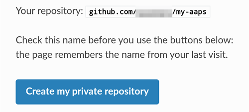
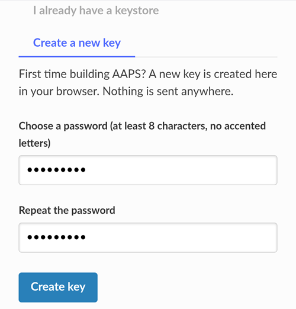
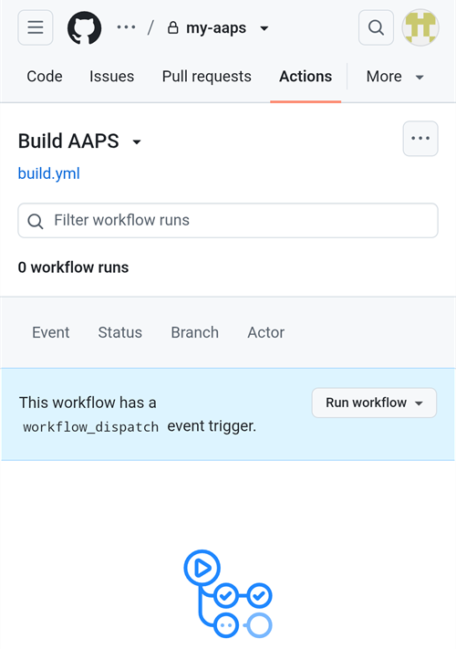
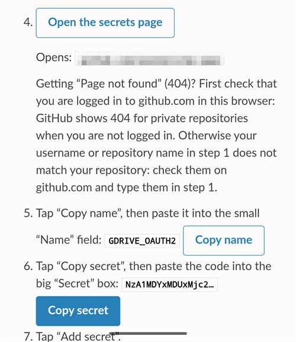

(aaps-builder)=

# Izrada u pregledniku s AAPS Builderom

```{note}
Ovo je preporučeni način izrade AAPS-a s **Android telefona**. Radi i iz bilo kojeg preglednika na računalu. Druge načine izrade s računala ili iPhonea pogledajte u pregledu [Izrada u pregledniku](BrowserBuild.md).
```

```{contents} In this page
:backlinks: entry
:depth: 2
```

**AAPS Builder** izrađuje aplikaciju AAPS umjesto vas na GitHubu, besplatnoj web stranici za smještaj koda. Na telefon ne trebate ništa instalirati niti otvarati pripremnu datoteku.

Kroz to vas vodi stranica postavki. Prvi put to traje oko 10 minuta:

1. Izradite vlastitu **privatnu kopiju** AAPS Buildera na svom GitHub računu: stranica postavki otvara GitHub sa svime već popunjenim, vi samo potvrđujete. Workflow za izradu, datoteka koja GitHubu govori kako izraditi AAPS, već je u njoj.
2. Izradite ili prenesite svoj **ključ za potpisivanje** (spremište ključeva).
3. Dajte ključ svom repozitoriju kao GitHub **tajnu**.
4. **Izradite** aplikaciju. Jedna izrada traje 15 do 30 minuta.
5. **Preuzmite i instalirajte** aplikaciju na telefon.

**Ne** trebate izraditi fork AndroidAPS-a: izvorni kod AAPS-a preuzima se iz službenog repozitorija AndroidAPS pri svakoj izradi. **Ne** trebate ni Google Drive: aplikaciju preuzimate izravno s GitHuba.

```{admonition} Where the code comes from
:class: note

Workflow za izradu održavaju razvojni programeri AAPS-a u repozitoriju [nightscout/aaps-builder](https://github.com/nightscout/aaps-builder), a vaš je repozitorij njegova kopija. [Workflow](https://github.com/nightscout/aaps-builder/blob/main/.github/workflows/build.yml) u vašoj kopiji je kratak: pokreće [korake izrade](https://github.com/nightscout/aaps-builder/blob/main/.github/workflows/aaps-builder.yml) koji se čuvaju u tom repozitoriju, pa poboljšanja stižu do vas bez ikakve promjene u vašem repozitoriju. Obje datoteke možete pročitati. Pri izradi workflow preuzima samo službeni izvorni kod AAPS-a i GitHubove vlastite alate za izradu. Vaše spremište ključeva nikada ne napušta vaš preglednik i vaš privatni repozitorij.
```

(aaps-builder-before-you-start)=

## Prije nego počnete

Trebat će vam:

- **GitHub račun** (besplatan). Ako ga nemate, najprije ga izradite na [github.com](https://github.com/signup).
- **Web preglednik**: Chrome na telefonu ili bilo koji preglednik na računalu. Prije početka se u tom pregledniku prijavite na github.com.
- **Imate aplikaciju GitHub na telefonu?** Možete je zadržati. Neki gumbi stranice postavki tada otvaraju aplikaciju umjesto Chromea. Izrada radi u aplikaciji, ali aplikacija **ne može preuzeti** gotov AAPS: [korak 5](#aaps-builder-step5) pokazuje kako za preuzimanje prijeći u Chrome.
- Vaše **postojeće spremište ključeva** (datoteka `.jks`), njegova lozinka i alias, ako ste AAPS već izradili i želite ga ažurirati bez ponovne instalacije.

```{warning}
**Vaš repozitorij za izradu mora ostati privatan.** Sve što izrada proizvede vidljivo je svakome tko može vidjeti repozitorij. Stranica postavki izradit će privatni repozitorij za vas. Nikada ga ne mijenjajte u javni i nemojte umjesto toga izraditi **fork** AAPS Buildera: fork je uvijek javan.

Privatni repozitorij dobiva 2000 besplatnih minuta GitHub Actions mjesečno, što je dovoljno za nekoliko izrada.
```

```{warning}
**Novi ključ ili postojeći ključ: o tome ovisi možete li ažurirati AAPS.**

- **Već imate AAPS na telefonu, izrađen sa spremištem ključeva koje još imate**: na stranici postavki odaberite **Već imam spremište ključeva** i prenesite ga. Vaša sljedeća izrada ažurirat će postojeći AAPS. Jeste li AAPS izradili prethodnom izradom u pregledniku (vlastiti fork)? Vaše spremište ključeva nalazi se u vašem forku: [najprije napravite njegovu kopiju](#aaps-builder-from-fork).
- **AAPS izrađujete prvi put ili ste izgubili spremište ključeva ili njegovu lozinku**: odaberite **Izradi novi ključ**. Aplikacija potpisana novim ključem **ne može ažurirati** AAPS potpisan drugim ključem. Morate izvesti postavke, kopirati datoteku izvan telefona, deinstalirati stari AAPS, instalirati novi i zatim uvesti postavke: pogledajte [Ponovna instalacija AAPS-a s novim spremištem ključeva](#reinstall-aaps).

Nakon toga uvijek koristite isti ključ. Kada izradite novi ključ, preuzmite sigurnosnu kopiju koju stranica nudi i spremite je s lozinkom i aliasom (`key0`) na sigurno mjesto izvan telefona.
```

(aaps-builder-from-fork)=

## Prelazak s prethodne izrade u pregledniku (fork)

Preskočite ovaj odjeljak ako AAPS nikada niste izradili prethodnom metodom izrade u pregledniku (vlastita kopija ili fork AndroidAPS-a na GitHubu, s pripremnom datotekom i Google Driveom).

Vaše spremište ključeva spremljeno je kao tajne u vašem forku. GitHub nikada više ne prikazuje tajnu pa je ne možete kopirati u novi repozitorij. Najprije napravite kopiju svog spremišta ključeva, a zatim je koristite u [koraku 2](#aaps-builder-step2) s opcijom **Već imam spremište ključeva**.

```{warning}
Ne odabirite **Izradi novi ključ**. AAPS izrađen novim ključem ne može ažurirati AAPS na vašem telefonu.
```

Koji je vaš slučaj?

- **Koristili ste Opciju 2** (prenijeli ste vlastito spremište ključeva iz Android Studija) i još imate datoteku `.jks`, njezine lozinke i alias: ovdje ne trebate ništa raditi. Tu datoteku koristite u koraku 2.
- **Koristili ste Opciju 1** (pripremna datoteka izradila je vaš ključ) ili više nemate datoteku spremišta ključeva: izvezite je iz svog forka kako je opisano u nastavku.

Izvoz spremišta ključeva iz vašeg forka:

1. U svom forku otvorite **Settings** → **Secrets and variables** → **Actions** i dodajte tajnu s nazivom `ZIP_PASSWORD`. Odaberite lozinku samo s engleskim slovima i brojkama. Ona štiti datoteku koju ćete izraditi.
2. Otvorite karticu **Actions** svog forka, dodirnite **CI Keystore Export**, a zatim **Run workflow**. Više detalja: [Izvoz spremišta ključeva](#ci-keystore-export).
3. Kada pokretanje ima zelenu kvačicu, otvorite svoj Google Drive: datoteka `keystore.zip` nalazi se u mapi **AAPS** → **KeyStore**. Ako pokretanje ne uspije u koraku Google Drive, pristup vašeg forka Google Driveu je istekao: pogledajte [Istekao je Google refresh token](#aaps-ci-google-token-expired).
4. Preuzmite `keystore.zip` i otvorite ga sa svojom lozinkom `ZIP_PASSWORD`: na računalu ili na telefonu s aplikacijom za upravljanje datotekama koja može otvoriti ZIP datoteke zaštićene lozinkom. Sadrži:
   - `keystore.jks`: vaše spremište ključeva,
   - `keyStoreInfo.txt`: vaše vrijednosti `KEYSTORE_PASSWORD`, `KEY_PASSWORD` i `ALIAS` (obično `key0`).
5. Kopirajte `keystore.jks` na telefon (ili na Google Drive da ga ondje možete odabrati).

U [koraku 2](#aaps-builder-step2) stranice postavki:

1. Dodirnite **Već imam spremište ključeva**.
2. U polju **Datoteka spremišta ključeva** odaberite `keystore.jks`.
3. U polje **Lozinka spremišta ključeva** upišite `KEYSTORE_PASSWORD` iz `keyStoreInfo.txt`.
4. U polju **Alias ključa** odaberite ili upišite `ALIAS` iz `keyStoreInfo.txt`.
5. Ako se `KEY_PASSWORD` razlikuje od `KEYSTORE_PASSWORD`, uklonite kvačicu s **Lozinka ključa ista je kao lozinka spremišta ključeva** i upišite `KEY_PASSWORD`.

Čuvajte `keystore.zip` i njegov `ZIP_PASSWORD` na sigurnom mjestu izvan telefona: to je sigurnosna kopija vašeg ključa.

Da se izrade AAPS Buildera spremaju i na Google Drive, napravite [korak 6](#aaps-builder-google-drive): stranica postavki dohvatit će novi `GDRIVE_OAUTH2` za vas. Svoj fork možete zadržati dok AAPS izrađen AAPS Builderom ne bude instaliran na vašem telefonu.

## Otvorite stranicu postavki

**→ [Otvorite stranicu postavki AAPS Buildera](#aaps-builder-setup)**

Stranica postavki dio je ove dokumentacije, na vašem jeziku. Ovu stranicu također držite otvorenom u drugoj kartici: odjeljci u nastavku detaljnije objašnjavaju svaki korak stranice postavki, sa snimkama zaslona.

Stranica postavki otvara svaku GitHub stranicu u novoj kartici Chromea. Da se vratite na stranicu postavki, dodirnite gumb kartica pokraj Chromeove adresne trake (kvadrat s brojem) i odaberite stranicu postavki AAPS Buildera.


Stranica postavki radi u potpunosti u vašem pregledniku: vaš ključ i lozinke nikamo se ne šalju, osim u GitHub tajnu u koju ih sami zalijepite. GitHubu se šalje samo vaše GitHub korisničko ime, kako bi se provjerilo postoji li. Pamti vaše GitHub korisničko ime i naziv repozitorija pa joj se možete vratiti u bilo kojem trenutku da ponovno otvorite stranicu s tajnama ili svoje izrade.


(aaps-builder-step1)=

## Korak 1 – Izradite svoj privatni repozitorij za izradu

Ovaj korak izrađuje vašu vlastitu privatnu kopiju AAPS Buildera na vašem GitHub računu, s workflowom za izradu koji je već u njoj. Samo ga vi možete vidjeti, kao i aplikacije koje izrađuje.

1. Provjerite jeste li u ovom pregledniku prijavljeni na github.com.

2. U polje **Vaše GitHub korisničko ime** upišite svoje GitHub korisničko ime, a ne e-mail adresu. Stranica ga provjerava na GitHubu: **✓ GitHub korisnik pronađen** znači da je ispravno.

3. U polju **Naziv vašeg repozitorija** ostavite predloženi naziv `my-aaps`. Ako ste repozitorij već izradili s drugim nazivom, upišite točno taj naziv.

   ```{note}
   **Već imate repozitorij AAPS Buildera** (izrađen ranijom verzijom stranice postavki)? Nemojte izrađivati novi: upišite točno njegov naziv, preskočite **Izradi moj privatni repozitorij** i jednom ažurirajte njegov workflow kako je objašnjeno u [Ažuriranje AAPS-a](#aaps-builder-updates). Vaše tajne ostaju kakve jesu. Ako ipak želite novi repozitorij, odaberite naziv koji još nemate, na primjer `my-aaps-2`, i u koraku 2 koristite isto spremište ključeva.

   Ne upisujte naziv svog forka AndroidAPS-a: fork je javan i već izrađuje sa svojim workflowom **AAPS CI**.
   ```

   

4. Provjerite redak **Vaš repozitorij:** prikazuje `github.com/<your username>/my-aaps`. Stranica postavki pamti naziv iz vašeg zadnjeg posjeta: provjerite ga svaki put prije nego upotrijebite njezine gumbe.

5. Dodirnite **Izradi moj privatni repozitorij**.

   

6. GitHub otvara **Create a new repository** u novoj kartici. Sve je već popunjeno: pod **Start with a template** predložak `nightscout/aaps-builder` s isključenim **Include all branches**, a pod **General** vaš račun kao **Owner** i naziv koji ste odabrali.

   

   Ništa ne mijenjajte.

7. Pomaknite se prema dolje: pod **Configuration** je **Choose visibility** već postavljeno na **Private**. Dodirnite zeleni gumb **Create repository**.

   

   GitHub prikazuje vaš novi repozitorij: sadrži mapu `.github` (s workflowom za izradu) i datoteku `README.md`. **Vratite se na karticu sa stranicom postavki** za korak 2: dodirnite gumb kartica pokraj Chromeove adresne trake i odaberite stranicu postavki.

   

```{warning}
**Vaš novi repozitorij je prazan**, bez datoteka? Nije izrađen iz predloška i ne može izrađivati. Izbrišite ga (**Settings** → dno stranice → **Delete this repository**), a zatim na stranici postavki ponovno dodirnite **Izradi moj privatni repozitorij**.
```

```{tip}
GitHub prikazuje **my-aaps already exists in this account**? Repozitorij već imate: zatvorite karticu GitHuba i nastavite na stranici postavki. Ako je vaš ključ već u njemu, nastavite s [korakom 4](#aaps-builder-step4). Pogledajte [rješavanje problema](#aaps-builder-ts-repo-exists).
```

(aaps-builder-step2)=

## Korak 2 – Vaš ključ za potpisivanje

Aplikacija mora biti potpisana vašim vlastitim ključem. Odaberite jednu od dvije kartice. Najprije pročitajte [upozorenje o novom ili postojećem ključu](#aaps-builder-before-you-start).


### Već imam spremište ključeva

1. Dodirnite **Već imam spremište ključeva**.
2. U polju **Datoteka spremišta ključeva** odaberite svoju datoteku `.jks` (ili `.keystore`, `.p12`, `.pfx`). Na telefonu najprije kopirajte datoteku na telefon ili na Google Drive.
3. U polje **Lozinka spremišta ključeva** upišite lozinku spremišta ključeva.
4. U polju **Alias ključa** odaberite svoj alias s popisa ili ga upišite ako popisa nema. Za spremišta ključeva izrađena u Android Studiju to je obično `key0`.
5. Ako se lozinka ključa razlikuje od lozinke spremišta ključeva, uklonite kvačicu s **Lozinka ključa ista je kao lozinka spremišta ključeva** i upišite lozinku ključa.
6. Dodirnite **Provjeri i nastavi**.

Stranica provjerava lozinku i alias na vašem uređaju. **Spremište ključeva je u redu! Nastavite s korakom 3.** znači da je sve u redu. Ako piše da će se lozinka provjeriti pri izradi, svejedno nastavite: izrada će vam reći ako nešto nije u redu.

### Izradi novi ključ

1. Dodirnite **Izradi novi ključ**.

2. Odaberite lozinku i upišite je dvaput. Pravila: najmanje 8 znakova, samo slova a–z i A–Z, znamenke 0–9 i simboli kao što su `! ? #`. Bez razmaka, bez slova s dijakritičkim znakovima (npr. č, ć, š, ž) i bez znaka `|`.

3. Dodirnite **Izradi ključ**. Potrebno je nekoliko sekundi dok se ne pojavi **Ključ je izrađen**.

   

4. Dodirnite **Preuzmi sigurnosnu kopiju (aaps-keystore.jks)**. Ako Chrome pita **Download file again?**, na telefonu je već starija sigurnosna kopija s istim nazivom: dodirnite **Download again**. Chrome tada sprema novi ključ kao `aaps-keystore (1).jks`: to je datoteka koja pripada ovom ključu. Čuvajte je i ne zamijenite je sa starijom.

   Čuvajte ovo troje zajedno, na sigurnom mjestu izvan telefona (na primjer u vlastitoj pohrani u oblaku):

   - datoteku `aaps-keystore.jks`,
   - svoju lozinku,
   - alias ključa: **`key0`**.

   Sve troje trebat će vam ako AAPS ikada budete izrađivali na drugi način, na primjer s Android Studiom. Ključevi izrađeni ranijom verzijom stranice postavki imaju alias `aaps`.

   

(aaps-builder-step3)=

## Korak 3 – Dajte ključ svom repozitoriju

Korak 3 se otključava kada je korak 2 gotov. Vaš ključ, njegove lozinke i alias spakirani su u jednu vrijednost, tajnu `KEYSTORE_SET`.

1. Dodirnite **Otvori stranicu s tajnama**.


2. GitHub otvara stranicu **New secret** (nova tajna) vašeg repozitorija. Na telefonu se nalazi ispod izbornika postavki: pomaknite se prema dolje.


3. Prijeđite na karticu sa stranicom postavki i dodirnite **Kopiraj naziv**. Vratite se na karticu GitHuba i zalijepite ga u malo polje **Name**. Naziv je `KEYSTORE_SET`.

4. Prijeđite na karticu sa stranicom postavki i dodirnite **Kopiraj tajnu**. Vratite se na karticu GitHuba i zalijepite je u veliki okvir **Secret** (na telefonu dugim pritiskom). Tajna je vrlo dug kod, s tisućama znakova: stranica postavki prikazuje njezine prve znakove pokraj gumba. Ondje ne lijepite riječ `KEYSTORE_SET`.

5. Dodirnite **Add secret**. `KEYSTORE_SET` sada se prikazuje pod **Repository secrets**.


To trebate učiniti samo jednom.

```{tip}
GitHub prikazuje **Page not found** (404)? Najprije provjerite jeste li u ovom pregledniku prijavljeni na github.com: GitHub prikazuje 404 za privatne repozitorije kada niste prijavljeni. Inače se korisničko ime ili naziv repozitorija u koraku 1 ne podudara s vašim repozitorijem. Provjerite naziv na github.com, ispravite ga u koraku 1 i ponovno dodirnite gumb.
```

(aaps-builder-step4)=

## Korak 4 – Izradite aplikaciju

1. Na stranici postavki dodirnite **Otvori stranicu za izradu**. GitHub otvara stranicu **Build AAPS** vašeg repozitorija.

   

   Ako se umjesto toga otvori **aplikacija GitHub**: dodirnite **RUN WORKFLOW**, provjerite verziju i varijantu i ponovno dodirnite **RUN WORKFLOW**. Aplikacija možda i dalje prikazuje **Nothing to see here**: povucite popis prema dolje da ga osvježite i vidite svoju izradu. Zatim nastavite s korakom 4 u nastavku.

2. Ako GitHub pita, dodirnite zeleni gumb da omogućite workflowe.

   Popis workflowa prikazuje dva unosa: koristite **Build AAPS**. Zanemarite **AAPS Builder**: on sadrži korake izrade i nema gumb **Run workflow**.

3. Dodirnite **Run workflow**. Otvara se mali obrazac:
   - **Version**: ostavite `latest` da izradite najnovije izdanje AAPS-a ili upišite broj izdanja, npr. `4.0.0`.
   - **Variant**: za normalnu upotrebu s pumpom ostavite `fullRelease`. Ostale varijante objašnjene su u odjeljku [varijante izrade](#browserbuild-variant). `aapsclient3Release` izrađuje **AAPSClient3**, dostupan od verzije 4.0 **AAPS-a** (pogledajte [O AAPSClientu, AAPSClientu2 i AAPSClientu3](#remotecontrol-aapsclient-versions)).
   - Dodirnite zeleni gumb **Run workflow**.

   

4. Izrada počinje i prikazuje **In progress**, s dva dijela: **AAPS / Check**, a zatim **AAPS / Build AAPS**.

   

5. Pričekajte 15 do 30 minuta. Zelena kvačica znači da je izrada gotova. Crveni križić znači da izrada nije uspjela: otvorite izradu da pročitate poruku, a zatim pogledajte [rješavanje problema](#aaps-builder-troubleshooting).

   

   ```{tip}
   **E-mail kada je izrada gotova:** GitHub vam šalje e-mail samo kada izrada ne uspije. Da dobijete e-mail i kada uspije: na github.com otvorite svoju profilnu sliku → **Settings** → **Notifications** → **System** → **Actions** i uklonite kvačicu s **Only notify for failed workflows**.
   ```

Ako nema gumba **Build AAPS** ili **Run workflow**:

- Otvorite svoj repozitorij i provjerite ima li mapu `.github` s datotekom `workflows/build.yml`. Ako je repozitorij prazan, nije izrađen iz predloška: izbrišite ga (**Settings** → dno stranice → **Delete this repository**) i ponovite [korak 1](#aaps-builder-step1) pomoću gumba.
- Datoteka postoji, ali GitHub prikazuje **This workflow does not exist**: pogledajte [rješavanje problema](#aaps-builder-ts-workflow-not-found).
- Otvorite karticu **Actions**. Ako piše da su workflowi onemogućeni, dodirnite zeleni gumb da ih omogućite, a zatim na popisu dodirnite **Build AAPS**.

(aaps-builder-step5)=

## Korak 5 – Instalirajte aplikaciju na telefon

```{warning}
**Prije svakog ažuriranja** [izvezite svoje postavke](#ExportImportSettings-Automating-Settings-Export) u AAPS-u i kopirajte datoteku **izvan telefona** (Google Drive, Dropbox…). Ondje čuvajte i nekoliko starijih izvoza i APK datoteka, da se uvijek možete vratiti.
```

1. Na telefonu otvorite stranicu postavki u **Chromeu**. Ako se to zatraži, prijavite se na github.com.
2. Dodirnite **Otvori moje izrade**, a zatim najnoviju izradu sa zelenom kvačicom.

   ```{admonition} The GitHub app opened instead of Chrome?
   :class: note

   Aplikacija GitHub ne može preuzimati izrade. U aplikaciji otvorite najnoviju izradu, a zatim dodirnite **Artifacts ↗** ili dodirnite ikonu za dijeljenje na vrhu i odaberite **Chrome** (ili **Copy link**, a zatim zalijepite poveznicu u Chromeovu adresnu traku). Izrada se otvara u Chromeu: ondje nastavite sa sljedećim korakom.

   Da GitHub poveznice prestanu otvarati aplikaciju: Android **Postavke** → **Aplikacije** → **GitHub** → **Zadano otvaranje** (Open by default) → isključite **Otvaranje podržanih veza** (Open supported links).
   ```

   

3. Pomaknite se prema dolje do sažetka izrade i dodirnite poveznicu **Download AAPS**.

   

   ```{tip}
   Pomičite prstom po tekstu, a ne po dijagramu koraka izrade: inače se pomiče dijagram umjesto stranice.
   ```

   Možete se pomaknuti i dalje prema dolje do **Artifacts** i dodirnuti ikonu za preuzimanje pokraj `aaps-….apk`.

   

4. Kada je preuzimanje gotovo, otvorite Chromeov izbornik **⋮** → **Downloads**, dodirnite `aaps-….apk` i odaberite **Instaliraj**. Ako se to zatraži, dopustite instaliranje aplikacija iz ovog izvora.

   

`aaps-wear-….apk` je aplikacija za pametni sat. Preskočite je ako ne koristite sat.

Aplikacija se čuva na stranici izrade **14 dana**. Ne prikazuje se pod **Code** u vašem repozitoriju. Kopirajte je na sigurno mjesto izvan telefona, zajedno s izvozima postavki.

Druge načine instalacije aplikacije pogledajte u [Prijenos i instalacija AAPS-a na vaš pametni telefon](TransferringAndInstallingAaps.md).

```{note}
Od rujna 2026. Googleova [provjera Android razvojnih programera](#android-developer-verification) može, ovisno o vašoj zemlji, blokirati instalaciju APK datoteke dodirom na datoteku. Besplatna zaobilazna rješenja objašnjena su na toj stranici.
```

(aaps-builder-google-drive)=

## Korak 6 (neobavezno) – Spremajte aplikaciju i na Google Drive

Svaku izradu možete spremati i na svoj Google Drive, u mapu `AAPS/<version>`. Ovo nije obavezno: aplikacija je uvijek dostupna na stranici izrade.

Za to treba još jedna tajna, `GDRIVE_OAUTH2`. Korak 6 stranice postavki dohvaća je od Googlea za vas, na telefonu ili računalu. **AAPS** tada može vidjeti i mijenjati samo datoteke koje sam izradi na vašem Google Driveu, ništa drugo.

1. Na stranici postavki dodirnite **Poveži Google Drive**. Google se otvara u novoj kartici.

2. Odaberite svoj Google račun i dopustite pristup. Ako Google kaže da aplikacija nije provjerena, dodirnite **Advanced**, a zatim **Go to …**.

   

   

3. Nova kartica tada prikazuje grešku kao što je **This site can't be reached** ili **127.0.0.1 refused to connect**. **To je očekivano:** Googleov odgovor nalazi se u adresi te kartice. Dodirnite adresnu traku, a zatim ikonu za kopiranje pokraj adrese (na računalu: označite cijelu adresu i kopirajte je). Adresa počinje s `http://127.0.0.1:47913/`.

   

   

4. Vratite se na karticu sa stranicom postavki u roku od nekoliko minuta: Googleov odgovor vrijedi samo kratko i samo jednom. Zalijepite adresu u **Ovdje zalijepite kopiranu adresu** i dodirnite **Dohvati GDRIVE_OAUTH2**. Stranica prikazuje **GDRIVE_OAUTH2 je spreman**.

   

   

5. Dodirnite **Otvori stranicu s tajnama**. Dodirnite **Kopiraj naziv**, a zatim ga zalijepite u malo polje **Name** (naziv je `GDRIVE_OAUTH2`). Dodirnite **Kopiraj tajnu**, zalijepite je u veliki okvir **Secret** i dodirnite **Add secret**.

   

Od sljedeće izrade APK datoteke spremaju se i na Google Drive.

Već imate vrijednost `GDRIVE_OAUTH2` iz pripremne datoteke drugih metoda izrade u pregledniku? I ona radi: dodajte je kao tajnu `GDRIVE_OAUTH2`.

Google prekida pristup ako ne izrađujete 6 mjeseci ili ako promijenite lozinku za Google. Izrada će vam to tada javiti: ponovite ove korake. Pogledajte [Istekao je Google refresh token](#aaps-ci-google-token-expired).

(aaps-builder-updates)=

## Ažuriranje AAPS-a

Vaš repozitorij nikada ništa ne izrađuje sam: vi odlučujete kada izraditi, koju verziju i koju varijantu. Kada izađe nova verzija AAPS-a:

1. [Napravite sigurnosnu kopiju postavki](#aaps-builder-step5) kako je objašnjeno u koraku 5.
2. Izradite novu verziju kao u [koraku 4](#aaps-builder-step4). Ostavite `latest` ili upišite broj izdanja.
3. Preuzmite je i instalirajte kao u [koraku 5](#aaps-builder-step5).

**Ažuriranja koraka izrade** stižu do vas sama: pri svakoj izradi vaš repozitorij pokreće korake izrade koje su razvojni programeri AAPS-a objavili u nightscout/aaps-builder. U vašem repozitoriju se ništa ne mijenja i nema automatske izrade.

**Ažuriranja vaše datoteke workflowa** su rijetka: samo kada se promijeni obrazac **Run workflow**, na primjer zbog nove varijante izrade, ili jednom ako je vaš repozitorij izrađen ranijom verzijom stranice postavki (prazan repozitorij s kratkom datotekom workflowa) ili iz starog predloška. To piše na stranici [Ažuriranja i promjene dokumentacije](../Maintenance/DocumentationUpdate.md). Vaša tajna `KEYSTORE_SET` ostaje kakva jest. Na stranici postavki otvorite **Ažuriranje vaše kopije** na kraju koraka 1:

1. Dodirnite **Otvori najnoviji workflow**. Na računalu kliknite **ikonu za kopiranje** („Copy raw file“) u gornjem desnom kutu datoteke. Na telefonu umjesto toga otvorite **verziju s običnim tekstom**, pritisnite i držite tekst, a zatim **Odaberi sve** i **Kopiraj**.
2. Dodirnite **Otvori moju datoteku workflowa**, zatim izbornik **⋯** u gornjem desnom kutu datoteke i **Edit file… In place** (na računalu kliknite olovku).
3. Zamijenite cijeli tekst kopiranim workflowom (na telefonu dugim pritiskom: **Odaberi sve**, a zatim **Zalijepi**).
4. Dodirnite **Commit changes…**, a zatim **Commit changes**.

Prvi redak datoteke prikazuje njezinu verziju.

## Rješavanje problema

Nešto nije uspjelo? Pogledajte [Rješavanje problema s AAPS Builderom](#aaps-builder-troubleshooting).

```{toctree}
:hidden:

Stranica postavki AAPS Buildera <BrowserBuildAapsBuilderSetup.md>
```
