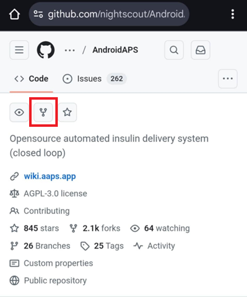
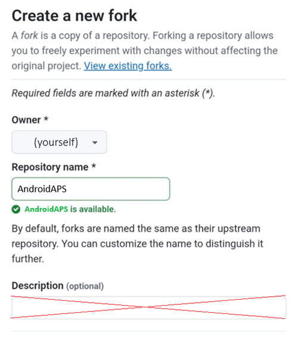
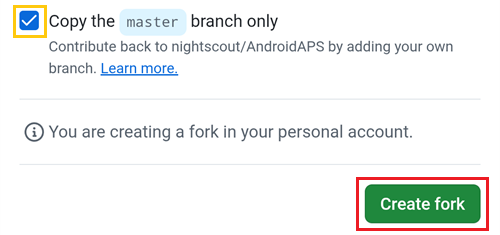
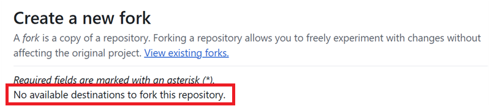
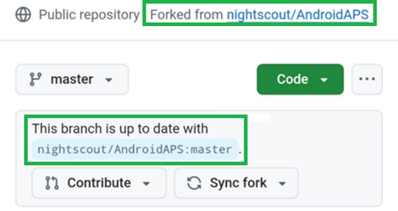

(github-fork)=

# Izrada u pregledniku – Korak 1: Izradite svoj GitHub fork

```{note}
Ovo je **Korak 1** postupka [Izrada u pregledniku](BrowserBuild.md).
```

Svoj osobni Android Java ključ i podatke za Google Drive morat ćete spremiti kao tajne (secrets) na GitHubu (kasnije u postupku objasnit ćemo kako).

Budući da se to ne može napraviti unutar javnog repozitorija AndroidAPS-a, morate izraditi svoju osobnu kopiju izvornog koda (koja se zove fork).

## GitHub račun

Ako ga još nemate, morate [izraditi GitHub račun](https://github.com/signup).  
Možete se registrirati svojom adresom e-pošte ili putem Googlea. Slijedite postupak registracije i potvrde.

Kada imate račun, [prijavite se na GitHub](https://github.com/login).

## Fork AndroidAPS-a

Otvorite službeni repozitorij AndroidAPS-a putem [ove poveznice](https://github.com/nightscout/AndroidAPS).

Dodirnite ikonu fork. Time će se izraditi kopija unutar vašeg vlastitog računa.



Pomaknite se prema dolje na sljedećem zaslonu i dodirnite **Create Fork**.



*Napomena: možete **isključiti** „Copy the master branch only“ ako želite izrađivati razvojne verzije ili prilagodbe.*



```{note}
Ne možete napraviti fork i vidite ovo?<br/><br/>
**`No available destinations to fork this repository.`**<br/><br/>
<br/><br/>
To znači da već imate postojeći fork AndroidAPS-a.<br/>
Provjerite je li ažuran i nastavite s pripremnim koracima.
```

```{warning}
**Nikada ne brišite svoj fork ako prije toga niste napravili sigurnosnu kopiju svojih tajni!**
```

GitHub sada prikazuje vašu osobnu kopiju AndroidAPS-a. Ostavite ovu karticu web preglednika otvorenom.



----

**Sljedeće: [Korak 2 – Izradite spremište ključeva za potpisivanje](BrowserBuildKeystore.md) →**
